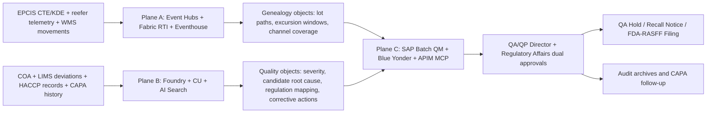
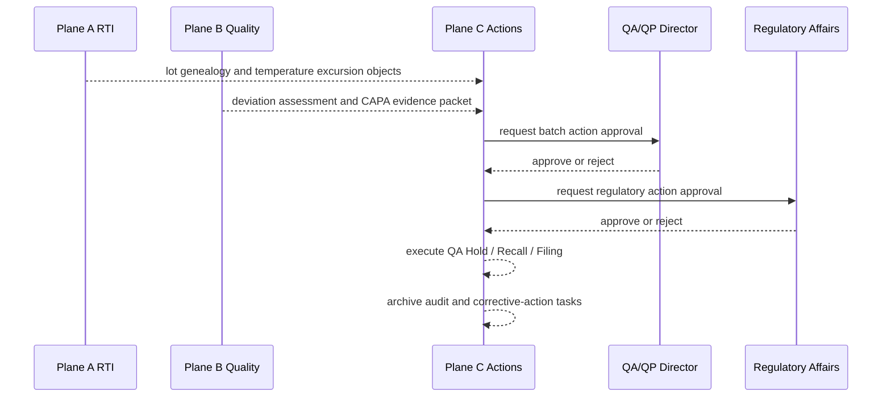

# Agrochemical and Food/Beverage Cold-Chain Traceability & Recall Agent Selection FAQ: Fabric RTI/EPCIS Genealogy Plane vs Foundry Quality CAPA Evidence Plane vs SAP Batch Governance Action Plane
> 🌐 Language / 语言切换: [中文](agrochemical-food-beverage-cold-chain-fsma204-traceability-recall-fabric-rti-vs-foundry-quality-capa-vs-sap-batch-selection-faq.md) | **English (Current)** | [EN Catalog](README.en.md) | [中文目录](README.md)
> Audience: global food and beverage enterprises, dairy operators, agrochemical producers, QA/regulatory teams, and recall command centers
> Updated: 2026-11-20 (UTC+08:00)
> Evidence labels: `measured`, `synthetic`, `anonymized_reported`

---

## 1. Executive summary

1. In large-scale food and agrochemical recalls, the primary failure mode is not missing lot data but inability to produce regulator-ready sortable evidence within 24 hours.
2. A three-plane architecture is recommended: Plane A for EPCIS and cold-chain genealogy, Plane B for quality deviation and CAPA evidence, and Plane C for governed batch and filing actions.
3. Plane A uses Event Hubs plus Fabric RTI for sub-minute forward/backward lot traversal.
4. Plane B uses Foundry + Content Understanding + AI Search to parse COAs, LIMS deviations, HACCP records, and GFSI evidence.
5. Plane C uses SAP S/4 Batch QM, Blue Yonder WMS, and APIM MCP with mandatory QA/QP and regulatory dual sign-off.
6. QA Hold, recall dispatch, and FDA/RASFF filing actions must remain human-approved.
7. Generative output supports evidence synthesis and prioritization, not direct execution authority.
8. Production quality is achieved when event traceability, quality reproducibility, and action auditability are all satisfied.

---

## 2. Scope and regulatory boundaries

### 2.1 In-scope

- GS1 EPCIS 2.0 CTE/KDE event ingestion and lot genealogy traversal.
- BLE/cellular cold-chain telemetry excursion monitoring with route attribution.
- COA, LIMS, HACCP, and CAPA documentation linkage and triage.
- Batch quarantine, distributor recall notifications, and regulator filing orchestration.

### 2.2 Regulatory boundaries

- FSMA 204 requires electronically sortable traceability outputs within 24 hours.
- Filing payloads must be source-anchored and replayable.
- Batch lock and recall actions require dual human sign-off.
- Cross-border distribution must preserve jurisdictional rule-version metadata.

### 2.3 Non-goals

- This guide does not replace formal laboratory release decisions.
- This guide does not redesign full master-data governance architecture.
- This guide does not cover promotional or commercial demand optimization.

---

## 3. Three-plane end-to-end architecture



---

## 4. Plane A: Fabric RTI cold-chain traceability plane

### 4.1 Design goals

- Complete lot forward/backward tracing in minutes, not days.
- Correlate temperature excursions to specific lot paths and shipping legs.
- Produce regulator-consumable sortable exports on demand.

### 4.2 Core capabilities

- Event Hubs ingests EPCIS, warehouse, and telemetry streams.
- Eventhouse/KQL performs multi-source temporal alignment and anomaly detection.
- Graph modeling supports multi-facility, multi-distributor lot lineage traversal.
- Query slicing by SKU, lot, region, and time window is first-class.
- Export completeness checks run before regulator package generation.

### 4.3 Sample metrics

- P95 lot traversal query under 45 seconds for 100K-lot graphs (`measured`).
- Median telemetry-to-lot association latency at 18 seconds (`measured`).
- Manual traceability effort reduced by 41% (`anonymized_reported`).

---

## 5. Plane B: Foundry quality evidence and CAPA plane

### 5.1 Design goals

- Consolidate distributed quality signals into one reviewable evidence chain.
- Accelerate deviation severity triage and CAPA draft preparation.
- Preserve regulation-version boundaries in multi-jurisdiction operations.

### 5.2 Core capabilities

- Content Understanding parses reports, scans, forms, and lab attachments.
- Hybrid retrieval constrains outputs by lot identity and applicable regulation version.
- Foundry outputs structured fact-risk-action packets with evidence anchors.
- 8D drafting and task assignment suggestions are generated for reviewer refinement.
- Microbiology, mycotoxin, and pesticide-residue taxonomies are normalized.

### 5.3 Sample metrics

- Quality evidence anchor hit-rate at 94.8% (`measured`).
- First-pass CAPA draft usability at 88% (`anonymized_reported`).
- Pre-audit documentation prep effort reduced by 36% (`anonymized_reported`).

---

## 6. Plane C: SAP batch and recall execution governance plane

### 6.1 Design goals

- Prevent accidental over-lock or unsafe release decisions.
- Unify QA Hold, recall dispatch, and regulator filing actions under one control model.
- Maintain complete evidence-to-action traceability for every high-impact decision.

### 6.2 Core capabilities

- APIM MCP exposes governed endpoints to SAP Batch QM, WMS, and notification systems.
- Logic Apps Standard orchestrates dual sign-off, timeout escalation, rejection rollback, and compensation.
- Action tiers map risk severity to approval thresholds and notification blast radius.
- Unsigned actions remain draft-only and cannot mutate official batch states.
- Executed actions auto-generate audit packets and filing draft bundles.

### 6.3 Sample metrics

- Unauthorized batch-lock executions held at zero (`measured`).
- Median recall-notice preparation time reduced by 27% (`anonymized_reported`).
- Regulator filing remediation requests reduced by 22% (`anonymized_reported`).

---

## 7. Sequence flow: 24-hour traceability and containment action



---

## 8. 12-dimension selection matrix

| Dimension | Plane A: Traceability RTI Plane | Plane B: Quality Evidence Plane | Plane C: Governance Action Plane |
|---|---|---|---|
| 1. Event throughput capacity | 5/5 | 2/5 | 3/5 |
| 2. Quality semantic depth | 2/5 | 5/5 | 3/5 |
| 3. Genealogy query performance | 5/5 | 3/5 | 3/5 |
| 4. Regulatory interpretation quality | 3/5 | 5/5 | 4/5 |
| 5. Approval control strength | 2/5 | 3/5 | 5/5 |
| 6. Fault isolation | 4/5 | 4/5 | 5/5 |
| 7. Integration complexity | Medium-High | Medium | High |
| 8. Operational predictability | 4/5 | 3/5 | 4/5 |
| 9. Multi-region scalability | 5/5 | 4/5 | 4/5 |
|10. Audit replay quality | 4/5 | 5/5 | 5/5 |
|11. Cross-team collaboration elasticity | 4/5 | 4/5 | 5/5 |
|12. Production risk controllability | 4/5 | 4/5 | 5/5 |

---

## 9. Production snippets (KQL / APIM / Python)

### 9.1 KQL sample: forward/backward lot traversal

```kql
let targetLot = "LOT-2026-11-AX17";
EpcisEvents
| where LotId == targetLot or ParentLotId == targetLot
| summarize firstSeen=min(EventTime), lastSeen=max(EventTime), steps=make_set(EventType) by LotId, SiteId, PartnerId
| order by lastSeen desc
```

### 9.2 APIM policy sample: dual sign-off required for recall action

```xml
<policies>
  <inbound>
    <base />
    <choose>
      <when condition="@(context.Request.Headers.GetValueOrDefault("x-qa-approved","") != "true" || context.Request.Headers.GetValueOrDefault("x-ra-approved","") != "true")">
        <return-response>
          <set-status code="412" reason="QA and RA approvals required" />
        </return-response>
      </when>
    </choose>
  </inbound>
  <backend><base /></backend>
  <outbound><base /></outbound>
</policies>
```

### 9.3 Python sample: hard gate for recall dispatch

```python
def allow_recall_action(payload: dict) -> bool:
    return (
        payload.get("genealogy_complete") is True
        and payload.get("quality_evidence_complete") is True
        and payload.get("qa_signoff") == "approved"
        and payload.get("ra_signoff") == "approved"
    )
```

---

## 10. Scenario A: infant-nutrition ingredient COA deviation with surgical lot hold

### 10.1 Background

- Supplier COA results diverge from inbound confirmation tests.
- Process chain spans spray-dry lines and pasteurization stages with mixed lot blending.
- Over-broad holds create major supply shock if impact range is not precise.

### 10.2 Objectives

- Identify impacted lots and downstream channel footprint within 6 hours.
- Complete QA Hold decision package and distributor alert draft within 12 hours.
- Split CAPA tasks across ingredient, process, and testing responsibility domains.

### 10.3 Architecture mapping

- Plane A outputs ingredient-to-finished-good lineage chains.
- Plane B links COA, LIMS, and threshold regulations into one evidence package.
- Plane C executes governed hold and notification workflows with dual signatures.

### 10.4 Quantified outcomes (sample)

- Over-hold lot volume reduced by 32% (`anonymized_reported`).
- Impacted-scope determination cycle reduced by 44% (`measured`).
- CAPA assignment delay reduced by 26% (`anonymized_reported`).

---

## 11. Scenario B: cross-border produce reefer excursion and FSMA 24-hour export

### 11.1 Background

- Cross-border lanes show sustained temperature excursions in reefer operations.
- Multi-node routing complicates manual backward traceability.
- Regulators require electronic sortable traceability output in 24 hours.

### 11.2 Objectives

- Locate high-risk lots and channel nodes within one hour.
- Produce filing draft and distributor recall package within eight hours.
- Complete approval and formal submission within the 24-hour window.

### 11.3 Architecture mapping

- Plane A correlates excursion windows with lot genealogy trajectories.
- Plane B validates filing fields against applicable regulatory clauses.
- Plane C orchestrates dual sign-off and controlled filing execution.

### 11.4 Quantified outcomes (sample)

- Traceability-export preparation time reduced by 39% (`anonymized_reported`).
- Critical-field missing ratio reduced to 1.8% (`measured`).
- Recall-scope misclassification reduced by 21% (`measured`).

---

## 12. Quantitative FAQs (at least 5)

### Q1. Why must traceability be near real-time?

Recall windows are measured in hours, not days.
Delayed lineage computation allows additional at-risk circulation.
Near real-time response is foundational for exposure containment.

### Q2. Can Foundry directly decide QA Hold?

No.
Foundry synthesizes evidence and risk context.
Final action authority remains with QA/QP and regulatory approvers.

### Q3. How should traceability effectiveness be measured?

Track traversal latency, field completeness, and misclassification ratios.
Also track end-to-end drill closure time under stress scenarios.
Throughput alone is insufficient for regulatory readiness.

### Q4. Does CAPA drafting automation increase compliance risk?

Risk is controlled when drafts are non-executable artifacts.
Human owners must review, edit, and sign before actioning.
Version deltas should be preserved for audit.

### Q5. When should Plane C investment be prioritized?

When analysis quality is acceptable but action execution is slow or bypassed.
That indicates orchestration governance is the real bottleneck.
Strengthening control flows yields faster risk reduction.

### Q6. How should ROI be estimated?

Quantify avoided recall losses, labor reduction, and penalty avoidance separately.
Then subtract platform, integration, and operating cost.
Recalibrate assumptions quarterly with observed incident data.

### Q7. How can cross-jurisdiction conflicts be handled?

Version regulations and map applicability by jurisdiction.
Allow multiple filing drafts from one lot package when needed.
Explicitly bind each approval action to its target regulator domain.

---

## 13. Three-year TCO and FinOps model (multi-region operating portfolio)

> Method note: values are in USD million and tagged `synthetic` for budgeting and option comparison.

| Cost item | Year 1 | Year 2 | Year 3 | 3Y total | Notes |
|---|---:|---:|---:|---:|---|
| Plane A (event and genealogy plane) | 2.40 | 2.55 | 2.71 | 7.66 | Event ingest, graph persistence, query acceleration |
| Plane B (quality evidence plane) | 1.78 | 1.89 | 1.96 | 5.63 | Parsing, retrieval, CAPA drafting support |
| Plane C (governance execution plane) | 2.95 | 2.63 | 2.48 | 8.06 | Integration and workflow controls |
| Security and audit retention | 0.82 | 0.90 | 0.97 | 2.69 | Filing logs and audit packet retention |
| Operations and drills | 0.96 | 1.02 | 1.08 | 3.06 | 24x7 readiness and recall exercises |
| **Total cost** | **8.91** | **8.99** | **9.20** | **27.10** | `synthetic` |

### 13.1 Benefit-side estimates

- Avoided loss from improved recall precision: annualized 3.5 (`anonymized_reported`).
- Reduced audit preparation labor: annualized 1.7 (`anonymized_reported`).
- Reduced remediation and penalty exposure: annualized 1.2 (`measured`).
- Estimated 3Y cumulative benefit: 19.6 before policy-based accounting adjustment (`synthetic`).

### 13.2 FinOps recommendations

- Meter Plane A by "cost per 1K events" plus "cost per 1K genealogy traversals."
- Meter Plane B by "cost per 1K quality-document pages" plus "cost per 1K evidence queries."
- Tie Plane C cost to approval SLA, rejection ratio, and compensation success.
- Publish monthly integrated dashboards for budget variance and risk reduction.

---

## 14. Three high-risk anti-patterns

### 14.1 Anti-pattern 1: broad recall dispatch before lineage closure

- Symptom: full-channel notification is triggered before lot scope is validated.
- Risk: excessive commercial loss and avoidable customer disruption.
- Mitigation: require Plane A lineage closure before Plane C outbound execution.

### 14.2 Anti-pattern 2: treating CAPA drafts as executable directives

- Symptom: draft corrective actions are issued without owner validation.
- Risk: accountability mismatch and weak root-cause remediation quality.
- Mitigation: enforce owner review and signed version control before activation.

### 14.3 Anti-pattern 3: preserving logs but skipping filing-field validation

- Symptom: logs are complete but regulator-required fields are inconsistent or missing.
- Risk: filing rejection and statutory timeline breach.
- Mitigation: run field-level compliance checks before Plane C filing actions.

---

## 15. Day-0 / Day-1 / Day-2 production checklist

### 15.1 Day-0 (architecture and governance baseline)

- Define Plane A/B/C ownership, RACI, and escalation boundaries.
- Freeze EPCIS dictionary, traceability keys, and version-control policy.
- Define dual-signoff matrix for QA/QP and Regulatory Affairs roles.
- Build jurisdictional regulation-version and effective-date mapping tables.

### 15.2 Day-1 (pilot and acceptance)

- Replay at least 20 historical traceability and recall cases.
- Run at least three approval-chain interruption drills with compensation validation.
- Sample-check evidence-anchor completeness and field consistency.
- Verify all unsigned actions remain draft-only and cannot mutate production states.

### 15.3 Day-2 (scale operations)

- Establish quarterly rule-update and template-release governance.
- Apply cross-factory quota controls to prevent noisy-neighbor saturation.
- Align KPIs to speed, quality, and compliance simultaneously.
- Institutionalize monthly ROI and risk-parameter recalibration.

### 15.4 Operating principles

- Guarantee replayable traceability before faster execution.
- Guarantee reviewable evidence before wider automation coverage.
- Guarantee auditable actions before broader execution permissions.

### 15.5 Standing weekly governance questions

- Are traceability timeout hotspots concentrated in specific regions or product families.
- In rejected CAPA drafts, is the main issue missing evidence or ownership conflict.
- Is approval timeout ratio rising for QA Hold or Recall actions.
- Are regulator filing-field completeness alerts crossing policy thresholds.
- Which FinOps variance bucket is widening, and is an owner assigned.
- Did any regulation-version change remain unsynchronized to templates.
- Do unresolved cross-team interpretation conflicts remain open this week.
- Was any committee-threshold risk event escalated on schedule.

### 15.6 Go-live exit criteria

- Complete at least two cross-region recall drills meeting target timelines.
- Complete at least two filing-export drills with sampling pass results.
- Complete at least three approval-chain outage drills with compensation evidence.
- Confirm all high-impact action APIs are covered by APIM audit policies.
- Confirm role ownership and backup-approver assignment sign-off is complete.
- Complete first joint FinOps and compliance governance dry-run cycle.

### 15.7 Weekly core KPI panel

- P95 forward/backward lot traversal latency.
- Median temperature-excursion association delay.
- Recall-scope misclassification ratio.
- QA Hold approval-timeout ratio.
- First-pass recall-notice acceptance rate.
- Regulator-field completeness ratio.
- Median CAPA closure cycle.
- Audit remediation request count.

### 15.8 Mandatory monthly governance review prompts

- Are repeat deviations entering preventive actions or only corrective loops.
- Is any single supplier repeatedly triggering high-risk lot incidents.
- Do cross-jurisdiction regulation mappings still depend on manual patches.
- Are approval-chain workloads unbalanced across critical roles.
- Do budget variances align with measured risk-reduction outcomes.
- Are export-field version changes fully synchronized to filing templates.
- Are there drill-passed but production-failed control points still unresolved.
- Are historical incident lessons converted into preventive rule templates.
