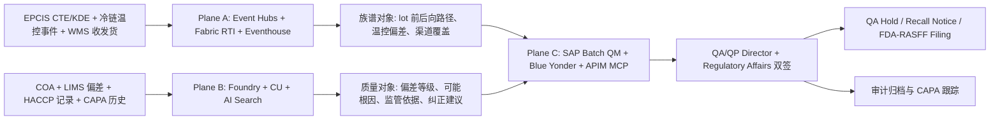
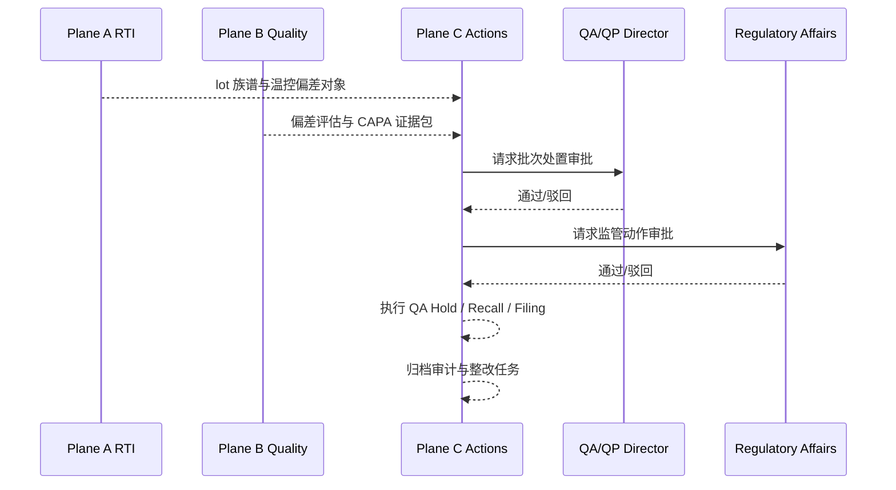

# 食品饮料与农化冷链追溯召回智能体选型 FAQ：Fabric RTI/EPCIS 族谱平面 vs Foundry 质量 CAPA 证据平面 vs SAP 批次管控执行平面
> 🌐 Language / 语言切换：**中文（当前）** | [English](agrochemical-food-beverage-cold-chain-fsma204-traceability-recall-fabric-rti-vs-foundry-quality-capa-vs-sap-batch-selection-faq.en.md) | [中文目录](README.md) | [EN Catalog](README.en.md)
> 适用对象：全球食品饮料集团、乳品企业、农化企业、质量法规团队、供应链与召回应急指挥团队
> 更新时间：2026-11-20（UTC+08:00）
> 证据标签：`measured`、`synthetic`、`anonymized_reported`

---

## 1. 执行摘要

1. 大规模食品与农化召回的核心风险不是“查不到批次”，而是“24 小时内无法形成可监管提交的电子证据包”。
2. 推荐三平面：Plane A 管 EPCIS 事件与冷链温控族谱，Plane B 管质量偏差与 CAPA 证据，Plane C 管批次锁定与监管报送动作。
3. Plane A 通过 Event Hubs + Fabric RTI 支撑亚分钟级正向/反向 lot genealogy 遍历。
4. Plane B 通过 Foundry + Content Understanding + AI Search 解析 COA、LIMS 偏差、HACCP 与 GFSI 稽核记录。
5. Plane C 通过 SAP S/4 Batch QM、Blue Yonder WMS 与 APIM MCP 编排 QA/QP 与法规双签动作。
6. 所有 QA Hold、召回通知和 FDA/RASFF 提交动作都必须经过人审，不允许模型直接执行。
7. 生成式模型负责证据汇总与风险解释，不负责最终批次放行或冻结判定。
8. 生产基线是“事件可追溯、质量可复核、动作可审计”三位一体。

---

## 2. 范围与法规边界

### 2.1 业务范围

- GS1 EPCIS 2.0 CTE/KDE 事件流接入与批次族谱追溯。
- 冷链温控厢 BLE/蜂窝数据异常监控与运输段归因。
- COA、LIMS 报告、HACCP 记录、8D/CAPA 文档关联分析。
- 批次隔离、渠道通知、监管报送与整改闭环追踪。

### 2.2 法规边界

- FSMA 204 要求 24 小时内提供电子可排序追溯数据。
- 监管提交数据必须可回放来源，不允许凭模型记忆补全。
- 批次锁定与召回通知必须有 QA/QP 与法规岗位双签。
- 跨境流通需保留区域法规版本与生效时间戳。

### 2.3 非目标

- 本指南不替代实验室正式检验判定。
- 本指南不覆盖企业主数据治理全量重构。
- 本指南不讨论营销与渠道促销策略优化。

---

## 3. 三平面端到端架构



---

## 4. Plane A：Fabric RTI 冷链追溯平面

### 4.1 设计目标

- 在分钟级内完成 lot 前向与反向追溯。
- 把冷链异常与批次路径自动关联，支持快速分区隔离。
- 为监管导出准备结构化可排序数据集。

### 4.2 关键能力

- Event Hubs 摄入 EPCIS 事件、仓储事件与温控遥测。
- Eventhouse/KQL 做多源时序对齐与异常检测。
- 图谱建模实现跨工厂、仓库、经销商的批次族谱联通。
- 支持按 SKU、批号、区域、时间窗口快速切片检索。
- 输出监管导出所需字段与数据完整性校验结果。

### 4.3 指标样例

- 10 万批次图谱前后向查询 P95 小于 45 秒（`measured`）。
- 温控异常到批次关联延迟中位 18 秒（`measured`）。
- 手工追溯工时下降 41%（`anonymized_reported`）。

---

## 5. Plane B：Foundry 质量证据与 CAPA 平面

### 5.1 设计目标

- 把分散在 COA、LIMS、稽核记录中的质量线索汇成可审阅证据链。
- 支持偏差等级判断与 CAPA 草案生成。
- 在跨法规场景下保留条款版本与适用边界。

### 5.2 关键能力

- Content Understanding 解析 PDF、扫描件、表格、实验报告附件。
- AI Search Hybrid RAG 强制检索到正确批次和正确法规版本。
- Foundry Agent 输出“事实-风险-建议-证据锚点”结构化包。
- 支持 8D 报告草案生成与责任人建议分派。
- 对微生物、真菌毒素、农残异常提供分类规则映射。

### 5.3 指标样例

- 质量证据锚点命中率 94.8%（`measured`）。
- CAPA 草案首轮可用率 88%（`anonymized_reported`）。
- 稽核前文档整理工时下降 36%（`anonymized_reported`）。

---

## 6. Plane C：SAP 批次与召回执行治理平面

### 6.1 设计目标

- 让批次处置动作严格受控，避免误封锁或误放行。
- 统一 QA Hold、召回通知、监管提交三类高风险动作。
- 确保每次动作都可回溯到证据链与审批链。

### 6.2 关键能力

- APIM MCP 暴露受控接口连接 SAP Batch QM、WMS 与分销通知系统。
- Logic Apps Standard 编排双签、超时升级、驳回回退、重试补偿。
- 行动分级策略按风险等级定义审批阈值与通报范围。
- 未双签动作只允许停留草稿，禁止写入正式状态。
- 执行动作后自动生成审计包与监管报送草表。

### 6.3 指标样例

- 未审批批次冻结执行次数保持 0（`measured`）。
- 召回通知准备时长中位下降 27%（`anonymized_reported`）。
- 监管报送补件次数下降 22%（`anonymized_reported`）。

---

## 7. 时序图：24 小时追溯与批次处置



---

## 8. 12 维选型矩阵

| 维度 | Plane A：追溯时空平面 | Plane B：质量证据平面 | Plane C：执行治理平面 |
|---|---|---|---|
| 1. 事件吞吐能力 | 5/5 | 2/5 | 3/5 |
| 2. 质量语义深度 | 2/5 | 5/5 | 3/5 |
| 3. 追溯查询性能 | 5/5 | 3/5 | 3/5 |
| 4. 法规解释能力 | 3/5 | 5/5 | 4/5 |
| 5. 审批控制强度 | 2/5 | 3/5 | 5/5 |
| 6. 失败隔离能力 | 4/5 | 4/5 | 5/5 |
| 7. 集成复杂度 | 中高 | 中 | 高 |
| 8. 运维可预测性 | 4/5 | 3/5 | 4/5 |
| 9. 多区域扩展性 | 5/5 | 4/5 | 4/5 |
|10. 审计重放能力 | 4/5 | 5/5 | 5/5 |
|11. 组织协同弹性 | 4/5 | 4/5 | 5/5 |
|12. 生产风险可控性 | 4/5 | 4/5 | 5/5 |

---

## 9. 生产片段（KQL / APIM / Python）

### 9.1 KQL：批次前后向追溯（示例）

```kql
let targetLot = "LOT-2026-11-AX17";
EpcisEvents
| where LotId == targetLot or ParentLotId == targetLot
| summarize firstSeen=min(EventTime), lastSeen=max(EventTime), steps=make_set(EventType) by LotId, SiteId, PartnerId
| order by lastSeen desc
```

### 9.2 APIM policy：无双签禁止执行召回（示例）

```xml
<policies>
  <inbound>
    <base />
    <choose>
      <when condition="@(context.Request.Headers.GetValueOrDefault("x-qa-approved","") != "true" || context.Request.Headers.GetValueOrDefault("x-ra-approved","") != "true")">
        <return-response>
          <set-status code="412" reason="QA and RA approvals required" />
        </return-response>
      </when>
    </choose>
  </inbound>
  <backend><base /></backend>
  <outbound><base /></outbound>
</policies>
```

### 9.3 Python：召回动作硬门禁（示例）

```python
def allow_recall_action(payload: dict) -> bool:
    return (
        payload.get("genealogy_complete") is True
        and payload.get("quality_evidence_complete") is True
        and payload.get("qa_signoff") == "approved"
        and payload.get("ra_signoff") == "approved"
    )
```

---

## 10. 场景 A：婴配原料 COA 偏差与手术批次隔离

### 10.1 背景

- 供应商 COA 与到厂抽检结果出现指标偏差。
- 产线涉及喷雾干燥产线与巴氏杀菌工段的跨工艺批次混合。
- 若不能快速定位影响范围，将触发大规模不必要封锁。

### 10.2 目标

- 在 6 小时内确定受影响 lot 与下游渠道覆盖。
- 在 12 小时内完成 QA Hold 决策与经销商预警草案。
- 将 CAPA 任务拆分到原料、工艺、检验三个责任域。

### 10.3 架构映射

- Plane A 输出原料 lot 到成品 lot 的族谱链条。
- Plane B 关联 COA、LIMS 与法规阈值生成偏差证据。
- Plane C 执行批次锁定与通知动作并保留双签记录。

### 10.4 量化结果（样例）

- 误封锁批次数下降 32%（`anonymized_reported`）。
- 受影响范围判定时长下降 44%（`measured`）。
- CAPA 责任分派延迟下降 26%（`anonymized_reported`）。

---

## 11. 场景 B：跨境生鲜温控偏差与 FSMA 24 小时导出

### 11.1 背景

- 跨境运输中冷链温控厢出现持续超温事件。
- 多区域仓配转运导致 lot 路径复杂，人工回溯耗时高。
- 监管要求 24 小时内提供电子可排序追溯数据。

### 11.2 目标

- 在 1 小时内定位高风险批次与流向节点。
- 在 8 小时内形成监管导出草表与渠道召回草案。
- 在 24 小时内完成审核、签署与正式提交。

### 11.3 架构映射

- Plane A 提供温控异常与 lot 族谱关联图。
- Plane B 提供法规条款匹配与提交字段校验。
- Plane C 提供双签与提交动作编排。

### 11.4 量化结果（样例）

- 追溯导出准备时长下降 39%（`anonymized_reported`）。
- 关键字段缺失率下降至 1.8%（`measured`）。
- 召回范围误判率下降 21%（`measured`）。

---

## 12. 量化 FAQ（不少于 5 个）

### Q1：为什么追溯平面必须实时化？

因为召回窗口通常按小时计，不是按天计。
若路径计算滞后，错误批次可能继续流通。
实时化是减少二次暴露风险的基础。

### Q2：Foundry 是否可直接决定 QA Hold？

不能直接决定。
Foundry 负责证据整合与风险说明。
最终动作必须由 QA/QP 与法规岗位双签。

### Q3：如何衡量追溯系统有效性？

重点看前后向查询时延、字段完整率、误判率。
还要看演练场景下的端到端闭环时间。
单看吞吐并不能反映监管可用性。

### Q4：CAPA 草案自动化会不会带来合规风险？

风险可控，前提是草案不直接成为执行指令。
需保留责任人复核与签署机制。
并记录每次修改与最终采纳差异。

### Q5：何时优先投入 Plane C？

当分析准确但动作执行慢或越权频发时。
此时瓶颈在审批编排而非证据挖掘。
先强化治理平面可最快降低运营与合规损失。

### Q6：如何估算 ROI？

将召回损失规避、人力节省、罚款避免分别量化。
再扣除平台、集成和运维成本。
建议按季度滚动校准参数。

### Q7：跨区域法规冲突如何处理？

通过法规版本化与区域适用标签管理。
同一批次可生成多版本提交草表。
审批动作中必须指定目标监管域。

---

## 13. 三年 TCO 与 FinOps 模型（跨区域业务组合）

> 说明：金额单位 USD million，标签 `synthetic`，用于预算对齐和方案评估。

| 成本项 | Year 1 | Year 2 | Year 3 | 三年合计 | 说明 |
|---|---:|---:|---:|---:|---|
| Plane A（事件与族谱平面） | 2.40 | 2.55 | 2.71 | 7.66 | 事件摄入、图谱存储、查询加速 |
| Plane B（质量证据平面） | 1.78 | 1.89 | 1.96 | 5.63 | 文档解析、RAG 检索、CAPA 草案 |
| Plane C（执行治理平面） | 2.95 | 2.63 | 2.48 | 8.06 | 集成改造与流程编排 |
| 安全与审计留存 | 0.82 | 0.90 | 0.97 | 2.69 | 审计包与报送日志保留 |
| 运维与演练 | 0.96 | 1.02 | 1.08 | 3.06 | 7x24 值守与召回演练 |
| **总成本** | **8.91** | **8.99** | **9.20** | **27.10** | `synthetic` |

### 13.1 收益侧估算

- 召回范围精准化带来的损失规避：年化 3.5（`anonymized_reported`）。
- 稽核准备工时降低：年化 1.7（`anonymized_reported`）。
- 监管补件与罚款风险降低：年化 1.2（`measured`）。
- 三年累计收益估算 19.6，需结合会计政策校正（`synthetic`）。

### 13.2 FinOps 建议

- Plane A 采用“每千事件 + 每千追溯查询”双维核算。
- Plane B 采用“每千页质量文档 + 每千证据查询”核算。
- Plane C 与审批 SLA、驳回率、补偿成功率联动考核。
- 每月发布预算偏差与风险减损一体化看板。

---

## 14. 三个高风险反模式

### 14.1 反模式一：追溯未闭环先发全渠道召回

- 症状：尚未确认 lot 范围就启动全量通知。
- 风险：造成过度损失与市场恐慌。
- 修复：先完成 Plane A 族谱闭环再触发 Plane C 动作。

### 14.2 反模式二：将 CAPA 草案直接当成整改命令

- 症状：草案未经复核即下发执行。
- 风险：责任界定错误，整改偏离根因。
- 修复：强制责任人复核和版本化签署。

### 14.3 反模式三：只做系统日志，不做法规字段校验

- 症状：日志完整但提交字段缺失或口径错误。
- 风险：监管驳回导致时效违规。
- 修复：在 Plane C 前置字段完整性与规则校验。

---

## 15. Day-0 / Day-1 / Day-2 落地检查单

### 15.1 Day-0（架构与治理定版）

- 定义 Plane A/B/C owner、RACI 与升级路径。
- 固化 EPCIS 字段字典、追溯键和版本策略。
- 定义 QA/QP 与法规岗位双签矩阵。
- 建立跨区域法规版本与生效日期映射表。

### 15.2 Day-1（试运行与验收）

- 回放不少于 20 个历史追溯与召回案例。
- 完成不少于 3 次审批链中断演练并验证补偿。
- 抽样检查证据包锚点完整性和字段一致性。
- 验证无双签动作恒为草稿，禁止状态落库。

### 15.3 Day-2（规模化运营）

- 建立季度规则更新与模板发布机制。
- 建立跨工厂容量配额，防止单点挤占。
- 将 KPI 与绩效挂钩，平衡速度与合规。
- 固化月度 ROI 与风险参数复盘机制。

### 15.4 运营原则

- 先保证追溯可复算，再追求更快执行。
- 先保证证据可复核，再扩大自动化覆盖。
- 先保证动作可审计，再放开执行权限。

### 15.5 周度治理例会固定问题

- 本周追溯查询超时是否集中于特定区域或品类。
- 本周 CAPA 草案被驳回的主因是证据缺失还是责任冲突。
- 本周 QA Hold 与 Recall 动作的审批超时比例是否上升。
- 本周监管报送字段缺失是否触发阈值告警。
- 本周预算偏差最大的成本项是否有整改 owner。
- 本周是否有法规版本变化未同步模板。
- 本周是否存在跨团队口径冲突未闭环。
- 本周是否触发需上报治理委员会的风险事件。

### 15.6 上线退出条件（Go-Live Exit Criteria）

- 至少完成 2 次跨区域召回演练并达成时效目标。
- 至少完成 2 次法规字段导出演练并通过抽检。
- 至少完成 3 次审批链故障演练并验证补偿逻辑。
- 所有高影响动作接口均已纳入 APIM 审计策略。
- 监管提交责任分工与替补机制已完成签字确认。
- 月度 FinOps 与合规联席会议已完成首次试运行。

### 15.7 周度核心 KPI 面板

- lot 前后向查询 P95。
- 温控异常关联时延中位值。
- 受影响范围误判率。
- QA Hold 审批超时比例。
- Recall 通知一次通过率。
- 监管字段缺失率。
- CAPA 关闭周期中位值。
- 审计补件请求数。

### 15.8 月度治理复盘必答题

- 是否有重复发生的同类偏差未进入预防性措施。
- 是否有单一供应商反复触发高风险 lot 事件。
- 是否有跨区域法规映射仍需人工补丁。
- 是否有审批链角色负载失衡导致积压。
- 是否有预算偏差与风险减损不匹配的异常项。
- 是否有导出字段版本未同步到下游报送模板。
- 是否有演练通过但实战失败的流程断点未修复。
- 是否有历史事故经验未转化为模板化预防规则。
