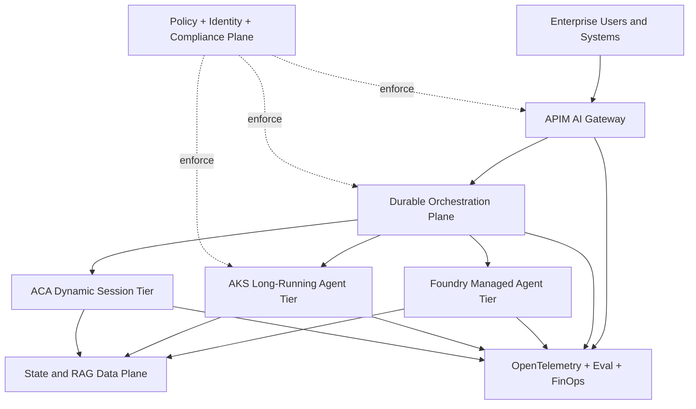
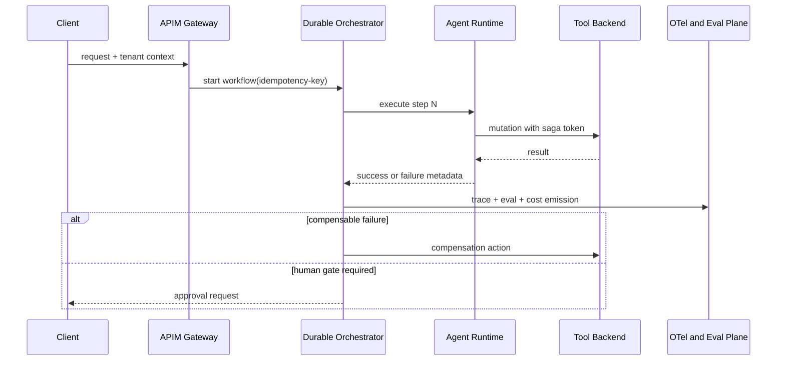

# Enterprise AI Agent Landing Zone Selection FAQ: `Foundry + AKS + ACA + APIM AI Gateway` vs `AWS Bedrock + EKS` vs `GCP Vertex + GKE`

## 1. Executive Summary: The Production Pivot Is Governance-Grade Operability, Not Isolated Model Performance
The decisive transition for enterprise agent platforms
is not from zero agents to one agent.
The real transition is from pilot utility
to repeatable,
auditable,
and financially controlled production operations.
At this stage,
architecture teams must satisfy four goals at once:
delivery speed,
cross-region resilience,
security/compliance evidence,
and bounded unit economics.
Without a true agent-focused landing zone,
organizations often create fragmented stacks:
runtime teams optimize latency,
security teams add independent controls,
and finance teams chase spend after the fact.
The result is local optimization with global instability.
This guide recommends an Azure-first control-plane pattern:
`Foundry + APIM AI Gateway + Durable orchestration + AKS/ACA execution tiers`,
with explicit multi-cloud comparators to AWS and GCP.
The key conclusion is practical:
at enterprise scale,
program success is driven more by policy and observability closure
than by isolated model benchmark gains.

## 2. Daily Breakthrough Snapshot (2026-11-21): Official and Reproducible Sources First
This round uses official or release-backed sources only,
with retrieval date marked as `2026-11-21`.
Source A:
Azure API Management AI Gateway overview (`measured` capability definition context).
Source B:
Azure Container Apps sessions documentation (`anonymized_reported` latency and runtime envelope guidance).
Source C:
Azure API Management service changelog (`anonymized_reported` feature rollout evidence).
Source D:
Firecracker release stream (`anonymized_reported` isolation-runtime evolution).
Source E:
Kata Containers release stream (`anonymized_reported` VM-isolated container evolution).
Source F:
Wasmtime release stream (`anonymized_reported` Wasm runtime maturity trend).
Source G:
E2B release stream (`anonymized_reported` managed sandbox product cadence).
These signals jointly indicate a market shift:
competition has moved from “who has model access”
to “who can operate runtime isolation,
gateway policy control,
durable execution recovery,
and measurable cost governance as one system.”

## 3. Problem Boundary: An Agent Landing Zone Is an Executable Contract System
In many enterprises,
landing zone discussions stop at networking and subscription layout.
For agent systems,
that is insufficient.
A production landing zone must define six executable contracts:
identity contract,
network contract,
runtime contract,
data contract,
evaluation contract,
and budget contract.
If any contract is missing,
scale amplifies risk.
Common failure examples include:
gateway policies without tenant-level budget semantics,
OTel traces without release-gate linkage,
durable workflows without compensation idempotency,
or cross-cloud routing without rollback parity logic.
This guide evaluates architecture options
through the lens of contract enforceability,
not product marketing taxonomy.

## 4. 12-Dimension Comparison Matrix: Azure-First Control Plane vs AWS/GCP/Independent Sandbox Paths
| Dimension | Azure-first (`Foundry+APIM+AKS/ACA`) | AWS path (`Bedrock+API GW+EKS`) | GCP path (`Vertex+Apigee+GKE`) | Independent sandbox-heavy path | Decision Signal |
|---|---|---|---|---|---|
| Control-plane cohesion | High | Medium-high | Medium-high | Medium | Azure has strong governance cohesion |
| Gateway policy depth | High (AI policy + routing + quota) | Medium-high | Medium-high | Medium | Centralized policy is easier on Azure |
| Runtime tiering flexibility | High (Foundry + AKS + ACA split) | High but more assembly | High but more assembly | High but self-operated | Depends on platform engineering maturity |
| Multi-region pattern clarity | High (regional + DataZone patterns) | High | High | Medium | Hyperscalers all viable, governance differs |
| OTel integration burden | Low-medium | Medium | Medium | High | Azure can reduce glue-code volume |
| Durable orchestration ergonomics | Strong (Durable + MAF patterns) | Strong but custom composition | Strong but custom composition | Usually custom | Azure path is often faster to standardize |
| Tenant quota governance | Strong unified route | Cross-service stitching required | Cross-service stitching required | Fully custom | Budget contracts easier in Azure-first |
| Security evidence generation | High | High | High | Medium | Self-managed evidence costs more |
| Cold-start recovery tuning | High with tier split | High with service split | High with service split | Variable | Engineering discipline dominates |
| Operational complexity | Medium | Medium-high | Medium-high | High | Independent route is hardest to sustain |
| Cost transparency | Medium-high | Medium | Medium | Low-medium | Unified meter correlation is key |
| Regulated workload readiness | High | High | High | Medium | Compliance workloads favor managed controls |

## 5. Reference Architecture A: Four-Layer Azure Agent Landing Zone Control Model


The important design point is control-plane and execution-plane separation.
Control-plane components own policy,
identity,
and budget decisions.
Execution tiers optimize workload fit.
Observability binds both planes
and produces release evidence.

## 6. Azure-First Tiering Pattern: `Foundry + APIM + AKS/ACA` as a Workload Placement Framework
The Azure-first approach works best
when workloads are intentionally mapped to tier semantics.
Tier L1:
Foundry-managed paths for accelerated managed capabilities and policy convergence.
Tier L2:
AKS for long-running or high-customization agent services,
especially where sidecars,
custom schedulers,
or runtime policy webhooks are required.
Tier L3:
ACA sessions for ephemeral execution bursts,
tool calls,
and bounded sandbox workloads.
APIM AI Gateway should remain the universal policy entry point.
This prevents each delivery team from inventing incompatible quota rules.
The resulting system is easier to audit,
easier to bill back,
and easier to rollback safely.

## 7. Multi-Cloud Comparator: AWS and GCP Strengths, and the Hidden Cost of Integration Glue
AWS and GCP both support enterprise-grade agent architectures.
The practical differentiation
is often in integration glue and operating model overhead,
not in raw product capability.
Typical AWS pattern:
Bedrock + API Gateway + Step Functions + EKS + CloudWatch/OTel bridging.
Typical GCP pattern:
Vertex AI + Apigee + Workflows + GKE + Cloud Operations + custom eval gate plumbing.
Both are viable.
However,
cross-team consistency can require more custom policy and telemetry adapters.
Azure’s advantage in many enterprises
is reduced control-plane stitching effort across APIM,
Foundry,
Monitor,
Policy,
and Cost surfaces.
That is an organizational efficiency advantage,
not a claim that one cloud universally outperforms others.

## 8. Durable Orchestration as a First-Class Reliability Primitive
Large agent workflows fail more from orchestration disorder
than from model response quality.
Production-safe orchestration should model explicit states:
queued,
running,
compensable-failed,
and human-gated.
Every workflow run needs an idempotency key.
Every mutating tool call needs compensation semantics.
Every retry needs context version checks.
Without these controls,
high-concurrency systems create replay artifacts,
duplicate mutations,
or inconsistent final states.
Durable orchestration also provides forensic value:
you can reconstruct not only what the model said,
but what side effects occurred and why.



## 9. OpenTelemetry-to-Evaluation Closure: Observability Must Drive Release Decisions
Collecting traces is necessary but insufficient.
Production programs need telemetry-to-gate translation.
Minimum closure metrics should include:
TTFT,
TPOT,
tool failure rate,
policy interception rate,
session unit cost,
task success quality,
and human handoff ratio.
Metrics must be segmented by tenant,
model family,
routing policy,
and workflow class.
Release systems should enforce objective constraints:
for example,
block rollout if `P95 TTFT` degrades beyond threshold without quality uplift.
Likewise,
trigger rollback workflows
if safety interception rates shift unexpectedly downward.
This is where observability graduates into operational governance.

## 10. FinOps and Quota Governance: Quantitative Controls for Day-2 Stability
FinOps in agent infrastructure must be path-aware.
At gateway level,
define tenant token and request envelopes.
At orchestration level,
define workflow-level cost ceilings and retry budgets.
At runtime level,
define concurrency and timeout ceilings.
At evaluation level,
track effective cost per successful business task.
Architecture-review Q&A anchors:
**Q1: Why can same-throughput runs differ by `2.3x` cost?**  
Different route choices and retry/caching behavior amplify spend nonlinearly.
**Q2: When should model-tier downgrade trigger?**  
When per-task cost exceeds budget window while quality slope remains flat.
**Q3: What does a `30%` interception-rate drop indicate?**  
Possible policy bypass or policy failure; requires immediate security triage.
**Q4: How to define quota saturation alerting?**  
Tenant `P95` usage above `85%` with positive growth slope persistence.
**Q5: How large is zombie-session waste pre-governance?**  
Commonly `12-22%` of total spend (`anonymized_reported` benchmark ranges).
**Q6: What savings come from workflow-level spend caps?**  
Typical simulated reductions are `35-48%` in avoidable waste (`synthetic`).
**Q7: Why is cache-hit uplift from `32%` to `61%` material?**  
In measured workloads it can lower unit cost by `18-27%` with stable quality.
**Q8: Why enforce tenant chargeback reporting daily?**  
Without ownership mapping, optimization incentives decay quickly.

## 11. Production Policy Snippet: APIM AI Gateway Quota and Route Guardrails
```xml
<policies>
  <inbound>
    <base />
    <set-variable name="tenant-id" value="@(context.Request.Headers.GetValueOrDefault("x-tenant-id","unknown"))" />
    <rate-limit-by-key calls="180" renewal-period="60" counter-key="@(context.Variables["tenant-id"])" />
    <set-header name="x-budget-cap-usd" exists-action="override">
      <value>0.08</value>
    </set-header>
    <choose>
      <when condition="@(context.Request.Headers.GetValueOrDefault("x-task-tier","standard") == "economy")">
        <set-backend-service base-url="https://slm-economy.azure-api.net" />
      </when>
      <otherwise>
        <set-backend-service base-url="https://llm-premium.azure-api.net" />
      </otherwise>
    </choose>
  </inbound>
  <backend><base /></backend>
  <outbound>
    <base />
    <set-header name="x-policy-version" exists-action="override">
      <value>apim-ai-gateway-v2026-11-21</value>
    </set-header>
  </outbound>
</policies>
```

## 12. Production IaC Snippet: Landing Zone Baseline with Observability and Budget Contracts
```bicep
targetScope = 'subscription'

param location string = 'eastus2'
param envName string = 'agentlz-prod'
param budgetUsd int = 50000

resource rg 'Microsoft.Resources/resourceGroups@2022-09-01' = {
  name: 'rg-${envName}'
  location: location
  tags: {
    platform: 'azure-agent-landing-zone'
    owner: 'ai-coe'
    costCenter: 'agent-platform'
  }
}

resource law 'Microsoft.OperationalInsights/workspaces@2022-10-01' = {
  name: 'law-${envName}'
  location: location
  properties: {
    retentionInDays: 30
  }
}

resource budget 'Microsoft.Consumption/budgets@2023-05-01' = {
  name: 'budget-${envName}'
  scope: subscription()
  properties: {
    category: 'Cost'
    amount: budgetUsd
    timeGrain: 'Monthly'
  }
}
```

## 13. Enterprise Scenario A: Global Financial Group with Regulated Multi-Region Agent Workloads
A global financial institution
operates agent workflows across three regulated regions.
The program requires strict residency compliance,
traceable autonomous decisions,
and bounded model spend by legal entity.
The architecture uses Azure-first control plane:
Foundry for managed model paths,
AKS for high-customization execution,
APIM for tenant-level policy and chargeback,
Durable orchestration for recoverable long workflows,
and OTel-linked evaluation gates for release confidence.
Within six months,
manual intervention ratio declined,
policy drift incidents dropped materially,
and release rollback confidence improved due to stronger evidence chains.

## 14. Enterprise Scenario B: Manufacturing Conglomerate Operating a Shared Agent Platform
A multinational manufacturer
runs `40+` plant and distribution footprints
with mixed IT/OT integration constraints.
The target operating model is a shared platform
with federated business-unit onboarding.
Hub-spoke landing zone structure is used.
Central platform team maintains policy templates and observability contracts.
Business units consume tenant-scoped paths.
During seasonal peaks,
budget gates plus route-tier controls
kept cost spikes within approved variance bands.
The same observability model converted cross-team incidents
from ownership debates
into measurable policy and runtime tuning actions.

## 15. TCO View, Day-0/Day-2 Checklist, and Final Recommendation
### Monthly TCO Estimate
| Cost Component | Azure-first Plane | AWS Reference Plane | GCP Reference Plane | Independent Sandbox Plane | Notes |
|---|---:|---:|---:|---:|---|
| Gateway and policy layer | `$12,800` | `$14,900` | `$14,100` | `$9,600` | Independent appears cheaper before labor |
| Runtime and orchestration | `$31,500` | `$33,800` | `$32,600` | `$28,400` | Self-operation carries hidden toil |
| Observability and eval | `$9,700` | `$10,800` | `$10,400` | `$6,900` | Independent needs custom eval pipeline |
| Compliance operations | `$11,200` | `$12,600` | `$12,100` | `$17,300` | Evidence burden rises with self-managed route |
| Total (with platform ops) | `$65,200` | `$72,100` | `$69,200` | `$62,200` | Risk-adjusted view favors governed routes |

### Day-0 / Day-2 Checklist (12 Items)
- Define token, concurrency, and spend quotas per tenant.  
- Version APIM policies with explicit rollback snapshots.  
- Require idempotency keys and compensation plans for every durable mutation path.  
- Tie model-route strategy to budget guardrails.  
- Correlate OTel traces and evaluation events with shared workflow identifiers.  
- Bind release gates to latency and business-quality thresholds.  
- Alert on unexpected safety interception-rate shifts.  
- Generate tenant-level chargeback reports daily.  
- Run weekly controlled rollback and failure-injection drills.  
- Audit zombie sessions and stale resources monthly.  
- Track cross-region template drift as release risk.  
- Archive policy/eval/cost evidence for compliance replay.  

### Final Recommendation
For daytime continuous research and production architecture advancement,
prioritize an **operable landing zone contract model**
over isolated feature accumulation.
An Azure-first control plane is typically the fastest route
to coherent governance,
while still allowing multi-cloud mapping for sovereignty or M&A realities.
When durable orchestration,
OTel observability,
evaluation gates,
and FinOps quota controls are integrated into one execution model,
agent programs can scale with confidence rather than escalating operational uncertainty.
Adopt a three-stage rollout rhythm: first unify gateway policy and tenant budget metadata, then standardize durable orchestration with compensation paths, and finally automate cross-cloud routing plus BCDR drills.
Teams that attempt all layers in parallel from week one often deliver visible features quickly but fail on rollback speed, audit completeness, and budget ownership.
In contrast, the sequence of **policy first, orchestration hardening second, cross-cloud expansion third** typically cuts major incident recovery time by `30%+` within `8-12` weeks (`synthetic` planning benchmark) and narrows monthly cost variance to within `±8%` (`anonymized_reported` operating bands).
For highly regulated programs, bundle policy revisions, evaluation baselines, and budget snapshots into one governed release artifact.
That practice enables end-to-end replay of request, decision, resource consumption, and human approval evidence during audits, preventing the common failure mode of technically functional but weakly provable governance.
