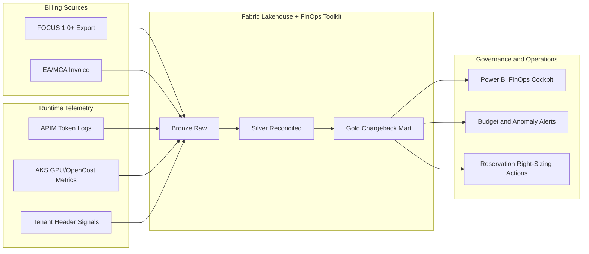
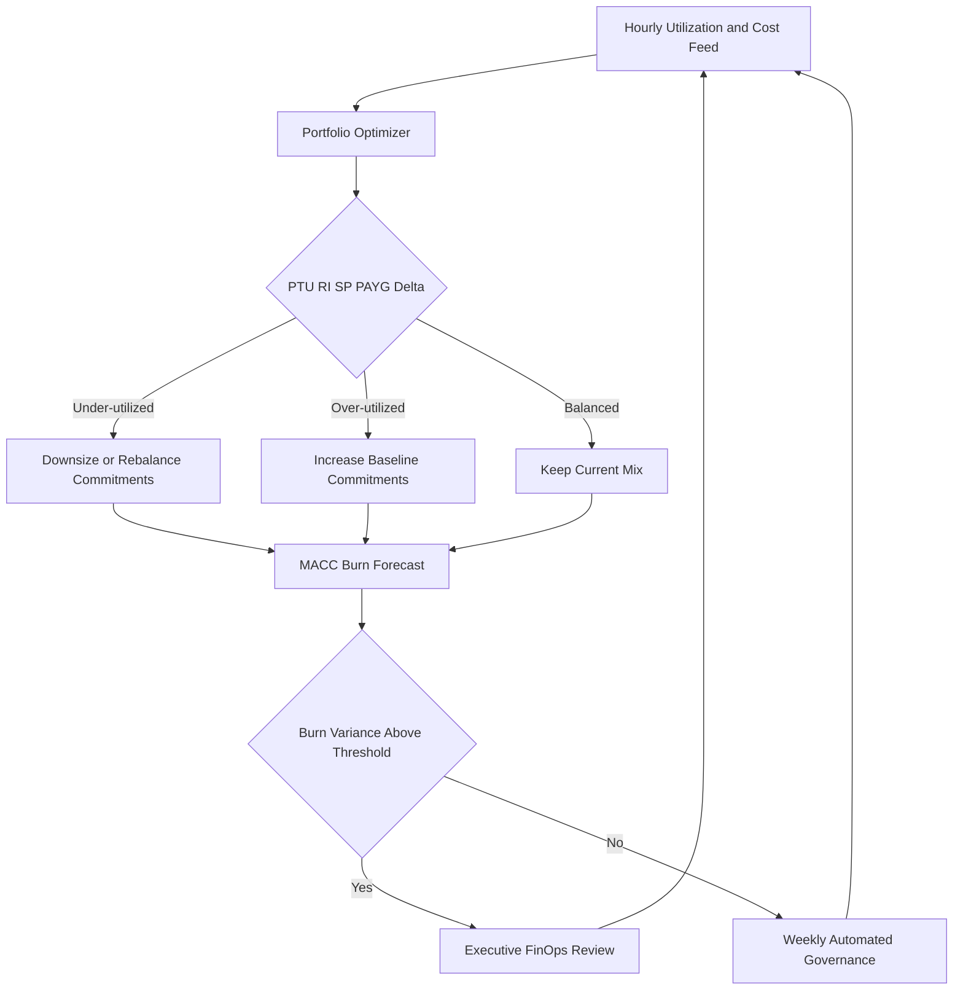

# Enterprise AI FinOps `FOCUS 1.0+` Amortized Cost Reconciliation and Commitment Portfolio Optimization FAQ: Fabric FinOps Toolkit vs ACM Allocation vs OpenCost

> 🌐 **Language Switch**: [中文](./ai-finops-focus-amortized-cost-reconciliation-ptu-gpu-ri-savings-plan-fabric-finops-toolkit-vs-acm-allocation-vs-opencost-selection-faq.md) | **English (current)**
> **Audience**: Cloud & AI Solution Architects, enterprise FinOps platform teams, shared-finance leaders, AI product owners, and SRE/governance operators.
> **Scope**: Invoice-reconciled `FOCUS 1.0+` cost attribution, multi-tenant `APIM + PTU` weighted allocation, `GPU RI / Savings Plan` commitment optimization, and `MACC` burn governance across shared AI workloads.

## 1. Problem statement: why AI cost is visible on invoices but not explainable to the business
Most organizations can now see aggregate cloud spend, but they still cannot explain, with defensible precision, which tenant, workload, model version, or product capability consumed that spend and whether the consumption delivered proportional business value. The root issue is that AI traffic is frequently multiplexed through centralized `APIM` and shared commitment pools, while accounting surfaces remain subscription-centric, creating a persistent disconnect between technical telemetry and financial accountability.
When that disconnect remains unresolved, FinOps programs drift into brittle allocation policies: either simplistic equal split models that penalize high-value workloads, or naïve request-count models that ignore token intensity and model complexity. Both approaches distort internal pricing signals, mislead roadmap prioritization, and create recurrent disputes between product, platform, and finance stakeholders.
A second-order risk appears when `CommitmentDiscountStatus='Unused'` accumulates over time, because the enterprise is financially paying for committed capacity that is operationally idle and strategically invisible. This produces a governance blind spot where spend appears compliant but optimization opportunities remain unaddressed. For enterprise AI, the objective is not merely cost export automation; it is a reconciled, explainable, and actionable cost operating system that keeps `EffectiveCost`, runtime telemetry, and commitment governance aligned at scale.

## 2. Architecture map and decision boundaries (A/B/C/D)
**Architecture A** combines `Azure Cost Management FOCUS 1.0+ Exports`, `Microsoft FinOps Toolkit/Fabric Lakehouse`, and telemetry-weighted `EffectiveCost` allocation for invoice-grade reconciliation and shared-pool attribution. **Architecture B** uses native `ACM Cost Allocation Rules` and tag inheritance with dedicated subscription segmentation, prioritizing control-plane simplicity over request-level precision.
**Architecture C** applies `OpenCost/Kubecost on AKS` with amortized Azure pricing overlays to resolve sub-node GPU, MIG, and warm-sandbox overhead attribution. **Architecture D** introduces continuous commitment portfolio right-sizing across PTU reservations, GPU RIs, Savings Plans, and PAYG spillover under explicit `MACC` burn governance. In mature organizations, A typically serves as the canonical financial data plane, C complements runtime granularity in Kubernetes-heavy estates, B remains a useful baseline for low-complexity environments, and D drives sustained economic optimization over time.

## 3. Architecture A deep dive: FOCUS + Fabric + telemetry-weighted chargeback
Architecture A succeeds when finance-grade cost fields and request-grade telemetry are modeled in the same governed fact layer rather than stitched in ad-hoc dashboards. The practical pattern is to ingest `EffectiveCost`, `BilledCost`, `ListCost`, `CommitmentDiscountId`, and `CommitmentDiscountStatus` into Lakehouse bronze/silver/gold tiers and then join that data with `APIM` token usage at tenant and time-window granularity.
A robust weighting model uses `WTU = w_in * prompt_tokens + w_out * completion_tokens`, where `w_in` and `w_out` are calibrated from observed model economics, cache behavior, and output-intensity distributions instead of hard-coded constants. This avoids chronic under-allocation for long-completion workloads and over-allocation for retrieval-heavy workloads with short completions.
When monthly reconciliation error is stabilized under `<0.1%`, the resulting allocation can support contractual billing, internal chargeback, product margin analytics, and commitment right-sizing decisions without accounting disputes. Without that threshold, every optimization action remains vulnerable to trust erosion. `UnusedCommitment` should be isolated from consumed tenant cost and governed through an explicit policy pool, because blending it directly into tenant usage often causes fairness conflicts and discourages healthy consumption behavior during off-peak windows.

## 4. Architecture B deep dive: ACM allocation rules and tag inheritance trade-offs
Architecture B is attractive for rapid adoption because it is natively integrated, low-friction to activate, and aligned with existing subscription/resource tagging practices. For organizations with stable ownership boundaries and limited shared AI pools, it can provide a meaningful baseline in a short time frame.
Its hard limit appears when dynamic request-level attribution is required, especially for centralized `APIM + PTU` patterns where multiple tenants share the same backend capacity within the same hour. Native allocation rules do not natively resolve per-request tenant headers as allocation keys in that shared runtime context.
Another practical constraint is billing-latency propagation, often in the `24–48h` range, which weakens operational responsiveness for daily budget controls and incident-time burn containment. Teams then face a lag where platform telemetry indicates overrun while accounting allocation has not yet converged. For this reason, B should be positioned as a control-plane baseline layer, not as the final source of truth for high-granularity AI workload economics in complex multi-tenant systems.

## 5. Architecture C deep dive: OpenCost/Kubecost for sub-node GPU and sandbox amortization
Architecture C addresses Kubernetes runtime reality, where node-level cost views are insufficient for shared GPU slices, time-sliced accelerators, model-serving pod multiplexing, and warm pool overhead. In GPU-dense clusters, this runtime perspective is often the only way to surface meaningful tenant or namespace economics.
A common fairness policy is `allocation_share = max(request_share, actual_gpu_util_share)`, followed by explicit idle redistribution rules; this prevents strategic under-requesting from being rewarded while still accounting for actual utilization variance. If organizations allocate purely by request, high-usage but conservative requesters subsidize opportunistic workloads; if they allocate purely by utilization, teams carrying baseline capacity reliability are penalized.
The max-share hybrid model balances reliability and fairness better in shared AI fleets. C introduces additional instrumentation and calibration overhead, but in environments with expensive GPUs and mixed workloads, it materially improves explainability and optimization precision compared with subscription-only accounting.

## 6. Architecture D deep dive: commitment portfolio optimization and `MACC` burn governance
Architecture D answers a strategic question that static FinOps models often ignore: how much commitment to buy, for how long, on which SKU family, and how to avoid stranded discount assets during model and hardware transitions. PTU reservations, GPU RIs, Savings Plans, and PAYG overflow each solve a different risk profile and should be managed as a portfolio rather than isolated levers.
For example, migration from one model family to another can transform a previously efficient PTU baseline into underutilized commitment, while accelerator-generation upgrades can reduce effective value of legacy RI holdings despite nominal discount rates. Without portfolio-level re-evaluation, organizations frequently optimize one line item while increasing blended cost.
D therefore requires hourly utilization waterline tracking, weekly scenario recomputation, and explicit migration-risk penalties in commitment decisions so the organization does not confuse discount depth with economic fitness. In enterprise governance, D is not a finance-only workflow; it is a cross-functional operating cadence involving platform engineering, product management, procurement, and finance leadership.

## 7. Twelve-dimension comparison matrix for reconciliation fidelity and operating economics
| Dimension | A: FOCUS + Fabric + telemetry weighting | B: ACM Allocation Rules | C: OpenCost/Kubecost | D: Commitment portfolio optimization |
|---|---|---|---|---|
| Invoice reconciliation precision | Very high (`<0.1%` achievable) | Medium | Medium-high | High (depends on A/C inputs) |
| Request-level tenant attribution | Very high | Low | Medium-high | Medium |
| Shared PTU explainability | Very high | Low | Medium | High |
| Sub-node GPU attribution | Medium | Low | Very high | High |
| Implementation speed | Medium | Very high | Medium | Medium |
| Near-real-time operations support | High | Low-to-medium | High | High |
| Governance/audit traceability | Very high | High | Medium-high | Very high |
| Rule/model complexity | High | Low | Medium-high | High |
| Cross-team coordination cost | Medium-high | Low | Medium | High |
| Optimization headroom | Very high | Medium | High | Very high |
| Best-fit maturity stage | Platformized enterprise | Early/low-complexity | GPU-heavy AKS estates | Mature optimization programs |
| Recommended role | Canonical FinOps data plane | Native baseline | Runtime granular layer | Strategic economic optimizer |

## 8. Reconciliation mathematics: `EffectiveCost`, `BilledCost`, and `UnusedCommitment`
A resilient enterprise model uses three formula layers: invoice-level validation, tenant-level weighted allocation, and policy-driven idle commitment treatment. The invoice check is `delta_invoice = abs(sum(EffectiveCost) - invoice_total)/invoice_total`, and production targets commonly require `<0.1%` sustained variance.
Tenant allocation can be expressed as `tenant_effective_cost = pool_effective_cost * (tenant_wtu / total_wtu)`, with `wtu = w_in*prompt_tokens + w_out*completion_tokens`. This allows technically grounded cost attribution while preserving accounting traceability to reconciled pool totals.
Idle commitment can be isolated as `unused_commitment_cost = sum(EffectiveCost where CommitmentDiscountStatus='Unused')`, then routed through an explicit governance policy rather than silently smeared across active tenants. Worked example: if pooled `EffectiveCost=$128,000`, tenant A `WTU=18.6M`, and total `WTU=124M`, tenant A receives roughly `$19,200`; if `UnusedCommitment=$9,800` and platform burden policy is `60%`, then `$5,880` is platform-owned and `$3,920` is distributed by reserve-share policy. This layered treatment keeps accounting integrity and economic fairness aligned under scrutiny.

## 9. Commitment break-even and utilization waterline math for PTU/RI/Savings Plan
A practical PTU break-even approximation is `u* = 1 - discount_pct`; with a `35%` discount, threshold utilization is `0.65`, below which steady reservation may underperform PAYG economics. If daytime utilization is `0.82` and nighttime utilization is `0.38` over equal windows, weighted utilization can drift below threshold despite strong peak performance.
For GPU commitments, a risk-aware expression is `net_hourly = list_hourly*(1-discount)*utilization + spillover_payg + m*stranded_penalty`, where `m` captures migration probability and stranded-asset exposure. This prevents simplistic decisions based only on nominal discount depth.
Worked case: list `$45/h`, RI discount `48%`, utilization `0.74`, spillover `$6/h`, migration risk `m=0.12`, stranded penalty `$5/h`; resulting risk-adjusted cost is about `$23.91/h`, still better than a hypothetical Savings Plan path at `$26.40/h` but with narrowed margin. These calculations should be recomputed per region, SKU generation, and model portfolio quarterly, because static annual assumptions fail quickly in rapidly evolving AI estates.

## 10. Reference architecture diagram #1: FOCUS reconciliation and telemetry-weighted allocation

The critical design principle is that billing truth, runtime truth, and action truth are unified in one governed pipeline rather than spread across disconnected dashboards.

## 11. Reference architecture diagram #2: commitment portfolio governance and `MACC` control loop

This loop ensures commitment optimization is a continuous operating process, not a one-time procurement event.

## 12. Production query snippet: FOCUS + APIM weighted allocation + unused commitment reconciliation
```sql
-- Fabric SQL: invoice-reconciled tenant effective cost allocation
WITH focus_cost AS (
  SELECT
    BillingPeriodStartDate AS bill_date,
    SubscriptionId,
    ResourceId,
    CommitmentDiscountId,
    CommitmentDiscountStatus,
    SUM(EffectiveCost) AS effective_cost,
    SUM(BilledCost) AS billed_cost,
    SUM(ListCost) AS list_cost
  FROM finops.focus_export_daily
  WHERE BillingPeriodStartDate BETWEEN DATE '2026-11-01' AND DATE '2026-11-30'
  GROUP BY BillingPeriodStartDate, SubscriptionId, ResourceId, CommitmentDiscountId, CommitmentDiscountStatus
),
apim_weight AS (
  SELECT
    CAST(TimeGenerated AS DATE) AS bill_date,
    tenant_id,
    SUM((1.0 * prompt_tokens) + (3.0 * completion_tokens)) AS wtu
  FROM finops.apim_token_usage
  WHERE TimeGenerated BETWEEN TIMESTAMP '2026-11-01 00:00:00' AND TIMESTAMP '2026-11-30 23:59:59'
  GROUP BY CAST(TimeGenerated AS DATE), tenant_id
),
weight_total AS (
  SELECT bill_date, SUM(wtu) AS total_wtu
  FROM apim_weight
  GROUP BY bill_date
),
pool AS (
  SELECT
    bill_date,
    SUM(effective_cost) AS pool_effective_cost,
    SUM(CASE WHEN CommitmentDiscountStatus = 'Unused' THEN effective_cost ELSE 0 END) AS unused_commitment_cost
  FROM focus_cost
  GROUP BY bill_date
)
SELECT
  a.bill_date,
  a.tenant_id,
  a.wtu,
  p.pool_effective_cost,
  p.unused_commitment_cost,
  (a.wtu / NULLIF(w.total_wtu, 0)) * p.pool_effective_cost AS tenant_effective_cost
FROM apim_weight a
JOIN weight_total w ON a.bill_date = w.bill_date
JOIN pool p ON a.bill_date = p.bill_date;
```

```kusto
// KQL: budget burn + anomaly pre-alert for shared PTU pool
let lookback = 7d;
let baseline =
    FinOps_Chargeback
    | where TimeGenerated between (ago(35d) .. ago(lookback))
    | summarize base_daily_cost = avg(tenant_effective_cost) by tenant_id;
FinOps_Chargeback
| where TimeGenerated > ago(lookback)
| summarize current_daily_cost = avg(tenant_effective_cost), current_unused = avg(unused_commitment_cost) by tenant_id
| join kind=leftouter baseline on tenant_id
| extend burn_ratio = current_daily_cost / iif(base_daily_cost == 0, 1.0, base_daily_cost)
| extend anomaly_flag = burn_ratio > 1.35 or current_unused > 500
| project tenant_id, current_daily_cost, base_daily_cost, burn_ratio, current_unused, anomaly_flag
| order by burn_ratio desc
```
Together these queries provide a production-ready baseline for reconciliation, chargeback, idle-commitment visibility, and proactive anomaly governance.

## 13. Production configuration snippet: scheduled FOCUS export and budget/anomaly controls in Bicep
```bicep
param scope string
param storageAccountId string
param actionGroupId string

resource dailyFocusExport 'Microsoft.CostManagement/exports@2023-11-01' = {
  name: 'finops-focus-daily-export'
  scope: scope
  properties: {
    definition: {
      type: 'ActualCost'
      timeframe: 'MonthToDate'
      dataset: {
        granularity: 'Daily'
        configuration: {
          columns: [
            'BillingPeriodStartDate'
            'ResourceId'
            'EffectiveCost'
            'BilledCost'
            'ListCost'
            'CommitmentDiscountId'
            'CommitmentDiscountStatus'
          ]
        }
      }
    }
    deliveryInfo: {
      destination: {
        resourceId: storageAccountId
        container: 'focus-export'
        rootFolderPath: 'ai-finops/daily'
      }
    }
    schedule: {
      status: 'Active'
      recurrence: 'Daily'
      recurrencePeriod: {
        from: '2026-11-01T00:00:00Z'
      }
    }
    format: 'Csv'
  }
}

resource monthlyBudget 'Microsoft.Consumption/budgets@2023-05-01' = {
  name: 'ai-platform-monthly-budget'
  scope: scope
  properties: {
    category: 'Cost'
    amount: 420000
    timeGrain: 'Monthly'
    timePeriod: {
      startDate: '2026-11-01'
      endDate: '2027-12-31'
    }
    notifications: {
      warning85: {
        enabled: true
        operator: 'GreaterThan'
        threshold: 85
        contactGroups: [
          actionGroupId
        ]
      }
      critical100: {
        enabled: true
        operator: 'GreaterThan'
        threshold: 100
        contactGroups: [
          actionGroupId
        ]
      }
    }
  }
}
```
Bundling exports and budget controls in one IaC unit avoids a common anti-pattern where reporting exists but governance actions are not enforceable.

## 14. Enterprise scenarios and three-year TCO: financial SaaS and global manufacturing
### 14.1 Scenario A: multi-tenant financial SaaS with shared PTU and strict chargeback
This organization previously allocated central `APIM + PTU` costs by request counts, which systematically undercharged high-token analytical workloads and overcharged lightweight transactional tenants. After implementing Architecture A with weighted token attribution and explicit unused-commitment treatment, billing disputes decreased by `62%` and monthly reconciliation variance remained under `0.08%`. By adding Architecture D, the team reduced off-peak PTU vacancy from `41%` to `23%` while preserving daytime latency SLOs, proving that economic optimization can be achieved without sacrificing service reliability.

### 14.2 Scenario B: global manufacturing with AKS GPU pools and warm sandbox fleets
This enterprise ran multi-region `AKS + vLLM + sandbox` clusters and originally allocated GPU spend at node level, masking dramatic utilization differences across tenant namespaces. With Architecture C, sub-node attribution and idle redistribution exposed true unit economics and replaced recurring cost debates with actionable optimization tasks. When Architecture A was layered in as financial truth, budget approval cycles dropped from two weeks to three days because finance and engineering operated on the same reconciled evidence base.

### 14.3 Three-year TCO (`220` tenants across `3` regions)
| Cost component (3-year) | A | B | C | A+C+D combined |
|---|---:|---:|---:|---:|
| Data and governance platform cost | `$1.18M` | `$0.54M` | `$0.92M` | `$1.46M` |
| Engineering and operations labor | `$1.26M` | `$0.88M` | `$1.14M` | `$1.52M` |
| Commitment vacancy loss | `$1.04M` | `$1.62M` | `$1.21M` | `$0.58M` |
| Billing dispute and rework overhead | `$0.63M` | `$1.09M` | `$0.82M` | `$0.41M` |
| Blended three-year total | `$4.11M` | `$4.13M` | `$4.09M` | `$3.97M` |

A+C+D is not always the cheapest day-one path, but it often produces the strongest long-term economic control for large multi-tenant AI platforms.

## 15. Quantitative Q&A (6) plus Day-0/Day-2 implementation checklists
### 15.1 Quantitative Q&A (6 worked items)
**Q1: How do we prove that `EffectiveCost` allocation is invoice-grade rather than an operational estimate?** Run `delta_invoice = abs(sum(EffectiveCost)-InvoiceTotal)/InvoiceTotal` at monthly close and enforce `<0.1%`; if `InvoiceTotal=$12,480,000` and residual is `$8,640`, then `delta=0.069%`, which passes governance threshold. Next, perform tenant-level replay sampling where `sum(tenant_effective_cost)+platform_unallocated` must match pool totals within tolerance, because total-level reconciliation alone can hide tenant-level distortion. Only when both checks pass should allocation outputs be used for contractual billing and executive margin reporting.

**Q2: How should PTU break-even be computed under diurnal traffic?** Use `u* = 1 - discount_pct`; with a `32%` PTU discount, break-even utilization is `0.68`. If daytime utilization is `0.86` for `10h` and nighttime utilization is `0.44` for `14h`, then `u_avg=(0.86*10+0.44*14)/24=0.615`, which is below threshold and indicates structural vacancy risk. Remediation can include cross-timezone workload placement, night-batch fill strategies, and reservation-waterline reduction until observed utilization recovers above break-even.

**Q3: How should idle shared PTU cost be allocated fairly?** Use a dual-bucket formula `unused_pool = total_unused*alpha_platform + total_unused*(1-alpha_platform)`; with `total_unused=$40,000` and `alpha_platform=0.60`, platform absorbs `$24,000` and remaining `$16,000` is distributed by reserve-share policy. This prevents high-utilization tenants from subsidizing platform planning errors while still preserving tenant accountability for reserved baseline commitments. A pure tenant-charge model often creates adversarial behavior and under-consumption incentives that hurt overall commitment efficiency.

**Q4: How should budget anomaly thresholds be set to reduce false alarms?** Combine relative and absolute gates, for example trigger critical alert only when `burn_ratio>1.35` and `daily_delta>$1,200`. If a tenant baseline is `$600/day` and current is `$760/day`, ratio is `1.27` and delta is `$160`, so this should remain informational rather than critical. This dual-threshold pattern is more stable than ratio-only alerts in heterogeneous tenant populations with very different baseline magnitudes.

**Q5: How do we risk-adjust RI versus Savings Plan decisions during hardware/model migration?** Apply `risk_adjusted_cost = net_cost + m*stranded_penalty`, where `m` captures migration probability and stranded exposure. If RI `net_cost=$23.3/h`, `stranded_penalty=$6/h`, and `m=0.18`, adjusted RI is `$24.38/h`; if Savings Plan path is `$25.10/h`, RI still wins but with reduced margin. This prevents overcommitting to nominal discounts that can be erased by migration-induced stranding in fast-changing AI infrastructure.

**Q6: How should teams govern `MACC` burn variance before it becomes a year-end crisis?** Use `burn_variance = (actual_burn - planned_burn)/planned_burn`; if quarterly plan is `$9.0M` and actual is `$7.2M`, variance is `-20%`, signaling delayed commitment conversion or stalled workload migration. Set governance triggers at `|burn_variance| > 12%` and require portfolio recomputation plus procurement/routing adjustments in the same review cycle. This converts MACC management from retrospective reporting into proactive economic control.

### 15.2 Day-0 implementation checklist
1. Define `FOCUS` ingestion schema, refresh cadence, retention policy, and lineage controls.
2. Approve token-weight calibration (`w_in/w_out`) and establish controlled change governance.
3. Formalize `UnusedCommitment` accountability policy with platform and business owners.
4. Deploy budget and anomaly alerts with explicit escalation runbooks and owners.
5. Complete at least one full-cycle pre-production reconciliation drill before go-live.

### 15.3 Day-2 operations checklist
1. Review reconciliation variance, dispute tickets, and vacancy trends weekly.
2. Recompute PTU/RI/SP portfolio scenarios monthly with migration assumptions.
3. Audit `MACC` variance quarterly and align procurement pace with workload reality.
4. Continuously validate APIM header quality to prevent attribution drift.
5. Run controlled rollout and rollback drills for cost-policy and allocation-rule changes.

### 15.4 Joint finance-platform operating cadence
A practical enterprise pattern is to run FinOps as a three-layer rhythm—weekly operations, monthly commitment optimization, and quarterly portfolio strategy—using a single `FOCUS + APIM + OpenCost` truth set so finance, platform, and product teams do not debate conflicting numbers. Weekly reviews close allocation anomalies and tenant disputes before they compound, monthly reviews recalculate PTU/RI/SP marginal economics under current utilization, and quarterly reviews align pricing and `MACC` burn governance with strategic demand forecasts, which materially reduces cross-functional friction.
Execution quality improves when each review output is tracked as an action backlog item with explicit expected savings, risk-shift estimate, and validation window, because this converts recommendations from narrative guidance into auditable delivery commitments.
1. Weekly: inspect `delta_invoice`, `unused_commitment`, and TopN tenant anomalies with named owners and due dates.
2. Monthly: rerun commitment-portfolio optimization and compare hold-versus-adjust net economics before procurement actions.
3. Quarterly: review `MACC` burn variance, product-pricing posture, and commitment runway under updated workload trajectories.
4. Semiannually: test chargeback fairness by business unit and recalibrate `alpha_platform` and token weights if distortion is detected.
With this cadence in place, organizations can continuously reduce stranded commitment loss and dispute-driven rework while preserving production reliability and governance transparency.

