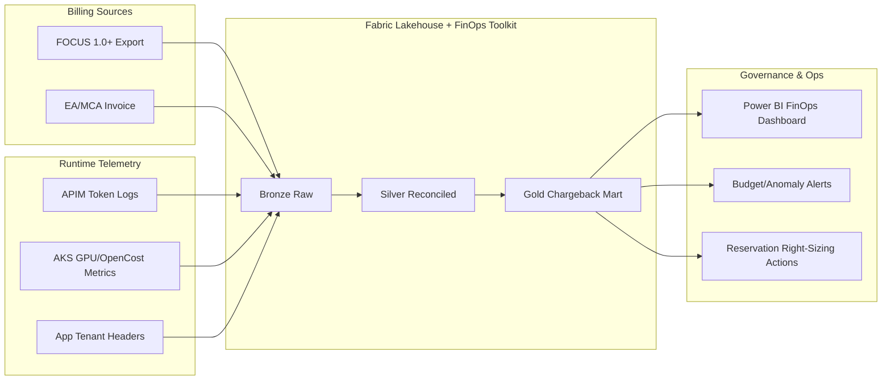
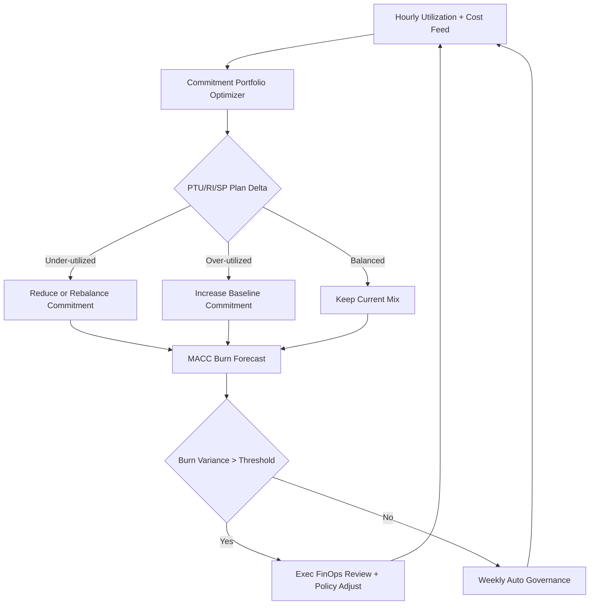

# 企业 AI FinOps `FOCUS 1.0+` 摊销成本对账与承诺组合优化选型 FAQ：Fabric FinOps Toolkit vs ACM Allocation vs OpenCost

> 🌐 **Language Switch**：**中文（当前）** | [English](./ai-finops-focus-amortized-cost-reconciliation-ptu-gpu-ri-savings-plan-fabric-finops-toolkit-vs-acm-allocation-vs-opencost-selection-faq.en.md)
> **受众**：Cloud & AI Solution Architect、平台 FinOps 团队、企业财务共享中心、AI 平台产品负责人、SRE 与治理团队。
> **范围**：围绕 `FOCUS 1.0+` 发票对账、`PTU/GPU RI/Compute Savings Plan` 承诺分摊、`APIM` 多租户 token 权重分配与 `MACC` 消耗治理，比较四条企业级落地架构并提供公式、查询、IaC、TCO 与运行清单。

## 1. 问题定义：为什么 AI 成本“账面可见”但“业务不可解释”
很多企业已经能在 Azure 门户看到总成本曲线，但无法把成本准确映射到租户、业务线、模型版本与产品功能，因此管理层虽然看到了金额，却无法判断哪条业务真正创造价值、哪条业务只是消耗承诺预算。传统云成本模型按订阅或资源组聚合，而 AI 流量常常在中心化 `APIM + PTU` 池里混跑，导致“共享资源可见、责任归属不可见”的治理断层。
在这种状态下，FinOps 很容易陷入两个极端：要么粗暴均摊导致高价值团队被错误惩罚，要么只按调用次数分配导致高 token 复杂任务长期吃亏，两者都会扭曲产品决策和定价策略。更严重的是，当 `CommitmentDiscountStatus=Unused` 长期堆积时，企业在财务上已经支付承诺费用，却没有形成业务产出，产生“可计费但不可经营”的空转。因此高成熟度 AI FinOps 的核心目标不是“把账单导出到表格”，而是把 `EffectiveCost/BilledCost/ListCost` 与请求级遥测结合，形成可对账、可解释、可行动的成本决策系统，并且在跨区域、多租户、多承诺组合下保持一致性。

## 2. 四种架构路径与职责边界（A/B/C/D）
**Architecture A**：`Azure Cost Management FOCUS 1.0+ Exports` + `Microsoft FinOps Toolkit / Fabric Lakehouse` + 遥测加权 `EffectiveCost` 分摊，目标是实现发票级对账和共享承诺池精细分配。**Architecture B**：`ACM Cost Allocation Rules` + Tag Inheritance + 专属订阅分段，优势是控制面原生、部署快，但难以处理请求级共享 `APIM/PTU` 动态分摊。
**Architecture C**：`OpenCost/Kubecost on AKS` + Azure 摊销价补充，重点解决 GPU/MIG/time-slice 与沙箱暖池的子节点级成本归因。**Architecture D**：持续承诺组合优化（PTU Reservation、GPU RI、Savings Plan、PAYG 溢出）+ `MACC` 消耗治理，目标是降低承诺闲置与迁移断层风险。在生产实践中，A 常作为企业级总账底座，C 作为 Kubernetes 运行时细粒度补充，B 用于轻量组织和快速起步，D 则是管理层和平台层共担的长期收益引擎。

## 3. Architecture A：FOCUS + Fabric Lakehouse + 遥测权重分摊主路径
A 路径的关键是把 `FOCUS` 标准成本字段和请求遥测放进同一事实模型，并保持“财务口径一致、工程口径可解释、业务口径可运营”三者同时成立。企业可将每日或日内导出的 `EffectiveCost/BilledCost/ListCost/CommitmentDiscountId/CommitmentDiscountStatus` 写入 Lakehouse，再与 `APIM` 日志中按租户聚合的 token 权重做 join。
推荐采用加权单位 `WTU = w_in * prompt_tokens + w_out * completion_tokens`，其中 `w_in` 与 `w_out` 应由模型成本结构和缓存命中率校准而来，而不是固定 `1:1`。这样可以避免“长输出型租户被低估”或“检索型租户被高估”的系统性偏差。
当企业实现按天对账误差 `<0.1%` 后，才能将成本分配结果用于合同计费、内部 chargeback、产品毛利分析与承诺优化闭环，否则任何优化都可能建立在错误账基上。在 A 路径下，`UnusedCommitment` 不应直接吞进业务租户成本，而应先进入“空置容量池”，再按预先约定策略（平台承担、按保底份额分摊、或按峰值占用率追责）处理，确保财务和业务对空置责任理解一致。

## 4. Architecture B：ACM Allocation Rules 与 Tag Inheritance 的边界
B 路径适合组织初期快速落地，因为无需搭建 Lakehouse 或复杂 ETL，只需在资源和订阅层定义成本分配规则即可形成基础可见性。它在“团队与订阅边界稳定、共享池较少、计费口径偏静态”的情况下非常高效。
但 B 的硬边界也很明确：它无法基于每次请求头中的租户标识做动态分摊，尤其无法解释共享 `APIM + PTU` 池中同一小时内租户负载结构变化，这正是 AI 业务最常见的真实场景。此外，计费数据常有 `24–48h` 延迟，导致实时运营与预算预警难以直接依赖 ACM 规则结果，团队容易出现“运营面已超预算、财务面尚未显现”的时间差风险。因此 B 应被定位为“控制面基础账本”，而不是“AI 请求级成本真相”，在多租户 AI 平台上通常需要与 A 或 C 配合。

## 5. Architecture C：OpenCost/Kubecost 子节点 GPU 与沙箱摊销
C 路径聚焦 Kubernetes 运行面的真实资源占用，特别是 `ND H100 v5/NC A100` 的 MIG 切片、time-slice、模型 Pod 共享以及 warm pool 沙箱空置成本。相比按节点均摊，C 能把成本下钻到命名空间、工作负载、标签与时间窗口。
常用分配策略是 `share = max(request_share, actual_gpu_util_share)`，先用 request 保障资源预留公平，再用实际利用率纠偏，最后对集群 idle 成本按策略二次分发。如果企业只用 request 分配，容易奖励“低申报高占用”租户；如果只用 utilization 分配，又会惩罚承担容量保底职责的团队，因此双因子上限法在多租户平台更稳健。C 路径需要额外维护采集和校准链路，但在 GPU 价格高、共享程度高、弹性波动大的环境中，它对单位经济性的解释力通常远高于订阅级成本模型。

## 6. Architecture D：承诺组合优化与 `MACC` 消耗治理
D 路径回答的是“买多少承诺、买多久、什么时候切换、如何防止升级迁移导致承诺搁浅”这一管理层高价值问题。PTU Reservation、GPU RI、Compute Savings Plan 与 PAYG 的最优组合不是静态配置，而是随流量曲线、模型代际、区域政策与产品策略持续变化。
例如模型迁移从 `gpt-4.1` 到高性价比族群后，原本合适的 PTU 水位可能变成过量承诺；GPU 节点从 A100 迁移到 H100 时，旧 RI 的折扣优势可能被新 SKU 性能收益抵消，若不及时重算会形成“折扣看似存在、总成本反而上升”的伪优化。D 路径强调小时级水位观测和周度组合重算，通过“保底承诺覆盖 + 弹性溢出 + 迁移缓冲”机制控制闲置，同时把 `MACC` 完成率纳入节奏管理，避免年底突击消耗造成低价值采购。在大规模企业中，D 不是财务独立完成的工作，而是财务、平台、产品共同治理的运营系统。

## 7. 12 维对比矩阵：对账精度、可解释性与运营复杂度
| 维度 | A：FOCUS+Fabric+遥测权重 | B：ACM Allocation Rules | C：OpenCost/Kubecost | D：承诺组合优化 |
|---|---|---|---|---|
| 发票对账精度 | 很高（可 `<0.1%`） | 中 | 中高 | 高（依赖 A/C 输入） |
| 请求级分摊能力 | 很高 | 低 | 中高 | 中 |
| 共享 PTU 解释力 | 很高 | 低 | 中 | 高 |
| GPU 子节点归因 | 中 | 低 | 很高 | 高 |
| 落地速度 | 中 | 很高 | 中 | 中 |
| 实时运营支持 | 高（可日内） | 低到中 | 高 | 高 |
| 治理可审计性 | 很高 | 高 | 中高 | 很高 |
| 规则复杂度 | 高 | 低 | 中高 | 高 |
| 跨团队协同成本 | 中高 | 低 | 中 | 高 |
| 成本优化上限 | 很高 | 中 | 高 | 很高 |
| 适用组织阶段 | 中后期平台化 | 早期/轻量化 | GPU 重负载平台 | 成熟运营组织 |
| 推荐定位 | 企业 AI FinOps 主账底座 | 控制面快速起步 | K8s/GPU 精细归因层 | 管理层组合优化引擎 |

## 8. 核心对账公式：`EffectiveCost`、`BilledCost`、`UnusedCommitment`
企业级对账建议使用三层公式，先保证总账一致，再做租户分摊和空置责任归属。第一层总账校验：`delta_invoice = abs(sum(EffectiveCost) - invoice_total) / invoice_total`，目标通常设为 `<0.1%`。
第二层租户分摊：`tenant_effective_cost = pool_effective_cost * (tenant_wtu / sum(wtu))`，其中 `wtu = w_in*prompt_tokens + w_out*completion_tokens`。第三层空置成本：`unused_commitment_cost = sum(EffectiveCost where CommitmentDiscountStatus='Unused')`，按治理策略分摊到平台或保底租户。
示例：当日共享池 `pool_effective_cost=$128,000`，租户 A `wtu=18.6M`、总 `wtu=124M`，则 A 的分摊成本约 `$19,200`；若当日 `UnusedCommitment=$9,800`，且策略规定平台承担 `60%`，则平台吸收 `$5,880`，剩余 `$3,920` 按保底份额分摊。通过这种分层，企业可以把“账单正确”和“经营公平”同时落地。

## 9. 承诺水位与 break-even 数学：PTU、RI、Savings Plan
PTU 的简化 break-even 可写为 `u* = 1 - discount_pct`，若 PTU 折扣为 `35%`，则利用率阈值 `u* = 0.65`，低于该值长期持有往往不优于 PAYG。若企业白天利用率 `0.82`、夜间 `0.38`，按 12 小时双峰平均得到 `u_avg=0.60`，这意味着“日均看似接近阈值，但夜间空置拉低收益”，需要通过跨时区调度或缩减保底承诺解决。
GPU RI 与 Savings Plan 比较可用 `net_hourly = list_hourly * (1 - discount) * utilization + spillover_payg`，并加入迁移风险因子 `m`，最终优化目标可写为 `min(total_cost + m*stranded_commitment_penalty)`。示例：某 GPU 集群列表价 `$45/h`，3 年 RI 折扣 `48%`，利用率 `0.74`，溢出 PAYG `$6/h`，则净小时成本约 `$23.31`；若迁移风险导致 `m=0.12` 且潜在搁浅罚金 `$5/h`，风险调整后约 `$23.91/h`，仍优于 Savings Plan `$26.40/h`。这类计算必须按 SKU、区域、代际逐项重算，不能用单一折扣率做全年静态决策。

## 10. 参考架构图一：FOCUS 对账与遥测加权分摊数据平面

该图的重点是把账单、遥测、动作闭环放在同一管道中，避免“监控系统说一套、财务系统算一套、运营系统做另一套”的三层割裂。

## 11. 参考架构图二：承诺组合优化与 `MACC` 治理闭环

该闭环保证优化不是一次性动作，而是持续策略，尤其适合模型迭代快、业务季节性强的组织。

## 12. 生产查询片段：FOCUS + APIM token 权重 + 空置承诺对账 SQL/KQL
```sql
-- Fabric SQL: invoice-reconciled tenant effective cost allocation
WITH focus_cost AS (
  SELECT
    BillingPeriodStartDate AS bill_date,
    SubscriptionId,
    ResourceId,
    CommitmentDiscountId,
    CommitmentDiscountStatus,
    SUM(EffectiveCost) AS effective_cost,
    SUM(BilledCost) AS billed_cost,
    SUM(ListCost) AS list_cost
  FROM finops.focus_export_daily
  WHERE BillingPeriodStartDate BETWEEN DATE '2026-11-01' AND DATE '2026-11-30'
  GROUP BY BillingPeriodStartDate, SubscriptionId, ResourceId, CommitmentDiscountId, CommitmentDiscountStatus
),
apim_weight AS (
  SELECT
    CAST(TimeGenerated AS DATE) AS bill_date,
    tenant_id,
    SUM((1.0 * prompt_tokens) + (3.0 * completion_tokens)) AS wtu
  FROM finops.apim_token_usage
  WHERE TimeGenerated BETWEEN TIMESTAMP '2026-11-01 00:00:00' AND TIMESTAMP '2026-11-30 23:59:59'
  GROUP BY CAST(TimeGenerated AS DATE), tenant_id
),
weight_total AS (
  SELECT bill_date, SUM(wtu) AS total_wtu
  FROM apim_weight
  GROUP BY bill_date
),
pool AS (
  SELECT
    bill_date,
    SUM(effective_cost) AS pool_effective_cost,
    SUM(CASE WHEN CommitmentDiscountStatus = 'Unused' THEN effective_cost ELSE 0 END) AS unused_commitment_cost
  FROM focus_cost
  GROUP BY bill_date
)
SELECT
  a.bill_date,
  a.tenant_id,
  a.wtu,
  p.pool_effective_cost,
  p.unused_commitment_cost,
  (a.wtu / NULLIF(w.total_wtu, 0)) * p.pool_effective_cost AS tenant_effective_cost
FROM apim_weight a
JOIN weight_total w ON a.bill_date = w.bill_date
JOIN pool p ON a.bill_date = p.bill_date;
```

```kusto
// KQL: budget burn + anomaly pre-alert for shared PTU pool
let lookback = 7d;
let baseline =
    FinOps_Chargeback
    | where TimeGenerated between (ago(35d) .. ago(lookback))
    | summarize base_daily_cost = avg(tenant_effective_cost) by tenant_id;
FinOps_Chargeback
| where TimeGenerated > ago(lookback)
| summarize current_daily_cost = avg(tenant_effective_cost), current_unused = avg(unused_commitment_cost) by tenant_id
| join kind=leftouter baseline on tenant_id
| extend burn_ratio = current_daily_cost / iif(base_daily_cost == 0, 1.0, base_daily_cost)
| extend anomaly_flag = burn_ratio > 1.35 or current_unused > 500
| project tenant_id, current_daily_cost, base_daily_cost, burn_ratio, current_unused, anomaly_flag
| order by burn_ratio desc
```
以上查询组合覆盖了“发票对账、租户分摊、空置承诺、异常预警”四个 FinOps 核心视角，可直接作为周报与治理会议输入。

## 13. 生产配置片段：FOCUS 定时导出与预算/异常告警 Bicep
```bicep
param location string = resourceGroup().location
param scope string
param storageAccountId string
param workspaceId string

resource dailyFocusExport 'Microsoft.CostManagement/exports@2023-11-01' = {
  name: 'finops-focus-daily-export'
  scope: scope
  properties: {
    definition: {
      type: 'ActualCost'
      timeframe: 'MonthToDate'
      dataset: {
        granularity: 'Daily'
        configuration: {
          columns: [
            'BillingPeriodStartDate'
            'ResourceId'
            'EffectiveCost'
            'BilledCost'
            'ListCost'
            'CommitmentDiscountId'
            'CommitmentDiscountStatus'
          ]
        }
      }
    }
    deliveryInfo: {
      destination: {
        resourceId: storageAccountId
        container: 'focus-export'
        rootFolderPath: 'ai-finops/daily'
      }
    }
    schedule: {
      status: 'Active'
      recurrence: 'Daily'
      recurrencePeriod: {
        from: '2026-11-01T00:00:00Z'
      }
    }
    format: 'Csv'
  }
}

resource budget 'Microsoft.Consumption/budgets@2023-05-01' = {
  name: 'ai-platform-monthly-budget'
  scope: scope
  properties: {
    category: 'Cost'
    amount: 420000
    timeGrain: 'Monthly'
    timePeriod: {
      startDate: '2026-11-01'
      endDate: '2027-12-31'
    }
    notifications: {
      warning85: {
        enabled: true
        operator: 'GreaterThan'
        threshold: 85
        contactRoles: [
          'Owner'
        ]
      }
      critical100: {
        enabled: true
        operator: 'GreaterThan'
        threshold: 100
        contactGroups: [
          workspaceId
        ]
      }
    }
  }
}
```
该 IaC 片段将导出与预算门禁一并声明，有助于避免“只建报表不建告警”的常见落地缺口。

## 14. 企业场景与三年 TCO：金融 SaaS 与跨国制造双案例
### 14.1 场景一：多租户金融 SaaS（共享 PTU + 严格 chargeback）
该企业采用中心化 `APIM + PTU`，此前按调用次数分摊导致高复杂度租户持续补贴低复杂度租户，产品定价与资源预算长期失真。引入 A 路径后，通过 token 权重与空置承诺池拆分，在两个月内把租户分摊争议工单下降 `62%`，并将发票对账误差稳定在 `<0.08%`。随后叠加 D 路径，将夜间闲置 PTU 从平均 `41%` 降至 `23%`，年度承诺浪费显著下降，同时维持白天高峰 SLO。

### 14.2 场景二：跨国制造（AKS GPU + warm sandbox）
该组织在多个区域运行 `AKS + vLLM + sandbox`，此前仅按节点成本均摊，导致高利用率团队与低利用率团队成本相近，激励完全失真。采用 C 路径后，基于 `max(request_share, util_share)` 和 idle redistribution，成本归因与真实资源占用显著贴合，资源治理会议从“争论口径”转为“优化动作”。再结合 A 路径总账对账，财务和平台共享一套真值数据，预算审批周期从两周缩短到三天。

### 14.3 三年 TCO（跨 3 个区域、`220` 租户）
| 成本项（3 年） | A | B | C | A+C+D 组合 |
|---|---:|---:|---:|---:|
| 数据与治理平台成本 | `$1.18M` | `$0.54M` | `$0.92M` | `$1.46M` |
| 工程与运维人力 | `$1.26M` | `$0.88M` | `$1.14M` | `$1.52M` |
| 承诺闲置损失 | `$1.04M` | `$1.62M` | `$1.21M` | `$0.58M` |
| 计费争议与返工成本 | `$0.63M` | `$1.09M` | `$0.82M` | `$0.41M` |
| 三年综合成本 | `$4.11M` | `$4.13M` | `$4.09M` | `$3.97M` |

从总额看，A+C+D 不是最便宜的初始方案，但在承诺损失与争议返工维度显著占优，通常更符合中长期规模化经营目标。

## 15. 定量 Q&A（6 项）+ Day-0/Day-2 落地清单
### 15.1 定量 Q&A（6 项）
**Q1：如何证明 `EffectiveCost` 分摊结果可用于财务对账，而不是仅用于运营估算？**先用 `delta_invoice = abs(sum(EffectiveCost)-InvoiceTotal)/InvoiceTotal` 做月度对账，若 `InvoiceTotal=$12,480,000` 且差额 `$8,640`，则 `delta_invoice=0.069%`，满足 `<0.1%` 门槛。
再做租户层抽样回放，抽 `20` 个租户验证 `sum(tenant_effective_cost)+platform_unallocated` 与总池一致，确保“总账准、分账也准”。若只验证总账不验证租户层，仍可能出现个体分配偏差，因此应同时做双层校验。

**Q2：PTU 承诺 break-even 如何在昼夜流量下计算？**设 PTU 折扣 `discount_pct=32%`，则阈值 `u*=1-0.32=0.68`。
若白天 10 小时利用率 `0.86`、夜间 14 小时利用率 `0.44`，加权平均 `u_avg=(0.86*10+0.44*14)/24=0.615`，低于阈值，说明单纯全天保底承诺会产生闲置。可通过跨时区路由、夜间批处理回填、或下调保底水位把 `u_avg` 拉升到阈值以上。

**Q3：共享 PTU 空置成本如何设计 chargeback 才公平？**可定义 `unused_pool = total_unused * alpha_platform + total_unused * (1-alpha_platform)`，其中平台承担系数 `alpha_platform` 建议 `0.5–0.7`。
例如 `total_unused=$40,000`、`alpha=0.6`，平台承担 `$24,000`，剩余 `$16,000` 按保底配额或预留份额分配，避免把全部空置成本压给高利用租户。这种混合策略能兼顾平台容量责任与租户行为激励。

**Q4：`Best effort` 预算告警阈值应该如何设，才能减少误报？**可同时设置相对阈值和绝对阈值：`burn_ratio>1.35` 且 `daily_delta>$1,200` 才触发高优先级告警。
若某租户基线 `$600/day`，当前 `$760/day`，虽然 `1.27x` 但绝对增量只有 `$160`，可降级处理；若当前 `$980/day` 且增量 `$380`，仍不满足绝对阈值，避免小基数误报。双阈值法通常比单一比例法更稳定。

**Q5：GPU RI 与 Savings Plan 如何做迁移风险修正？**可定义 `risk_adjusted_cost = net_cost + m * stranded_penalty`，其中 `m` 来自模型迁移概率与 SKU 代际替换概率。
若 RI `net_cost=$23.3/h`、`stranded_penalty=$6/h`、`m=0.18`，则风险修正后 `$24.38/h`；若 Savings Plan `$25.10/h`，RI 仍优，但优势收窄。这一步可防止“只看折扣不看迁移”的短视决策。

**Q6：Reviewer 如何评估 `MACC` 消耗偏差并提前纠偏？**可用 `burn_variance = (actual_burn - planned_burn)/planned_burn`，若季度计划消耗 `$9M`、实际 `$7.2M`，则偏差 `-20%`，意味着承诺或采购节奏可能偏慢。
建议设置 `|burn_variance| > 12%` 触发治理评审，并联动承诺重算和采购计划。这样可以避免年底集中消耗造成低 ROI 项目挤占预算。

### 15.2 Day-0 上线清单
1. 明确 `FOCUS` 数据域、刷新频率、字段映射与数据保留策略。
2. 确定 token 权重口径（`w_in/w_out`）与校准流程，并建立变更审批。
3. 落地 `UnusedCommitment` 责任策略（平台承担、租户分摊或混合）。
4. 配置预算告警、异常告警和升级流程责任人。
5. 在预发环境完成至少一个计费周期的端到端对账演练。

### 15.3 Day-2 运行清单
1. 周度核对对账误差、租户争议与空置成本变化趋势。
2. 月度重算承诺组合并复盘 RI/SP/PTU 的边际收益。
3. 季度回顾 `MACC` 消耗偏差并调整采购与迁移节奏。
4. 持续优化 `APIM` 遥测质量，防止 header 丢失导致分摊失真。
5. 对关键规则执行灰度发布和回滚演练，保持治理可控。

### 15.4 财务与平台联合评审节奏建议
建议将 FinOps 评审拆分为“周运营、月承诺、季战略”三层节奏，并把同一份 `FOCUS + APIM + OpenCost` 真值数据作为唯一输入，避免财务、平台和业务各自维护一套口径导致治理结论反复。周运营会聚焦异常归因与租户分摊争议闭环，月承诺会聚焦 PTU/RI/SP 的边际收益重算，季战略会聚焦产品定价、`MACC` 消耗路径与下一财季承诺采购计划，三层节奏形成闭环后通常能显著降低跨团队摩擦。
在执行层面，建议把每次评审结论沉淀为可追踪的 action backlog，并要求下一周期明确“预期节省额、风险敞口变化、验证窗口”三个量化字段，从而把“口头优化建议”变成可交付、可复核、可审计的治理动作。
1. 周度：固定审查 `delta_invoice`、`unused_commitment` 与异常租户 TopN，确保运营偏差不过周。
2. 月度：重跑承诺组合优化，比较“继续持有 vs 调整组合”的净收益差，并输出采购建议。
3. 季度：复盘 `MACC` burn variance、定价策略与产品结构，确认是否需要调整商业条款与预算结构。
4. 半年度：按业务线评估 chargeback 模型公平性，必要时更新 `alpha_platform` 与权重口径。
通过以上节奏化机制，企业可以在不牺牲服务稳定性的前提下持续压缩无效承诺和争议返工成本，并把 AI 成本治理纳入常态化经营系统。

