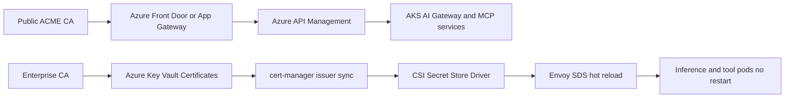
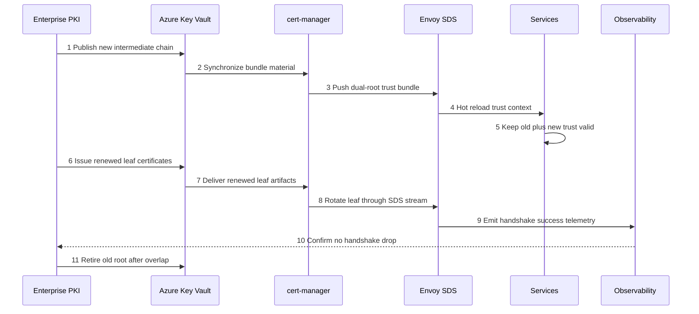
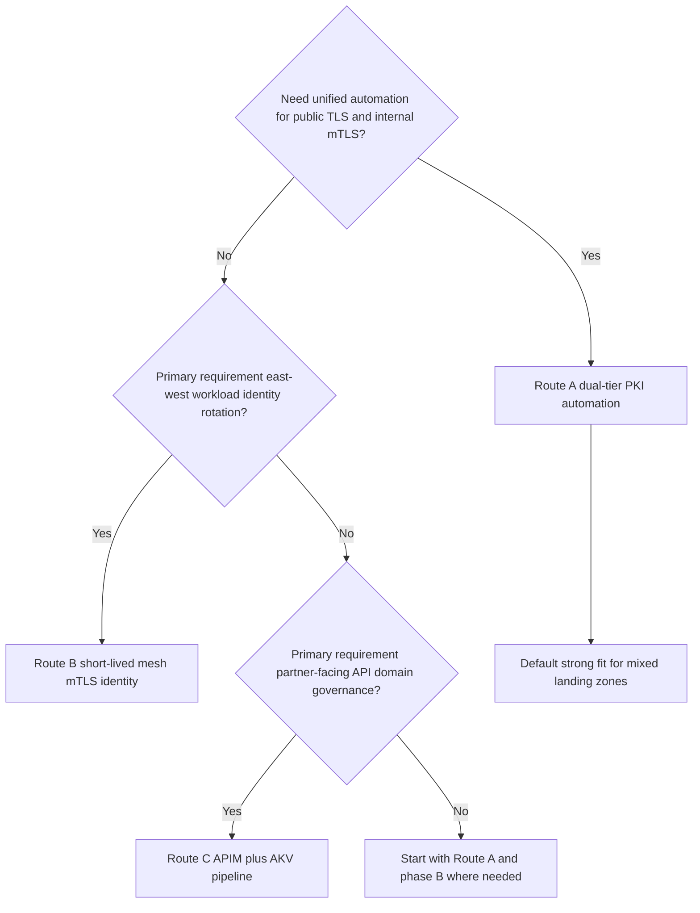

# AI Landing Zone certificate lifecycle selection FAQ: zero-downtime 47-day TLS and mTLS automation on Azure
> **Audience**: cloud and AI solution architects, platform engineering, SRE, enterprise PKI owners, and compliance governance teams.
> **Objective**: keep edge TLS and internal mTLS continuously healthy as certificate validity compresses toward 47 days.

## 1. Executive Summary
Certificate validity compression from 398 to 200 to 100 and then 47 days transforms certificate management into a high-frequency reliability discipline.
Manual ticket-driven renewal and PFX uploads cannot scale under this cadence without introducing recurring outage risk.
Route A provides dual-tier automation for both public edge certificates and internal service certificates with hot reload semantics.
Route B emphasizes short-lived workload identity certificates for east-west traffic and avoids persistent secret artifacts entirely.
Route C centers on APIM and Key Vault automation pipelines for partner-facing north-south API estates with lower Kubernetes footprint.
Route D introduces deterministic failure modes: thumbprint pinning breakage, frequent restart windows, and renewal backlog accumulation.

## 2. Core Pain Points
The first pain point is timeline compression: what used to be annual activity now becomes monthly or even sub-monthly lifecycle execution.
The second pain point is thumbprint coupling in SDKs and integration clients that fail as soon as leaf certificates rotate.
The third pain point is propagation lag between PKI issuance, Key Vault sync, control-plane polling, and runtime trust update.
The fourth pain point is stateful GPU serving impact, where pod restarts evict warm KV-cache and degrade latency and throughput.
The fifth pain point is CA transition orchestration, where insufficient overlap windows can create handshake cliffs during root or intermediate rotation.

## 3. Route A Deep Dive: Dual-Tier Automated PKI
Route A combines managed public edge certificate renewal on Azure Front Door or Application Gateway with cluster-level private certificate automation.
Inside AKS, cert-manager issues or renews internal certificates while Key Vault-backed issuers synchronize enterprise CA policy.
CSI Secret Store Driver and SDS-driven hot reload mechanisms update certificates without restarting inference or gateway pods.
During CA migration, dual-root and dual-intermediate trust bundles preserve continuity while new and old chains overlap intentionally.
This route offers broadest coverage for organizations that must secure both public domains and internal mTLS service meshes.

## 4. Route B Deep Dive: Service-Mesh Short-Lived mTLS Identity
Route B adopts short-lived workload certificates, often 24-hour SVIDs rotated every 12 hours in memory through SDS channels.
Istio Ambient ztunnel, OSM, or SPIFFE-inspired identity frameworks can supply the runtime issuance and validation model.
Intermediate CA keys can be anchored in Azure Key Vault Managed HSM for stronger key governance and audit traceability.
Because rotation is hot and in-memory, GPU inference pods keep warm state and avoid expensive cache rebuild cycles.
The trade-off is operational maturity: teams must manage mesh control-plane reliability and identity policy at scale.

## 5. Route C Deep Dive: APIM + Key Vault + Event Grid Pipeline
Route C focuses on PaaS control-plane automation where APIM binds certificates from Key Vault and renewal workflows are event-driven.
Event Grid can trigger durable renewal functions, CSR workflows, and policy checks against enterprise PKI governance controls.
This pattern is attractive for partner APIs and custom domains where north-south traffic and compliance logging dominate requirements.
Propagation speed may be slower than in-cluster SDS updates, so explicit refresh and timing budgets are essential under short validity periods.
Teams should treat polling and sync upper bounds as hard constraints in renewal scheduling logic.

## 6. Route D Anti-Pattern
Route D relies on manual ITSM tickets, ad-hoc certificate uploads, and application restarts for new material adoption.
At 47-day validity, this creates a high count of recurring change windows and increases human error probability.
Any hardcoded thumbprint dependency turns a healthy automated rotation into immediate handshake failure.
For stateful inference systems, restart-based rollout also destroys expensive warm runtime state and increases recovery lag.

## 7. Architecture Principles and Quantitative Formulas
Treat certificate lifecycle as a measurable SRE and platform engineering contract.
1. Safe renewal trigger window: `T_renew = (2/3) * T_valid`.
2. Grace buffer invariant: `B_grace = (1/3) * T_valid > T_poll,max + T_incident,MTTR`.
3. Annual operational touch multiplier: `M_ops = ceil(365 / T_renew) * N_endpoints`.
4. Dual-CA overlap invariant: `[t_new_trust, t_old_retire] ⊇ [t_leaf_cutover, t_leaf_cutover + T_leaf]`.
5. Cache-eviction cost proxy: `C_cache = N_restart * KV_GiB * P_gpu_hour`.
6. Handshake reliability objective: `SLO_tls = 1 - Fail_handshake / Total_handshake`.

## 8. Mermaid: End-to-End Edge-to-Pod Zero-Restart PKI Topology


## 9. Mermaid: Eleven-Step Dual-Bundle CA Rotation Sequence


## 10. Mermaid: Selection Decision Tree


## 11. Twelve-Dimension Comparison Matrix
| Dimension | Route A | Route B | Route C | Route D |
|---|---|---|---|---|
| Public edge certificate automation coverage | High | Low | High | Low |
| Internal mTLS automation depth | High | High | Medium | Low |
| Pod-restart dependency | None | None | Usually none | Frequent |
| GPU cache preservation | High | High | Medium-high | Low |
| CA migration controllability | High | Medium-high | Medium | Low |
| Operational complexity | Medium-high | High | Medium | Superficially low and practically high |
| Propagation speed | High | High | Medium | Low |
| North-south API fit | High | Medium | High | Low |
| East-west zero-trust fit | High | High | Medium | Low |
| Compliance evidence quality | High | High | High | Low |
| Three-year cost profile | Medium-high | Medium | Medium-high | Low initial and high eventual |
| Recommendation strength | Strong | Conditional strong | Strong | Prohibited |

## 12. Production Python Reference: Chain and Thumbprint Drift Auditor
```python
from __future__ import annotations
from dataclasses import dataclass
from datetime import datetime, timezone

@dataclass(frozen=True)
class CertState:
    subject: str
    thumbprint: str
    not_after: datetime

def days_remaining(cert: CertState) -> int:
    now = datetime.now(timezone.utc)
    return int((cert.not_after - now).total_seconds() // 86400)

def thumbprint_drift(observed: str, expected: str) -> bool:
    return observed.lower() != expected.lower()
```

## 13. Production YAML Reference: cert-manager Certificate plus SDS Hot Reload
```yaml
apiVersion: cert-manager.io/v1
kind: Certificate
metadata:
  name: ai-gateway-mtls-leaf
spec:
  secretName: ai-gateway-mtls
  duration: 720h
  renewBefore: 240h
  issuerRef:
    name: akv-cluster-issuer
    kind: ClusterIssuer
  dnsNames:
    - ai-gateway.prod.internal
---
static_resources:
  secrets:
    - name: sds-mtls-cert
      sds_config:
        path: /var/run/sds/uds_path
```

### Q1: Why trigger renewal at two-thirds of validity even under 47-day certificates
For 47-day validity, a day-31 trigger leaves roughly 16 days for retries, approvals, and incident recovery.
If renewal starts in the final week, one control-plane delay can consume the entire remaining safety margin.
Two-thirds triggering therefore becomes more important as validity compresses, not less.

### Q2: How should APIM or secret-sync lag be budgeted in reliability planning
Use worst-case propagation bounds, not average lag, in grace-buffer equations.
If grace is smaller than polling maximum plus MTTR, expiry windows become mathematically inevitable.
Design by pessimistic timing and operate by real-time telemetry.

### Q3: Why thumbprint pinning becomes unsustainable in high-frequency rotation
Leaf thumbprints change every normal renewal cycle, so pinning turns healthy rotation into false failure.
At 47-day cadence, this quickly becomes chronic operational noise and emergency exceptions.
Prefer chain trust, SAN validation, and issuer-policy constraints over single hash identity assumptions.

### Q4: Why should certificate rotation avoid restarting GPU inference pods
Stateful inference nodes can hold hundreds of GiB of warm KV-cache and context state.
Restart-driven cert reloads discard warm state, increase latency tails, and reduce throughput efficiency.
SDS hot reload decouples trust material lifecycle from compute process lifecycle.

### Q5: What minimum overlap window is practical for dual-root migrations
Overlap should cover at least one complete leaf lifecycle plus cross-region propagation uncertainty.
In global multi-region estates, a 21 to 30 day overlap is a common practical baseline.
Shorter overlap windows increase probability of region-specific trust discontinuities.

### Q6: How large is manual renewal overhead at scale
With `N=400` endpoints and `T_renew=31 days`, annual touch count is about `ceil(365/31)*400 = 4800` operations.
At 20 minutes each, that is approximately 1600 annual labor hours before incident and coordination overhead.
Automation is therefore not optional; it is the only sustainable reliability economics model.

## 14. Enterprise Scenario A: Global Financial AI Gateway with 400-plus Partner Domains
A global financial institution must migrate more than 400 partner mTLS connections and custom domains to 47-day automation.
Its edge stack uses Front Door and APIM, while internal services run on AKS AI gateway clusters.
Route A provides unified automation and Route C governs partner API control-plane workflows.
Dual-CA overlap and handshake observability keep reliability within governance thresholds during migration windows.

## 15. Enterprise Scenario B: ND H200 v5 Stateful vLLM Inference Cluster
A high-throughput inference platform on ND H200 v5 cannot tolerate frequent restart windows during cert rotation.
Route B provides short-lived in-memory mTLS identities with SDS hot rotation, preserving warm KV-cache continuity.
Public edge certificates are still handled through Route A automation, creating layered end-to-end lifecycle control.
The combined pattern sustains both certificate compliance cadence and inference SLA continuity.

## 16. Three-Year TCO Model
| Route | Three-Year Platform Cost | Renewal Operations and Incident Cost | Practical Outcome |
|---|---:|---:|---:|
| Route A | `$4.0M-$5.7M` | Low | High value for mixed edge and cluster estates |
| Route B | `$3.8M-$5.5M` | Low to medium | High value for dense internal mTLS rotation |
| Route C | `$3.3M-$4.9M` | Medium | Medium-high value for centralized API governance |
| Route D | `$2.4M-$3.1M` | Extreme | Prohibited due eventual outage and labor escalation |
Under compressed validity cycles, zero-restart capability and automation depth are dominant TCO drivers.

## 17. Go-Live Acceptance Checklist
1. Verify all public certificates have automated renewal and explicit expiry-risk alerting.
2. Verify internal mTLS certificates can rotate without restarting production workloads.
3. Verify APIM, AKV, CSI, and mesh propagation upper bounds are reflected in grace-window policy.
4. Verify clients no longer enforce static thumbprint pinning and rely on chain-based trust checks.
5. Verify dual-CA overlap windows cover full regional cutover and leaf lifecycle intervals.
6. Verify quarterly rotation drills with preserved forensic evidence and pass-fail criteria.
7. Verify handshake error-rate dashboards and renewal-failure alerts integrate with SRE incident workflows.
8. Verify rollback runbooks can restore known-good trust bundles in minutes.

## 18. Day-2 Operations
Track certificate age distribution, renewal success ratio, handshake failures, and propagation lag continuously.
Segment telemetry by edge public certs, internal service certs, and mesh identity cert classes.
Maintain CMDB integrity so no orphan endpoints remain outside automation coverage.
After each PKI policy change, run full-path handshake replay tests and synthetic canary validation.
Treat regional outliers as leading indicators of control-plane drift or trust-chain inconsistency.

## 19. Authoritative References
- CA/Browser Forum Ballot SC-081v3 certificate-validity compression guidance.
- RFC 8555 ACME protocol specification for automated certificate management.
- Envoy SDS dynamic secret discovery and certificate hot-reload documentation.
- Azure Key Vault certificate lifecycle and Azure API Management TLS binding documentation.
- cert-manager Certificate and Issuer lifecycle references for Kubernetes PKI automation.

## 20. Final Recommendation
For most enterprise landing zones, Route A should be the default backbone because it unifies edge and cluster lifecycle automation.
Introduce Route B on latency-sensitive internal service meshes where restart-free short-lived identity provides material reliability gains.
Use Route C as the operational center for partner-facing API domains and compliance-audited control-plane workflows.
Retire Route D patterns proactively before 47-day cadence turns manageable toil into recurring incidents.
In compressed validity eras, certificate lifecycle engineering is now a core availability architecture function.

## 21. Governance Metrics and Audit Contract
| Metric | Definition | Target | Escalation Action |
|---|---|---|---|
| `cert_renew_success_rate` | Successful automated renewals per cycle | `>= 99.9%` | Trigger P1 reliability incident below target |
| `handshake_failure_rate` | Failed TLS or mTLS handshakes over total | `< 0.1%` | Freeze risky rollout and investigate immediately |
| `pod_restart_due_to_cert` | Workload restarts triggered by cert rotation | `0` | Mandate architecture remediation |
| `thumbprint_pinned_clients` | Clients still hard-pinning leaf thumbprints | `0` | Block release until refactor completes |
| `ca_overlap_coverage_days` | Dual-CA overlap duration before old root retirement | `>= 21` | Delay retirement and revalidate globally |
| `expiry_risk_endpoints` | Endpoints below minimum remaining-cert threshold | `0` | Activate emergency renewal workflow |
Audit evidence bundles should include trust-bundle version, renewal event timeline, propagation telemetry, and incident or approval lineage.

## 22. Ninety-Day Rollout Blueprint
Days 0-30: complete certificate inventory, dependency mapping, and thumbprint-coupling remediation plans.
Days 31-60: canary Route A and Route B on selected edge and internal paths and validate zero-restart behavior.
Days 61-90: scale automation coverage, integrate governance metrics with quarterly audits, and finalize incident playbooks.
At organization level, align PKI, platform, application, and security ownership to prevent handoff ambiguity.
At engineering level, enforce GitOps and versioned trust policy pipelines with review gates.
At operations level, define cert-class-specific SLOs and clear on-call response procedures.
This cadence enables durable reliability under 47-day validity without sacrificing delivery velocity.
