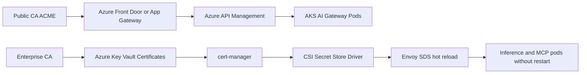
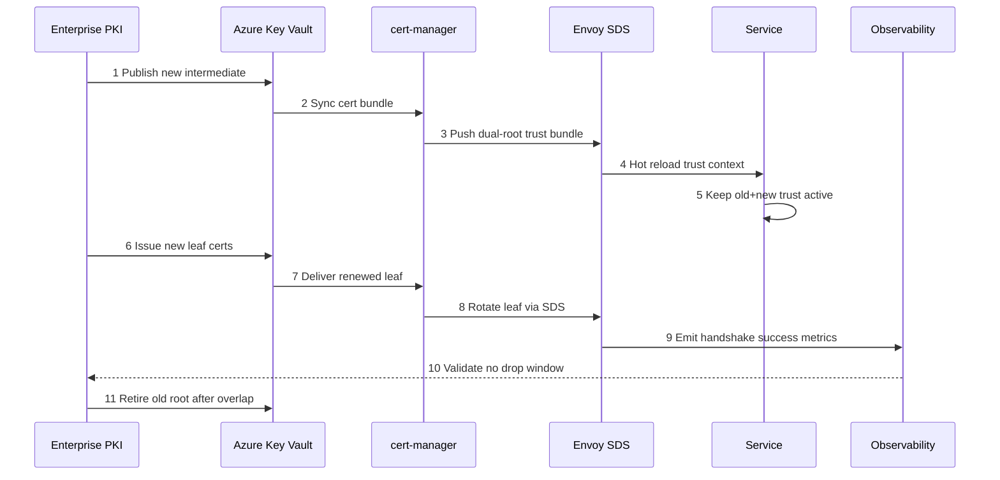
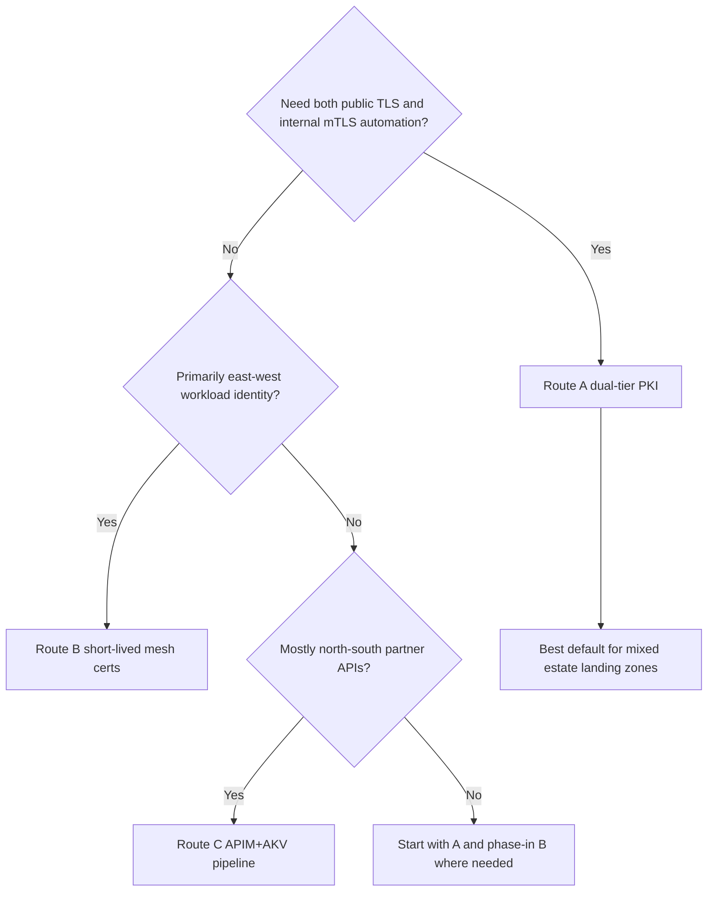

# 企业 AI Landing Zone 证书生命周期选型 FAQ：47 天 TLS/mTLS 自动轮转（cert-manager+AKV vs Mesh CA vs APIM Pipeline）
> **适用对象**：云与 AI 解决方案架构师、平台工程团队、SRE、企业 PKI 与安全治理团队。
> **目标**：在 CA/B Forum 有效期压缩到 47 天后，保持边缘 TLS 与内部 mTLS 零中断自动轮换。

## 1. Executive Summary
证书有效期从 398 天持续压缩到 200、100，再到 47 天，本质是把“偶发运维动作”改写成“高频持续工程能力”。
如果企业还依赖人工工单与手动上传 PFX，变更窗口数量会指数增长，并放大失误概率。
Route A 用双层自动化同时覆盖公网边缘证书与集群内私有证书，适合多数混合场景。
Route B 通过短时工作负载证书把内部 mTLS 做成内存态轮换，最适合高并发 AI 推理网格。
Route C 以 APIM + Key Vault 为中心，运维负担低，适合北南向 API 与合作伙伴域名托管。
Route D 会在 47 天周期下演变为持续性 SEV-1 风险源。

## 2. Core Pain Points
第一类痛点是时间窗口被压缩：过去一年一次的工作，未来可能每月多次触发。
第二类痛点是证书指纹耦合：Agent SDK 或网关代码硬编码 thumbprint，会在叶子证书轮转后瞬间断链。
第三类痛点是同步时延：APIM 与 CSI/SecretStore 的轮询刷新与传播并非实时，必须留足缓冲。
第四类痛点是状态化 GPU 工作负载：重启 Pod 触发证书加载会清空 vLLM KV-cache，造成吞吐与延迟回退。
第五类痛点是跨域信任切换：根/中间 CA 迁移若无双信任重叠，mTLS 会在切换窗口抖动。

## 3. Route A: Dual-Tier Automated PKI for Edge and Cluster
A 路线在边缘层使用 Azure Front Door 或 Application Gateway 托管 ACME 自动续期。
同时在 AKS 内使用 cert-manager 颁发工作负载证书，配合 Key Vault Certificate 自动轮转。
通过 CSI Secret Store Driver 与 Reloader/SDS 热更新，实现无 Pod 重启证书切换。
当企业 CA 更换时，采用双根/双中间证书并行信任窗口，保证新旧链路重叠。
该路线覆盖面最全，既能满足公网域名治理，也能满足内部服务网格与 MCP 工具链 mTLS。

## 4. Route B: Service-Mesh Short-Lived mTLS Identity
B 路线核心是 24 小时短证书、12 小时轮换，证书全程内存态，不落盘。
Istio Ambient ztunnel、OSM 或 SPIFFE/SPIRE 模型可作为实现基础。
中间 CA 锚定在 Azure Key Vault Managed HSM，审计链与密钥保护更完整。
轮换通过 Envoy SDS 推送，不需要重启推理 Pod，避免 GPU 热状态丢失。
该路线对东西向流量安全收益显著，但对团队的网格运维能力有更高要求。

## 5. Route C: APIM + AKV + Event Grid Renewal Pipeline
C 路线把重点放在 PaaS 控制面：APIM 绑定 Key Vault 证书并由 Event Grid 触发续期流水线。
CSR 签发可以对接企业 PKI，适合合作伙伴 API、自定义域名和 B2B 集成场景。
优势是 Kubernetes 足迹小、职责清晰、合规审计链集中。
不足是传播速度通常慢于集群内即时热更新，某些场景需显式 refresh 才能缩短收敛时间。
当有效期仅 47 天时，必须把轮询上界纳入续期缓冲预算。

## 6. Route D Anti-Pattern
D 路线以手工工单、人工上传 PFX、应用重启加载新证书为主。
在 47 天周期下，每年单端点至少 8 次以上变更窗口，跨系统协同难度极高。
一旦 thumbprint 被写死在客户端，叶子轮转后将出现即时握手失败。
对状态化推理集群而言，重启触发的缓存丢失会直接拉低实时 SLA。

## 7. Architecture Principles and Quantitative Formulas
建议将证书生命周期治理写成硬性数学约束。
1. 安全续期触发窗口：`T_renew = 2/3 * T_valid`。
2. 缓冲不变量：`B_grace = 1/3 * T_valid > T_poll,max + T_incident,MTTR`。
3. 年度运维触点：`M_ops = ceil(365 / T_renew) * N_endpoints`。
4. 双 CA 重叠不变量：`[t_new_trust, t_old_retire] ⊇ [t_leaf_cutover, t_leaf_cutover + T_leaf]`。
5. 缓存损失代价：`C_cache = N_restart * KV_GiB * P_gpu_hour`。
6. 失效率预算：`SLO_tls = 1 - Fail_handshake / Total_handshake`。

## 8. Mermaid: Edge-to-Pod Zero-Restart PKI Topology


## 9. Mermaid: 11-Step Dual-CA Rotation without mTLS Drop


## 10. Mermaid: Selection Decision Tree


## 11. 12-Dimension Comparison Matrix
| 维度 | Route A | Route B | Route C | Route D |
|---|---|---|---|---|
| 公网证书自动化覆盖 | 高 | 低 | 高 | 低 |
| 内部 mTLS 自动轮换 | 高 | 高 | 中 | 低 |
| 是否需要 Pod 重启 | 否 | 否 | 通常否 | 常见需要 |
| GPU 缓存保留能力 | 高 | 高 | 中高 | 低 |
| CA 切换可控性 | 高 | 中高 | 中 | 低 |
| 运维复杂度 | 中高 | 高 | 中 | 表面低/实质高 |
| 传播速度 | 高 | 高 | 中 | 低 |
| 北南向 API 适配 | 高 | 中 | 高 | 低 |
| 东西向零信任适配 | 高 | 高 | 中 | 低 |
| 合规审计链完整性 | 高 | 高 | 高 | 低 |
| 三年综合成本 | 中高 | 中 | 中高 | 低初期/高长期 |
| 推荐级别 | 强烈推荐 | 条件强推荐 | 强推荐 | 禁用 |

## 12. Python Reference: Chain and Thumbprint Drift Auditor
```python
from __future__ import annotations
from dataclasses import dataclass
from datetime import datetime, timezone

@dataclass(frozen=True)
class CertState:
    subject: str
    thumbprint: str
    not_after: datetime

def days_left(cert: CertState) -> int:
    now = datetime.now(timezone.utc)
    return int((cert.not_after - now).total_seconds() // 86400)

def drift_detected(observed_thumbprint: str, expected_thumbprint: str) -> bool:
    return observed_thumbprint.lower() != expected_thumbprint.lower()
```

## 13. YAML Reference: cert-manager Certificate + Envoy SDS
```yaml
apiVersion: cert-manager.io/v1
kind: Certificate
metadata:
  name: ai-gateway-mtls-leaf
spec:
  secretName: ai-gateway-mtls
  duration: 720h
  renewBefore: 240h
  issuerRef:
    name: akv-cluster-issuer
    kind: ClusterIssuer
  dnsNames:
    - ai-gateway.prod.internal
---
static_resources:
  secrets:
    - name: sds-mtls-cert
      sds_config:
        path: /var/run/sds/uds_path
```

### Q1: 47 天周期下，为什么仍按 2/3 生命周期触发续期
47 天下若第 31 天触发续期，仍可保留约 16 天缓冲，用于处理失败重试与事故修复。
若拖到最后一周才处理，任何审批或传播延迟都可能直接撞上到期边界。
因此 `T_renew = 2/3 * T_valid` 在短周期下反而更关键。

### Q2: APIM/AKV 轮询延迟如何纳入风险预算
应把最坏传播时间 `T_poll,max` 纳入缓冲不变量，而不是用平均值估算。
只要 `B_grace` 小于传播上界加 MTTR，总会出现窗口性风险。
生产策略应按最坏时延设计，按平均时延运营。

### Q3: 指纹绑定为何在自动轮转时代不可持续
Thumbprint 每次叶子更新都会变化，绑定行为会把“正常续期”误判为“安全异常”。
在 47 天节奏下，这种误判会从偶发变成常态，导致持续手工豁免。
应改为链信任与 SAN/Issuer 校验，而非单值指纹硬绑定。

### Q4: 为什么证书轮换必须避免重启 GPU 推理 Pod
状态化推理节点的 KV-cache 可能以百 GiB 计，重启会带来明显冷启动回退。
缓存回填期间，P95 延迟和单位成本都会恶化。
SDS 热加载能把证书变更与业务计算生命周期解耦。

### Q5: 双根双中间重叠窗口最短应设多长
至少覆盖一轮完整叶子证书生命周期与跨区域传播窗口。
在全球多 Region 环境，通常建议重叠窗口不小于 21-30 天。
窗口过短会在尾部区域形成握手断崖。

### Q6: 如何量化人工工单模式的运维爆炸
假设 `N=400` 端点，`T_renew=31` 天，年度触点约 `ceil(365/31)*400=4800` 次。
即使单次仅 20 分钟，也意味着每年约 1600 工时的纯轮换操作。
自动化不足时，这部分工作会直接挤压可靠性改进与架构演进预算。

## 14. Enterprise Scenario A: Global Financial AI Gateway
某全球金融机构需要在 400+ 合作伙伴域名与 mTLS 连接上实现 47 天证书自动化。
其北南向入口使用 Front Door + APIM，内部服务运行在 AKS AI Gateway 集群。
Route A 作为主干可统一治理边缘与内部证书，Route C 负责合作伙伴 API 证书流程。
通过双 CA 重叠与链路观测，变更窗口内握手成功率保持在目标阈值之上。

## 15. Enterprise Scenario B: ND H200 v5 Stateful vLLM Cluster
某推理平台在 ND H200 v5 上承载高并发 vLLM，Pod 重启会造成显著 KV-cache 回填成本。
平台采用 Route B 的短时 mTLS 证书与 SDS 热更新，避免证书轮转触发重启。
边缘域名仍由 Route A 自动续期，形成“边缘+内部”双轨治理。
最终实现证书高频轮转与推理 SLA 并存。

## 16. 3-Year TCO Model
| 路线 | 三年平台成本 | 轮换运维与事故成本 | 综合结论 |
|---|---:|---:|---:|
| Route A | `$4.0M-$5.7M` | 低 | 高价值，适配混合边缘与集群场景 |
| Route B | `$3.8M-$5.5M` | 低到中 | 高价值，适配高密度内部 mTLS |
| Route C | `$3.3M-$4.9M` | 中 | 中高价值，适配 API 管理中心化组织 |
| Route D | `$2.4M-$3.1M` | 极高 | 禁用，长期成本与事故风险最高 |
在短有效期时代，自动化覆盖率与零重启能力是成本拐点核心变量。

## 17. Go-Live Acceptance Checklist
1. 验证所有公网证书具备自动续期能力与到期告警闭环。
2. 验证内部 mTLS 证书可在不重启业务 Pod 的情况下热更新。
3. 验证 APIM/AKV/CSI 的传播最坏时延并纳入续期缓冲预算。
4. 验证客户端不再使用 thumbprint 硬绑定，而使用链与 SAN 校验。
5. 验证双 CA 重叠窗口覆盖全区域叶子切换周期。
6. 验证证书轮转演练至少季度执行一次并留存审计证据。
7. 验证握手失败率、到期风险与轮转失败告警接入统一 SRE 看板。
8. 验证应急回退流程支持分钟级证书回滚与路由切换。

## 18. Day-2 Operations
上线后需持续监控证书剩余天数分布、续期成功率、握手失败率与传播时延。
任何单区域的异常峰值都可能反映 CA 链路漂移或控制面延迟放大。
建议按证书类型分层监控：公网边缘证书、内部服务证书、网格身份证书。
同时维护证书资产 CMDB，防止孤儿域名或遗留端点脱离自动化。
每次 PKI 策略调整后，应执行一次全链路握手压测与回放验证。

## 19. Authoritative References
- CA/Browser Forum Ballot SC-081v3 与证书有效期压缩路线图。
- RFC 8555 ACME 协议规范与自动签发机制。
- Envoy SDS 动态证书分发与热更新文档。
- Azure Key Vault Certificates、APIM TLS 绑定与自动轮转文档。
- cert-manager 官方 `Certificate` 与 `Issuer` 生命周期管理指南。

## 20. Final Recommendation
对大多数企业 Landing Zone，建议以 Route A 作为默认主干。
若内部服务网格规模大、证书更新频率高，建议在关键路径引入 Route B。
以 APIM 为核心的对外 API 集成场景，可将 Route C 作为运营主轴。
任何依赖人工轮转与重启加载证书的 Route D 都应在生产中淘汰。
短有效期时代，证书治理已经从“安全附属项”升级为“可用性基础设施”。

## 21. Governance Metrics and Audit Contract
| 指标 | 定义 | 建议阈值 | 升级动作 |
|---|---|---|---|
| `cert_renew_success_rate` | 周期内自动续期成功率 | `>= 99.9%` | 低于阈值触发 P1 排障 |
| `handshake_failure_rate` | TLS/mTLS 握手失败占比 | `< 0.1%` | 触发灰度冻结 |
| `pod_restart_due_to_cert` | 因证书轮转导致重启次数 | `0` | 触发架构整改 |
| `thumbprint_pinned_clients` | 仍使用指纹硬绑定客户端数 | `0` | 阻断发布 |
| `ca_overlap_coverage_days` | 新旧 CA 重叠覆盖天数 | `>= 21` | 延后旧 CA 退役 |
| `expiry_risk_endpoints` | 剩余寿命低于阈值端点数 | `0` | 启动应急轮转 |
审计包应包含：证书链版本、续期事件、传播时间线、告警工单与验证报告。

## 22. 90-Day Rollout Blueprint
第 0-30 天：完成证书资产普查、轮转路径梳理、thumbprint 依赖清理计划。
第 31-60 天：在一条边缘入口与一组内部服务灰度 Route A/B，验证零重启链路。
第 61-90 天：扩展到全域并把指标接入季度治理与合规审计流程。
组织上需统一 PKI、平台、应用、安全四方责任边界，避免轮转责任悬空。
工程上需将证书策略与配置版本化，纳入 GitOps 变更审计。
运维上需设置按证书类型分层的 SLO 与值班手册。
通过该节奏，可在 47 天有效期时代保持稳定交付与高可用运行。
