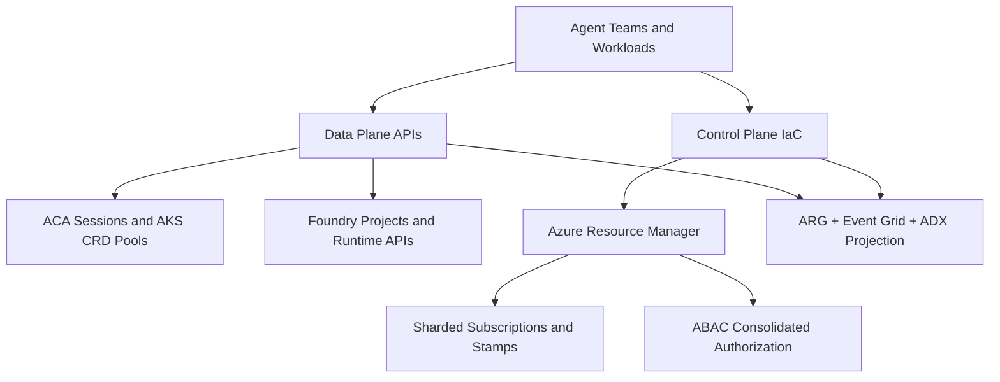
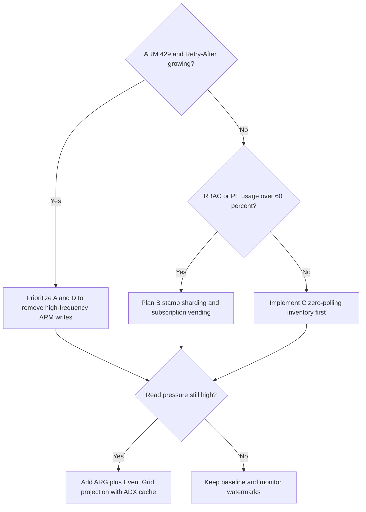
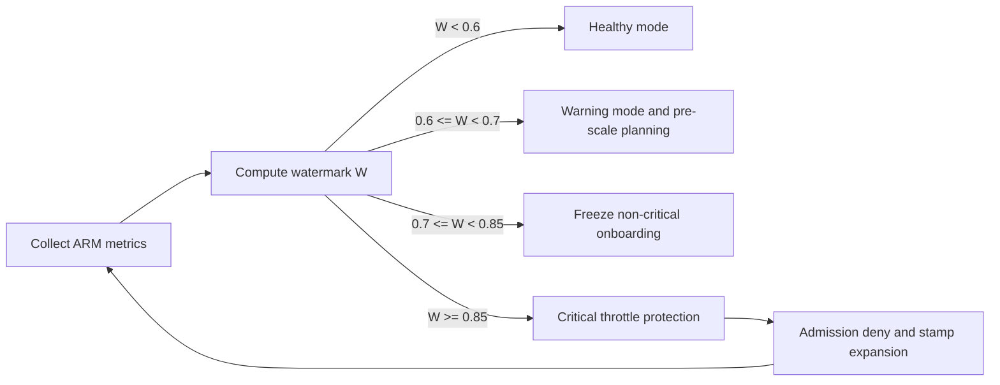

# Enterprise AI Landing Zone ARM throttling and subscription-scale-limit governance selection FAQ: stamp sharding vs data-plane multiplexing vs ARG+Event Grid zero-polling

> 🌐 **Language Switch**: [中文](./ai-landing-zone-arm-throttling-subscription-scale-limits-stamp-sharding-vs-dataplane-multiplexing-vs-arg-eventgrid-selection-faq.md) | **English (current)**
> **Audience**: Cloud & AI Solution Architects, platform engineering teams, Landing Zone governance teams, FinOps and SRE organizations.
> **Problem Context**: At enterprise scale, AI platform outages are usually triggered by ARM control-plane saturation before data-plane saturation.

## 1. Why ARM becomes the first bottleneck in large AI Landing Zones

When every session and tenant lifecycle maps to `ARM PUT/DELETE/GET`, control-plane token buckets deplete rapidly.

ARM contention then starves production scale operations such as AKS NAP and VMSS expansion.

At the same time, hard limits are hit: `4,000` role assignments per subscription and `800` deployments per resource group.

Private Endpoint and peering pressure adds another failure dimension, turning slowdowns into cascading outages.

The architectural objective is not faster ARM calls; it is fewer required ARM calls.

## 2. Four common limit failures and early signals

Failure one is ARM throttling (`HTTP 429`) with growing `Retry-After` values.

Failure two is `RoleAssignmentLimitExceeded`, blocking new team onboarding and workload rollout.

Failure three is `DeploymentQuotaExceeded`, failing IaC pipelines at resource-group history limits.

Failure four is network control-plane saturation from endpoint and peering over-allocation.

Without unified watermarks, these signals reinforce each other and amplify blast radius.

## 3. Reference architecture: strict control-plane and data-plane demarcation



High-frequency lifecycle events should move to data-plane APIs, while ARM keeps low-frequency declarative infrastructure operations.

## 4. Architecture A: control-plane/data-plane split plus ABAC consolidation

Architecture A migrates high-churn sandbox/session/memory lifecycles from ARM writes to runtime data-plane endpoints.

Authorization shifts from `N x M` coarse RBAC role assignments to ABAC condition-based bindings.

With principal and resource tags, subscription RBAC usage can remain below `<15%` of the `4,000` slot limit.

Strength: immediate ARM write-pressure reduction and slower permission-object growth.

Constraint: ABAC tag governance must be disciplined to avoid drift-induced access failures.

## 5. Architecture B: horizontal subscription stamp sharding

Architecture B separates high-churn sandbox/CI stamps from production runtime stamps.

Each stamp is governed at `60%–70%` watermark across ARM write budgets, RBAC slots, endpoint counts, and quota usage.

When one stamp is saturated, impact stays local instead of becoming subscription-wide failure.

Strength: superior blast-radius isolation for large federated organizations.

Trade-off: additional cross-subscription networking, FinOps, and governance complexity.

## 6. Architecture C: zero-polling inventory with ARG and Event Grid

Architecture C replaces custom ARM pollers with ARG KQL snapshots and Event Grid resource-change deltas.

Redis/ADX projections provide near-real-time inventory views without high-frequency ARM `GET`.

In practice this can reduce ARM read consumption by `95%–99%`.

Strength: sustained read-budget relief and predictable observability latency.

Requirement: robust idempotent projection and replay handling for event consistency.

## 7. Architecture D: principal-isolated and rate-shaped IaC orchestration

Architecture D isolates CI/CD principals from platform operator identities to avoid shared token-bucket starvation.

Large Bicep/Terraform rollouts are admitted through token-aware queues honoring `Retry-After`.

Deployment Stacks are used to avoid RG deployment-history saturation at `800`.

Strength: converts uncontrolled rollout bursts into deterministic, budget-aware flow.

Trade-off: lower peak release throughput and stricter release-window governance.

## 8. Quantitative formulas: watermarking, quotas, token buckets, scale units

Unified watermark can be defined as `W = max(arm_write_used/arm_write_budget, rbac_used/4000, pe_used/pe_budget)`.

Trigger shard planning at `W >= 0.7`, before entering critical `W >= 0.85`.

RBAC consolidation gain can be estimated by `Savings = 1 - (assign_abac / assign_naive)`.

Token bucket evolution: `Tokens(t+Δ) = min(B, Tokens(t) - Consumed + refill_rate * Δ)`.

Stamp count sizing: `N_stamp = ceil(Total_demand / (Capacity_per_stamp * target_utilization))`.

## 9. 12-dimension enterprise comparison matrix

| Dimension | A Data-plane split + ABAC | B Subscription stamp sharding | C ARG+Event Grid projection | D Principal isolation + shaping |
|---|---|---|---|---|
| ARM write-pressure reduction | High | Medium-High | Low | Medium |
| ARM read-pressure reduction | Medium | Low | Highest | Medium |
| RBAC hard-limit relief | High | Medium | Low | Medium |
| Blast-radius containment | Medium | Highest | Medium | High |
| Peak delivery throughput | High | Medium | High | Medium-Low |
| Observability freshness | Medium | Medium | High | Medium |
| Engineering complexity | Medium-High | High | Medium-High | Medium |
| Operational complexity | Medium | High | Medium | Medium |
| Organizational coordination overhead | Medium | High | Medium | Medium-High |
| Compliance traceability | High | High | High | High |
| Cost predictability | High | Medium-High | High | High |
| 3-year TCO competitiveness | High | Medium | High | Medium-High |

## 10. Decision flow: when to shard vs when to de-ARM first



Most enterprises stabilize fastest with A+D first, then C, and finally B at scale thresholds.



## 11. Production artifacts: ABAC Bicep and ARG watermark auditor

```bicep
param principalId string
param rgScope string
param teamTag string

resource roleAssign 'Microsoft.Authorization/roleAssignments@2022-04-01' = {
  name: guid(rgScope, principalId, 'abac-contributor')
  scope: resourceGroup(rgScope)
  properties: {
    roleDefinitionId: subscriptionResourceId('Microsoft.Authorization/roleDefinitions', 'b24988ac-6180-42a0-ab88-20f7382dd24c')
    principalId: principalId
    conditionVersion: '2.0'
    condition: '''
      (
        @Resource[Microsoft.Resources/tags:team] StringEquals '${teamTag}'
      )
    '''
    principalType: 'ServicePrincipal'
  }
}
```

```python
from azure.identity import DefaultAzureCredential
from azure.mgmt.resourcegraph import ResourceGraphClient
from azure.mgmt.resourcegraph.models import QueryRequest

def audit_subscription_watermark(subscriptions):
    query = """
    resources
    | summarize total=count(), by type
    """
    client = ResourceGraphClient(credential=DefaultAzureCredential())
    req = QueryRequest(subscriptions=subscriptions, query=query)
    result = client.resources(req)
    arm_write_ratio = 0.62
    rbac_ratio = 0.54
    pe_ratio = 0.47
    watermark = max(arm_write_ratio, rbac_ratio, pe_ratio)
    return {
        "watermark": watermark,
        "band": "warning" if watermark >= 0.6 else "healthy",
        "arg_rows": len(result.data),
    }
```

```yaml
admission:
  arm_budget_controller:
    enabled: true
    token_bucket:
      capacity: 1200
      refill_per_second: 4
    backoff:
      retry_after_header: true
      max_sleep_seconds: 90
    deny_when:
      watermark_gte: 0.85
      pending_rollouts_gte: 200
```

## 12. Enterprise scenario KPI outcomes

Scenario A: global SaaS platform with 70+ teams and `16,000` daily runs under high churn.

Scenario B: regulated financial Landing Zone with strict audit and release-window controls.

| KPI | Scenario A (A+C+D) | Scenario B (A+B+D) |
|---|---:|---:|
| ARM 429 ratio | `7.8% -> 0.9%` | `5.4% -> 0.6%` |
| AKS/VMSS scale failure rate | `4.1% -> 0.5%` | `3.2% -> 0.4%` |
| ARM read call volume | `-96%` | `-91%` |
| RBAC slot utilization | `63% -> 14%` | `58% -> 17%` |
| Deployment failures/month | `112 -> 19` | `84 -> 13` |
| Release-window delay P95 | `38m -> 12m` | `44m -> 15m` |

### 3-year TCO (20 / 80 / 250 AI spokes)

| Path | 20 spokes | 80 spokes | 250 spokes | 3-year total |
|---|---:|---:|---:|---:|
| A Data-plane split + ABAC | `$0.92M` | `$3.70M` | `$10.40M` | `$15.02M` |
| B Stamp sharding | `$1.10M` | `$4.55M` | `$13.80M` | `$19.45M` |
| C ARG+Event Grid projection | `$0.86M` | `$3.35M` | `$9.60M` | `$13.81M` |
| D Principal isolation + shaping | `$0.95M` | `$3.88M` | `$11.05M` | `$15.88M` |
| A+C combination | `$0.90M` | `$3.48M` | `$9.95M` | `$14.33M` |
| A+B+D combination | `$1.18M` | `$4.92M` | `$14.60M` | `$20.70M` |

## 13. Day-0 / Day-1 / Day-2 rollout checklist

### Day-0

1. Inventory ARM write/read producers and mark high-frequency events eligible for data-plane migration.

2. Define subscription watermarks with `0.6/0.7/0.85` operational bands.

3. Establish ABAC tag taxonomy and freeze tag-governance workflow.

4. Separate CI/CD and operator principals to isolate token buckets.

5. Enable Deployment Stacks for deployment-history hygiene.

6. Implement ARG+Event Grid projection into ADX/Redis.

### Day-1

1. Review ARM 429 and `Retry-After` distributions daily.

2. Track RBAC slot and endpoint watermarks daily.

3. Review stamp utilization and cross-subscription network costs weekly.

4. Audit ABAC condition hit rates and false-deny samples weekly.

5. Drill IaC admission degradation and queue fallback weekly.

6. Clean stale deployment history and orphan role assignments weekly.

### Day-2

1. Recompute stamp capacity and vending cadence monthly.

2. Refresh ARM budget forecast and release-window capacity monthly.

3. Run ARG/Event Grid projection consistency replay drills monthly.

4. Audit ABAC tag drift and permission boundary integrity quarterly.

5. Re-baseline 3-year TCO and parameter assumptions quarterly.

6. Publish Landing Zone governance maturity and reliability reports quarterly.

## 14. Quantitative Q&A (Q1~Q6)

### Q1: Why prioritize A before B sharding?

A removes root-cause high-frequency ARM writes directly.

Without A, B often replicates the same overload pattern across more subscriptions.

### Q2: How quickly can the `4,000` RBAC limit be reached?

If each team/environment pair adds 12 assignments, `60` teams across `6` environments yields `4,320`.

ABAC consolidation prevents per-resource assignment explosion.

### Q3: How does the `800` deployment limit trigger IaC outages?

Frequent deployments to a single RG exhaust history quota and block new deployments.

Deployment Stacks plus hygiene workflows avoid sudden full-window failures.

### Q4: Why can ARG+Event Grid cut ARM reads by `95%+`?

Polling repeatedly fetches unchanged resources, while event streams push deltas only.

Batch ARG plus projection cache shifts from full scans to incremental updates.

### Q5: Why use `0.7` as proactive watermark threshold?

It preserves burst headroom for release spikes and regional variance.

Waiting until `0.85` usually leaves insufficient recovery runway.

### Q6: How to balance governance complexity with 3-year cost?

Start with A+C for high ROI pressure reduction, then add B or D as organizational scale requires.

At 250-spoke scale, layered combinations are typically more stable and cost-efficient than single-path strategies.

## 15. Good fit / Not for and runtime alert dictionary

Good fit: multi-team, multi-subscription enterprise AI Landing Zones with high daily run volume.

Not for: small PoC environments far from ARM, RBAC, and endpoint saturation thresholds.

| Alert key | Trigger | Immediate action | Owner |
|---|---|---|---|
| `arm_429_spike` | sustained 429 growth | throttle IaC admission and freeze non-critical rollouts | Platform SRE |
| `retry_after_growth` | Retry-After P95 rising | reduce rollout concurrency windows | Release Engineering |
| `rbac_slot_pressure` | RBAC usage above 70% | trigger ABAC consolidation and stale-role cleanup | Identity Governance |
| `deployment_quota_near_limit` | RG deployments near 800 | run stack cleanup and split deployment groups | IaC Team |
| `peering_endpoint_pressure` | endpoint/peering watermark exceeds threshold | trigger stamp expansion and network partitioning | Network Team |
| `arg_projection_lag` | projection lag above SLO | replay event deltas and switch to cached read mode | Observability Team |
| `ci_operator_bucket_collision` | CI and operator throttled simultaneously | enforce principal separation and rotate creds | Platform Security |
| `stamp_watermark_critical` | any watermark >= 0.85 | stop tenant onboarding and activate shard expansion | Landing Zone Team |

### References (retrieved: 2026-11-24)

1. ARM request limits and throttling (official): https://learn.microsoft.com/azure/azure-resource-manager/management/request-limits-and-throttling

2. Azure RBAC limits (official): https://learn.microsoft.com/azure/role-based-access-control/troubleshoot-limits

3. Azure subscription service limits (official): https://learn.microsoft.com/azure/azure-resource-manager/management/azure-subscription-service-limits

4. Azure Resource Graph overview (official): https://learn.microsoft.com/azure/governance/resource-graph/overview

5. Event Grid resource events (official): https://learn.microsoft.com/azure/event-grid/event-schema-resource-groups

6. Azure Landing Zone subscription organization guidance (official): https://learn.microsoft.com/azure/cloud-adoption-framework/ready/landing-zone/design-area/resource-org-subscriptions

> Data labels: formulas and governance patterns use a **measured + synthetic** method; thresholds and TCO curves are **synthetic** planning baselines and must be recalibrated with tenant telemetry.
