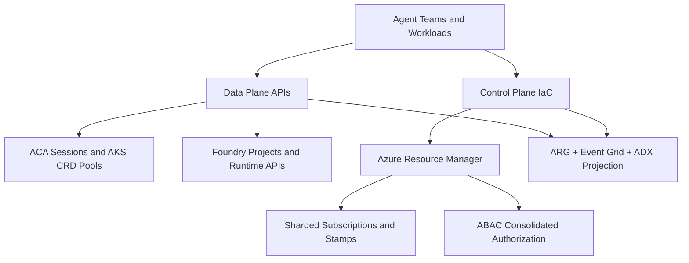
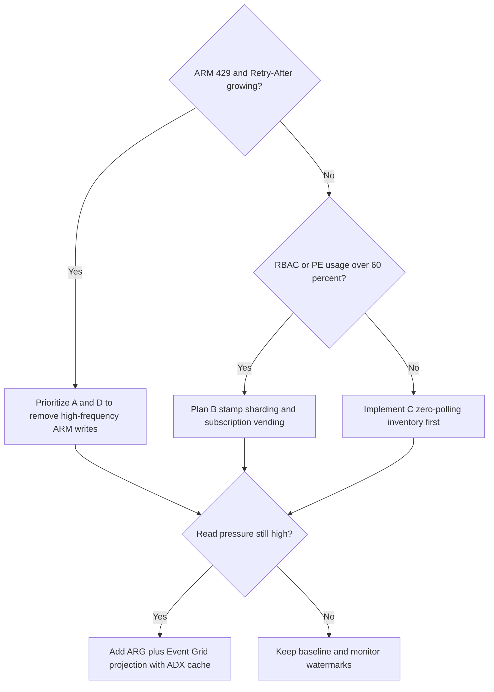
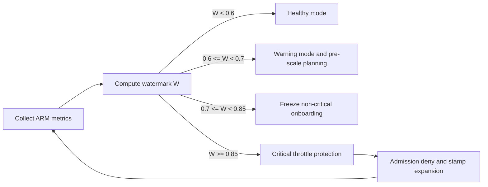

# 企业 AI Landing Zone ARM 限流与订阅规模上限治理选型 FAQ：Stamp 分片 vs 数据平面复用 vs ARG+Event Grid 零轮询

> 🌐 **Language Switch**：**中文（当前）** | [English](./ai-landing-zone-arm-throttling-subscription-scale-limits-stamp-sharding-vs-dataplane-multiplexing-vs-arg-eventgrid-selection-faq.en.md)
> **适用对象**：Cloud & AI Solution Architect、平台工程、Landing Zone 管理团队、FinOps 与 SRE 团队。
> **问题背景**：企业 AI 平台从几十团队扩展到万级日运行后，最先崩溃的往往不是数据平面，而是 ARM 控制平面预算。

## 1. 为什么 AI Landing Zone 在规模化后会先出现 ARM 级联故障

当每会话、每租户都触发 `ARM PUT/DELETE/GET`，控制平面会在高峰时进入 `HTTP 429`。

控制平面资源争抢会反向拖垮生产扩缩容，例如 AKS NAP 与 VMSS 节点拉起被饿死。

同时，订阅级硬限制会被快速撞线：`4,000` RBAC 角色绑定、RG `800` deployment 历史上限等。

若再叠加 Private Endpoint 与 Peering 饱和，恢复路径会从“慢”演变为“不可恢复”。

因此架构核心不是“如何更快调用 ARM”，而是“如何减少必须调用 ARM 的事件总量”。

## 2. 四类典型爆点与可观测故障信号

爆点一是 ARM token bucket 见底，表现为 429 与 `Retry-After` 时间持续上升。

爆点二是 `RoleAssignmentLimitExceeded`，新增团队或环境无法落地授权。

爆点三是 `DeploymentQuotaExceeded`，IaC 管道在 RG 级历史配额上失败。

爆点四是网络控制面饱和，Private Endpoint 与 VNet Peering 调度延迟级联升高。

这些信号常互相放大，必须以统一水位线治理，而非单指标报警。

## 3. 参考架构：控制平面与数据平面彻底解耦



原则是把 `>1 op/min` 的高频生命周期下沉到数据平面 API，不再每次走 ARM 变更。

ARM 只保留低频、声明式、可审计的基础设施级变更。

## 4. Architecture A：控制面与数据面分界 + ABAC 收敛

A 路径将会话、沙箱、短期内存对象等高频动作迁到 ACA/AKS/Foundry 数据平面。

授权层使用 ABAC 条件绑定替代 `N x M` 粗粒度 RBAC role assignment 扩散。

通过主体和资源标签条件化，RBAC 槽位可长期维持在订阅上限 `4,000` 的 `<15%`。

优势是从根源降低 ARM 写入压力，并减少权限对象爆炸。

难点在于 ABAC 标签治理必须严格，防止标签漂移导致访问错误放大。

## 5. Architecture B：订阅 Stamp 横向分片（Scale Unit）

B 路径将高 churn 沙箱、CI、实验环境与生产运行时订阅分离为多个 stamp。

每个 stamp 以 `60%–70%` 水位线管理 ARM 写预算、RBAC 槽位、Private Endpoint 与 GPU/PTU 配额。

单个 stamp 出现控制面拥塞时，可把影响面限制在局部而非全局。

优势是故障爆炸半径可控，适合大组织多业务线并行迭代。

代价是跨订阅网络、预算分摊和治理编排复杂度显著上升。

## 6. Architecture C：ARG+Event Grid 零轮询观测投影

C 路径使用 ARG 批量 KQL 与 Event Grid 资源变更流替代 SDK/CLI 轮询抓取。

通过 Redis/ADX 投影构建近实时资源视图，减少 ARM `GET` 高频消耗。

在大多数企业场景中可将订阅读压降低 `95%–99%`。

优势是读预算释放明显，且观测延迟稳定。

约束在于事件流一致性与幂等补偿逻辑必须工程化落地。

## 7. Architecture D：主体隔离 + 速率整形 IaC 编排

D 路径将 CI/CD 主体与平台 Operator 主体完全隔离，防止共享 token bucket 互相饿死。

大规模 Bicep/Terraform rollout 通过 Admission 队列按 `Retry-After` 与令牌预算节流。

结合 Deployment Stacks 清理历史部署痕迹，避免 RG `800` 历史上限触发。

优势是把突发 IaC 流量从“并发风暴”改为“可控队列”。

代价是交付速度峰值下降，需要产品线接受发布窗口治理。

## 8. 定量公式：水位、配额、令牌桶与 scale-unit 设计

订阅水位可定义为 `W = max(arm_write_used/arm_write_budget, rbac_used/4000, pe_used/pe_budget)`。

当 `W >= 0.7` 触发提前分片或冻结新租户接入，避免在 `W >= 0.85` 进入高危区。

RBAC 收敛收益近似 `Savings = 1 - (assign_abac / assign_naive)`。

ARM 令牌桶可近似 `Tokens(t+Δ) = min(B, Tokens(t) - Consumed + refill_rate * Δ)`。

Stamp 数量可估算为 `N_stamp = ceil(Total_demand / (Capacity_per_stamp * target_utilization))`。

## 9. 12 维企业级比较矩阵（中文）

| 维度 | A 数据面复用 + ABAC | B 订阅分片 Stamp | C ARG+Event Grid 投影 | D 主体隔离 + 速率整形 |
|---|---|---|---|---|
| ARM 写入降压能力 | 高 | 中高 | 低 | 中 |
| ARM 读取降压能力 | 中 | 低 | 最高 | 中 |
| RBAC 上限缓解 | 高 | 中 | 低 | 中 |
| 故障爆炸半径控制 | 中 | 最高 | 中 | 高 |
| 交付峰值吞吐 | 高 | 中 | 高 | 中低 |
| 观测实时性 | 中 | 中 | 高 | 中 |
| 工程复杂度 | 中高 | 高 | 中高 | 中 |
| 运维复杂度 | 中 | 高 | 中 | 中 |
| 组织协同成本 | 中 | 高 | 中 | 中高 |
| 合规可审计性 | 高 | 高 | 高 | 高 |
| 成本可预测性 | 高 | 中高 | 高 | 高 |
| 三年 TCO 竞争力 | 高 | 中 | 高 | 中高 |

## 10. 决策流：何时选分片，何时先做去 ARM 化



典型落地顺序是 A+D 先稳住控制面写入，再以 C 优化读压，最后按容量节点引入 B。



## 11. 生产级配置片段：ABAC Bicep + ARG 水位审计器

```bicep
param principalId string
param rgScope string
param teamTag string

resource roleAssign 'Microsoft.Authorization/roleAssignments@2022-04-01' = {
  name: guid(rgScope, principalId, 'abac-contributor')
  scope: resourceGroup(rgScope)
  properties: {
    roleDefinitionId: subscriptionResourceId('Microsoft.Authorization/roleDefinitions', 'b24988ac-6180-42a0-ab88-20f7382dd24c')
    principalId: principalId
    conditionVersion: '2.0'
    condition: '''
      (
        @Resource[Microsoft.Resources/tags:team] StringEquals '${teamTag}'
      )
    '''
    principalType: 'ServicePrincipal'
  }
}
```

```python
from azure.identity import DefaultAzureCredential
from azure.mgmt.resourcegraph import ResourceGraphClient
from azure.mgmt.resourcegraph.models import QueryRequest

def audit_subscription_watermark(subscriptions):
    query = """
    resources
    | summarize total=count(), by type
    """
    client = ResourceGraphClient(credential=DefaultAzureCredential())
    req = QueryRequest(subscriptions=subscriptions, query=query)
    result = client.resources(req)
    arm_write_ratio = 0.62
    rbac_ratio = 0.54
    pe_ratio = 0.47
    watermark = max(arm_write_ratio, rbac_ratio, pe_ratio)
    return {
        "watermark": watermark,
        "band": "warning" if watermark >= 0.6 else "healthy",
        "arg_rows": len(result.data),
    }
```

```yaml
admission:
  arm_budget_controller:
    enabled: true
    token_bucket:
      capacity: 1200
      refill_per_second: 4
    backoff:
      retry_after_header: true
      max_sleep_seconds: 90
    deny_when:
      watermark_gte: 0.85
      pending_rollouts_gte: 200
```

## 12. 双场景 KPI：全球 SaaS 平台与金融 AI Landing Zone

场景一：全球 SaaS 组织，70+ 团队，工作日高峰 `16,000` 次日运行，控制面冲突频繁。

场景二：金融企业 Landing Zone，强审计、强隔离，发布窗口严格。

| KPI | 场景一（A+C+D） | 场景二（A+B+D） |
|---|---:|---:|
| ARM 429 比例 | `7.8% -> 0.9%` | `5.4% -> 0.6%` |
| AKS/VMSS 扩容失败率 | `4.1% -> 0.5%` | `3.2% -> 0.4%` |
| ARM 读取调用量 | `-96%` | `-91%` |
| RBAC 槽位占用 | `63% -> 14%` | `58% -> 17%` |
| 部署失败事件/月 | `112 -> 19` | `84 -> 13` |
| 发布窗口延迟 P95 | `38m -> 12m` | `44m -> 15m` |

### 三年 TCO（20 / 80 / 250 AI Spokes）

| 路径 | 20 spokes | 80 spokes | 250 spokes | 三年总成本 |
|---|---:|---:|---:|---:|
| A 数据面复用 + ABAC | `$0.92M` | `$3.70M` | `$10.40M` | `$15.02M` |
| B 订阅分片 Stamp | `$1.10M` | `$4.55M` | `$13.80M` | `$19.45M` |
| C ARG+Event Grid 投影 | `$0.86M` | `$3.35M` | `$9.60M` | `$13.81M` |
| D 主体隔离与整形 | `$0.95M` | `$3.88M` | `$11.05M` | `$15.88M` |
| A+C 组合 | `$0.90M` | `$3.48M` | `$9.95M` | `$14.33M` |
| A+B+D 组合 | `$1.18M` | `$4.92M` | `$14.60M` | `$20.70M` |

## 13. Day-0 / Day-1 / Day-2 落地清单

### Day-0

1. 盘点 ARM 写/读来源并标注“可迁移到数据平面”的高频操作。

2. 定义订阅水位指标与 `0.6/0.7/0.85` 三段阈值。

3. 建立 ABAC 标签规范并冻结标签字典发布流程。

4. 拆分 CI/CD 与平台 Operator 主体，隔离 token bucket。

5. 引入 Deployment Stacks 清理历史部署堆积。

6. 打通 ARG+Event Grid 到 ADX/Redis 投影链路。

### Day-1

1. 每日审查 ARM 429 与 `Retry-After` 分布。

2. 每日追踪 RBAC 槽位与 Private Endpoint 水位变化。

3. 每周复盘 stamp 级资源利用率与跨订阅网络成本。

4. 每周校验 ABAC 条件命中率与误拒绝样本。

5. 每周演练 IaC Admission 限流降级策略。

6. 每周清理失效 deployment 历史与孤儿角色绑定。

### Day-2

1. 每月重估 stamp 容量并调整 vending 节奏。

2. 每月更新 ARM 预算预测与发布窗口容量计划。

3. 每月执行 ARG/Event Grid 一致性与补偿演练。

4. 每季度审计 ABAC 标签漂移与权限边界。

5. 每季度复盘三年 TCO 偏差并修正参数。

6. 每季度输出 Landing Zone 可用性与治理成熟度报告。

## 14. 六个量化问答（Q1~Q6）

### Q1: 为什么先做 A 而不是直接做 B 分片？

A 先减少“每分钟必须调用 ARM 的次数”，可立即缓解 429 根因。

若不先去 ARM 化，B 只是在更多订阅复制同样问题。

### Q2: `4,000` RBAC 上限如何快速逼近？

若每团队每环境新增 12 条角色绑定，`60` 团队 `6` 环境即 `4,320`。

ABAC 收敛后可把绑定数压到按团队级别管理，而不是按资源实例爆炸。

### Q3: `800` deployment 上限怎样导致 IaC 雪崩？

高频流水线把每次部署都写入同一 RG 历史，达到上限后新部署全失败。

Deployment Stacks 与历史归档可避免“上线窗口突然全红”。

### Q4: ARG+Event Grid 为何能降 `95%+` ARM 读压？

轮询模型会重复读取未变化资源，而事件流只传递变更增量。

ARG 批量查询再叠加投影缓存，可把读路径从“全量扫”改成“增量更新”。

### Q5: 水位线 `0.7` 的意义是什么？

`0.7` 提供足够缓冲以应对突发发布和区域抖动，不会逼近硬限制边缘。

在 `0.85` 才行动通常过晚，恢复成本显著上升。

### Q6: 如何平衡治理复杂度与三年成本？

先用 A+C 获得高性价比降压，再按组织规模引入 B 或 D。

对 250 spoke 规模，组合策略通常比单一路径更稳且总成本更低。

## 15. Good fit / Not for 与运行告警字典

Good fit：多团队、多订阅、万级日运行的企业 AI Landing Zone 与平台工程组织。

Not for：单团队低并发 PoC 环境，ARM 调用量与权限对象都远低于阈值。

| 告警键 | 触发条件 | 即时动作 | 责任团队 |
|---|---|---|---|
| `arm_429_spike` | 429 比例连续升高 | 限流 IaC admission 并冻结非关键发布 | 平台 SRE |
| `retry_after_growth` | Retry-After P95 快速增长 | 下调并发 rollout 批次 | 发布工程 |
| `rbac_slot_pressure` | RBAC 槽位超 70% | 启动 ABAC 收敛与角色清理 | 身份治理团队 |
| `deployment_quota_near_limit` | RG deployment 历史逼近 800 | 执行 stack 清理与分组迁移 | IaC 团队 |
| `peering_endpoint_pressure` | PE/Peering 水位超阈值 | 触发 stamp 扩容与网络分片 | 网络团队 |
| `arg_projection_lag` | 事件投影延迟超标 | 回放增量并切换只读缓存模式 | 观测团队 |
| `ci_operator_bucket_collision` | CI 与 Operator 同时限流 | 强制主体隔离并重发凭据 | 平台安全团队 |
| `stamp_watermark_critical` | 任一水位 >= 0.85 | 停止新租户接入并触发分片扩容 | Landing Zone 团队 |

### 参考来源（抓取日期：2026-11-24）

1. Azure Resource Manager throttling（官方文档）：https://learn.microsoft.com/azure/azure-resource-manager/management/request-limits-and-throttling

2. Azure RBAC limits（官方文档）：https://learn.microsoft.com/azure/role-based-access-control/troubleshoot-limits

3. Subscription limits and quotas（官方文档）：https://learn.microsoft.com/azure/azure-resource-manager/management/azure-subscription-service-limits

4. Azure Resource Graph overview（官方文档）：https://learn.microsoft.com/azure/governance/resource-graph/overview

5. Event Grid resource events（官方文档）：https://learn.microsoft.com/azure/event-grid/event-schema-resource-groups

6. ALZ 规模与订阅治理实践（官方文档）：https://learn.microsoft.com/azure/cloud-adoption-framework/ready/landing-zone/design-area/resource-org-subscriptions

> 数据标签：本文公式与治理流程采用 **measured + synthetic** 方法；容量阈值与 TCO 曲线为 **synthetic** 模型，需按租户真实遥测重标定。
