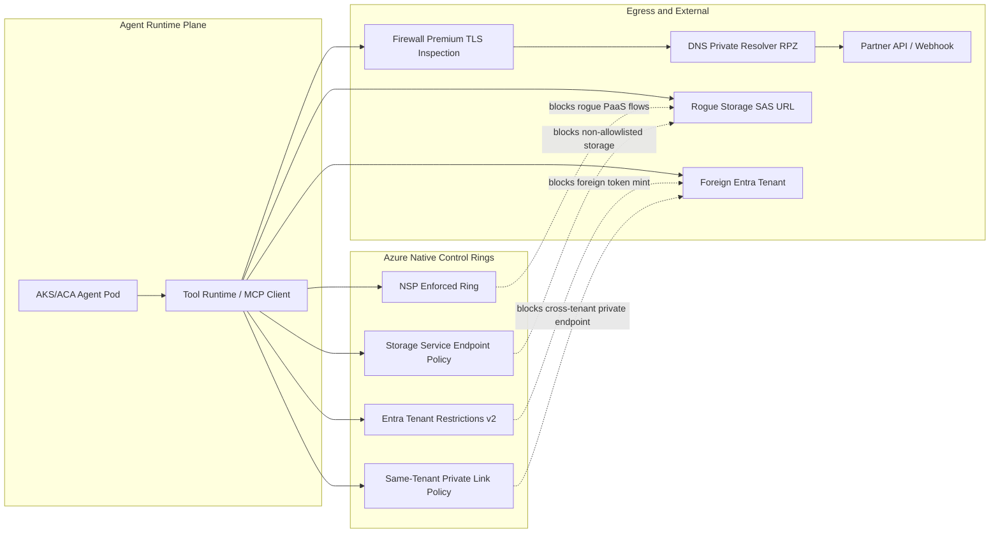
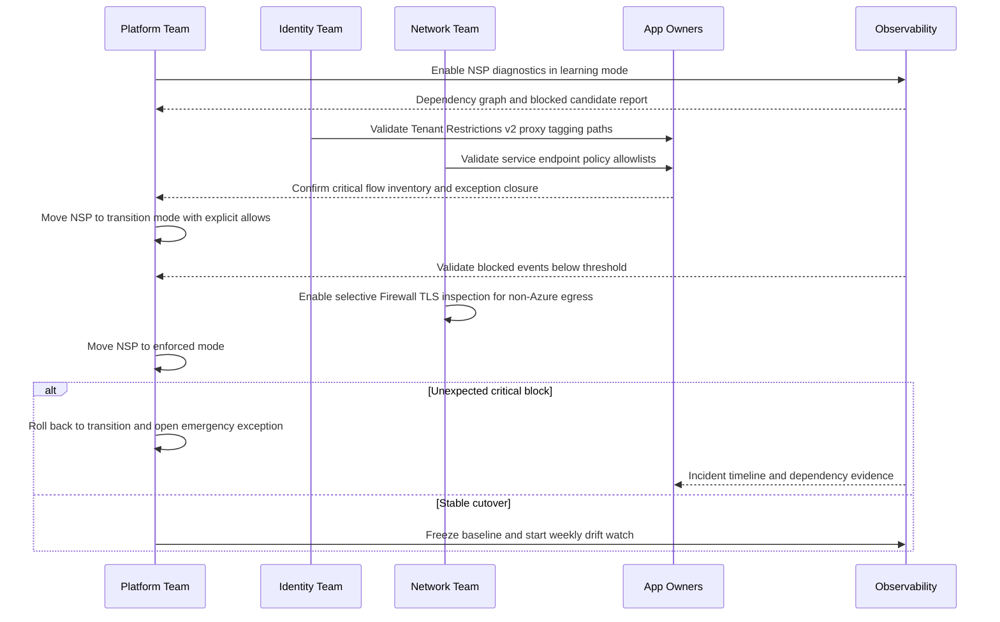

# Enterprise AI Landing Zone Data-Exfiltration Prevention Selection FAQ: NSP Perimeter vs Entra Tenant Restrictions v2 vs Firewall TLS Inspection

> 🌐 **Language Switch**: [中文](./ai-landing-zone-data-exfiltration-prevention-nsp-perimeter-vs-entra-tenant-restrictions-v2-vs-firewall-tls-inspection-selection-faq.md) | **English (current)**
> **Audience**: Cloud and AI Solution Architects, CISO platform teams, enterprise landing-zone owners, identity and network architects, and regulated-industry governance leaders.
> **Scope**: Production anti-exfiltration design for AI landing zones that run AKS or ACA agent workloads and PaaS data planes, with platform controls across Azure Network Security Perimeter, Entra Tenant Restrictions v2, Storage Service Endpoint Policies, Firewall Premium TLS inspection, and rollout choreography from learning to enforced mode.

## 1. Why this topic is now critical for enterprise AI landing zones
Private Endpoints and `publicNetworkAccess: Disabled` reduce direct public exposure, but they do not by themselves stop a compromised in-VNet workload from exfiltrating data to an attacker-controlled destination if outbound identity and destination governance are weak.
Modern prompt-injection campaigns target agent toolchains and retrieval flows, so the attacker does not need to break infrastructure first; instead, they can coerce an over-permissioned runtime to export sensitive chunks to rogue storage, webhook relays, or foreign tenants.
CISO audits increasingly test whether platform controls can block all four practical exfiltration vectors: generic Internet HTTPS, rogue SAS storage writes, cross-tenant OAuth token acquisition, and cross-tenant Private Endpoint abuse.
The architecture decision is therefore no longer a single network control choice but a layered policy and identity choreography problem that must preserve delivery velocity while provably reducing exfiltration pathways.

## 2. Why Private Endpoints alone fail formal exfiltration audits
A runtime inside the enterprise VNet can still issue HTTPS egress toward public endpoints that are unrelated to your private-link topology, so Private Endpoints alone do not provide universal destination intent control.
If a workload can mint or reuse SAS tokens, it can upload sensitive payloads to external storage accounts unless you constrain both token acquisition and storage destination allowlists at identity and data-plane boundaries.
Cross-tenant attack paths remain possible when identity flows are not restricted and when private endpoint approval policies are permissive, because the exploit does not require direct public inbound reachability to be effective.
Trusted-service exceptions and bypass channels can accidentally create hidden egress corridors, so production architecture must treat endpoint privatization as one layer, not as an end-state guarantee.

## 3. Architecture landscape A/B/C/D and control-plane ownership boundaries
**Architecture A** applies Azure Network Security Perimeter in learning and transition phases before enforced mode, creating platform-level in/out access governance for grouped PaaS resources without mandatory VNet hairpin routing.
**Architecture B** hardens identity and storage destinations using Entra Tenant Restrictions v2 plus Storage Service Endpoint Policies, so compromised runtimes cannot request tokens for foreign tenants or write blobs to non-allowlisted accounts.
**Architecture C** controls non-Azure egress with Firewall Premium TLS inspection and DNS sinkhole patterns, providing explicit URL or SNI policy over partner APIs, package mirrors, and webhook domains that NSP does not govern.
**Architecture D** combines all controls as a four-ring defense model with rollout choreography, delivering high-confidence containment against all four exfiltration vectors while minimizing outage risk during policy hardening.

## 4. Architecture A deep dive: Azure Network Security Perimeter as platform-plane PaaS ring
NSP allows you to group storage, key, search, event, and database resources into a perimeter profile and define inbound and outbound rules as an Azure platform control, so PaaS-to-PaaS managed-identity flows can be kept inside an explicit policy envelope.
The key design advantage is that perimeter enforcement happens at the Azure service plane rather than only at workload host networking, which improves consistency when multiple subscriptions and service types are involved.
A practical rollout starts with learning mode to enumerate true dependencies, moves to transition with explicit allow rules, and then enters enforced mode only after dependency closure and exception burn-down are completed.
Pairing NSP with Azure Policy that denies cross-tenant private endpoint connections closes a common governance gap where private connectivity is treated as inherently safe even when tenant lineage is untrusted.

## 5. Architecture B deep dive: Tenant Restrictions v2 plus Storage Service Endpoint Policy allowlists
Tenant Restrictions v2 constrains token issuance destinations so enterprise users and workloads cannot silently acquire OAuth tokens for unapproved external tenants, which directly reduces cross-tenant data exfiltration options.
Storage Service Endpoint Policies provide deterministic destination allowlists for `Microsoft.Storage`, preventing uploads to arbitrary storage accounts even when a workload is otherwise network-reachable and has outbound path availability.
This architecture has strong cost efficiency because it does not depend on per-GB TLS inspection for Azure storage egress and therefore avoids throughput tax on legitimate high-volume internal data paths.
The primary operational requirement is disciplined identity and subscription governance, because policy exceptions and stale allowlists can quickly re-open blind spots if tenant inventory hygiene is weak.

## 6. Architecture C deep dive: Firewall Premium TLS inspection for non-Azure egress governance
When workloads must call external MCP endpoints, package repositories, SaaS callbacks, or partner APIs, Firewall Premium offers L7 policy visibility that NSP and tenant restrictions alone cannot provide.
TLS inspection and URL or SNI allowlisting can materially reduce unknown outbound destinations, but inspection introduces throughput cost and latency overhead that becomes expensive when teams route heavy Azure-native data traffic through this lane.
A design anti-pattern is tromboning AOAI or blob-heavy pipelines through L7 inspection when those flows can be governed by lower-tax Azure-native controls; this inflates both unit cost and p95 latency without proportional security gain.
The recommended pattern is selective enforcement for non-Azure egress classes, combined with explicit bypass design for approved Azure service lanes already governed by NSP, identity controls, and destination policies.

## 7. Architecture D deep dive: four-ring defense-in-depth zero-exfiltration landing zone
Architecture D stacks NSP enforced perimeter, same-tenant private-link policy controls, Entra Tenant Restrictions v2, and Firewall Premium for non-Azure outbound domains so each ring mitigates a distinct failure class.
This approach is especially suitable for financial and regulated sectors where audit evidence must demonstrate control coverage against all major exfiltration vectors, not just network segmentation posture.
The operational success factor is rollout choreography: learning data collection, exception minimization, blast-radius simulation, phased enforcement, and fast rollback levers that preserve service continuity.
By formalizing ownership across platform, identity, and network teams, D converts a fragmented control set into a measurable exfiltration-prevention program with enforceable SLOs and governance checkpoints.

## 8. 12-dimension comparison matrix
| Dimension | A: NSP perimeter | B: Entra TRv2 + service endpoint policy | C: Firewall Premium TLS inspection | D: Four-ring defense |
|---|---|---|---|---|
| Coverage of Azure PaaS east-west exfiltration | Very high | Medium | Low | Very high |
| Coverage of cross-tenant OAuth abuse | Medium | Very high | Low | Very high |
| Coverage of non-Azure HTTPS egress | Low | Low | Very high | Very high |
| Coverage of rogue SAS storage uploads | Medium | Very high | Medium | Very high |
| Coverage of rogue private endpoint path | High (with policy) | Medium | Low | Very high |
| Incremental latency impact on Azure-native paths | Very low | Very low | Medium-high | Low-medium |
| Incremental per-GB traffic tax | None | None | High | Medium |
| Operational complexity | Medium | Medium | Medium-high | High |
| Rollout blast-radius risk | Medium | Medium | Medium | Medium-high |
| Regulatory evidence strength | High | High | Medium-high | Very high |
| Best fit workload profile | PaaS-centric enterprise core | Identity-governed enterprise mesh | Internet partner-heavy edge | Regulated zero-exfiltration mandate |
| Primary recommendation role | Baseline PaaS perimeter | Identity and storage destination guard | External egress control plane | End-state integrated program |

## 9. Quantitative models: cost, latency, and cutover blast-radius math
Firewall inspection throughput cost can be estimated by `C_fw = D_tb * 1024 * p_gb + C_sku`; with `D_tb=120`, `p_gb=0.016 USD`, and monthly fixed firewall baseline `C_sku=7,800`, total monthly processing plus baseline is about `$9,766`, which is substantial if applied indiscriminately to Azure-native bulk traffic.
Cutover blast-radius during `Learning -> Enforced` can be approximated with `B_block = N_dep * p_unmapped * p_critical`, where `N_dep` is discovered dependency count, `p_unmapped` is unresolved dependency ratio, and `p_critical` is critical-flow ratio.
With `N_dep=420`, `p_unmapped=0.08`, and `p_critical=0.35`, expected critical blocked dependencies are about `11.8`, which justifies phased ring enablement and pre-enforcement dependency closure objectives.
Latency budget planning should distinguish direct and double-hairpin routes: well-designed DNS plus L7 external control should target `<8 ms` added p95 for approved external calls, while accidental double-hairpin patterns often drift into `25–45 ms` additional p95.

## 10. Reference diagram 1: four exfiltration vectors and control interception points

This view clarifies that each control ring intercepts a different step in the kill chain, so no single mechanism should be treated as universally sufficient.

## 11. Reference diagram 2: transition-to-enforced rollout choreography with rollback gates

This sequence highlights that safe enforcement is an operational program, not a one-time toggle.

## 12. Production Bicep and Azure Policy snippets
```bicep
targetScope = 'resourceGroup'

@description('Network Security Perimeter name')
param nspName string = 'nsp-ai-landingzone-prod'

@description('Resource IDs to associate to NSP')
param associatedResources array

resource perimeter 'Microsoft.Network/networkSecurityPerimeters@2024-03-01' = {
  name: nspName
  location: resourceGroup().location
  properties: {
    perimeterType: 'Standard'
  }
}

resource profile 'Microsoft.Network/networkSecurityPerimeters/profiles@2024-03-01' = {
  name: '${perimeter.name}/prod-profile'
  properties: {}
}

resource accessRulesInbound 'Microsoft.Network/networkSecurityPerimeters/profiles/accessRules@2024-03-01' = {
  name: '${profile.name}/allow-inbound-managed-identity'
  properties: {
    direction: 'Inbound'
    accessRuleType: 'Allow'
    sourceAddressPrefixes: [
      'VirtualNetwork'
    ]
  }
}

resource accessRulesOutbound 'Microsoft.Network/networkSecurityPerimeters/profiles/accessRules@2024-03-01' = {
  name: '${profile.name}/allow-outbound-approved-paas'
  properties: {
    direction: 'Outbound'
    accessRuleType: 'Allow'
    destinationAddressPrefixes: [
      'Storage'
      'KeyVault'
      'CosmosDB'
      'Search'
      'EventHub'
    ]
  }
}

resource associations 'Microsoft.Network/networkSecurityPerimeters/resourceAssociations@2024-03-01' = [for (r, i) in associatedResources: {
  name: '${perimeter.name}/assoc-${i}'
  properties: {
    privateLinkResource: {
      id: r
    }
    profile: {
      id: profile.id
    }
    accessMode: 'Enforced'
  }
}]
```

```json
{
  "name": "deny-cross-tenant-private-endpoint-connections",
  "type": "Microsoft.Authorization/policyDefinitions",
  "properties": {
    "mode": "All",
    "displayName": "Deny cross-tenant private endpoint connections",
    "policyType": "Custom",
    "parameters": {
      "allowedTenantId": {
        "type": "String",
        "metadata": {
          "displayName": "Allowed tenant ID"
        }
      }
    },
    "policyRule": {
      "if": {
        "allOf": [
          {
            "field": "type",
            "equals": "Microsoft.Network/privateEndpoints/privateLinkServiceConnections"
          },
          {
            "not": {
              "field": "Microsoft.Network/privateEndpoints/privateLinkServiceConnections/privateLinkServiceId",
              "contains": "[parameters('allowedTenantId')]"
            }
          }
        ]
      },
      "then": {
        "effect": "deny"
      }
    }
  }
}
```
These snippets should be combined with assignment scopes, exemption workflow, and staged rollout controls before production enforcement.

## 13. Python and KQL: pre-cutover readiness verifier and NSP diagnostics audit
```python
from dataclasses import dataclass
from typing import Iterable


@dataclass
class Dependency:
    service: str
    criticality: str
    mapped: bool
    approved: bool


def projected_critical_blocks(deps: Iterable[Dependency]) -> float:
    dep_list = list(deps)
    if not dep_list:
        return 0.0
    n_dep = len(dep_list)
    unmapped = sum(1 for d in dep_list if not d.mapped)
    critical = sum(1 for d in dep_list if d.criticality == "critical")
    p_unmapped = unmapped / n_dep
    p_critical = critical / n_dep
    return n_dep * p_unmapped * p_critical


def readiness_gate(deps: Iterable[Dependency], max_expected_blocks: float = 2.0) -> dict:
    dep_list = list(deps)
    expected = projected_critical_blocks(dep_list)
    missing_approvals = [d.service for d in dep_list if d.mapped and not d.approved]
    ready = expected <= max_expected_blocks and len(missing_approvals) == 0
    return {
        "dependencies": len(dep_list),
        "expected_critical_blocks": round(expected, 2),
        "missing_approvals": missing_approvals,
        "ready_for_enforced": ready,
    }


if __name__ == "__main__":
    sample = [
        Dependency("storage-core", "critical", True, True),
        Dependency("search-rag", "critical", True, True),
        Dependency("eventhub-telemetry", "high", True, True),
        Dependency("external-webhook", "critical", False, False),
        Dependency("partner-mcp", "high", False, False),
    ]
    print(readiness_gate(sample))
```

```kql
let window = 24h;
let blocked = AzureDiagnostics
| where TimeGenerated > ago(window)
| where Category in ("NSPOutboundAccess", "NSPInboundAccess")
| where ResultType =~ "Blocked"
| summarize blocked_count = count(), blocked_targets = dcount(TargetResourceId) by bin(TimeGenerated, 15m), ResourceGroup;
let allowed = AzureDiagnostics
| where TimeGenerated > ago(window)
| where Category in ("NSPOutboundAccess", "NSPInboundAccess")
| where ResultType =~ "Allowed"
| summarize allowed_count = count(), allowed_targets = dcount(TargetResourceId) by bin(TimeGenerated, 15m), ResourceGroup;
blocked
| join kind=fullouter allowed on TimeGenerated, ResourceGroup
| extend blocked_count = coalesce(blocked_count, 0), allowed_count = coalesce(allowed_count, 0)
| extend block_ratio = iif(blocked_count + allowed_count == 0, 0.0, todouble(blocked_count) / todouble(blocked_count + allowed_count))
| project TimeGenerated, ResourceGroup, blocked_count, allowed_count, block_ratio, blocked_targets, allowed_targets
| order by TimeGenerated desc
```
The Python gate and KQL baseline should be integrated into the release checklist so transition-to-enforced decisions remain data-driven and auditable.

## 14. Enterprise scenarios and 3-year TCO
### 14.1 Scenario A: global financial assistant with strict cross-tenant controls
A global bank running AI-assisted policy and case triage workloads needed to prevent both direct Internet exfiltration and accidental cross-tenant identity drift during merger integration.
By combining A+B first and adding C for external API lanes, the team blocked rogue token mint attempts, restricted storage upload destinations, and reduced uncontrolled egress while preserving internal PaaS throughput.
Audit teams accepted the design because each enforced ring produced independent evidence streams and because exception workflows were tied to ticketed approvals rather than ad-hoc network changes.

### 14.2 Scenario B: regulated insurance claims AI with partner webhook integrations
An insurance platform required frequent external partner webhook callbacks for claim lifecycle events, which made pure private-link controls insufficient for data-loss prevention objectives.
The team adopted D, routing only partner-bound traffic through TLS-inspected lanes while keeping Azure-native bulk retrieval and indexing paths on NSP-governed low-latency routes.
This split avoided unnecessary per-GB inspection cost while materially reducing uncontrolled outbound domains and improving incident triage fidelity.

### 14.3 3-year TCO (`small / medium / large` enterprise lanes)
| 3-year cost item | A: NSP-centric | B: TRv2+SEP-centric | C: Firewall-centric | D: Four-ring integrated |
|---|---:|---:|---:|---:|
| Platform policy engineering | `$0.62M` | `$0.58M` | `$0.54M` | `$0.79M` |
| Identity and tenant governance operations | `$0.41M` | `$0.66M` | `$0.37M` | `$0.73M` |
| Network egress control runtime | `$0.29M` | `$0.24M` | `$1.18M` | `$0.66M` |
| Telemetry, audit, and forensics | `$0.36M` | `$0.39M` | `$0.43M` | `$0.51M` |
| Incident containment and recovery | `$0.44M` | `$0.47M` | `$0.52M` | `$0.31M` |
| Total 3-year cost | `$2.12M` | `$2.34M` | `$3.04M` | `$3.00M` |
Pure cost ranking can make A or B look superior, but regulated environments often select D because severe-incident avoidance and audit certainty offset higher operating complexity.

## 15. Worked quantitative Q&A (6) and Day-0/Day-2 operations
### 15.1 Worked quantitative Q&A (6)
**Q1: How do we estimate Firewall Premium traffic-tax impact?** Use `C_fw = D_tb * 1024 * p_gb + C_sku`; with `D_tb=120`, `p_gb=0.016`, and `C_sku=7,800`, monthly total is around `$9,766`, so avoid sending bulk Azure-native traffic through inspection by default.

**Q2: How do we estimate enforcement cutover blast radius?** Use `B_block = N_dep * p_unmapped * p_critical`; with `N_dep=420`, `p_unmapped=0.08`, and `p_critical=0.35`, expected critical blocks are `11.8`, indicating transition hardening is incomplete.

**Q3: How do we size dependency burn-down targets before enforced mode?** Set `p_unmapped_target <= B_target / (N_dep * p_critical)`; with `B_target=2`, `N_dep=420`, `p_critical=0.35`, target unmapped ratio is about `1.36%`.

**Q4: How do we calculate added latency budget in mixed routing?** Use `L_total = L_dns + L_l7 + L_route`; for optimized external calls `L_dns=1.8ms`, `L_l7=4.6ms`, `L_route=1.2ms`, total is `7.6ms`, while double-hairpin designs frequently exceed `25ms`.

**Q5: How do we quantify storage exfiltration risk reduction from allowlists?** Model expected incidents as `I = A_attempts * p_success`; reducing `p_success` from `0.18` to `0.02` at `A_attempts=140` lowers expected successful events from `25.2` to `2.8`.

**Q6: How do we evaluate integrated program value for D?** Use `NetValue = LossAvoided + AuditPenaltyAvoided - IncrementalOpsCost`; if annual values are `$1.15M + $0.42M - $0.67M`, net annual value is `$0.90M`.

### 15.2 Day-0 go-live checklist
1. Baseline all target PaaS resources into NSP learning mode and collect at least one representative business cycle of diagnostics.
2. Enable same-tenant private endpoint policy with explicit exemption workflow and owner accountability.
3. Configure Tenant Restrictions v2 and validate enterprise proxy or gateway tagging paths for managed and user-interactive flows.
4. Deploy Storage Service Endpoint Policies with approved account or subscription allowlists for all runtime subnets.
5. Restrict TLS inspection to non-Azure destinations and publish approved bypass categories with traceability.

### 15.3 Day-2 operations checklist
1. Track NSP blocked-to-allowed ratio trends and investigate sudden dependency drift.
2. Review tenant-restriction bypass attempts and expired policy exemptions weekly.
3. Reconcile storage destination allowlists against active business data-flow inventory.
4. Test rollback path from enforced to transition mode in non-production every release train.
5. Run quarterly adversarial exfiltration drills across all four vectors and update response playbooks.

### 15.4 Good fit vs Not for
This architecture family is a strong fit for enterprises that run high-value AI data flows across PaaS services and need explicit, auditable controls against cross-tenant and outbound exfiltration paths.
It is not ideal to force full TLS inspection on all traffic in low-risk internal-only environments where identity and destination controls already provide sufficient containment at lower latency and cost.

### 15.5 Audit field mapping (example)
| Field | Source layer | Governance purpose | Minimum retention |
|---|---|---|---|
| `request_id` | Gateway | Correlates control-plane decision chain | 3 years |
| `workload_identity` | Entra | Principal attribution for outbound action | 5 years |
| `target_fqdn` | DNS/Firewall | Destination accountability | 2 years |
| `target_tenant_id` | Entra | Cross-tenant detection and policy evidence | 5 years |
| `nsp_profile` | NSP | Effective perimeter governance context | 5 years |
| `nsp_result` | NSP | Allowed/blocked enforcement evidence | 5 years |
| `policy_assignment_id` | Azure Policy | Control assignment provenance | 5 years |
| `service_endpoint_policy_id` | VNet policy | Storage allowlist provenance | 5 years |
| `firewall_rule_collection` | Firewall | Egress rule provenance | 3 years |
| `tls_inspection_applied` | Firewall | L7 inspection proof | 3 years |
| `sas_write_attempt` | Storage diagnostics | Rogue upload detection | 5 years |
| `private_endpoint_tenant` | Network | Same-tenant policy conformance | 5 years |
| `blocked_reason_code` | Control plane | Deterministic denial rationale | 5 years |
| `exception_ticket_id` | ITSM | Risk acceptance traceability | 7 years |
| `exception_expiry` | Governance | Automatic exception retirement evidence | 7 years |
| `cutover_phase` | Release pipeline | Transition/enforced timeline trace | 3 years |
| `dependency_owner` | CMDB | Escalation ownership | 3 years |
| `region` | Platform | Regional blast-radius analytics | 3 years |
| `data_classification` | Purview | Sensitivity-aware policy tuning | 7 years |
| `incident_case_id` | SOC | Forensic and response linkage | 7 years |

### 15.6 Runtime alert dictionary (example)
| Alert key | Trigger condition | Immediate action | Primary owner |
|---|---|---|---|
| `nsp_block_ratio_spike` | Block ratio exceeds threshold for 15m | Freeze enforcement promotion and inspect dependency drift | Platform security |
| `cross_tenant_token_attempt` | Token request to non-approved tenant detected | Revoke session and open high-priority incident | Identity security |
| `rogue_sas_upload_attempt` | Storage write to non-allowlisted account | Block egress path and quarantine workload identity | Data security |
| `private_endpoint_tenant_mismatch` | Private endpoint request not in allowed tenant | Deny request and notify landing-zone governance | Network governance |
| `tls_inspection_bypass_detected` | Non-approved bypass category used | Force route correction and review policy exemptions | Network security |
| `double_hairpin_latency` | External route p95 exceeds budget | Re-route through optimized path and tune policy order | Platform SRE |
| `firewall_data_tax_anomaly` | Per-GB inspection cost spikes unexpectedly | Audit route classification and bypass eligible Azure flows | FinOps |
| `tenant_restriction_header_missing` | Proxy tagging missing for constrained clients | Block token flow and trigger config remediation | Identity platform |
| `service_endpoint_policy_drift` | Allowlist changed outside approved process | Reconcile from Git baseline and open compliance ticket | Cloud platform |
| `nsp_diag_drop` | Expected diagnostics volume unexpectedly drops | Validate logging pipeline health and retention path | Observability |
| `exception_past_due` | Exemption expiry crossed without closure | Auto-disable exemption and page control owner | Governance |
| `critical_dependency_unmapped` | New critical dependency lacks explicit allow | Keep in transition mode and enforce mapping workflow | App platform |
| `blocked_partner_api` | Approved partner callback blocked | Trigger emergency temporary allow with expiry | Integration team |
| `dns_sinkhole_hit_rate_spike` | Sinkhole hits rise above baseline | Investigate potential beaconing or misconfiguration | SOC |
| `enforced_rollout_failure` | Enforced mode causes critical outage | Execute rollback to transition and start post-incident review | Release manager |
