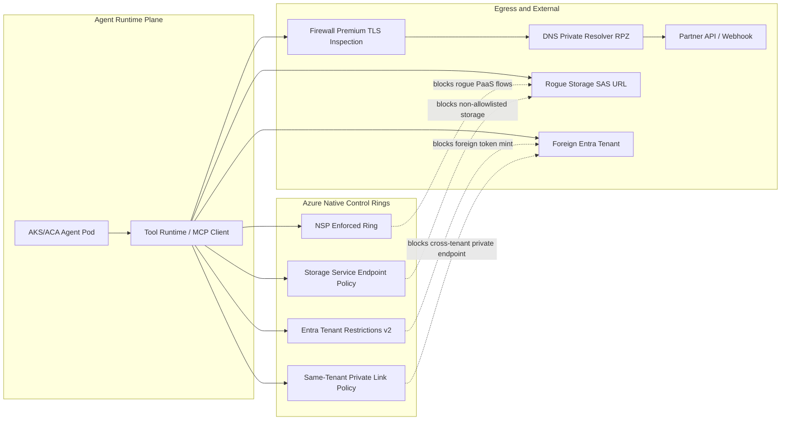
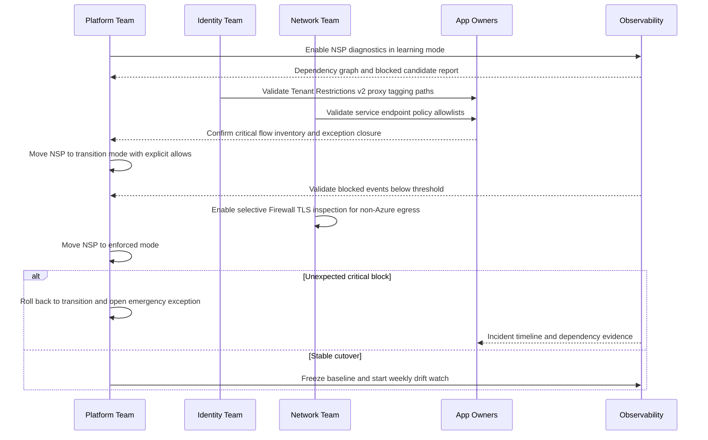

# 企业 AI Landing Zone 数据外泄防护选型 FAQ：NSP 平台边界 vs Entra Tenant Restrictions v2 vs Firewall TLS Inspection

> 🌐 **Language Switch**: **中文（当前）** | [English](./ai-landing-zone-data-exfiltration-prevention-nsp-perimeter-vs-entra-tenant-restrictions-v2-vs-firewall-tls-inspection-selection-faq.en.md)
> **适用对象**：Cloud & AI Solution Architect、企业 CISO 平台团队、Landing Zone 平台负责人、身份与网络架构团队、强监管行业治理团队。
> **讨论范围**：面向 AKS 与 ACA Agent 运行时及 Azure PaaS 数据平面的生产级反外泄架构，覆盖 Azure Network Security Perimeter、Entra Tenant Restrictions v2、Storage Service Endpoint Policies、Firewall Premium TLS Inspection，以及从 Learning/Transition 到 Enforced 的零停机落地编排。

## 1. 为什么该主题在企业 AI Landing Zone 中成为高优先级
Private Endpoint 与 `publicNetworkAccess: Disabled` 可以降低公网直连暴露面，但它们并不能单独阻断“已进入 VNet 的被攻陷工作负载”向攻击者目标发起外泄，尤其当出站身份与目的地治理缺位时风险仍然成立。
在真实攻防中，提示词注入常常瞄准 Agent 工具链与检索链路，攻击者不一定先攻破基础设施，而是诱导高权限运行时主动把敏感片段、PII 或审计数据写入外部目标。
CISO 审计现在通常要求证明系统能同时覆盖四类外泄向量：通用 Internet HTTPS、Rogue SAS 存储上传、跨租户 OAuth 令牌获取、以及跨租户 Private Endpoint 滥用。
因此该决策不是“选一个网络控件”就结束，而是要设计多层策略、身份、网络协同的体系化控制，并在不牺牲业务上线节奏的前提下提供可验证证据链。

## 2. 为什么仅靠 Private Endpoints 通过不了外泄审计
即使企业核心 PaaS 资源都走私网访问，运行在企业 VNet 内的工作负载仍可能向外部 HTTPS 目标出站，Private Endpoint 无法天然表达“这个目标是否被业务允许”。
当运行时可以获取或复用 SAS，便可能向外部存储账户写入数据，若缺乏租户级身份约束与存储目的地白名单，外泄链路依然有效且隐蔽。
跨租户路径同样会出现，只要令牌获取没有 Tenant Restrictions 约束、私链审批策略不严格，攻击者就能借“合法协议动作”绕开传统边界假设。
Trusted Services 例外与历史兼容放行也可能形成“隐形通道”，所以企业必须把 Endpoint 私有化视为一层能力，而不是数据外泄防护的终态。

## 3. A/B/C/D 架构全景与控制边界归属
**Architecture A** 以 NSP 为平台层边界，先 Learning/Transition 再 Enforced，将存储、密钥、搜索、事件与数据库纳入同一策略面，避免只靠网络拓扑假设安全。
**Architecture B** 通过 Entra Tenant Restrictions v2 与 Storage Service Endpoint Policies 同时约束“令牌可去哪里”和“存储可写到哪里”，让被攻陷运行时失去外租户与外账户出口。
**Architecture C** 采用 Firewall Premium TLS Inspection 与 DNS RPZ 下沉治理非 Azure 出站，补齐 NSP 与 Tenant Restrictions 对外部域名控制能力不足的短板。
**Architecture D** 将四类控制按攻击链逐层叠加，形成监管场景常见的防御纵深模型，并通过阶段化切换流程降低误封带来的业务中断风险。

## 4. Architecture A 深入：NSP 平台边界与跨租户私链拒绝策略
NSP 的核心价值在于把多种 PaaS 资源纳入同一平台策略上下文，入站与出站规则在 Azure 服务平面执行，不依赖业务团队逐个改写网络路径。
该模式特别适合企业 AI 数据平面，因为大量服务间调用并不适合全部回流到统一 L7 检查点，平台面治理能在保持路径效率的同时提升一致性。
实践中建议先开 Learning 收集依赖，再进入 Transition 明确允许清单，最后以数据驱动方式进入 Enforced，而不是一次性硬切导致大面积误阻断。
若叠加“同租户 Private Endpoint 准入策略”，可有效封堵“私链就是安全”的误判，防止跨租户私链审批被滥用成为数据外泄桥梁。

## 5. Architecture B 深入：Tenant Restrictions v2 + Storage 目的地白名单
Tenant Restrictions v2 从身份平面阻断对未授权外部租户的令牌获取，直接压缩跨租户数据流转空间，尤其适用于 Agent 运行时与用户代理并存的企业场景。
Storage Service Endpoint Policies 则在数据平面提供强约束，只有企业允许的账户或订阅可作为目标，显著降低 Rogue SAS 外传成功率。
该方案的一个关键优势是成本可控，因为它不按流量体量收取 TLS 检查税，适合存储吞吐大的企业数据处理链路长期运行。
但它要求组织具备良好的身份资产治理与订阅资产盘点能力，否则白名单陈旧与例外失控会逐步侵蚀防护强度。

## 6. Architecture C 深入：Firewall Premium TLS Inspection 非 Azure 外联治理
当业务必须访问外部 MCP API、第三方 webhook、包镜像或伙伴 SaaS 接口时，Firewall Premium 的 TLS 检查与 URL/SNI 规则是可执行的精细化治理手段。
它能把“未知目的地出站”显著收敛到可审计集合，但代价是吞吐税与时延增加，若把大流量 Azure 原生链路错误导入该路径会导致明显成本与性能回退。
因此 C 架构不应成为一切流量的默认路径，而应聚焦非 Azure 外联域，配合对 Azure 原生路径的低税控制机制形成分层治理。
正确实施后，团队可在不牺牲核心数据面吞吐的前提下，提升外部依赖链路的可见性、可控性与取证能力。

## 7. Architecture D 深入：四层防御纵深零外泄 Landing Zone
Architecture D 将 NSP Enforced、同租户 Private Link 策略、Tenant Restrictions v2、以及非 Azure 出站防火墙整合为同一治理框架，使每一层都对应特定攻击环节。
该模式特别适用于金融、保险、公共部门等高合规行业，因为审计不仅关注“是否有控制”，更关注“是否覆盖全链路并可出具证据”。
落地关键在于切换编排：依赖发现、例外清理、爆炸半径预估、灰度切换、回滚闸门、周度漂移巡检，这些步骤决定了生产可用性。
当组织把平台、身份、网络、应用四类责任明确到同一发布节奏，D 架构可以把分散的点状安全能力转化为可持续运营的企业级防护体系。

## 8. 12 维度对比矩阵
| 维度 | A：NSP 平台边界 | B：TRv2 + Service Endpoint Policy | C：Firewall TLS Inspection | D：四层纵深联防 |
|---|---|---|---|---|
| Azure PaaS 东西向外泄防护 | 很高 | 中等 | 低 | 很高 |
| 跨租户 OAuth 风险抑制 | 中等 | 很高 | 低 | 很高 |
| 非 Azure HTTPS 外联管控 | 低 | 低 | 很高 | 很高 |
| Rogue SAS 存储上传防护 | 中高 | 很高 | 中等 | 很高 |
| Rogue Private Endpoint 路径防护 | 高（配合策略） | 中等 | 低 | 很高 |
| 对 Azure 原生链路时延影响 | 很低 | 很低 | 中高 | 低到中 |
| 流量处理增量成本 | 无 | 无 | 高 | 中等 |
| 运行维护复杂度 | 中等 | 中等 | 中高 | 高 |
| 切换误封爆炸半径风险 | 中等 | 中等 | 中等 | 中高 |
| 合规审计证据强度 | 高 | 高 | 中高 | 很高 |
| 最佳适配工作负载 | PaaS 主导型企业 | 身份强治理企业 | 外部 API 密集场景 | 强监管零外泄目标 |
| 推荐落位 | 基础边界底座 | 身份与存储硬约束 | 外联域精细治理 | 终态一体化方案 |

## 9. 定量模型：成本、时延与切换风险数学
Firewall 检查成本可用 `C_fw = D_tb * 1024 * p_gb + C_sku` 估算；例如 `D_tb=120`、`p_gb=0.016 USD`、`C_sku=7,800`，月度总成本约 `$9,766`，不应把可走低税路径的 Azure 原生流量全部导入该链路。
`Learning -> Enforced` 的误阻断爆炸半径可用 `B_block = N_dep * p_unmapped * p_critical` 估算，用于评估依赖收敛是否达到切换门限。
当 `N_dep=420`、`p_unmapped=0.08`、`p_critical=0.35` 时，预期关键依赖被阻断约 `11.8` 条，表明必须继续完成依赖映射与审批闭环。
时延预算建议拆分 `L_total = L_dns + L_l7 + L_route`，优化设计应将新增 p95 控制在 `<8ms`，而错误的双重回流往往会落入 `25–45ms` 的不经济区间。

## 10. 参考图 1：四类外泄向量与拦截点

该图强调“控制分层对应攻击链分层”，任何单点控件都无法覆盖全部外泄路径。

## 11. 参考图 2：Transition 到 Enforced 的切换编排

该流程说明安全切换是持续运营活动，不是一次配置动作。

## 12. 生产级 Bicep 与 Azure Policy 片段
```bicep
targetScope = 'resourceGroup'

@description('Network Security Perimeter name')
param nspName string = 'nsp-ai-landingzone-prod'

@description('Resource IDs to associate to NSP')
param associatedResources array

resource perimeter 'Microsoft.Network/networkSecurityPerimeters@2024-03-01' = {
  name: nspName
  location: resourceGroup().location
  properties: {
    perimeterType: 'Standard'
  }
}

resource profile 'Microsoft.Network/networkSecurityPerimeters/profiles@2024-03-01' = {
  name: '${perimeter.name}/prod-profile'
  properties: {}
}

resource accessRulesInbound 'Microsoft.Network/networkSecurityPerimeters/profiles/accessRules@2024-03-01' = {
  name: '${profile.name}/allow-inbound-managed-identity'
  properties: {
    direction: 'Inbound'
    accessRuleType: 'Allow'
    sourceAddressPrefixes: [
      'VirtualNetwork'
    ]
  }
}

resource accessRulesOutbound 'Microsoft.Network/networkSecurityPerimeters/profiles/accessRules@2024-03-01' = {
  name: '${profile.name}/allow-outbound-approved-paas'
  properties: {
    direction: 'Outbound'
    accessRuleType: 'Allow'
    destinationAddressPrefixes: [
      'Storage'
      'KeyVault'
      'CosmosDB'
      'Search'
      'EventHub'
    ]
  }
}

resource associations 'Microsoft.Network/networkSecurityPerimeters/resourceAssociations@2024-03-01' = [for (r, i) in associatedResources: {
  name: '${perimeter.name}/assoc-${i}'
  properties: {
    privateLinkResource: {
      id: r
    }
    profile: {
      id: profile.id
    }
    accessMode: 'Enforced'
  }
}]
```

```json
{
  "name": "deny-cross-tenant-private-endpoint-connections",
  "type": "Microsoft.Authorization/policyDefinitions",
  "properties": {
    "mode": "All",
    "displayName": "Deny cross-tenant private endpoint connections",
    "policyType": "Custom",
    "parameters": {
      "allowedTenantId": {
        "type": "String",
        "metadata": {
          "displayName": "Allowed tenant ID"
        }
      }
    },
    "policyRule": {
      "if": {
        "allOf": [
          {
            "field": "type",
            "equals": "Microsoft.Network/privateEndpoints/privateLinkServiceConnections"
          },
          {
            "not": {
              "field": "Microsoft.Network/privateEndpoints/privateLinkServiceConnections/privateLinkServiceId",
              "contains": "[parameters('allowedTenantId')]"
            }
          }
        ]
      },
      "then": {
        "effect": "deny"
      }
    }
  }
}
```
这些片段应与策略指派范围、例外审批机制、灰度切换门禁联合使用，避免“有规则但无治理流程”。

## 13. Python 与 KQL：切换前依赖就绪校验与 NSP 审计
```python
from dataclasses import dataclass
from typing import Iterable


@dataclass
class Dependency:
    service: str
    criticality: str
    mapped: bool
    approved: bool


def projected_critical_blocks(deps: Iterable[Dependency]) -> float:
    dep_list = list(deps)
    if not dep_list:
        return 0.0
    n_dep = len(dep_list)
    unmapped = sum(1 for d in dep_list if not d.mapped)
    critical = sum(1 for d in dep_list if d.criticality == "critical")
    p_unmapped = unmapped / n_dep
    p_critical = critical / n_dep
    return n_dep * p_unmapped * p_critical


def readiness_gate(deps: Iterable[Dependency], max_expected_blocks: float = 2.0) -> dict:
    dep_list = list(deps)
    expected = projected_critical_blocks(dep_list)
    missing_approvals = [d.service for d in dep_list if d.mapped and not d.approved]
    ready = expected <= max_expected_blocks and len(missing_approvals) == 0
    return {
        "dependencies": len(dep_list),
        "expected_critical_blocks": round(expected, 2),
        "missing_approvals": missing_approvals,
        "ready_for_enforced": ready,
    }


if __name__ == "__main__":
    sample = [
        Dependency("storage-core", "critical", True, True),
        Dependency("search-rag", "critical", True, True),
        Dependency("eventhub-telemetry", "high", True, True),
        Dependency("external-webhook", "critical", False, False),
        Dependency("partner-mcp", "high", False, False),
    ]
    print(readiness_gate(sample))
```

```kql
let window = 24h;
let blocked = AzureDiagnostics
| where TimeGenerated > ago(window)
| where Category in ("NSPOutboundAccess", "NSPInboundAccess")
| where ResultType =~ "Blocked"
| summarize blocked_count = count(), blocked_targets = dcount(TargetResourceId) by bin(TimeGenerated, 15m), ResourceGroup;
let allowed = AzureDiagnostics
| where TimeGenerated > ago(window)
| where Category in ("NSPOutboundAccess", "NSPInboundAccess")
| where ResultType =~ "Allowed"
| summarize allowed_count = count(), allowed_targets = dcount(TargetResourceId) by bin(TimeGenerated, 15m), ResourceGroup;
blocked
| join kind=fullouter allowed on TimeGenerated, ResourceGroup
| extend blocked_count = coalesce(blocked_count, 0), allowed_count = coalesce(allowed_count, 0)
| extend block_ratio = iif(blocked_count + allowed_count == 0, 0.0, todouble(blocked_count) / todouble(blocked_count + allowed_count))
| project TimeGenerated, ResourceGroup, blocked_count, allowed_count, block_ratio, blocked_targets, allowed_targets
| order by TimeGenerated desc
```
建议把 Python 就绪校验与 KQL 漂移观察固化到发布流水线，让是否进入 Enforced 变成可回放、可审计、可追责的工程决策。

## 14. 企业场景与三年 TCO
### 14.1 场景 A：全球金融智能助理跨租户防护
某全球银行在并购期间需要同时防止跨租户身份漂移与对外泄漏，单靠私网链路无法满足审计对“身份来源、目标租户、目的地账户”的可解释要求。
团队先落地 A+B 作为主干，再对外部伙伴接口引入 C，最终形成 D 的联防形态，在不牺牲核心交易链路吞吐的前提下收敛了高风险出站面。
审计通过的关键点不是“控件数量”，而是每层控件都有独立证据、例外有时限、回滚有闸门、责任有归属。

### 14.2 场景 B：保险理赔平台与第三方回调生态
某保险平台理赔流程依赖大量外部伙伴回调，若强行把全部流量都送入 TLS 检查会带来显著时延与成本上升，并影响高峰期 SLA。
采用 D 后，平台将非 Azure 外联流量进入 C 路径治理，而 Azure 原生大流量链路继续走 A+B 低税控制，形成“高风险高检查、低风险高效率”的分层策略。
结果显示该方案在成本可控前提下显著提升了外联可观测性与违规目的地阻断效果，满足了监管部门对外泄防护的实证要求。

### 14.3 三年 TCO（`small / medium / large` 复合负载）
| 三年成本项 | A：NSP 主导 | B：TRv2+SEP 主导 | C：Firewall 主导 | D：四层联防 |
|---|---:|---:|---:|---:|
| 平台策略工程与发布 | `$0.62M` | `$0.58M` | `$0.54M` | `$0.79M` |
| 身份与租户治理运营 | `$0.41M` | `$0.66M` | `$0.37M` | `$0.73M` |
| 网络出站治理运行成本 | `$0.29M` | `$0.24M` | `$1.18M` | `$0.66M` |
| 审计与取证体系 | `$0.36M` | `$0.39M` | `$0.43M` | `$0.51M` |
| 事件遏制与恢复 | `$0.44M` | `$0.47M` | `$0.52M` | `$0.31M` |
| 三年总成本 | `$2.12M` | `$2.34M` | `$3.04M` | `$3.00M` |
若仅看账面成本，A 或 B 可能更优；但在强监管行业中，D 方案常因减少重大事件与审计罚损而具备更高风险调整后价值。

## 15. 六个定量问答与 Day-0/Day-2 运维清单
### 15.1 定量问答（6）
**Q1：如何估算 Firewall Premium 的流量税影响？** 使用 `C_fw = D_tb * 1024 * p_gb + C_sku`；当 `D_tb=120`、`p_gb=0.016`、`C_sku=7,800` 时月度约 `$9,766`，应避免把可走低税策略的 Azure 原生流量错误导入该路径。

**Q2：如何估算 Enforced 切换的误阻断爆炸半径？** 使用 `B_block = N_dep * p_unmapped * p_critical`；当 `N_dep=420`、`p_unmapped=0.08`、`p_critical=0.35` 时约 `11.8` 条关键依赖风险，切换前必须继续收敛依赖映射。

**Q3：切换前的未映射依赖目标阈值如何推导？** 使用 `p_unmapped_target <= B_target / (N_dep * p_critical)`；若 `B_target=2`、`N_dep=420`、`p_critical=0.35`，则目标未映射率约 `1.36%`。

**Q4：混合路由时如何评估新增时延预算？** 使用 `L_total = L_dns + L_l7 + L_route`；若 `1.8ms + 4.6ms + 1.2ms = 7.6ms` 可满足 `<8ms` 目标，而双重回流设计常落入 `25–45ms` 不经济区间。

**Q5：如何衡量存储白名单对外泄风险的收益？** 将期望成功事件建模为 `I = A_attempts * p_success`；当 `A_attempts=140`，`p_success` 从 `0.18` 降至 `0.02`，成功外泄期望从 `25.2` 降到 `2.8`。

**Q6：如何评估四层联防的净业务价值？** 使用 `NetValue = LossAvoided + AuditPenaltyAvoided - IncrementalOpsCost`；若年化为 `$1.15M + $0.42M - $0.67M`，净值约 `$0.90M`，说明联防投入具备正回报。

### 15.2 Day-0 上线清单
1. 将目标 PaaS 资源纳入 NSP Learning，并覆盖至少一个完整业务周期的诊断采样。
2. 启用同租户 Private Endpoint 准入策略，并强制例外单据与到期时间。
3. 开启 Tenant Restrictions v2 并验证代理标记链路对托管与交互式流量都生效。
4. 为运行时子网配置 Storage Service Endpoint Policies 目标白名单。
5. 将 TLS 检查仅应用于非 Azure 外联域，并发布受控旁路分类与审批流程。

### 15.3 Day-2 运维清单
1. 周期性审查 NSP blocked/allowed 比例与异常漂移。
2. 周度复盘 tenant restriction 违规尝试与例外过期情况。
3. 对照资产清单校验存储白名单是否覆盖实际业务目标。
4. 在非生产环境定期演练 Enforced 回滚到 Transition 的流程。
5. 每季度开展四类外泄向量对抗演练并更新响应手册。

### 15.4 Good fit vs Not for
该架构族适合高价值数据流、跨服务 PaaS 编排、以及对合规证据与租户边界有严格要求的企业 AI 平台。
对于低风险、低吞吐、纯内网且身份边界单一的场景，不应默认全量 TLS 检查，可先采用 A+B 再按外联风险引入 C。

### 15.5 审计字段映射（示例）
| 字段 | 来源层 | 治理目的 | 最低保留期 |
|---|---|---|---|
| `request_id` | Gateway | 关联完整控制链路 | 3 年 |
| `workload_identity` | Entra | 出站主体归因 | 5 年 |
| `target_fqdn` | DNS/Firewall | 目标域责任审计 | 2 年 |
| `target_tenant_id` | Entra | 跨租户行为证据 | 5 年 |
| `nsp_profile` | NSP | 边界策略上下文 | 5 年 |
| `nsp_result` | NSP | 放行/阻断证据 | 5 年 |
| `policy_assignment_id` | Azure Policy | 策略归属追踪 | 5 年 |
| `service_endpoint_policy_id` | VNet policy | 存储白名单归因 | 5 年 |
| `firewall_rule_collection` | Firewall | 外联规则归属 | 3 年 |
| `tls_inspection_applied` | Firewall | L7 检查证据 | 3 年 |
| `sas_write_attempt` | Storage diagnostics | 外部上传检测 | 5 年 |
| `private_endpoint_tenant` | Network | 同租户约束校验 | 5 年 |
| `blocked_reason_code` | Control plane | 拒绝原因可解释性 | 5 年 |
| `exception_ticket_id` | ITSM | 风险接受追踪 | 7 年 |
| `exception_expiry` | Governance | 例外到期收敛证据 | 7 年 |
| `cutover_phase` | Release pipeline | 切换阶段可回放 | 3 年 |
| `dependency_owner` | CMDB | 依赖责任归属 | 3 年 |
| `region` | Platform | 区域爆炸半径分析 | 3 年 |
| `data_classification` | Purview | 分级防护调优 | 7 年 |
| `incident_case_id` | SOC | 事件与取证关联 | 7 年 |

### 15.6 运行时告警字典（示例）
| 告警键 | 触发条件 | 立即动作 | 责任团队 |
|---|---|---|---|
| `nsp_block_ratio_spike` | 15 分钟阻断比例超阈值 | 暂停 Enforced 推进并排查依赖漂移 | 平台安全 |
| `cross_tenant_token_attempt` | 检测到外租户令牌获取尝试 | 吊销会话并升级高优先级事件 | 身份安全 |
| `rogue_sas_upload_attempt` | 向非白名单存储写入尝试 | 阻断路径并隔离工作负载身份 | 数据安全 |
| `private_endpoint_tenant_mismatch` | 私链租户不匹配策略 | 拒绝连接并通知 landing zone 治理 | 网络治理 |
| `tls_inspection_bypass_detected` | 出现未授权旁路 | 强制回路并审查例外清单 | 网络安全 |
| `double_hairpin_latency` | 外联链路 p95 超预算 | 优化路由与策略顺序 | 平台 SRE |
| `firewall_data_tax_anomaly` | 每 GB 检查成本突增 | 排查路径分类与流量误路由 | FinOps |
| `tenant_restriction_header_missing` | 代理标记缺失 | 阻断令牌流程并修复配置 | 身份平台 |
| `service_endpoint_policy_drift` | 白名单被非流程变更 | 从 Git 基线回滚并触发合规工单 | 云平台 |
| `nsp_diag_drop` | 诊断数据量异常下降 | 校验日志链路与保留配置 | 可观测平台 |
| `exception_past_due` | 例外超时未收敛 | 自动失效例外并通知责任人 | 治理团队 |
| `critical_dependency_unmapped` | 关键依赖未映射放行 | 保持 Transition 并拉齐依赖映射 | 应用平台 |
| `blocked_partner_api` | 已批准伙伴接口被阻断 | 临时放行并设置到期时间 | 集成团队 |
| `dns_sinkhole_hit_rate_spike` | Sinkhole 命中率异常上升 | 排查 beacon 行为或误配 | SOC |
| `enforced_rollout_failure` | Enforced 导致关键业务故障 | 回滚到 Transition 并启动复盘 | 发布经理 |
