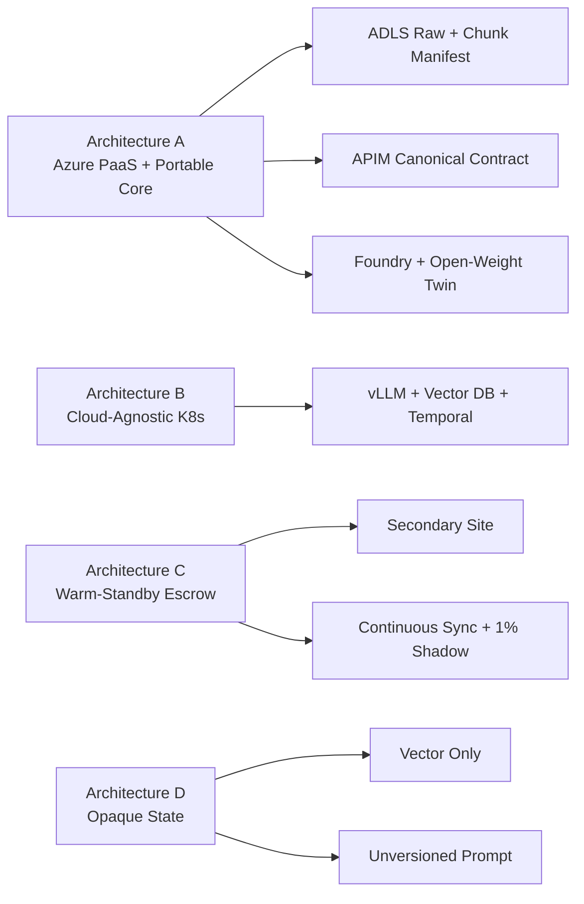
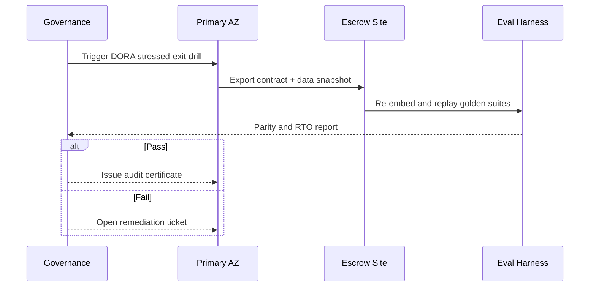
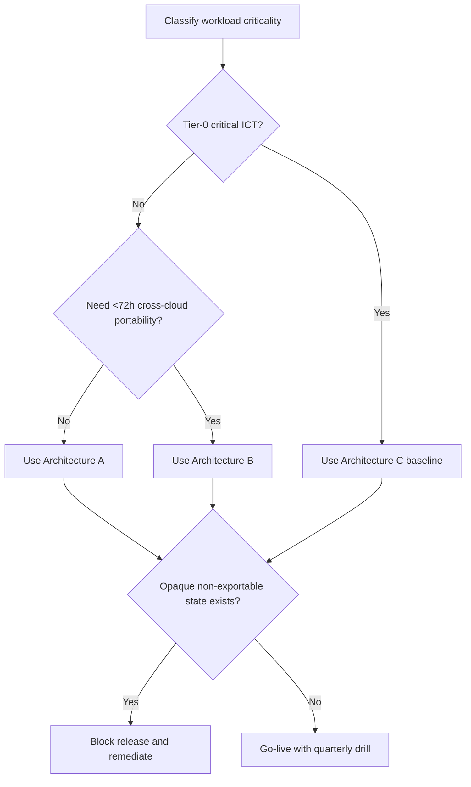

# Enterprise AI landing-zone stressed-exit portability escrow selection FAQ: Pragmatic Portable Core vs Cloud-Agnostic K8s vs Warm-Standby Escrow vs Paper-Only Plan
> **Use case**: regulated enterprise GenAI platforms under `EU DORA Article 28(8)`, `PRA SS2/21`, and `EU Data Act Chapter VI`.
> **Decision pressure**: preserve Azure managed velocity while proving executable model/platform exit readiness.
> **Goal**: deliver auditable and measurable stressed-exit architecture with quarterly rehearsal evidence.

## 1. Executive summary
- Supervisors validate recoverability and substitutability, not narrative multi-cloud promises.
- Default recommendation is Architecture A, with Architecture C for critical workflows.
- Architecture B fits strict portability requirements but carries sustained operations tax.
- Architecture D is a prohibited anti-pattern in regulated environments.
- Portable core assets must include raw corpus, chunk manifests, MCP schemas, eval datasets, and approval evidence.
- Vector indexes are derivative artifacts and cannot be the only source of truth.
- Model migration must be controlled by parity gates rather than subjective acceptance.
- Quarterly rehearsals should produce signed evidence packages and tracked remediation.
- Board reporting should include `RTO_exit`, `T_reembed`, `T_transfer`, and `Parity_pass_rate`.

## 2. Scope and non-goals
- Applicable to critical ICT functions in banking, insurance, payments, and public sectors.
- Applicable to concentration-risk mitigation and contract-termination migration readiness.
- Applicable to model deprecation, geopolitical ring-fencing, and sovereignty constraints.
- Not a fit for low-risk internal chat assistants or one-off PoCs.
- Not a fit for short-lived sandboxes with no audit obligations.
- Not a fit for unmanaged experimentation bypassing enterprise controls.

## 3. Regulatory-to-engineering control mapping
- DORA requires verifiable stressed-exit execution for critical outsourced ICT.
- PRA emphasizes concentration-risk governance and continuity assurance.
- Data Act emphasizes switching economics, portability, and interface transparency.
- Engineering controls must convert policy requirements into pipeline gates and replayable evidence.
- Drill outcomes should be integrated into governance and audit cycles.
- Every control claim requires logs, hashes, and versioned artifacts.

## 4. Four candidate architectures
- **Architecture A**: native Azure PaaS with pragmatic portable core.
- **Architecture B**: cloud-agnostic K8s stack for maximal infrastructure portability.
- **Architecture C**: primary Azure plus warm-standby escrow and shadow parity.
- **Architecture D**: paper-only compliance over opaque non-exportable state.
- A balances speed and reversibility for most enterprise pathways.
- B prioritizes portability but increases day-to-day complexity.
- C prioritizes low-RTO confidence for Tier-0 services.
- D fails practical drill and audit scrutiny.

## 5. Architecture A details (Pragmatic Portable Core)
- `APIM` enforces canonical OpenAI/MCP contracts with version control.
- `ADLS Gen2` stores raw corpus and chunk manifests as source of truth.
- `Azure AI Foundry` and open-weight twins run parity regressions.
- Critical-task parity gate target is typically `>= 92%`.
- Automated re-embedding and index rebuild pipelines are mandatory.
- Approval-chain signatures and hash-linked evidence provide auditability.
- Managed-service velocity is preserved while lock-in exposure is reduced.

## 6. Architecture B details (Cloud-Agnostic K8s)
- Typical stack: `AKS + vLLM + pgvector/Qdrant + Temporal + Envoy/LiteLLM + Dapr`.
- Portability to EKS/GKE/Azure Local is improved by template reuse.
- Day-2 burden rises due to capacity, patching, and compatibility ownership.
- Continuous SRE commitment is the tradeoff for relocation agility.
- Best suited for strict sovereignty and migration constraints.

## 7. Architecture C details (Warm-Standby Escrow)
- Azure remains production primary; secondary site continuously syncs critical assets.
- Synced assets include corpus, prompts, tool configs, eval sets, and exportable ledger state.
- `1%` shadow traffic is executed for parity evidence.
- Cutover objectives are tiered `<4h/<12h/<24h` by business criticality.
- Quarterly drills generate regulator-ready certificates.
- This is the most robust path for Tier-0 workloads.

## 8. Architecture D anti-pattern (Paper-Only Plan)
- Vector-only persistence without raw manifests breaks reversibility.
- Unexportable assistant-thread state blocks deterministic replay.
- Unversioned prompts create silent behavior regressions across model families.
- Document-only rehearsals cannot replace executable cutover tests.
- Failure risk is highest during supervisory challenge drills.

## 9. Twelve-dimension comparison matrix
| Dimension | Architecture A | Architecture B | Architecture C | Architecture D |
|---|---|---|---|---|
| Exit executability | High | Medium-high | Very high | Low |
| Daily delivery velocity | Very high | Medium | Medium-high | Medium |
| Audit evidence completeness | High | Medium-high | Very high | Low |
| Migration rewrite pressure | Medium | Low | Medium | Very high |
| Day-2 burden | Medium-low | Very high | High | Superficially low |
| Model substitution elasticity | High | High | Very high | Low |
| Data reversibility | High | High | Very high | Low |
| Multi-region resilience | High | Medium-high | Very high | Low |
| Cost predictability | High | Medium | Medium | Low |
| Talent threshold | Medium | High | High | Low short-term |
| Compliance trustworthiness | High | Medium-high | Very high | Low |
| Recommendation | Default | Special case | Tier-0 preferred | Prohibited |

## 10. Portability and escrow topology

## 11. Quarterly stressed-exit rehearsal sequence

## 12. Criticality decision tree

### Q1. Why regulators require executable exits instead of policy-only statements
- Supervisory reviews reject non-replayable claims.
- Stressed scenarios require real cutover capability.
- Concentration-risk reduction needs measurable substitution paths.
- Exit readiness defines continuity floor for critical services.
- Weak evidence chains prolong remediation and supervisory pressure.
- Practical drills expose hidden couplings early.
- Executable exits provide board-level risk control leverage.

### Q2. What mechanism-level differences matter most across the four architectures
- A aligns managed velocity with portable-core safeguards.
- B trades sustained operational load for infrastructure portability.
- C adds standby heat and recurring parity drills for low-RTO confidence.
- D lacks exportability and deterministic replay guarantees.
- A vs C differs mainly by secondary-site readiness depth.
- B vs C can both reduce migration risk with different cost surfaces.
- D hides drift until incident or supervisory testing.

### Q3. How should exit windows be quantified
- Re-embedding: `T_reembed = N_chunks * L_tok_avg / TPS_embed`.
- Transfer: `T_transfer = Data_size / Effective_bandwidth`.
- Composite window: `T_exit = max(T_reembed, T_transfer) + T_validate + T_cutover`.
- If `d1 != d2`, run dual-index overlap windows.
- Control re-embedding peaks to avoid production starvation.
- Include worst-network and policy-route constraints in rehearsals.
- Publish P50/P95 and tail mitigation plans.

### Q4. How to evaluate expected-value cost under exit risk
- Expected-value formula: `E[Cost] = C_day2 + p_exit * C_migration`.
- A keeps day-to-day costs moderate with controlled migration effort.
- B minimizes rewrite risk but maximizes recurring operations burden.
- C increases readiness spend while maximizing loss avoidance for Tier-0.
- D carries the highest hidden incident and supervisory costs.
- Include outage impact and reputational exposure in business cases.
- Optimize for risk-adjusted total cost, not isolated bill lines.

### Q5. FinOps/TCO choices for `10M/200M/2B` chunk portfolios
- `10M` chunks and `50` agents: A first, C for critical slices.
- `200M` chunks and `300` agents: A+C baseline with quarterly certification drills.
- `2B` chunks and G-SIB critical ICT: C by default for Tier-0.
- All tiers require explicit embedding throughput and bandwidth envelopes.
- All tiers require model-deprecation emergency runbooks.
- All tiers require signed evidence retention and remediation tracking.
- All tiers should continuously improve parity coverage quality.

### Q6. Anti-patterns and go-live/audit checklist
- Anti-pattern 1: vector store as sole source of truth.
- Anti-pattern 2: unversioned prompts and undocumented drift.
- Anti-pattern 3: no executable cutover rehearsal.
- Anti-pattern 4: coverage metrics without critical failure analysis.
- Pre-go-live: verify contract freeze, approval chain, and rollback thresholds.
- Pre-audit: verify evidence completeness and hash integrity.
- Quarterly: verify window compression and remediation closure.

## 13. Day-0 go-live checklist
- Classify critical vs non-critical workflows with explicit RTO/RPO targets.
- Freeze APIM external contracts and compatibility tests.
- Enforce MCP schema versioning and reject unknown fields.
- Establish ADLS raw corpus and chunk-manifest resilient backup.
- Deploy re-embedding and index rebuild pipelines.
- Set Foundry and open-weight twin parity baselines.
- Harden least-privilege and federation templates.
- Complete first stressed-exit rehearsal and archive evidence.
- Define escalation and remediation SLA for failures.
- Enable quarterly governance dashboard alerts.

## 14. Day-2 operations checklist
- Review model replacement and retirement plans monthly.
- Check escrow freshness and replication lag weekly.
- Track shadow parity failure distribution daily.
- Rehearse high-risk tool-call paths periodically.
- Validate cross-cloud template health and drift.
- Monitor re-embedding and transfer tail latency.
- Track supplier term and pricing changes.
- Clean exception privileges and approval-chain debt.
- Keep audit mapping aligned with evidence index.
- Close remediation actions on schedule.

## 15. Good fit vs Not for
- Good fit: heavily regulated organizations with strict continuity obligations.
- Good fit: teams needing Azure velocity plus reversible exits.
- Good fit: multi-entity organizations needing unified governance.
- Not for: low-risk internal tools without audit requirements.
- Not for: teams unwilling to build eval/evidence pipelines.
- Not for: short-lived experiments with no critical dependencies.

## 16. Five-step rollout guide
- Step 1: Identify critical workflows and define exit objectives.
- Step 2: Build portable core assets and versioned contracts.
- Step 3: Deploy A or A+C and finish first rehearsal.
- Step 4: Integrate evidence into governance and audit cadence.
- Step 5: Run quarterly retrospectives and compress exit windows.

## 17. Quarterly governance metrics
- Track RTO_exit P50/P95
- Track T_reembed stability
- Track T_transfer tail latency
- Track Parity pass rate
- Track Escrow freshness
- Track Schema compatibility failure rate
- Track Model retirement drill completion
- Track Cross-cloud drift count
- Track Approval timeout ratio
- Track Audit recurrence rate
- Track Critical replay success rate
- Track Evidence package missing ratio
- Track Governance overhead ratio
- Track Governance cost per transaction
- Track High-risk change coverage
- Track Cross-region policy consistency
- Track Contract upgrade success rate
- Track Vector rebuild retry ratio
- Track Export failure distribution
- Track Remediation on-time closure
- Track External audit first-pass rate
- Track Post-switch stabilization days
- Track Critical timeout ratio
- Track Cross-border exception volume
- Track Business impact duration during drills
- Track Regulatory response prep time
- Track Supplier-term impact assessment latency
- Track Dashboard availability
- Track Certificate issuance latency
- Track Risk heatmap refresh latency

## 18. Data provenance note
- Track exit rehearsal lag volatility.
- Track exit rehearsal deviation distribution.
- Track exit rehearsal anomaly clusters.
- Track exit rehearsal ticket backlog.
- Track exit rehearsal threshold drift.
- Track exit rehearsal approval congestion.
- Track exit rehearsal recovery stability.
- Track exit rehearsal audit pass trend.
- Track contract governance lag volatility.
- Track contract governance deviation distribution.
- Track contract governance anomaly clusters.
- Track contract governance ticket backlog.
- Track contract governance threshold drift.
- Track contract governance approval congestion.
- Track contract governance recovery stability.
- Track contract governance audit pass trend.
- Track evidence retention lag volatility.
- Track evidence retention deviation distribution.
- Track evidence retention anomaly clusters.
- Track evidence retention ticket backlog.
- Track evidence retention threshold drift.
- Track evidence retention approval congestion.
- Track evidence retention recovery stability.
- Track evidence retention audit pass trend.
- Track cross-region transfer lag volatility.
- Track cross-region transfer deviation distribution.
- Track cross-region transfer anomaly clusters.
- Track cross-region transfer ticket backlog.
- Track cross-region transfer threshold drift.
- Track cross-region transfer approval congestion.
- Track cross-region transfer recovery stability.
- Track cross-region transfer audit pass trend.
- Track supplier risk lag volatility.
- Track supplier risk deviation distribution.
- Track supplier risk anomaly clusters.
- Track supplier risk ticket backlog.
- Track supplier risk threshold drift.
- Track supplier risk approval congestion.
- Track supplier risk recovery stability.
- Track supplier risk audit pass trend.
- Track shadow parity lag volatility.
- Track shadow parity deviation distribution.
- Track shadow parity anomaly clusters.
- Track shadow parity ticket backlog.
- Track shadow parity threshold drift.
- Track shadow parity approval congestion.
- Track shadow parity recovery stability.
- Track shadow parity audit pass trend.
- Track identity federation lag volatility.
- Track identity federation deviation distribution.
- Track identity federation anomaly clusters.
- Track identity federation ticket backlog.
- Track identity federation threshold drift.
- Track identity federation approval congestion.
- Track identity federation recovery stability.
- Track identity federation audit pass trend.
- Track index rebuild lag volatility.
- `anonymized_reported`: formulas, latency ranges, and cost ranges are synthesized from anonymized enterprise programs with reproducible assumptions.
- Preserve drill batch IDs, snapshot hashes, contract versions, model versions, and signed approval chains.
- Retain audit evidence, financial models, and runbooks in layered repositories with least-disclosure controls.
- Recalculate `E[Cost]` and switching windows when policy or supplier terms change.
