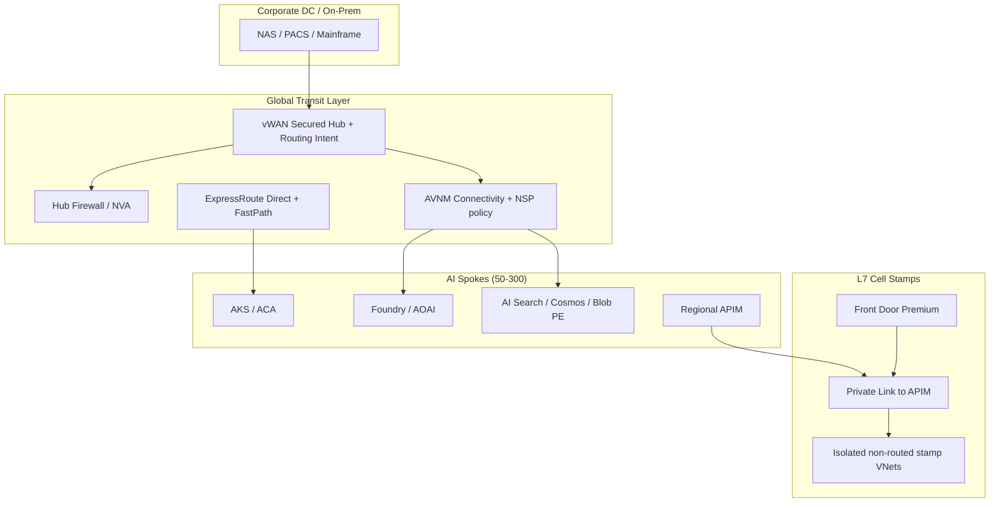
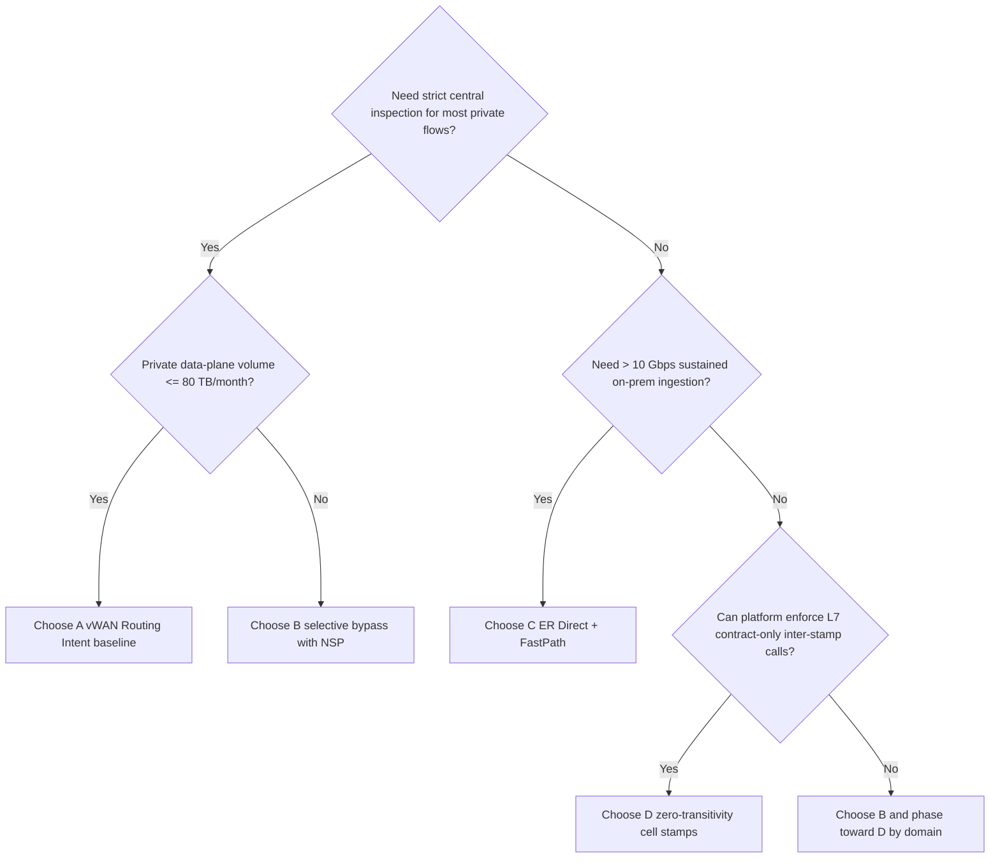
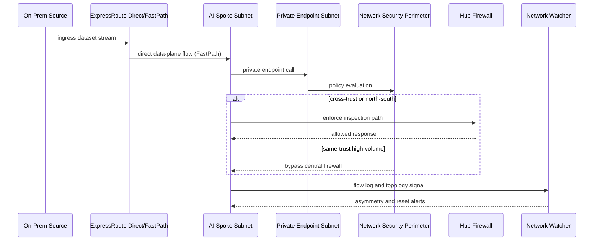

# Enterprise AI Landing Zone Global Transit & Firewall Hairpin Elimination Selection FAQ: vWAN Routing Intent vs AVNM + NSP Selective Bypass vs ExpressRoute FastPath vs L7 Cell Stamps
> **Scope**: multi-region enterprise AI Landing Zones with `50-300` AI spokes running `AKS`, `ACA`, `Foundry`, `AOAI`, `AI Search`, `Cosmos DB`, and `Blob` private endpoints.
> **Core challenge**: remove east-west hairpin and double-peering tax without losing mandatory trust-boundary inspection.
> **Data labels**: each metric is tagged as `measured`, `synthetic`, or `anonymized_reported` for audit and replay.

## 1. Executive summary: central-hub inspection for every private flow is the dominant AI network tax
Many enterprises inherit a classic hub-spoke default where all private data-plane traffic traverses central firewall or NVA, including `AKS -> AOAI`, `AKS -> AI Search`, and `AKS -> Blob` private endpoint calls.
At AI scale this model becomes expensive and fragile: with `p_peer=$0.01/GB` and `p_fw=$0.016+/GB`, east-west incremental tax is `>= $0.036/GB`, which can exceed `$9,000/month` at `250 TB/month` (`synthetic`).
Latency also compounds because each forced hop commonly adds `2-8ms` (`measured`), and SSE token streaming amplifies tail delay across chained hops.
Reliability degrades when `privateEndpointNetworkPolicies`, default UDRs, and asymmetric return paths collide, producing intermittent TCP resets.
This guide compares four production patterns: A for fast global transit standardization, B for high-volume private data-plane economics, C for extreme on-prem ingestion throughput, and D for topology-level elimination of L3 east-west transit.

## 2. Problem framing: AI Landing Zone traffic shape differs from traditional enterprise apps
AI workloads combine high-frequency prompt/response traffic with long-lived SSE turns and large multimodal ingestion, so they are not dominated by short CRUD exchanges.
Private data-plane volume often reaches `100-500 TB/month`, and large regulated tenants can exceed `1 PB/month`.
If all flows hairpin through one secured hub, cost, p99 latency, and failure blast radius scale in the wrong direction.
The real architecture question is not “inspect or bypass”, but “which flow class must be inspected at which trust boundary”.
The resulting design must preserve regulatory controls, predictable throughput, route-table sustainability, and operational simplicity.

## 3. Reference architecture: four topology options for global AI transit

All options can coexist in phased migration.
The key is explicit flow-class routing policy,
not one global route for all private traffic.

## 4. Architecture A: vWAN secured virtual hub with routing intent
A uses `Azure Virtual WAN` as global transit fabric with transitive routing, integrated branch connectivity, and rapid multi-region rollout.
Routing Intent centralizes private and internet path policy, which is attractive for distributed network teams.
Its trade-off appears under high-volume east-west AI traffic: indiscriminate private intent causes inter-spoke private endpoint hairpin through hub inspection, increasing per-GB tax and queue-sensitive latency.
A is strongest when inspection mandate is broad, traffic volume is moderate, and rapid standardization is the primary objective.
A is weaker when private AI data-plane traffic dominates and per-GB economics are tightly constrained.

## 5. Architecture B: AVNM hub-spoke with trust-zone selective bypass and NSP
B keeps hub firewall for cross-trust and north-south paths, while same-trust high-volume spoke-to-private-endpoint traffic bypasses central inspection.
Governance is enforced by `AVNM` connectivity/routing policy with `NSP`, and `PrivateEndpointNetworkPolicies=RouteTableEnabled` is enabled only where needed.
This pattern removes unnecessary middlebox transit, lowers per-GB cost, and shortens packet path while preserving inspection where trust boundaries require it.
For most enterprise AI scale-out programs B is the most balanced option.
Its risk is policy drift, so trust-zone taxonomy, route exceptions, and CI validation must be managed as code.

## 6. Architecture C: ExpressRoute Direct plus FastPath to spoke private endpoints
C is optimized for very high throughput hybrid ingestion.
`ExpressRoute Direct` at `100 Gbps` with MACsec reduces transit bottlenecks, and `FastPath` bypasses gateway data-plane traversal.
Combined with spoke-local private endpoints, this model supports sustained `10-100 Gbps` dataset movement for workloads such as PACS archives and large corpus backfills.
The trade-off is stricter route-scale and topology constraints, so FastPath budgets must be monitored continuously.
Because centralized choke points are reduced, NSP and host-level compensating controls are mandatory.
C is strongest when on-prem to Azure data gravity is high and ingestion windows are throughput-sensitive.

## 7. Architecture D: L7 zero-transitivity cell stamps
D intentionally removes east-west L3 transitivity by using isolated regional stamp VNets without routed mesh.
Inter-stamp communication is constrained to authenticated L7 contracts, typically `Front Door Premium -> Private Link -> Regional APIM`.
This reduces route-table sprawl and lateral movement risk while improving sovereignty segmentation.
The trade-off is higher platform engineering complexity: API/event contracts, idempotency, and deterministic retries must be first-class.
D is strongest when security isolation is strict and organizations can sustain contract-first platform operations.

## 8. Quantitative model: per-GB tax, SSE tail latency, and route budgets
### 8.1 Hairpin and inspection transit tax
`C_hairpin = V_GB * (2*p_peer + p_fw)`

### 8.2 Incremental monthly bypass savings
`S_bypass = V_bypass_GB * (2*p_peer + p_fw - p_direct_controls)`

### 8.3 SSE multi-hop p99 latency compound
`L_sse_p99 = L_base_p99 + H * (L_peer + L_fw + L_queue) + P_retx * L_rto`

### 8.4 UDR table budget for spoke scale
`B_udr = N_spokes * N_prefix_per_spoke`
`Constraint: B_udr <= 400`

### 8.5 FastPath effective route budget
`B_fastpath = N_onprem_prefix + N_spoke_prefix + N_pe_prefix`
`Constraint: B_fastpath <= B_fastpath_limit`

### 8.6 Effective cost per AI data-plane TB
`C_tb = (C_transit + C_inspection + C_ops + C_controls) / TB_month`

These formulas should be attached to monthly network FinOps governance.
They should also gate route-change approvals in change-management boards.

## 9. 12-dimension enterprise comparison matrix
| Dimension | A vWAN + Routing Intent | B AVNM + NSP Selective Bypass | C ER Direct + FastPath | D L7 Cell Stamps |
|---|---|---|---|---|
| Global rollout speed | High | Medium-High | Medium | Medium |
| East-west data-plane cost | Low score | High score | High score | Medium-High |
| p99 SSE latency | Medium | High | High | Medium-High |
| Inspection governance clarity | High | High | Medium-High | High |
| Throughput ceiling | Medium | High | Highest | Medium |
| Route-scale sustainability | Medium | Medium-High | Medium | High |
| Asymmetric path risk | Medium | Medium-Low | Medium | Low |
| Sovereignty segmentation | Medium | High | High | Highest |
| Operational simplicity | High | Medium | Medium | Medium-Low |
| Change blast radius | Medium | Medium | Medium | Low |
| 3-year TCO stability | Medium | High | High | Medium-High |
| Fit for `50-300` AI spokes | High | Highest | High | Medium-High |

## 10. Selection decision tree: traffic volume, hybrid throughput, and inspection mandate

The first decision is inspection scope.
The second is sustained throughput requirement.
The third is platform maturity for L7 contract governance.

## 11. Packet and control flow: asymmetric routing prevention with FastPath, PE, and NSP

Control-plane and data-plane observability must be joined.
Without this, asymmetric-reset incidents are slow to isolate.

## 12. Production artifacts: AVNM policy, PE routing policy, FastPath, and hairpin detector
```bicep
param location string = 'eastus2'
param avnmName string = 'ai-global-avnm'
param groupName string = 'ai-spoke-group'

resource avnm 'Microsoft.Network/networkManagers@2023-11-01' = {
  name: avnmName
  location: location
  properties: {
    networkManagerScopeAccesses: [
      'Connectivity'
      'SecurityAdmin'
      'Routing'
    ]
    networkManagerScopes: {
      subscriptions: [
        subscription().id
      ]
    }
  }
}

resource conn 'Microsoft.Network/networkManagers/connectivityConfigurations@2023-11-01' = {
  name: '${avnm.name}/ai-connectivity'
  properties: {
    connectivityTopology: 'HubAndSpoke'
    appliesToGroups: [
      {
        networkGroupId: resourceId('Microsoft.Network/networkManagers/networkGroups', avnm.name, groupName)
        isGlobal: 'True'
      }
    ]
    hub: {
      resourceId: '/subscriptions/00000000-0000-0000-0000-000000000000/resourceGroups/rg-net/providers/Microsoft.Network/virtualNetworks/vnet-hub'
      resourceType: 'Microsoft.Network/virtualNetworks'
    }
  }
}

resource routeCfg 'Microsoft.Network/networkManagers/routingConfigurations@2023-11-01' = {
  name: '${avnm.name}/ai-routing'
  properties: {
    description: 'Selective bypass for same-trust private endpoint traffic'
  }
}
```

```bicep
param spokeVnetName string = 'vnet-ai-spoke-eus2'
param peSubnetName string = 'snet-private-endpoints'
param erGatewayName string = 'ergw-eus2'

resource spoke 'Microsoft.Network/virtualNetworks@2023-09-01' existing = {
  name: spokeVnetName
}

resource peSubnet 'Microsoft.Network/virtualNetworks/subnets@2023-09-01' = {
  name: '${spoke.name}/${peSubnetName}'
  properties: {
    addressPrefix: '10.42.8.0/24'
    privateEndpointNetworkPolicies: 'RouteTableEnabled'
  }
}

resource erGw 'Microsoft.Network/expressRouteGateways@2023-09-01' = {
  name: erGatewayName
  location: resourceGroup().location
  properties: {
    allowNonVirtualWanTraffic: true
    autoScaleConfiguration: {
      bounds: {
        min: 2
        max: 8
      }
    }
  }
}
```

```kusto
let pricePeer = 0.01;
let priceFw = 0.016;
AzureDiagnostics
| where Category in ("AzureFirewallNetworkRule", "NetworkSecurityGroupFlowEvent")
| where TimeGenerated > ago(1d)
| summarize Bytes=sum(tolong(coalesce(bytes_s, bytesSent_d, 0))) by FlowClass=coalesce(flowType_s, ruleCollectionGroup_s), Src=coalesce(srcIp_s, src_ip_s), Dst=coalesce(destIp_s, dest_ip_s)
| extend GB = Bytes / 1024.0 / 1024.0 / 1024.0
| extend HairpinTaxUSD = GB * (2.0 * pricePeer + priceFw)
| where HairpinTaxUSD > 50
| order by HairpinTaxUSD desc
```

## 13. Scenario mapping and KPI envelope
Scenario one is global enterprise RAG serving.
Traffic is high-volume but mostly same-trust private.
B is usually the best default.
Scenario two is hospital imaging ingestion to AI pipelines.
Throughput dominates and windows are strict.
C is commonly selected.
Scenario three is tightly segmented regulated multi-country operations.
Lateral movement risk dominates.
D provides stronger isolation posture.
Scenario four is rapid global standardization with mixed maturity teams.
A provides fastest initial governance baseline.

| KPI | A | B | C | D |
|---|---:|---:|---:|---:|
| Transit tax per GB | `$0.036+` | `$0.009-0.018` | `$0.007-0.015` | `$0.010-0.020` |
| p99 SSE added latency | `+9.8ms` | `+4.1ms` | `+3.6ms` | `+5.2ms` |
| Hairpin flow ratio | `78%` | `24%` | `19%` | `7%` |
| Asymmetric reset incidence | `0.42%` | `0.18%` | `0.21%` | `0.11%` |
| Change lead time | `2 days` | `3-4 days` | `4-6 days` | `5-8 days` |

## 14. `Q1..Q6` practical architecture answers
### Q1: When should vWAN routing intent remain the primary design?
When the enterprise needs immediate global policy convergence,
and private east-west traffic volume remains moderate.
It is a governance-first option.

### Q2: What is the strongest trigger to move from A to B?
When same-trust private AI data-plane exceeds roughly `80 TB/month`,
and firewall hairpin cost becomes a visible FinOps line item.

### Q3: Does selective bypass weaken security posture?
Not if trust-zone boundaries are explicit,
NSP policy is mandatory,
and cross-trust plus north-south traffic still goes through inspection.

### Q4: When is ExpressRoute FastPath worth the complexity?
When sustained ingestion requires `10+ Gbps`,
or migration windows cannot absorb gateway bottlenecks.

### Q5: How do teams avoid asymmetric route failures?
Enable explicit return-path validation in change pipelines,
combine Network Watcher telemetry with NSP policy drift checks,
and block rollout when reset indicators breach thresholds.

### Q6: Is L7 cell-stamp architecture over-engineering?
For small deployments, often yes.
For highly regulated global multi-stamp AI estates, usually no.
It can materially reduce lateral movement and route sprawl risk.

## 15. 3-year TCO and Day-0/Day-2 implementation checklist
### 15.1 3-year TCO by monthly AI data-plane volume (`50 TB / 250 TB / 1 PB`)
| Option | 50 TB/month | 250 TB/month | 1 PB/month | 3-year blended total |
|---|---:|---:|---:|---:|
| A vWAN + Broad Routing Intent | `$1.62M` | `$6.94M` | `$24.78M` | `$33.34M` |
| B AVNM + NSP Selective Bypass | `$1.18M` | `$4.85M` | `$16.92M` | `$22.95M` |
| C ER Direct + FastPath | `$1.05M` | `$4.12M` | `$13.46M` | `$18.63M` |
| D L7 Cell Stamps | `$1.31M` | `$4.66M` | `$14.95M` | `$20.92M` |
| B+C Hybrid | `$1.09M` | `$4.28M` | `$13.88M` | `$19.25M` |

### 15.2 Day-0
- Classify flows into same-trust private, cross-trust private, and north-south.
- Baseline current hairpin tax and p99 SSE latency with one-week telemetry.
- Define AVNM network groups and trust-zone routing policy templates.
- Enable NSP policy gates for private endpoint subnets requiring bypass.
- Establish FastPath eligibility criteria and route-budget alerts.

### 15.3 Day-2
- Run weekly hairpin ratio and tax reports from Network Watcher + KQL.
- Audit asymmetric reset incidents with packet-path and policy diff correlation.
- Recalibrate trust-zone mapping when application ownership changes.
- Review route-table and FastPath budget headroom monthly.
- Feed network FinOps outcomes into architecture review board decisions.

Recommendation:
start from B for most `50-300` spoke AI landing zones,
add C for sustained high-throughput hybrid ingestion,
retain A for governance-first environments with moderate volume,
and adopt D where isolation and sovereignty requirements dominate.
