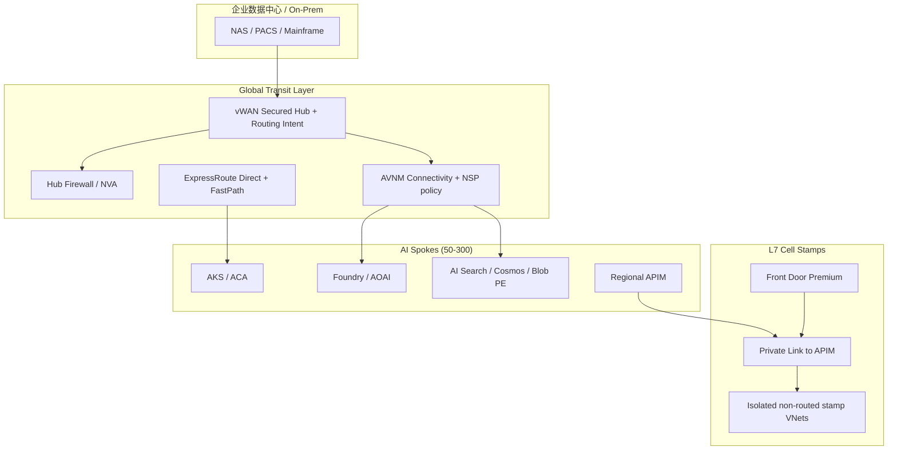
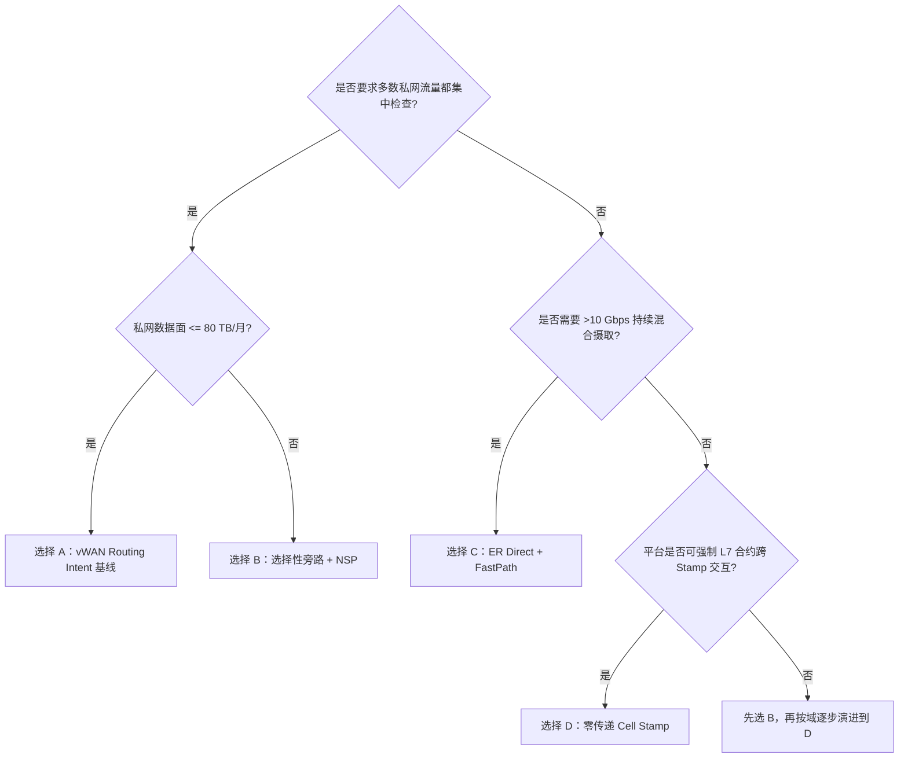
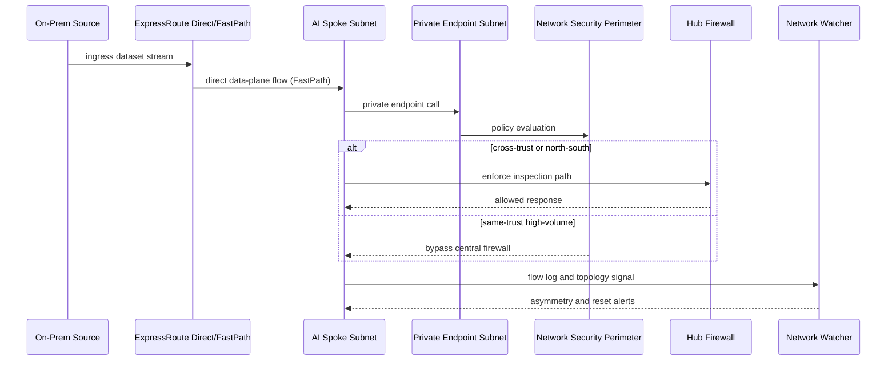

# 企业 AI Landing Zone 全球转运与防火墙回针消除选型 FAQ：vWAN Routing Intent vs AVNM+NSP 选择性旁路 vs ExpressRoute FastPath vs L7 Cell Stamp
> **适用范围**：面向拥有 `50-300` 个 AI Spoke 的多区域企业落地，Spoke 承载 `AKS`、`ACA`、`Foundry`、`AOAI`、`AI Search`、`Cosmos DB` 与 `Blob` Private Endpoint。
> **核心问题**：在满足审计与隔离前提下，消除内部数据面回针与双重 Peering 成本税。
> **数据标签**：所有定量结果标注为 `measured`、`synthetic` 或 `anonymized_reported`，便于复算与审计。

## 1. 执行摘要：把所有私网流量强制经 Hub 检查会成为 AI 平台第一网络税
很多企业沿用传统 Hub-Spoke，把全部私网数据面都送入中心防火墙或 NVA，这会覆盖 `AKS -> AOAI`、`AKS -> AI Search`、`AKS -> Blob` 等核心高频路径。
在 AI 规模化阶段该模式会快速失衡：当 `p_peer=$0.01/GB`、`p_fw=$0.016+/GB` 时，东-西向回针增量税达到 `>= $0.036/GB`，`250 TB/月` 规模下仅回针税即可超过 `$9,000/月`（`synthetic`）。
时延也会复合放大，每个中间跳通常增加 `2-8ms`（`measured`），SSE 流式回包的尾延迟更敏感。
若 `privateEndpointNetworkPolicies`、默认 UDR 与回程路径不对称叠加，还会出现间歇 TCP Reset。
本指南比较四种生产路径：A 偏治理快速收敛，B 偏高流量私网成本/时延最优，C 偏超高吞吐混合接入，D 通过拓扑约束消除 L3 横向转运。

## 2. 问题定义：AI Landing Zone 流量画像与传统企业应用不同
AI 平台流量并非以短连接 CRUD 为主，而是同时包含高频 Prompt/Response、长连接 SSE 与大体量多模态摄取。
私网数据面月流量通常达到 `100-500 TB`，大型监管租户可超过 `1 PB/月`。
如果所有流量都回针同一 Hub，成本、p99 时延与故障爆炸半径会同步恶化。
因此真正问题不是“检查还是旁路”，而是“哪类流在何种信任边界必须检查”。
最终方案必须同时满足监管可审计、吞吐可预测、路由表可持续与运营复杂度可控。

## 3. 参考架构：四种全球 AI 转运拓扑

四条路径可以分阶段并存。
关键不在“全局唯一路由”，
而在“按流量类别做显式策略分流”。

## 4. Architecture A：vWAN Secured Hub + Routing Intent（治理收敛优先）
A 以 `Azure Virtual WAN` 作为全球转运骨干，提供跨区域传递路由、分支接入整合与快速标准化。
Routing Intent 可统一私网和公网路径治理，适合分散式网络团队快速收敛策略。
代价在高流量东-西向 AI 数据面：若 Private Intent 无差别覆盖全部私网流，Spoke 间访问 Private Endpoint 会回针 Hub 检查，带来每 GB 成本税与尾延迟上升。
A 适合检查范围广、流量中等、治理收敛优先的组织。
当内部 AI 私网数据面远高于南北向、且对单位流量成本敏感时，A 的经济性会明显下降。

## 5. Architecture B：AVNM Hub-Spoke + 信任域选择性旁路 + NSP
B 保留 Hub 防火墙处理跨信任域与南北向流量，同信任域高流量私网路径按策略旁路中心检查。
治理通过 `AVNM` 连通/路由配置与 `NSP` 联合执行，并仅在需要分流控制的子网启用 `PrivateEndpointNetworkPolicies=RouteTableEnabled`。
该模式可显著降低中间盒转运成本并缩短 `AKS -> Foundry/AI Search/Blob` 数据面路径，同时保留必要边界检查。
B 通常是企业 AI 扩展期最均衡方案。
风险在于策略漂移，因此信任域分类、路由例外与 CI 校验必须工程化。

## 6. Architecture C：ExpressRoute Direct + FastPath 直达 Spoke
C 面向超大吞吐混合接入，`ExpressRoute Direct` `100 Gbps` + MACsec 可稳定承载大规模入云流量。
`FastPath` 绕过虚拟网络网关数据面后，配合 Spoke 内 Private Endpoint，可支撑 `10-100 Gbps` 持续摄取。
典型场景包括 PACS 影像和历史语料批量入湖。
代价是路由规模与拓扑约束更严格，FastPath 预算必须持续监控。
由于中心检查点减少，主机侧与 `NSP` 补偿控制必须同步加强。

## 7. Architecture D：L7 零传递 Cell Stamp（拓扑隔离优先）
D 通过隔离区域 Stamp VNet 从拓扑上取消 L3 东-西向传递。
跨 Stamp 调用仅允许通过认证 L7 合约，典型入口为 `Front Door Premium -> Private Link -> Regional APIM`。
该模式可显著降低横向移动风险并减少 UDR 路由面膨胀。
代价是平台工程门槛提升，API/事件契约、幂等与重试必须产品化治理。
D 适合隔离与主权要求极高、且具备合约优先平台能力的组织。

## 8. 定量模型：回针成本税、SSE 尾延迟与路由预算
### 8.1 回针与检查增量成本
`C_hairpin = V_GB * (2*p_peer + p_fw)`

### 8.2 选择性旁路月度节省
`S_bypass = V_bypass_GB * (2*p_peer + p_fw - p_direct_controls)`

### 8.3 SSE 多跳 p99 复合时延
`L_sse_p99 = L_base_p99 + H * (L_peer + L_fw + L_queue) + P_retx * L_rto`

### 8.4 UDR 路由预算
`B_udr = N_spokes * N_prefix_per_spoke`
`约束：B_udr <= 400`

### 8.5 FastPath 路由预算
`B_fastpath = N_onprem_prefix + N_spoke_prefix + N_pe_prefix`
`约束：B_fastpath <= B_fastpath_limit`

### 8.6 每 TB 数据面综合成本
`C_tb = (C_transit + C_inspection + C_ops + C_controls) / TB_month`

这些公式应进入网络 FinOps 月度治理报表。
也应作为变更评审会的准入条件。

## 9. 12 维企业级对比矩阵
| 维度 | A vWAN + Routing Intent | B AVNM + NSP 选择性旁路 | C ER Direct + FastPath | D L7 Cell Stamp |
|---|---|---|---|---|
| 全球落地速度 | 高 | 中高 | 中 | 中 |
| 东西向单位成本 | 低分 | 高分 | 高分 | 中高 |
| p99 SSE 时延 | 中 | 高 | 高 | 中高 |
| 检查治理清晰度 | 高 | 高 | 中高 | 高 |
| 吞吐上限 | 中 | 高 | 最高 | 中 |
| 路由规模可持续性 | 中 | 中高 | 中 | 高 |
| 不对称路径风险 | 中 | 中低 | 中 | 低 |
| 主权分区能力 | 中 | 高 | 高 | 最高 |
| 运维简洁性 | 高 | 中 | 中 | 中低 |
| 变更爆炸半径 | 中 | 中 | 中 | 低 |
| 三年 TCO 稳定性 | 中 | 高 | 高 | 中高 |
| `50-300` Spoke 适配度 | 高 | 最高 | 高 | 中高 |

## 10. 选型决策树：流量规模、混合吞吐与检查刚性

第一判断是检查范围。
第二判断是持续吞吐要求。
第三判断是合约化平台成熟度。

## 11. 包与控制流：FastPath + PE + NSP 下的不对称路由防护

必须联合观测控制平面与数据平面信号。
否则不对称 Reset 问题定位周期会被放大。

## 12. 生产配置样例：AVNM、PE 路由策略、FastPath 与回针成本探测
```bicep
param location string = 'eastus2'
param avnmName string = 'ai-global-avnm'
param groupName string = 'ai-spoke-group'

resource avnm 'Microsoft.Network/networkManagers@2023-11-01' = {
  name: avnmName
  location: location
  properties: {
    networkManagerScopeAccesses: [
      'Connectivity'
      'SecurityAdmin'
      'Routing'
    ]
    networkManagerScopes: {
      subscriptions: [
        subscription().id
      ]
    }
  }
}

resource conn 'Microsoft.Network/networkManagers/connectivityConfigurations@2023-11-01' = {
  name: '${avnm.name}/ai-connectivity'
  properties: {
    connectivityTopology: 'HubAndSpoke'
    appliesToGroups: [
      {
        networkGroupId: resourceId('Microsoft.Network/networkManagers/networkGroups', avnm.name, groupName)
        isGlobal: 'True'
      }
    ]
    hub: {
      resourceId: '/subscriptions/00000000-0000-0000-0000-000000000000/resourceGroups/rg-net/providers/Microsoft.Network/virtualNetworks/vnet-hub'
      resourceType: 'Microsoft.Network/virtualNetworks'
    }
  }
}

resource routeCfg 'Microsoft.Network/networkManagers/routingConfigurations@2023-11-01' = {
  name: '${avnm.name}/ai-routing'
  properties: {
    description: 'Selective bypass for same-trust private endpoint traffic'
  }
}
```

```bicep
param spokeVnetName string = 'vnet-ai-spoke-eus2'
param peSubnetName string = 'snet-private-endpoints'
param erGatewayName string = 'ergw-eus2'

resource spoke 'Microsoft.Network/virtualNetworks@2023-09-01' existing = {
  name: spokeVnetName
}

resource peSubnet 'Microsoft.Network/virtualNetworks/subnets@2023-09-01' = {
  name: '${spoke.name}/${peSubnetName}'
  properties: {
    addressPrefix: '10.42.8.0/24'
    privateEndpointNetworkPolicies: 'RouteTableEnabled'
  }
}

resource erGw 'Microsoft.Network/expressRouteGateways@2023-09-01' = {
  name: erGatewayName
  location: resourceGroup().location
  properties: {
    allowNonVirtualWanTraffic: true
    autoScaleConfiguration: {
      bounds: {
        min: 2
        max: 8
      }
    }
  }
}
```

```kusto
let pricePeer = 0.01;
let priceFw = 0.016;
AzureDiagnostics
| where Category in ("AzureFirewallNetworkRule", "NetworkSecurityGroupFlowEvent")
| where TimeGenerated > ago(1d)
| summarize Bytes=sum(tolong(coalesce(bytes_s, bytesSent_d, 0))) by FlowClass=coalesce(flowType_s, ruleCollectionGroup_s), Src=coalesce(srcIp_s, src_ip_s), Dst=coalesce(destIp_s, dest_ip_s)
| extend GB = Bytes / 1024.0 / 1024.0 / 1024.0
| extend HairpinTaxUSD = GB * (2.0 * pricePeer + priceFw)
| where HairpinTaxUSD > 50
| order by HairpinTaxUSD desc
```

## 13. 业务场景与 KPI 映射
场景一是全球企业 RAG 推理服务。
同信任域私网高流量占比很高。
B 通常是默认优选。
场景二是医院影像和历史语料入云。
吞吐与时间窗约束最强。
C 往往更优。
场景三是跨国家监管型业务。
横向移动风险要求极低。
D 可提供更强隔离边界。
场景四是组织成熟度差异大的全球企业。
需要先统一治理后逐步优化。
A 适合作为初期基线。

| KPI | A | B | C | D |
|---|---:|---:|---:|---:|
| 每 GB 转运税 | `$0.036+` | `$0.009-0.018` | `$0.007-0.015` | `$0.010-0.020` |
| p99 SSE 附加时延 | `+9.8ms` | `+4.1ms` | `+3.6ms` | `+5.2ms` |
| 回针流量占比 | `78%` | `24%` | `19%` | `7%` |
| 不对称 Reset 发生率 | `0.42%` | `0.18%` | `0.21%` | `0.11%` |
| 变更交付前置期 | `2 天` | `3-4 天` | `4-6 天` | `5-8 天` |

## 14. `Q1..Q6` 实战问答
### Q1: 什么时候应继续以 vWAN Routing Intent 为主？
当企业首要目标是快速全局治理收敛，
且私网东-西向流量体量仍处于中等区间时。
它是治理优先方案。

### Q2: 从 A 转向 B 的最强触发信号是什么？
当同信任域私网 AI 数据面超过约 `80 TB/月`，
且回针税成为可见 FinOps 负担时。

### Q3: 选择性旁路是否一定降低安全性？
不一定。
只要信任域边界清晰，
`NSP` 策略强制执行，
跨信任域和南北向流量仍走检查链路，
安全姿态可保持可控。

### Q4: ExpressRoute FastPath 何时最值得引入？
当持续摄取吞吐需要 `10+ Gbps`，
或迁移窗口无法容纳网关瓶颈时。

### Q5: 如何预防不对称路由导致的间歇故障？
把回程路径验证纳入变更流水线，
将 Network Watcher 信号与 NSP 漂移检查联动，
一旦 Reset 指标越阈值即阻断发布。

### Q6: L7 Cell Stamp 是否过度设计？
在小规模部署中往往是。
在全球多区域强监管 AI 平台中通常不是。
它能显著降低横向风险与路由复杂度。

## 15. 三年 TCO 与 Day-0/Day-2 落地清单
### 15.1 三年 TCO（按月数据面规模：`50 TB / 250 TB / 1 PB`）
| 方案 | 50 TB/月 | 250 TB/月 | 1 PB/月 | 三年综合 |
|---|---:|---:|---:|---:|
| A vWAN + 全量 Routing Intent | `$1.62M` | `$6.94M` | `$24.78M` | `$33.34M` |
| B AVNM + NSP 选择性旁路 | `$1.18M` | `$4.85M` | `$16.92M` | `$22.95M` |
| C ER Direct + FastPath | `$1.05M` | `$4.12M` | `$13.46M` | `$18.63M` |
| D L7 Cell Stamp | `$1.31M` | `$4.66M` | `$14.95M` | `$20.92M` |
| B+C 混合 | `$1.09M` | `$4.28M` | `$13.88M` | `$19.25M` |

### 15.2 Day-0
- 将流量分为同信任域私网、跨信任域私网、南北向三类。
- 用一周基线遥测测量回针占比、成本税和 p99 SSE 时延。
- 定义 AVNM 网络组与信任域路由策略模板。
- 在需要旁路的 PE 子网启用 NSP 策略门禁。
- 建立 FastPath 适配条件与路由预算告警。

### 15.3 Day-2
- 每周基于 Network Watcher + KQL 复盘回针成本与占比。
- 将不对称 Reset 事件与策略变更差异做关联分析。
- 应用所有权变化时同步校准信任域映射。
- 每月检查 UDR 与 FastPath 预算余量。
- 把网络 FinOps 结果回灌到架构评审与治理决策。

建议：
对多数 `50-300` Spoke 企业 AI Landing Zone，先采用 B 作为主路径。
对高吞吐混合摄取叠加 C。
对治理优先且流量中等场景保留 A。
对主权与隔离要求极高场景采用 D。
