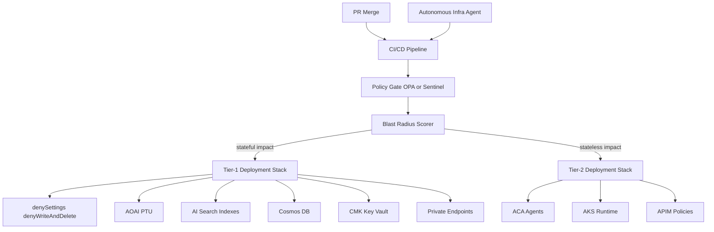
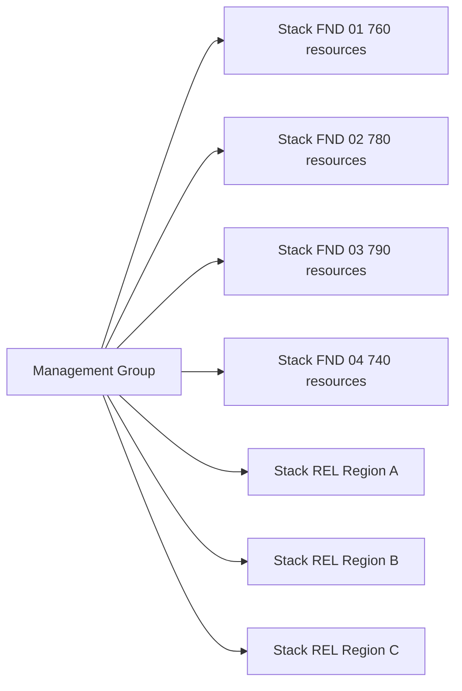
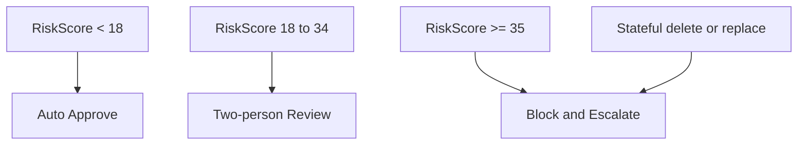

# Enterprise AI Landing Zone IaC blast-radius guardrail selection FAQ: Deployment Stacks denySettings vs Terraform OPA Sentinel vs What-If ARG Drift

> 🌐 **Language Switch**: [中文](./ai-landing-zone-iac-blast-radius-guardrails-azure-deployment-stacks-denysettings-vs-terraform-opa-sentinel-vs-whatif-arg-drift-selection-faq.md) | **English (current)**
> **Audience**: Cloud & AI Solution Architects, platform engineering, SRE, FinOps, security governance, and audit teams.
> **Scope**: Four enterprise IaC lifecycle and drift-remediation architectures that constrain destructive blast radius for stateful AI landing-zone assets.

## 1. Why AI landing-zone destructive guardrails differ from classic app IaC

PTU reservations, vector indexes, Cosmos estates, and private-endpoint chains are slow-changing and expensive-to-recover assets in AI landing zones.

A single destructive change can trigger rebuild, reindex, key-chain remediation, and compliance evidence reconstruction, with impact beyond stateless services.

When autonomous infra agents execute production changes, mistakes propagate at machine speed, so deterministic guardrails must be placed before irreversible mutations.

This guide focuses on quantifying and constraining blast radius rather than merely increasing deployment throughput.

## 2. Four architecture options and ownership boundaries

Architecture A enforces hard stops at ARM admission for destructive writes and deletes.

Architecture B rejects risky actions during IaC plan evaluation with policy-as-code.

Architecture C provides lightweight pre-check and post-change drift visibility, with weaker hard-stop capability.

Architecture D decouples stateful foundation from fast-release surfaces and is commonly the enterprise target pattern.

## 3. End-to-end reference architecture and control-plane boundaries



By separating scoring, escalation, and resource-tier boundaries, platforms can preserve both release velocity and safety.

## 4. Architecture A: Deployment Stacks with denySettings

`denyWriteAndDelete` and `denyDelete` elevate protection from process convention to control-plane enforcement.

`excludedPrincipals` should map to PIM break-glass groups with strict activation auditing.

`detachAll` in `actionOnUnmanage` suits stateful foundations, while `deleteResources` is acceptable for disposable release assets.

The trade-off of A is reduced flexibility, but the benefit is destructive intent blocked at the earliest entry point.

## 5. Architecture B: Terraform OpenTofu with OPA Sentinel

B centers on evaluating `terraform show -json` plan output with OPA or Sentinel policies.

`prevent_destroy`, `moved`, and `removed` patterns substantially reduce replacement-style destructive transitions.

`plan -refresh-only` should run on schedule to surface ClickOps and configuration drift.

If control-plane changes bypass pipeline execution, B loses enforcement power.

## 6. Architecture C: Bicep What-If PSRule ARG

C is lightweight and easy to scale across many teams without heavy state lifecycle governance.

What-If and PSRule fit pre-release feedback, while ARG changes fit post-change drift visibility.

C lacks deterministic hard-stop boundaries, which is risky for high-value stateful assets.

Therefore C is usually positioned as validation and observability support, not the final line of defense.

## 7. Architecture D: two-tier split-stack recommended pattern

D separates Tier-1 stateful foundation governance from Tier-2 rapid release governance.

Tier-1 defaults to hard protection with `detachAll`, while Tier-2 preserves high-frequency release agility.

This pattern reduces the systemic risk of touching stateful assets in every release cycle.

At 50 to 250 spokes, explicit 800-resource stack partition planning is mandatory.

## 8. Quantitative models and blast-radius formulas

`RiskScore = Wd*DeleteCount + Ws*StatefulCount + Wq*QuotaImpact + Wr*RTOPenalty`.

A practical seed weighting is Wd=1, Ws=8, Wq=5, Wr=3, then recalibrate quarterly from incident data.

`StacksNeeded = ceil(TotalManagedResources / 800)` is the primary stack partition capacity formula.

`Loss = DowntimeHours * BusinessLossPerHour + RecoveryOpsCost + ReindexCost + ComplianceOverhead` estimates destructive-event economics.

## 9. Quantitative 12-dimension comparison matrix

| Dimension | A Deployment Stacks | B Terraform OPA Sentinel | C Bicep What-If ARG | D Two-Tier Split-Stack |
|---|---|---|---|---|
| Enforcement point | ARM admission pre-write | CI plan gate pre-apply | Precheck and post-change telemetry | Tier-1 ARM plus Tier-2 process gate |
| Delete protection | denyWriteAndDelete hard block | Policy block on delete and replace | Warn unless external block | Tier-1 hard block Tier-2 controlled delete |
| Owner bypass resistance | High except excluded principals | Medium if direct control-plane edits | Low without deny assignments | High in Tier-1 medium in Tier-2 |
| Stateful restore exposure | Near zero under strict deny | Medium when gate is bypassed | High in detect-after-change mode | Low for Tier-1 bounded for Tier-2 |
| Drift detection latency | Low because mutation is constrained | Medium by refresh cadence | Medium high by ARG lag | Low medium with split observability |
| Scale limit pressure | 800 resources per stack | No stack cap state growth risk | No stack cap weaker stop line | Tier-1 800 cap with independent Tier-2 |
| Private endpoint CMK chain safety | Strong when protected set includes PE KV | Good if policies enumerate all types | Moderate with warning-only gates | Strong in Tier-1 foundation lane |
| False positive noise | Low after deny scope tuning | Medium policy quality dependent | Higher what-if computed noise | Medium with risk-scoring suppression |
| Delivery agility | Medium governance biased | High developer friendly | High lightweight process | High with lane separation |
| Operational complexity | Medium stack lifecycle governance | Medium high state and policy lifecycle | Low medium observability focused | High dual-tier orchestration |
| Typical RTO impact | Additional RTO near 0h when blocked | 2 to 18h if destructive apply slips | 4 to 24h in late detection cases | Tier-1 near 0h Tier-2 often under 1h |
| Best fit scale | 10 to 300 spokes strict compliance | 5 to 200 spokes cross-cloud teams | 1 to 80 spokes light governance | 20 to 250 spokes enterprise default |

## 10. 800-resource limit and partition topology



Keep each Tier-1 stack in a 650 to 790 resource operating range to avoid hard-cap freeze during growth.

## 11. Production Bicep: deploymentStacks and denySettings

```bicep
targetScope = 'subscription'
param stackName string = 'alz-ai-tier1-foundation'
param location string = 'eastus2'
param breakGlassPrincipalIds array

resource tier1 'Microsoft.Resources/deploymentStacks@2024-03-01' = {
  name: stackName
  location: location
  properties: {
    actionOnUnmanage: {
      managementGroups: 'detachAll'
      resourceGroups: 'detachAll'
      resources: 'detachAll'
    }
    denySettings: {
      mode: 'denyWriteAndDelete'
      applyToChildScopes: true
      excludedPrincipals: breakGlassPrincipalIds
      excludedActions: [
        'Microsoft.Authorization/roleAssignments/read'
        'Microsoft.Resources/tags/read'
      ]
    }
  }
}
```

This template shows how break-glass, deny mode, and child-scope coverage are codified together in IaC.

## 12. OPA Rego and Python blast-radius evaluator

```rego
package terraform.guardrails

default deny = []

stateful_types := {
  "azurerm_cosmosdb_account",
  "azurerm_search_service",
  "azurerm_key_vault",
  "azurerm_private_endpoint",
  "azapi_resource::Microsoft.CognitiveServices/accounts"
}

deny[msg] {
  rc := input.resource_changes[_]
  rc.change.actions == ["delete"]
  stateful_types[rc.type]
  msg := sprintf("deny delete on stateful type: %s", [rc.address])
}

deny[msg] {
  rc := input.resource_changes[_]
  rc.change.actions == ["delete", "create"]
  stateful_types[rc.type]
  msg := sprintf("deny replace on stateful type: %s", [rc.address])
}
```

```python
from dataclasses import dataclass

@dataclass
class PlanStats:
    deletes: int
    replaces: int
    stateful_hits: int
    ptu_quota_pct: float
    estimated_rto_hours: float

def blast_radius_score(s: PlanStats) -> float:
    wd, wr, ws, wq, wt = 1.0, 2.0, 8.0, 5.0, 3.0
    return wd*s.deletes + wr*s.replaces + ws*s.stateful_hits + wq*(s.ptu_quota_pct/100.0) + wt*s.estimated_rto_hours

def decision(score: float) -> str:
    if score < 18:
        return "allow-auto"
    if score < 35:
        return "require-two-person-review"
    return "block-and-escalate"
```

Policy output should always include resource address and matched rule for fast remediation by delivery teams.

## 13. Enterprise scenario A: global banking platform

Scenario A models a global bank with 96 spokes, 12 PTU pools, and sovereignty-compliance constraints across regions.

Before redesign, one replacement event forced a 9-hour AI Search rebuild and materially degraded retrieval quality.

After redesign, Tier-1 hard-stop plus Tier-2 fast release lane was adopted, and high RiskScore plans auto-escalated to two-person review.

After ten weeks, stateful destructive incidents dropped to zero, pre-release wait increased by only seven minutes, and major recovery windows shrank by 64 percent.

## 14. Enterprise scenario B: global manufacturing 24x7 operations

Scenario B models a global manufacturer with 210 spokes and autonomous overnight operations agents handling drift remediation.

Early near-miss private-endpoint replacement attempts proved post-fact observability alone is insufficient for stateful foundations.

After redesign, all stateful assets were moved into Tier-1 hard protection while autonomous agents retained least privilege on Tier-2.

After three months, autonomous remediation success increased from 82 to 96 percent, with 41 high-risk actions blocked and zero production damage.

### 3-year TCO table (USD, 20 / 80 / 250 AI spokes)

| Architecture path | 20 spokes | 80 spokes | 250 spokes | 3-year platform cost | 3-year avoided-loss value | 3-year net value |
|---|---:|---:|---:|---:|---:|---:|
| A Deployment Stacks hard control | 0.92M | 2.84M | 8.75M | 12.51M | 18.30M | 5.79M |
| B Terraform OPA Sentinel | 0.78M | 2.36M | 7.10M | 10.24M | 13.95M | 3.71M |
| C Bicep What-If ARG | 0.66M | 2.05M | 6.42M | 9.13M | 9.84M | 0.71M |
| D Two-Tier Split-Stack | 1.02M | 2.62M | 7.48M | 11.12M | 20.44M | 9.32M |

## 15. Day-0/Day-1/Day-2, Q&A, fit boundaries, and alerts

### Day-0

1. Complete Tier-1 asset inventory and define non-destructible resource classes.

2. Configure break-glass PIM, MFA, and audit traceability.

3. Design stack partitions against the 800-resource limit.

4. Integrate policy gates and blast-radius scoring in CI.

5. Execute one destructive simulation and verify hard-stop behavior.

### Day-1

1. Track deny hit-rate and false-block rate.

2. Track policy rejection reasons and remediation lead time.

3. Calibrate RiskScore thresholds and review gates.

4. Validate least-privilege execution boundaries for autonomous agents.

5. Postmortem one real change and close policy gaps.

### Day-2

1. Weekly review stateful coverage and uncovered assets.

2. Monthly review TCO and avoided-loss outcomes.

3. Quarterly evaluate stack partition density and growth headroom.

4. Quarterly rotate break-glass identities and drill revocation.

5. Bind alert dictionary to automated incident workflows and escalation.

### 15.1 Worked quantitative Q&A

### Q1: How do we estimate stack partition count

How do we estimate stack partition count? Use `StacksNeeded = ceil(TotalManagedResources / 800)` and add 15 percent growth headroom.

For 250 spokes * 18 resources, baseline is 4500 and needs 6 stacks, while buffered planning suggests 7 stacks.

### Q2: How do we estimate AI Search destructive loss

How do we estimate AI Search destructive loss? Combine downtime loss, rebuild compute, and compliance overhead.

With 6h downtime at 120k per hour, 10h rebuild at 2.5k per hour, and 80k compliance, total loss is about 825k.

### Q3: How should RiskScore thresholds be set

How should RiskScore thresholds be set? Replay historical plans and map scores to incident severity.

A practical policy is `<18` auto, `18-34` two-person review, and `>=35` hard block, then recalibrate quarterly.

### Q4: How do we quantify guardrail delivery penalty

How do we quantify guardrail delivery penalty? Compare before-after with `LeadTimeDelta`.

If lead time rises from 22 to 29 minutes, the 7-minute penalty is usually far smaller than one destructive event loss.

### Q5: How often should refresh-only run

How often should refresh-only run? A heuristic is `max(15min, MeanTimeToUnsafeChange/4)`.

If unsafe change interval averages two hours, use 30-minute cadence and pair with 15-minute ARG stream monitoring.

### Q6: How do we compute split-stack net value

How do we compute split-stack net value? `NetBenefit = AvoidedLoss + ProductivityGain - AddedGovernanceCost`.

With 20.44M avoided loss, 3.10M productivity gain, and 14.22M added governance cost, net value is about 9.32M.

### 15.2 Good fit vs Not for

Good fit: organizations with multi-region spokes, high-value stateful assets, and autonomous change execution.

Not for: very small, disposable workloads with low compliance pressure and no strict audit requirements.

### 15.3 Runtime alert dictionary

| Alert key | Trigger condition | Immediate action | Owner |
|---|---|---|---|
| `deny_assignment_bypass_attempt` | Tier-1 mutation attempt by non-excluded principal | Block and trigger audit | Platform Security |
| `stateful_delete_in_plan` | Plan contains stateful delete | Fail pipeline and escalate | Platform Engineering |
| `replace_on_private_endpoint` | Private endpoint replacement detected | Freeze rollout and review | Network Team |
| `arg_drift_on_tier1` | Tier-1 drift outside approved window | Lock window and isolate session | SRE |
| `risk_score_over_threshold` | RiskScore >= 35 | Auto block and two-person escalation | Change Board |
| `stack_resource_near_limit` | Stack exceeds 760 resources | Trigger partition expansion | Platform Engineering |
| `break_glass_activation` | Break-glass activation event | Enable full-session audit capture | Security Governance |
| `ptu_quota_drift` | PTU quota drift above threshold | Pause impacted release lanes | FinOps |
| `search_index_mutation_spike` | Index delete or replace spike | Enter read-only protection mode | Data Platform |
| `cosmos_account_policy_drift` | Cosmos policy drift | Auto-remediate and alert | Data Platform |



### 15.4 Source references (captured 2026-11-23)

1. Azure Deployment Stacks: https://learn.microsoft.com/azure/azure-resource-manager/bicep/deployment-stacks

2. ARM What-If: https://learn.microsoft.com/azure/azure-resource-manager/templates/deploy-what-if

3. Azure Resource Graph changes: https://learn.microsoft.com/azure/governance/resource-graph/changes/get-resource-changes

4. Terraform lifecycle: https://developer.hashicorp.com/terraform/language/meta-arguments/lifecycle

5. Open Policy Agent docs: https://www.openpolicyagent.org/docs/latest/

6. PSRule for Azure: https://azure.github.io/PSRule.Rules.Azure/

### 15.5 Common failure patterns and practical mitigations

Failure pattern one is mixing Tier-1 and Tier-2 resources in a single stack, which forces every release to touch stateful boundaries.

This looks simpler at small scale, but once estates grow beyond roughly 80 spokes, approval latency and recovery complexity rise together and eventually degrade both speed and resilience.

Failure pattern two is using OPA or Sentinel as only a formatting gate while leaving destructive `delete` and `replace` vectors outside mandatory block rules.

In that mode, pipelines stay green while stateful assets are replaced, and ARG drift telemetry arrives minutes later when optimal loss-containment windows are already missed.

Failure pattern three is operating break-glass identities as standing privileged accounts without PIM windows, without deterministic session traceability, and without dual approval.

That turns emergency channels into routine channels and collapses governance posture from enforceable control to paper compliance.

Failure pattern four is setting `actionOnUnmanage` to `deleteResources` globally, which creates destructive cascades during normal refactor and resource-detach workflows.

For stateful foundations, `detachAll` is the safer default, and automatic delete semantics should be limited to clearly disposable release surfaces.

Failure pattern five is ignoring the 800-resource cap until stacks approach saturation, then performing emergency partitioning under production pressure.

A more reliable operating model expands partitions proactively in the 650 to 790 range and keeps explicit budget and lifecycle windows per partition.

### 15.6 Additional sizing worksheet for platform planners

| Metric | Formula | Interpretation | Sample input | Sample output |
|---|---|---|---|---|
| Tier-1 resource estate | `Spokes * R_per_spoke` | Total stateful managed resources | `250 * 18` | `4500` |
| Minimum partition count | `ceil(Total/800)` | Required deployment stack count | `4500/800` | `6` |
| Buffered partition count | `ceil((Total/0.85)/800)` | 15 percent growth headroom | `(4500/0.85)/800` | `7` |
| Single event loss | `Down*LossPH + Rebuild*GPU + Compliance` | Destructive event cost model | `6h,120k,10h,2.5k,80k` | `825k` |
| Governance wait cost | `LeadTimeDelta * ChangesPerMonth * CostMin` | Monthly approval overhead | `7m*420*38` | `111.7k per month` |
| Protection ROI ratio | `AvoidedLoss/AddedGovernanceCost` | Guardrail ROI indicator | `20.44M/14.22M` | `1.44x` |
| Threshold hit ratio | `BlockedChanges/TotalChanges` | High-risk block share | `41/1280` | `3.2%` |
| Drift closure latency | `DetectTime + RemediateTime` | End-to-end remediation latency | `12m + 26m` | `38m` |
| Tier-2 release density | `ReleasesPerDay/Teams` | Release pressure by team | `96/24` | `4 per team per day` |
| Review saturation | `EscalationsPerWeek/Reviewers` | Approval workload pressure | `84/12` | `7 per reviewer per week` |
| Quota shock ratio | `PTUAffected/TotalPTU` | PTU exposure percentage | `18/90` | `20%` |
| Annual recovery labor | `Incidents * AvgRecoveryHours` | Engineering recovery budget | `9*14h` | `126h` |

### 15.7 Governance KPI baseline and alert thresholds

| KPI | Target | Amber threshold | Red threshold | Operational note |
|---|---:|---:|---:|---|
| Tier-1 destructive incidents | `0` | `>=1` | `>=1` | Any event requires full RCA and board review |
| Post-block override ratio | `<15%` | `>20%` | `>30%` | High override rate means threshold drift |
| What-If noise ratio | `<12%` | `>18%` | `>25%` | Excess noise causes policy fatigue |
| ARG drift miss ratio | `<3%` | `>5%` | `>8%` | Missed drift amplifies late-loss exposure |
| Break-glass activations | `<4 per month` | `>6 per month` | `>10 per month` | High frequency implies boundary erosion |
| Tier-1 approval median latency | `<40min` | `>60min` | `>90min` | Slow approvals incentivize unsafe bypass |
| Tier-2 rollback ratio | `<6%` | `>9%` | `>12%` | High rollback suggests poor release quality |
| Drift remediation median latency | `<45min` | `>75min` | `>120min` | Measures detect-to-fix coordination quality |
| Critical coverage ratio | `>=98%` | `<96%` | `<92%` | Percent of stateful assets under hard controls |
| Audit evidence completeness | `100%` | `<99%` | `<97%` | Missing evidence directly impacts external audits |

These KPIs should not remain passive dashboard metrics; they must trigger deterministic automated actions.

For example, when audit-evidence completeness drops below threshold, high-risk release lanes should auto-freeze until evidence integrity is restored.

Likewise, sustained break-glass activation growth should trigger mandatory identity-model review, not be normalized as routine seasonal variance.

Governance maturity is measured by execution closure quality after policy triggers, not by policy volume alone.

### 15.8 Review-board decision statements ready for production architecture governance

If a candidate architecture cannot prove at control-plane level that destructive operations on stateful assets are deterministically denied, it should be rejected for production AI landing-zone use even if developer ergonomics and deployment speed appear superior, because speed without hard-stop guarantees creates unbounded recovery and compliance exposure.

If Tier-1 and Tier-2 assets are governed inside one release lane with shared destructive semantics, the design should be considered blast-radius unsafe, because any routine release can carry accidental replacement vectors against stateful foundations and reviewers cannot reliably detect every latent destructive edge before execution time.

If break-glass access has no auditable activation window, no dual-approval gate, and no enforced expiry workflow, governance maturity should be classified as incomplete, because emergency privilege naturally drifts into standing privilege over time and progressively erodes every preventive policy boundary introduced elsewhere in the stack.

If `RiskScore` thresholds are not calibrated against historical incident severity and postmortem outcomes, policy governance remains heuristic rather than evidence-driven, and such a design should not be approved for autonomous high-frequency infrastructure execution where false negatives can produce irreversible state loss.

If the architecture cannot provide quantitative partition and budget plans for 20, 80, and 250 spoke scales, it is unsuitable for annual planning and executive commitment, because stack-cap saturation will force emergency repartitioning under load, which is exactly when destructive mistakes and downtime risk are most likely to escalate.

If quarterly drills cannot repeatedly complete the five-stage closure sequence of block trigger, escalation, constrained override, evidence capture, and policy feedback update, operational readiness should be rated below production threshold even when isolated component tests pass, because enterprise reliability depends on closure quality rather than point correctness.

If ARG drift events are not correlated with release session identity, approval artifacts, and policy-version lineage, audit output degenerates into disconnected alerts without accountable causality, making it difficult to separate policy design gaps from unauthorized operational behavior in incident review and regulatory reporting.

If alert definitions contain trigger conditions but omit immediate action and ownership assignments, alerting quality will decay during pressure periods and convert into backlog noise instead of risk reduction, so production admission should be blocked until runbook automation and escalation templates are explicitly linked.

If a platform can sustain near-zero Tier-1 destructive incidents, bounded approval latency, stable drift-closure times, and high evidence completeness across multiple audit windows, it qualifies for scale-out phase and can shift optimization focus from raw blocking strength to friction reduction without weakening safety boundaries.

If those outcomes remain stable across regions, teams, and control cycles, the architecture can be promoted as enterprise default landing-zone baseline and reused as governance template for data-platform, model-serving, and agent-runtime domains with minimal structural rework.

Additional decision clause one: when Tier-1 inventory misses any of PTU quota objects, AI Search index services, Cosmos accounts, or CMK dependency chains, the design must be classified as incomplete-asset-identification and release approvals should pause until discovery, ownership, and protection mapping are fully reconciled.

Additional decision clause two: if two consecutive audit windows cannot prove one-to-one correlation between `denyAssignment` hit records and release-work-item identities, governance traceability is considered broken, and autonomous execution scope must not expand until session identity, approval ID, and policy version are joined in a deterministic evidence model.

Additional decision clause three: if quarterly capacity forecasting shows any Tier-1 stack likely to exceed 790 resources and no partition-migration plus rollback plan exists, risk should be raised to red status, because emergency repartitioning at cap boundary usually requires cross-subscription permission shifts and dependency rewiring under time pressure.

Additional decision clause four: when business stakeholders request lower approval latency, optimize score explainability, policy-noise suppression, and parallel review design before lowering block thresholds, because threshold relaxation often converts short-term flow gains into long-term incident debt repaid through outages, audit penalties, and emergency labor spikes.
