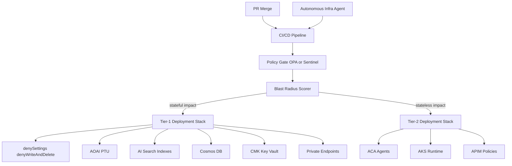
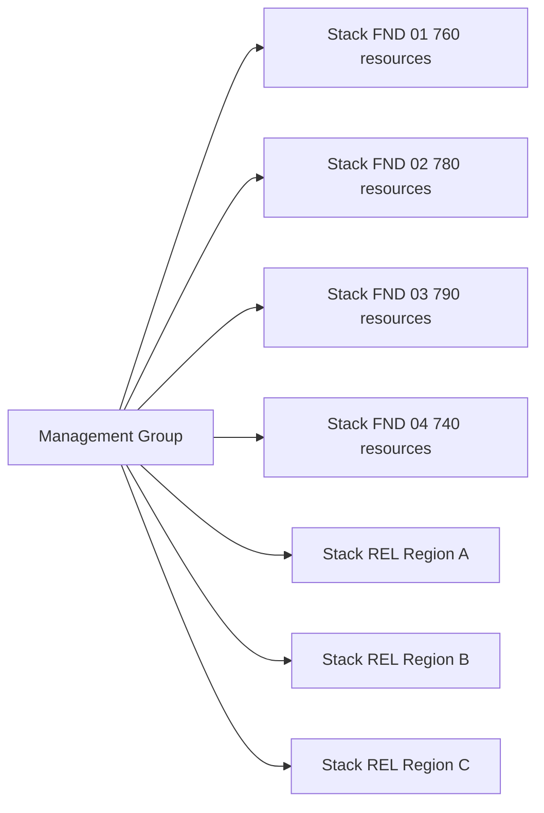
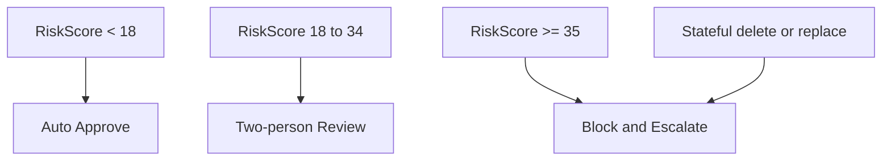

# 企业 AI Landing Zone IaC 爆炸半径防护选型 FAQ：Deployment Stacks denySettings vs Terraform OPA Sentinel vs What-If ARG Drift

> 🌐 **Language Switch**：**中文（当前）** | [English](./ai-landing-zone-iac-blast-radius-guardrails-azure-deployment-stacks-denysettings-vs-terraform-opa-sentinel-vs-whatif-arg-drift-selection-faq.en.md)
> **适用对象**：Cloud & AI Solution Architect、平台工程、SRE、FinOps、审计与内控团队。
> **范围声明**：比较四种企业级 IaC 生命周期治理架构，防止状态资源误删、漂移失控与自治运维代理错误扩散。

## 1. 为什么 AI Landing Zone 的防误删治理与传统应用不同

AI 落地平台中的 PTU、向量索引、Cosmos 数据和私网链路都属于慢变且高恢复成本资产。

一次误删会触发重建、重灌、密钥链修复和合规补录，影响远大于普通无状态服务。

当自治 Infra Agent 进入生产后，错误执行会以机器速度扩散，因此必须把阻断前移到高确定性边界。

本专题关注的是如何把爆炸半径量化并控制，而不是单纯提升部署吞吐。

## 2. 四类架构与责任边界

Architecture A 在 ARM 控制面 admission 阶段强阻断删除与写入。

Architecture B 在 IaC plan 阶段通过策略拒绝高风险动作。

Architecture C 提供轻量预检和事后漂移观测，但阻断能力较弱。

Architecture D 将状态基础层和快速发布层解耦，是企业主流推荐形态。

## 3. 端到端参考架构与控制面



通过分离风险评分、审批升级和资源分层，平台可以同时兼顾速度与安全。

## 4. Architecture A：Deployment Stacks denySettings

`denyWriteAndDelete` 与 `denyDelete` 可将状态资产保护从流程约束升级为控制面约束。

`excludedPrincipals` 应绑定 PIM break-glass 组，并严格审计激活窗口。

`actionOnUnmanage` 中 `detachAll` 适合状态层，`deleteResources` 仅适用于可重建资产。

A 的代价是灵活性下降，但收益是误删在入口即被拦截。

## 5. Architecture B：Terraform OpenTofu OPA Sentinel

B 的核心是利用 `terraform show -json` 输出进行 OPA 或 Sentinel 规则评估。

`prevent_destroy`、`moved`、`removed` 组合可显著降低替换式变更概率。

`plan -refresh-only` 应定时执行，用于发现 ClickOps 与配置漂移。

若存在绕过 pipeline 的直接控制面变更，B 的保护会削弱。

## 6. Architecture C：Bicep What-If PSRule ARG

C 的优势是轻量和推广快，不依赖复杂 state 治理。

What-If 与 PSRule 适合开发前置反馈，ARG 适合运行后漂移追踪。

但 C 缺乏强制阻断边界，面对高价值状态资产时风险较高。

因此 C 通常作为验证与观测层，而不是最终防线。

## 7. Architecture D：双层 Split-Stack 推荐形态

D 将 Tier-1 状态基础层与 Tier-2 快速发布层分开治理。

Tier-1 默认强阻断并使用 `detachAll`，Tier-2 保持发布敏捷性。

该模式减少“每次业务发版都触碰状态资产”的系统性风险。

在 50 到 250 Spokes 规模下，必须显式纳入 800 资源上限分片设计。

## 8. 关键定量模型与风险公式

`RiskScore = Wd*DeleteCount + Ws*StatefulCount + Wq*QuotaImpact + Wr*RTOPenalty`。

样例权重可设 Wd=1、Ws=8、Wq=5、Wr=3，并按季度回归校准。

`StacksNeeded = ceil(TotalManagedResources / 800)` 用于容量分片。

`Loss = DowntimeHours * BusinessLossPerHour + RecoveryOpsCost + ReindexCost + ComplianceOverhead` 用于损失估算。

## 9. 12 维定量对比矩阵

| 维度 | 架构 A：`deploymentStacks` + `denySettings` | 架构 B：Terraform/OpenTofu + OPA/Sentinel | 架构 C：Bicep + `What-If` + PSRule + ARG | 架构 D：双层 Split-Stack（推荐） |
|---|---|---|---|---|
| 阻断生效层级 | ARM 控制面写入前硬阻断，`denyWriteAndDelete` 对删除与改写均生效 | CI `plan-json` 阶段阻断，需确保所有变更都走 pipeline | 预检与事后观测为主，默认不具备硬阻断 | Tier-1 走 ARM 硬阻断，Tier-2 走发布门禁与审批 |
| 对高权限主体约束 | 默认可约束 Subscription Owner，仅 `excludedPrincipals` 放行 | 无法约束绕过 IaC 的控制面直改 | 无原生 deny assignment，Owner 可直接改动 | Tier-1 约束强，Tier-2 通过流程约束 |
| 删除与替换拦截 | `delete` 与高风险 `write` 可在入口拒绝，额外 RTO 接近 `0h` | 可拦截 `delete`/`delete+create`，但依赖策略覆盖完整性 | `What-If` 可提示但不自动拒绝，漏拦截风险较高 | Tier-1 删除默认拒绝，Tier-2 允许受控替换 |
| 漂移发现时延 | 未授权变更通常在提交阶段即失败，告警延迟常 `<5min` | 取决于 `refresh-only` 周期，常见 `15–60min` | ARG 变更采集+分析链路常见 `10–45min` | Tier-1 低时延阻断，Tier-2 以 `15–30min` 观测收敛 |
| 状态资产恢复暴露 | 误删窗口最小，AI Search/Cosmos/CMK 链路破坏概率最低 | 若策略漏拦截，状态恢复常见 `2–18h` | 事后发现模式下极端可达 `4–24h` | Tier-1 接近 `0h`，Tier-2 通常 `<1h` 回滚 |
| 资源上限与分片压力 | 单 stack 上限 `800` 受管资源，建议 `650–790` 提前分片 | 无 stack 上限，但 state 文件膨胀和锁冲突显著 | 无 stack 上限，治理压力转移到规则维护 | Tier-1 按 `800` 规则分片，Tier-2 独立扩展 |
| 私网与密钥链保护 | `Private Endpoint`、`Key Vault`、CMK 依赖可纳入硬保护集 | 依赖策略白名单完整度，遗漏即有暴露面 | 以提示为主，难以保证关键链路不被替换 | Tier-1 强保护，避免快发版误触核心链路 |
| 误报噪声与运维摩擦 | 规则稳定后误报较低，但前期建模复杂度中等 | 策略质量决定误报率，跨模块规则易冲突 | `What-If` computed diff 噪声相对更高 | 通过风险评分器过滤噪声，审批更可解释 |
| 交付敏捷性 | 治理优先，发布速度中等 | 工程体验较好，发布速度高 | 最轻量、上手快，适合早期团队 | 兼顾速度与安全，适合中大型组织 |
| 典型单次发布附加时延 | 常见新增门禁时延 `+5~12min` | 常见 `+3~10min`（视策略复杂度） | 常见 `+2~6min` | Tier-1 `+8~20min`，Tier-2 `+3~8min` |
| 三年 TCO 与风险收益 | 平台成本较高但损失避免收益显著，净收益稳定 | 成本适中，收益受策略执行一致性影响 | 平台成本低，但高价值场景风险暴露大 | 综合净收益最高，适配 `20–250` Spokes |
| 适配组织规模与场景 | 强合规行业、核心状态资产密集平台 | 跨云团队、IaC 工程能力成熟组织 | 轻治理与早期平台验证场景 | 企业主流落地形态，适合自治代理规模化 |

## 10. 800 资源上限与分片拓扑



每个 Tier-1 stack 建议运行在 650 到 790 资源区间，避免触顶导致发布冻结。

## 11. 生产级 Bicep：deploymentStacks denySettings

```bicep
targetScope = 'subscription'
param stackName string = 'alz-ai-tier1-foundation'
param location string = 'eastus2'
param breakGlassPrincipalIds array

resource tier1 'Microsoft.Resources/deploymentStacks@2024-03-01' = {
  name: stackName
  location: location
  properties: {
    actionOnUnmanage: {
      managementGroups: 'detachAll'
      resourceGroups: 'detachAll'
      resources: 'detachAll'
    }
    denySettings: {
      mode: 'denyWriteAndDelete'
      applyToChildScopes: true
      excludedPrincipals: breakGlassPrincipalIds
      excludedActions: [
        'Microsoft.Authorization/roleAssignments/read'
        'Microsoft.Resources/tags/read'
      ]
    }
  }
}
```

该模板示例展示了如何把 break-glass、deny 模式和子范围覆盖一并纳入 IaC。

## 12. OPA Rego 与 Python 风险评分器

```rego
package terraform.guardrails

default deny = []

stateful_types := {
  "azurerm_cosmosdb_account",
  "azurerm_search_service",
  "azurerm_key_vault",
  "azurerm_private_endpoint",
  "azapi_resource::Microsoft.CognitiveServices/accounts"
}

deny[msg] {
  rc := input.resource_changes[_]
  rc.change.actions == ["delete"]
  stateful_types[rc.type]
  msg := sprintf("deny delete on stateful type: %s", [rc.address])
}

deny[msg] {
  rc := input.resource_changes[_]
  rc.change.actions == ["delete", "create"]
  stateful_types[rc.type]
  msg := sprintf("deny replace on stateful type: %s", [rc.address])
}
```

```python
from dataclasses import dataclass

@dataclass
class PlanStats:
    deletes: int
    replaces: int
    stateful_hits: int
    ptu_quota_pct: float
    estimated_rto_hours: float

def blast_radius_score(s: PlanStats) -> float:
    wd, wr, ws, wq, wt = 1.0, 2.0, 8.0, 5.0, 3.0
    return wd*s.deletes + wr*s.replaces + ws*s.stateful_hits + wq*(s.ptu_quota_pct/100.0) + wt*s.estimated_rto_hours

def decision(score: float) -> str:
    if score < 18:
        return "allow-auto"
    if score < 35:
        return "require-two-person-review"
    return "block-and-escalate"
```

策略输出必须包含资源地址和命中规则，便于研发团队快速修复计划。

## 13. 企业场景 A：全球银行平台

场景 A 以全球银行为例，96 个 Spoke、12 个 PTU 池、多区域主权合规要求并存。

改造前单层栈在一次 replace 事件后导致 AI Search 重建 9 小时，业务检索质量明显下降。

改造后 Tier-1 强阻断、Tier-2 快发布，RiskScore 高于阈值自动升级双人审批。

十周后状态资产误删归零，平均变更前等待仅增加 7 分钟，重大恢复窗口缩短 64%。

## 14. 企业场景 B：全球制造 24x7 运维

场景 B 以全球制造企业为例，210 个 Spoke，夜间自治运维代理负责漂移修复和策略收敛。

初期发生过接近事故的私网端点替换尝试，证明仅靠事后观测不足以保护核心状态面。

改造后所有状态资产进入 Tier-1 强保护，自治代理仅持有 Tier-2 最小权限。

三个月后自动修复成功率从 82% 提升到 96%，高风险动作被阻断 41 次且零生产破坏。

### 3-year TCO table (USD, 20 / 80 / 250 AI spokes)

| 架构路径 | 20 Spokes | 80 Spokes | 250 Spokes | 三年平台成本 | 三年损失避免收益 | 三年净收益 |
|---|---:|---:|---:|---:|---:|---:|
| A Deployment Stacks hard control | 0.92M | 2.84M | 8.75M | 12.51M | 18.30M | 5.79M |
| B Terraform OPA Sentinel | 0.78M | 2.36M | 7.10M | 10.24M | 13.95M | 3.71M |
| C Bicep What-If ARG | 0.66M | 2.05M | 6.42M | 9.13M | 9.84M | 0.71M |
| D Two-Tier Split-Stack | 1.02M | 2.62M | 7.48M | 11.12M | 20.44M | 9.32M |

## 15. Day-0/Day-1/Day-2、Q&A、适配边界与告警

### Day-0

1. 完成 Tier-1 资产清单并定义不可删类型。

2. 配置 break-glass PIM、MFA 与审计。

3. 按 800 上限完成 stack 分片设计。

4. 在 CI 接入策略门禁与风险打分。

5. 完成一次误删演练并验证阻断链路。

### Day-1

1. 监控 deny 命中率与误拦截率。

2. 统计策略阻断原因与修复时长。

3. 校准 RiskScore 阈值与审批门槛。

4. 验证自治代理最小权限执行边界。

5. 复盘一次真实变更并补齐规则缺口。

### Day-2

1. 周度复盘状态资产覆盖率和漏网项。

2. 月度复盘 TCO 与损失避免收益。

3. 季度评估 stack 分片与增长空间。

4. 季度轮换 break-glass 身份并演练失效流程。

5. 将告警字典绑定自动工单和升级路径。

### 15.1 Worked quantitative Q&A

### Q1: 如何估算 stack 分片数量

如何估算 stack 分片数量？使用 `StacksNeeded = ceil(TotalManagedResources / 800)` 并叠加 15% 增长缓冲。

例如 250 spokes * 18 资源约等于 4500，基础为 6 片，带缓冲建议 7 片。

### Q2: 如何估算误删 AI Search 索引损失

如何估算误删 AI Search 索引损失？使用停机损失加重建算力加合规成本。

若停机 6h、每小时 120k、重建 10h*2.5k、合规 80k，总损失约 825k。

### Q3: RiskScore 阈值如何设定

RiskScore 阈值如何设定？建议从历史样本回放映射事故等级。

可用 `<18` 自动、`18-34` 双人复核、`>=35` 强阻断，再按季度调参。

### Q4: 如何量化 guardrail 对交付效率影响

如何量化 guardrail 对交付效率影响？使用 `LeadTimeDelta` 比较启用前后。

若从 22 分钟增至 29 分钟则增量 7 分钟，通常远小于一次误删损失。

### Q5: refresh-only 多久跑一次

refresh-only 多久跑一次？可按 `max(15min, MeanTimeToUnsafeChange/4)` 估算。

若不安全变更均值 2 小时，建议 30 分钟 cadence，并叠加 ARG 15 分钟流监控。

### Q6: 双层 Split-Stack 净收益如何计算

双层 Split-Stack 净收益如何计算？`NetBenefit = AvoidedLoss + ProductivityGain - AddedGovernanceCost`。

当避免损失 20.44M、效率收益 3.10M、新增治理 14.22M 时净收益约 9.32M。

### 15.2 Good fit vs Not for

Good fit：多区域、多团队、状态资产价值高且存在自治变更执行的企业组织。

Not for：小规模、可重建、低合规压力且无强审计要求的轻量场景。

### 15.3 Runtime alert dictionary

| 告警键 | 触发条件 | 立即动作 | 责任团队 |
|---|---|---|---|
| `deny_assignment_bypass_attempt` | 非排除主体尝试修改 Tier-1 资源 | 阻断并触发审计 | 平台安全 |
| `stateful_delete_in_plan` | 计划出现状态资产 delete | pipeline fail 并升级 | 平台工程 |
| `replace_on_private_endpoint` | 检测到 PE replace | 冻结发布并复核 | 网络团队 |
| `arg_drift_on_tier1` | Tier-1 出现窗口外变更 | 锁定窗口并隔离会话 | SRE |
| `risk_score_over_threshold` | RiskScore >= 35 | 自动阻断并双签升级 | 变更委员会 |
| `stack_resource_near_limit` | 单 stack 超过 760 资源 | 触发分片扩容 | 平台工程 |
| `break_glass_activation` | break-glass 被激活 | 开启全程审计 | 安全治理 |
| `ptu_quota_drift` | PTU 配额偏差超阈值 | 暂停相关发布车道 | FinOps |
| `search_index_mutation_spike` | 索引删除替换异常上升 | 进入只读保护窗口 | 数据平台 |
| `cosmos_account_policy_drift` | Cosmos 策略漂移 | 自动回滚并告警 | 数据平台 |



### 15.4 参考来源与抓取日期（2026-11-23）

1. Azure Deployment Stacks: https://learn.microsoft.com/azure/azure-resource-manager/bicep/deployment-stacks

2. ARM What-If: https://learn.microsoft.com/azure/azure-resource-manager/templates/deploy-what-if

3. Azure Resource Graph changes: https://learn.microsoft.com/azure/governance/resource-graph/changes/get-resource-changes

4. Terraform lifecycle: https://developer.hashicorp.com/terraform/language/meta-arguments/lifecycle

5. Open Policy Agent docs: https://www.openpolicyagent.org/docs/latest/

6. PSRule for Azure: https://azure.github.io/PSRule.Rules.Azure/

### 15.5 常见失效模式与对应缓解策略

失效模式一是将 Tier-1 和 Tier-2 混在同一 stack 里，导致每次发布都要触碰状态资产边界。

这种做法在前期看似简单，但在规模到达 80 个以上 Spokes 后，审批链路和恢复链路会同时变慢，最终拖垮交付效率与稳定性。

失效模式二是把 OPA 或 Sentinel 规则仅用于“格式检查”，却没有把删除动作与替换动作纳入硬阻断清单。

结果是 pipeline 通过但资源被替换，直到 ARG 在事后数分钟到数十分钟后才发出漂移告警，错过最佳止损窗口。

失效模式三是 break-glass 账号长期处于常驻高权限状态，没有 PIM 激活窗口、没有会话留痕，也没有双人确认。

这会让应急通道退化为日常通道，最终把所有治理投入变成“纸面存在、运行失效”的合规假象。

失效模式四是把 `actionOnUnmanage` 统一设置为 `deleteResources`，在资源解绑定场景里触发误删连锁反应。

对状态资产而言，`detachAll` 通常是更安全默认值，只有可重建层才应允许自动删除。

失效模式五是忽略 800 资源上限，等到 stack 接近阈值才临时拆分，造成命名、依赖和权限模型整体震荡。

更稳妥的做法是在 650 到 790 区间提前扩容分片，并为每个分片维护独立容量预算和升级窗口。

### 15.6 额外容量估算工作表

| 指标 | 公式 | 说明 | 样例输入 | 样例输出 |
|---|---|---|---|---|
| Tier-1 总资源量 | `Spokes * R_per_spoke` | 状态资产资源总数估算 | `250 * 18` | `4500` |
| 分片需求 | `ceil(Total/800)` | Deployment Stack 最小分片数 | `4500/800` | `6` |
| 缓冲分片需求 | `ceil((Total/0.85)/800)` | 预留 15% 增长 | `(4500/0.85)/800` | `7` |
| 误删损失 | `Down*LossPH + Rebuild*GPU + Compliance` | 单次事件损失 | `6h,120k,10h,2.5k,80k` | `825k` |
| 变更等待成本 | `LeadTimeDelta * ChangesPerMonth * CostMin` | 审批增量成本 | `7m*420*38` | `111.7k/月` |
| 保护收益比 | `AvoidedLoss/AddedGovernanceCost` | 治理投入回报 | `20.44M/14.22M` | `1.44x` |
| 阈值命中率 | `BlockedChanges/TotalChanges` | 高风险阻断占比 | `41/1280` | `3.2%` |
| 漂移收敛时延 | `DetectTime + RemediateTime` | 从发现到收敛总时长 | `12m + 26m` | `38m` |
| Tier-2 发布密度 | `ReleasesPerDay/Teams` | 发布节奏负载 | `96/24` | `4/队/日` |
| 审批饱和度 | `EscalationsPerWeek/Reviewers` | 审批压力观测 | `84/12` | `7/人/周` |
| 配额冲击系数 | `PTUAffected/TotalPTU` | PTU 风险比例 | `18/90` | `20%` |
| 恢复工时预算 | `Incidents * AvgRecoveryHours` | 年度恢复人力预算 | `9*14h` | `126h` |

### 15.7 治理 KPI 基线与告警阈值建议

| KPI | 目标值 | 黄色阈值 | 红色阈值 | 说明 |
|---|---:|---:|---:|---|
| Tier-1 误删事件数 | `0` | `>=1` | `>=1` | 任何一次都应进入 RCA |
| RiskScore 阻断后放行率 | `<15%` | `>20%` | `>30%` | 放行过高说明阈值设计失真 |
| What-If 噪声比 | `<12%` | `>18%` | `>25%` | 噪声高会导致规则疲劳 |
| ARG 漂移漏报率 | `<3%` | `>5%` | `>8%` | 漏报会放大事后损失 |
| Break-glass 激活次数 | `<4/月` | `>6/月` | `>10/月` | 激活频率异常意味着权限边界失效 |
| Tier-1 审批中位时延 | `<40min` | `>60min` | `>90min` | 时延过高会倒逼绕过流程 |
| Tier-2 发布失败回滚率 | `<6%` | `>9%` | `>12%` | 回滚率高需检查发布策略 |
| 漂移修复中位时延 | `<45min` | `>75min` | `>120min` | 体现检测与修复协同效率 |
| 关键资源覆盖率 | `>=98%` | `<96%` | `<92%` | 指状态资产纳入治理比例 |
| 审计证据完整率 | `100%` | `<99%` | `<97%` | 缺证据会直接影响外部审计通过 |

上述 KPI 不应只在报表中展示，还应和自动化动作绑定。

例如当审计证据完整率低于阈值时，系统应自动阻断高风险发布，而不是继续放行等待人工补录。

同理，当 break-glass 激活频率持续升高时，平台应自动触发权限模型复盘，而不是把异常当作业务高峰的常态波动。

治理成熟度的关键不是写了多少规则，而是规则触发后是否有稳定、可追踪、可回滚的执行闭环。

### 15.8 架构评审会可直接使用的落地判定语句

若评审对象无法在控制面层证明“状态资产误删必被拒绝”，则该方案默认不满足生产级 AI Landing Zone 基线，即便其开发体验更好、发布速度更快，也必须先补齐拒绝证据再进入试点。

若评审对象将 Tier-1 资产与 Tier-2 资产放入同一发布流水线并共享同一销毁语义，则其爆炸半径不可接受，因为任意一次普通版本发布都可能携带状态资产替换风险，且难以在事故发生前通过人工审查完整识别。

若评审对象没有对 break-glass 通道定义可审计的激活时窗、双人确认和自动失效机制，则其治理能力应视为不完整，因为应急权限会在长期运行中自然演化为常驻权限，最终侵蚀所有前置策略边界。

若评审对象无法量化 `RiskScore` 与历史事故等级之间的映射关系，且不能解释阈值为何设在当前区间，则其策略门禁仍停留在经验层，缺乏可持续优化能力，不宜直接承载自治代理的大规模变更执行。

若评审对象无法给出 20、80、250 Spokes 三档容量下的分片规划与预算上限，则其成本模型不可用于年度采购和平台承诺，因为资源上限触顶时将被迫进行高风险紧急拆分，反而放大停机概率与人力消耗。

若评审对象在季度演练中不能稳定完成“阻断触发、审批升级、最小化放行、证据归档、策略回写”五段闭环，则应判定为运行成熟度不足，即使单点测试通过也不能视作平台级可运营能力。

若评审对象未将 ARG 漂移事件与发布会话、审批记录和策略版本进行关联，则事后审计只能看到孤立告警，无法形成责任链条，导致治理团队难以区分策略漏拦截与人为越权两类根因。

若评审对象的告警体系只定义触发条件而没有明确“立即动作和责任团队”，则告警价值会在高压时段迅速衰减，最终形成告警堆积而非风险收敛，应该在上线前补齐自动工单和升级动作模板。

若评审对象可以证明 Tier-1 误删事件长期为零、审批增量可控、漂移收敛时延稳定且证据完整率接近满分，则可进入规模化扩张阶段，并把优化重点从“是否阻断”转向“如何降低阻断摩擦”。

若评审对象能够在跨区域、跨团队、跨审计周期下持续满足上述条件，则可将其作为企业级 AI Landing Zone 的标准蓝本，并用于后续数据域、模型域和代理域的统一治理推广。

补充判定条款一：当评审团队发现 Tier-1 资产清单中缺失 PTU 配额对象、AI Search 索引服务、Cosmos 账户或 CMK 依赖链任一项时，应立即判定为“资产识别不完整”，并冻结变更审批流程，先完成资产发现与责任归属映射，再恢复发布节奏。

补充判定条款二：当平台连续两个审计周期无法证明 `denyAssignment` 命中日志与发布流水线工单一一对应时，说明治理链路存在证据断点，必须在下一次窗口前补齐日志主键、审批编号与会话 ID 的关联字段，否则不得扩大自治代理执行范围。

补充判定条款三：若季度容量预测显示任一 Tier-1 stack 在下一周期可能超过 790 资源，而团队仍没有提交分片迁移计划与回滚预案，则该风险应升级为红色项，因为资源触顶后的紧急拆分几乎总会伴随跨订阅权限调整与依赖链重排，极易引入新的误删窗口。

补充判定条款四：当业务方要求缩短审批时延时，优先优化风险打分解释质量、策略噪声抑制和审批并行化，而不是直接下调阻断阈值，因为阈值下调会把短期效率收益转化为长期事故债务，最终在年度审计与停机损失中成倍偿还。

最终落地建议是把“状态资产识别、控制面阻断、策略解释、审批闭环、证据归档、季度调参”视作同一治理产品的六个不可拆环节，并通过统一指标看板持续验证其有效性；只有当这六个环节都可量化、可审计、可回滚时，AI Landing Zone 的自治变更能力才真正具备企业级可持续性。
该结论同样意味着平台治理必须长期投入自动化验证与证据工程，而不能依赖一次性项目冲刺完成后自然维持；只有把审计改进、策略回写和运行度量纳入持续闭环，平台架构才能在多年演进中保持稳定与可审计。
进一步地，组织应把 Tier-1 资产目录、变更工单、风险评分、审批记录、ARG 漂移事件和恢复演练报告统一到同一证据索引中，并以季度为周期输出“策略有效性与误阻断成本”联合报告，确保治理团队既能持续降低事故暴露，也能持续压缩不必要的发布摩擦。
同时建议在年度预算阶段把“误删避免损失、审批摩擦成本、漂移治理人力、恢复演练投入”统一纳入平台治理财务模型，以便管理层能够持续评估双层栈策略在风险收敛与交付效率之间的真实收益曲线，并据此进行阈值调优与资源再分配。
