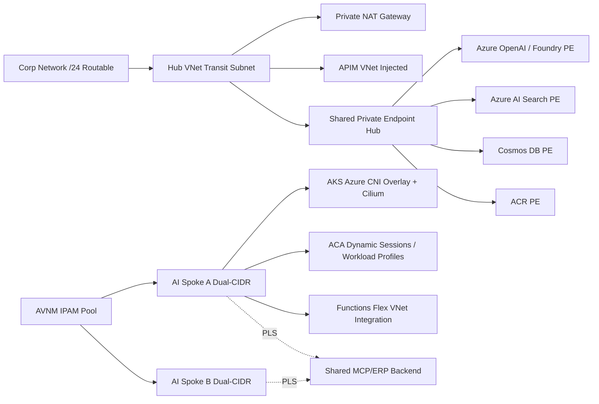
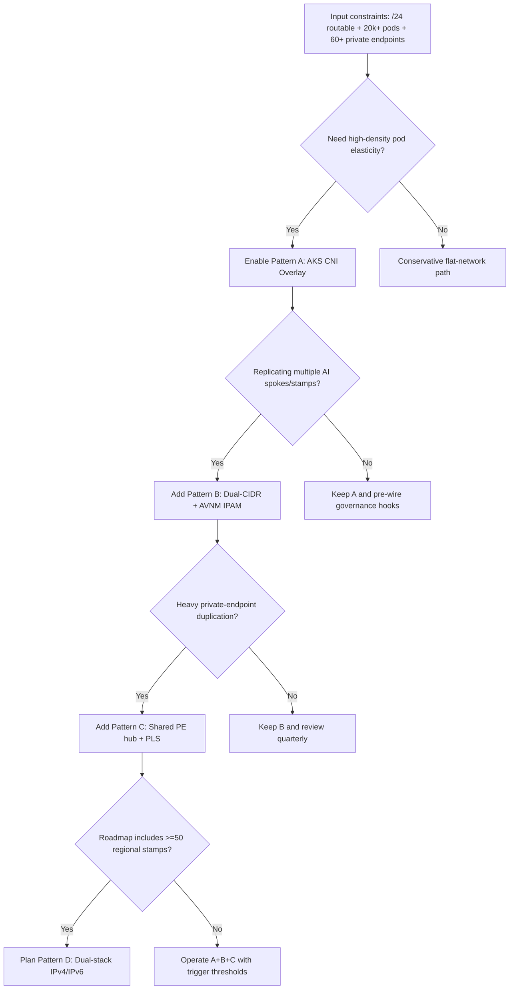

# Enterprise AI Landing Zone IPv4 Exhaustion Selection FAQ: AKS CNI Overlay + CGNAT vs AVNM IPAM Dual-CIDR vs Private Link/PLS Consolidation vs Dual-Stack IPv6

> 🌐 **Language Switch**: [中文](./ai-landing-zone-ipv4-exhaustion-aks-cni-overlay-cgnat-vs-avnm-ipam-dual-cidr-vs-privatelink-nat-vs-ipv6-selection-faq.md) | **English (current)**
> **Audience**: Cloud & AI Solution Architects, enterprise network architecture leads, platform SRE owners, landing-zone engineering teams, AKS/ACA platform operators.
> **Scope**: Production-grade IP architecture for the scenario where corporate NetOps approves only a `/24` routable CIDR while the AI platform must host `20,000+` agent/GPU pods, ACA Dynamic Sessions subnets, APIM VNet injection, and `60+` PaaS private endpoints with auditable resiliency and controlled operating cost.

## 1. Problem framing: why AI agent platforms hit IPv4 limits earlier than classic enterprise stacks
Traditional enterprise estates usually scale in relatively predictable VM tiers, a moderate number of middleware clusters, and tightly bounded private endpoint footprints, so IP growth is visible and linear.  
AI agent platforms break that assumption because they scale address demand across runtime pods, transient execution pools, private endpoint fan-out, and multi-region resiliency windows at the same time.  

This is why many organizations report an apparent paradox: service-level load is still below target, yet subnet pressure already blocks rollout, upgrade, or DR drills.  
The root cause is almost never “one wrong subnet size”; it is usually a missing capacity model that combines pod density, surge math, private endpoint replication, and parallel cutover windows.  

In other words, the design objective is not merely to “find more addresses.”  
The real objective is to convert scarce routable IPv4 into a governed control resource while shifting high-density workload growth into reusable non-routable and eventually dual-stack domains.  

## 2. Four-pattern portfolio: convert address scarcity into layered, governable growth
Pattern A uses AKS `Azure CNI Overlay` so pod addresses are decoupled from routable VNet address consumption and can reuse `100.64.0.0/10` (`RFC 6598`) at large scale.  
Pattern B introduces a dual-CIDR AI Spoke where a small routable corporate range remains for north-south governance and a larger non-routable range carries high-density compute subnets under AVNM IPAM policy control.  

Pattern C consolidates private endpoint sprawl into a shared hub and extends reusable backends through Private Link Service (PLS), reducing duplicate endpoint burn across repeated AI stamps.  
Pattern D moves long-horizon east-west scale pressure toward IPv6 dual-stack while preserving IPv4 compatibility paths for services and controls that are not yet IPv6-complete.  

These patterns are additive rather than mutually exclusive.  
A practical enterprise sequence is A+B first for immediate capacity relief, C next for operating-cost stabilization, and D as the strategic growth runway for global stamp expansion.  

## 3. End-to-end reference architecture: governed address control plane for enterprise AI landing zones


This architecture intentionally treats routable enterprise IPv4 as a governance corridor rather than a high-density workload pool.  
By centralizing allocation through AVNM IPAM and separating routable from non-routable growth domains, platform teams keep expansion deterministic and auditable instead of negotiation-driven and reactive.  

## 4. Pattern A deep dive: AKS Azure CNI Overlay with reusable `100.64.0.0/10`
Overlay fundamentally changes the scaling equation by removing pod IP demand from routable VNet subnet demand.  
For a `100`-node cluster with `maxPods=250`, pod capacity is roughly `25,000`, while routable IPv4 consumption is tied mainly to node count and upgrade surge, not pod cardinality.  

Compared with flat CNI, this eliminates the need to pre-approve very large routable blocks before business growth is proven.  
That is especially important for organizations where network approval cycles are quarterly and address expansion requires centralized architecture-board sign-off.  

The trade-off is observability and source-identity expectations in hybrid networks.  
If on-prem controls rely on routable pod source IP semantics, teams must explicitly provide equivalent evidence through Cilium/eBPF telemetry, workload identity context, and policy-linked flow logs.  

## 5. Pattern B deep dive: dual-CIDR AI Spoke with AVNM IPAM governance
Dual-CIDR design splits each AI Spoke into a small routable slice and a large non-routable growth slice.  
A typical shape is `/24` or `/25` routable for ingress, transit, and management boundaries, plus `100.64.0.0/16`-class non-routable space for pod-heavy and session-heavy runtime tiers.  

This cleanly separates NetOps routing constraints from AI platform elasticity needs.  
Instead of reopening enterprise routing design every time pod density increases, the platform expands within pre-governed non-routable pools while preserving stable north-south controls.  

AVNM IPAM is critical because scale failure usually comes from allocation drift, not from one initial subnet decision.  
Policy-backed allocation, recycling, and conflict prevention across subscriptions/regions/teams provides repeatable stamp rollout without manual spreadsheet orchestration.  

## 6. Pattern C deep dive: shared private endpoint hub and PLS for overlapping spokes
Without consolidation, each AI Spoke often creates duplicate private endpoints for AOAI, Foundry, AI Search, Cosmos DB, and ACR.  
At `30` spokes with `40` endpoints each, that is roughly `1,200` endpoint addresses, plus duplicated DNS zone links, policy objects, and change risk.  

Pattern C replaces that repetition with a shared private endpoint hub and controlled service exposure through PLS.  
This is particularly effective when AI stamps reuse overlapping address templates and cannot be directly peered without conflict side effects.  

The value is not only address savings.  
It also reduces Day-2 cognitive load by collapsing endpoint lifecycle, naming standards, DNS governance, and policy enforcement into a platform-owned service boundary.  

## 7. Pattern D deep dive: dual-stack IPv4/IPv6 for long-horizon regional expansion
Dual-stack adoption is the structural answer to long-term IPv4 exhaustion in globally distributed AI estates.  
If the roadmap includes `50+` landing-zone stamps, continuing to stack NAT and overlap workarounds on IPv4 alone increases hidden fragility and incident blast radius.  

AKS dual-stack with Cilium allows east-west traffic growth to move onto IPv6 while maintaining IPv4 compatibility where required.  
However, successful adoption requires a live service-support matrix that tracks which private-link and platform integrations are IPv6-ready versus IPv4-only at each release stage.  

The safest enterprise rollout pattern is progressive enablement: dual-stack by default in new regions, followed by controlled migration waves for existing regions.  
This minimizes rollback complexity while preserving delivery cadence for application teams with mixed dependency readiness.  

## 8. Capacity and surge formulas: make IP planning reproducible instead of intuitive
Azure reserves `5` IP addresses per subnet, so usable capacity is `2^(32-prefix)-5`.  
Under flat CNI, upgrade-peak routable IP demand is approximately `(nodes + maxSurge) * (maxPods + 1)` because both nodes and pods consume routable addresses.  

Under Overlay, routable demand is near `(nodes + maxSurge)` while pod demand shifts to Overlay CIDR.  
That single change is often the difference between “blocked by `/24`” and “production-capable with `/24` plus proper governance.”  

For ACA, Consumption environments generally need `/23`-class planning for resilient growth, while Dedicated workload-profile footprints can start near `/27` in tightly scoped lanes with strict autoscale envelopes.  
Therefore, AKS and ACA subnet consumption should be modeled as separate budget domains with independent utilization guardrails.  

| Capacity item | Formula | Example input | Result |
|---|---|---|---|
| Subnet usable IPs | `2^(32-prefix)-5` | `/24` | `251` |
| Flat CNI upgrade peak | `(nodes+maxSurge)*(maxPods+1)` | `100, 10, 250` | `27,610` |
| Overlay routable peak | `nodes+maxSurge` | `100, 10` | `110` |
| ACA Consumption baseline | platform minimum planning guidance | `-` | `/23` |
| ACA Dedicated start lane | platform minimum planning guidance | `-` | `/27` |

## 9. 12-dimension decision matrix: capacity, governance, resilience, and operating friction
| Dimension | Pattern A: AKS Overlay + CGNAT | Pattern B: Dual-CIDR + AVNM IPAM | Pattern C: PE Hub + PLS | Pattern D: Dual-Stack IPv4/IPv6 |
|---|---|---|---|---|
| Pod-density expansion ceiling | Very high | High (with A) | Indirect support | Very high |
| Routable IPv4 consumption | Very low | Low | Medium-low | Low for IPv4 lanes |
| Upgrade surge friendliness | High | Medium-high | Medium | High |
| Hybrid audit explainability | Medium (needs telemetry enrichment) | High | High | Medium-high |
| Cross-team governance consistency | Medium | High | High | Medium |
| Day-0 implementation complexity | Medium | Medium | Medium-high | High |
| Private endpoint cost pressure | Medium | Medium | Low | Medium |
| Overlapping-address tolerance | Medium | Medium-high | High | High |
| Multi-region replication speed | High | High | Medium | High |
| Dependency on org maturity | Medium | Medium | Medium-high | High |
| Day-2 operational burden | Medium | Medium | Medium-high | High during transition |
| Fit for `20,000+` pods under `/24` constraint | Strong | Strong (with A) | Supportive | Strategic long term |

The matrix typically leads to the same architectural conclusion in enterprise reviews: A+B is the immediate stabilizer, C is the scale-cost optimizer, and D is the future-proofing pillar.  
Trying to force a single-pattern answer usually creates either short-term bottlenecks or long-term migration debt.  

## 10. Three-year TCO model: network refactor cost, endpoint sprawl, and change-failure risk
The model below assumes `30` AI spokes with sustained growth and repeated regional expansion cycles.  
Cost categories include network redesign and change labor, endpoint lifecycle operations, failure rollback overhead, and governance enforcement maintenance.  

| Option | 3-year network/refactor + operations cost (USD) | 3-year private endpoint cost (USD) | major-change failure risk cost (USD) | 3-year total (USD) |
|---|---:|---:|---:|---:|
| Flat IPv4 expansion only (baseline) | 1,920,000 | 780,000 | 420,000 | 3,120,000 |
| A+B (Overlay + Dual-CIDR + IPAM) | 1,140,000 | 620,000 | 210,000 | 1,970,000 |
| A+B+C (plus PE hub + PLS) | 1,260,000 | 410,000 | 190,000 | 1,860,000 |
| A+B+C+D (plus dual-stack rollout) | 1,520,000 | 390,000 | 160,000 | 2,070,000 |

Across a three-year horizon, A+B+C is often the best near-to-mid-term economic balance.  
D introduces additional transition effort but becomes increasingly favorable when global stamp count and east-west growth exceed what IPv4-only governance can safely absorb.  



The key purpose of this decision flow is to anchor architecture progression to measurable conditions instead of preference-driven debate.  
When each branch is tied to observable indicators such as subnet utilization, endpoint growth velocity, and regional stamp rollout cadence, migration timing becomes explainable and auditable.  
That governance clarity materially improves cross-team execution because platform, network, and application owners can align on objective trigger criteria instead of ad hoc exceptions.  
In practice, this flow should be embedded into landing-zone templates and change gates so each expansion request automatically carries evidence for why a specific pattern combination was selected.  

## 11. Production Bicep: dual-CIDR VNet, AKS Overlay, and policy-ready subnet domains
```bicep
param location string = resourceGroup().location
param vnetName string = 'ai-spoke-vnet'
param routablePrefix string = '10.52.24.0/24'
param cgnatPrefix string = '100.64.32.0/20'
param aksSubnetPrefix string = '10.52.24.0/26'
param transitSubnetPrefix string = '10.52.24.64/27'
param acaSubnetPrefix string = '100.64.32.0/23'
param funcSubnetPrefix string = '100.64.34.0/26'
param podCidr string = '100.96.0.0/11'
param serviceCidr string = '10.200.0.0/16'
param dnsServiceIp string = '10.200.0.10'

resource vnet 'Microsoft.Network/virtualNetworks@2023-09-01' = {
  name: vnetName
  location: location
  properties: {
    addressSpace: {
      addressPrefixes: [
        routablePrefix
        cgnatPrefix
      ]
    }
    subnets: [
      {
        name: 'aks-system'
        properties: {
          addressPrefix: aksSubnetPrefix
        }
      }
      {
        name: 'transit-routable'
        properties: {
          addressPrefix: transitSubnetPrefix
        }
      }
      {
        name: 'aca-consumption'
        properties: {
          addressPrefix: acaSubnetPrefix
          delegations: [
            {
              name: 'acaDelegation'
              properties: {
                serviceName: 'Microsoft.App/environments'
              }
            }
          ]
        }
      }
      {
        name: 'functions-flex'
        properties: {
          addressPrefix: funcSubnetPrefix
          delegations: [
            {
              name: 'funcDelegation'
              properties: {
                serviceName: 'Microsoft.Web/serverFarms'
              }
            }
          ]
        }
      }
    ]
  }
}

resource aks 'Microsoft.ContainerService/managedClusters@2024-05-01' = {
  name: 'ai-aks-overlay'
  location: location
  properties: {
    networkProfile: {
      networkPlugin: 'azure'
      networkPluginMode: 'overlay'
      podCidr: podCidr
      serviceCidr: serviceCidr
      dnsServiceIP: dnsServiceIp
      loadBalancerSku: 'standard'
    }
    agentPoolProfiles: [
      {
        name: 'system'
        count: 3
        vmSize: 'Standard_D8ds_v5'
        maxPods: 250
        vnetSubnetID: '${vnet.id}/subnets/aks-system'
      }
    ]
  }
}
```

This template demonstrates the core shape of routable plus non-routable coexistence with Overlay networking.  
In production, teams should modularize AVNM IPAM allocation, NAT gateway policy, route table rules, and private DNS governance into the same release pipeline for deterministic drift control.  

## 12. Operational guardrail config: surge control, NAT posture, and subnet exhaustion alarms
```yaml
aks:
  clusterName: ai-aks-overlay
  maxPods: 250
  upgradeSettings:
    maxSurge: "10%"
  network:
    plugin: azure
    pluginMode: overlay
    podCidr: 100.96.0.0/11
    serviceCidr: 10.200.0.0/16
    ebpfObservability: enabled

aca:
  environmentSubnet: 100.64.32.0/23
  workloadProfiles:
    - name: sessions-dedicated
      subnet: 100.64.34.0/27
      minReplicas: 2
      maxReplicas: 80

egress:
  privateNatGateway:
    enabled: true
    sourceSubnet: transit-routable
    snatPolicy: centralized

guardrails:
  subnetUtilizationWarning: 70
  subnetUtilizationCritical: 85
  privateEndpointQuotaPerSpoke: 12
  enforceHubPrivateEndpoint: true
```

The practical benefit of these guardrails is that IP exhaustion becomes an SLO-governed signal instead of a last-minute rollout blocker.  
Subnets, endpoint quotas, and SNAT pressure should be monitored in one reliability dashboard with pre-defined actions at warning and critical thresholds.  

## 13. Enterprise scenario A: global retail bank with strict audit trails and regulated resiliency drills
This profile typically has conservative routable-CIDR approvals, strict evidence requirements, and mandatory regional failover drills with parallel runtime windows.  
A+B+C is usually the strongest fit: Overlay for pod density, dual-CIDR for governance-compatible scale, and private endpoint consolidation for operational and cost control.  

The practical risk in this scenario is drill failure due to temporary doubled infrastructure footprint during failover tests.  
Without Overlay and endpoint consolidation, those windows frequently exceed subnet headroom and trigger governance exceptions that auditors interpret as architectural fragility.  

A full dual-stack transition does not need to happen in year one.  
A safer approach is to make dual-stack mandatory for newly opened regions and maintain an explicit migration backlog for existing regions with measurable readiness gates.  

## 14. Enterprise scenario B: high-growth multi-tenant coding-agent SaaS adding 8–12 stamps per quarter
In this profile, business growth cadence is faster than centralized network governance cycles, so repeatable stamp rollout is the primary design constraint.  
The recommended sequence is A+B immediately, C for stamp economics, and D when global scale and long-term east-west traffic patterns justify strategic transition.  

The most common failure mode is “template reproducibility without address reproducibility.”  
Teams clone landing-zone templates successfully but fail in late-stage integration because endpoint duplication, route overlap, or unmanaged CIDR drift breaks assumptions at scale.  

AVNM IPAM plus PLS-based overlap tolerance directly addresses that systemic risk.  
As stamp count climbs, the architecture shifts from heroic manual network troubleshooting toward governed, policy-led expansion with predictable lead time.  

## 15. Quantitative Q&A plus Day-0/Day-2 execution checklist
| Question | Recommended quantitative answer |
|---|---|
| Q1: Can `/24` really host `20,000+` pods? | Yes, with Overlay. At `100` nodes and `maxPods=250`, pod capacity is about `25,000`, while routable demand stays near `110` including `10%` surge. |
| Q2: Why not keep flat CNI and just request larger CIDR? | Because peak demand follows `(nodes+maxSurge)*(maxPods+1)`, which is about `27,610` in the same example and often impossible under enterprise approval constraints. |
| Q3: How much does endpoint consolidation matter? | With `30` spokes and `40` duplicated endpoints each, consolidation addresses roughly `1,200` duplicated endpoint addresses plus DNS/policy overhead reduction. |
| Q4: What is the practical ACA subnet baseline? | Plan `/23` for Consumption lanes and `/27` start lanes for dedicated profiles with strict autoscale guardrails and utilization alarms. |
| Q5: Should dual-stack be an immediate all-region cutover? | No. New-region-first dual-stack with staged migration for existing regions yields lower rollback risk and better dependency sequencing. |
| Q6: When should IPv6 become a funded roadmap item? | When strategic plans indicate `50+` global stamps or sustained three-year regional expansion where IPv4-only patterns create recurring refactor debt. |

**Day-0 (before go-live)**
- Build a deterministic address-capacity baseline that includes node growth, pod density, surge windows, ACA envelopes, endpoint growth, and SNAT budgets.  
- Enforce AVNM IPAM pool allocation and block manual subnet carving outside policy-backed workflows.  
- Standardize AKS Overlay baseline modules and validate upgrade-peak behavior in pre-production load and failover rehearsal.  
- Define shared private endpoint and PLS governance standards to avoid per-spoke endpoint duplication from day one.  
- Publish a live dual-stack readiness matrix with service dependencies, policy owners, and migration sequencing criteria.  

**Day-2 (operations)**
- Review subnet utilization and endpoint growth weekly, with mandatory actions at `70%` warning and `85%` critical levels.  
- Audit IPAM allocation drift monthly, reclaim idle CIDR blocks, and remove orphaned endpoint assets to reduce fragmentation debt.  
- Run quarterly regional failover drills that validate addressing, routing, and endpoint reachability under parallel-run conditions.  
- Track platform IPv6 support changes continuously and execute staged migration waves by business priority and dependency readiness.  
- Include network-unit economics in FinOps reporting so each new stamp has explicit marginal network cost visibility.  
