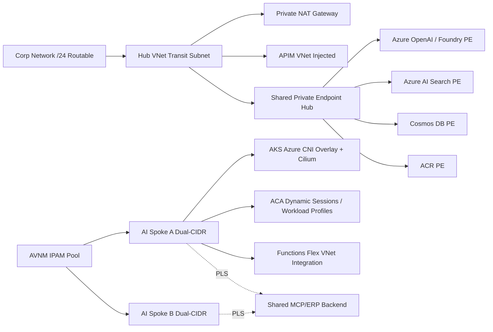
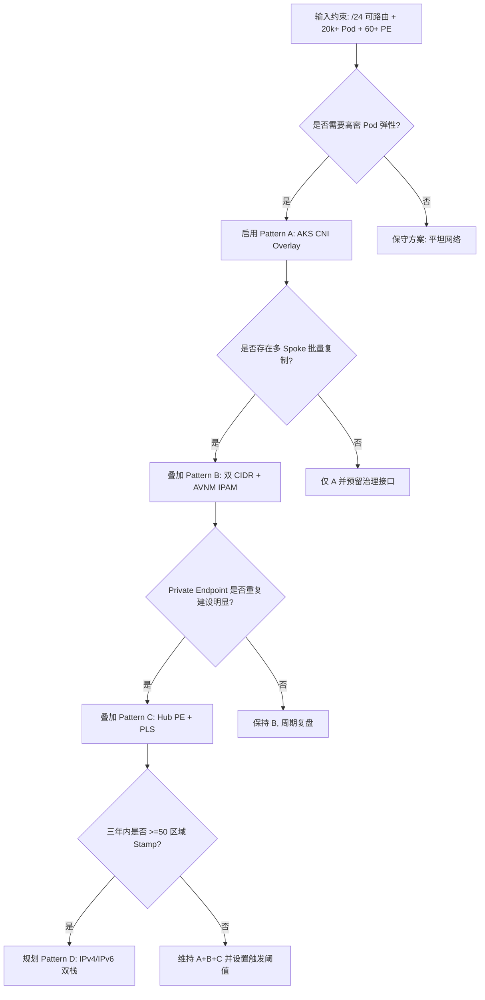

# 企业 AI Landing Zone IPv4 枯竭治理选型 FAQ：AKS CNI Overlay + CGNAT vs AVNM IPAM 双 CIDR vs Private Link/PLS 汇聚 vs 双栈 IPv6

> 🌐 **Language Switch**：**中文（当前）** | [English](./ai-landing-zone-ipv4-exhaustion-aks-cni-overlay-cgnat-vs-avnm-ipam-dual-cidr-vs-privatelink-nat-vs-ipv6-selection-faq.en.md)
> **受众**：Cloud & AI Solution Architect、企业网络架构负责人、平台 SRE、Landing Zone 负责人、AKS/ACA 平台团队。
> **范围**：解决“企业仅批复 `/24` 可路由网段，但要承载 `20,000+` AI Agent/GPU Pod、ACA Dynamic Sessions、APIM VNet 注入和 `60+` Private Endpoint”的生产级地址规划与韧性治理问题，重点比较四种可落地模式与三年 TCO。

## 1. 问题定义：为什么 AI Agent 平台最先撞上 IPv4 天花板
传统企业应用通常以 VM、数据库和少量中间件为主，地址消耗速率相对线性，而 AI Agent 平台会把地址压力同时拉高到运行时平面、数据平面和控制平面。  
当 AKS 节点数、Pod 密度、ACA 会话子网、Private Endpoint 数量和多区域冗余叠加后，`RFC 1918` 地址池会在上线初期就进入持续紧张状态。  

很多团队在 PoC 阶段看不到问题，是因为测试环境只验证功能通路，没有把升级 Surge、蓝绿发布、灾备并行窗口和运维预留地址放进容量模型。  
一旦进入生产，平台会出现“业务并发还没到，网段已经满了”的反直觉现象，导致扩容、发布、故障切换和合规整改全部受到连锁影响。  

本指南的核心不是单点优化某个子网，而是建立“地址作为平台容量配额”的系统性治理方法。  
目标是让网络团队在只给 `/24` 可路由空间的前提下，仍能支撑企业级 AI 负载增长并保持可审计、可迁移和可持续运维。  

## 2. 四种模式概览：把“地址稀缺”转化为“分层可治理”
Pattern A 以 AKS `Azure CNI Overlay` 为核心，把 Pod 地址从 VNet 可路由地址中解耦，使用 `100.64.0.0/10` 可复用地址池承载高密 Pod。  
Pattern B 构建双 CIDR AI Spoke，保留小规模企业可路由网段做对外治理通道，同时把高耗地址工作负载放到非路由地址空间并用 AVNM IPAM 统一分配。  

Pattern C 将 Private Endpoint 从“每个 Spoke 重复建设”改为“Hub 汇聚 + PLS 共享”，在多 Stamp 场景显著降低地址燃烧速率。  
Pattern D 推进 IPv4/IPv6 双栈，把未来跨区域规模化增长转移到 IPv6 空间，同时为现有 IPv4 依赖保留平滑迁移窗口。  

这四种模式不是互斥关系，企业通常按阶段叠加。  
推荐顺序是先做 A 与 B 解决近期容量与审批约束，再通过 C 降低长期重复成本，最后在平台成熟时引入 D 建立跨区域长期扩展能力。  

## 3. 端到端参考架构：AI Landing Zone 地址治理控制面


该架构把企业可路由地址当作“治理与审计通道”而不是“所有工作负载地址池”，从根因上避免把稀缺地址消耗在高密弹性层。  
同时通过 AVNM IPAM 保证每个 Spoke 的地址分配可追踪、可回收、可审计，避免人工切网段导致的碎片化和冲突。  

## 4. Pattern A：AKS Azure CNI Overlay + `100.64.0.0/10` Pod 地址复用
Overlay 的关键收益是让 Pod 地址不再占用 VNet 子网可路由地址，节点只需为 Node 与系统组件保留有限地址。  
在 `100` 节点、`maxPods=250` 的场景下，Pod 容量可达 `25,000`，而可路由地址消耗大致只与节点规模和升级 Surge 相关。  

对比平坦 CNI，Overlay 把地址规划难题从“提前申请超大路由网段”变成“在可控范围内扩节点与 Surge”。  
这对“企业网络审批慢、网段不可轻易扩容”的组织特别关键，因为可以先上线业务并按节点弹性扩张。  

需要注意的是 ExpressRoute 与本地审计对源地址可见性的要求。  
若安全团队依赖真实 Pod 源地址做细粒度取证，需要结合 Cilium 可观测、eBPF 流日志和统一身份上下文补齐审计链，而不是继续依赖平坦 CNI 的传统做法。  

## 5. Pattern B：双 CIDR AI Spoke + AVNM IPAM（小路由面 + 大非路由面）
双 CIDR 模式将 Spoke 地址空间拆分为两层：一层是 `/24` 或 `/25` 的可路由企业地址，用于入口、管理、跳板和关键南北向治理；另一层是 `100.64.0.0/16` 等非路由地址，用于高密 Pod、会话子网和弹性计算。  
这样可以把“路由审批约束”与“算力弹性扩容”解耦，避免每次扩容都触发企业主干网络变更。  

AVNM IPAM 的价值不只是自动分配网段，更重要的是建立跨订阅、跨区域、跨团队的一致地址策略。  
当平台需要快速复制新 Stamp 时，IPAM 能保证地址块按策略派发并防止重叠，显著降低上线前网络冲突排障时间。  

在该模式下，Functions Flex VNet 集成、ACA Workload Profiles 与短生命周期沙箱可集中部署到非路由地址区。  
可路由区只保留最小必要面，结合 Private NAT Gateway 统一出站身份，从而在审计与容量之间取得可解释平衡。  

## 6. Pattern C：Private Endpoint Hub 汇聚 + Private Link Service 跨重叠 Spoke
很多企业在每个 AI Spoke 内重复创建 AOAI、AI Search、Cosmos、ACR 的 Private Endpoint，导致地址与 DNS 维护成本随 Spoke 数线性上升。  
当 Spoke 增长到 `30` 个、每个 `40` 个私网终结点时，仅终结点地址就会占用 `1,200` 个 IPv4 地址，并形成高复杂度变更面。  

Pattern C 通过共享 Hub 汇聚 Private Endpoint，把 PaaS 私网访问集中治理。  
对同构 AI Stamp，可使用 PLS 将共享后端服务暴露给重叠地址 Spoke，避免因网段重复无法 Peering 的结构性阻塞。  

该模式不仅省地址，也减少证书、DNS Zone、策略和告警规则的重复配置。  
在组织层面，它把“每条业务线独立维护私网终结点”转为“平台团队统一托管网络接入能力”，显著降低 Day-2 运维碎片化。  

## 7. Pattern D：IPv4/IPv6 双栈 Landing Zone（长期扩展与区域复制）
双栈策略的价值在于把长期横向扩展的主要压力迁移到 IPv6，而不是持续挤压 IPv4。  
当企业计划建设 `50+` 全球 AI Stamp 时，继续依赖 IPv4 叠加 NAT/重叠网段技巧会显著增加运维复杂度和故障面。  

AKS Dual-Stack + Cilium 可为东西向通信提供更充裕地址空间，并简化跨区域复制时的地址规划。  
但双栈落地必须建立 PaaS 私网能力矩阵，明确哪些服务在当前阶段支持 IPv6 Private Link，哪些仍需 IPv4 兼容路径。  

推荐做法是在新建区域先启用双栈基线，再以服务白名单逐步迁移。  
这样可以避免“全量一次性切换”带来的回滚风险，并给应用团队足够窗口完成依赖组件和安全策略的双栈适配。  

## 8. 子网容量与升级公式：把规划从经验判断变成可复算
Azure 子网每个网段固定保留 `5` 个地址，因此可用地址为 `2^(32-prefix)-5`。  
在平坦 CNI 下，升级峰值地址需求可按 `(nodes + maxSurge) * (maxPods + 1)` 估算，因为每个 Pod 与节点都会消耗 VNet 可路由地址。  

在 Overlay 模式下，VNet 地址需求近似 `(nodes + maxSurge)`，Pod 地址转移到 Overlay 空间。  
这就是为什么同样的 Pod 规模在 Overlay 下可用 `/24` 或更小可路由网段起步，而平坦 CNI 往往需要巨大前置网段。  

ACA 方面，Consumption 环境通常需要 `/23` 才能满足平台保留与弹性空间，Dedicated Workload Profile 在收敛场景可用 `/27` 起步但仍需考虑峰值扩缩容。  
因此同一 Landing Zone 中应把 ACA 与 AKS 的地址需求分层管理，而不是混在同一容量池里粗放处理。  

| 计算项 | 公式 | 示例输入 | 结果 |
|---|---|---|---|
| 子网可用地址 | `2^(32-prefix)-5` | `/24` | `251` |
| 平坦 CNI 升级峰值 | `(nodes+maxSurge)*(maxPods+1)` | `100, 10, 250` | `27,610` |
| Overlay 升级峰值（VNet） | `nodes+maxSurge` | `100, 10` | `110` |
| ACA Consumption 建议基线 | 平台建议最小网段 | `-` | `/23` |
| ACA Dedicated 起步 | 平台建议最小网段 | `-` | `/27` |

## 9. 12 维度选型矩阵：容量、治理、韧性与运维复杂度
| 维度 | Pattern A：AKS Overlay + CGNAT | Pattern B：双 CIDR + AVNM IPAM | Pattern C：PE Hub + PLS | Pattern D：IPv4/IPv6 双栈 |
|---|---|---|---|---|
| 地址扩展上限 | Pod 高密扩展最强 | Spoke 横向复制强 | 终结点规模治理强 | 长期区域扩展最强 |
| 可路由地址消耗 | 极低 | 低 | 中低 | 低（IPv4 部分） |
| 升级 Surge 友好度 | 高 | 中高 | 中 | 高 |
| 网络审计可解释性 | 中（需补 eBPF/身份） | 高 | 高 | 中高 |
| 跨团队治理一致性 | 中 | 高（IPAM 驱动） | 高 | 中 |
| 对现网改造成本 | 低到中 | 中 | 中 | 中高 |
| Private Endpoint 成本 | 中 | 中 | 低（汇聚后） | 中 |
| 重叠地址容忍度 | 中 | 中高 | 高（PLS） | 高 |
| 多区域复制效率 | 高 | 高 | 中 | 高 |
| 依赖平台能力成熟度 | 中 | 中 | 中高 | 高 |
| Day-2 运维复杂度 | 中 | 中 | 中高 | 高（初期） |
| 适配 `20,000+` Pod | 是 | 是（配合 A） | 间接支持 | 是（长期） |

该矩阵表明，A/B 是近期最具性价比的容量解法，C 是规模化运营降本关键，D 是长期战略能力。  
企业不应把四者理解成“只能选一个”，而应按组织成熟度与区域扩张节奏构建组合路线。  

## 10. 三年 TCO：网络改造、终结点维护与运维投入对比
下表以 `30` 个 AI Spoke、每个 Spoke 目标承载 `20k` 级 Agent 相关工作负载增长路径为假设，比较三年累计成本结构。  
TCO 包含网络改造工时、地址冲突排障、Private Endpoint 运维、区域复制实施与变更失败回滚成本。  

| 方案 | 三年网络改造与运维总成本（USD） | Private Endpoint 三年成本（USD） | 重大变更失败风险成本（USD） | 三年总计（USD） |
|---|---:|---:|---:|---:|
| 仅平坦 IPv4 扩网（基线） | 1,920,000 | 780,000 | 420,000 | 3,120,000 |
| A+B（Overlay + 双 CIDR + IPAM） | 1,140,000 | 620,000 | 210,000 | 1,970,000 |
| A+B+C（再加 Hub 汇聚与 PLS） | 1,260,000 | 410,000 | 190,000 | 1,860,000 |
| A+B+C+D（双栈逐步落地） | 1,520,000 | 390,000 | 160,000 | 2,070,000 |

从三年视角看，A+B+C 往往是“近期降本 + 中期稳定”最佳平衡点。  
若企业已明确 `50+` 区域 Stamp 规划，D 的额外投入会在更长周期回收，并显著降低后续地址重构风险。  



上图的重点是把选型流程“条件化”，避免在架构评审会上陷入偏好争论。  
当组织把每个分支条件绑定到可观测指标（例如子网利用率、终结点增长率、区域复制节奏）后，路线升级就会从“主观判断”变成“阈值触发”。  
这对于跨团队协同尤其重要，因为网络、平台和业务团队可以共享同一组触发标准，从而减少临时例外与反复返工。  
在实践中，建议把该决策流直接落到平台蓝图模板与发布门禁中，让每次新建 Spoke 或扩容申请都自动产出“为何采用某模式组合”的可审计证据。  

## 11. 生产 Bicep：双 CIDR VNet + AKS Overlay + AVNM IPAM 池
```bicep
param location string = resourceGroup().location
param vnetName string = 'ai-spoke-vnet'
param routablePrefix string = '10.52.24.0/24'
param cgnatPrefix string = '100.64.32.0/20'
param aksSubnetPrefix string = '10.52.24.0/26'
param transitSubnetPrefix string = '10.52.24.64/27'
param acaSubnetPrefix string = '100.64.32.0/23'
param funcSubnetPrefix string = '100.64.34.0/26'
param podCidr string = '100.96.0.0/11'
param serviceCidr string = '10.200.0.0/16'
param dnsServiceIp string = '10.200.0.10'

resource vnet 'Microsoft.Network/virtualNetworks@2023-09-01' = {
  name: vnetName
  location: location
  properties: {
    addressSpace: {
      addressPrefixes: [
        routablePrefix
        cgnatPrefix
      ]
    }
    subnets: [
      {
        name: 'aks-system'
        properties: {
          addressPrefix: aksSubnetPrefix
        }
      }
      {
        name: 'transit-routable'
        properties: {
          addressPrefix: transitSubnetPrefix
        }
      }
      {
        name: 'aca-consumption'
        properties: {
          addressPrefix: acaSubnetPrefix
          delegations: [
            {
              name: 'acaDelegation'
              properties: {
                serviceName: 'Microsoft.App/environments'
              }
            }
          ]
        }
      }
      {
        name: 'functions-flex'
        properties: {
          addressPrefix: funcSubnetPrefix
          delegations: [
            {
              name: 'funcDelegation'
              properties: {
                serviceName: 'Microsoft.Web/serverFarms'
              }
            }
          ]
        }
      }
    ]
  }
}

resource aks 'Microsoft.ContainerService/managedClusters@2024-05-01' = {
  name: 'ai-aks-overlay'
  location: location
  properties: {
    networkProfile: {
      networkPlugin: 'azure'
      networkPluginMode: 'overlay'
      podCidr: podCidr
      serviceCidr: serviceCidr
      dnsServiceIP: dnsServiceIp
      loadBalancerSku: 'standard'
    }
    agentPoolProfiles: [
      {
        name: 'system'
        count: 3
        vmSize: 'Standard_D8ds_v5'
        maxPods: 250
        vnetSubnetID: '${vnet.id}/subnets/aks-system'
      }
    ]
  }
}
```

该模板展示了“可路由 + 非路由”地址空间并存和 Overlay 网络插件组合。  
实际生产建议把 AVNM IPAM 池分配、NAT Gateway、Route Table 与 DNS 私有解析规则作为独立模块纳入同一发布流水线。  

## 12. 生产配置补充：升级 Surge、NAT 与地址容量防线
```yaml
aks:
  clusterName: ai-aks-overlay
  maxPods: 250
  upgradeSettings:
    maxSurge: "10%"
  network:
    plugin: azure
    pluginMode: overlay
    podCidr: 100.96.0.0/11
    serviceCidr: 10.200.0.0/16
    ebpfObservability: enabled

aca:
  environmentSubnet: 100.64.32.0/23
  workloadProfiles:
    - name: sessions-dedicated
      subnet: 100.64.34.0/27
      minReplicas: 2
      maxReplicas: 80

egress:
  privateNatGateway:
    enabled: true
    sourceSubnet: transit-routable
    snatPolicy: centralized

guardrails:
  subnetUtilizationWarning: 70
  subnetUtilizationCritical: 85
  privateEndpointQuotaPerSpoke: 12
  enforceHubPrivateEndpoint: true
```

这组配置的重点是把“地址耗尽”前移为可观测事件，而不是等扩容失败后被动救火。  
建议把子网利用率、Private Endpoint 配额、NAT SNAT 端口使用率纳入统一 SLO，并绑定自动化扩容或流量抑制策略。  

## 13. 企业场景一：全球零售银行（7 年审计留痕 + 多区域容灾）
该类组织通常面临极严审计要求和跨境数据驻留约束，网络团队对可路由地址审批非常保守。  
推荐组合是 A+B+C：Overlay 支撑高密 Pod，双 CIDR 保障审批可落地，Hub 汇聚终结点减少跨区域重复配置。  

在容灾演练窗口，平台需要并行保留主备区域资源，地址需求会短期翻倍。  
若没有 Overlay 与终结点汇聚，最常见结果是演练无法按计划上线，进而影响监管审查结论。  

该场景不必在第一年强推双栈，但应在新区域建设时预留双栈策略接口。  
这样既不增加当前变更风险，又能在第二阶段平滑引入 IPv6 以支撑更大规模扩展。  

## 14. 企业场景二：高增长多租户 AI SaaS（季度新增 8–12 个 AI Stamp）
该场景的核心矛盾是扩张速度快于网络治理节奏，且每次复制都伴随大量私网接入需求。  
推荐组合是 A+B+C+D 分阶段执行：先用 A+B 保证季度上线速度，再通过 C 降低重复私网成本，最终用 D 支撑全球复制。  

在实践中，SaaS 团队最容易忽视的是“模板可复制但地址不可复制”。  
通过 AVNM IPAM 的池化分配和 PLS 的重叠地址兼容，可以把复制失败率从人工规划阶段的大幅波动降到可控范围。  

若组织目标是 `50+` 区域 Stamp，双栈不是可选项而是长期必选项。  
越晚引入双栈，后续迁移涉及的历史兼容债务就越高，迁移窗口也越难协调。  

## 15. 量化 Q&A 与 Day-0/Day-2 检查单
| 问题 | 建议答案（量化） |
|---|---|
| Q1：`/24` 能否承载 `20,000+` Pod？ | 能，前提是采用 Overlay；在 `100` 节点、`maxPods=250` 时 Pod 容量约 `25,000`，可路由地址需求约 `110`（含 `10%` Surge）。 |
| Q2：为什么不继续平坦 CNI 扩网？ | 因为升级峰值近似 `(nodes+maxSurge)*(maxPods+1)`，同参数下约 `27,610` 个可路由地址，远超 `/24` 供给。 |
| Q3：C 模式带来多少地址节省？ | `30` Spoke × `40` 终结点即 `1,200` 地址，Hub 汇聚后可显著压缩重复终结点数量并降低 DNS/策略维护面。 |
| Q4：ACA 子网如何规划更稳妥？ | Consumption 优先按 `/23` 规划，Dedicated 可从 `/27` 起步但需绑定弹性上限与利用率告警。 |
| Q5：双栈是否必须立即全量切换？ | 不建议；采用“新区域先双栈、存量区域逐步迁移”可把回滚风险与业务扰动降到最低。 |
| Q6：何时应启动 IPv6 项目立项？ | 当组织已确认 `50+` 区域 Stamp 或三年内持续新增大规模 Spoke 时，应在下一财年纳入必做项。 |

**Day-0（上线前）**
- 完成地址容量基线：节点、Pod 密度、Surge、ACA 子网、Private Endpoint 数量、NAT 端口预算。  
- 在 AVNM IPAM 定义地址池与分配策略，禁止手工切网段绕过平台。  
- 对 AKS 统一启用 Overlay 基线模板，发布前执行地址峰值压测与升级演练。  
- 明确 Hub 终结点汇聚策略与 PLS 接入标准，减少 Spoke 重复建设。  
- 建立双栈能力矩阵台账，列出当前服务支持状态与迁移先后顺序。  

**Day-2（运行中）**
- 每周复盘子网利用率与终结点增长曲线，在 `70%/85%` 阈值触发容量动作。  
- 每月审查 IPAM 分配漂移，回收僵尸子网和闲置终结点，避免地址碎片化。  
- 每季度执行区域故障切换演练，验证并行窗口下地址与路由策略仍可用。  
- 持续跟踪 PaaS IPv6 私网支持更新，按业务优先级推进双栈迁移。  
- 把地址与网络运维成本纳入 FinOps，看板化管理“每新增 Stamp 的网络边际成本”。  
