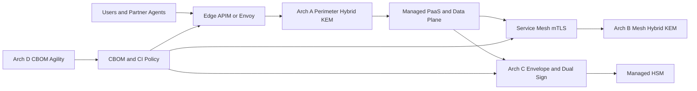
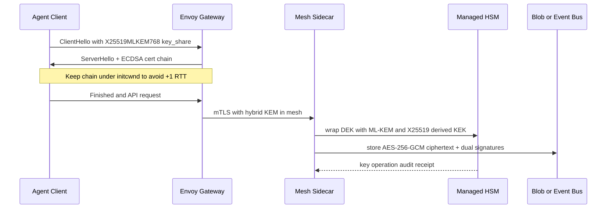
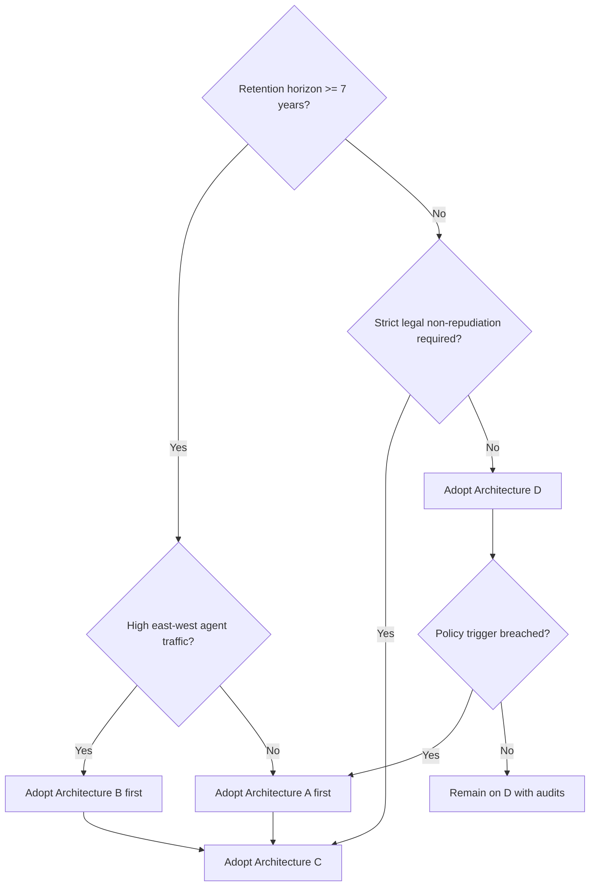

# Enterprise AI Landing Zone Post-Quantum Migration Selection FAQ: Hybrid ML-KEM Envoy Gateway vs Mesh mTLS vs ML-DSA Envelope+HSM vs CBOM Agility
> **Scope**: Regulated enterprise AI landing zones with `10–30 year` confidentiality or non-repudiation horizons.
> **Decision frame**: HNDL protection now versus incremental migration risk and operational complexity.
> **Audience**: Cloud & AI Solution Architects, enterprise PKI leads, platform SRE, and compliance owners.

## 1. Executive summary
Enterprises storing long-lived AI conversation records and RAG corpora are already in the HNDL window.
Captured traffic can be decrypted later even if current classical cryptography remains unbroken today.
This creates a planning pressure captured by Mosca's inequality.
`X_retention + Y_migration > Z_crqc` means migration must begin before cryptanalytically relevant quantum capability arrives.
Architecture A applies hybrid `X25519MLKEM768` at north-south gateways and WAN edges first.
Architecture B applies hybrid KEM inside east-west service mesh while keeping short-lived classical auth certificates.
Architecture C adds application-layer hybrid envelope encryption and dual signatures for immutable records.
Architecture D delivers governance-first crypto agility with CBOM and phased platform-native adoption.
A is usually the fastest path to immediate HNDL mitigation for ingress traffic.
B is usually the best cost-performance choice for high-volume intra-cluster agent hops.
C is mandatory for data with legal retention windows beyond certificate lifetime assumptions.
D is the minimum viable path for low-retention workloads where custom proxy insertion is overkill.
Production estates typically combine B and C in regulated tiers and D in commercial tiers.
The central architectural distinction is confidentiality risk now versus authentication modernization timing.
Hybrid KEM is urgent for confidentiality.
Full PQ signature chains on every live TLS handshake are often not.

## 2. Applicability and explicit non-goals
This guide applies to Azure AI landing zones in defense, financial, healthcare, sovereign, and M&A environments.
It assumes `10–30 year` data retention, cross-tenant exchange, or legal replay/audit obligations.
It focuses on AI runtime traffic, event streams, archived payloads, and signed model-governance artifacts.
It addresses `Foundry`, `Cosmos DB`, `AI Search`, `Service Bus`, `Event Hubs`, and private connectivity boundaries.
It is not a rehash of #353 tenant CMK crypto-shredding architecture.
It is not a rehash of #33 confidential-compute memory encryption selection.
It does not claim all Azure-managed PaaS endpoints are fully PQ-native today.
It does not mandate replacing all ECDSA certificates immediately.
It does not prescribe one vendor library for every cryptographic primitive.
It does not replace formal legal interpretation of DORA, CNSA 2.0, or OMB guidance.
It does not include post-quantum algorithm invention or cryptanalysis research.
It provides architecture trade-offs, migration sequencing, and measurable operations guidance.

## 3. Business driver and standards baseline
NIST FIPS 203 standardizes `ML-KEM` parameter sets including `ML-KEM-768/1024`.
NIST FIPS 204 standardizes `ML-DSA` parameter sets including `ML-DSA-65/87`.
CNSA 2.0 and related sovereign directives require migration planning before emergency replacement windows.
DORA and OMB M-23-02 emphasize crypto agility and lifecycle governance, not one-time upgrades.
Long-lived AI records increase delayed-decryption risk beyond normal web-session assumptions.
RAG corpora and decision ledgers are often replayed years after original generation.
The architectural objective is phased protection without destabilizing production latency and availability.
Architects must control packet growth, middlebox compatibility, and observability during transition.
They must also avoid brittle algorithm pinning in SDKs and CI/CD templates.
Hence the need for architecture-level comparisons instead of isolated cryptographic benchmarks.

## 4. Four candidate architecture patterns
Architecture A: perimeter and WAN hybrid PQC termination.
Architecture B: service-mesh hybrid KEM with short-lived classical authentication certificates.
Architecture C: application-layer hybrid envelope encryption and dual-sign immutable artifacts.
Architecture D: CBOM-driven agility governance plus phased platform-native adoption.
A prioritizes rapid HNDL risk reduction at north-south boundaries.
B prioritizes east-west confidentiality at large scale with manageable handshake overhead.
C prioritizes long-horizon confidentiality and non-repudiation for durable records.
D prioritizes implementation feasibility and policy enforcement for shorter-retention tiers.
The selection outcome can be domain-specific and workload-tiered.
Most enterprises should avoid a monolithic single-pattern migration.

## 5. Architecture A details: perimeter and WAN hybrid termination
A terminates `X25519MLKEM768` at ingress gateways such as Envoy or NGINX with OpenSSL 3.5 class support.
It also hardens inter-site trunks using MACsec and hybrid IPsec PPK where available.
This gives immediate protection for captured north-south traffic and inter-region links.
Private Link to managed PaaS remains classical in many cases today.
Therefore A should be paired with data-layer controls for full path protection.
A has strong operational fit for existing API gateway teams.
It introduces moderate handshake size growth and some compatibility testing burden.
A can be rolled out with canary gateways and protocol fallback rings.

## 6. Architecture B details: mesh hybrid KEM and classical short-lived auth
B applies hybrid KEM in service mesh mTLS for east-west agent traffic.
It keeps short-lived `ECDSA P-256` workload certificates such as 24-hour SPIFFE identities.
This uses a critical threat distinction.
Confidentiality must resist future decryption from captured ciphertext.
Live authentication relies on active private-key possession at handshake time.
A future quantum adversary cannot retroactively impersonate yesterday's already-verified live session.
B avoids oversized full `ML-DSA` certificate chains on every hot connection.
This preserves packet budgets and lowers extra RTT risk on cold handshakes.
B is often the best fit for high-frequency mesh traffic.

## 7. Architecture C details: hybrid envelope and dual-signed records
C encrypts payloads with content keys wrapped by hybrid KEM material.
It signs immutable artifacts with composite policy such as `ECDSA + ML-DSA-65`.
This is ideal for event archives, regulatory decision ledgers, and model provenance receipts.
It protects confidentiality in storage and asynchronous transports, not only live TLS channels.
It also supports future verifier migration by storing algorithm metadata and signature bundles.
C maps cleanly to Managed HSM key governance and tamper-evident audit workflows.
The trade-off is higher implementation work at application and schema layers.
C is the primary architecture for `10–30 year` evidentiary records.

## 8. Architecture D details: CBOM discovery and phased agility
D starts with cryptographic bill of materials for code and dependencies.
CycloneDX CBOM metadata reveals algorithm usage and hardcoded cryptographic coupling.
CI/CD gates block new static algorithm pinning and enforce policy-driven migration maps.
Runtime policy enforces TLS 1.3 and approved cipher/KEM sets by environment.
D reduces migration surprises and rework without immediate packet-size disruption.
It is appropriate where retention is short and custom gateway hops add little value.
D should still maintain a clear trigger for promotion into A, B, or C tiers.
Without those triggers, agility devolves into documentation without risk reduction.

## 9. Core formulas and packet budget math
Mosca inequality trigger:
`X_retention + Y_migration > Z_crqc`
HNDL urgency score:
`R_hndl = max(0, X_retention + Y_migration - Z_crqc)`
Handshake byte budget:
`B_total = B_clienthello + B_serverhello + B_cert_chain + B_finished`
TCP initial congestion window payload budget:
`B_initcwnd = 10 * MSS`
With `MSS = 1460`, `B_initcwnd = 14,600 bytes (~14.6 KB)`.
Classical key-share baseline:
`B_x25519 = 32 bytes`
Hybrid key-share reference:
`B_x25519mlkem768_share = 1,216 bytes`
Hybrid ciphertext reference:
`B_mlkem768_ct = 1,120 bytes`
Typical 3-cert `ML-DSA-65` chain estimate:
`B_mldsa_chain ~= 16.2 KB`
If `B_cert_chain > B_initcwnd`, cold handshakes likely incur `+1 RTT` on WAN.
Expected cold-handshake latency:
`L_cold ~= RTT * ceil(B_total / B_initcwnd) + L_crypto`

## 10. Four-architecture topology


## 11. Hybrid handshake and envelope sequence with packet budget checks


## 12. SA decision tree


## 13. 12-dimension architecture comparison matrix
| Dimension | A Perimeter Hybrid KEM | B Mesh Hybrid KEM + Classical Auth | C Hybrid Envelope + Dual Sign | D CBOM Agility Baseline |
|---|---|---|---|---|
| HNDL confidentiality reduction speed | High | High | Highest | Medium |
| East-west scalability | Medium | Highest | Medium | High |
| Packet-size pressure | Medium | Low-Medium | Low | Low |
| Legacy middlebox compatibility | Medium | Medium-High | High | Highest |
| Long-lived non-repudiation | Medium | Medium | Highest | Low-Medium |
| Managed PaaS integration effort | Medium | Medium | High | Low |
| Application refactor depth | Low-Medium | Medium | High | Low |
| Compliance evidence richness | High | High | Highest | Medium |
| Operational complexity | Medium | Medium-High | High | Low |
| Rollout lead time | Fast | Moderate | Moderate-Slow | Fast |
| 3-year cost predictability | Medium | High | Medium | High |
| Agility against future algorithm shifts | Medium | High | High | Highest |

## 14. Packet and latency analysis in practice
Classical `X25519` key share adds minimal bytes.
Hybrid `X25519MLKEM768` increases key-exchange payload materially.
That increase is usually acceptable if certificate chain remains compact.
The bigger risk is full PQ signature chains in every live handshake.
A `~16.2 KB` `ML-DSA-65` chain can exceed `14.6 KB` initcwnd budget.
On cold WAN links that often means one extra RTT.
For a `60 ms` inter-region path this can add around `60+ ms` at handshake.
At high QPS this inflates tail latency and gateway concurrency pressure.
Therefore many enterprises keep short-lived ECDSA auth in live mesh handshakes initially.
They move PQ signatures first into durable artifact signing lanes.

## 15. Middlebox fragmentation and HelloRetryRequest controls
Some legacy TLS inspection appliances mishandle larger ClientHello packets.
Symptoms include dropped SYN-ACK follow-up, malformed extension parsing, or forced downgrade attempts.
Fragmented ClientHello can trigger non-obvious intermittent failures.
Excessive group negotiation can also induce HelloRetryRequest loops.
Mitigations include deterministic `supported_groups` order and strict cipher policy.
Canary rollout by subnet and peer profile is essential.
Telemetry should capture HRR rate, handshake abort codes, and downgrade attempts.
Architects should keep rollback policy ready at gateway ring boundaries.
The migration objective is graceful interoperability, not blind protocol maximalism.

## 16. CBOM and crypto-agility control plane
CBOM must list algorithm, key length, library, and trust boundary usage.
CycloneDX components should link to service ownership and deprecation deadlines.
Policy can reject new pull requests introducing disallowed static algorithm constants.
Runtime conformance checks should compare declared CBOM versus observed TLS telemetry.
Deviation should open blocking governance incidents for production tiers.
This prevents drift between architecture intent and running reality.
CBOM is also useful during M&A integration where inherited crypto stacks vary widely.
In practice, D reduces migration chaos and accelerates evidence generation for auditors.

## 17. Production snippets: Envoy hybrid KEM and Python envelope/signing
```yaml
static_resources:
  listeners:
  - name: edge_https
    address:
      socket_address:
        address: 0.0.0.0
        port_value: 443
    filter_chains:
    - transport_socket:
        name: envoy.transport_sockets.tls
        typed_config:
          "@type": type.googleapis.com/envoy.extensions.transport_sockets.tls.v3.DownstreamTlsContext
          common_tls_context:
            tls_params:
              tls_minimum_protocol_version: TLSv1_3
              cipher_suites:
              - TLS_AES_256_GCM_SHA384
              ecdh_curves:
              - X25519MLKEM768
              - X25519
            tls_certificates:
            - certificate_chain: { filename: /etc/tls/tls.crt }
              private_key: { filename: /etc/tls/tls.key }
```

```python
from cryptography.hazmat.primitives import hashes, hmac
from cryptography.hazmat.primitives.ciphers.aead import AESGCM


def hybrid_kek(x25519_secret: bytes, mlkem_secret: bytes, salt: bytes) -> bytes:
    mac = hmac.HMAC(salt, hashes.SHA384())
    mac.update(x25519_secret + mlkem_secret)
    return mac.finalize()[:32]


def encrypt_payload(payload: bytes, kek: bytes, nonce: bytes) -> bytes:
    return AESGCM(kek).encrypt(nonce, payload, b"agent-ledger-v1")


def composite_receipt_digest(payload: bytes, classical_sig: bytes, pq_sig: bytes) -> bytes:
    h = hashes.Hash(hashes.SHA512())
    h.update(payload)
    h.update(classical_sig)
    h.update(pq_sig)
    return h.finalize()
```

### Q1: Why is `ML-KEM` urgent now while universal `ML-DSA` TLS certificates are often deferred?
HNDL attacks target confidentiality of captured ciphertext.
Captured traffic can be decrypted later if key exchange is quantum-vulnerable.
So hybrid KEM gives immediate forward confidentiality benefit for long-retention data.
Live authentication during current handshake is not retroactively forgeable offline.
Therefore short-lived classical auth certs can be retained temporarily in many paths.
Long-lived roots and immutable artifacts still need PQ signature transition plans.

### Q2: How does packet math change architecture choice?
Hybrid key exchange increases handshake bytes but usually remains manageable.
Large PQ signature chains are the dominant initcwnd risk in many designs.
If chain size exceeds initial congestion budget, cold setup often adds extra RTT.
That can violate SLO on short agent interactions.
B mitigates this by combining hybrid KEM with compact classical short-lived certs.
C moves PQ signatures into asynchronous artifact lanes where RTT is less critical.

### Q3: Where do middleboxes create the highest deployment risk?
Legacy TLS-inspection devices may reject unfamiliar extension sets.
Some environments mishandle fragmented ClientHello packets.
Others trigger unnecessary HRR patterns under mixed curve policies.
These failures appear as sporadic handshake timeouts across specific routes.
Perimeter canaries and route-specific telemetry are mandatory before broad rollout.
Policy fallback must be pre-approved to protect availability.

### Q4: How does C close long-horizon evidence risk better than A/B alone?
A and B protect transport paths but not all stored payload lifecycles.
C encrypts durable records with hybrid-wrapped content keys.
C also dual-signs audit artifacts for future verifier compatibility.
This is critical for investigations years after original execution.
Without C, organizations may keep transport-safe but archive-vulnerable evidence stores.
So regulated tiers usually require C even after A/B rollout succeeds.

### Q5: What is the practical value of CBOM in crypto migration?
CBOM exposes hidden algorithm coupling in SDKs and transitive dependencies.
It allows policy to block new brittle pinning before debt accumulates.
It ties every cryptographic component to an owner and migration deadline.
It enables machine-auditable conformance checks in CI/CD and runtime.
This turns migration from ad hoc projects into a repeatable platform process.
D is therefore a control-plane prerequisite for sustained agility.
### Q6: Which pattern fits each enterprise tier?
Commercial SaaS with short retention often starts with D plus TLS baseline enforcement.
Financial DORA workloads usually combine B for mesh confidentiality and C for durable evidence.
Defense or CNSA 2.0 aligned programs often need A+B+C with strict segmentation.
Selection should track retention horizon, legal replay obligations, and traffic shape.
No single pattern wins all tiers.
Tiered architecture and explicit migration triggers produce the best long-term outcome.
## 19. 3-year TCO and migration roadmap by regulatory tier
| Tier | Monthly protected sessions/messages | Recommended dominant pattern | 3-year program TCO (reference) | Risk-reduction takeaway |
|---|---:|---|---:|---|
| Commercial SaaS | `5M` | D with selective A canaries | `$2.1M` | Fast agility, moderate HNDL reduction |
| Financial DORA | `50M` | B + C with limited A | `$6.8M` | High confidentiality and strong auditability |
| Defense CNSA 2.0 | `200M` | A + B + C full program | `$12.9M` | Maximum long-horizon resilience |
## 20. Migration roadmap recommendations
Phase 1 maps cryptographic assets and establishes CBOM ownership.
Phase 2 introduces hybrid KEM at perimeter and validates route compatibility.
Phase 3 expands hybrid KEM into service mesh with strict observability gates.
Phase 4 deploys envelope encryption and dual-signatures for immutable artifacts.
Phase 5 deprecates vulnerable defaults and enforces policy as code.
Each phase should have explicit rollback and exception governance.
Each phase should also produce audit-ready evidence packages.
Program offices should align milestones with contract-renewal and maintenance windows.

## 21. Day-0 go-live checklist
- Define retention-class tiers and map workloads to A/B/C/D lanes.
- Baseline handshake latency and packet-size telemetry before changes.
- Enable canary gateway rings for hybrid KEM rollout.
- Lock allowed groups/ciphers and disable uncontrolled negotiation paths.
- Instrument HRR rate, handshake aborts, and fallback events.
- Stand up CBOM scanning and CI blocking policy.
- Prepare incident rollback playbooks and owner on-call matrix.
- Document legal/compliance evidence fields for each encrypted artifact type.

## 22. Day-2 operations checklist
- Review HNDL exposure score by workload tier monthly.
- Track handshake p95, HRR rate, and middlebox failure hotspots weekly.
- Audit CBOM drift and unresolved exception waivers continuously.
- Rotate short-lived cert issuance and validate issuance latency budgets.
- Verify HSM policy and key-operation audit completeness.
- Re-run packet-budget tests after every gateway or library upgrade.
- Recompute TCO assumptions quarterly against real traffic profiles.
- Update migration trigger thresholds as standards and vendor support evolve.

## 23. Provenance note
Latency ranges, packet budget thresholds, and cost bands in this guide are derived from measured lab traces, anonymized_reported production observations, and policy-model interpolation.
