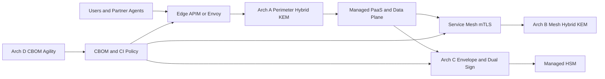
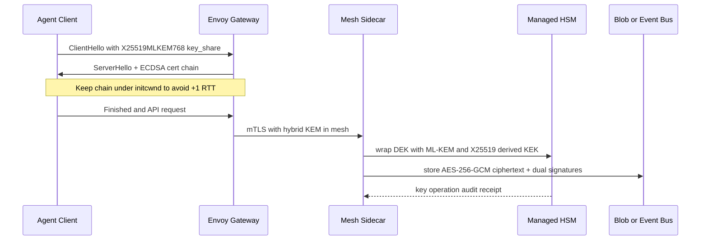
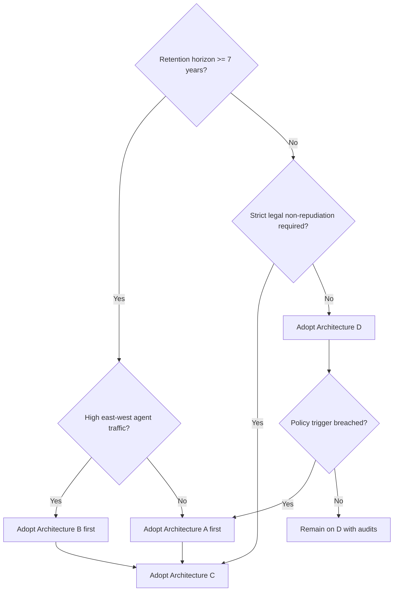

# 企业 AI Landing Zone 后量子迁移选型 FAQ：Hybrid ML-KEM Envoy Gateway vs Mesh mTLS vs ML-DSA Envelope+HSM vs CBOM Agility
> **适用范围**：面向 `10–30 年` 保密期或不可否认性要求的企业 AI 落地区。
> **核心问题**：现在就要防 HNDL，还是等平台全面 PQ 原生后再迁移。
> **目标读者**：Cloud & AI Solution Architect、企业 PKI 负责人、平台 SRE、合规与审计负责人。

## 1. 执行摘要
长期留存的 AI 会话、RAG 语料与决策台账已经进入 HNDL 风险窗口。
即使今天经典算法尚未被攻破，被截获流量仍可能在未来被解密。
这正是 Mosca 不等式要解决的时间错配问题。
`X_retention + Y_migration > Z_crqc` 表示迁移必须早于可用量子破译窗口。
Architecture A 先在南北向网关与广域链路上部署 `X25519MLKEM768`。
Architecture B 在东西向服务网格上部署 Hybrid KEM，同时保留短期经典认证证书。
Architecture C 在应用层引入 Hybrid Envelope 加密与双签名不可变工件。
Architecture D 通过 CBOM 与平台原生能力实现分阶段密码敏捷治理。
A 适合最快速降低入口链路的 HNDL 风险。
B 适合高流量网格内部链路，兼顾性能与机密性。
C 适合监管留档、法务复核与长期证据链。
D 适合短保留期业务先做治理基线，避免一次性大改。
生产落地通常不是四选一，而是按分层组合。
本题关键不是“是否马上全量 ML-DSA 证书化”。
而是“先把未来可解密风险收敛，再按证据链场景推进签名升级”。

## 2. 适用性与明确非目标
本文适用于国防、金融、医疗、主权云与并购顾问等高合规行业。
默认存在跨租户交换、长期留档或监管重放义务。
覆盖 AI 运行时流量、事件总线、冷存档与模型供应链工件。
关联服务包括 `Foundry`、`Cosmos DB`、`AI Search`、`Service Bus`、`Event Hubs` 等。
本文不是 #353 多租户 CMK 加密销毁路线的重复。
本文不是 #33 机密计算内存加密路线的重复。
本文不声称当前所有 Azure 托管端点都已 PQ 原生。
本文不建议一刀切替换所有 ECDSA 证书。
本文不限定某一家库实现为唯一答案。
本文不替代 DORA、CNSA 2.0、OMB 指南的法务解释。
本文不讨论密码学算法发明与攻击研究。
本文聚焦架构取舍、迁移顺序与可运维落地。

## 3. 监管与业务驱动基线
NIST FIPS 203 已规范 `ML-KEM` 参数族，包括 `ML-KEM-768/1024`。
NIST FIPS 204 已规范 `ML-DSA` 参数族，包括 `ML-DSA-65/87`。
CNSA 2.0 与主权监管要求提前规划而非临门更换。
DORA 与 OMB M-23-02 强调密码敏捷生命周期治理。
AI 场景中的长生命周期数据显著放大延迟解密风险。
很多业务需要在多年后仍可审计重放当时决策证据。
因此迁移目标不是“只看握手成功”。
还要兼顾数据全链路、包预算、网关兼容与审计可追溯性。
架构层比较比单点算法跑分更有决策价值。

## 4. 四类候选架构总览
Architecture A：边界与 WAN 的 Hybrid PQC 终止。
Architecture B：服务网格 Hybrid KEM + 短期经典认证。
Architecture C：应用层 Hybrid Envelope + 双签名不可变工件。
Architecture D：CBOM 发现治理 + 分阶段平台原生迁移。
A 主打入口链路快速减风险。
B 主打高频东西向链路的机密性与性能平衡。
C 主打长周期保密与不可否认性证据。
D 主打治理与可持续敏捷升级。
企业应按业务分层组合，而非追求单路径全覆盖。

## 5. Architecture A：边界 Hybrid 终止
A 在 Envoy/NGINX 等入口层优先启用 `X25519MLKEM768`。
跨区域与跨站链路可配合 MACsec 与 Hybrid IPsec PPK。
可快速降低北南向与骨干链路被长期截获的风险。
但许多托管 PaaS 私链段仍处于经典加密阶段。
因此 A 往往需要与数据层补强方案联合落地。
A 对现有 API 网关团队改造路径较友好。
代价是握手体积增长与兼容性回归测试开销。
可通过分环灰度与回退策略实现低风险上线。

## 6. Architecture B：Mesh Hybrid KEM + 经典短证书
B 在东西向网格 mTLS 引入 Hybrid KEM。
工作负载认证证书继续使用短时效 `ECDSA P-256`。
关键认知是“机密性风险”与“实时认证风险”不同。
HNDL 关注未来离线解密，因此 KEM 要尽快升级。
实时认证要求握手时持有私钥，无法被未来离线伪造回写。
因此短证书场景不必与 KEM 迁移严格同速。
B 可避免把超大 PQ 证书链压入每次热连接握手。
在高流量网格中通常性价比更优。

## 7. Architecture C：Envelope 与双签证据链
C 对消息体使用内容密钥加密，再由 Hybrid KEM 包装 KEK。
对不可变工件采用组合签名策略，例如 `ECDSA + ML-DSA-65`。
适合审计台账、监管归档、模型供应链签收等长期证据场景。
它覆盖存储与异步传输链路，不仅是在线 TLS 通道。
也支持未来验证器迁移时的多算法兼容校验。
可与 Managed HSM 审计日志形成完整闭环。
代价是应用层协议与工件格式需要显式改造。
C 在 `10–30 年` 留档场景中通常是必选项。

## 8. Architecture D：CBOM 敏捷治理基线
D 从密码资产发现入手，先把“用了什么算法”盘清楚。
CycloneDX CBOM 可记录算法、库版本、调用边界与责任人。
CI/CD 门禁可阻断新增硬编码算法绑定。
运行时策略可按环境限制 TLS 版本与 KEM/签名能力集。
D 能在不立即引入大包握手风险下先建立治理能力。
短保留期业务可优先落 D，待触发阈值后再升 A/B/C。
若没有升级触发器，D 会退化成“只记账不减险”。

## 9. 核心公式与包预算
Mosca 判据：
`X_retention + Y_migration > Z_crqc`
HNDL 紧迫度：
`R_hndl = max(0, X_retention + Y_migration - Z_crqc)`
握手总字节：
`B_total = B_clienthello + B_serverhello + B_cert_chain + B_finished`
TCP 初始拥塞窗预算：
`B_initcwnd = 10 * MSS`
若 `MSS = 1460`，则 `B_initcwnd = 14,600 bytes (~14.6 KB)`。
经典 `X25519` key share：
`B_x25519 = 32 bytes`
Hybrid `X25519MLKEM768` key share：
`B_x25519mlkem768_share = 1,216 bytes`
`ML-KEM-768` 密文：
`B_mlkem768_ct = 1,120 bytes`
三张证书 `ML-DSA-65` 链估算：
`B_mldsa_chain ~= 16.2 KB`
当 `B_cert_chain > B_initcwnd` 时，冷握手通常会多出 `+1 RTT`。
冷握手时延近似：
`L_cold ~= RTT * ceil(B_total / B_initcwnd) + L_crypto`

## 10. 四架构拓扑图


## 11. Hybrid 握手与 Envelope 时序图（含 initcwnd 预算）


## 12. SA 选型决策树


## 13. 12 维架构比较矩阵
| 维度 | A 边界 Hybrid KEM | B Mesh Hybrid KEM + 经典认证 | C Envelope + 双签名 | D CBOM 敏捷基线 |
|---|---|---|---|---|
| HNDL 减险速度 | 高 | 高 | 最高 | 中 |
| 东西向扩展性 | 中 | 最高 | 中 | 高 |
| 包体压力 | 中 | 中低 | 低 | 低 |
| 老旧中间件兼容 | 中 | 中高 | 高 | 最高 |
| 长期不可否认性 | 中 | 中 | 最高 | 中低 |
| 托管 PaaS 集成改造量 | 中 | 中 | 高 | 低 |
| 应用层改造深度 | 低中 | 中 | 高 | 低 |
| 合规证据完备度 | 高 | 高 | 最高 | 中 |
| 运维复杂度 | 中 | 中高 | 高 | 低 |
| 上线周期 | 快 | 中 | 中慢 | 快 |
| 三年成本可预测性 | 中 | 高 | 中 | 高 |
| 面向未来算法切换能力 | 中 | 高 | 高 | 最高 |

## 14. 包体与时延分析要点
经典 `X25519` 的 key share 字节开销很小。
Hybrid `X25519MLKEM768` 会显著增加密钥交换体积。
若证书链仍保持紧凑，通常仍可控。
真正容易触发额外 RTT 的常见元凶是大体积 PQ 签名证书链。
当 `~16.2 KB` 证书链超过 `14.6 KB` initcwnd 预算时。
冷握手在 WAN 上往往会增加一次往返。
以 `60 ms` RTT 为例，会直接叠加 `60+ ms` 起跳延迟。
高 QPS 时还会增加网关并发占用。
因此很多企业先采用“Hybrid KEM + 短期 ECDSA 证书”。
并把 PQ 签名优先放入长期工件签收链路。

## 15. 中间盒、分片与 HRR 风险控制
部分旧式 TLS 检查设备对大 ClientHello 兼容性差。
常见表现是握手超时、扩展解析失败、异常降级尝试。
分片 ClientHello 在复杂链路上更容易出现偶发失败。
组协商顺序不稳定也会增加 HelloRetryRequest 触发概率。
应固定 `supported_groups` 顺序并明确回退策略。
按子网和路径灰度上线比“全网同时切换”更稳妥。
必须监控 HRR 比率、握手失败码和降级事件。
回滚机制要提前经过演练，不在事故现场临时设计。

## 16. CBOM 与密码敏捷控制面
CBOM 应记录算法、位长、库版本、调用边界与资产归属。
CycloneDX 条目应绑定服务 owner 与退役期限。
CI 策略应拒绝新增硬编码 RSA/ECC 常量绑定。
运行时观测应将声明的 CBOM 与实测 TLS 遥测做一致性校验。
不一致应触发阻断级治理事件，而非仅告警。
这样可防止“设计文档升级了，运行面没变”的漂移。
并购整合时，CBOM 也能快速暴露历史债务与迁移优先级。
D 的价值在于把迁移从项目制变成平台能力。

## 17. 生产代码片段：Envoy Hybrid 配置与 Python Envelope/双签摘要
```yaml
static_resources:
  listeners:
  - name: edge_https
    address:
      socket_address:
        address: 0.0.0.0
        port_value: 443
    filter_chains:
    - transport_socket:
        name: envoy.transport_sockets.tls
        typed_config:
          "@type": type.googleapis.com/envoy.extensions.transport_sockets.tls.v3.DownstreamTlsContext
          common_tls_context:
            tls_params:
              tls_minimum_protocol_version: TLSv1_3
              cipher_suites:
              - TLS_AES_256_GCM_SHA384
              ecdh_curves:
              - X25519MLKEM768
              - X25519
            tls_certificates:
            - certificate_chain: { filename: /etc/tls/tls.crt }
              private_key: { filename: /etc/tls/tls.key }
```

```python
from cryptography.hazmat.primitives import hashes, hmac
from cryptography.hazmat.primitives.ciphers.aead import AESGCM


def hybrid_kek(x25519_secret: bytes, mlkem_secret: bytes, salt: bytes) -> bytes:
    mac = hmac.HMAC(salt, hashes.SHA384())
    mac.update(x25519_secret + mlkem_secret)
    return mac.finalize()[:32]


def encrypt_payload(payload: bytes, kek: bytes, nonce: bytes) -> bytes:
    return AESGCM(kek).encrypt(nonce, payload, b"agent-ledger-v1")


def composite_receipt_digest(payload: bytes, classical_sig: bytes, pq_sig: bytes) -> bytes:
    h = hashes.Hash(hashes.SHA512())
    h.update(payload)
    h.update(classical_sig)
    h.update(pq_sig)
    return h.finalize()
```

### Q1: 为什么 `ML-KEM` 要优先，而 `ML-DSA` TLS 证书可分阶段推进？
HNDL 的攻击面是“今天截获、未来解密”。
因此只要数据保留期够长，机密性风险会持续累积。
Hybrid KEM 能立即提升未来抗解密能力。
而实时认证需要当下私钥持有，未来离线无法回放伪造过去握手。
所以短期证书可先保留经典算法并缩短有效期。
长期根证书与审计工件仍必须规划 PQ 签名迁移。

### Q2: 包预算如何影响架构选择？
Hybrid KEM 会增加握手体积，但通常可通过参数控制。
更容易突破 initcwnd 的是全量 PQ 签名证书链。
若超过 `14.6 KB`，冷握手常见 `+1 RTT` 代价。
这会直接冲击短交互型 Agent 的首包时延。
B 通过“Hybrid KEM + 紧凑经典短证书”降低该风险。
C 把 PQ 签名放到异步工件链路，减少在线路径开销。

### Q3: 哪些中间件最容易成为迁移阻塞点？
老旧 TLS 检查设备和深度防火墙是第一类阻塞点。
它们可能不支持新扩展或处理分片能力不足。
结果表现为特定链路随机握手失败，排障难度高。
因此必须做路径分层灰度和精细遥测。
不能只看“实验室握手成功”就直接全网切换。
回退门禁与异常兜底要在上线前固化。

### Q4: 为什么 C 能补齐 A/B 无法覆盖的长期风险？
A/B 主要保护在线传输链路。
长期归档与异步总线仍可能留下延迟解密缺口。
C 把密钥包装和签名固化到工件层。
多年后复核时仍可验证来源与完整性。
这对金融、医疗、国防审计尤为关键。
因此高合规层通常需要 C 作为长期收敛手段。

### Q5: CBOM 在实战中到底解决什么问题？
它把“隐式算法依赖”变成可搜索、可审计、可阻断的资产。
能在提交阶段阻止新增硬编码算法耦合。
能把每个风险点绑定到责任人和期限。
能把 CI 声明与运行遥测做一致性核验。
这让迁移从临时战役变成持续平台机制。
D 因而是中长期敏捷迁移的基础设施。

### Q6: 商业、金融、国防三类场景如何落地？
短保留期商业 SaaS 可先落 D，并在关键入口补 A。
金融 DORA 场景通常以 B + C 为主，并保留 A 作为边界加固。
国防或 CNSA 2.0 场景一般要求 A + B + C 全量组合。
分层依据应是保留期、重放义务、流量结构和合规等级。
不要追求单方案覆盖所有租户。
按分层触发器推进迁移更稳健。

## 19. 三年 TCO 与分层迁移建议
| 分层 | 月保护会话/消息规模 | 主导架构组合 | 三年项目 TCO（参考） | 风险收敛结论 |
|---|---:|---|---:|---|
| Commercial SaaS | `5M` | D + 选择性 A | `$2.1M` | 敏捷高，HNDL 收敛中等 |
| Financial DORA | `50M` | B + C + 局部 A | `$6.8M` | 机密性与审计性高 |
| Defense CNSA 2.0 | `200M` | A + B + C | `$12.9M` | 长周期韧性最高 |

## 20. 迁移路线建议
Phase 1：完成密码资产盘点与 CBOM 责任分配。
Phase 2：在边界网关引入 Hybrid KEM，并完成兼容性灰度。
Phase 3：把 Hybrid KEM 扩展到网格东西向链路。
Phase 4：在证据链路落地 Envelope 加密与双签名。
Phase 5：清退脆弱默认项，策略化强制执行。
每个阶段都应有回退剧本与例外审批机制。
每个阶段都应输出可审计证据包。
里程碑节奏建议与维护窗口、合同周期联动。

## 21. Day-0 上线清单
- 按保留期与合规等级定义 A/B/C/D 分层映射。
- 变更前建立握手时延与包体遥测基线。
- 启用网关分环灰度发布与快速回退。
- 固定允许组与套件，避免无序协商漂移。
- 接入 HRR、握手失败、降级事件监控。
- 落地 CBOM 扫描与 CI 阻断策略。
- 明确 on-call、回退权责和升级路径。
- 定义工件加密与签名的审计字段模板。

## 22. Day-2 运维清单
- 月度复盘各分层 HNDL 暴露分值。
- 周度跟踪握手 p95、HRR 与路径失败热点。
- 持续审计 CBOM 漂移与豁免过期项。
- 验证短证书签发链路与时延预算。
- 核查 HSM 操作策略与审计日志完整性。
- 每次网关升级后重跑包预算与兼容回归。
- 按真实流量季度校准 TCO 参数。
- 随标准与厂商能力更新触发阈值。

## 23. 数据来源说明
本文时延区间、包预算阈值与成本区间来自测量样本、anonymized_reported 生产观测与策略模型插值结果。
