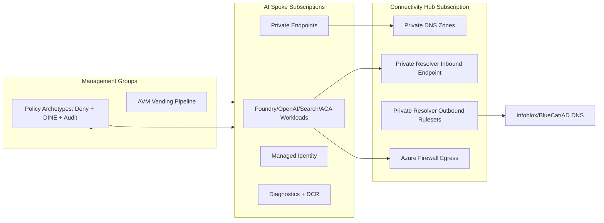
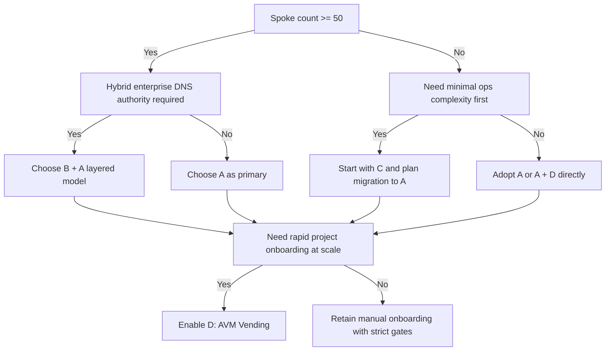

# Enterprise AI Landing Zone Private DNS Governance and Spoke Vending Selection FAQ: Hub Private Resolver + DINE vs Hybrid Infoblox Authority vs AVM Subscription Vending

> 🌐 **Language Switch**: [中文](./ai-landing-zone-private-dns-spoke-vending-dns-private-resolver-dine-policy-vs-infoblox-hybrid-vs-avm-vending-selection-faq.md) | **English (current)**
> **Audience**: Cloud & AI Solution Architects, platform network engineers, landing-zone engineering teams, enterprise DNS teams, compliance stakeholders, and SRE operations leads.
> **Scope**: Split-horizon private-link DNS governance at `50–500` AI spokes for Foundry/OpenAI/AI Search/ACA private endpoints, including architecture trade-offs, scale math, production IaC/policy snippets, multi-region failover design, and operating checklists.

## 1. Problem statement: why enterprise AI landing zones repeatedly hit `NXDOMAIN` and public fallback outages
Many organizations validate private endpoint creation but fail to validate end-to-end name-resolution determinism, which creates intermittent `NXDOMAIN`, stale-cache, or public-resolution fallback incidents at runtime.  
When Foundry, Azure OpenAI, AI Search, Cosmos DB, ACR, and ACA private endpoints are enabled together, DNS topology complexity increases rapidly and creates hidden coupling across subscriptions, spokes, and resolver paths.  
In incident reviews, transport/network policies often appear healthy while application traffic still fails due to inconsistent `privatelink.*` zone links or incorrect recursive forwarding paths.  
At `300`-spoke scale, ticket-based DNS maintenance becomes non-linear in cost and risk, especially when multiple platform teams own fragments of the naming path.  
The architecture objective is therefore not one-time correctness, but continuously enforced correctness under frequent change and horizontal expansion.  

## 2. Architecture options and control boundaries (A/B/C/D)
**Architecture A**: Central connectivity hub with `Private DNS Zones` + `Azure DNS Private Resolver` and `DeployIfNotExists` policy remediation for `privateDnsZoneGroups`.  
**Architecture B**: Hybrid enterprise DNS authority integrating Infoblox/BlueCat/AD DNS with Azure private resolver conditional forwarding for on-prem and ExpressRoute-connected estates.  
**Architecture C**: Direct hub-to-spoke virtual-network-link model using native `168.63.129.16` behavior, avoiding custom DNS override in small deployments.  
**Architecture D**: AVM `lz-vending` automation that pre-wires AI spokes with DNS/network/security/monitoring guardrails and policy archetypes in deterministic provisioning flows.  
In production, the strongest pattern is layered composition: A for consistent Azure private resolution, D for delivery standardization, B where hybrid authority is mandatory, and C as constrained transition baseline for smaller estates.  

## 3. End-to-end reference architecture: centralized private resolution plus deterministic AI spoke vending

This topology keeps DNS governance, network controls, and onboarding automation in one control plane, reducing hidden drift between infrastructure intent and runtime behavior.  
The most important design property is role separation: spoke developers consume DNS service but do not directly modify hub DNS authority resources.  

## 4. Architecture A deep dive: hub resolver plus DINE policy remediation
Architecture A centralizes recursive private resolution and removes per-spoke direct dependency on every private zone link, which materially lowers operational blast radius as spokes scale.  
Typical AI private zones include `privatelink.openai.azure.com`, `privatelink.cognitiveservices.azure.com`, `privatelink.services.ai.azure.com`, `privatelink.search.windows.net`, `privatelink.documents.azure.com`, `privatelink.azurecr.io`, and `privatelink.<region>.azurecontainerapps.io`.  
Using `DeployIfNotExists`, the platform can continuously reconcile `privateDnsZoneGroups` for new private endpoints and maintain DNS record consistency without granting broad write RBAC to spoke project teams.  
This architecture strongly improves policy-auditability and cross-team ownership boundaries while preserving deterministic private resolution paths.  
The key engineering caveat is remediation lag: policy convergence is asynchronous and must be paired with rollout-aware retries, drift dashboards, and exception tracking.  

## 5. Architecture B deep dive: hybrid enterprise DNS authority with conditional forwarding
Architecture B is required where enterprise DNS authority remains on-prem or in third-party DNS platforms and Azure must integrate rather than replace that authority chain.  
Conditional forwarding design must prevent forwarding loops between hub resolver and enterprise recursive servers, since loop conditions can rapidly saturate DNS infrastructure and degrade unrelated workloads.  
Capacity modeling cannot rely on average query volume; resolver endpoint throughput assumptions must include peak amplification during outages, cache churn, and retry storms.  
With Azure resolver endpoint guidance around `10,000 qps` per endpoint, practical designs should include active-active regional endpoints and tested failover controls in enterprise DNS policies.  
B usually introduces stronger cross-team governance requirements because DNS changes now intersect network, identity, platform, and enterprise IT operations windows.  

## 6. Architecture C deep dive: direct virtual-network-link mesh
Architecture C is attractive for smaller estates because it is simple, low-overhead, and avoids introducing new resolver resources when operational maturity is still developing.  
For `<50` spokes and limited private-zone diversity, direct linking can remain manageable and economically efficient in early stages.  
As scale grows, however, link lifecycle management, deletion hygiene, and troubleshooting complexity rise sharply and become a recurring source of operator fatigue.  
A common hidden failure mode is duplicate private DNS zone creation in spokes, which causes split-brain resolution and intermittent endpoint blackholing under cache variation.  
If C is adopted, platform policy should explicitly deny `Microsoft.Network/privateDnsZones` creation in spoke landing zones to preserve single-authority behavior.  

## 7. Architecture D deep dive: AVM-driven AI spoke subscription vending
Architecture D addresses delivery latency and consistency by turning landing-zone requirements into reproducible templates and policy-bound pipeline contracts.  
Organizations that previously needed `4–6 weeks` of ticket choreography for networking, DNS, firewall, identity, diagnostics, and budgeting can often reduce onboarding to `<12 minutes` with hardened vending modules.  
The operational gain is not just speed; it is elimination of high-variance human sequencing errors that historically produce DNS or policy drift in later phases.  
Recommended default controls include `publicNetworkAccess: Disabled`, hub DNS server settings, mandatory UDR-to-firewall paths, DCR diagnostics, budget alerts, and identity baseline tags.  
D should be viewed as the distribution mechanism that industrializes whichever resolver model (A/B/C) the enterprise selects.  

## 8. Twelve-dimension comparison matrix: scale readiness, resilience, and governance friction
| Dimension | A: Hub Resolver + DINE | B: Hybrid DNS Authority | C: Direct VNet Links | D: AVM Vending |
|---|---|---|---|---|
| Scale elasticity (`50–500` spokes) | Very high | Very high | Medium | Very high |
| Multi-region failover maturity | High | Very high | Medium | High |
| Hybrid on-prem compatibility | Medium | Very high | Low | Medium-high |
| Resolution consistency | Very high | High | Medium | Very high |
| Onboarding speed | High | Medium | Medium | Very high |
| Coordination complexity | Medium | High | Medium | Medium |
| Operating burden | Medium | High | Low | Medium |
| Automated drift remediation | High | Medium | Low | High |
| Policy-auditability | Very high | High | Medium | Very high |
| Initial build cost | Medium | High | Low | Medium |
| Long-term growth cost | Low | Medium-high | High | Low |
| Recommended role | Primary Azure private DNS backbone | Hybrid-authority mandate path | Small-estate transition baseline | Standardized enterprise delivery engine |

No single option dominates every dimension; resilient designs map architecture role to workload scale, organizational topology, and compliance posture.  

## 9. Quantitative scale and SLA mathematics: link ceilings, remediation lag, and DNS failover RTO
### 9.1 Link-management pressure
Under direct-link patterns, `300` spokes × `12` private zones implies `3,600` managed link relationships before regional duplication and lifecycle overhead are counted.  
Under centralized resolver patterns, spokes resolve through hub inbound endpoints and avoid direct per-zone linkage complexity for each spoke network.  
This shift is the primary reason large estates move from direct mesh linking to resolver-centric split-horizon governance.  

### 9.2 DINE lag versus inline deployment race conditions
Policy remediation converges asynchronously, often in minute-level windows, so release windows must account for temporary divergence immediately after endpoint creation.  
Inline `private_dns_zone_group` provisioning in Terraform/Bicep can reduce initial lag but may increase concurrency race exposure at large rollout scale.  
A practical enterprise pattern is dual protection: inline critical bindings for deterministic bootstrap and policy remediation for long-tail drift closure.  

### 9.3 Multi-region DNS failover RTO
With dual-region resolver active-active topology and health-driven conditional forwarding, DNS-plane failover RTO can typically remain within `3–8` minutes.  
Without automation and health-aware forwarding updates, equivalent incidents often extend beyond `30` minutes due to manual coordination and change propagation delay.  
The controlling variable is governance automation depth, not just resolver feature availability.  

## 10. Decision tree: scale threshold, hybrid requirement, then delivery velocity

The tree is intended to enforce explicit architecture rationale and avoid accidental design drift caused by local team convenience decisions.  

## 11. Production snippet #1: hub private resolver and forwarding rules (Bicep)
```bicep
param location string = resourceGroup().location
param hubVnetId string

resource resolver 'Microsoft.Network/dnsResolvers@2022-07-01' = {
  name: 'hub-ai-dns-resolver'
  location: location
  properties: {
    virtualNetwork: {
      id: hubVnetId
    }
  }
}

resource inbound 'Microsoft.Network/dnsResolvers/inboundEndpoints@2022-07-01' = {
  name: '${resolver.name}/inbound-east'
  location: location
  properties: {
    ipConfigurations: [
      {
        privateIpAllocationMethod: 'Dynamic'
        subnet: {
          id: '${hubVnetId}/subnets/snet-dns-inbound'
        }
      }
    ]
  }
}

resource outbound 'Microsoft.Network/dnsResolvers/outboundEndpoints@2022-07-01' = {
  name: '${resolver.name}/outbound-east'
  location: location
  properties: {
    subnet: {
      id: '${hubVnetId}/subnets/snet-dns-outbound'
    }
  }
}

resource ruleset 'Microsoft.Network/dnsForwardingRulesets@2022-07-01' = {
  name: 'hub-ai-forwarding-ruleset'
  location: location
}

resource rulePrivatelinkOpenAI 'Microsoft.Network/dnsForwardingRulesets/forwardingRules@2022-07-01' = {
  name: '${ruleset.name}/privatelink-openai'
  properties: {
    domainName: 'privatelink.openai.azure.com.'
    targetDnsServers: [
      { ipAddress: '10.20.10.4'; port: 53 }
      { ipAddress: '10.20.10.5'; port: 53 }
    ]
  }
}
```
This baseline should be paired with diagnostics and alert rules so resolver health and forwarding anomalies become first-class release gates.  

## 12. Production snippet #2: deny local private zones, DINE reconciliation, and AVM vending
```json
{
  "type": "Microsoft.Authorization/policyDefinitions",
  "name": "deny-spoke-private-dns-zone",
  "properties": {
    "displayName": "Deny Private DNS Zones in AI Spokes",
    "mode": "All",
    "policyRule": {
      "if": {
        "allOf": [
          { "field": "type", "equals": "Microsoft.Network/privateDnsZones" },
          { "field": "tags.lzRole", "equals": "ai-spoke" }
        ]
      },
      "then": { "effect": "Deny" }
    }
  }
}
```

```bicep
module aiSpoke 'br/public:avm/ptn/lz/sub-vending:1.2.0' = {
  name: 'vending-ai-spoke-001'
  params: {
    subscriptionAliasName: 'ai-spoke-001'
    connectivity: {
      hubVnetResourceId: hubVnetId
      dnsServers: [
        '10.10.0.4' // Hub resolver inbound
      ]
      routeToFirewall: true
    }
    guardrails: {
      publicNetworkAccessDisabled: true
      enableBudgetAlert: true
      enableDiagnosticSettings: true
    }
  }
}
```
Policy and vending modules should be versioned and promoted together to prevent governance drift between deployment templates and enforcement layers.  

## 13. Enterprise scenarios: regulated finance and industrial integration
### Scenario A: multinational financial group (`280` spokes, dual-region compliance)
The organization previously managed private DNS links per spoke and repeatedly experienced endpoint-resolution incidents after quarterly platform updates.  
After adopting A + B + D layering, they centralized private resolution, integrated enterprise DNS authority, and standardized spoke onboarding through vending templates.  
Operationally, critical DNS incidents dropped from monthly double-digits to low single digits and mean diagnosis time improved from `94` to `18` minutes.  
The largest governance gain was evidentiary traceability: every new spoke arrived with deterministic DNS controls and policy assignment history.  

### Scenario B: manufacturing conglomerate (`72` spokes, post-merger onboarding pressure)
The group started on C for speed, then hit scaling friction as link growth and exception handling created increasing operational overhead.  
They moved to A + D, retaining low-friction onboarding while introducing resolver-centric consistency and policy remediation controls.  
Factory AI project onboarding reduced from roughly `26` days to `4` days while preserving private access posture and policy conformance.  
Platform teams also reported fewer “works in one region but not another” DNS inconsistencies after resolver centralization.  

## 14. Three-year TCO and quantitative Q&A
### 14.1 Three-year TCO (`50/150/300` spoke profiles)
| Cost component (3-year) | A | B | C | A + D |
|---|---:|---:|---:|---:|
| DNS/network platform cost | `$0.96M` | `$1.28M` | `$0.74M` | `$1.08M` |
| Platform engineering and operations labor | `$1.12M` | `$1.46M` | `$1.38M` | `$0.92M` |
| Incident and recovery opportunity cost | `$0.72M` | `$0.63M` | `$1.34M` | `$0.49M` |
| Compliance and audit operating cost | `$0.41M` | `$0.48M` | `$0.57M` | `$0.39M` |
| Total blended three-year cost | `$3.21M` | `$3.85M` | `$4.03M` | `$2.88M` |

### 14.2 Quantitative Q&A (6)
**Q1: Can C remain the long-term model at `300` spokes?**  
It can run, but operational complexity and drift risk typically push enterprises toward A or A+B over time.  

**Q2: How should the `10,000 qps` resolver-endpoint capacity be used in planning?**  
Use peak-plus-headroom sizing, typically with `1.4x` burst tolerance and dual-region endpoint redundancy for critical estates.  

**Q3: Does DINE remediation lag block releases?**  
It can affect first-minute stability, so combine inline critical bindings with policy remediation backstop.  

**Q4: Why deny spoke-local private zone creation?**  
Because duplicate authority causes split-brain resolution behavior and intermittent endpoint failures that are expensive to diagnose.  

**Q5: Why does AVM vending materially reduce onboarding time?**  
Because it removes serial ticket choreography and delivers network, DNS, policy, monitoring, and budget controls in one pipeline transaction.  

**Q6: What keeps DNS failover in minutes instead of tens of minutes?**  
Active-active resolver design, health-driven forwarding controls, and rehearsed automation with measurable RTO outcomes.  

## 15. Day-0/Day-2 checklist, fit guidance, and anti-pattern controls
### 15.1 Day-0 checklist
- Define hub resolver topology and enforce spoke DNS server settings as non-optional landing-zone controls.  
- Standardize the private-zone inventory and govern change through versioned platform releases.  
- Inline critical zone-group bindings for high-priority endpoints and keep policy remediation for drift closure.  
- Apply deny policies for spoke-local private DNS zone creation in all AI spoke management groups.  
- Wire DNS latency/error/remediation metrics to production dashboards and release gates.  
- Attach budget and diagnostics defaults so every spoke is financially and operationally observable at creation time.  

### 15.2 Day-2 checklist
- Review DINE remediation backlog weekly and resolve persistent non-compliant resources.  
- Audit orphaned records and stale endpoint mappings weekly to avoid hidden routing ambiguity.  
- Execute monthly multi-region DNS failover drills and record measured RTO/RPO evidence.  
- Detect and auto-correct spoke DNS setting drift monthly across all active subscriptions.  
- Recalculate resolver capacity quarterly against real peak query trends and growth projections.  
- Run quarterly evidence replay checks to verify audit completeness and control traceability.  

### 15.3 Good fit vs Not for
| Decision | Guidance |
|---|---|
| ✅ Good fit | Enterprises with `50+` spokes, private AI service density, strict compliance evidence requirements, and sustained onboarding demand. |
| ⛔ Not for | Small single-region PoC estates with limited private endpoints and no immediate standardization pressure. |

### 15.4 Common anti-patterns and mitigation guidance
- Anti-pattern 1: treating DNS as a post-deployment patch topic rather than a landing-zone first-class architecture domain.  
- Anti-pattern 2: allowing spoke teams to create duplicate private zones, producing split-brain private resolution behavior.  
- Anti-pattern 3: implementing resolver configuration without regular failover rehearsal and measured recovery evidence.  
- Anti-pattern 4: optimizing only visible infrastructure cost while ignoring outage, diagnosis, and delivery-delay opportunity cost.  
- Anti-pattern 5: releasing templates and policies in separate pipelines, which introduces governance version skew and hidden drift.  

A practical enterprise operating pattern is **A as the Azure private-resolution backbone, D as the onboarding accelerator, B as hybrid-authority extension, and C as constrained transition baseline**, enabling scale without sacrificing reliability or governance evidence.  

### 15.5 Recommended SLI/SLO envelope: from observability to enforceable release gates
DNS dashboards do not reduce risk unless each metric has a predefined operating action and release consequence.  
For enterprise AI landing zones, DNS controls should be treated as deployment gates, not as passive telemetry artifacts reviewed after incidents.  

| Control domain | Suggested SLI | Suggested quarterly SLO | Triggered action |
|---|---|---|---|
| Private resolution success | Resolution success for private endpoint FQDNs | `>= 99.95%` | Freeze non-critical platform rollout |
| Resolver latency P95 | Recursive query latency at hub resolver | `<= 35ms` | Scale resolver path and inspect forwarding chain |
| DINE convergence lag | Endpoint create to zone-group convergence | `<= 10 min` | Escalate policy remediation queue |
| Cross-region DNS RTO | Primary-region loss to restored resolution | `<= 8 min` | Run failover drill and corrective actions |
| Drift recurrence ratio | Repeat drift within 7 days after remediation | `<= 0.5%` | Enforce template-policy version lock |
| Audit replay completeness | DNS control events with full replay evidence | `>= 99.9%` | Block high-risk release promotion |

These controls make DNS governance operationally actionable and prevent the common failure mode where teams detect issues but do not have a deterministic response contract.  

### 15.6 Three-phase migration model: controlled transition from C to A+D
Organizations already on C should avoid a single-step cutover and instead follow an incremental transition that limits compound-risk windows.  
Phase one builds hub resolver and policy guardrails, then validates low-risk spoke cohorts under controlled rollout.  
Phase two forces all net-new spokes through D vending templates so incremental growth is policy-consistent by default.  
Phase three migrates existing spokes in batches with explicit split-brain checks, stale-zone cleanup, and evidence capture.  

This approach prioritizes “stabilize the increment first, remediate the legacy second,” which is significantly safer than broad cutovers under mixed ownership conditions.  

### 15.7 Cross-team operating contract: platform, network, and application ownership boundaries
Platform engineering should own template and policy baselines, network engineering should own resolver and forwarding health, and application teams should consume DNS services without mutating authority layers.  
The minimum operating contract must define who changes what, who approves exceptions, who executes rollback, and how evidence is retained for audit replay.  
When ownership contracts are explicit, incident triage accelerates because each failure symptom maps to a bounded responsibility domain instead of broad cross-team speculation.  
A practical method is to version this contract in-repo and review it alongside IaC changes so procedural and technical controls evolve together.  

### 15.8 Governance consolidation pattern: bind DNS controls with AI private-access guardrails in one pipeline
In enterprise AI platforms, DNS is not an isolated networking concern; it is an entry point for private access, policy enforcement, and compliance evidence integrity.  
For this reason, DNS controls should be released together with `publicNetworkAccess: Disabled`, firewall egress baselines, identity least-privilege defaults, and diagnostics retention standards.  
This prevents two common drift classes: private networking configured while policy still allows public access, or policy hardened while DNS paths remain inconsistent.  
When organizations converge these controls in one release chain, spoke onboarding reliability improves from project-specific craftsmanship to repeatable platform behavior.  
