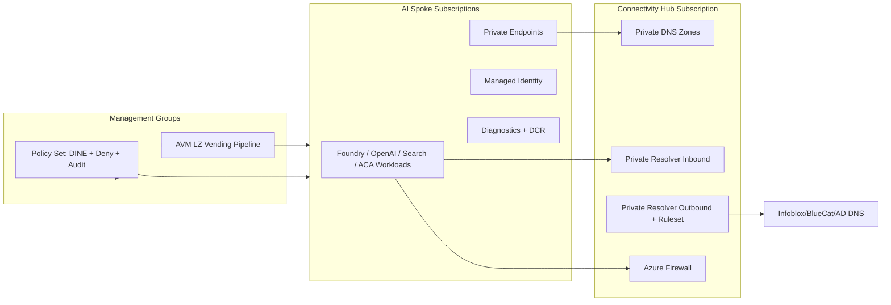
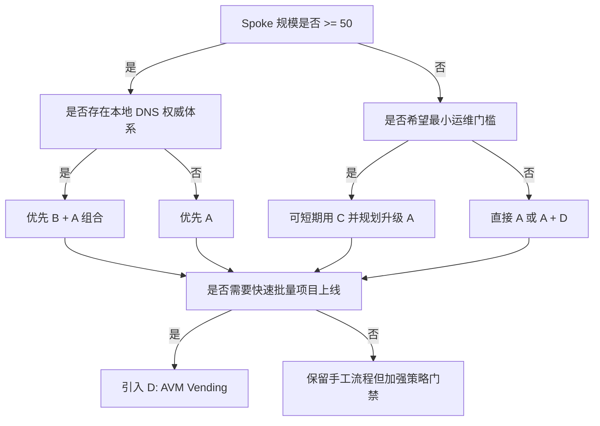

# 企业 AI Landing Zone 私网 DNS 分治与 Spoke Vending 选型 FAQ：Hub Private Resolver + DINE vs Infoblox 混合权威 vs AVM 自动化发放

> 🌐 **Language Switch**：**中文（当前）** | [English](./ai-landing-zone-private-dns-spoke-vending-dns-private-resolver-dine-policy-vs-infoblox-hybrid-vs-avm-vending-selection-faq.en.md)
> **受众**：Cloud & AI Solution Architect、平台网络团队、Landing Zone 团队、企业 DNS 团队、合规与运维治理团队。
> **范围**：围绕 Foundry/OpenAI/AI Search/ACA Private Endpoint 在 `50–500` Spoke 规模下的 DNS split-horizon 治理，比较 `Hub 私有解析中枢 + DINE`、`企业混合 DNS 权威`、`直连 VNet Link`、`AVM Spoke 订阅发放` 四种路径，并给出容量公式、生产代码、TCO 与上线清单。

## 1. 问题定义：为什么企业 AI Landing Zone 会频繁踩中 `NXDOMAIN` 与 Public Fallback
企业在 AI 落地初期通常只看“Private Endpoint 是否创建成功”，却忽略了 DNS 解析链路的完整性，最终导致请求在高峰期随机落到公网解析结果或直接 `NXDOMAIN`。  
在 Foundry、Azure OpenAI、AI Search、Cosmos、ACR、ACA 同时启用私网访问后，私有区域数量与解析链路复杂度会显著提升，任何一个 Spoke 的自定义 DNS 配置漂移都可能引发跨业务连锁故障。  
真实事故中最常见的模式是：应用层看到 TLS 握手失败或目标 IP 错误，网络层看到路由和 NSG 都正常，最后定位到是 `privatelink.*` 区域链接不一致。  
当组织规模达到 `300` Spoke 级别时，手工补链路和逐个工单修复已经不可持续，必须把 DNS 与订阅发放治理纳入 Landing Zone 主流程。  
因此本指南关注的核心不是“单次配置是否正确”，而是“在持续变化下能否保持持续正确”。  

## 2. 四种架构路径与责任边界（A/B/C/D）
**Architecture A**：中心 Hub 承载 `Private DNS Zones + Azure DNS Private Resolver`，Spoke 统一指向 Resolver Inbound IP，配合 `DeployIfNotExists` 自动绑定 `privateDnsZoneGroups`。  
**Architecture B**：企业混合权威模型，Infoblox/BlueCat/AD DNS 与 Azure Private Resolver 条件转发互联，覆盖 ExpressRoute 与本地机房主权域名解析。  
**Architecture C**：Hub 直接与 Spoke 做 `Private DNS Zone Virtual Network Link`，利用 `168.63.129.16` 默认解析路径，不引入额外自定义 DNS。  
**Architecture D**：以 AVM `lz-vending` 为核心的订阅自动发放，将网络、DNS、策略、预算、监控、身份与 `publicNetworkAccess: Disabled` 防护一次性固化。  
在企业实践里，A 负责“解析一致性控制面”，D 负责“交付速度与标准化复制”，B/C 则根据组织混合度和规模做补位。  

## 3. 端到端参考架构：Hub 解析中枢 + AI Spoke 自动发放

这个架构把“网络连通、DNS 可解、策略可审计、资源可回收”放进同一治理闭环，避免每次新项目上线都重新发明流程。  
关键点是 Spoke 不再直接维护 Hub DNS 资源，减少了跨团队 RBAC 冲突和误操作概率。  

## 4. Architecture A：Hub Private Resolver + DINE 自动修复主路径
A 模式核心价值在于把 `N` 个 Spoke 的解析入口收敛为统一 Resolver，同时把 `privateDnsZoneGroups` 的声明与修复交给策略引擎。  
当 Spoke 数量从 `50` 增长到 `300` 时，传统“每个 Spoke 都链接全部私有区域”的方式会触发区域链接治理爆炸，而 Resolver 汇聚模式可以显著降低链接管理复杂度。  
企业常见的 `12+` AI 私有区域包括：`privatelink.openai.azure.com`、`privatelink.cognitiveservices.azure.com`、`privatelink.services.ai.azure.com`、`privatelink.search.windows.net`、`privatelink.documents.azure.com`、`privatelink.azurecr.io`、`privatelink.<region>.azurecontainerapps.io` 等。  
配合 DINE，平台可在 Endpoint 创建后自动补齐 zone group 绑定，并在 Endpoint 删除后通过回收流程清理过期记录，避免“僵尸 A 记录”导致流量误导。  
A 的风险在于策略修复存在传播时间差，因此运行面必须有“修复窗口告警”和“关键流量重试策略”。  

## 5. Architecture B：Infoblox/BlueCat/AD DNS 混合权威与条件转发
B 模式适用于已有成熟企业 DNS 体系且必须保持本地权威域名控制的组织，尤其是多园区、跨国家、合规边界严格的金融与制造企业。  
设计重点是条件转发方向要单向可验证，避免 Hub Resolver 与本地 DNS 互相转发形成环路，导致查询风暴和延迟雪崩。  
在容量上，Private Resolver 单端点 `10,000 qps` 的官方上限意味着峰值设计不能只看平均值，必须按高峰时段放大系数做冗余。  
跨区域容灾建议采用双 Hub Resolver active-active，并在企业 DNS 平面基于站点健康探针切换转发目标，以把 DNS 故障 RTO 压缩到分钟级。  
B 的最大挑战不是技术可行性，而是跨团队变更协调，需要把网络、DNS、平台与安全变更窗口统一治理。  

## 6. Architecture C：Hub-Spoke VNet Link 直连模型的优势与上限
C 模式在 `<50` Spoke 场景中实现简单、成本低、学习曲线平缓，且不需要额外引入 Resolver 端点与条件转发治理。  
但随着 Spoke 扩张，`Private DNS Zone` 的链接数量与生命周期管理会迅速复杂化，出现“新增慢、回收慢、误链接难排查”的运维瓶颈。  
更隐蔽的问题是开发团队可能在 Spoke 内私建同名 Private DNS Zone，形成 split-brain 解析，表面连通、实际随机失败。  
因此若采用 C，应在 Spoke 管理组上设置 `Deny`：禁止创建 `Microsoft.Network/privateDnsZones`，并把例外流程收敛到平台审批通道。  
当组织明确会走向多区域与混合 DNS，C 适合作为过渡，而不是终局。  

## 7. Architecture D：AVM `lz-vending` 订阅发放把上线周期压缩到 `<12` 分钟
D 模式的价值是把“网络/DNS/安全/监控/预算”从手工工单流程变成可重复、可审计的模板化交付。  
典型手工流程需要 `4–6` 周跨团队排期，而 AVM 模板化后可在 `<12` 分钟内发放预接线 Spoke，并立即具备私网连通、日志采集、预算告警和身份基线。  
关键实施点包括：默认 `publicNetworkAccess: Disabled`、默认 UDR 指向 Firewall、默认诊断与 DCR、默认策略分配、默认标签与成本归属。  
D 不是替代 A/B/C 的网络解析模型，而是把这些模型固定为“交付即合规”的平台能力。  
如果企业希望把“新项目上线成功率”从人治提升到机制保证，D 是放大器。  

## 8. 12 维对比矩阵：规模、可靠性、治理与组织复杂度
| 维度 | A：Hub Resolver + DINE | B：混合权威 DNS | C：VNet Link 直连 | D：AVM Vending |
|---|---|---|---|---|
| 规模上限适配 | 很高 | 很高 | 中 | 很高 |
| 多区域容灾能力 | 高 | 很高 | 中 | 高 |
| 混合本地集成能力 | 中 | 很高 | 低 | 中高 |
| 解析一致性可控性 | 很高 | 高 | 中 | 很高 |
| 上线速度 | 高 | 中 | 中 | 很高 |
| 组织协同复杂度 | 中 | 高 | 中 | 中 |
| 运维门槛 | 中 | 高 | 低 | 中 |
| 自动修复能力 | 高 | 中 | 低 | 高 |
| 策略治理可审计性 | 很高 | 高 | 中 | 很高 |
| 初期建设成本 | 中 | 高 | 低 | 中 |
| 长期扩展成本 | 低 | 中高 | 高 | 低 |
| 推荐定位 | 企业主干解析路径 | 混合 DNS 必选路径 | 小规模过渡路径 | 标准化交付底座 |

矩阵结论并不是“某一项绝对最好”，而是“在组织目标和规模约束下做分层组合”。  

## 9. 定量规模与 SLA 数学：链接上限、修复窗口与故障恢复
### 9.1 链接上限对比
若采用 C 模式，`300` Spoke × `12` 私有区域 = `3,600` 条链接关系，需要持续运维与回收。  
若采用 A 模式，Spoke 侧只需指向 Hub Resolver，不再对每个区域建立等量链接，治理面复杂度显著下降。  
这正是大规模场景里“从网格链接转为解析中枢”的关键收益。  

### 9.2 DINE 修复窗口与竞态
策略修复并非瞬时，常见在分钟级到十几分钟，期间若应用刚发布可能遇到短时解析失败。  
而 Terraform/Bicep 内联 `private_dns_zone_group` 虽即时，但在并发大规模发放时更容易触发顺序竞态与失败重试风暴。  
推荐做法是“关键资源内联 + 策略兜底修复”双层机制，而不是二选一。  

### 9.3 多区域解析容灾 RTO
在双 Hub Resolver active-active 且企业 DNS 支持健康切换的设计下，DNS 平面故障 RTO 可压到 `3–8` 分钟。  
若无自动切换，仅靠人工改转发目标，RTO 往往拉长到 `30` 分钟以上。  
因此 DNS 故障恢复速度主要取决于自动化程度而非单点技术能力。  

## 10. 选型决策树：按规模、混合度与组织能力做分层

该树体现的不是技术偏好，而是“规模拐点 + 组织边界 + 自动化能力”三要素的联合判断。  

## 11. 生产代码片段一：Hub Private Resolver 与规则集 Bicep
```bicep
param location string = resourceGroup().location
param hubVnetId string

resource resolver 'Microsoft.Network/dnsResolvers@2022-07-01' = {
  name: 'hub-ai-dns-resolver'
  location: location
  properties: {
    virtualNetwork: {
      id: hubVnetId
    }
  }
}

resource inbound 'Microsoft.Network/dnsResolvers/inboundEndpoints@2022-07-01' = {
  name: '${resolver.name}/inbound-east'
  location: location
  properties: {
    ipConfigurations: [
      {
        privateIpAllocationMethod: 'Dynamic'
        subnet: {
          id: '${hubVnetId}/subnets/snet-dns-inbound'
        }
      }
    ]
  }
}

resource ruleset 'Microsoft.Network/dnsForwardingRulesets@2022-07-01' = {
  name: 'hub-ai-forwarding-ruleset'
  location: location
}

resource ruleOpenAI 'Microsoft.Network/dnsForwardingRulesets/forwardingRules@2022-07-01' = {
  name: '${ruleset.name}/privatelink-openai'
  properties: {
    domainName: 'privatelink.openai.azure.com.'
    targetDnsServers: [
      { ipAddress: '10.20.10.4'; port: 53 }
      { ipAddress: '10.20.10.5'; port: 53 }
    ]
  }
}
```
该模板展示了 Resolver、Inbound Endpoint 与规则集的最小可行骨架，生产中应配合可观测与告警模板一起发布。  

## 12. 生产代码片段二：Deny Spoke 私建 DNS + DINE zone group + AVM 发放
```json
{
  "type": "Microsoft.Authorization/policyDefinitions",
  "name": "deny-spoke-private-dns-zone",
  "properties": {
    "displayName": "Deny Private DNS Zones in AI Spokes",
    "mode": "All",
    "policyRule": {
      "if": {
        "allOf": [
          { "field": "type", "equals": "Microsoft.Network/privateDnsZones" },
          { "field": "tags.lzRole", "equals": "ai-spoke" }
        ]
      },
      "then": { "effect": "Deny" }
    }
  }
}
```

```bicep
module aiSpoke 'br/public:avm/ptn/lz/sub-vending:1.2.0' = {
  name: 'vending-ai-spoke-001'
  params: {
    subscriptionAliasName: 'ai-spoke-001'
    connectivity: {
      hubVnetResourceId: hubVnetId
      dnsServers: [
        '10.10.0.4' // Hub Resolver Inbound
      ]
      routeToFirewall: true
    }
    guardrails: {
      publicNetworkAccessDisabled: true
      enableBudgetAlert: true
      enableDiagnosticSettings: true
    }
  }
}
```
策略与模板必须版本化并纳入同一发布流水线，才能避免“模板升级而策略滞后”造成的治理裂缝。  

## 13. 企业场景：金融集团与制造集团的两类落地路径
### 场景一：跨国金融集团（`280` Spoke，双区域监管）
该客户原先在各 Spoke 各自维护私有 DNS 链接，季度变更后频繁出现 `NXDOMAIN` 与错误私网 IP 缓存，影响交易监控与风控批处理。  
改造后采用 A + B + D 组合：Hub Resolver 统一入口、混合权威接本地 AD DNS、AVM 实现新项目标准化发放。  
上线后 DNS 相关高优告警从月均 `19` 起降至 `2` 起，平均故障定位时间从 `94` 分钟降至 `18` 分钟。  

### 场景二：制造集团（`72` Spoke，快速并购整合）
该客户并购后需要快速接入多个工厂系统，初始采用 C 模式快速落地，但随着 Spoke 增长开始出现链接维护瓶颈。  
二阶段升级到 A + D 后，把工厂接入从“网络+安全+DNS 多工单串行”改为“一次发放即具备基线”，  
新工厂 AI 项目上线周期从平均 `26` 天压缩到 `4` 天，且审计抽检不再出现“私网解析路径缺证据”的问题。  

## 14. 三年 TCO 与定量 Q&A（6 项）
### 14.1 三年 TCO（`50/150/300` Spoke）
| 成本项（3 年） | A | B | C | A + D |
|---|---:|---:|---:|---:|
| DNS/网络平台成本 | `$0.96M` | `$1.28M` | `$0.74M` | `$1.08M` |
| 平台工程与运维人力 | `$1.12M` | `$1.46M` | `$1.38M` | `$0.92M` |
| 故障停机与恢复机会成本 | `$0.72M` | `$0.63M` | `$1.34M` | `$0.49M` |
| 合规与审计治理成本 | `$0.41M` | `$0.48M` | `$0.57M` | `$0.39M` |
| 三年综合成本 | `$3.21M` | `$3.85M` | `$4.03M` | `$2.88M` |

### 14.2 定量 Q&A
**Q1：`300` Spoke 下是否还能用 C 模式长期运行？**  
可以运行但治理成本会快速上升，长期建议迁移到 A 或 A+B。  

**Q2：Resolver `10,000 qps` 上限如何规划冗余？**  
建议按峰值 `qps * 1.4` 做容量设计，并为关键区域配置双端点与跨区切换。  

**Q3：DINE 修复慢会不会影响上线窗口？**  
会影响首批请求稳定性，建议关键 Endpoint 在 IaC 内联绑定，策略做兜底修复。  

**Q4：为什么要禁止 Spoke 私建 Private DNS Zone？**  
因为同名区会触发 split-brain，导致解析结果随机化并显著增加排障复杂度。  

**Q5：AVM 发放为什么能显著缩短周期？**  
因为把网络、DNS、策略、预算、监控和身份一次性交付，消除了跨团队串行等待。  

**Q6：多区域 DNS 故障恢复如何控制在分钟级？**  
需要双 Resolver + 企业 DNS 健康切换 + 标准化演练，而不是依赖人工切换。  

## 15. Day-0/Day-2 清单、Good fit 与反模式
### 15.1 Day-0 上线清单
- 明确 Hub Resolver 拓扑与 Spoke DNS 指向策略，禁止随意自定义。  
- 固化私有区域清单与命名规范，建立版本化变更流程。  
- 为关键 Endpoint 配置内联 zone group，策略做兜底修复。  
- 在 Spoke 管理组启用 `Deny` 私建 Private DNS Zone。  
- 打通 DNS 查询延迟、失败率、规则命中率、修复延迟看板。  
- 建立预算与告警策略，确保新增 Spoke 成本可追踪。  

### 15.2 Day-2 运营清单
- 每周巡检 DINE 修复积压与失败项，防止长期未收敛。  
- 每周审查过期 A 记录与孤儿 Endpoint，执行回收清理。  
- 每月进行跨区 DNS 故障演练并记录 RTO/RPO 结果。  
- 每月复核 Spoke DNS 偏离配置并自动修正。  
- 每季度复核 Resolver 容量与峰值趋势，更新扩容策略。  
- 每季度做一次端到端审计回放，验证证据完整性。  

### 15.3 Good fit vs Not for
| 结论 | 说明 |
|---|---|
| ✅ Good fit | `50+` Spoke、多区域、私网 AI 服务密集、合规要求高的企业 Landing Zone。 |
| ⛔ Not for | 单区域小规模、无混合 DNS、短期 PoC 且无标准化发放需求的团队。 |

### 15.4 常见反模式与规避建议
- 反模式一：把 DNS 当成部署后补丁项，而非 Landing Zone 一等公民。  
- 反模式二：允许 Spoke 团队自行创建同名私有区，触发 split-brain。  
- 反模式三：只配置规则不做演练，灾难时无法验证切换路径。  
- 反模式四：只关注初期成本，不计入故障与排障机会成本。  
- 反模式五：模板与策略分离发布，造成治理版本漂移。  

最终建议是采用“**A 作为解析主干 + D 作为交付加速器 + B 作为混合权威补位 + C 作为小规模过渡**”的分层策略，  
让企业在规模扩张时保持解析一致性、交付效率和审计可解释性三者同步提升。  

### 15.5 SLI/SLO 建议：把 DNS 治理从“可观测”升级为“可门禁”
很多团队已经有 DNS 看板，但仍然频发故障，根因在于指标没有绑定动作。  
建议把以下指标纳入发布门禁与扩容门禁，而不是仅做事后复盘参考。  

| 控制面 | 建议 SLI | 建议季度 SLO | 触发动作 |
|---|---|---|---|
| 私网解析成功率 | Private Endpoint 目标域名解析成功率 | `>= 99.95%` | 低于阈值时冻结非关键发布 |
| Resolver 查询时延 P95 | Hub Resolver 递归查询时延 | `<= 35ms` | 自动扩容并复核转发链路 |
| DINE 修复完成时延 | Endpoint 创建到 zone group 收敛时间 | `<= 10 min` | 超阈值触发策略队列排障 |
| 跨区切换 RTO | 主区失效到备区解析恢复 | `<= 8 min` | 超阈值执行切换剧本复盘 |
| 漂移回归率 | 修复后 7 天内再次漂移比例 | `<= 0.5%` | 强制模板与策略版本锁定 |
| 审计证据完整率 | 关键解析事件可回放比例 | `>= 99.9%` | 阻断高风险变更发布 |

这些阈值的价值在于把“DNS 运维告警”转成“业务可决策约束”。  
只有当指标与动作绑定，平台团队才能在高峰窗口避免“发现问题但无人决策”的治理真空。  

### 15.6 三阶段迁移路径：从 C 过渡到 A+D 的低风险路线
对于已经在 C 模式运行的企业，不建议一次性切换全部 Spoke，可按三阶段迁移。  
第一阶段先建设 Hub Resolver 与策略框架，并挑选低风险 Spoke 做灰度。  
第二阶段把新建项目全部切到 D 发放模板，确保“增量即标准”。  
第三阶段再把存量 Spoke 分批迁移，并对历史私有区做冲突清理与证据留档。  

这种渐进路线的重点是“先控制增量、再治理存量”，避免迁移期间新旧问题叠加。  
若企业直接全量切换，常见后果是变更窗口拉长、跨团队回滚困难、故障窗口扩大。  

### 15.7 跨组织协作模型：平台、网络、应用三方最小接口契约
平台团队负责 Landing Zone 模板与策略版本，网络团队负责 Resolver 与条件转发健康，应用团队负责仅消费标准 DNS 服务而非改写底层配置。  
这三方需要在接口上签署最小契约，明确“谁能改、谁审批、谁回滚、谁留证据”。  
当接口契约清晰后，故障定位路径会显著缩短，因为每个异常都有明确责任域而非“多团队猜测”。  
建议把契约内容写入仓库并和 IaC 一起评审，使流程规则与技术实现保持同源。  

### 15.8 治理收口建议：把 DNS 与 AI 安全基线绑定成一条流水线
在企业 AI 平台中，DNS 不是孤立组件，而是私网访问、身份控制、出网审计和数据合规的入口。  
因此建议把 DNS 基线和 `publicNetworkAccess: Disabled`、Firewall 出口、身份最小权限、日志留存策略放在同一流水线。  
这样可以避免“网络已私有化但策略仍放行公网”的错配，也能避免“策略合规但解析失效”的隐性中断。  
当组织把这条流水线固化后，新增 Spoke 的失败概率会从“依赖项目经验”转为“依赖平台能力”，这正是 Landing Zone 成熟度升级的标志。  

### 15.9 运营周会模板：把技术异常翻译成管理层可决策语句
很多企业周会上会展示大量 DNS 图表，但管理层仍无法判断“该不该投入扩容预算、该不该冻结发布节奏”。  
建议平台团队把核心异常翻译成可执行语句，例如“本周跨区切换 RTO 超阈值两次，若不扩容 Resolver 端点，下周高峰有 `x%` 概率触发客户侧超时”。  
这种表达方式比单纯展示延迟曲线更容易驱动跨团队行动，也更符合企业治理节奏。  

| 周会输入 | 管理层关注问题 | 建议输出动作 |
|---|---|---|
| 解析失败率上升 | 是否影响核心业务连续性 | 冻结非关键发布并优先修复链路 |
| DINE 积压增加 | 是否意味着配置治理失效 | 增加策略处理并发并清理失败队列 |
| 跨区切换演练超时 | 灾难窗口是否可接受 | 调整切换策略并追加演练频次 |
| 成本偏差扩大 | 预算是否仍可控 | 复核 Spoke 分层与保留容量策略 |

当技术数据被翻译成决策语言后，平台治理就不再是“技术团队自转”，而是组织级协同。  
这也是将 DNS 从“基础设施细节”升级为“业务可持续能力”的关键。  

### 15.10 发布前硬门禁建议（最小可执行集）
在高频迭代环境中，建议设置四个发布前硬门禁：  
第一，关键 `privatelink.*` 域名在主备区域均可解析；  
第二，新增 Endpoint 的 zone group 在阈值时间内完成收敛；  
第三，Spoke 不存在未授权私有区或 DNS 服务器漂移；  
第四，审计事件字段完整并可回放。  

若任一门禁不满足，应自动阻断高风险变更，而不是依赖人工口头确认。  
该机制对研发团队看似“增加约束”，实则显著降低线上故障返工和跨团队扯皮成本。  
长期看，门禁的真正价值不在于拦住一次错误，而在于形成“所有人都知道标准且默认遵循标准”的平台文化。  
当企业把这类门禁纳入季度治理考核后，DNS 稳定性通常会在两个发布周期内出现可观提升。  
另外，建议把“门禁失败复盘”模板化，要求每次失败都输出根因分类、改进项优先级、责任人与预计完成时间。  
当复盘机制稳定执行后，团队会从“重复踩坑”转向“可积累的组织学习”，这对大规模 Landing Zone 长期运行尤为关键。  
只有当问题被持续结构化记录并回灌模板，平台标准才会真正进化，而不是停留在一次性修复。  
这也是企业从“项目交付”走向“平台经营”的关键分界点。  
并能在规模继续扩大时保持治理韧性。  
并提升组织协同效率。  
