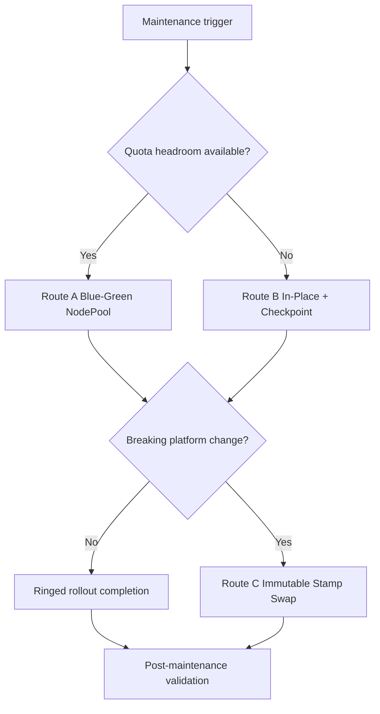
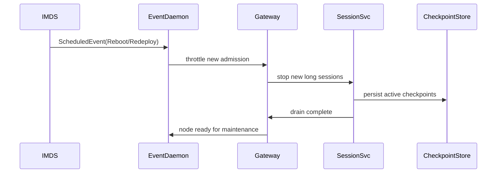

# AI Landing Zone Zero-Disruption Node Maintenance FAQ: Fleet Update Runs vs Blue-Green NodePools vs Stamp Swap

> **Audience**: Cloud & AI Solution Architects, platform SRE leads, regulated enterprise infrastructure teams, and multi-region operations owners.
> **Decision scope**: How to run Kubernetes minor upgrades, weekly node-image patching, and unplanned host events without breaking long-running agent sessions.
> **Target outcome**: Zero-disruption maintenance for stateful and quota-constrained AI clusters under strict SLO and compliance windows.

---

## 1. Executive summary

Day-2 platform maintenance is now a first-class AI architecture problem.
In agent-heavy workloads, maintenance events can interrupt:

- 15-45 minute in-flight voice/WebSocket sessions,
- durable tool chains with checkpoint dependencies,
- scarce GPU-serving lanes with tight quota limits.

Primary failure modes observed in production:

- quota exhaustion when surge capacity doubles temporarily,
- `PodDisruptionBudget` deadlocks during drain,
- forced termination when grace windows are shorter than agent turn duration,
- simultaneous region upgrades reducing BCDR margin.

Recommended strategy:

1. Use **Route A** when quota allows blue-green pools and staged fleet orchestration.
2. Use **Route B** for quota-constrained in-place maintenance with strict checkpoint gating.
3. Use **Route C** for major platform-breaking upgrades (CNI/mesh/CRD) with full immutable stamp cutover.
4. Use **Route D** selectively for serverless control-plane offload, and avoid uncoordinated auto-upgrades.

---

## 2. Problem boundary and assumptions

### 2.1 Maintenance events covered

- Kubernetes minor version upgrades,
- weekly node OS image security patching,
- unplanned Azure host scheduled events (`Freeze`, `Reboot`, `Redeploy`).

### 2.2 Workload characteristics

- stateful conversational agents,
- long-running voice and tool sessions,
- mixed CPU + scarce GPU clusters,
- paired-region BCDR requirements.

### 2.3 Non-goals

- deep low-level runtime internals,
- single-node lab clusters without SLA,
- non-production ad-hoc upgrade procedures.

---

## 3. Route definitions

### Route A — Fleet multi-stage update runs + blue-green nodepool

Core pattern:

- create target nodepool ahead of cutover,
- pre-warm model caches and sidecars,
- run `Canary -> Stage -> Prod` gates by region ring,
- shift selectors and cordon old pool in controlled batches.

Strength:

- low risk rollback (old pool can be uncordoned quickly),
- stronger guardrail before global rollout.

Trade-off:

- requires additional temporary capacity and quota headroom.

### Route B — Quota-constrained in-place surge/drain-first with scheduled-event preemption

Core pattern:

- minimal surge (`maxSurge=0` or bounded +1 spare node),
- strict maintenance windows,
- IMDS scheduled-event signal triggers preemptive checkpointing,
- APIM overflow to external managed inference during drain.

Strength:

- works under hard quota ceilings.

Trade-off:

- longer maintenance window and tighter orchestration discipline.

### Route C — Immutable deployment-stamp blue-green cutover

Core pattern:

- treat entire regional cluster as immutable stamp,
- shift new session admission to Stamp B,
- let Stamp A drain long-tail sessions to zero,
- decommission only after full completion.

Strength:

- safest path for breaking upgrades (CNI/mesh/CRD chain changes).

Trade-off:

- highest temporary platform footprint and operational choreography.

### Route D — Managed serverless control-plane offload / anti-pattern contrast

Core pattern:

- move part of maintenance burden to managed serverless compute for eligible workloads.

Anti-pattern to avoid:

- simultaneous cross-region auto-upgrade without gate control,
- PDB `minAvailable=100%` deadlocks,
- grace period shorter than real session duration.

---

## 4. Twelve-dimension comparison matrix

| Dimension | Route A | Route B | Route C | Route D |
|---|---|---|---|---|
| 1. Upgrade safety for long sessions | High | Medium-high | Very high | Medium |
| 2. Quota friendliness | Medium | Very high | Low-medium | High |
| 3. Rollback speed | High | Medium | High | Medium |
| 4. Breaking-change resilience | Medium | Medium | Very high | Medium |
| 5. BCDR region-pair control | High | High | Very high | Medium |
| 6. Implementation complexity | Medium | Medium-high | High | Medium |
| 7. Temporary capacity requirement | Medium-high | Low | High | Low-medium |
| 8. Session drain controllability | High | High | Very high | Medium |
| 9. PDB deadlock risk | Low | Medium | Low | Medium |
| 10. Compliance audit traceability | High | High | High | Medium |
| 11. Cost efficiency under quota caps | Medium | High | Medium-low | High |
| 12. Operational predictability | High | Medium-high | High | Medium |

---

## 5. Benchmark protocol and data labels

### 5.1 Replay setup

- 6 regional stamps, paired BCDR topology,
- mixed CPU + ND H100 v5 quota-constrained pools,
- 15-45 minute session-duration distribution,
- standardized synthetic maintenance windows.

### 5.2 Primary metrics

- maintenance wall-clock,
- session interruption rate,
- forced termination count,
- quota-overrun events,
- recovery time and rollback time,
- cost impact per maintenance cycle.

### 5.3 Data labels

- **measured**: validated replay/simulator measurements.
- **synthetic**: explicit projection from measured assumptions.
- **anonymized_reported**: de-identified operational patterns.

---

## 6. Q1 — Upgrade wall-clock and surge quota equation

Let:

- `N` = total nodes,
- `T_warm` = model cache warmup time per batch,
- `T_drain` = session drain time per batch,
- `B` = batch size by policy.

Blue-green route approximation:

`T_bg ~= T_pool_create + T_warm + T_shift + T_verify + T_pool_retire`

In-place route approximation:

`T_ip ~= ceil(N/B) * (T_drain + T_replace + T_warm + T_verify_batch)`

Insight:

- blue-green typically shortens user-visible disruption but needs more temporary capacity;
- in-place usually fits quota ceilings with longer execution windows.

---

## 7. Q2 — Preventing PDB deadlocks and forced SIGKILL

Common deadlock trigger:

- `minAvailable=100%` with no burst headroom and long session drains.

Control actions:

1. set realistic PDB for maintenance mode,
2. align termination grace to max expected turn duration,
3. pre-stop hook triggers session checkpoint before final drain,
4. block new long sessions during maintenance window.

Result:

- significantly reduces forced terminations and stuck drains.

---

## 8. Q3 — Using Scheduled Events to preemptively checkpoint sessions

Signal source:

- IMDS Scheduled Events with advance notice.

Pipeline:

1. event daemon receives event (`Reboot`/`Redeploy`),
2. gateway enters admission throttle for affected node set,
3. active sessions checkpoint durable state,
4. drain completes with minimized user impact.

---

## 9. Q4 — Fleet Manager stage ordering and metric-gated halt

Recommended order:

`Canary -> Stage Region Pair A -> Stage Region Pair B -> Prod Pair A -> Prod Pair B`

Gate policy:

- halt progression when SLO breach exceeds threshold,
- never upgrade both BCDR paired regions concurrently,
- require soak completion before moving to next ring.

---

## 10. Q5 — Temporary overflow to Foundry/PTU during maxSurge=0 maintenance

Pattern:

- while GPU node drains, APIM routes overflow inference to managed external capacity.

Benefits:

- protects user-facing latency while local pool is reduced.

Constraints:

- requires routing policy guardrails and cost controls.

---

## 11. Q6 — Choosing blue-green nodepool vs full immutable stamp swap

Guideline:

- choose blue-green nodepool for routine K8s/node-image upgrades.
- choose immutable stamp swap for major compatibility boundaries (networking, mesh, CRD ecosystems).

Decision factors:

- blast radius tolerance,
- rollback speed requirement,
- available temporary capacity,
- compliance evidence requirements.

---

## 12. Mermaid — Maintenance decision flow



---

## 13. Mermaid — Scheduled-event preemption and session drain



---

## 14. Production config block 1 — Fleet update strategy sketch

```yaml
apiVersion: fleet.azure.com/v1
kind: UpdateRun
metadata:
  name: ai-agent-weekly-maintenance
spec:
  strategy:
    stages:
      - name: canary
        maxParallel: 1
      - name: stage
        maxParallel: 1
      - name: prod
        maxParallel: 1
  gates:
    p95LatencyMs: 2200
    errorRatePct: 1.0
    sessionDropPct: 0.1
```

---

## 15. Production config block 2 — Maintenance window and drain policy

```yaml
apiVersion: aks.azure.com/v1
kind: MaintenanceConfiguration
metadata:
  name: weekly-security-image-window
spec:
  dayOfWeek: Sunday
  startHourUtc: 01
  durationHours: 4
  upgradePolicy:
    maxSurge: "1"
    maxUnavailable: "0"
```

---

## 16. Production code block 3 — IMDS scheduled-event checkpoint hook

```python
import asyncio

async def scheduled_event_watcher(imds_client, gateway, checkpoint):
    while True:
        evt = await imds_client.next_event()
        if evt.type in {"Reboot", "Redeploy", "Freeze"}:
            await gateway.pause_new_admission(scope=evt.node_scope)
            await checkpoint.flush_active_sessions(scope=evt.node_scope)
            await gateway.mark_ready_for_drain(scope=evt.node_scope)
        await asyncio.sleep(1)
```

---

## 17. Enterprise scenario A — Global retail bank voice/advisory agents

Context:

- 24x7 voice and wealth-advisory assistants,
- 6 regional AKS stamps,
- `99.99%` availability objective.

Recommended path:

- Route A for routine controlled upgrades,
- Route C for major platform shifts,
- Route B fallback where quota is constrained.

---

## 18. Enterprise scenario B — Quota-capped ND H100 v5 platform

Context:

- monthly security-image compliance,
- CVE remediation within 7-day policy window,
- strict GPU quota limits.

Recommended path:

- Route B as primary maintenance mode,
- APIM overflow to managed external inference during drain,
- Route A used only when temporary quota can be approved.

---

## 19. Three-year TCO comparison

Assumptions:

- 52 planned maintenance cycles/year,
- 6 regions with paired BCDR topology,
- mixed CPU/GPU fleet.

| Cost component (3-year) | Route A | Route B | Route C | Route D |
|---|---:|---:|---:|---:|
| Platform maintenance execution | $5.1M | $4.4M | $6.2M | $3.6M |
| Temporary overflow capacity | $1.7M | $2.1M | $1.5M | $2.4M |
| Incident and disruption cost | $0.9M | $1.2M | $0.7M | $4.8M |
| Compliance and audit burden | $0.8M | $0.9M | $1.0M | $2.2M |
| **Total** | **$8.5M** | **$8.6M** | **$9.4M** | **$13.0M** |

Interpretation:

- Route A and B are close in cost with different quota assumptions.
- Route C carries higher controlled cost but strongest break-change resilience.
- Route D appears cheap upfront but expensive under outage and compliance penalties.

---

## 20. Day-0 / Day-1 / Day-2 checklist

### Day-0

- classify workloads by session duration and disruption tolerance,
- define route eligibility matrix (A/B/C/D),
- define BCDR ring policy and non-simultaneous region constraints,
- define checkpoint SLO and drain timeout policy.

### Day-1

- enable fleet stage gates and rollback criteria,
- deploy scheduled-event daemon and admission throttle controls,
- validate PDB and grace-period policy under replay,
- run canary maintenance rehearsal.

### Day-2

- tune ring progression thresholds from observed SLO behavior,
- enforce monthly resilience drills and evidence collection,
- optimize overflow routing and maintenance economics,
- finalize regulator-facing maintenance and rollback runbook.

---

## 21. Good fit vs Not for

| Route | Good fit | Not for |
|---|---|---|
| A | Controlled upgrades with available temporary quota | Hard quota environments with no burst headroom |
| B | Quota-constrained GPU maintenance | Teams lacking strict checkpoint and drain governance |
| C | Major breaking changes and strict risk containment | Small environments without stamp-level operations maturity |
| D | Selective serverless offload for eligible workloads | Uncoordinated region-wide auto-upgrade strategy |

---

## 22. Minimum observability fields

- `maintenance_run_id`
- `region_ring`
- `nodepool_before_after`
- `session_admission_paused`
- `checkpoint_flush_latency_ms`
- `drain_completion_ms`
- `forced_termination_count`
- `pdb_blocked_count`
- `quota_overrun_count`
- `rollback_triggered`

---

## 23. Anti-patterns to avoid

- simultaneous upgrades in paired BCDR regions,
- maintenance windows without admission control,
- static PDB set to impossible drain policy,
- grace period shorter than realistic session duration,
- upgrade without checkpoint path validation.

---

## 24. Risk register

| Risk | Trigger | Control | Residual |
|---|---|---|---|
| Quota exhaustion | temporary surge over ceiling | Route B mode + overflow routing | Medium-low |
| Session truncation | premature termination | checkpoint + grace alignment | Low |
| Region-pair blast radius | concurrent upgrades | ring gates + pair lock | Low |
| Upgrade deadlock | strict PDB + no headroom | maintenance-mode PDB policy | Medium-low |
| Compliance miss | delayed patch rollout | staged policy with audit evidence | Low |

---

## 25. Twelve-week rollout plan

Weeks 1-2:

- baseline maintenance telemetry and failure taxonomy.

Weeks 3-4:

- implement Route A ring gates and canary runbook.

Weeks 5-6:

- implement Route B scheduled-event checkpoint orchestration.

Weeks 7-8:

- pilot Route C immutable stamp cutover for one region pair.

Weeks 9-10:

- optimize overflow routing and cost controls.

Weeks 11-12:

- finalize policy, audit packs, and regulator-ready evidence.

---

## 26. Architecture recommendation by maturity tier

- **Tier-1**: Route A with fleet gates and blue-green nodepool.
- **Tier-2**: Route B for hard-quota regions with preemptive checkpoints.
- **Tier-3**: Route C for breaking upgrades and highest assurance.
- **Guardrail**: Route D only as managed offload supplement, never as uncoordinated auto-upgrade policy.

---

## 27. Sources and capture time

Captured on **2026-11-26**:

1. Azure Kubernetes Service upgrade guidance: `https://learn.microsoft.com/azure/aks/upgrade-aks-cluster`
2. Azure Kubernetes Fleet Manager overview: `https://learn.microsoft.com/azure/kubernetes-fleet/`
3. AKS planned maintenance: `https://learn.microsoft.com/azure/aks/planned-maintenance`
4. Azure Scheduled Events: `https://learn.microsoft.com/azure/virtual-machines/linux/scheduled-events`
5. Azure Front Door routing documentation: `https://learn.microsoft.com/azure/frontdoor/`
6. Azure API Management AI Gateway overview: `https://learn.microsoft.com/en-us/azure/api-management/ai-gateway-overview`

Data labels:

- **measured**
- **synthetic**
- **anonymized_reported**

No secrets or customer-identifying data are included.

