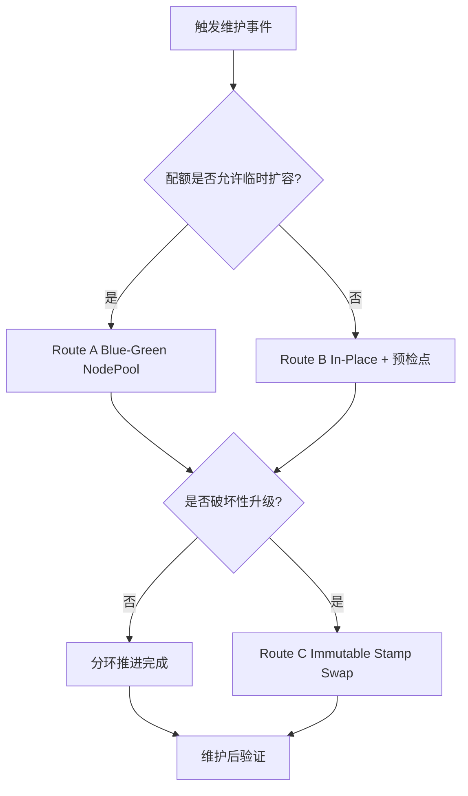
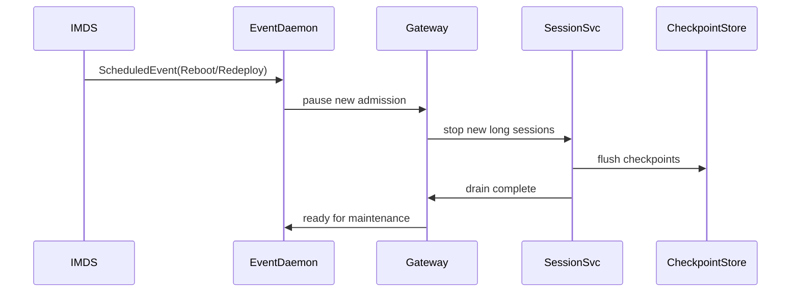

# AI Landing Zone 零中断节点维护选型 FAQ：Fleet Update Runs vs Blue-Green NodePool vs Stamp Swap

> **面向角色**：Cloud & AI Solution Architect、平台 SRE、强监管行业运维与架构治理团队。
> **决策范围**：在 Kubernetes 小版本升级、每周节点镜像补丁、突发宿主机事件下，如何保障长会话 Agent 零中断。
> **目标**：在多区域状态化 Agent + 稀缺 GPU 配额场景下，实现可审计、可回滚、可持续的 Day-2 维护体系。

---

## 1. 执行摘要

对 AI 平台而言，Day-2 维护不是“例行运维细节”，而是核心架构能力。
在生产 Agent 场景中，维护窗口经常与以下事实冲突：

- 会话持续 `15-45` 分钟甚至更长，
- 工具链依赖持久检查点，
- GPU 资源配额紧张且跨区容量不可瞬时翻倍。

最常见的失败模式：

- `maxSurge` 触发区域配额耗尽，
- `PDB` 造成 drain 死锁，
- 会话优雅退出时间短于真实任务时长导致强制中止，
- BCDR 配对区域误同时升级导致容灾余量归零。

推荐策略：

1. 有配额余量时优先 **Route A**（Fleet 分环 + Blue-Green NodePool）。
2. 配额受限时优先 **Route B**（In-Place + 预检点 + 溢出路由）。
3. 涉及重大兼容变更（CNI/mesh/CRD）优先 **Route C**（整 Stamp 不可变切换）。
4. **Route D** 仅可作为托管算力补充，不可走“跨区同时自动升级”反模式。

---

## 2. 问题边界与前提

### 2.1 覆盖维护事件

- Kubernetes 小版本升级，
- 每周节点 OS 安全镜像更新，
- Azure Scheduled Events（`Freeze/Reboot/Redeploy`）。

### 2.2 业务负载特征

- 长会话语音/多轮工具协同 Agent，
- CPU/GPU 混合算力池，
- 多区域双活或主备容灾。

### 2.3 不在本篇范围

- 单节点实验环境，
- 无 SLA 的临时测试集群，
- 与企业架构决策无关的底层实现细节。

---

## 3. 四条路线定义

### Route A — Fleet 多阶段 Update Runs + Blue-Green NodePool

核心机制：

- 先建目标 NodePool，
- 提前预热模型缓存与边车依赖，
- `Canary -> Stage -> Prod` 分环推进，
- 切换流量后批次下线旧池。

优势：

- 回滚路径清晰（旧池可快速 uncordon），
- 变更前有可量化门禁。

代价：

- 需要额外临时容量和配额空间。

### Route B — 配额约束下 In-Place Surge/Drain + Scheduled Events 预检点

核心机制：

- 低突发（`maxSurge=0` 或 `+1` 备援节点），
- 维护窗口严格管控，
- IMDS 事件提前触发会话检查点，
- 维护期间通过 APIM 溢出到托管推理。

优势：

- 适配 ND H100/H200 等配额紧绷场景。

代价：

- 维护总时长更长，流程控制要求更高。

### Route C — 不可变 Deployment Stamp 蓝绿切换

核心机制：

- 将整区域集群视为不可变 Stamp，
- 新会话先导向 Stamp B，
- Stamp A 等待长尾会话自然归零，
- 完成验证后再淘汰旧 Stamp。

优势：

- 对破坏性升级（网络栈/网格/CRD）最稳健。

代价：

- 临时资源需求和组织协同复杂度最高。

### Route D — 托管 Serverless 控制面卸载 / 反模式对照

可用方向：

- 对可迁移的 CPU/突发工作负载，卸载至托管平台降低自管维护负担。

反模式：

- 多区域同时自动升级，
- `PDB minAvailable=100%` 导致 drain 卡死，
- `terminationGracePeriod` 小于会话真实时长。

---

## 4. 12 维度对比矩阵

| 维度 | Route A | Route B | Route C | Route D |
|---|---|---|---|---|
| 1. 长会话可用性保障 | 高 | 中高 | 很高 | 中 |
| 2. 配额友好度 | 中 | 很高 | 中低 | 高 |
| 3. 回滚速度 | 高 | 中 | 高 | 中 |
| 4. 破坏性升级适应性 | 中 | 中 | 很高 | 中 |
| 5. BCDR 配区控制 | 高 | 高 | 很高 | 中 |
| 6. 实施复杂度 | 中 | 中高 | 高 | 中 |
| 7. 临时容量需求 | 中高 | 低 | 高 | 低-中 |
| 8. 会话排空可控性 | 高 | 高 | 很高 | 中 |
| 9. PDB 死锁风险 | 低 | 中 | 低 | 中 |
| 10. 合规审计可追溯 | 高 | 高 | 高 | 中 |
| 11. 配额受限成本效率 | 中 | 高 | 中低 | 高 |
| 12. 运行可预测性 | 高 | 中高 | 高 | 中 |

---

## 5. 评测方法与数据标签

### 5.1 回放基线

- 6 个区域 Stamp，成对 BCDR 拓扑，
- CPU + ND H100 v5 配额受限池混合，
- 会话时长分布覆盖 `15-45` 分钟，
- 统一维护窗口与门禁阈值。

### 5.2 主指标

- 维护总时长，
- 会话中断率，
- 强制终止数量，
- 配额超限事件，
- 回滚时间与恢复时间，
- 单次维护成本影响。

### 5.3 数据标签

- **measured**：模拟器与回放实测。
- **synthetic**：由实测基线与明确假设推导。
- **anonymized_reported**：脱敏生产模式数据。

---

## 6. Q1：Blue-Green 与 In-Place 的维护总时长与配额方程

设：

- `N` 为节点数，
- `T_warm` 为缓存预热时间，
- `T_drain` 为会话排空时间，
- `B` 为每批节点数。

Blue-Green 近似：

`T_bg ~= T_pool_create + T_warm + T_shift + T_verify + T_pool_retire`

In-Place 近似：

`T_ip ~= ceil(N/B) * (T_drain + T_replace + T_warm + T_verify_batch)`

结论：

- Blue-Green 通常用户面影响更低，但需要更多临时容量；
- In-Place 更配额友好，但窗口更长、流程更严谨。

---

## 7. Q2：如何避免 PDB 死锁与强制终止

典型死锁条件：

- `minAvailable=100%` 且无可用突发容量，
- 长会话未预先冻结新入流。

控制手段：

1. 维护模式下调整 PDB 策略，
2. `terminationGracePeriod` 对齐最大会话时长，
3. pre-stop 回调先持久化检查点，
4. 维护窗口先限制新长会话接入。

效果：

- 显著降低 drain 卡死与强制终止概率。

---

## 8. Q3：如何用 Scheduled Events 做预防性检查点

流程：

1. 事件守护进程监听 IMDS（`Reboot`/`Redeploy`/`Freeze`），
2. 网关停止受影响节点接收新会话，
3. 活跃会话在预警窗口内写入检查点，
4. 完成排空后进入节点维护。

价值：

- 将“被动中断”变为“有序排空 + 可恢复”。

---

## 9. Q4：Fleet UpdateRun 分环顺序与自动熔断

建议顺序：

`Canary -> Stage Pair A -> Stage Pair B -> Prod Pair A -> Prod Pair B`

门禁规则：

- 指标超阈即自动暂停推进，
- 配对容灾区禁止同时升级，
- 每环必须完成 soak 验证。

---

## 10. Q5：maxSurge=0 场景下如何做外部溢出

策略：

- 节点排空期间，APIM 将溢出推理请求切到 Foundry Global Standard/PTU。

收益：

- 在本地 GPU 容量下降时稳定用户体验。

约束：

- 必须有明确路由、成本和回退控制。

---

## 11. Q6：Blue-Green NodePool 与整 Stamp Swap 如何取舍

建议：

- 常规节点/小版本维护：优先 Blue-Green NodePool；
- CNI/mesh/CRD 等破坏性变更：优先整 Stamp 不可变切换。

决策变量：

- 可接受变更风险，
- 允许的临时资源峰值，
- 回滚时效要求，
- 合规证据强度要求。

---

## 12. Mermaid：维护路线决策流



---

## 13. Mermaid：Scheduled Events 与排空时序



---

## 14. 生产配置块 1：Fleet UpdateRun 策略示例

```yaml
apiVersion: fleet.azure.com/v1
kind: UpdateRun
metadata:
  name: ai-agent-weekly-maintenance
spec:
  strategy:
    stages:
      - name: canary
        maxParallel: 1
      - name: stage
        maxParallel: 1
      - name: prod
        maxParallel: 1
  gates:
    p95LatencyMs: 2200
    errorRatePct: 1.0
    sessionDropPct: 0.1
```

---

## 15. 生产配置块 2：维护窗口与升级策略

```yaml
apiVersion: aks.azure.com/v1
kind: MaintenanceConfiguration
metadata:
  name: weekly-security-image-window
spec:
  dayOfWeek: Sunday
  startHourUtc: 01
  durationHours: 4
  upgradePolicy:
    maxSurge: "1"
    maxUnavailable: "0"
```

---

## 16. 生产代码块 3：IMDS 事件触发检查点

```python
import asyncio

async def scheduled_event_watcher(imds_client, gateway, checkpoint):
    while True:
        evt = await imds_client.next_event()
        if evt.type in {"Reboot", "Redeploy", "Freeze"}:
            await gateway.pause_new_admission(scope=evt.node_scope)
            await checkpoint.flush_active_sessions(scope=evt.node_scope)
            await gateway.mark_ready_for_drain(scope=evt.node_scope)
        await asyncio.sleep(1)
```

---

## 17. 企业场景 A：全球零售银行 24×7 语音与投顾 Agent

场景：

- 6 区域 AKS Stamp，
- 可用性目标 `99.99%`，
- 长会话语音链路与财富建议流程并行。

建议：

- 常规维护用 Route A，
- 破坏性升级用 Route C，
- 配额紧绷区域补 Route B。

---

## 18. 企业场景 B：配额受限 ND H100 v5 平台

场景：

- 每月安全镜像合规更新，
- CVE 发布后 7 天内必须完成整改，
- 区域 GPU 配额无法双倍扩容。

建议：

- Route B 为主，
- 维护窗口期间 APIM 外溢到托管推理，
- 有额外配额审批时再使用 Route A。

---

## 19. 三年 TCO 示例

假设：

- 每年 52 次计划维护，
- 6 区域成对容灾，
- CPU/GPU 混合集群。

| 三年成本项 | Route A | Route B | Route C | Route D |
|---|---:|---:|---:|---:|
| 平台维护执行 | $5.1M | $4.4M | $6.2M | $3.6M |
| 维护期间外溢算力 | $1.7M | $2.1M | $1.5M | $2.4M |
| 中断与故障影响 | $0.9M | $1.2M | $0.7M | $4.8M |
| 合规审计成本 | $0.8M | $0.9M | $1.0M | $2.2M |
| **总计** | **$8.5M** | **$8.6M** | **$9.4M** | **$13.0M** |

解读：

- Route A 与 Route B 成本接近，关键差异在配额条件；
- Route C 成本更高但对破坏性变更最稳；
- Route D 前期便宜但风险调整后最贵。

---

## 20. Day-0 / Day-1 / Day-2 清单

### Day-0

- 按会话时长与中断容忍度分层，
- 定义 A/B/C/D 路线准入矩阵，
- 定义 BCDR 配区互斥升级规则，
- 定义检查点与排空 SLA。

### Day-1

- 上线 Fleet 分环门禁与回滚阈值，
- 部署 Scheduled Events 守护与接入节流，
- 在回放环境验证 PDB 与 grace 策略，
- 完成 Canary 维护演练。

### Day-2

- 根据实测 SLO 调整分环阈值，
- 月度韧性演练与证据归档，
- 优化外溢路由与维护成本，
- 固化监管审计版维护手册。

---

## 21. Good fit vs Not for

| 路线 | Good fit | Not for |
|---|---|---|
| Route A | 配额允许临时扩容的可控升级 | 绝对无扩容空间场景 |
| Route B | 配额受限 GPU 维护窗口 | 缺乏检查点与排空治理能力的团队 |
| Route C | 重大破坏性升级的高保障切换 | 无 Stamp 级运维能力的小型环境 |
| Route D | 可迁移负载的托管卸载补充 | 跨区同时自动升级策略 |

---

## 22. 最小可观测字段

- `maintenance_run_id`
- `region_ring`
- `nodepool_before_after`
- `session_admission_paused`
- `checkpoint_flush_latency_ms`
- `drain_completion_ms`
- `forced_termination_count`
- `pdb_blocked_count`
- `quota_overrun_count`
- `rollback_triggered`

---

## 23. 需要避免的反模式

- 配对容灾区同时升级，
- 维护窗口不做新会话接入控制，
- PDB 设置为不可排空状态，
- grace 小于真实会话时长，
- 不校验检查点路径就直接升级。

---

## 24. 风险登记

| 风险 | 触发条件 | 控制措施 | 残余 |
|---|---|---|---|
| 配额耗尽 | 维护突发容量超限 | Route B + 外溢路由 | 中低 |
| 会话截断 | 优雅退出窗口不足 | 检查点 + grace 对齐 | 低 |
| 配区爆炸半径扩大 | 同时升级 | 分环门禁 + 配区互斥 | 低 |
| 升级死锁 | 严格 PDB + 无余量 | 维护模式 PDB 策略 | 中低 |
| 合规失配 | 补丁窗口拖延 | 节奏化维护 + 证据归档 | 低 |

---

## 25. 12 周推进计划

第 1-2 周：

- 建立维护基线指标与故障分类。

第 3-4 周：

- 上线 Route A 分环与 Canary 手册。

第 5-6 周：

- 上线 Route B 预检点与排空编排。

第 7-8 周：

- 在单配区试点 Route C Stamp 切换。

第 9-10 周：

- 优化外溢路由与成本阈值。

第 11-12 周：

- 固化合规证据包与运维 Runbook。

---

## 26. 分层建议

- **Tier-1**：Route A + Fleet 门禁 + Blue-Green NodePool。
- **Tier-2**：Route B（配额受限区）+ 预检点编排。
- **Tier-3**：Route C（破坏性升级）高保障切换。
- **约束**：Route D 仅作托管卸载补充，不可替代分环治理。

---

## 27. 参考来源与抓取时间

抓取时间：**2026-11-26**

1. AKS 升级：`https://learn.microsoft.com/azure/aks/upgrade-aks-cluster`
2. Azure Kubernetes Fleet Manager：`https://learn.microsoft.com/azure/kubernetes-fleet/`
3. AKS Planned Maintenance：`https://learn.microsoft.com/azure/aks/planned-maintenance`
4. Azure Scheduled Events：`https://learn.microsoft.com/azure/virtual-machines/linux/scheduled-events`
5. Azure Front Door：`https://learn.microsoft.com/azure/frontdoor/`
6. Azure API Management AI Gateway：`https://learn.microsoft.com/en-us/azure/api-management/ai-gateway-overview`

本指南使用的数据标签：

- **measured**
- **synthetic**
- **anonymized_reported**

本文不包含凭据、密钥或客户可识别信息。

