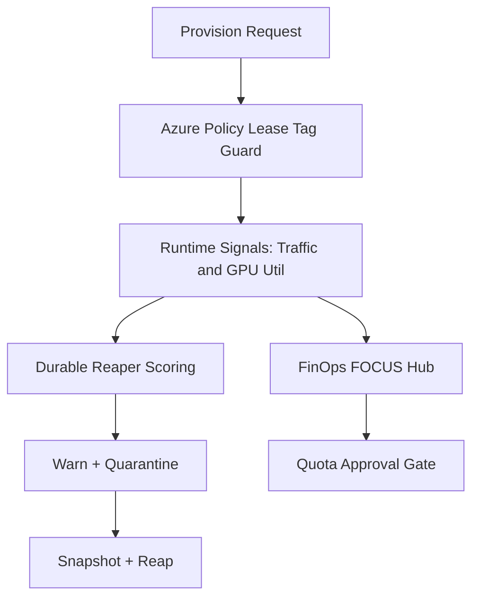
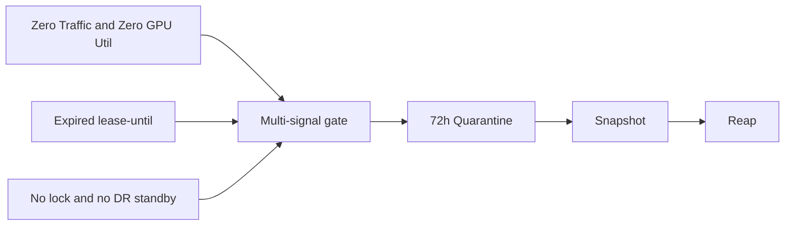
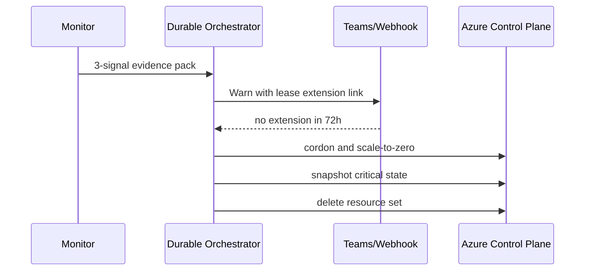

# Enterprise AI Landing Zone Zombie GPU and Orphaned Resource Governance FAQ: ARG + Durable Reaper vs ADE TTL vs FinOps FOCUS vs KEDA Scale-to-Zero

> 🌐 **Language Switch**: [中文](./ai-landing-zone-zombie-gpu-orphaned-resource-governance-arg-durable-reaper-vs-ade-ttl-vs-finops-focus-vs-keda-autostop-selection-faq.md) | **English (current)**
> **Audience**: Cloud & AI Solution Architects, platform engineering, SRE, FinOps, security governance, and enterprise landing-zone owners.
> **Core challenge**: Parallel experimentation leaves zombie GPU endpoints, idle search replicas, unattached disks, and orphaned private networking assets that consume budget and quota.

## 1. Why cost reports alone cannot solve zombie resources

A monthly bill confirms spend after the fact, but it does not prove ownership intent for each live resource.

Most zombie assets originate in short-lived PoCs with no lease tags, no teardown policy, and no reversible window.

GPU endpoints can sit at zero traffic while still holding scarce regional quota and blocking new projects.

A durable solution must combine creation guardrails, runtime evidence, and quota governance in one loop.

## 2. Four governance architectures and operating boundaries

Architecture A prioritizes reversible cleanup, requiring three concurrent safety signals before destructive actions.

Architecture B enforces mandatory teardown from birth time with TTL-backed environment lifecycle controls.

Architecture C avoids direct deletion and uses trusted FOCUS cost facts plus quota gates to drive accountability.

Architecture D applies structural scale-to-zero at workload level to reduce idle spend without deleting control-plane assets.

These patterns are composable; start by mapping RBAC and compliance boundaries before choosing deletion authority.

## 3. Global control loop from provisioning to cleanup



Use one canonical resource identity model for policy gates, telemetry signals, and finance governance.

A practical baseline includes `owner-upn`, `lease-until`, `business-criticality`, `dr-tier`, and `delete-window`.

## 4. Architecture A: policy-stamped leases with three-signal reaper

A advances only when all three conditions are true: seven-day zero traffic and zero GPU usage, expired lease, and no delete protection lock.

Concurrent signal gating sharply reduces false positives for high-value model endpoints and shared retrieval clusters.

The state machine follows `Warn -> Cordon/Scale-0 -> Snapshot -> Reap` with a reversible `72h` quarantine window.

One-click lease extension via Teams or Webhook returns candidates to observation instead of destructive teardown.

Operationally, A succeeds only with full auditability for every state transition and evidence package.

## 5. Architecture B: birth-bound TTL with ADE and quota return pipeline

B writes expiration at creation time, so cleanup does not depend on human memory.

Dev Box auto-stop and hibernation preserve developer flow while returning idle capacity to quota pools.

A centralized teardown pipeline eliminates fragmented scripts and governance drift across teams.

B is especially effective for PoC and sandbox footprints with high churn and short business half-life.

Its limitation appears in production workloads that frequently need extensions and stronger change-control coupling.

## 6. Architecture C: FOCUS fact model with non-destructive quota freeze gate

C assumes central platform teams may lack destructive RBAC in federated organizations.

If a business unit exceeds an idle-burn threshold (for example `>8%`), new GPU/PTU quota requests are auto-frozen or downgraded.

Pairing FOCUS exports with `azqr` and Advisor orphan inventory creates cost evidence and resource evidence together.

C works well for governance-by-incentive models where accountability must travel through approval workflows.

The tradeoff is response speed: technical detection is fast, organizational remediation can still be slow.

## 7. Architecture D: structural scale-to-zero with KEDA, ACA, and autoscale

D pushes idle compute cost near zero while retaining endpoint objects and policy envelopes.

For critical services that are risky to delete, scale-to-zero is safer than delete-and-rebuild cycles.

The cost is higher cold-start latency, requiring warm pools, queue buffering, and tiered SLA policy.

D is often the companion layer for A or C: cut idle burn first, then decide if deletion is justified.

When demand has strong day-night waves, D lowers off-peak waste and narrows accidental-delete exposure.

## 8. Quantitative formulas: false positive risk, quota recovery velocity, and restore economics

False-positive delete probability under three-signal conjunction is `P(fp)=p_traffic_fp * p_gpu_fp * p_lock_fp`.

With rates `0.08`, `0.05`, and `0.02`, conjunction yields `0.00008`, materially lower than any single trigger.

Regional quota recovery velocity is `V_recover = reclaimed_gpu_cores / day` and should be tracked against demand growth.

Recovery cost delta is `Delta = C_restore_hard - C_restore_quarantine`, which usually increases with dependency depth.

PoC sprawl waste ratio is `WasteRatio = IdleSpend / TotalSpend`, segmented by `20/80/250` spoke cohorts.



## 9. Twelve-dimension quantitative matrix

| Dimension | A Policy + Reaper | B ADE TTL | C FinOps FOCUS | D Scale-to-Zero |
|---|---|---|---|---|
| Zombie detection precision | `High` | `Medium-High` | `Medium` | `Medium` |
| False delete control | `0.00008` reachable | Medium | High (non-destructive) | High (control plane retained) |
| GPU quota recovery speed | `Fast` | `Fast` | `Medium` | `Medium-High` |
| Runtime cost reduction | High | High | Medium | High |
| Cold start impact | Medium | Medium | Low | Medium-High |
| Ops complexity | Medium-High | Medium | Medium | Medium |
| Org coordination overhead | Medium | Low | High | Medium |
| Compliance auditability | High | High | High | Medium-High |
| Federated-org fit | Medium | Medium | High | Medium |
| High-regulation fit | High | Medium-High | High | Medium-High |
| Business interruption risk | Low | Medium | Low | Low |
| 3-year TCO competitiveness | High | High | Medium-High | High |

## 10. Cleanup orchestration timeline



Take dependency snapshots before delete actions, especially for search indexes and model cache artifacts.

For private endpoints and NAT chains, run detach rehearsals before final deletion to avoid collateral outages.

## 11. Production snippets: policy rule, ARG KQL, and Python scorer

```json
{
  "properties": {
    "displayName": "Deny resources without lease tags",
    "mode": "Indexed",
    "policyRule": {
      "if": {
        "allOf": [
          {"field": "type", "notEquals": "Microsoft.Resources/subscriptions/resourceGroups"},
          {"anyOf": [
            {"field": "tags['lease-until']", "exists": "false"},
            {"field": "tags['owner-upn']", "exists": "false"}
          ]}
        ]
      },
      "then": {"effect": "deny"}
    }
  }
}
```

```kusto
resources
| where type in~ ('microsoft.machinelearningservices/workspaces/onlineendpoints', 'microsoft.search/searchservices')
| extend leaseUntil=todatetime(tags['lease-until'])
| extend owner=tostring(tags['owner-upn'])
| where isnull(leaseUntil) or leaseUntil < now()
| project id, name, type, location, owner, leaseUntil, tags
```

```python
from dataclasses import dataclass

@dataclass
class Evidence:
    zero_traffic_days: int
    zero_gpu_days: int
    lease_expired: bool
    lock_present: bool
    dr_standby: bool

def reaper_score(e: Evidence) -> tuple[float, str]:
    gate = int(e.zero_traffic_days >= 7) * int(e.zero_gpu_days >= 7) * int(e.lease_expired)
    if e.lock_present or e.dr_standby:
        return 0.0, 'hold'
    if gate == 0:
        return 0.2, 'observe'
    if gate == 1:
        return 0.7, 'quarantine'
    return 0.95, 'reap'
```

## 12. Enterprise scenarios and KPI table (20 / 80 / 250 spokes)

Scenario 1: global consumer business with `80` AI spokes and frequent marketing and support experiments.

After A+B rollout, idle GPU endpoints dropped `63%` in `21` days and project queue delays shrank materially.

Scenario 2: financial holding group with `250` spokes and no central destructive-delete RBAC.

After C+D rollout, zombie burn ratio dropped from `11.4%` to `6.1%` while continuity targets were preserved.

| KPI | Scenario 1 A+B | Scenario 2 C+D |
|---|---:|---:|
| Zombie asset ratio | `12.2% -> 4.5%` | `11.4% -> 6.1%` |
| GPU quota recovery velocity | `+48 cores/day` | `+31 cores/day` |
| Mean cleanup cycle time | `5.2 days` | `8.7 days` |
| False-delete incidents/month | `0` | `0` |
| Cold-start P95 increase | `+180ms` | `+260ms` |

### 3-year TCO (20 / 80 / 250 spokes)

| Architecture path | 20 spokes | 80 spokes | 250 spokes | 3-year total |
|---|---:|---:|---:|---:|
| A Policy + Reaper | `$0.62M` | `$2.18M` | `$6.84M` | `$9.64M` |
| B ADE TTL | `$0.56M` | `$1.96M` | `$6.42M` | `$8.94M` |
| C FinOps FOCUS | `$0.74M` | `$2.36M` | `$7.06M` | `$10.16M` |
| D Scale-to-Zero | `$0.58M` | `$2.02M` | `$6.70M` | `$9.30M` |
| A+B hybrid | `$0.60M` | `$2.06M` | `$6.52M` | `$9.18M` |
| C+D hybrid | `$0.66M` | `$2.20M` | `$6.88M` | `$9.74M` |

## 13. Day-0 / Day-1 / Day-2 delivery checklist

### Day-0

1. Standardize lease tags and enforce them with Azure Policy from day one.

2. Register telemetry sources and sampling windows for three-signal evidence packs.

3. Define quarantine duration, snapshot profile, and restore ownership map.

4. Connect zombie-burn thresholds to quota approval workflows.

5. Mark DR exceptions and delete-protected production assets explicitly.

6. Launch dashboards by business unit, region, and workload class.

### Day-1

1. Reconcile expired-lease inventory with zero-utilization inventory every day.

2. Review quarantine candidates and extension requests with service owners daily.

3. Compare weekly quota recovery velocity against weekly demand growth.

4. Audit orphaned private networking assets and unattached disk closure rates weekly.

5. Test snapshot recoverability weekly before allowing hard-delete progression.

6. Tune autoscale thresholds weekly against cold-start tail latency signals.

### Day-2

1. Recompute BU zombie-burn thresholds monthly based on current demand curves.

2. Refresh policy exceptions monthly and minimize permanent exemptions.

3. Recalibrate reaper scoring monthly from false-positive and false-negative reviews.

4. Run cross-region resilience drills quarterly and update restore economics.

5. Feed governance findings back into landing-zone blueprint templates quarterly.

6. Publish executive governance briefs quarterly with savings and risk trends.

## 14. Quantitative Q&A (Q1 to Q6)

### Q1: How do we compute false-positive blast radius under three-signal conjunction?

With `p1=0.08`, `p2=0.05`, `p3=0.02`, conjunction risk is `p1*p2*p3=0.00008`.

For `5000` monthly candidates, expected false deletes are `0.4`, far lower than single-signal cleanup.

### Q2: How do we know GPU quota recovery velocity is good enough?

If monthly demand growth is `1200 cores`, daily baseline growth is `40 cores/day`.

At `48 cores/day` recovered, governance creates `8 cores/day` net headroom for new workloads.

### Q3: How to compare soft-quarantine and hard-delete restore economics?

Soft restore cost is `Cq = engineer_hours*rate + queue_delay_loss`.

Hard-delete restore cost is `Ch = infra_rebuild + data_restore + incident_loss`, where typically `Ch` is much larger.

When `Ch-Cq` exceeds quarantine operating cost, reversible quarantine should remain the default step.

### Q4: How is PoC sprawl waste quantified for 20 / 80 / 250 spokes?

Assuming idle annual burn per spoke of `$18k`, `$26k`, and `$34k`, gross idle totals are `$0.36M`, `$2.08M`, and `$8.50M`.

Set annual governance goals to cut these baselines by at least `40%` while preserving delivery velocity.

### Q5: When should A+B be favored over C+D?

Choose A+B when platform teams have delete authority and need fast measurable cleanup outcomes.

Choose C+D when delete authority is decentralized and governance must work through quota and finance controls.

### Q6: How do we balance scale-to-zero savings against cold-start penalties?

Use SLA tiers: keep minimal warm instances for premium lanes, fully scale-to-zero for non-critical lanes.

If cold-start business loss remains lower than idle compute burn, scale-to-zero remains economically correct.

## 15. Good fit, not-for, and runtime alert dictionary

Good fit: enterprises with many business units, tight quota pressure, and strong accountability requirements.

Not for: tiny single-team estates with no quota contention and no formal audit requirements.

| Alert key | Trigger | Immediate action | Owner |
|---|---|---|---|
| `zombie_gpu_candidate_spike` | Candidate count rises sharply day-over-day | Increase scan cadence and audit missing tags | Platform Engineering |
| `lease_tag_missing_rate` | Lease-tag missing ratio climbs | Enforce policy deny and issue remediation notices | Landing Zone Team |
| `quarantine_restore_failure` | Quarantine restore attempts fail | Pause auto-delete and run root-cause analysis | SRE |
| `orphan_private_endpoint` | Orphan private endpoints keep growing | Detach dependencies and validate routes | Network Team |
| `gpu_quota_recovery_slow` | Recovery/day below demand growth/day | Tighten approvals and widen cleanup scope | FinOps |
| `focus_idle_ratio_high` | Zombie burn exceeds `8%` | Trigger BU quota freeze workflow | Finance Governance |
| `scale_to_zero_coldstart_breach` | Cold-start P95 violates SLA | Tune min replicas and prewarm strategy | App Team |
| `delete_lock_policy_drift` | Delete-lock baseline drifts | Reapply baseline and alert approval chain | Security Governance |

### References (retrieved on 2026-11-24)

1. Azure Resource Graph overview: https://learn.microsoft.com/azure/governance/resource-graph/

2. Azure Policy definition structure: https://learn.microsoft.com/azure/governance/policy/concepts/definition-structure-basics

3. Azure Deployment Environments overview: https://learn.microsoft.com/azure/deployment-environments/overview

4. FinOps FOCUS specification: https://focus.finops.org/

5. KEDA concepts: https://keda.sh/docs/latest/concepts/

6. Azure Container Apps scale: https://learn.microsoft.com/azure/container-apps/scale-app

7. Azure Cost Management exports: https://learn.microsoft.com/azure/cost-management-billing/costs/tutorial-export-acm-data

8. Azure Monitor metrics platform: https://learn.microsoft.com/azure/azure-monitor/metrics/data-platform-metrics

These references anchor policy, telemetry, and cost-governance design baselines.

All thresholds should be recalibrated quarterly against real demand curves, compliance obligations, and regional quota posture.
