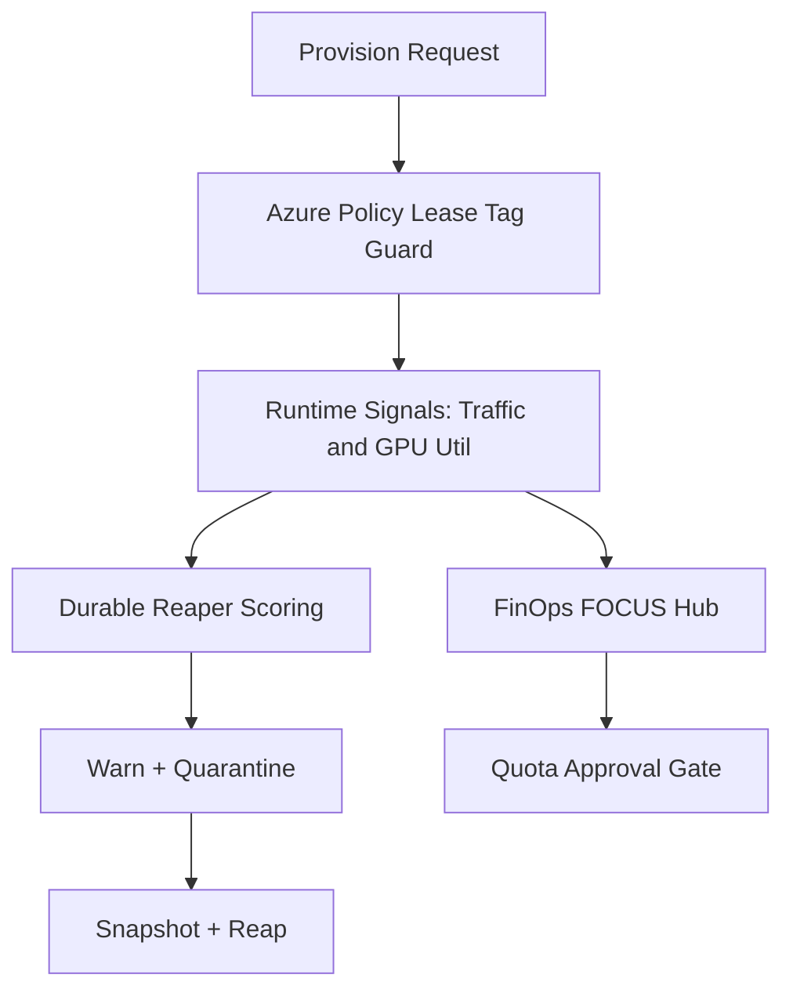
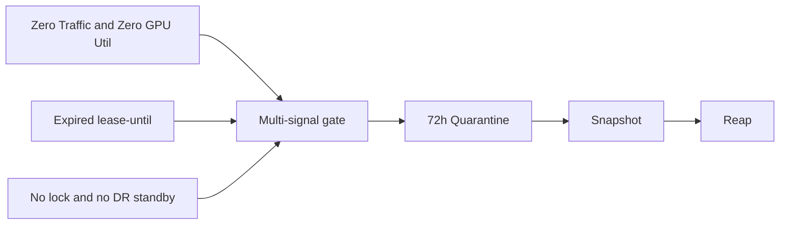
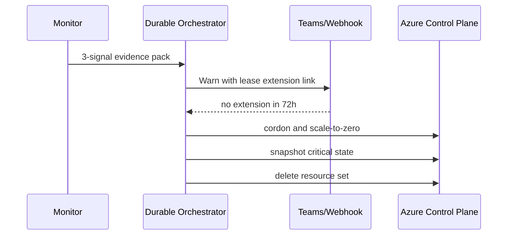

# 企业 AI Landing Zone 僵尸 GPU 与孤儿资源治理选型 FAQ：ARG + Durable Reaper vs ADE TTL vs FinOps FOCUS vs KEDA Scale-to-Zero

> 🌐 **Language Switch**：**中文（当前）** | [English](./ai-landing-zone-zombie-gpu-orphaned-resource-governance-arg-durable-reaper-vs-ade-ttl-vs-finops-focus-vs-keda-autostop-selection-faq.en.md)
> **适用对象**：Cloud & AI Solution Architect、平台工程、SRE、FinOps、安全合规与企业 Landing Zone 治理团队。
> **核心挑战**：多团队并行实验会产生僵尸 GPU 端点、闲置 AI Search 副本、未挂载磁盘与孤儿私网资源，既推高成本也吞噬区域配额。

## 1. 为什么“只看成本报表”无法根治僵尸资源

月度账单只能告诉你钱已经花掉，不能告诉你哪个资源仍有业务责任人。

很多僵尸资源来自短期 PoC，创建时没有租约标签、删除策略与回收窗口定义。

GPU 端点在零流量下持续保温，会在不知不觉中占满配额并阻断新项目上线。

因此需要从创建入口、运行期信号和配额审批三层联动治理，而不是单点清理脚本。

## 2. 四类治理架构与边界假设

Architecture A 强调可逆删除前置，要求三信号并发命中后再进入分阶段回收状态机。

Architecture B 把“到期即销毁”固化在环境生命周期，避免遗忘导致的长期拖尾成本。

Architecture C 不直接删资源，而是用 FOCUS 成本事实与配额闸门倒逼业务线先清理再扩容。

Architecture D 在工作负载层实现结构性 Scale-to-Zero，减少“删错资源”的操作风险。

四种路径可以组合，关键是先明确组织 RBAC 与合规边界，再决定谁有破坏性删除权限。

## 3. 全局控制回路：从创建到回收的统一闭环



建议把策略拦截、运行信号和财务治理汇聚到同一资源标识模型，避免多套标签口径冲突。

统一模型至少包含 `owner-upn`、`lease-until`、`business-criticality`、`dr-tier`、`delete-window`。

## 4. Architecture A：策略标签 + 三信号 Reaper 状态机

A 只在三个条件同时成立时才推进清理：`7` 天零流量与零 GPU 利用率、租约过期、无删除保护锁。

三信号并发能显著压低误删概率，特别适合高价值模型端点与共享检索集群。

状态机采用 `Warn -> Cordon/Scale-0 -> Snapshot -> Reap`，并保留 `72h` 软隔离可逆窗口。

Teams/Webhook 一键续租可把资源退回观察态，避免夜间误报直接触发硬删除。

A 的工程重点是证据链完整性：每一次状态跃迁都必须可审计、可回放、可追责。

## 5. Architecture B：ADE 先天 TTL 与配额回收流水线

B 在环境出生时写入过期时间，不依赖团队自觉关机或手工回收。

Dev Box 自动休眠与自动停止让开发者体验保持连续，同时把闲置算力及时归还配额池。

到期清理由平台流水线统一执行，减少跨团队脚本差异引发的治理盲区。

B 对 PoC/Sandbox 场景收益极高，因为生命周期短且资源波动大，最容易形成孤儿资产。

局限是生产环境常需要延长保留期，必须与变更审批流程联动，否则会遭遇业务阻力。

## 6. Architecture C：FOCUS 事实账本 + 配额冻结闸门

C 不依赖中心团队的删除权限，而是用可信成本事实触发“先治理后审批”的组织机制。

当 BU 僵尸成本占比超过阈值（如 `>8%`），新 GPU/PTU 配额申请自动进入冻结或降级审批。

该路径适用于联邦式组织：中心平台只掌握观察与审批权，删除动作由业务线执行。

结合 `azqr` 与 Advisor 孤儿资源盘点，可形成“成本事实 + 资源证据”的双轨问责。

C 的短板是见效速度受组织流程影响，技术上快，治理动作未必快。

## 7. Architecture D：KEDA/ACA/Foundry 结构性 Scale-to-Zero

D 通过自动缩容把空闲计算成本压到接近零，同时保留端点和策略对象。

对于无法轻易删除的核心服务，Scale-to-Zero 比“删后重建”更稳健。

代价是冷启动恢复时间增加，需要通过暖池、请求排队和分层 SLA 缓冲。

D 经常作为 A 或 C 的补充层：先把闲置成本压低，再决定是否删除控制面资源。

若业务峰谷剧烈波动，D 能显著降低夜间空转成本并减少误删风险暴露面。

## 8. 定量公式：误删概率、配额恢复速度与恢复成本

三信号误判删错概率可估算为 `P(fp)=p_traffic_fp * p_gpu_fp * p_lock_fp`。

若单信号误判分别为 `0.08`、`0.05`、`0.02`，并发后 `P(fp)=0.00008`，远低于单信号清理。

区域 GPU 配额恢复速度：`V_recover = reclaimed_gpu_cores / day`，用于评估清理措施是否跟上需求增长。

软隔离与硬删除恢复成本差：`Delta = C_restore_hard - C_restore_quarantine`，通常随依赖复杂度放大。

PoC 蔓延浪费率：`WasteRatio = IdleSpend / TotalSpend`，可按 `20/80/250` spoke 分层观察。



## 9. 12 维定量矩阵（中文）

| 维度 | A 策略+Reaper | B ADE TTL | C FinOps FOCUS | D Scale-to-Zero |
|---|---|---|---|---|
| 僵尸识别准确度 | `高`（三信号并发） | `中高`（以到期为主） | `中`（偏财务视角） | `中`（偏负载视角） |
| 误删概率控制 | `0.00008` 可达 | 中 | 高（不直接删） | 高（不删控制面） |
| GPU 配额回收速度 | `快` | `快` | `中` | `中高` |
| 运行时成本压降 | 高 | 高 | 中 | 高 |
| 冷启动影响 | 中 | 中 | 低 | 中高 |
| 运维复杂度 | 中高 | 中 | 中 | 中 |
| 组织协作成本 | 中 | 低 | 高 | 中 |
| 合规可审计性 | 高 | 高 | 高 | 中高 |
| 适配联邦组织 | 中 | 中 | 高 | 中 |
| 适配高监管场景 | 高 | 中高 | 高 | 中高 |
| 对业务中断风险 | 低（软隔离先行） | 中 | 低 | 低 |
| 三年 TCO 竞争力 | 高 | 高 | 中高 | 高 |

## 10. 回收编排时序：告警、隔离、快照、删除



迁移动作必须先做依赖快照，尤其是 AI Search 索引与模型权重缓存。

对于私网端点和 NAT 依赖，建议先做“解绑演练”再做最终删除，避免连带故障。

## 11. 生产片段：Azure Policy + ARG KQL + Python Reaper 评分

```json
{
  "properties": {
    "displayName": "Deny resources without lease tags",
    "mode": "Indexed",
    "policyRule": {
      "if": {
        "allOf": [
          {"field": "type", "notEquals": "Microsoft.Resources/subscriptions/resourceGroups"},
          {"anyOf": [
            {"field": "tags['lease-until']", "exists": "false"},
            {"field": "tags['owner-upn']", "exists": "false"}
          ]}
        ]
      },
      "then": {"effect": "deny"}
    }
  }
}
```

```kusto
resources
| where type in~ ('microsoft.machinelearningservices/workspaces/onlineendpoints', 'microsoft.search/searchservices')
| extend leaseUntil=todatetime(tags['lease-until'])
| extend owner=tostring(tags['owner-upn'])
| where isnull(leaseUntil) or leaseUntil < now()
| project id, name, type, location, owner, leaseUntil, tags
```

```python
from dataclasses import dataclass

@dataclass
class Evidence:
    zero_traffic_days: int
    zero_gpu_days: int
    lease_expired: bool
    lock_present: bool
    dr_standby: bool

def reaper_score(e: Evidence) -> tuple[float, str]:
    gate = int(e.zero_traffic_days >= 7) * int(e.zero_gpu_days >= 7) * int(e.lease_expired)
    if e.lock_present or e.dr_standby:
        return 0.0, 'hold'
    if gate == 0:
        return 0.2, 'observe'
    if gate == 1:
        return 0.7, 'quarantine'
    return 0.95, 'reap'
```

## 12. 企业场景与 KPI（20 / 80 / 250 spoke）

场景一：全球消费业务集团，`80` 个 AI spoke，季度内频繁新建营销与客服试验环境。

采用 A+B 后，闲置 GPU 端点在 `21` 天内下降 `63%`，新项目排队时长显著缩短。

场景二：金融控股集团，`250` 个 spoke，中心平台无删除权限，侧重审计与配额治理。

采用 C+D 后，僵尸成本占比从 `11.4%` 降到 `6.1%`，并维持业务连续性。

| KPI 指标 | 场景一 A+B | 场景二 C+D |
|---|---:|---:|
| 僵尸资源占比 | `12.2% -> 4.5%` | `11.4% -> 6.1%` |
| GPU 配额恢复速度 | `+48 cores/day` | `+31 cores/day` |
| 平均回收闭环时长 | `5.2 days` | `8.7 days` |
| 误删事件（月） | `0` | `0` |
| 冷启动 P95 增量 | `+180ms` | `+260ms` |

### 三年 TCO（20 / 80 / 250 spoke）

| 架构路径 | 20 spokes | 80 spokes | 250 spokes | 三年总成本 |
|---|---:|---:|---:|---:|
| A Policy + Reaper | `$0.62M` | `$2.18M` | `$6.84M` | `$9.64M` |
| B ADE TTL | `$0.56M` | `$1.96M` | `$6.42M` | `$8.94M` |
| C FinOps FOCUS | `$0.74M` | `$2.36M` | `$7.06M` | `$10.16M` |
| D Scale-to-Zero | `$0.58M` | `$2.02M` | `$6.70M` | `$9.30M` |
| A+B 混合 | `$0.60M` | `$2.06M` | `$6.52M` | `$9.18M` |
| C+D 混合 | `$0.66M` | `$2.20M` | `$6.88M` | `$9.74M` |

## 13. Day-0 / Day-1 / Day-2 落地清单

### Day-0

1. 统一租约标签规范并以 Policy 强制执行。

2. 定义三信号数据源与采样周期，确保可追溯。

3. 配置隔离窗口时长、快照策略与恢复责任人。

4. 把僵尸成本阈值写入配额审批流程。

5. 为高价值生产资源标记 DR 例外与保护锁。

6. 建立按 BU、按区域、按工作负载的可视化看板。

### Day-1

1. 每日核对过期租约资源与零利用率资源交集。

2. 每日复核被隔离资源的业务影响与续租请求。

3. 每周统计 GPU 回收速度与新增申请速度差值。

4. 每周审计孤儿私网资源与未挂载磁盘闭环率。

5. 每周抽查快照可恢复性，防止回收不可逆。

6. 每周复盘冷启动尾延迟并校准自动缩容阈值。

### Day-2

1. 每月重算 BU 僵尸成本阈值并联动配额策略。

2. 每月更新 Policy 例外清单并执行最小化治理。

3. 每月复盘误报与漏报，优化 Reaper 评分权重。

4. 每季度执行跨区域灾备演练与恢复成本评估。

5. 每季度将治理事实回写 Landing Zone 蓝图模板。

6. 每季度发布管理层治理简报，展示节省与风险下降。

## 14. 六个量化问答（Q1~Q6）

### Q1: 三信号并发下误删爆炸半径概率如何算？

设单信号误判率分别为 `p1=0.08`、`p2=0.05`、`p3=0.02`，并发后误判率为 `p1*p2*p3=0.00008`。

若单月候选 `5000` 项，期望误删候选仅 `0.4` 项，明显优于单信号触发。

### Q2: 区域 GPU 配额恢复速度如何评估达标？

若月新增需求折算 `1200 cores`，30 天日均需求增量 `40 cores/day`。

治理后日均回收 `48 cores/day`，净富余 `8 cores/day`，说明配额压力可被持续吸收。

### Q3: 软隔离与硬删除的恢复成本差值怎么算？

软隔离恢复成本可近似 `Cq = engineer_hours*rate + queue_delay_loss`。

硬删除恢复成本 `Ch = infra_rebuild + data_restore + incident_loss`，通常 `Ch >> Cq`。

当 `Ch-Cq` 持续大于隔离窗口运维成本时，应优先采用可逆隔离机制。

### Q4: 20 / 80 / 250 spoke 的 PoC 蔓延浪费怎么衡量？

假设单 spoke 年均空转成本 `$18k`、`$26k`、`$34k`，则三档总空转约 `$0.36M`、`$2.08M`、`$8.50M`。

用 `WasteRatio` 观测后，可把治理目标设为一年内下降 `40%` 以上。

### Q5: 何时优先 A+B，何时优先 C+D？

当平台具备删除权限且追求快速见效时，A+B 能在数周内显著下降僵尸资产。

当组织联邦化且删除权限分散时，C+D 更现实，先控支出与配额，再推动业务线清理。

### Q6: 如何平衡 Scale-to-Zero 的冷启动损失？

可把请求按 SLA 分层：高优先级保留最小暖实例，低优先级完全缩零。

若冷启动导致的业务损失低于空转成本，缩零策略即具备经济合理性。

## 15. Good fit / Not for 与运行告警字典

Good fit：多 BU、多区域、配额紧张且成本治理压力高的企业 AI Landing Zone。

Not for：资源规模很小、无配额约束且无需审计追踪的单团队短期环境。

| 告警键 | 触发条件 | 即时动作 | 责任团队 |
|---|---|---|---|
| `zombie_gpu_candidate_spike` | 候选数日增超阈值 | 提升巡检频率并审计标签缺口 | 平台工程 |
| `lease_tag_missing_rate` | 无租约标签比例上升 | 启动 Policy 阻断与整改通知 | Landing Zone 团队 |
| `quarantine_restore_failure` | 软隔离恢复失败 | 暂停自动删除并执行根因排查 | SRE |
| `orphan_private_endpoint` | 孤儿私网端点持续增加 | 批量解绑依赖并复核路由 | 网络团队 |
| `gpu_quota_recovery_slow` | 日回收低于需求增量 | 收紧审批并扩大回收窗口 | FinOps |
| `focus_idle_ratio_high` | 僵尸成本占比超 `8%` | 触发 BU 配额冻结流程 | 财务治理团队 |
| `scale_to_zero_coldstart_breach` | 冷启动 P95 违约 | 调整最小实例与预热策略 | 应用团队 |
| `delete_lock_policy_drift` | 保护锁配置偏移 | 重新下发基线并告警审批链 | 安全治理团队 |

### 参考来源（抓取日期：2026-11-24）

1. Azure Resource Graph overview: https://learn.microsoft.com/azure/governance/resource-graph/

2. Azure Policy definition structure: https://learn.microsoft.com/azure/governance/policy/concepts/definition-structure-basics

3. Azure Deployment Environments overview: https://learn.microsoft.com/azure/deployment-environments/overview

4. FinOps FOCUS specification: https://focus.finops.org/

5. KEDA concepts: https://keda.sh/docs/latest/concepts/

6. Azure Container Apps scale documentation: https://learn.microsoft.com/azure/container-apps/scale-app

7. Azure Cost Management exports: https://learn.microsoft.com/azure/cost-management-billing/costs/tutorial-export-acm-data

8. Azure Monitor metrics overview: https://learn.microsoft.com/azure/azure-monitor/metrics/data-platform-metrics

以上来源用于校准策略结构、运行信号与成本治理流程的工程基线。

所有阈值应按企业业务峰谷、合规要求和区域配额实际使用曲线进行季度重算。
