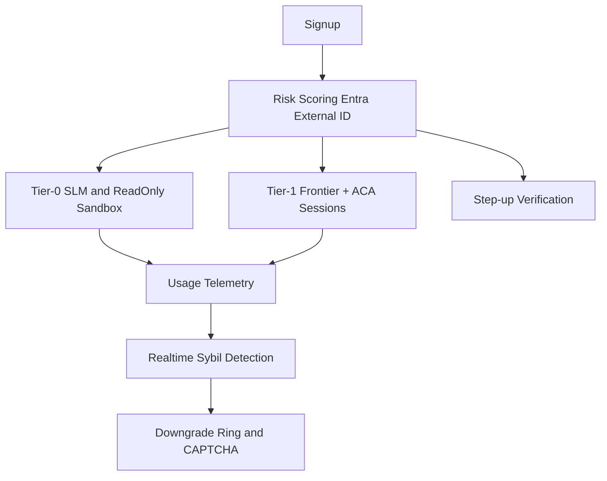
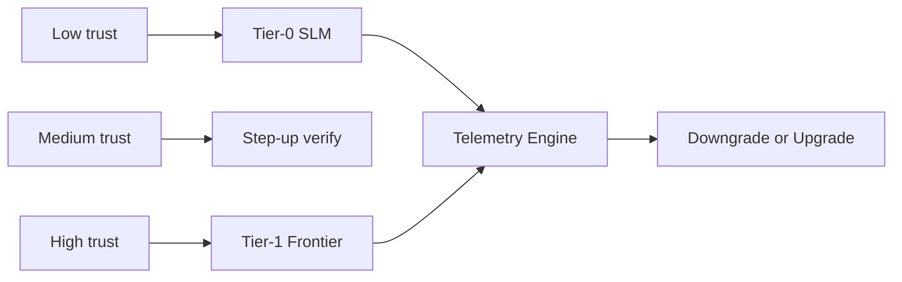
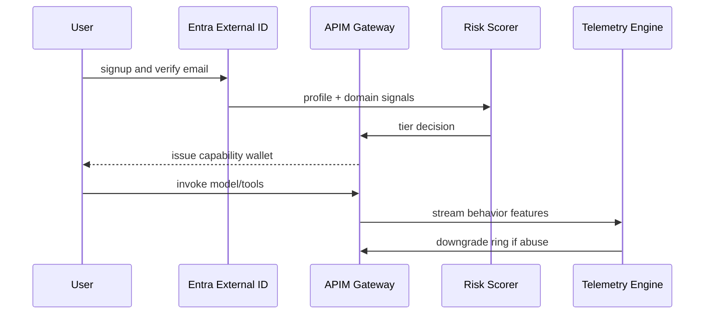

# Enterprise AI SaaS PLG Free-Trial and Anti-Sybil Selection FAQ: Progressive Trust vs Card-Gated Trial vs BYOK Sandbox vs Realtime Kill-Switch

> 🌐 **Language Switch**: [中文](./ai-saas-plg-free-trial-unit-economics-anti-sybil-progressive-trust-entra-apim-vs-card-gated-trial-vs-byok-sandbox-selection-faq.md) | **English (current)**
> **Audience**: Cloud & AI Solution Architects, PLG growth teams, FinOps, anti-abuse operations, SaaS platform engineering, and monetization leaders.
> **Context**: AI SaaS free-trial funnels are vulnerable to token arbitrage and synthetic signup farms, so growth and abuse control must be co-designed.

## 1. Why AI SaaS trial governance is both a growth and a risk problem

In AI SaaS, marginal trial cost is tied to inference spend instead of only storage or seats.

If signup friction is too low without trust segmentation, abusive automation quickly consumes token budgets.

If friction is too high at entry, top-of-funnel collapse can erase long-term PLG compounding.

A durable design requires low-friction entry, progressive verification, and dynamic downgrade controls in one lifecycle.

## 2. Four architecture patterns for PLG and anti-sybil defense

Architecture A applies progressive trust with Entra-driven identity and domain signals to tiered capability wallets.

Architecture B applies card-fingerprint uniqueness for reverse trials and strong one-trial-per-identity enforcement.

Architecture C offers deterministic replay plus BYOK evaluation to keep ISV-side LLM spend near zero during exploration.

Architecture D streams behavioral telemetry for sub-30-second abuse scoring and downgrade actions.

Mature deployments often combine A as the primary funnel with B, C, or D as selective control layers.

## 3. End-to-end funnel architecture



Keep signup risk, capability wallet, inference budget, and runtime enforcement in one policy domain.

This avoids fragmented control planes where abuse passes signup checks but escapes runtime governance.

## 4. Architecture A: progressive trust and model-cascade funnel

A starts with low-friction signup and computes trust using domain age, SSO proof, mailbox quality, and behavior consistency.

Low-trust users get Tier-0 low-COGS experiences with read-only sandboxes and tight spend caps under `<$0.08/user`.

Verified corporate users are upgraded to Tier-1 frontier reasoning and ACA dynamic sessions with `$8–$15` credit caps.

Grey-zone users face selective step-up checks such as passkeys, developer-graph proof, or `$1` 3DS2 card checks.

A is strongest when organizations need continuous tuning instead of hard allow/deny gates.

## 5. Architecture B: card-vaulted reverse trial

B binds trial identity to issuer card fingerprints using SetupIntent-style payment primitives.

It can block `96%+` synthetic trial farming and often improves trial-to-paid conversion into the `18%–32%` range.

The major tradeoff is top-funnel drop-off, often `45%–65%` in developer-led bottom-up journeys.

B fits high-ACV or high-abuse products more than community-first experimentation-led products.

Operationally, B must handle shared-card, virtual-card, and enterprise card-pool false positives carefully.

## 6. Architecture C: zero-COGS replay showcase plus BYOK deep eval

C provides deterministic replay journeys for exploration with near-zero incremental model cost.

For deep technical validation, prospects can switch to BYOK mode using their own enterprise API keys.

This is effective for long enterprise evaluations where rich proof is needed before procurement.

C requires strict key isolation, short-lived session controls, and clear tenant-scoped key lifecycle governance.

It lowers non-converting trial burn but needs excellent product guidance to preserve perceived capability depth.

## 7. Architecture D: realtime telemetry and anti-arbitrage downgrade ring

D scores behavior features such as UI-event-to-LLM ratio, role-override entropy, cross-account prompt similarity, and tool-call absence.

Abuse candidates are downgraded to lower-cost or challenge rings within `<30s` rather than waiting for manual review.

This closes gaps where attackers appear clean on identity signals but exploit runtime economics.

D requires calibrated thresholds and rapid appeal loops to avoid penalizing legitimate power users.

Use progressive containment: degrade, challenge, then freeze, instead of immediate hard lock.

## 8. Core formulas for CAC, blast radius, and ARR break-even

Effective PLG CAC: `CAC_plg = (C_mkt + N_free * COGS_free) / (N_free * CR)`.

Weekend sybil blast cap: `BlastCap = Min(BudgetCap / Cost_per_abuse, RateLimitWindow * Paths)`.

Progressive trust vs upfront card ARR break-even: `ARR_break_even = DeltaConversion * ACV - DeltaCOGS - DeltaFraudLoss`.

PQL calibration baseline: `PQL = w1*Activation + w2*TeamDepth + w3*GovernanceReadiness`.

High PQL should never bypass risk checks without confidence in trust and abuse controls.



## 9. Twelve-dimension quantitative matrix

| Dimension | A Progressive Trust | B Card-Gated Trial | C Replay + BYOK | D Realtime Downgrade |
|---|---|---|---|---|
| Top-funnel pass rate | High | Medium-Low | High | High |
| Sybil interception power | Medium-High | High | Medium | High |
| Trial unit-cost control | High | Medium-High | High | Medium-High |
| Trial-to-paid conversion | Medium-High | High | Medium | Medium-High |
| Dependence on adaptive ops | Medium-High | Medium | High | High |
| Implementation complexity | Medium | Medium | Medium-High | High |
| False-positive risk | Medium | Medium | Low | Medium-High |
| Enterprise procurement fit | High | Medium | High | Medium-High |
| Dependence on payment rail | Low | High | Low | Low |
| Dependence on data-science maturity | Medium | Low | Medium | High |
| 3-year margin uplift potential | High | Medium-High | High | High |
| Fit for early-stage product | High | Medium | High | Medium |

## 10. Routing and downgrade control timeline



Control success depends on preserving identity-to-runtime state continuity across every request path.

Each downgrade decision should include explainable evidence for customer success and compliance review.

## 11. Production snippets: APIM policy and Python scorers

```xml
<policies>
  <inbound>
    <base />
    <set-variable name="trustTier" value="@(context.Request.Headers.GetValueOrDefault("x-trust-tier","tier0"))" />
    <choose>
      <when condition="@(context.Variables.GetValueOrDefault<string>("trustTier") == "tier1")">
        <set-header name="x-model-route" exists-action="override"><value>frontier</value></set-header>
        <set-header name="x-credit-cap" exists-action="override"><value>15</value></set-header>
      </when>
      <otherwise>
        <set-header name="x-model-route" exists-action="override"><value>slm</value></set-header>
        <set-header name="x-credit-cap" exists-action="override"><value>0.08</value></set-header>
      </otherwise>
    </choose>
    <rate-limit-by-key calls="120" renewal-period="60" counter-key="@(context.Subscription.Id)" />
  </inbound>
  <backend><base /></backend>
  <outbound><base /></outbound>
</policies>
```

```python
from dataclasses import dataclass

@dataclass
class SignupSignals:
    domain_age_days: int
    disposable_email: bool
    corporate_sso: bool
    github_graph_score: float
    card_fingerprint_seen: bool

def signup_risk(signals: SignupSignals) -> float:
    risk = 0.0
    risk += 0.35 if signals.domain_age_days < 180 else 0.0
    risk += 0.40 if signals.disposable_email else 0.0
    risk -= 0.25 if signals.corporate_sso else 0.0
    risk -= 0.20 * min(signals.github_graph_score, 1.0)
    risk += 0.30 if signals.card_fingerprint_seen else 0.0
    return max(0.0, min(1.0, risk))

def telemetry_sybil_score(ui_events: int, llm_calls: int, prompt_simhash_overlap: float, tool_call_ratio: float) -> float:
    ratio = llm_calls / max(ui_events, 1)
    score = 0.45 * min(ratio / 3.0, 1.0) + 0.35 * prompt_simhash_overlap + 0.20 * (1.0 - tool_call_ratio)
    return max(0.0, min(1.0, score))
```

## 12. Two AI SaaS scenarios and KPI table

Scenario 1: DevTools coding-agent ISV with `100K` annual signups and high automation abuse exposure.

A+D keeps strong signup throughput while enforcing quick runtime downgrade against abuse bursts.

Scenario 2: vertical Legal/FinOps B2B SaaS with `10K` annual signups and long technical evaluation cycles.

C+A cuts non-converting demo burn while preserving enterprise-grade proof depth before paid rollout.

| KPI | DevTools A+D | Vertical SaaS C+A |
|---|---:|---:|
| Trial activation | `61%` | `54%` |
| Sybil interception | `93%` | `88%` |
| Trial-to-paid conversion | `16.8%` | `24.2%` |
| Trial unit cost | `$0.62` | `$1.48` |
| Annual gross-margin delta | `+6.4pp` | `+4.8pp` |

### 3-year TCO and gross-margin impact (10K / 100K / 500K annual signups)

| Architecture path | 10K signups | 100K signups | 500K signups | 3-year total |
|---|---:|---:|---:|---:|
| A Progressive Trust | `$0.48M` | `$2.96M` | `$12.20M` | `$15.64M` |
| B Card-Gated Trial | `$0.52M` | `$3.20M` | `$12.90M` | `$16.62M` |
| C Replay + BYOK | `$0.40M` | `$2.70M` | `$11.40M` | `$14.50M` |
| D Realtime Kill-Switch | `$0.50M` | `$3.02M` | `$12.34M` | `$15.86M` |
| A+D hybrid | `$0.54M` | `$3.18M` | `$12.58M` | `$16.30M` |
| C+A hybrid | `$0.46M` | `$2.82M` | `$11.76M` | `$15.04M` |

## 13. Day-0 / Day-1 / Day-2 checklist

### Day-0

1. Define trust tiers and per-tier spend caps in one capability-wallet schema.

2. Integrate Entra External ID extensions with domain and identity risk signals.

3. Implement APIM routing, spend headers, rate limits, and fallback switches.

4. Define selective step-up verification triggers and UX copy.

5. Deploy telemetry stream and downgrade orchestration pipeline.

6. Align legal and support process for evidence, appeal, and account recovery.

### Day-1

1. Monitor funnel progression and per-tier COGS burn daily.

2. Review downgraded tenant cohorts and false-positive samples daily.

3. Review step-up completion and abandonment rates weekly.

4. Track cross-account prompt similarity clusters weekly.

5. Validate BYOK key lifecycle and revocation correctness weekly.

6. Refresh PQL labeled samples weekly to prevent scoring drift.

### Day-2

1. Recompute CAC_plg and ARR break-even monthly for budget adjustment.

2. Recalibrate risk thresholds monthly by segment and geography.

3. Review false-positive appeals monthly and improve allowlist governance.

4. Evaluate payment-friction impact on brand and growth quarterly.

5. Run red-team abuse simulation quarterly for bypass path validation.

6. Refresh pricing and packaging experiments quarterly based on real funnel economics.

## 14. Quantitative Q&A (Q1 to Q6)

### Q1: How is effective PLG CAC computed and interpreted?

With `C_mkt=$1.2M`, `N_free=100,000`, `COGS_free=$0.9`, and `CR=0.16`,

`CAC_plg=(1,200,000+100,000*0.9)/(100,000*0.16)=$80.6`, which can be compared to ACV and payback targets.

### Q2: How do we cap weekend sybil blast radius?

If abuse cost is `$0.22` per run and weekend guardrail budget is `$12,000`, raw cap is about `54,545` runs.

Adding route-level rate windows further reduces exploitable throughput before budget exhaustion.

### Q3: How to compare progressive trust with upfront card gating on ARR?

If card gating improves conversion by `+4pp` but cuts top funnel by `-52%`, net paid-user delta may still be negative.

Only when incremental ARR exceeds added COGS and fraud loss does upfront card gating become economically superior.

### Q4: How should PQL activation scoring be calibrated?

Fit weights on historical outcomes for Activation, TeamDepth, and GovernanceReadiness and retrain quarterly.

Thresholds should align with sales follow-up capacity to avoid over-scoring low-intent cohorts.

### Q5: When is C preferable to B?

C is preferable when deep technical proof is needed and ISV-side trial burn must be constrained.

B is preferable when abuse pressure is extreme and organizations accept stronger signup friction.

### Q6: How can realtime downgrade reduce false positives?

Use staged containment with rapid appeal flow rather than immediate lockouts.

Combine multiple behavior features to avoid single-threshold misclassification of legitimate power users.

## 15. Good fit, not-for, and runtime alert dictionary

Good fit: enterprise AI SaaS products balancing fast PLG growth with strict unit economics and abuse controls.

Not for: products with negligible trial COGS and minimal automation abuse exposure.

| Alert key | Trigger | Immediate action | Owner |
|---|---|---|---|
| `tier0_cost_spike` | Tier-0 burn spikes | Tighten low-trust cap and review model route | FinOps Team |
| `signup_sybil_burst` | Similar fingerprint burst | Raise step-up level and add short-term throttles | Anti-Abuse Team |
| `card_dedup_false_positive` | Card dedup false positives rise | Start manual review and tune dedup window | Payments Team |
| `byok_key_reuse_anomaly` | BYOK key reuse anomaly | Revoke sessions and force key rotation | Platform Security |
| `telemetry_lag_over_30s` | Detection lag exceeds SLA | Switch to conservative downgrade profile | Data Platform Team |
| `pql_drift_alert` | PQL distribution drifts | Trigger scoring retraining | Growth Analytics |
| `arr_breakeven_negative` | ARR break-even turns negative | Adjust trial entitlement and funnel gates | Monetization Team |
| `appeal_backlog_high` | Appeal backlog exceeds threshold | Relax downgrade temporarily and scale support | Customer Success |

### References (retrieved on 2026-11-24)

1. Entra External ID documentation: https://learn.microsoft.com/entra/external-id/

2. API Management policy reference: https://learn.microsoft.com/azure/api-management/api-management-policies

3. Azure Event Hubs overview: https://learn.microsoft.com/azure/event-hubs/event-hubs-about

4. Azure Data Explorer overview: https://learn.microsoft.com/azure/data-explorer/data-explorer-overview

5. Azure Cache for Redis documentation: https://learn.microsoft.com/azure/azure-cache-for-redis/

6. Azure Container Apps sessions: https://learn.microsoft.com/azure/container-apps/sessions

These references anchor identity-tiering, gateway routing, telemetry scoring, and dynamic downgrade controls.

Thresholds should be tuned continuously against product stage, customer mix, and observed attack patterns.
