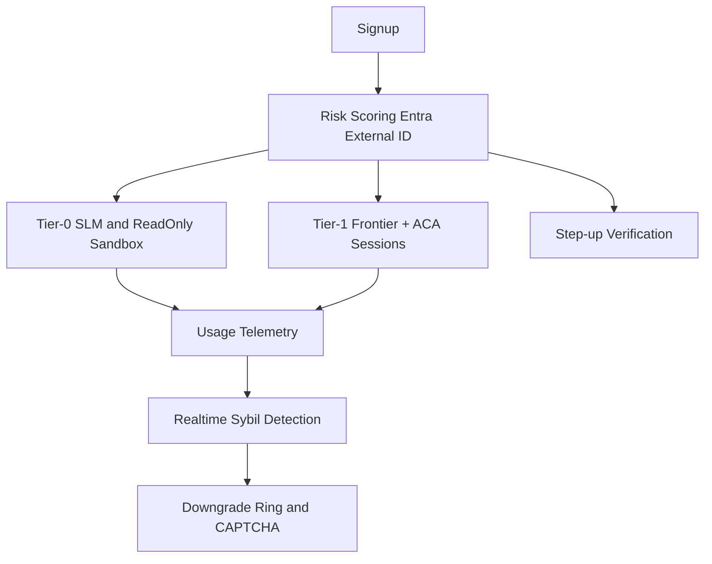
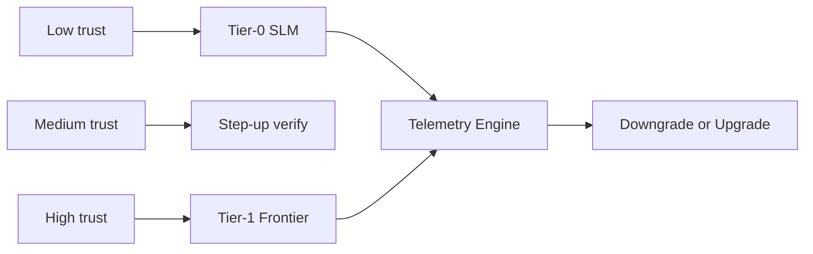
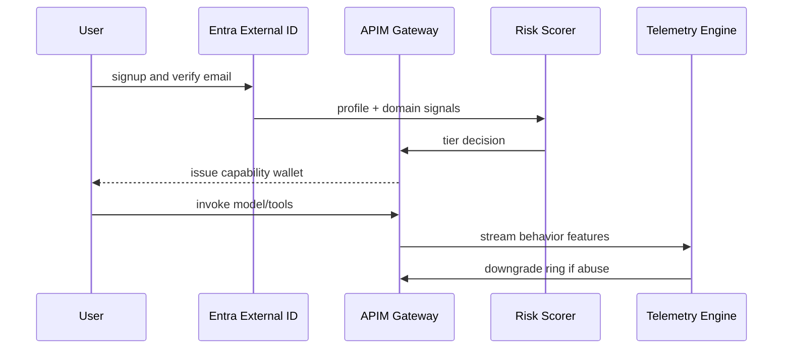

# 企业 AI SaaS PLG 免费试用与反女巫治理选型 FAQ：Entra 渐进信任 vs 卡绑定试用 vs BYOK 沙盒 vs 实时滥用降级环

> 🌐 **Language Switch**：**中文（当前）** | [English](./ai-saas-plg-free-trial-unit-economics-anti-sybil-progressive-trust-entra-apim-vs-card-gated-trial-vs-byok-sandbox-selection-faq.en.md)
> **适用对象**：Cloud & AI Solution Architect、PLG 增长团队、FinOps、反滥用治理团队、SaaS 平台工程与商业化负责人。
> **问题背景**：AI SaaS 在免费试用阶段容易遭遇 Token 套利和批量薅羊毛，需要同时守住转化率、成本上限与品牌体验。

## 1. 为什么 AI SaaS 试用治理必须同时看增长与风控

传统 SaaS 的试用成本主要是存储和席位，而 AI SaaS 的边际成本直接受模型推理消耗驱动。

如果只追求注册量，不做身份和行为分层，很快会被脚本账号和代理转售流量挤占预算。

如果一开始就重门槛拦截，虽然能降低滥用，但会显著损害底层漏斗的自然增长。

因此需要一套“低摩擦获客 + 渐进验证 + 动态降级”的组合策略，而不是单一闸门。

## 2. 四类 PLG 与反女巫架构概览

Architecture A 通过 Entra External ID 与域名画像构建渐进信任，把不同风险用户路由到不同成本层。

Architecture B 采用银行卡指纹唯一化，显著压制多账号薅试用，但会引入显性注册摩擦。

Architecture C 用零边际成本回放体验加 BYOK 深评估，减少 ISV 自身 Token 风险敞口。

Architecture D 基于实时行为遥测做 30 秒内识别与降级，专治“看似正常身份”的高隐蔽套利。

四者并非互斥，成熟企业常把 A 作为主路径，再叠加 B/C/D 形成闭环。

## 3. 漏斗总架构：注册、评分、路由、降级



建议把注册风险、能力钱包、推理预算和实时降级放在同一个策略引擎中统一决策。

这样可以避免“注册通过但后续风控不可见”导致的治理断层。

## 4. Architecture A：渐进信任与模型级联漏斗

A 在注册初始只要求低摩擦信息，并按域名年龄、企业 SSO、邮箱质量、行为一致性进行风险分层。

低信任用户进入 Tier-0 低成本体验，常见上限 `<$0.08/user`，并限制写操作与重型工具链。

企业验证用户自动解锁 Tier-1 Frontier 推理与 ACA 动态会话，典型信用上限 `$8–$15`。

灰区用户只在关键节点触发 Passkey、开发者图谱或 `$1` 3DS2 卡验证，不对全量用户施压。

A 的核心优势是在增长与成本之间保持连续可调，而不是二元放行或阻断。

## 5. Architecture B：卡指纹反向试用

B 在试用开始前要求绑定支付方式，通过 SetupIntent 与发卡行指纹实现“每卡一次试用”约束。

该路径通常可拦截 `96%+` 的一次性批量账号，且付费转化率常见区间 `18%–32%`。

但底部漏斗会出现 `45%–65%` 的注册流失，尤其对开发者自助试用影响明显。

B 适合高客单价或高滥用行业，不适合完全依赖社区裂变增长的产品阶段。

实施 B 时要重点治理误伤，例如企业共享卡、虚拟卡与跨法人集团卡池。

## 6. Architecture C：零 COGS 回放 + BYOK 深评估

C 先提供可交互的确定性回放工作台，用户无需消耗真实推理配额即可感知能力边界。

需要深评估时，用户可绑定自己的企业密钥进入 BYOK 模式，ISV 不承担该段 Token 成本。

该模式特别适合技术采购流程长、PoC 评估复杂的大型 B2B 客户。

C 的关键在于严格会话隔离与密钥生命周期控制，防止 BYOK 泄露或被跨租户复用。

它能显著降低“演示型滥用”成本，却需要更强的产品引导设计来保障体验一致性。

## 7. Architecture D：实时滥用遥测与降级环

D 把事件流送入 Eventhouse/ADX，计算 UI 事件与 LLM 调用比、角色覆盖熵、跨账号 prompt 相似度等特征。

当综合分超过阈值时，在 `<30s` 内把租户降级到 SLM 或 CAPTCHA 环，不必等待人工审核。

该路径可拦截“干净 IP + 盗卡”的隐蔽套利模式，是 A/B/C 的关键补盲层。

D 的风险在于误伤高强度自动化合法用户，需要配套白名单与复核通道。

推荐把降级动作设计为渐进式而非一次封禁，先减配再冻结，降低业务争议。

## 8. 关键公式：CAC、攻击半径与 ARR 盈亏点

PLG 有效获客成本：`CAC_plg = (C_mkt + N_free * COGS_free) / (N_free * CR)`。

周末女巫攻击半径上限：`BlastCap = Min(BudgetCap / Cost_per_abuse, RateLimitWindow * Paths)`。

渐进信任与前置绑卡 ARR 盈亏点：`ARR_break_even = DeltaConversion * ACV - DeltaCOGS - DeltaFraudLoss`。

PQL 校准可用 `PQL = w1*Activation + w2*TeamDepth + w3*GovernanceReadiness`。

当 PQL 高但风险也高时，应先触发验证再升级能力，避免“高活跃=高价值”的误判。



## 9. 12 维定量矩阵（中文）

| 维度 | A 渐进信任 | B 卡绑定试用 | C 回放+BYOK | D 实时降级环 |
|---|---|---|---|---|
| 顶部漏斗通过率 | 高 | 中低 | 高 | 高 |
| 女巫拦截强度 | 中高 | 高 | 中 | 高 |
| 试用单位成本控制 | 高 | 中高 | 高 | 中高 |
| 试用到付费转化 | 中高 | 高 | 中 | 中高 |
| 对智能运营依赖 | 中高 | 中 | 高 | 高 |
| 实施复杂度 | 中 | 中 | 中高 | 高 |
| 误伤风险 | 中 | 中 | 低 | 中高 |
| 企业采购友好度 | 高 | 中 | 高 | 中高 |
| 对支付链路依赖 | 低 | 高 | 低 | 低 |
| 对数据科学能力依赖 | 中 | 低 | 中 | 高 |
| 三年毛利改善潜力 | 高 | 中高 | 高 | 高 |
| 适配产品早期阶段 | 高 | 中 | 高 | 中 |

## 10. 分层路由与降级时序



时序治理重点是把注册时风险与运行时风险关联到同一租户状态，避免跨系统失忆。

所有降级事件都应可追溯到特征证据，支持客户成功和法务沟通。

## 11. 生产片段：APIM 路由策略 + Python 风险评分器

```xml
<policies>
  <inbound>
    <base />
    <set-variable name="trustTier" value="@(context.Request.Headers.GetValueOrDefault("x-trust-tier","tier0"))" />
    <choose>
      <when condition="@(context.Variables.GetValueOrDefault<string>("trustTier") == "tier1")">
        <set-header name="x-model-route" exists-action="override"><value>frontier</value></set-header>
        <set-header name="x-credit-cap" exists-action="override"><value>15</value></set-header>
      </when>
      <otherwise>
        <set-header name="x-model-route" exists-action="override"><value>slm</value></set-header>
        <set-header name="x-credit-cap" exists-action="override"><value>0.08</value></set-header>
      </otherwise>
    </choose>
    <rate-limit-by-key calls="120" renewal-period="60" counter-key="@(context.Subscription.Id)" />
  </inbound>
  <backend><base /></backend>
  <outbound><base /></outbound>
</policies>
```

```python
from dataclasses import dataclass

@dataclass
class SignupSignals:
    domain_age_days: int
    disposable_email: bool
    corporate_sso: bool
    github_graph_score: float
    card_fingerprint_seen: bool

def signup_risk(signals: SignupSignals) -> float:
    risk = 0.0
    risk += 0.35 if signals.domain_age_days < 180 else 0.0
    risk += 0.40 if signals.disposable_email else 0.0
    risk -= 0.25 if signals.corporate_sso else 0.0
    risk -= 0.20 * min(signals.github_graph_score, 1.0)
    risk += 0.30 if signals.card_fingerprint_seen else 0.0
    return max(0.0, min(1.0, risk))

def telemetry_sybil_score(ui_events: int, llm_calls: int, prompt_simhash_overlap: float, tool_call_ratio: float) -> float:
    ratio = llm_calls / max(ui_events, 1)
    score = 0.45 * min(ratio / 3.0, 1.0) + 0.35 * prompt_simhash_overlap + 0.20 * (1.0 - tool_call_ratio)
    return max(0.0, min(1.0, score))
```

## 12. 两类 AI SaaS 场景与 KPI

场景一：DevTools Coding Agent ISV，年度注册 `100K`，大量开发者先试后买，容易出现脚本化滥用。

采用 A+D 组合后，保留较高试用通过率，同时把高风险账户快速降配，毛利率明显改善。

场景二：垂直 Legal/FinOps B2B SaaS，年度注册 `10K`，客单价高但采购周期长。

采用 C+A 组合后，前期演示成本下降，企业验证通过后再进入高价值试用阶段。

| KPI 指标 | DevTools A+D | Vertical SaaS C+A |
|---|---:|---:|
| 试用激活率 | `61%` | `54%` |
| 女巫滥用拦截率 | `93%` | `88%` |
| 试用到付费转化 | `16.8%` | `24.2%` |
| 试用单位成本 | `$0.62` | `$1.48` |
| 年化毛利率变化 | `+6.4pp` | `+4.8pp` |

### 三年 TCO 与毛利影响（10K / 100K / 500K 年注册）

| 架构路径 | 10K signups | 100K signups | 500K signups | 三年总成本 |
|---|---:|---:|---:|---:|
| A Progressive Trust | `$0.48M` | `$2.96M` | `$12.20M` | `$15.64M` |
| B Card-Gated Trial | `$0.52M` | `$3.20M` | `$12.90M` | `$16.62M` |
| C Replay + BYOK | `$0.40M` | `$2.70M` | `$11.40M` | `$14.50M` |
| D Realtime Kill-Switch | `$0.50M` | `$3.02M` | `$12.34M` | `$15.86M` |
| A+D 混合 | `$0.54M` | `$3.18M` | `$12.58M` | `$16.30M` |
| C+A 混合 | `$0.46M` | `$2.82M` | `$11.76M` | `$15.04M` |

## 13. Day-0 / Day-1 / Day-2 落地清单

### Day-0

1. 确认试用分层策略和每层成本上限，建立能力钱包字段规范。

2. 接入 Entra External ID 自定义扩展并定义域名与身份风险信号。

3. 在 APIM 配置模型路由、预算头、速率限制与灰度切换。

4. 定义 step-up 验证触发条件与用户交互文案。

5. 建立实时遥测管道和降级动作编排策略。

6. 与法务确认反滥用证据留存与申诉流程。

### Day-1

1. 每日监控试用漏斗分层转化与成本消耗。

2. 每日审查高风险租户的降级命中与误伤样本。

3. 每周复盘 step-up 验证完成率与放弃率。

4. 每周追踪跨账号 prompt 相似度簇与来源渠道。

5. 每周评估 BYOK 会话密钥生命周期与回收质量。

6. 每周更新 PQL 标注样本，避免评分漂移。

### Day-2

1. 每月重算 CAC_plg 与 ARR 盈亏点，动态调整预算上限。

2. 每月校准风险阈值，按行业与地区分层策略。

3. 每月复盘误伤申诉并优化白名单治理。

4. 每季度评估付款门槛策略对品牌口碑的影响。

5. 每季度做红队演练验证女巫攻击绕过路径。

6. 每季度更新商业化实验计划和产品定价假设。

## 14. 六个量化问答（Q1~Q6）

### Q1: 有效 PLG CAC 如何计算并用于决策？

若营销成本 `C_mkt=$1.2M`，免费用户 `N_free=100,000`，每试用成本 `COGS_free=$0.9`，转化率 `CR=0.16`。

则 `CAC_plg=(1,200,000+100,000*0.9)/(100,000*0.16)=$80.6`，可直接对比 ACV 与回本周期。

### Q2: 周末女巫攻击半径如何设上限？

设滥用单次成本 `$0.22`，周末预算护栏 `$12,000`，理论上限 `12,000/0.22≈54,545` 次。

再叠加速率窗口限制后，实际可触达攻击量将进一步下降，避免预算失控。

### Q3: 渐进信任 vs 前置绑卡 ARR 盈亏点怎么比？

若绑卡方案转化提升 `+4pp`，但顶部漏斗下降 `-52%`，需计算净新增付费用户后再乘 ACV。

当 `DeltaConversion*ACV` 小于漏斗损失与额外运营成本时，前置绑卡并不划算。

### Q4: PQL 激活分如何校准？

可用历史客户样本拟合 `Activation`、`TeamDepth`、`GovernanceReadiness` 权重，并按季度重训。

阈值应与销售接手容量联动，防止“高分过多”稀释跟进质量。

### Q5: 何时优先 C 路径而非 B 路径？

当产品需要大规模技术深评估且试用成本高时，C 能显著降低非转化成本。

当业务更看重快速付费筛选且可接受漏斗摩擦时，B 才更具优势。

### Q6: 实时降级如何降低误伤？

先降配再封禁，并保留短链路复核机制，可把误伤用户快速拉回正常体验。

同时用多特征联合判定替代单阈值，可避免对高活跃合法用户的误判。

## 15. Good fit / Not for 与运行告警字典

Good fit：需要兼顾高速 PLG 增长与严苛成本治理的企业级 AI SaaS 产品。

Not for：几乎无试用成本、无自动化滥用风险或纯线下销售驱动的产品模式。

| 告警键 | 触发条件 | 即时动作 | 责任团队 |
|---|---|---|---|
| `tier0_cost_spike` | Tier-0 成本突升 | 收紧低信任额度并复核模型路由 | FinOps 团队 |
| `signup_sybil_burst` | 新注册相似指纹聚集 | 提升 step-up 强度并限速 | 反滥用团队 |
| `card_dedup_false_positive` | 卡去重误伤升高 | 人工复核并调整去重窗口 | 支付团队 |
| `byok_key_reuse_anomaly` | BYOK 密钥异常复用 | 立即吊销会话并强制换钥 | 平台安全团队 |
| `telemetry_lag_over_30s` | 实时检测延迟超标 | 切换降级保守策略 | 数据平台团队 |
| `pql_drift_alert` | PQL 分布偏移 | 触发评分模型重训 | 增长分析团队 |
| `arr_breakeven_negative` | ARR 盈亏点连续转负 | 调整漏斗门槛与试用权益 | 商业化团队 |
| `appeal_backlog_high` | 申诉积压超阈值 | 临时放宽降级并扩容客服 | 客户成功团队 |

### 参考来源（抓取日期：2026-11-24）

1. Entra External ID documentation: https://learn.microsoft.com/entra/external-id/

2. API Management policy reference: https://learn.microsoft.com/azure/api-management/api-management-policies

3. Azure Event Hubs overview: https://learn.microsoft.com/azure/event-hubs/event-hubs-about

4. Azure Data Explorer overview: https://learn.microsoft.com/azure/data-explorer/data-explorer-overview

5. Azure Cache for Redis documentation: https://learn.microsoft.com/azure/azure-cache-for-redis/

6. Azure Container Apps sessions: https://learn.microsoft.com/azure/container-apps/sessions

以上来源用于约束身份分层、网关路由、遥测检测与动态降级机制的工程边界。

阈值需要按产品阶段、客群结构和攻击态势持续调优，避免增长与治理失衡。
