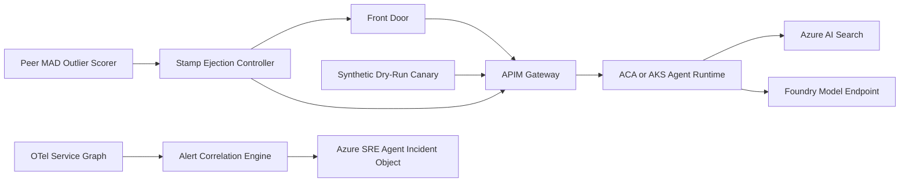
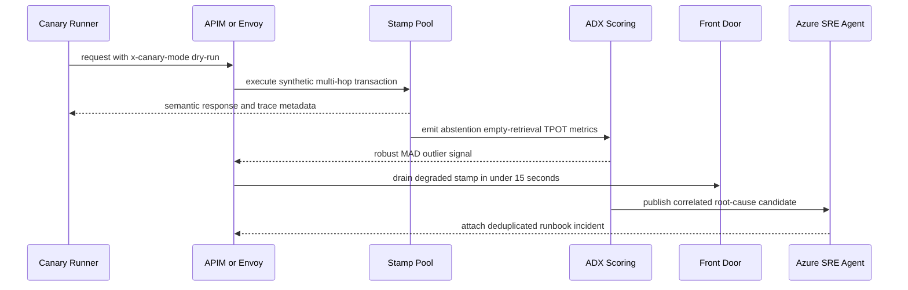
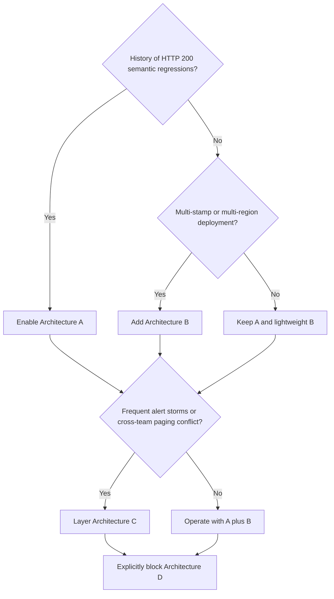

# Enterprise AI Agent Gray-Failure Detection Selection FAQ: Semantic Dry-Run Canary Mesh vs Peer-Outlier Stamp Ejection vs OTel Causal-DAG Alert Correlation vs Static-Threshold Anti-Pattern
> **Audience**: Cloud & AI Solution Architects, AIOps platform owners, SRE teams, incident commanders, and on-call governance leads.
> **Decision focus**: detect and isolate `HTTP 200` semantic blackholes before customers escalate, while keeping token budget, false-ejection risk, and alert-noise volume under disciplined control.
> **Recommended posture**: run A+B as the default production baseline, layer C for alert-storm compression and incident deduplication, and explicitly ban D in production runbooks and architecture review checklists.

## 1. Executive summary
As enterprise agent systems evolve into multi-hop transaction graphs, failure semantics shift.
Outages no longer require hard transport failure to create business damage.
Many high-impact incidents now present as successful status codes with degraded semantic outcomes.
Examples include zero-hit retrieval amnesia, malformed tool-call JSON after fallback, stale prompt-cache behavior, and order-of-magnitude TPOT inflation.
Classical health probes are blind to these conditions because liveness survives while usefulness collapses.
Production reliability therefore requires semantic observability, not only network observability.
Architecture A introduces deterministic synthetic dry-run canary transactions across the full chain.
Architecture B introduces passive peer-differential robust outlier scoring with sub-stamp ejection.
Architecture C introduces topology-aware alert correlation and incident deduplication based on OTel service graphs.
Architecture D demonstrates why shallow `/healthz` checks plus independent static thresholds fail in modern AI agent stacks.
This guide quantifies MTTD-versus-token-budget trade-offs, robust MAD outlier behavior, and alert-compression economics.
The objective is to turn gray-failure handling into repeatable platform capability instead of heroic incident improvisation.

## 2. Why gray failures are harder than hard outages
Hard outages are explicit and therefore easy to detect.
Gray failures are implicit and often hidden inside nominal success responses.
Systems look available while user outcomes silently degrade.
Customers then become the earliest monitoring layer, which is the wrong ordering.
In multi-component chains, retries and caches can temporarily mask degradation.
Masking delays detection until impact accumulates and bursts into visible incident volume.
By then, blast radius is wider and forensic ambiguity is higher.
Therefore reliable operations need both proactive and passive detection surfaces.
Proactive canaries discover semantic drift early.
Passive peer scoring catches asymmetric local degradation between canary intervals.
Correlation logic then converts noisy symptoms into root-cause-centered incident flow.

## 3. Goals and boundaries
Goal one is minute-scale and predictable MTTD for semantic regressions.
Goal two is sub-stamp containment so local degradation does not become regional degradation.
Goal three is alert-noise compression into operator-actionable incident objects.
Goal four is controlled synthetic token spend with explicit FinOps guardrails.
Goal five is evidence-rich post-incident replay and threshold tuning loops.
Boundary one is not zero false positives, but explainable and reversible ejection decisions.
Boundary two is not single-signal authority, but multi-signal corroboration with policy gates.
Boundary three is not static-threshold primacy, but adaptive robust statistics under changing load shapes.

## 4. Candidate architectures
Architecture A executes semantic dry-run canary transactions through `Front Door -> APIM -> ACA/AKS -> AI Search -> Foundry`, with side-effect-free MCP stubs and invariant assertions.
Architecture B computes robust peer-outlier scores on `60s` windows for abstention, empty-retrieval ratio, tool-retry count, and p95 TPOT, then drains degraded backends via APIM/Envoy/Front Door.
Architecture C groups cascading alerts by OTel causal DAG and invokes Azure Monitor processing plus Azure SRE Agent deduplicated runbook tickets.
Architecture D relies on shallow TCP/HTTP `200` checks and disconnected static thresholds.
A solves proactive semantic detection blind spots.
B solves asymmetric local performance and quality degradation.
C solves operator overload during dependency-driven alert storms.
D repeatedly misses real customer harm and over-pages on low-value noise.

## 5. Architecture A deep dive: semantic dry-run canary mesh
The value of A is deterministic semantic contract validation, not just synthetic traffic generation.
Each canary scenario should traverse retrieval, tool invocation, model generation, and structured output checks.
All potential side effects are routed to dry-run stubs by default.
This keeps canary frequency high without mutating production state.
Canary prompts should use compact templates and mini-model variants where feasible.
Assertions should include schema integrity, citation behavior, abstention logic, and latency envelopes.
Scenarios should be stratified by region, tenant criticality, and workload type.
This enables high detection coverage with bounded token spend.
Canary failures should trigger policy-calibrated containment actions rather than immediate global failover.
A works best when integrated with replayable scenario catalogs and versioned invariant definitions.

## 6. Architecture B deep dive: robust peer-outlier scoring and stamp ejection
B assumes co-located peers running equivalent code should show comparable behavior distributions.
When one stamp persistently deviates across semantic and latency indicators, local degradation is likely.
Median and MAD provide robust statistics under skewed and bursty distributions.
Compared with mean and standard deviation, MAD reduces sensitivity to heavy-tail noise.
A common policy is `Z_i > 3.5` across one or more key metrics over multiple windows.
Ejection should be staged: weight reduction, partial drain, then full drain if degradation persists.
Recovery should require explicit cool-down and validation windows to prevent flapping.
B protects customer experience by confining damage before broad route-level failure manifests.
B also shortens operator decision loops because ejection policies can be pre-approved and auditable.

## 7. Architecture C deep dive: causal-DAG alert compression and deduplication
C addresses the human bottleneck in incident response.
When a shared dependency degrades, dozens of downstream services can emit symptom alerts simultaneously.
Without correlation, paging load explodes and triage quality falls.
OTel span linkage provides causal topology for grouping alerts into root-cause clusters.
Azure Monitor processing rules can suppress derivative alerts once root cause is established.
Azure SRE Agent can create a single incident object with runbook context and impacted-surface projection.
Operators then spend time on mitigation, not on duplicate-ticket reconciliation.
C typically reduces alert fan-out dramatically in dependency-centered failure events.
The outcome is lower cognitive load, faster containment, and better post-incident accountability.

## 8. Architecture D anti-pattern analysis
D treats health as availability and availability as correctness.
That assumption does not hold in LLM-centric multi-hop systems.
A route can remain reachable while semantic quality has already crossed failure thresholds.
Static disconnected thresholds further amplify noise during transient fluctuations.
Teams are then paged for symptom variance while true semantic failures remain hidden.
Customer-visible degradation can persist for hours before a meaningful incident is assembled.
D therefore fails both early detection and efficient response.
Production governance should classify D as a prohibited strategy for critical workloads.

## 9. Quantitative models and operating equations
For canary interval `Δt` and confirmation factor `k`, approximate:
`MTTD ≈ Δt / 2 + k * Δt`
`Δt / 2` represents average arrival offset before first detection opportunity.
For `Δt=60s` and `k=2`, expected detection is around 150 seconds.
Robust peer outlier score:
`Z_i = (x_i - median(x)) / (1.4826 * MAD(x))`
False-ejection risk declines when multiple independent metrics exceed threshold concurrently.
Alert-storm compression ratio:
`Compression = N_raw_alerts / N_correlated_incidents`
In shared dependency incidents, observed values often range from `20:1` to `100:1`.
Synthetic canary budget:
`Cost_canary = N_runs * Tokens_per_run * Price_per_token`
FinOps controls include mini-model prompts, cache-friendly templates, and risk-tiered scheduling.

## 10. Twelve-dimension architecture matrix
| Dimension | Architecture A | Architecture B | Architecture C | Architecture D |
|---|---|---|---|---|
| Gray-failure detection power | High | Medium-High | Medium | Low |
| Local degradation isolation speed | Medium | High | Medium | Low |
| Alert-storm suppression | Medium | Medium | Highest | Low |
| False-action controllability | Medium-High | High | High | Low |
| Cost predictability | Medium-High | High | Medium-High | Superficially high |
| Operational complexity | Medium | Medium-High | High | Low |
| Rollback traceability | High | High | Medium-High | Low |
| Multi-region suitability | High | High | High | Medium |
| Existing monitor compatibility | High | High | High | Medium |
| Recommended role | Proactive detection backbone | Automatic containment backbone | Response compression backbone | Prohibited |
| Typical measurable gain | Lower semantic miss rate | Lower blast radius | Lower paging entropy | None |
| Net recommendation | Required | Required | Strongly recommended | Reject |

## 11. Gray-failure detection and ejection control plane


## 12. Sequence: canary, peer outlier, drain, and root-cause ticket


## 13. Selection decision tree


### Q1. Why must semantic canaries be isolated into dry-run paths
Using production write paths for probes introduces unintended side effects.
Dry-run routing allows high-frequency probing without state contamination.
That shift turns canaries from occasional tests into continuous diagnostics.
Semantic probes also validate logic layers that liveness probes cannot see.
For multi-hop agent stacks, this is foundational for gray-failure detection.
Without dedicated dry-run channels, probe quality and trust degrade over time.

### Q2. Why is MAD-based peer ejection preferable to mean-threshold gating
Mean-based thresholds are fragile under heavy-tail and bursty distributions.
MAD stays robust when a subset of peers is already distorted.
Peer-relative scoring also removes global traffic level bias.
When semantic and latency metrics co-deviate, confidence improves further.
Cooldown and multi-window persistence policies reduce ejection flapping.
This makes B better suited for autonomous containment in production noise.

### Q3. How should synthetic token cost be controlled
Prefer mini-model prompts and reusable cached templates.
Separate invariant skeletons from variable slot values for stable prompt economics.
Run high-frequency probes only on high-risk journeys and high-criticality tenants.
Use lower-frequency sentinel probes on historically stable paths.
Tune frequency with observed detection gain rather than fixed global cadence.
This keeps detection coverage high while token spend remains predictable.

### Q4. Does alert correlation hide useful signals
Correlation should deduplicate, not discard.
Raw alerts must remain linkable to correlated root-cause incidents.
Operators need one root ticket with expandable symptom context.
This design lowers noise while preserving diagnostic granularity.
Well-implemented correlation improves response quality and postmortem clarity.
Poorly implemented suppression without traceability should be rejected.

### Q5. When should ejection be automatic versus operator-confirmed
Automatic ejection is appropriate when robust outlier thresholds persist across windows and peer baselines remain healthy.
Operator confirmation is appropriate when data quality is uncertain or when workload criticality demands human sign-off.
A staged strategy can begin with weight reduction before full drain.
Critical tenants may require stricter recovery gates before re-entry.
Policy should encode business tolerance and rollback confidence explicitly.
The key is reversible decisions with complete audit trails.

### Q6. Five-step rollout and Good fit vs Not for
Step one: catalog critical user journeys and define semantic invariants with versioned ownership.
Step two: deploy Architecture A dry-run canary mesh and FinOps budget monitors.
Step three: deploy Architecture B robust peer scoring and staged ejection policies.
Step four: deploy Architecture C OTel-based correlation and incident deduplication workflows.
Step five: enforce Architecture D prohibition through review gates and runbook linting.
Good fit: multi-region, multi-stamp, SLA-sensitive agent platforms with continuous operations.
Not for: single-node demos or short-lived experiments without sustained operational accountability.

## 14. Implementation snippets
```kql
let win = 60s;
let m = AgentRuntimeMetrics
| where Timestamp > ago(15m)
| summarize
    p95_tpot = percentile(TPOT_ms, 95),
    abstention = avg(toint(IsAbstain)),
    empty_ratio = avg(toint(RetrievalDocCount == 0)),
    retry_ratio = avg(ToolRetryCount)
  by bin(Timestamp, win), Region, StampId;
let p = m
| summarize
    med_tpot = percentile(p95_tpot, 50),
    mad_tpot = percentile(abs(p95_tpot - percentile(p95_tpot, 50)), 50),
    med_empty = percentile(empty_ratio, 50),
    mad_empty = percentile(abs(empty_ratio - percentile(empty_ratio, 50)), 50)
  by bin(Timestamp, win), Region;
m
| join kind=inner p on Region, Timestamp
| extend z_tpot = (p95_tpot - med_tpot) / (1.4826 * iff(mad_tpot == 0, 0.001, mad_tpot))
| extend z_empty = (empty_ratio - med_empty) / (1.4826 * iff(mad_empty == 0, 0.001, mad_empty))
| where z_tpot > 3.5 or z_empty > 3.5
| project Timestamp, Region, StampId, p95_tpot, empty_ratio, z_tpot, z_empty
```

```python
from dataclasses import dataclass
from typing import Any

@dataclass
class Check:
    ok: bool
    reason: str

def headers() -> dict[str, str]:
    return {"x-canary-mode": "dry-run", "x-agent-scenario": "gray_failure_probe"}

def verify(response: dict[str, Any]) -> Check:
    answer = str(response.get("answer", "")).strip()
    citations = response.get("citations", [])
    retrieval = int(response.get("retrieval_doc_count", 0))
    tool_payload = response.get("tool_payload", {})
    if len(answer) < 50:
        return Check(False, "answer_too_short")
    if retrieval == 0 and "cannot" not in answer.lower() and "无法" not in answer:
        return Check(False, "silent_empty_retrieval")
    if not isinstance(tool_payload, dict) or "action" not in tool_payload:
        return Check(False, "tool_payload_invalid")
    if response.get("need_citation", True) and len(citations) == 0:
        return Check(False, "missing_citation")
    return Check(True, "ok")
```

```bicep
param workspaceId string

resource rule 'Microsoft.Insights/scheduledQueryRules@2023-12-01' = {
  name: 'gray-failure-root-cause-correlation'
  location: resourceGroup().location
  properties: {
    enabled: true
    evaluationFrequency: 'PT1M'
    windowSize: 'PT5M'
    scopes: [
      workspaceId
    ]
    severity: 2
    criteria: {
      allOf: [
        {
          query: 'GrayFailureCorrelated | where compression_ratio > 20 and incident_count > 0'
          operator: 'GreaterThan'
          threshold: 0
          timeAggregation: 'Count'
          metricMeasureColumn: 'incident_count'
        }
      ]
    }
  }
}
```

## 15. Three-tier enterprise TCO framing
| Tier | Deployment profile | Recommended architecture mix | Dominant cost drivers | Core operational gain |
|---|---|---|---|---|
| Tier-1 | Single-region moderate traffic | A plus lightweight B | Canary token spend and baseline indexing | Earlier semantic failure detection |
| Tier-2 | Multi-region multi-stamp SaaS | A plus B plus C | Robust scoring compute and correlation automation | Lower MTTD and lower MTTR |
| Tier-3 | High-compliance high-SLA platforms | Hardened A plus B plus C | Tenant-specific policy operations and drills | Controlled blast radius and deduplicated response |

## 16. Production readiness checklist
Confirm all canary requests enforce `x-canary-mode: dry-run` and side-effect blockers.
Confirm invariant checks cover answer quality, citation integrity, tool JSON shape, and retrieval consistency.
Confirm canary cadence tiers map to explicit token-budget thresholds and alerts.
Confirm MAD outlier grouping separates region, version, and hardware cohort dimensions.
Confirm ejection actions support weight reduction, partial drain, and full drain stages.
Confirm ejection includes minimum residence timers and validated re-entry gates.
Confirm OTel trace keys bridge Front Door, APIM, runtime, retrieval, and model layers.
Confirm correlation rules preserve raw-to-root mapping instead of dropping original evidence.
Confirm SRE Agent runbook execution is idempotent and rollback-aware.
Confirm on-call dashboards expose both root-incident count and raw alert volume.
Confirm postmortem templates record compression ratio, false-ejection rate, and recovery latency.
Confirm quarterly drills cover regional jitter, single-stamp degradation, and shared dependency failures.

## 17. Operational lessons and optimization guidance
Version semantic invariants alongside application release versions to prevent assertion drift.
Use peak and off-peak differentiated canary cadence curves rather than static cadence.
Model seasonality in canary outcomes to separate cyclical variation from true degradation.
Add graylist states in B to avoid repeated ejection and re-entry thrashing.
Audit automatic ejection with a parallel human-review trail for sensitive tenants.
Export C-layer correlation outputs into cross-team incident systems for coordination.
Track mean handling time after correlation as a governance KPI.
Feed false-ejection samples back into threshold tuning datasets automatically.
Set stricter re-entry gates for premium or high-regulation tenant cohorts.
Monitor canary health itself to avoid silent probe-plane degradation.
Decouple policy-release windows from feature-release windows where possible.
Review stability, cost, and operator-efficiency metrics together each quarter.

## 18. Conclusion
Gray-failure resilience is not achieved by generating more alerts for humans; it is achieved by routing the right semantic signals to the right automated and human actions quickly.
Architecture A establishes proactive semantic visibility, Architecture B enables fast local containment, and Architecture C converts paging noise into root-cause-centered incident flow, which together reduces the customer-first-detection anti-pattern.
Architecture D reflects outdated assumptions that equate liveness with correctness and should be blocked by both policy and control-plane safeguards.
When A, B, and C operate as one governed loop, enterprises gain predictable MTTD, explainable ejection decisions, auditable incident chains, and sustainable reliability economics at scale.
