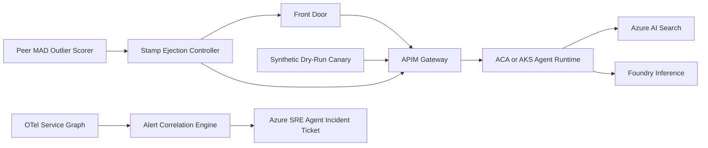
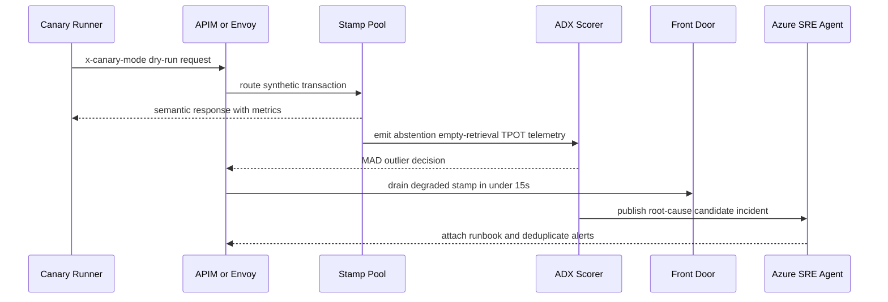
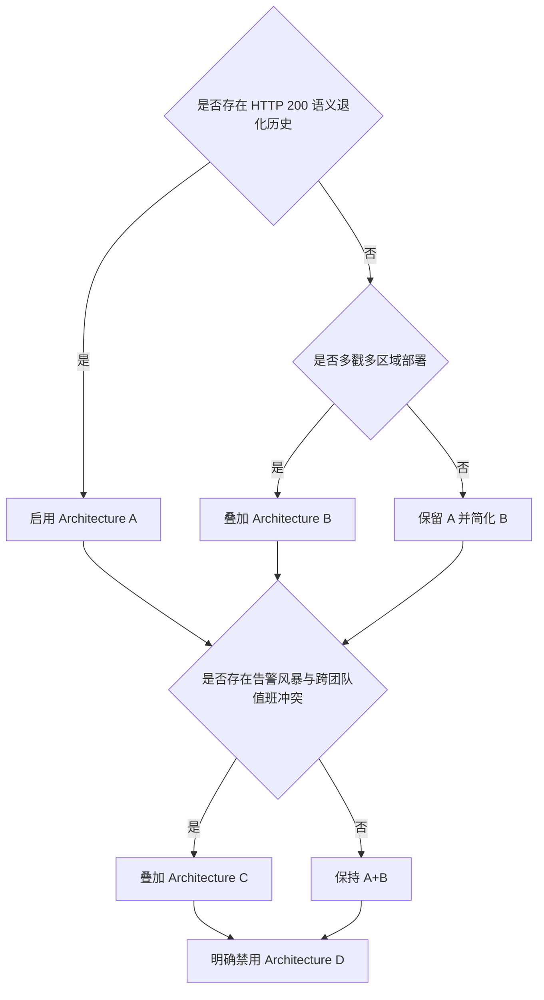

# 企业 AI Agent 灰故障检测选型 FAQ：语义 Canary 干跑网格 vs 同伴离群逐戳排空 vs OTel 因果 DAG 告警压缩 vs 静态阈值反模式
> **适用角色**：Cloud & AI Solution Architect、AIOps 负责人、平台 SRE、值班与事件响应团队。
> **决策焦点**：如何在 `HTTP 200` 仍然返回的“语义黑洞”场景下，实现分钟级发现、秒级隔离、告警去风暴与成本可控的生产治理。
> **建议摘要**：默认 A+B 组合，跨域告警压缩叠加 C，D 作为强制禁用项写入运行手册与评审模板。

## 1. 执行摘要
企业 Agent 系统进入多跳链路时代后，故障表现已不再等价于连接失败。
越来越多事故发生在“接口看似可用，但语义质量明显退化”的灰故障区间。
典型现象包括 RAG 命中骤降、工具 JSON 结构残缺、回答礼貌却空洞、TPOT 成倍增长。
这类问题往往返回 `200 OK`，传统 `/healthz` 与静态阈值难以及时发现。
生产治理必须从“存活探测”升级为“语义完整性探测”。
Architecture A 提供端到端干跑语义探针链路。
Architecture B 提供同区域同伴鲁棒离群检测与自动排空。
Architecture C 提供 OTel 因果图压缩与告警风暴去重。
Architecture D 展示仅靠 TCP/HTTP 存活探测的系统性盲点。
本文给出 MTTD 近似公式、MAD 误逐出概率讨论、告警压缩比与三档 TCO。
目标是把灰故障治理做成可持续运营能力，而不是故障后临时修补。

## 2. 背景：灰故障为何比硬故障更难
硬故障通常显式中断，监控系统容易捕获。
灰故障则隐藏在成功状态码之内，具有高迷惑性。
系统表面可用，但业务语义已偏离期望轨道。
客户往往先感知体验下滑，平台后感知指标异常。
这导致发现时序反转，放大品牌与 SLA 风险。
在多组件链路中，单点微退化还会被重试与缓存掩盖。
当缓存过期或负载切换时，问题才集中爆发。
因此需要主动探针与被动差分协同，而不是单一监测机制。

## 3. 目标与边界
目标一：把灰故障 MTTD 压到分钟级并可预测。
目标二：把单戳退化的扩散半径限制在最小流量面。
目标三：把告警风暴压缩为可执行根因工单。
目标四：把探针成本控制在可预算范围内。
目标五：把治理证据沉淀为可复盘运营资产。
边界一：不追求“零误报”，而追求“可解释可回滚的误报控制”。
边界二：不把单个策略引擎作为唯一真相来源。
边界三：不把静态阈值当作复杂链路的主监测手段。

## 4. 四类候选架构
Architecture A：`x-canary-mode: dry-run` 多区域语义交易探针，贯穿 `Front Door -> APIM -> ACA/AKS -> AI Search -> Foundry`，并在 MCP 层使用无副作用 stub。
Architecture B：基于 `median + MAD` 的同伴离群评分，按 `60s` 滑窗比较 abstention、empty-retrieval、tool-retry、TPOT，并触发 `APIM/Envoy/Front Door` 子戳排空。
Architecture C：OpenTelemetry 服务图根因聚合，结合 Azure Monitor 告警处理规则与 Azure SRE Agent 事件去重。
Architecture D：只做 TCP/HTTP `200` 探测并叠加静态独立阈值告警。
A 解决“主动发现”的盲区。
B 解决“局部退化”的细粒度隔离。
C 解决“告警雪崩”的人效坍塌。
D 在复杂链路下几乎必然漏报语义性事故。

## 5. Architecture A 深入：语义 Canary 干跑网格
A 的关键不是多发探针，而是“探针语义契约化”。
每条 canary 交易都应覆盖检索、工具调用、模型推理与输出校验。
所有写操作在 dry-run 模式下路由到无副作用 stub。
这保证探针可高频执行而不污染业务状态。
探针输入应采用小模型提示与缓存模板，控制 token 成本。
输出校验不只看文本相似度，还要看结构字段与引用完整性。
探针应按区域、租户级别、场景类型分层抽样。
这样可以在成本可控前提下维持足够覆盖密度。
当探针连续失败时，触发自动旁路策略与人工复核流程。

## 6. Architecture B 深入：同伴离群与子戳逐出
B 的核心假设是同区域同版本节点行为分布应近似一致。
若某个戳在多个语义指标上持续偏离中位数，可判断为灰退化候选。
相比均值标准差，MAD 对异常值更鲁棒。
在负载不均匀场景下，MAD 可降低误判敏感性。
策略可设为 `Z_i > 3.5` 且持续 `n` 个窗口后触发排空。
排空动作应支持分级：降权、半排空、全排空。
为防抖动，应配置最小驻留时间与恢复探针门槛。
B 的收益是把“局部异常”切在局部，不让全局流量陪跑。
B 与 A 互补：A 发现趋势，B 执行快速隔离。

## 7. Architecture C 深入：因果 DAG 告警压缩
C 面向的不是检测，而是响应效率。
当共享依赖故障时，下游系统会同时出现大量症状告警。
若不聚合，值班团队会被重复页面淹没。
OTel span 图提供天然的因果链索引。
可将多个症状告警映射到同一上游根因 span。
告警处理规则把重复告警折叠为单事件并关联上下文。
Azure SRE Agent 可基于历史 runbook 给出预验证动作序列。
这让“先止血再定位”变为“定位即止血”。
C 的价值体现在人效与 MTTR 双重下降。

## 8. Architecture D 反模式说明
D 只看存活，不看语义。
系统可能持续返回 200，但答案质量已经不可用。
静态阈值又容易在短时抖动中触发级联告警。
结果是关键问题漏掉，噪声问题放大。
值班人员在错误方向耗费大量精力。
客户体验问题会先于平台告警暴露。
在公众渠道扩散后再定位，修复成本会成倍增加。
因此 D 应作为禁止项写入生产标准。

## 9. 数学模型与容量推导
探针周期记为 `Δt`，连续 `k` 次失败确认异常，则：
`MTTD ≈ Δt / 2 + k * Δt`
其中 `Δt/2` 代表随机到达近似平均等待时间。
若 `Δt=60s` 且 `k=2`，理论 MTTD 约 150 秒。
MAD 离群评分可写为：
`Z_i = (x_i - median(x)) / (1.4826 * MAD(x))`
当 `Z_i > 3.5` 且多指标同向偏离时，误逐出概率显著下降。
告警压缩比定义为：
`Compression = N_raw_alerts / N_correlated_incidents`
在共享依赖退化场景，实践中可见 `20:1` 到 `100:1` 区间。
探针成本预算可写为：
`Cost_canary = N_runs * Tokens_per_run * Price_per_token`
通过 mini 模型与缓存模板可把预算压在可控范围。

## 10. 12 维架构对比矩阵
| 维度 | Architecture A | Architecture B | Architecture C | Architecture D |
|---|---|---|---|---|
| 语义灰故障发现能力 | 高 | 中高 | 中 | 低 |
| 局部异常隔离速度 | 中 | 高 | 中 | 低 |
| 告警风暴抑制 | 中 | 中 | 最高 | 低 |
| 误报可控性 | 中高 | 高 | 高 | 低 |
| 成本可预测性 | 中高 | 高 | 中高 | 表面高 |
| 运维复杂度 | 中 | 中高 | 高 | 低 |
| 回滚可执行性 | 高 | 高 | 中高 | 低 |
| 跨区域适配 | 高 | 高 | 高 | 中 |
| 与现有监控兼容 | 高 | 高 | 高 | 中 |
| 推荐角色 | 主动发现主链 | 自动隔离主链 | 响应压缩主链 | 禁用 |
| 典型收益 | 降低漏报 | 降低扩散 | 降低噪声 | 无 |
| 综合建议 | 必选 | 必选 | 建议叠加 | 反模式 |

## 11. 灰故障检测与排空控制平面


## 12. 探针、离群与根因聚合时序


## 13. 选型决策树


### Q1. 为什么必须把语义探针独立成干跑链路
直接用真实写路径做探针会污染业务状态。
干跑链路可高频执行且不会引发副作用。
这让探针从“偶尔演练”变成“持续体检”。
语义探针还能覆盖健康探针无法覆盖的逻辑层。
对于 Agent 多跳调用链，这是识别灰故障的基础能力。
没有独立干跑链路，检测质量会长期不稳定。

### Q2. MAD 离群逐出为什么优于均值阈值
均值对极端值敏感，在噪声高时容易误判。
MAD 对离群点更稳健，适合在线生产数据。
同伴比较还能抵消全局流量涨落影响。
当多个语义指标共同偏离时，判断更可靠。
结合持续窗口与最小驻留时间可降低抖动。
因此 B 在复杂负载场景更适合自动排空。

### Q3. 如何控制探针 token 成本
优先使用 mini 模型和缓存模板。
把探针提示词拆分为固定骨架与变量槽位。
高风险场景高频探测，低风险场景低频轮询。
按区域和租户分层抽样，避免全量等频探测。
对历史稳定链路可逐步下调频率。
这样可以在可接受预算内维持检测覆盖。

### Q4. 告警压缩是否会隐藏真实故障
压缩目标是去重，不是丢弃。
C 需要保留原始告警与关联映射可追溯链。
根因事件应附带受影响下游列表。
值班人员可从单事件展开查看全部症状。
这样既降低噪声，又不牺牲可见性。
正确设计的压缩会提升而非削弱诊断质量。

### Q5. 何时应触发自动排空而非人工确认
当离群评分超过阈值且持续多个窗口时。
当语义指标与延迟指标同时退化时。
当同区域同版本其余节点保持稳定时。
这类条件下自动排空风险可控且收益高。
对于关键租户可先半排空再全排空。
最终策略应由业务容忍度与恢复成本共同决定。

### Q6. 五步落地与 Good fit / Not for
第一步：梳理关键用户旅程并定义语义不变量断言。
第二步：上线 A 的 dry-run canary 网格与预算看板。
第三步：部署 B 的 MAD 同伴评分与分级排空策略。
第四步：部署 C 的 OTel 因果聚合与告警处理规则。
第五步：将 D 写入禁用清单并纳入评审门禁。
Good fit：多区域、多戳、多跳 Agent 链路且存在严格 SLA 的平台。
Not for：单节点实验环境或无持续运营责任的临时演示系统。

## 14. 生产实现片段
```kql
let window = 60s;
let metric = AgentRuntimeMetrics
| where Timestamp > ago(15m)
| summarize
    p95_tpot = percentile(TPOT_ms, 95),
    abstention = avg(toint(IsAbstain)),
    empty_retrieval = avg(toint(RetrievalDocCount == 0)),
    tool_retry = avg(ToolRetryCount)
  by bin(Timestamp, window), StampId, Region;
let peers = metric
| summarize
    med_tpot = percentile(p95_tpot, 50),
    mad_tpot = percentile(abs(p95_tpot - percentile(p95_tpot, 50)), 50),
    med_abstention = percentile(abstention, 50),
    mad_abstention = percentile(abs(abstention - percentile(abstention, 50)), 50)
  by bin(Timestamp, window), Region;
metric
| join kind=inner peers on Region, Timestamp
| extend z_tpot = (p95_tpot - med_tpot) / (1.4826 * iff(mad_tpot == 0, 0.001, mad_tpot))
| extend z_abstention = (abstention - med_abstention) / (1.4826 * iff(mad_abstention == 0, 0.001, mad_abstention))
| where z_tpot > 3.5 or z_abstention > 3.5
| project Timestamp, Region, StampId, p95_tpot, abstention, z_tpot, z_abstention
```

```python
import json
from dataclasses import dataclass
from typing import Any

@dataclass
class InvariantResult:
    ok: bool
    reason: str

def verify_semantic_invariants(resp: dict[str, Any]) -> InvariantResult:
    citations = resp.get("citations", [])
    tool_payload = resp.get("tool_payload", {})
    answer = resp.get("answer", "")
    if len(answer.strip()) < 40:
        return InvariantResult(False, "answer_too_short")
    if resp.get("retrieval_doc_count", 0) == 0 and "无法" not in answer:
        return InvariantResult(False, "empty_retrieval_without_abstain")
    if not isinstance(tool_payload, dict):
        return InvariantResult(False, "tool_payload_not_object")
    if "action" not in tool_payload:
        return InvariantResult(False, "missing_tool_action")
    if len(citations) == 0 and resp.get("need_citation", True):
        return InvariantResult(False, "missing_citations")
    return InvariantResult(True, "ok")

def dry_run_headers() -> dict[str, str]:
    return {"x-canary-mode": "dry-run", "x-agent-scenario": "semantic_probe"}
```

```bicep
param profileName string
param monitorWorkspaceId string

resource afdProfile 'Microsoft.Cdn/profiles@2024-02-01' existing = {
  name: profileName
}

resource alertRule 'Microsoft.Insights/scheduledQueryRules@2023-12-01' = {
  name: 'gray-failure-correlation-rule'
  location: resourceGroup().location
  properties: {
    enabled: true
    evaluationFrequency: 'PT1M'
    windowSize: 'PT5M'
    scopes: [
      monitorWorkspaceId
    ]
    severity: 2
    criteria: {
      allOf: [
        {
          query: 'GrayFailureCorrelated | where compression_ratio > 20 and incident_count > 0'
          timeAggregation: 'Count'
          operator: 'GreaterThan'
          threshold: 0
          metricMeasureColumn: 'incident_count'
        }
      ]
    }
  }
}
```

## 15. 三档企业 TCO（灰故障治理）
| 档位 | 场景规模 | 推荐组合 | 成本主驱动 | 核心收益 |
|---|---|---|---|---|
| Tier-1 | 单区域中等流量 | A + 轻量 B | 探针 token 与基础索引 | 把语义漏报显著前移 |
| Tier-2 | 多区域多戳 SaaS | A + B + C | 同伴评分计算与告警编排 | 缩短 MTTD 与 MTTR |
| Tier-3 | 高合规高 SLA 行业 | A + B + C 强化 | 多租户分层策略与演练治理 | 控制扩散并压缩告警风暴 |

## 16. 上线核查清单
应确认所有 canary 请求默认带 `x-canary-mode: dry-run` 并禁止写副作用。
应确认语义断言覆盖答案长度、引用完整性、工具 JSON 结构、检索命中一致性。
应确认探针频率分层与 token 预算阈值联动告警。
应确认 MAD 离群评分按区域、版本、机型分组，避免跨异构比较。
应确认逐出策略具备降权、半排空、全排空三级动作。
应确认逐出动作包含最小驻留时间与自动恢复门槛。
应确认 OTel span 关联键可贯通 Front Door、APIM、运行时、检索与模型层。
应确认告警压缩规则保留原始告警映射而非简单丢弃。
应确认 SRE Agent 触发 runbook 前有幂等保护与回滚步骤。
应确认值班看板区分“根因事件数”与“原始告警量”双指标。
应确认事故复盘模板包含压缩比、误逐出率、恢复时延。
应确认季度演练覆盖区域级抖动、单戳退化、共享依赖故障三类场景。

## 17. 运营经验与优化建议
建议把语义不变量版本与业务版本绑定管理，避免断言漂移。
建议在高峰时段与低峰时段采用不同探针频率曲线。
建议把 canary 历史结果做季节性建模，识别周期性波动。
建议为 B 架构引入“灰名单”机制，防止边缘节点频繁进出。
建议对排空动作保留“自动+人工复核”双轨审计。
建议把 C 架构压缩结果同步到事件平台用于跨团队协同。
建议跟踪“告警压缩后的人均处理时长”作为治理 KPI 指标。
建议将误逐出样本自动回流到阈值调优数据集。
建议为关键租户设置更严格的恢复确认门槛。
建议建立“探针失真”监控，防止探针本身失效。
建议把策略变更窗口与发布窗口解耦，减少联动风险并提升稳定性。
建议将成本、稳定性、人效三类指标统一纳入季度评审。

## 18. 结论
灰故障治理的关键不是把更多告警堆给值班人员，而是把正确信号更快送达正确动作链路。
A 让系统具备语义级主动发现能力，B 让局部退化在秒级被隔离，C 让告警噪声压缩为可执行根因事件，三者协同后可显著降低客户先感知、平台后感知的被动局面。
D 所代表的“健康即成功”思维在现代 Agent 多跳体系中已不成立，应通过制度与技术双重门禁彻底退出生产面。
当 A/B/C 在同一控制平面联动并长期运行，平台将获得可预测的 MTTD、可解释的隔离决策、可复盘的事件链与可持续的运营成本结构，这正是企业级 AIOps 从监控走向治理的分界线，并能把可靠性管理从“故障后响应”升级为“故障前抑制 + 故障中收敛 + 故障后学习”的闭环能力。

## 19. 补充实践要点
建议把探针场景按“检索主导、工具主导、长上下文主导、跨租户隔离主导”四类建库，并在每次模型或路由策略变更后自动挑选代表集运行回归，以防单一场景过拟合导致盲区，同时沉淀跨版本可比基线。
建议为每个语义断言增加“严重度等级”和“业务影响标签”，使排空策略能够按影响面分层执行，避免低价值断言误触发高代价隔离动作并引发不必要流量抖动。
建议在 B 架构中引入“灰度排空门”与“回流闸门”双向控制，前者限制单位时间内自动逐出的最大比例，后者要求恢复节点先通过强化探针后再接回主流量，降低抖动循环风险。
建议将 C 架构的根因聚合结果回写到知识库，持续积累“症状簇 -> 根因簇 -> 处置簇”映射，逐步提升 SRE Agent 推荐动作的命中率与可解释性，形成组织级事件记忆资产。
建议在跨区域部署中启用区域间对照探针，利用同一场景在不同区域的输出一致性监测潜在区域级语义漂移，提前发现 DNS、缓存、索引同步与模型配额差异引发的隐性风险，并提前规划跨区回退路径。
建议把探针预算拆分为“基线保障预算”和“事件弹性预算”，在异常期自动临时提升探针密度并消耗弹性预算，在稳定期自动回落，避免长期高频探测侵蚀整体运营成本。
建议将逐出策略与客户分层 SLA 联动，对高优先级租户优先保护用户体验，对低优先级租户优先控制成本，从而在冲突场景下实现明确可审计的治理优先级排序并兼顾公平性。
建议为关键告警链路设置“压缩后回放抽样审计”，定期验证告警压缩不会丢失关键上下文，确保去噪与可观测透明度保持平衡，防止压缩策略随时间漂移成黑盒。
建议将 MTTD、误逐出率、恢复成功率、压缩比、探针成本五项指标构成联合得分卡，并在季度评审中以趋势而非单点判断治理质量，持续驱动策略迭代和组织学习，同时形成跨团队共享评分语言。
建议在演练中模拟“慢性退化 + 瞬时抖动 + 共享依赖故障”三种叠加情形，验证 A/B/C 协同逻辑是否仍能给出稳定决策，避免仅在单一理想故障模型下获得虚高治理信心，并把灰故障治理结果纳入客户沟通素材形成可解释可靠性报告模板，在重大事件后向客户透明展示检测、隔离、恢复与防复发链路，提升外部信任、续约韧性与跨部门协作共识。
