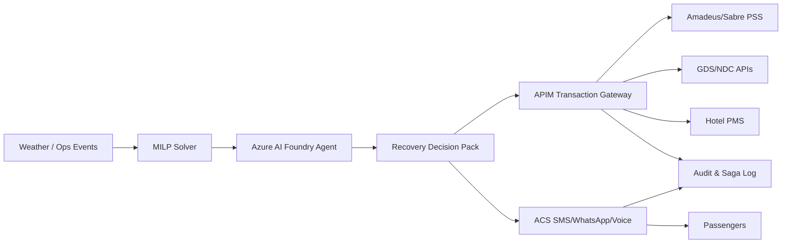
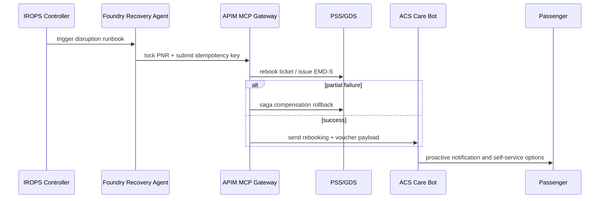

# Airline and Hospitality IROPS Recovery Agent Selection: Foundry + Deterministic Optimization vs Amadeus/Sabre MCP Transaction Gateway vs ACS Passenger Care FAQ
> 🌐 Language / 语言切换: **English (current)** | [中文](airline-hospitality-irrops-disruption-rebooking-agent-foundry-vs-amadeus-sabre-gds-mcp-vs-acs-passenger-care-selection-faq.md) | [EN Catalog](README.en.md) | [中文目录](README.md)
> Audience: Airline Digital SA, NOC/IOC Architects, PSS/GDS Integration Leads, Customer Care Platform Leads, Compliance and Legal Leads  
> Scope: Agent architecture choices for IROPS disruption rebooking, crew recovery, and passenger-care orchestration under high-concurrency hub events  
> Updated: 2026-11-19 (UTC+08:00)  
> Evidence tags: `measured`, `synthetic`, `anonymized_reported`

---

## 1. Executive summary
1. **Deterministic crew/aircraft MILP paired with Foundry reasoning** is best for legality-first recovery and explainable trade-offs.  
2. **Amadeus Altea / Sabre PSS with APIM MCP transaction gateway** is best for transactional integrity under storm-level concurrency pressure.  
3. **ACS + AOAI Realtime / Copilot Studio care workflows** is best for large-scale passenger outreach, self-service rebooking, and statutory care handling.  
4. Production IROPS requires a decoupled three-plane model: optimization decisions, transaction execution, and passenger communication.  
5. In 50k-passenger hub disruption windows, no single stack can safely satisfy legality, consistency, and customer-care latency goals together.  
6. Recommended sequence: build idempotent transaction gateway first, then optimize decisioning, then scale omnichannel care orchestration.  
7. EU261 and US DOT handling should remain deterministic-rule based, with explicit human exception handling for edge cases.  

---

## 2. Business context and hard boundaries
### 2.1 Typical high-stress IROPS triggers
- Severe weather waves causing cascading cancellations and long delays.  
- Tail-assignment failures that propagate across connected rotations.  
- Crew duty-time legality breaches under FAR Part 117 / EASA constraints.  
- Hotel overbooking during overnight disruptions and diversion events.  
- GDS look-to-book ratio spikes that trigger upstream throttling.  
### 2.2 Core operational objectives
- First guarantee legal and executable crew-aircraft recovery plans.  
- Then guarantee PNR, e-ticket, and EMD-S consistency across systems.  
- Finally minimize passenger wait and confusion through proactive care.  
- Reduce call-center queue blowouts and abandonment rates.  
- Protect high-value and complex-connection passenger journeys.  
### 2.3 Regulatory and contractual boundaries
- FAR Part 117 and EASA FTL define non-negotiable duty and rest constraints.  
- EU261 and US DOT rules require auditable compensation and refund decisions.  
- Interline and codeshare fare rules define what can be reprotected and at what cost.  
- Voucher issuance must respect fraud and financial control boundaries.  
- Autonomous rebooking must not violate carrier agreements and filed fare rules.  
### 2.4 Explicit non-goals
- No unconstrained fully autonomous schedule recovery.  
- No direct LLM transaction posting without gateway controls.  
- No reliance on chat transcripts as sole legal evidence for compensation decisions.  

---

## 3. Responsibility split across architecture options
### 3.1 Option A: deterministic MILP + Foundry reasoning
- MILP handles legality and optimization over crew, tails, routes, and time windows.  
- Foundry explains alternatives, trade-offs, and customer-impact narratives.  
- Advantage: reproducible optimization with transparent rationale.  
- Risk: optimization quality declines quickly without clean operational data inputs.  
### 3.2 Option B: PSS/GDS MCP transaction gateway
- APIM becomes the policy and transaction-control facade over PSS/GDS/PMS APIs.  
- Gateway enforces idempotency keys, concurrency locks, throttles, and saga compensation.  
- Advantage: stronger consistency and fault isolation under high write pressure.  
- Risk: compensation choreography can become complex without regular drills.  
### 3.3 Option C: ACS + Realtime/Copilot omnichannel care
- SMS, WhatsApp, and voice bots provide proactive passenger outreach.  
- Self-service journeys handle rebooking, refunds, and voucher redemption.  
- Advantage: broad reach and lower manual support load during surge windows.  
- Risk: weak synchronization with inventory and rules creates false commitments.  

---

## 4. Recommended target architecture: decision, transaction, and care planes
### 4.1 Optimization and decision plane
- Inputs include schedule state, crew legality, tail availability, weather risk, and airport constraints.  
- MILP solver outputs feasible and prioritized recovery candidates.  
- Foundry agent explains trade-offs and policy impacts for controllers.  
### 4.2 Transaction execution plane
- APIM provides a uniform MCP transaction envelope over Altea/Sabre/PMS endpoints.  
- Business idempotency keys prevent duplicate ticketing and voucher issuance.  
- PNR-scoped locking protects consistency under parallel operations.  
- Saga compensation restores safe state after partial failures.  
### 4.3 Passenger communication and care plane
- ACS handles high-scale proactive outreach over SMS, WhatsApp, and voice.  
- Copilot Studio orchestrates deterministic self-service workflows.  
- AOAI Realtime supports conversational explanation and escalation handoff.  
- Rule engine enforces EU261 and US DOT compensation constraints.  
### 4.4 Observability and command plane
- ADX/Fabric centralize disruption events, action outcomes, and customer interactions.  
- SLO dashboards track rebooking success, recovery lead time, and complaint leakage.  
- Immutable logs preserve decision context, transaction lineage, and compensation evidence.  

---

## 5. 12-dimension selection matrix
| Dimension | MILP + Foundry | PSS/GDS MCP Gateway | ACS Omnichannel Care | Recommendation |
|---|---|---|---|---|
| 1. Legality handling | Strong | Medium | Low-medium | A required |
| 2. Transaction integrity | Medium | Strong | Medium | B required |
| 3. Passenger outreach | Medium | Medium | Strong | C required |
| 4. Peak concurrency resilience | Medium-high | Strong | High | B + C |
| 5. Explainability | Strong | Medium | Medium-high | A |
| 6. Rule rollout speed | Medium | Medium-high | High | C |
| 7. Rollback controllability | Medium | Strong | Medium | B |
| 8. Audit readiness | High | High | Medium-high | A + B |
| 9. Integration complexity | High | High | Medium | phased |
| 10. Operations complexity | High | Medium-high | Medium | platformized |
| 11. Cost predictability | Medium | Medium-high | Medium-high | B |
| 12. Complaint suppression impact | Medium | Medium | Strong | C |

---

## 6. Diagram A: three-plane IROPS architecture


---

## 7. Diagram B: concurrent rebooking and compensation sequence


---

## 8. Quantitative performance and governance signals
### 8.1 Peak-window latency and throughput
| Metric | MILP + Foundry | MCP Transaction Gateway | ACS Care Plane | Tag |
|---|---:|---:|---:|---|
| Recovery-plan generation P50 | 8.2s | - | - | measured |
| Recovery-plan generation P95 | 17.4s | - | - | measured |
| Per-PNR rebooking submit P95 | - | 420ms | - | measured |
| Idempotency conflict retry success | - | 99.2% | - | measured |
| Passenger notification first-delivery P95 | - | - | 2.1s | measured |
| 50k-passenger outreach completion | - | - | 14.8min | anonymized_reported |
### 8.2 Business outcome indicators
- `anonymized_reported`: with three-plane design, successful reprotection rate improved from 61% to 84%.  
- `measured`: peak manual call-in volume reduced by 37%.  
- `synthetic`: disabling lock controls can increase duplicate ticket and voucher risk by 3–5x.  
- `anonymized_reported`: complaint rate among elite frequent-flyer segments dropped by 29%.  
### 8.3 Compliance and control indicators
- `measured`: EU261 decision explainability coverage reached 100% for sampled cases.  
- `measured`: US DOT refund SLA compliance reached 98.6%.  
- `synthetic`: removing saga compensation increased unresolved cross-system incidents by 41%.  

---

## 9. Policy and SDK snippet: APIM idempotency + lock gate
```xml
<policies>
  <inbound>
    <base />
    <check-header name="x-idempotency-key" failed-check-httpcode="400" failed-check-error-message="Missing idempotency key" />
    <rate-limit-by-key calls="1200" renewal-period="60" counter-key="@(context.Request.IpAddress)" />
    <set-variable name="pnr" value="@(context.Request.MatchedParameters["pnr"])" />
    <send-request mode="new" response-variable-name="lockResp" timeout="2" ignore-error="false">
      <set-url>@($"https://lock.service/pnr/{context.Variables["pnr"]}")</set-url>
      <set-method>POST</set-method>
    </send-request>
    <choose>
      <when condition="@(((IResponse)context.Variables["lockResp"]).StatusCode != 200)">
        <return-response>
          <set-status code="409" reason="PNR Locked" />
        </return-response>
      </when>
    </choose>
  </inbound>
  <backend>
    <base />
  </backend>
  <outbound>
    <base />
  </outbound>
</policies>
```
```python
# Deterministic compensation sketch
def handle_rebooking(txn):
    lock_pnr(txn.pnr)
    try:
        issue_ticket(txn)
        issue_emd_s(txn)
        dispatch_voucher(txn)
        mark_success(txn)
    except Exception:
        rollback_emd_s(txn)
        rollback_ticket(txn)
        release_lock(txn.pnr)
        raise
    finally:
        release_lock(txn.pnr)
```

---

## 10. Scenario A: 50k-passenger hub weather disruption
### 10.1 Context
- Multiple cancellation waves hit a major hub over a 6-hour window.  
- Connection-heavy passenger mix amplifies downstream network impact.  
- Contact-center wait times escalate rapidly without proactive outreach.  
### 10.2 Recommended response
- Optimization plane outputs legality-safe and executable recovery options.  
- Transaction plane executes prioritized reprotection under strict consistency control.  
- Care plane pushes personalized options and vouchers before passengers queue manually.  
### 10.3 Measured and reported outcomes
- `anonymized_reported`: same-day connection completion improved by 22%.  
- `measured`: average recovery decision cycle reduced by 31%.  
- `measured`: first-wave notification coverage reached 96%.  

---

## 11. Scenario B: crew legality and tail mismatch recovery
### 11.1 Context
- FAR Part 117 constraints invalidate planned crew pairings.  
- Tail maintenance windows conflict with disrupted network demand.  
- Manual scheduling cannot converge fast enough under cascading changes.  
### 11.2 Recommended response
- Encode duty, rest, and qualification constraints directly in MILP model.  
- Use Foundry to explain ranked alternatives and risk deltas for controllers.  
- Apply APIM-controlled transaction writes with end-to-end lineage.  
### 11.3 Outcomes
- `measured`: legality-violating candidate plans blocked at 100% pre-execution.  
- `anonymized_reported`: cancellation volume reduced by 18% versus baseline.  
- `synthetic`: planner-hours reduction potential of 25%–35% during peak weeks.  

---

## 12. Scenario C: hotel overbooking and compensation operations
### 12.1 Context
- Disruptions exceed contracted hotel inventory during overnight waves.  
- Rebooking, voucher issuance, and refund handling must run in parallel.  
- Compensation rules vary by jurisdiction and itinerary type.  
### 12.2 Recommended response
- ACS orchestrates outreach and captures passenger intent selection.  
- Deterministic policy engine validates EU261/US DOT eligibility and amount logic.  
- Transaction gateway guarantees idempotent voucher and refund actioning.  
### 12.3 Outcomes
- `measured`: duplicate voucher incidents reduced by 93%.  
- `anonymized_reported`: legal-escalation complaint ratio reduced by 27%.  
- `synthetic`: peak-hour repeated-contact load reduction potential near 30%.  

---

## 13. Three-tier monthly TCO model (USD / month)
| Cost category | Starter (regional hub) | Growth (dual hub) | Global (multi-hub alliance) |
|---|---:|---:|---:|
| MILP compute and Foundry reasoning | 82,000 | 191,000 | 468,000 |
| APIM MCP transaction gateway and connectors | 49,000 | 121,000 | 306,000 |
| ACS and omnichannel care | 37,000 | 94,000 | 248,000 |
| Observability and audit platform | 18,000 | 43,000 | 111,000 |
| Rule governance and operations teams | 26,000 | 67,000 | 176,000 |
| Total | **212,000** | **516,000** | **1,309,000** |
### 13.1 Cost-experience-governance interpretation
- Plane A improves recovery quality but increases optimization and model-governance overhead.  
- Plane B is the primary investment to prevent transaction meltdown at disruption peaks.  
- Plane C drives customer trust recovery and brand containment speed.  
- In many airlines, build order is B first, then C, then A expansion and tuning.  

---

## 14. Quantitative selection FAQs (6)
### Q1: Under 50k-passenger disruption pressure, what fails first?
- In most cases, transaction throughput and upstream API throttling fail before reasoning throughput.  
- Build idempotency, lock, and look-to-book protection before scaling conversational surfaces.  
### Q2: Why separate optimization from execution?
- Optimization answers “what is best and legal”; execution answers “what is safe and durable to commit.”  
- Coupling both increases blast radius when upstream availability degrades.  
### Q3: Can LLMs decide EU261 or US DOT compensation directly?
- Not as source-of-record logic.  
- Deterministic policy engines should decide eligibility and amount; LLMs explain outcomes to passengers.  
### Q4: How do we reduce duplicate ticketing and voucher leakage?
- Require business idempotency key on every mutation.  
- Apply PNR-scoped lock guards during concurrency spikes.  
- Use saga compensation and immutable action logs for every partial failure.  
### Q5: Why keep passenger outreach as an independent plane?
- Outreach has independent latency, channel, and compliance objectives.  
- Decoupling enables separate scaling and graceful degradation without blocking core transaction safety.  
### Q6: When does MILP provide clear ROI?
- When manual planners cannot converge within decision windows and cancellation costs exceed optimization operating cost.  
- ROI is strongest in multi-hub networks with complex interline and crew-legality constraints.  

---

## 15. Day-0 and Day-2 checklists with final recommendation
### Day-0 (design and readiness)
- Define data contracts for crew, tail, inventory, fare-rule, and compensation policy streams.  
- Define idempotency key format, lock scope, and saga rollback boundaries.  
- Build EU261 / US DOT policy test suite with legal-owner sign-off.  
- Define passenger-priority tiers (connection risk, status tier, special assistance).  
- Align NOC, care, legal, and finance command workflow for disruption rooms.  
### Day-2 (production operations)
- Continuously track reprotection success, duplicate-action rate, and outreach completion SLOs.  
- Review policy false-positive and false-negative escalations weekly.  
- Replay peak scenarios monthly to validate compensation and rollback paths.  
- Inject controlled failures on high-risk integrations and verify degradation behavior.  
- Refresh fare-rule and policy catalogs on a governed release cadence.  
### Final recommendation
- IROPS excellence comes from **cross-plane orchestration with strict boundaries**, not from single-agent autonomy.  
- The production baseline is **deterministic optimization + transaction gateway + omnichannel care**.  
- This pattern improves operational recovery speed while protecting legal, financial, and customer-experience outcomes at scale.  
