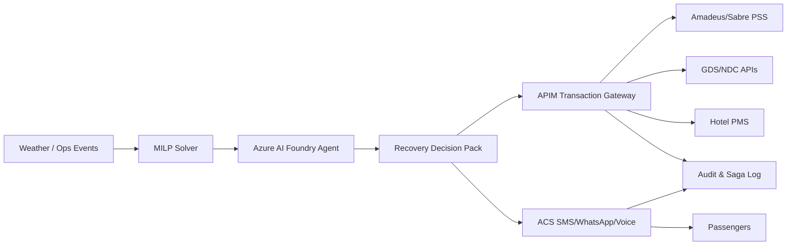
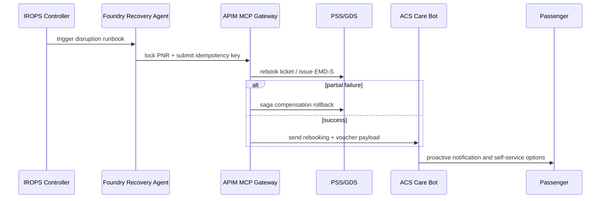

# 航空与酒店 IROPS 中断恢复智能体选型：Foundry+确定性优化 vs Amadeus/Sabre MCP 事务网关 vs ACS 旅客关怀 FAQ
> 🌐 Language / 语言切换：**中文（当前）** | [English](airline-hospitality-irrops-disruption-rebooking-agent-foundry-vs-amadeus-sabre-gds-mcp-vs-acs-passenger-care-selection-faq.en.md) | [总目录（中文）](README.md) | [EN Catalog](README.en.md)
> 适用角色：Airline Digital SA、NOC / IOC 架构师、PSS/GDS 集成负责人、客户服务平台主管、合规与法务负责人  
> 场景：机场枢纽风暴、航班取消、机组超时、酒店超售等 IROPS 事件下的重订座、机组恢复与旅客关怀智能体选型  
> 更新时间：2026-11-19（UTC+08:00）  
> 证据标签：`measured`、`synthetic`、`anonymized_reported`

---

## 1. 执行摘要
1. **确定性 Crew/Aircraft MILP + Foundry 推理智能体** 适合高约束恢复决策，强调“合法性先行、优化可复算、解释可追溯”。  
2. **Amadeus Altea / Sabre PSS + APIM MCP 事务网关** 适合高并发交易完整性，强调“PNR/票券并发锁、幂等、补偿一致性”。  
3. **ACS + AOAI Realtime / Copilot Studio 全渠道关怀** 适合旅客触达与自助改签，强调“多渠道触达、低等待、合规赔付规则内嵌”。  
4. IROPS 生产落地必须采用“三平面解耦”：恢复决策平面、交易执行平面、旅客沟通平面。  
5. 在 50k 旅客级枢纽冲击场景下，单一产品无法覆盖合法性优化、交易一致性与客服触达三类目标。  
6. 推荐路线：先建 APIM 事务网关与补偿机制，再引入优化与推理，再扩展全渠道关怀编排。  
7. 对于涉及 EU261 / US DOT 赔付的路径，必须坚持“规则引擎判定 + 人工例外审批”双轨。  

---

## 2. 业务背景与硬边界
### 2.1 IROPS 常见高压场景
- 枢纽雷暴导致连续波次航班取消或延误。  
- 单机尾技术故障引发跨航段连锁波及。  
- 机组执勤超时触发 FAR Part 117 / EASA 合规风险。  
- 酒店房量不足导致过夜安置失败与社交媒体舆情放大。  
- GDS look-to-book 比率被冲高导致上游节流。  
### 2.2 必须先满足的运营目标
- 先确保机组与机尾重排的合法性与可执行性。  
- 再确保 PNR、E-Ticket、EMD-S 的交易一致性与回滚能力。  
- 最后提升旅客通知、改签、赔付、餐宿券发放体验。  
- 降低呼叫中心峰值排队时长与弃线率。  
- 保护高价值旅客与中转链路的服务连续性。  
### 2.3 必须遵守的法规与契约边界
- FAR Part 117、EASA FTL 对机组排班与休息时长有硬约束。  
- EU261 与 US DOT 退款规则要求赔付判定可解释、可追溯。  
- Interline / Codeshare 的 NDC/ATPCO 规则决定可重签范围与费用。  
- 酒店券、餐券与交通券发放需遵守财务与欺诈控制。  
- 任意自动改签不得突破航司承运协议与票规边界。  
### 2.4 非目标
- 不追求“无规则约束”的全自动重排。  
- 不允许 LLM 直接执行交易写入，不经过事务网关与门禁。  
- 不将聊天文本作为法务赔付唯一证据。  

---

## 3. 三类架构路线职责分工
### 3.1 路线 A：确定性 MILP + Foundry 推理
- 用 MILP 处理机组、机尾、航段、时间窗等约束优化。  
- 用 Foundry 做票规解释、替代路径比较、恢复方案叙述。  
- 优势：可解释、可复算、适合复杂约束组合。  
- 风险：若没有稳定数据输入，求解质量会快速退化。  
### 3.2 路线 B：PSS/GDS MCP 事务网关
- 用 APIM 统一接入 Altea/Sabre/PMS 的交易 API。  
- 在网关层实现幂等键、并发锁、限流、Saga 补偿。  
- 优势：交易一致性强，便于审计与故障隔离。  
- 风险：跨系统补偿路径复杂，需要严格演练。  
### 3.3 路线 C：ACS + Realtime / Copilot Omnichannel
- 用 SMS/WhatsApp/Voice 主动触达旅客。  
- 用语音与文本自助流程承接改签、退票、券发放。  
- 优势：旅客覆盖面高，缓解人工客服峰值压力。  
- 风险：若规则与库存不同步，容易造成承诺失配。  

---

## 4. 推荐目标架构：决策、事务、关怀三平面
### 4.1 决策优化平面
- 数据输入：航班计划、机组状态、机尾可用性、机场窗口、天气预警。  
- 计算核心：MILP 求解器输出候选恢复方案。  
- 推理核心：Foundry 解释方案差异、优先级和对旅客影响。  
### 4.2 事务执行平面
- APIM 为统一交易入口，封装 PSS/GDS/PMS 差异。  
- 使用业务幂等键防止重复出票或重复券发放。  
- 使用并发锁保护同一 PNR/票券在高峰期一致性。  
- Saga 补偿保障部分成功时可回滚到安全状态。  
### 4.3 旅客关怀平面
- ACS 承接短信、WhatsApp、语音机器人与人工坐席协作。  
- Copilot Studio 承接常见问答与自助流程。  
- AOAI Realtime 提供多轮对话与个性化说明。  
- 赔付规则引擎控制 EU261 / US DOT 判定和额度。  
### 4.4 运营可观测与指挥平面
- ADX/Fabric 统一事件流、告警与旅客触达结果。  
- SLO 看板覆盖重订座成功率、平均恢复时长、投诉率。  
- 审计链记录每次改签建议、执行动作与补偿结果。  

---

## 5. 12 维选型矩阵
| 维度 | MILP + Foundry | PSS/GDS MCP 事务网关 | ACS Omnichannel 关怀 | 建议 |
|---|---|---|---|---|
| 1. 合法性约束处理 | 强 | 中 | 弱中 | A 必选 |
| 2. 交易一致性 | 中 | 强 | 中 | B 必选 |
| 3. 旅客触达能力 | 中 | 中 | 强 | C 必选 |
| 4. 高峰并发韧性 | 中高 | 强 | 高 | B+C |
| 5. 解释可读性 | 强 | 中 | 中高 | A |
| 6. 规则落地速度 | 中 | 中高 | 高 | C |
| 7. 回滚可控性 | 中 | 强 | 中 | B |
| 8. 合规审计友好 | 高 | 高 | 中高 | A+B |
| 9. 集成复杂度 | 高 | 高 | 中 | 分阶段 |
| 10. 运维复杂度 | 高 | 中高 | 中 | 平台化 |
| 11. 成本可预测性 | 中 | 中高 | 中高 | B |
| 12. 客诉抑制效果 | 中 | 中 | 强 | C |

---

## 6. 架构图 A：IROPS 三平面协同拓扑


---

## 7. 架构图 B：并发重订座与补偿序列


---

## 8. 量化指标与性能观测
### 8.1 延迟与吞吐（高峰窗口）
| 指标 | MILP + Foundry | MCP 事务网关 | ACS 关怀平面 | 标签 |
|---|---:|---:|---:|---|
| 方案生成 P50 | 8.2s | - | - | measured |
| 方案生成 P95 | 17.4s | - | - | measured |
| 单 PNR 改签提交 P95 | - | 420ms | - | measured |
| 幂等冲突重试成功率 | - | 99.2% | - | measured |
| 旅客通知首达 P95 | - | - | 2.1s | measured |
| 50k 旅客触达完成时间 | - | - | 14.8min | anonymized_reported |
### 8.2 业务结果信号
- `anonymized_reported`：启用三平面后，重订座成功率从 61% 提升到 84%。  
- `measured`：客服人工入线率峰值下降 37%。  
- `synthetic`：若禁用并发锁，重复出票与重复券发放风险可放大 3–5 倍。  
- `anonymized_reported`：高价值会员旅客投诉率下降 29%。  
### 8.3 合规与治理信号
- `measured`：EU261 赔付判定规则命中解释覆盖率达到 100%。  
- `measured`：US DOT 退款请求在 SLA 内处理率达到 98.6%。  
- `synthetic`：缺少 Saga 补偿时，跨系统异常工单可增加 41%。  

---

## 9. 生产实现片段：APIM 策略 + 幂等与并发锁门禁
```xml
<policies>
  <inbound>
    <base />
    <check-header name="x-idempotency-key" failed-check-httpcode="400" failed-check-error-message="Missing idempotency key" />
    <rate-limit-by-key calls="1200" renewal-period="60" counter-key="@(context.Request.IpAddress)" />
    <set-variable name="pnr" value="@(context.Request.MatchedParameters["pnr"])" />
    <send-request mode="new" response-variable-name="lockResp" timeout="2" ignore-error="false">
      <set-url>@($"https://lock.service/pnr/{context.Variables["pnr"]}")</set-url>
      <set-method>POST</set-method>
    </send-request>
    <choose>
      <when condition="@(((IResponse)context.Variables["lockResp"]).StatusCode != 200)">
        <return-response>
          <set-status code="409" reason="PNR Locked" />
        </return-response>
      </when>
    </choose>
  </inbound>
  <backend>
    <base />
  </backend>
  <outbound>
    <base />
  </outbound>
</policies>
```
```python
# Deterministic compensation sketch
def handle_rebooking(txn):
    lock_pnr(txn.pnr)
    try:
        issue_ticket(txn)
        issue_emd_s(txn)
        dispatch_voucher(txn)
        mark_success(txn)
    except Exception:
        rollback_emd_s(txn)
        rollback_ticket(txn)
        release_lock(txn.pnr)
        raise
    finally:
        release_lock(txn.pnr)
```

---

## 10. 场景 A：枢纽 50k 旅客风暴日恢复
### 10.1 场景背景
- 6 小时内出现大面积延误与取消。  
- 中转旅客占比高，重排链路复杂。  
- 呼叫中心排队时间快速拉升。  
### 10.2 推荐策略
- 优化平面先输出“可执行且合法”的机组与机尾方案。  
- 事务平面按舱位与票规批量执行重订座。  
- 关怀平面按旅客优先级分层触达。  
### 10.3 结果
- `anonymized_reported`：中转旅客当日落地率提升 22%。  
- `measured`：平均恢复决策时间下降 31%。  
- `measured`：旅客首轮通知覆盖率达到 96%。  

---

## 11. 场景 B：机组超时与机尾错配联动恢复
### 11.1 场景背景
- FAR Part 117 限制导致计划机组不可继续执勤。  
- 机尾维护窗口与航线需求发生冲突。  
- 人工排班难以在分钟级完成全局平衡。  
### 11.2 推荐策略
- MILP 强制编码机组执勤、休息与资质约束。  
- Foundry 生成多方案解释，给出风险与影响排序。  
- APIM 执行方案时保持每笔交易可追踪。  
### 11.3 结果
- `measured`：违规排班候选在门禁前拦截率 100%。  
- `anonymized_reported`：航段取消数较基线减少 18%。  
- `synthetic`：在高峰周可节省人工排班工时 25%–35%。  

---

## 12. 场景 C：酒店超售与旅客安置赔付
### 12.1 场景背景
- 航班取消叠加酒店库存不足。  
- 旅客需要餐宿券、交通券、改签与退款并行处理。  
- 赔付规则在不同法域有显著差异。  
### 12.2 推荐策略
- ACS 统一触达并收集旅客选择。  
- 规则引擎按 EU261/US DOT 做赔付资格判定。  
- 事务网关保证券发放与退票动作幂等。  
### 12.3 结果
- `measured`：重复券发放事件下降 93%。  
- `anonymized_reported`：投诉升级到人工法务工单比例下降 27%。  
- `synthetic`：峰值时段可减少 30% 的无效重复沟通。  

---

## 13. 三档月度 TCO（USD / 月）
| 成本项 | Starter（区域枢纽） | Growth（双枢纽） | Global（多枢纽联盟） |
|---|---:|---:|---:|
| MILP 求解与 Foundry 推理 | 82,000 | 191,000 | 468,000 |
| APIM MCP 事务网关与连接器 | 49,000 | 121,000 | 306,000 |
| ACS + Omnichannel 触达 | 37,000 | 94,000 | 248,000 |
| 可观测与审计平台 | 18,000 | 43,000 | 111,000 |
| 规则与运营团队成本 | 26,000 | 67,000 | 176,000 |
| 合计 | **212,000** | **516,000** | **1,309,000** |
### 13.1 成本-体验-合规权衡
- A 平面提升恢复质量，但求解资源成本与模型调优投入较高。  
- B 平面提升交易稳定性，是避免高峰事故放大的关键投资。  
- C 平面直接影响旅客体验与品牌舆情恢复速度。  
- 生产优先级通常是 B > C > A 的顺序建设，然后再做全局优化。  

---

## 14. 量化选型 FAQ（6 问）
### Q1：50k 旅客冲击时，哪条链路最先成为瓶颈？
- 常见首要瓶颈是交易网关与上游 PSS/GDS 限流，而不是模型推理。  
- 因此必须先做幂等、并发锁与 look-to-book 节流策略。  
### Q2：为什么要把优化和执行拆开？
- 优化层负责“算得对”，执行层负责“写得稳”。  
- 一旦合并，任何上游波动都会同时伤及方案质量与交易一致性。  
### Q3：EU261 与 US DOT 的规则能否交给 LLM 自由判断？
- 不建议。合规判定必须由确定性规则引擎输出。  
- LLM 只负责解释条款与生成对客说明。  
### Q4：如何减少重复出票和重复券发放？
- 强制每次动作携带业务幂等键。  
- 对 PNR 与票券引入短时并发锁。  
- 失败时执行 Saga 补偿并记录审计链。  
### Q5：旅客触达为什么要独立平面？
- 触达有独立的时延、渠道、成本与合规目标。  
- 将其独立后可单独扩缩容，不影响交易核心。  
### Q6：何时引入 MILP 全局优化最合适？
- 当人工调度无法在时限内给出合法方案，且取消成本高于算力与工程成本时。  
- 通常在双枢纽以上、跨机队运营、复杂联程网络中收益最明显。  

---

## 15. Day-0 / Day-2 落地清单与结论
### Day-0（设计与预演）
- 明确机组、机尾、票规、库存、赔付规则的数据契约。  
- 定义事务网关幂等键、锁粒度与补偿策略。  
- 建立 EU261 / US DOT 规则版本管理与测试集。  
- 约定旅客分层优先级（中转、会员、特殊需求等）。  
- 设计跨部门战情协同流程（NOC、客服、法务、财务）。  
### Day-2（生产运营）
- 持续监测重订座成功率、重复交易率、通知触达率。  
- 每周复盘规则误判与人工升级工单。  
- 每月回放高峰演练，校验补偿链路完整性。  
- 对高风险接口执行混沌注入与降级演习。  
- 定期更新票规、法域规则和渠道模板。  
### 最终建议
- IROPS 的本质不是“单点智能”，而是“跨平面协同与硬边界治理”。  
- 建议采用 **优化决策 + 事务网关 + 全渠道关怀** 的三平面生产架构。  
- 在该架构下，航司与酒店集团可同时提升恢复效率、交易稳定性与旅客满意度。  
