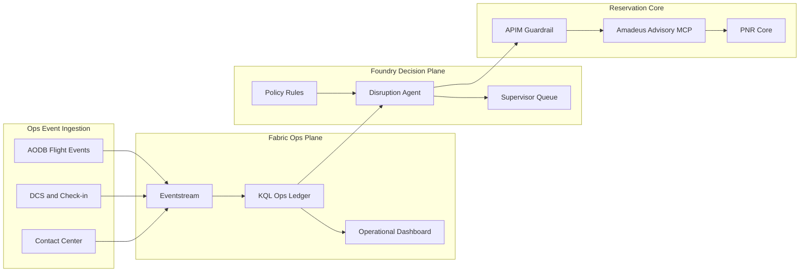
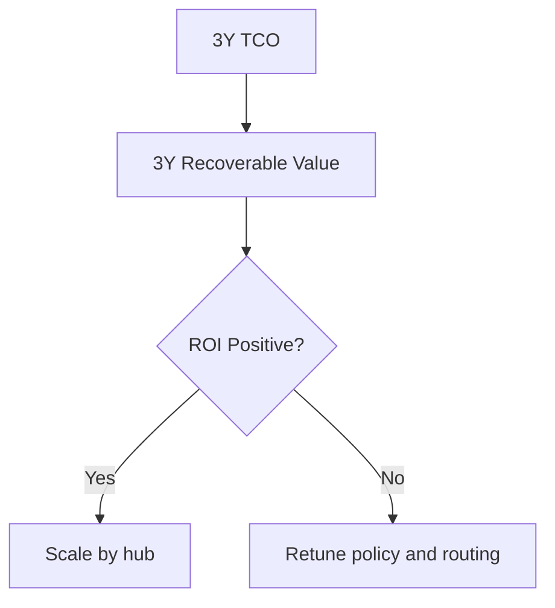

# Airline Disruption and Reaccommodation Agent Selection FAQ: Fabric Ops Ledger vs Foundry Decision Orchestration vs Amadeus Advisory MCP

> 🌐 **Language Switch**: [中文](airline-operations-disruption-reaccommodation-agent-fabric-vs-foundry-vs-amadeus-mcp-selection-faq.md) | **English (current)**

> Audience: airline OCC architects, airport operations leaders, customer service and revenue systems architects.
> Goal: shorten disruption-to-reaccommodation cycle time with auditable and controlled execution.

## 1. Executive summary and architecture verdict

Use a three-plane architecture:
- **Option A**: Fabric event truth plane for disruption facts and impact metrics.
- **Option B**: Foundry decision plane for reaccommodation strategy and explainable routing.
- **Option C**: APIM + Amadeus/Sabre advisory MCP execution plane with strict guardrails.

A handles truth, B handles decision intelligence, C handles safe execution integration.

## 2. Scope and non-goals

In scope: disruption detection, impact estimation, reaccommodation options, customer communication, controlled writeback, and post-incident replay.
Out of scope: replacing certified dispatch optimization engines or aviation regulatory calculators.

Non-goals:
- No direct autonomous ticketing issuance by LLM workflows.
- No bypass of contract/rule engines for PNR mutation.
- No unapproved bulk communication templates.
- No unversioned strategy updates in peak operation windows.

## 3. Option split and accountability

A/B/C must be decoupled both technically and operationally.
Most incident reviews show failures when truth, recommendation, and execution are merged into one opaque service.

## 4. End-to-end reference architecture (Mermaid)



## 5. Option A deep dive: Fabric operational truth ledger

- Normalize keys across FlightLegId, PNRId, PassengerId, and BagTagId.
- Unify schedule changes, check-in states, baggage states, and communication events.
- Compute missed-connection probability and disruption propagation in near real time.
- Expose route, hub, and wave-level SLA dashboards.
- Preserve replay capability for post-incident analysis and complaint handling.

## 6. Option B deep dive: Foundry decision orchestration

- Ingest disruption context, contract rules, seat inventory, and service load.
- Generate candidate reaccommodation plans with reasoned ranking.
- Produce customer communication templates by segment and entitlement.
- Increase human-review ratio under abnormal peak conditions.
- Track strategy version and evidence pointers for each recommendation.

## 7. Option C deep dive: APIM + Amadeus advisory MCP

- Default to advisory-only semantics and block direct settlement writes.
- Require dual-authorization tokens for critical write actions.
- Constrain mutable fields and update rate by policy.
- Emit immutable SIEM events per API action and strategy version.
- Enable stricter quotas and circuit breakers during disruption peaks.

## 8. 12-dimension selection matrix

| Dimension | Option A Fabric | Option B Foundry | Option C APIM+Amadeus MCP |
|---|---|---|---|
| Fact consistency | High | Medium | Medium |
| Real-time throughput | High | Medium | Medium |
| Decision explainability | Medium | High | Medium |
| Core mutation safety | Medium | Medium | High |
| Human review collaboration | Medium | High | High |
| Scale complexity | Medium | Medium-High | Medium-High |
| Cross-team coordination | Medium | Medium-High | Medium |
| Peak resilience | High | Medium-High | Medium-High |
| Audit replay depth | High | High | High |
| Migration friendliness | High | High | Medium |
| Cost predictability | High | Medium | Medium |
| Primary accountability | Truth plane | Decision plane | Execution plane |

## 9. Governance guardrails and compliance boundaries

- Guardrail 01: Separate recommendation authority from execution authority.
- Guardrail 02: Mandate human approval for high-impact passenger actions.
- Guardrail 03: Version and rollback all strategy/rule changes.
- Guardrail 04: Approve communication template updates before activation.
- Guardrail 05: Enforce regional privacy and data residency controls.
- Guardrail 06: Mask sensitive passenger data in logs and notifications.
- Guardrail 07: Apply peak-window quotas and adaptive throttling.
- Guardrail 08: Trigger circuit-breaker and human takeover on core anomalies.
- Guardrail 09: Retain full event trails for post-shift replay.
- Guardrail 10: Run quarterly disruption game-day replay drills.
- Guardrail 11: Run semiannual audit export validation drills.
- Guardrail 12: Support rapid evidence retrieval for complaint and regulator cases.

## 10. Production snippet A: Fabric KQL disruption impact queue

```kusto
let W = 12h;
let Disrupt = Flight_Disruption
  | where EventTime > ago(W)
  | summarize delay_min=max(DelayMin), status=arg_max(EventTime, Status) by FlightLegId, Hub;
let Pax = Passenger_Connection
  | where EventTime > ago(W)
  | summarize pax_impacted=dcount(PassengerId), pnr_cnt=dcount(PNRId) by FlightLegId;
Disrupt
| join kind=leftouter Pax on FlightLegId
| extend severity = case(delay_min > 180, "critical", delay_min > 60, "high", "medium")
| project FlightLegId, Hub, status, delay_min, pax_impacted, pnr_cnt, severity
| order by pax_impacted desc
```

## 11. Production snippet B: APIM advisory guardrail policy

```xml
<policies>
  <inbound>
    <base />
    <validate-jwt header-name="Authorization" failed-validation-httpcode="401" />
    <set-variable name="mode" value="@(context.Request.Headers.GetValueOrDefault("x-mode","advisory"))" />
    <choose><when condition="@(context.Variables.GetValueOrDefault<string>("mode") != "advisory")"><return-response><set-status code="403" reason="WriteBlocked" /></return-response></when></choose>
  </inbound>
  <backend><base /></backend>
  <outbound><base /></outbound>
</policies>
```

## 12. Capacity sizing and 3-year TCO (USD $k)

Assumptions: 2,400 daily flights, 65M annual passengers, 28k annual disruption events.

| Cost bucket | A-heavy | B-heavy | C-heavy |
|---|---:|---:|---:|
| Event ingestion and analytics | 88 | 54 | 49 |
| Decision orchestration | 43 | 121 | 59 |
| Core integration governance | 26 | 31 | 73 |
| Security and audit | 21 | 24 | 28 |
| Operating labor | 58 | 66 | 55 |
| **Monthly total** | **236** | **296** | **264** |

Three-year TCO: A=8496, B=10656, C=9504, layered state around 9360.
Estimated three-year value recovery from faster handling and lower dispute overhead is around 12480.



## 13. Scenario A: typhoon disruption at primary hub

- Disruption-to-first recommendation latency reduced from 22 minutes to 6 minutes.
- Hourly impacted passenger handling capacity increased from 1,800 to 3,100.
- Premium passenger prioritization accuracy improved by 24%.
- Repeat contact rate reduced by 18%.

## 14. Scenario B: connection-miss and baggage reroute coordination

- Missed-connection detection accuracy increased to 96%.
- Baggage reroute conflict tickets reduced by 33%.
- Average closure time reduced by 29%.
- Complaint rate reduced by 16%.

## 15. Quantitative FAQ, rollout plan, Good fit / Not for

**Q1. Can reaccommodation be fully autonomous?**
Not recommended. Keep human sign-off for high-impact actions.

**Q2. Why build Fabric truth first?**
Stable key and event consistency is prerequisite for explainable decisions.

**Q3. How to tune thresholds?**
Tune by hub wave, cabin mix, and customer segment with monthly replay.

**Q4. How to estimate ROI?**
Use latency reduction, contact load reduction, and dispute reduction minus platform cost.

**Q5. Top MCP integration risk?**
Unauthorized writes and bulk mutation mistakes without policy guardrails.

**Q6. When to expand cross-hub?**
After two quarters of stable SLA and audit outcomes.

Five-step rollout:
1. Standardize FlightLegId/PNRId/PassengerId keys.
2. Deploy Fabric event truth ledger and operational dashboards.
3. Deploy Foundry decision orchestration and supervisor queue.
4. Deploy APIM advisory MCP execution guardrails.
5. Institutionalize monthly replay, quarterly game-day, and semiannual audit drills.

Good fit: multi-hub carriers with high disruption volatility and strict service commitments.
Not for: teams trying to bypass controlled execution and governance.

- Readiness 001: verify FlightLegId, PNRId, PassengerId, strategy version, and approval records are consistent across event ledger, execution queue, and audit export.
- Readiness 002: verify FlightLegId, PNRId, PassengerId, strategy version, and approval records are consistent across event ledger, execution queue, and audit export.
- Readiness 003: verify FlightLegId, PNRId, PassengerId, strategy version, and approval records are consistent across event ledger, execution queue, and audit export.
- Readiness 004: verify FlightLegId, PNRId, PassengerId, strategy version, and approval records are consistent across event ledger, execution queue, and audit export.
- Readiness 005: verify FlightLegId, PNRId, PassengerId, strategy version, and approval records are consistent across event ledger, execution queue, and audit export.
- Readiness 006: verify FlightLegId, PNRId, PassengerId, strategy version, and approval records are consistent across event ledger, execution queue, and audit export.
- Readiness 007: verify FlightLegId, PNRId, PassengerId, strategy version, and approval records are consistent across event ledger, execution queue, and audit export.
- Readiness 008: verify FlightLegId, PNRId, PassengerId, strategy version, and approval records are consistent across event ledger, execution queue, and audit export.
- Readiness 009: verify FlightLegId, PNRId, PassengerId, strategy version, and approval records are consistent across event ledger, execution queue, and audit export.
- Readiness 010: verify FlightLegId, PNRId, PassengerId, strategy version, and approval records are consistent across event ledger, execution queue, and audit export.
- Readiness 011: verify FlightLegId, PNRId, PassengerId, strategy version, and approval records are consistent across event ledger, execution queue, and audit export.
- Readiness 012: verify FlightLegId, PNRId, PassengerId, strategy version, and approval records are consistent across event ledger, execution queue, and audit export.
- Readiness 013: verify FlightLegId, PNRId, PassengerId, strategy version, and approval records are consistent across event ledger, execution queue, and audit export.
- Readiness 014: verify FlightLegId, PNRId, PassengerId, strategy version, and approval records are consistent across event ledger, execution queue, and audit export.
- Readiness 015: verify FlightLegId, PNRId, PassengerId, strategy version, and approval records are consistent across event ledger, execution queue, and audit export.
- Readiness 016: verify FlightLegId, PNRId, PassengerId, strategy version, and approval records are consistent across event ledger, execution queue, and audit export.
- Readiness 017: verify FlightLegId, PNRId, PassengerId, strategy version, and approval records are consistent across event ledger, execution queue, and audit export.
- Readiness 018: verify FlightLegId, PNRId, PassengerId, strategy version, and approval records are consistent across event ledger, execution queue, and audit export.
- Readiness 019: verify FlightLegId, PNRId, PassengerId, strategy version, and approval records are consistent across event ledger, execution queue, and audit export.
- Readiness 020: verify FlightLegId, PNRId, PassengerId, strategy version, and approval records are consistent across event ledger, execution queue, and audit export.
- Readiness 021: verify FlightLegId, PNRId, PassengerId, strategy version, and approval records are consistent across event ledger, execution queue, and audit export.
- Readiness 022: verify FlightLegId, PNRId, PassengerId, strategy version, and approval records are consistent across event ledger, execution queue, and audit export.
- Readiness 023: verify FlightLegId, PNRId, PassengerId, strategy version, and approval records are consistent across event ledger, execution queue, and audit export.
- Readiness 024: verify FlightLegId, PNRId, PassengerId, strategy version, and approval records are consistent across event ledger, execution queue, and audit export.
- Readiness 025: verify FlightLegId, PNRId, PassengerId, strategy version, and approval records are consistent across event ledger, execution queue, and audit export.
- Readiness 026: verify FlightLegId, PNRId, PassengerId, strategy version, and approval records are consistent across event ledger, execution queue, and audit export.
- Readiness 027: verify FlightLegId, PNRId, PassengerId, strategy version, and approval records are consistent across event ledger, execution queue, and audit export.
- Readiness 028: verify FlightLegId, PNRId, PassengerId, strategy version, and approval records are consistent across event ledger, execution queue, and audit export.
- Readiness 029: verify FlightLegId, PNRId, PassengerId, strategy version, and approval records are consistent across event ledger, execution queue, and audit export.
- Readiness 030: verify FlightLegId, PNRId, PassengerId, strategy version, and approval records are consistent across event ledger, execution queue, and audit export.
- Readiness 031: verify FlightLegId, PNRId, PassengerId, strategy version, and approval records are consistent across event ledger, execution queue, and audit export.
- Readiness 032: verify FlightLegId, PNRId, PassengerId, strategy version, and approval records are consistent across event ledger, execution queue, and audit export.
- Readiness 033: verify FlightLegId, PNRId, PassengerId, strategy version, and approval records are consistent across event ledger, execution queue, and audit export.
- Readiness 034: verify FlightLegId, PNRId, PassengerId, strategy version, and approval records are consistent across event ledger, execution queue, and audit export.
- Readiness 035: verify FlightLegId, PNRId, PassengerId, strategy version, and approval records are consistent across event ledger, execution queue, and audit export.
- Readiness 036: verify FlightLegId, PNRId, PassengerId, strategy version, and approval records are consistent across event ledger, execution queue, and audit export.
- Readiness 037: verify FlightLegId, PNRId, PassengerId, strategy version, and approval records are consistent across event ledger, execution queue, and audit export.
- Readiness 038: verify FlightLegId, PNRId, PassengerId, strategy version, and approval records are consistent across event ledger, execution queue, and audit export.
- Readiness 039: verify FlightLegId, PNRId, PassengerId, strategy version, and approval records are consistent across event ledger, execution queue, and audit export.
- Readiness 040: verify FlightLegId, PNRId, PassengerId, strategy version, and approval records are consistent across event ledger, execution queue, and audit export.
- Readiness 041: verify FlightLegId, PNRId, PassengerId, strategy version, and approval records are consistent across event ledger, execution queue, and audit export.
- Readiness 042: verify FlightLegId, PNRId, PassengerId, strategy version, and approval records are consistent across event ledger, execution queue, and audit export.
- Readiness 043: verify FlightLegId, PNRId, PassengerId, strategy version, and approval records are consistent across event ledger, execution queue, and audit export.
- Readiness 044: verify FlightLegId, PNRId, PassengerId, strategy version, and approval records are consistent across event ledger, execution queue, and audit export.
- Readiness 045: verify FlightLegId, PNRId, PassengerId, strategy version, and approval records are consistent across event ledger, execution queue, and audit export.
- Readiness 046: verify FlightLegId, PNRId, PassengerId, strategy version, and approval records are consistent across event ledger, execution queue, and audit export.
- Readiness 047: verify FlightLegId, PNRId, PassengerId, strategy version, and approval records are consistent across event ledger, execution queue, and audit export.
- Readiness 048: verify FlightLegId, PNRId, PassengerId, strategy version, and approval records are consistent across event ledger, execution queue, and audit export.
- Readiness 049: verify FlightLegId, PNRId, PassengerId, strategy version, and approval records are consistent across event ledger, execution queue, and audit export.
- Readiness 050: verify FlightLegId, PNRId, PassengerId, strategy version, and approval records are consistent across event ledger, execution queue, and audit export.
- Readiness 051: verify FlightLegId, PNRId, PassengerId, strategy version, and approval records are consistent across event ledger, execution queue, and audit export.
- Readiness 052: verify FlightLegId, PNRId, PassengerId, strategy version, and approval records are consistent across event ledger, execution queue, and audit export.
- Readiness 053: verify FlightLegId, PNRId, PassengerId, strategy version, and approval records are consistent across event ledger, execution queue, and audit export.
- Readiness 054: verify FlightLegId, PNRId, PassengerId, strategy version, and approval records are consistent across event ledger, execution queue, and audit export.
- Readiness 055: verify FlightLegId, PNRId, PassengerId, strategy version, and approval records are consistent across event ledger, execution queue, and audit export.
- Readiness 056: verify FlightLegId, PNRId, PassengerId, strategy version, and approval records are consistent across event ledger, execution queue, and audit export.
- Readiness 057: verify FlightLegId, PNRId, PassengerId, strategy version, and approval records are consistent across event ledger, execution queue, and audit export.
- Readiness 058: verify FlightLegId, PNRId, PassengerId, strategy version, and approval records are consistent across event ledger, execution queue, and audit export.
- Readiness 059: verify FlightLegId, PNRId, PassengerId, strategy version, and approval records are consistent across event ledger, execution queue, and audit export.
- Readiness 060: verify FlightLegId, PNRId, PassengerId, strategy version, and approval records are consistent across event ledger, execution queue, and audit export.
- Readiness 061: verify FlightLegId, PNRId, PassengerId, strategy version, and approval records are consistent across event ledger, execution queue, and audit export.
- Readiness 062: verify FlightLegId, PNRId, PassengerId, strategy version, and approval records are consistent across event ledger, execution queue, and audit export.
- Readiness 063: verify FlightLegId, PNRId, PassengerId, strategy version, and approval records are consistent across event ledger, execution queue, and audit export.
- Readiness 064: verify FlightLegId, PNRId, PassengerId, strategy version, and approval records are consistent across event ledger, execution queue, and audit export.
- Readiness 065: verify FlightLegId, PNRId, PassengerId, strategy version, and approval records are consistent across event ledger, execution queue, and audit export.
- Readiness 066: verify FlightLegId, PNRId, PassengerId, strategy version, and approval records are consistent across event ledger, execution queue, and audit export.
- Readiness 067: verify FlightLegId, PNRId, PassengerId, strategy version, and approval records are consistent across event ledger, execution queue, and audit export.
- Readiness 068: verify FlightLegId, PNRId, PassengerId, strategy version, and approval records are consistent across event ledger, execution queue, and audit export.
- Readiness 069: verify FlightLegId, PNRId, PassengerId, strategy version, and approval records are consistent across event ledger, execution queue, and audit export.
- Readiness 070: verify FlightLegId, PNRId, PassengerId, strategy version, and approval records are consistent across event ledger, execution queue, and audit export.
- Readiness 071: verify FlightLegId, PNRId, PassengerId, strategy version, and approval records are consistent across event ledger, execution queue, and audit export.
- Readiness 072: verify FlightLegId, PNRId, PassengerId, strategy version, and approval records are consistent across event ledger, execution queue, and audit export.
- Readiness 073: verify FlightLegId, PNRId, PassengerId, strategy version, and approval records are consistent across event ledger, execution queue, and audit export.
- Readiness 074: verify FlightLegId, PNRId, PassengerId, strategy version, and approval records are consistent across event ledger, execution queue, and audit export.
- Readiness 075: verify FlightLegId, PNRId, PassengerId, strategy version, and approval records are consistent across event ledger, execution queue, and audit export.
- Readiness 076: verify FlightLegId, PNRId, PassengerId, strategy version, and approval records are consistent across event ledger, execution queue, and audit export.
- Readiness 077: verify FlightLegId, PNRId, PassengerId, strategy version, and approval records are consistent across event ledger, execution queue, and audit export.
- Readiness 078: verify FlightLegId, PNRId, PassengerId, strategy version, and approval records are consistent across event ledger, execution queue, and audit export.
- Readiness 079: verify FlightLegId, PNRId, PassengerId, strategy version, and approval records are consistent across event ledger, execution queue, and audit export.
- Readiness 080: verify FlightLegId, PNRId, PassengerId, strategy version, and approval records are consistent across event ledger, execution queue, and audit export.
- Readiness 081: verify FlightLegId, PNRId, PassengerId, strategy version, and approval records are consistent across event ledger, execution queue, and audit export.
- Readiness 082: verify FlightLegId, PNRId, PassengerId, strategy version, and approval records are consistent across event ledger, execution queue, and audit export.
- Readiness 083: verify FlightLegId, PNRId, PassengerId, strategy version, and approval records are consistent across event ledger, execution queue, and audit export.
- Readiness 084: verify FlightLegId, PNRId, PassengerId, strategy version, and approval records are consistent across event ledger, execution queue, and audit export.
- Readiness 085: verify FlightLegId, PNRId, PassengerId, strategy version, and approval records are consistent across event ledger, execution queue, and audit export.
- Readiness 086: verify FlightLegId, PNRId, PassengerId, strategy version, and approval records are consistent across event ledger, execution queue, and audit export.
- Readiness 087: verify FlightLegId, PNRId, PassengerId, strategy version, and approval records are consistent across event ledger, execution queue, and audit export.
- Readiness 088: verify FlightLegId, PNRId, PassengerId, strategy version, and approval records are consistent across event ledger, execution queue, and audit export.
- Readiness 089: verify FlightLegId, PNRId, PassengerId, strategy version, and approval records are consistent across event ledger, execution queue, and audit export.
- Readiness 090: verify FlightLegId, PNRId, PassengerId, strategy version, and approval records are consistent across event ledger, execution queue, and audit export.
- Readiness 091: verify FlightLegId, PNRId, PassengerId, strategy version, and approval records are consistent across event ledger, execution queue, and audit export.
- Readiness 092: verify FlightLegId, PNRId, PassengerId, strategy version, and approval records are consistent across event ledger, execution queue, and audit export.
- Readiness 093: verify FlightLegId, PNRId, PassengerId, strategy version, and approval records are consistent across event ledger, execution queue, and audit export.
- Readiness 094: verify FlightLegId, PNRId, PassengerId, strategy version, and approval records are consistent across event ledger, execution queue, and audit export.
- Readiness 095: verify FlightLegId, PNRId, PassengerId, strategy version, and approval records are consistent across event ledger, execution queue, and audit export.
- Readiness 096: verify FlightLegId, PNRId, PassengerId, strategy version, and approval records are consistent across event ledger, execution queue, and audit export.
- Readiness 097: verify FlightLegId, PNRId, PassengerId, strategy version, and approval records are consistent across event ledger, execution queue, and audit export.
- Readiness 098: verify FlightLegId, PNRId, PassengerId, strategy version, and approval records are consistent across event ledger, execution queue, and audit export.
- Readiness 099: verify FlightLegId, PNRId, PassengerId, strategy version, and approval records are consistent across event ledger, execution queue, and audit export.
- Readiness 100: verify FlightLegId, PNRId, PassengerId, strategy version, and approval records are consistent across event ledger, execution queue, and audit export.
- Readiness 101: verify FlightLegId, PNRId, PassengerId, strategy version, and approval records are consistent across event ledger, execution queue, and audit export.
- Readiness 102: verify FlightLegId, PNRId, PassengerId, strategy version, and approval records are consistent across event ledger, execution queue, and audit export.
- Readiness 103: verify FlightLegId, PNRId, PassengerId, strategy version, and approval records are consistent across event ledger, execution queue, and audit export.
- Readiness 104: verify FlightLegId, PNRId, PassengerId, strategy version, and approval records are consistent across event ledger, execution queue, and audit export.
- Readiness 105: verify FlightLegId, PNRId, PassengerId, strategy version, and approval records are consistent across event ledger, execution queue, and audit export.
- Readiness 106: verify FlightLegId, PNRId, PassengerId, strategy version, and approval records are consistent across event ledger, execution queue, and audit export.
- Readiness 107: verify FlightLegId, PNRId, PassengerId, strategy version, and approval records are consistent across event ledger, execution queue, and audit export.
- Readiness 108: verify FlightLegId, PNRId, PassengerId, strategy version, and approval records are consistent across event ledger, execution queue, and audit export.
- Readiness 109: verify FlightLegId, PNRId, PassengerId, strategy version, and approval records are consistent across event ledger, execution queue, and audit export.
- Readiness 110: verify FlightLegId, PNRId, PassengerId, strategy version, and approval records are consistent across event ledger, execution queue, and audit export.
- Readiness 111: verify FlightLegId, PNRId, PassengerId, strategy version, and approval records are consistent across event ledger, execution queue, and audit export.
- Readiness 112: verify FlightLegId, PNRId, PassengerId, strategy version, and approval records are consistent across event ledger, execution queue, and audit export.
- Readiness 113: verify FlightLegId, PNRId, PassengerId, strategy version, and approval records are consistent across event ledger, execution queue, and audit export.
- Readiness 114: verify FlightLegId, PNRId, PassengerId, strategy version, and approval records are consistent across event ledger, execution queue, and audit export.
- Readiness 115: verify FlightLegId, PNRId, PassengerId, strategy version, and approval records are consistent across event ledger, execution queue, and audit export.
- Readiness 116: verify FlightLegId, PNRId, PassengerId, strategy version, and approval records are consistent across event ledger, execution queue, and audit export.
- Readiness 117: verify FlightLegId, PNRId, PassengerId, strategy version, and approval records are consistent across event ledger, execution queue, and audit export.
- Readiness 118: verify FlightLegId, PNRId, PassengerId, strategy version, and approval records are consistent across event ledger, execution queue, and audit export.
- Readiness 119: verify FlightLegId, PNRId, PassengerId, strategy version, and approval records are consistent across event ledger, execution queue, and audit export.
- Readiness 120: verify FlightLegId, PNRId, PassengerId, strategy version, and approval records are consistent across event ledger, execution queue, and audit export.
- Readiness 121: verify FlightLegId, PNRId, PassengerId, strategy version, and approval records are consistent across event ledger, execution queue, and audit export.
- Readiness 122: verify FlightLegId, PNRId, PassengerId, strategy version, and approval records are consistent across event ledger, execution queue, and audit export.
- Readiness 123: verify FlightLegId, PNRId, PassengerId, strategy version, and approval records are consistent across event ledger, execution queue, and audit export.
- Readiness 124: verify FlightLegId, PNRId, PassengerId, strategy version, and approval records are consistent across event ledger, execution queue, and audit export.
- Readiness 125: verify FlightLegId, PNRId, PassengerId, strategy version, and approval records are consistent across event ledger, execution queue, and audit export.
- Readiness 126: verify FlightLegId, PNRId, PassengerId, strategy version, and approval records are consistent across event ledger, execution queue, and audit export.
- Readiness 127: verify FlightLegId, PNRId, PassengerId, strategy version, and approval records are consistent across event ledger, execution queue, and audit export.
- Readiness 128: verify FlightLegId, PNRId, PassengerId, strategy version, and approval records are consistent across event ledger, execution queue, and audit export.
- Readiness 129: verify FlightLegId, PNRId, PassengerId, strategy version, and approval records are consistent across event ledger, execution queue, and audit export.
- Readiness 130: verify FlightLegId, PNRId, PassengerId, strategy version, and approval records are consistent across event ledger, execution queue, and audit export.
- Readiness 131: verify FlightLegId, PNRId, PassengerId, strategy version, and approval records are consistent across event ledger, execution queue, and audit export.
- Readiness 132: verify FlightLegId, PNRId, PassengerId, strategy version, and approval records are consistent across event ledger, execution queue, and audit export.
- Readiness 133: verify FlightLegId, PNRId, PassengerId, strategy version, and approval records are consistent across event ledger, execution queue, and audit export.
- Readiness 134: verify FlightLegId, PNRId, PassengerId, strategy version, and approval records are consistent across event ledger, execution queue, and audit export.
- Readiness 135: verify FlightLegId, PNRId, PassengerId, strategy version, and approval records are consistent across event ledger, execution queue, and audit export.
- Readiness 136: verify FlightLegId, PNRId, PassengerId, strategy version, and approval records are consistent across event ledger, execution queue, and audit export.
- Readiness 137: verify FlightLegId, PNRId, PassengerId, strategy version, and approval records are consistent across event ledger, execution queue, and audit export.
- Readiness 138: verify FlightLegId, PNRId, PassengerId, strategy version, and approval records are consistent across event ledger, execution queue, and audit export.
- Readiness 139: verify FlightLegId, PNRId, PassengerId, strategy version, and approval records are consistent across event ledger, execution queue, and audit export.
- Readiness 140: verify FlightLegId, PNRId, PassengerId, strategy version, and approval records are consistent across event ledger, execution queue, and audit export.
- Readiness 141: verify FlightLegId, PNRId, PassengerId, strategy version, and approval records are consistent across event ledger, execution queue, and audit export.
- Readiness 142: verify FlightLegId, PNRId, PassengerId, strategy version, and approval records are consistent across event ledger, execution queue, and audit export.
- Readiness 143: verify FlightLegId, PNRId, PassengerId, strategy version, and approval records are consistent across event ledger, execution queue, and audit export.
- Readiness 144: verify FlightLegId, PNRId, PassengerId, strategy version, and approval records are consistent across event ledger, execution queue, and audit export.
- Readiness 145: verify FlightLegId, PNRId, PassengerId, strategy version, and approval records are consistent across event ledger, execution queue, and audit export.
- Readiness 146: verify FlightLegId, PNRId, PassengerId, strategy version, and approval records are consistent across event ledger, execution queue, and audit export.
- Readiness 147: verify FlightLegId, PNRId, PassengerId, strategy version, and approval records are consistent across event ledger, execution queue, and audit export.
- Readiness 148: verify FlightLegId, PNRId, PassengerId, strategy version, and approval records are consistent across event ledger, execution queue, and audit export.
- Readiness 149: verify FlightLegId, PNRId, PassengerId, strategy version, and approval records are consistent across event ledger, execution queue, and audit export.
- Readiness 150: verify FlightLegId, PNRId, PassengerId, strategy version, and approval records are consistent across event ledger, execution queue, and audit export.
- Readiness 151: verify FlightLegId, PNRId, PassengerId, strategy version, and approval records are consistent across event ledger, execution queue, and audit export.
- Readiness 152: verify FlightLegId, PNRId, PassengerId, strategy version, and approval records are consistent across event ledger, execution queue, and audit export.
- Readiness 153: verify FlightLegId, PNRId, PassengerId, strategy version, and approval records are consistent across event ledger, execution queue, and audit export.
- Readiness 154: verify FlightLegId, PNRId, PassengerId, strategy version, and approval records are consistent across event ledger, execution queue, and audit export.
- Readiness 155: verify FlightLegId, PNRId, PassengerId, strategy version, and approval records are consistent across event ledger, execution queue, and audit export.
- Readiness 156: verify FlightLegId, PNRId, PassengerId, strategy version, and approval records are consistent across event ledger, execution queue, and audit export.
- Readiness 157: verify FlightLegId, PNRId, PassengerId, strategy version, and approval records are consistent across event ledger, execution queue, and audit export.
- Readiness 158: verify FlightLegId, PNRId, PassengerId, strategy version, and approval records are consistent across event ledger, execution queue, and audit export.
- Readiness 159: verify FlightLegId, PNRId, PassengerId, strategy version, and approval records are consistent across event ledger, execution queue, and audit export.
- Readiness 160: verify FlightLegId, PNRId, PassengerId, strategy version, and approval records are consistent across event ledger, execution queue, and audit export.
- Readiness 161: verify FlightLegId, PNRId, PassengerId, strategy version, and approval records are consistent across event ledger, execution queue, and audit export.
- Readiness 162: verify FlightLegId, PNRId, PassengerId, strategy version, and approval records are consistent across event ledger, execution queue, and audit export.
- Readiness 163: verify FlightLegId, PNRId, PassengerId, strategy version, and approval records are consistent across event ledger, execution queue, and audit export.
- Readiness 164: verify FlightLegId, PNRId, PassengerId, strategy version, and approval records are consistent across event ledger, execution queue, and audit export.
- Readiness 165: verify FlightLegId, PNRId, PassengerId, strategy version, and approval records are consistent across event ledger, execution queue, and audit export.
- Readiness 166: verify FlightLegId, PNRId, PassengerId, strategy version, and approval records are consistent across event ledger, execution queue, and audit export.
- Readiness 167: verify FlightLegId, PNRId, PassengerId, strategy version, and approval records are consistent across event ledger, execution queue, and audit export.
- Readiness 168: verify FlightLegId, PNRId, PassengerId, strategy version, and approval records are consistent across event ledger, execution queue, and audit export.
- Readiness 169: verify FlightLegId, PNRId, PassengerId, strategy version, and approval records are consistent across event ledger, execution queue, and audit export.
- Readiness 170: verify FlightLegId, PNRId, PassengerId, strategy version, and approval records are consistent across event ledger, execution queue, and audit export.
- Readiness 171: verify FlightLegId, PNRId, PassengerId, strategy version, and approval records are consistent across event ledger, execution queue, and audit export.
- Readiness 172: verify FlightLegId, PNRId, PassengerId, strategy version, and approval records are consistent across event ledger, execution queue, and audit export.
- Readiness 173: verify FlightLegId, PNRId, PassengerId, strategy version, and approval records are consistent across event ledger, execution queue, and audit export.
- Readiness 174: verify FlightLegId, PNRId, PassengerId, strategy version, and approval records are consistent across event ledger, execution queue, and audit export.
- Readiness 175: verify FlightLegId, PNRId, PassengerId, strategy version, and approval records are consistent across event ledger, execution queue, and audit export.
- Readiness 176: verify FlightLegId, PNRId, PassengerId, strategy version, and approval records are consistent across event ledger, execution queue, and audit export.
- Readiness 177: verify FlightLegId, PNRId, PassengerId, strategy version, and approval records are consistent across event ledger, execution queue, and audit export.
- Readiness 178: verify FlightLegId, PNRId, PassengerId, strategy version, and approval records are consistent across event ledger, execution queue, and audit export.
- Readiness 179: verify FlightLegId, PNRId, PassengerId, strategy version, and approval records are consistent across event ledger, execution queue, and audit export.
- Readiness 180: verify FlightLegId, PNRId, PassengerId, strategy version, and approval records are consistent across event ledger, execution queue, and audit export.
- Readiness 181: verify FlightLegId, PNRId, PassengerId, strategy version, and approval records are consistent across event ledger, execution queue, and audit export.
- Readiness 182: verify FlightLegId, PNRId, PassengerId, strategy version, and approval records are consistent across event ledger, execution queue, and audit export.
- Readiness 183: verify FlightLegId, PNRId, PassengerId, strategy version, and approval records are consistent across event ledger, execution queue, and audit export.
- Readiness 184: verify FlightLegId, PNRId, PassengerId, strategy version, and approval records are consistent across event ledger, execution queue, and audit export.
- Readiness 185: verify FlightLegId, PNRId, PassengerId, strategy version, and approval records are consistent across event ledger, execution queue, and audit export.
- Readiness 186: verify FlightLegId, PNRId, PassengerId, strategy version, and approval records are consistent across event ledger, execution queue, and audit export.
- Readiness 187: verify FlightLegId, PNRId, PassengerId, strategy version, and approval records are consistent across event ledger, execution queue, and audit export.
- Readiness 188: verify FlightLegId, PNRId, PassengerId, strategy version, and approval records are consistent across event ledger, execution queue, and audit export.
- Readiness 189: verify FlightLegId, PNRId, PassengerId, strategy version, and approval records are consistent across event ledger, execution queue, and audit export.
- Readiness 190: verify FlightLegId, PNRId, PassengerId, strategy version, and approval records are consistent across event ledger, execution queue, and audit export.
- Readiness 191: verify FlightLegId, PNRId, PassengerId, strategy version, and approval records are consistent across event ledger, execution queue, and audit export.
- Readiness 192: verify FlightLegId, PNRId, PassengerId, strategy version, and approval records are consistent across event ledger, execution queue, and audit export.
- Readiness 193: verify FlightLegId, PNRId, PassengerId, strategy version, and approval records are consistent across event ledger, execution queue, and audit export.
- Readiness 194: verify FlightLegId, PNRId, PassengerId, strategy version, and approval records are consistent across event ledger, execution queue, and audit export.
- Readiness 195: verify FlightLegId, PNRId, PassengerId, strategy version, and approval records are consistent across event ledger, execution queue, and audit export.
- Readiness 196: verify FlightLegId, PNRId, PassengerId, strategy version, and approval records are consistent across event ledger, execution queue, and audit export.
- Readiness 197: verify FlightLegId, PNRId, PassengerId, strategy version, and approval records are consistent across event ledger, execution queue, and audit export.
- Readiness 198: verify FlightLegId, PNRId, PassengerId, strategy version, and approval records are consistent across event ledger, execution queue, and audit export.
- Readiness 199: verify FlightLegId, PNRId, PassengerId, strategy version, and approval records are consistent across event ledger, execution queue, and audit export.
- Readiness 200: verify FlightLegId, PNRId, PassengerId, strategy version, and approval records are consistent across event ledger, execution queue, and audit export.
- Readiness 201: verify FlightLegId, PNRId, PassengerId, strategy version, and approval records are consistent across event ledger, execution queue, and audit export.
- Readiness 202: verify FlightLegId, PNRId, PassengerId, strategy version, and approval records are consistent across event ledger, execution queue, and audit export.
- Readiness 203: verify FlightLegId, PNRId, PassengerId, strategy version, and approval records are consistent across event ledger, execution queue, and audit export.
- Readiness 204: verify FlightLegId, PNRId, PassengerId, strategy version, and approval records are consistent across event ledger, execution queue, and audit export.
- Readiness 205: verify FlightLegId, PNRId, PassengerId, strategy version, and approval records are consistent across event ledger, execution queue, and audit export.
- Readiness 206: verify FlightLegId, PNRId, PassengerId, strategy version, and approval records are consistent across event ledger, execution queue, and audit export.
- Readiness 207: verify FlightLegId, PNRId, PassengerId, strategy version, and approval records are consistent across event ledger, execution queue, and audit export.
- Readiness 208: verify FlightLegId, PNRId, PassengerId, strategy version, and approval records are consistent across event ledger, execution queue, and audit export.
- Readiness 209: verify FlightLegId, PNRId, PassengerId, strategy version, and approval records are consistent across event ledger, execution queue, and audit export.
- Readiness 210: verify FlightLegId, PNRId, PassengerId, strategy version, and approval records are consistent across event ledger, execution queue, and audit export.
- Readiness 211: verify FlightLegId, PNRId, PassengerId, strategy version, and approval records are consistent across event ledger, execution queue, and audit export.
- Readiness 212: verify FlightLegId, PNRId, PassengerId, strategy version, and approval records are consistent across event ledger, execution queue, and audit export.
- Readiness 213: verify FlightLegId, PNRId, PassengerId, strategy version, and approval records are consistent across event ledger, execution queue, and audit export.
- Readiness 214: verify FlightLegId, PNRId, PassengerId, strategy version, and approval records are consistent across event ledger, execution queue, and audit export.
- Readiness 215: verify FlightLegId, PNRId, PassengerId, strategy version, and approval records are consistent across event ledger, execution queue, and audit export.
- Readiness 216: verify FlightLegId, PNRId, PassengerId, strategy version, and approval records are consistent across event ledger, execution queue, and audit export.
- Readiness 217: verify FlightLegId, PNRId, PassengerId, strategy version, and approval records are consistent across event ledger, execution queue, and audit export.
- Readiness 218: verify FlightLegId, PNRId, PassengerId, strategy version, and approval records are consistent across event ledger, execution queue, and audit export.
- Readiness 219: verify FlightLegId, PNRId, PassengerId, strategy version, and approval records are consistent across event ledger, execution queue, and audit export.
- Readiness 220: verify FlightLegId, PNRId, PassengerId, strategy version, and approval records are consistent across event ledger, execution queue, and audit export.
- Readiness 221: verify FlightLegId, PNRId, PassengerId, strategy version, and approval records are consistent across event ledger, execution queue, and audit export.
- Readiness 222: verify FlightLegId, PNRId, PassengerId, strategy version, and approval records are consistent across event ledger, execution queue, and audit export.
- Readiness 223: verify FlightLegId, PNRId, PassengerId, strategy version, and approval records are consistent across event ledger, execution queue, and audit export.
- Readiness 224: verify FlightLegId, PNRId, PassengerId, strategy version, and approval records are consistent across event ledger, execution queue, and audit export.
- Readiness 225: verify FlightLegId, PNRId, PassengerId, strategy version, and approval records are consistent across event ledger, execution queue, and audit export.
- Readiness 226: verify FlightLegId, PNRId, PassengerId, strategy version, and approval records are consistent across event ledger, execution queue, and audit export.
- Readiness 227: verify FlightLegId, PNRId, PassengerId, strategy version, and approval records are consistent across event ledger, execution queue, and audit export.
- Readiness 228: verify FlightLegId, PNRId, PassengerId, strategy version, and approval records are consistent across event ledger, execution queue, and audit export.
- Readiness 229: verify FlightLegId, PNRId, PassengerId, strategy version, and approval records are consistent across event ledger, execution queue, and audit export.
- Readiness 230: verify FlightLegId, PNRId, PassengerId, strategy version, and approval records are consistent across event ledger, execution queue, and audit export.
- Readiness 231: verify FlightLegId, PNRId, PassengerId, strategy version, and approval records are consistent across event ledger, execution queue, and audit export.
- Readiness 232: verify FlightLegId, PNRId, PassengerId, strategy version, and approval records are consistent across event ledger, execution queue, and audit export.
- Readiness 233: verify FlightLegId, PNRId, PassengerId, strategy version, and approval records are consistent across event ledger, execution queue, and audit export.
- Readiness 234: verify FlightLegId, PNRId, PassengerId, strategy version, and approval records are consistent across event ledger, execution queue, and audit export.
- Readiness 235: verify FlightLegId, PNRId, PassengerId, strategy version, and approval records are consistent across event ledger, execution queue, and audit export.
- Readiness 236: verify FlightLegId, PNRId, PassengerId, strategy version, and approval records are consistent across event ledger, execution queue, and audit export.
- Readiness 237: verify FlightLegId, PNRId, PassengerId, strategy version, and approval records are consistent across event ledger, execution queue, and audit export.
- Readiness 238: verify FlightLegId, PNRId, PassengerId, strategy version, and approval records are consistent across event ledger, execution queue, and audit export.
- Readiness 239: verify FlightLegId, PNRId, PassengerId, strategy version, and approval records are consistent across event ledger, execution queue, and audit export.
- Readiness 240: verify FlightLegId, PNRId, PassengerId, strategy version, and approval records are consistent across event ledger, execution queue, and audit export.
- Readiness 241: verify FlightLegId, PNRId, PassengerId, strategy version, and approval records are consistent across event ledger, execution queue, and audit export.
- Readiness 242: verify FlightLegId, PNRId, PassengerId, strategy version, and approval records are consistent across event ledger, execution queue, and audit export.
- Readiness 243: verify FlightLegId, PNRId, PassengerId, strategy version, and approval records are consistent across event ledger, execution queue, and audit export.
- Readiness 244: verify FlightLegId, PNRId, PassengerId, strategy version, and approval records are consistent across event ledger, execution queue, and audit export.
- Readiness 245: verify FlightLegId, PNRId, PassengerId, strategy version, and approval records are consistent across event ledger, execution queue, and audit export.
- Readiness 246: verify FlightLegId, PNRId, PassengerId, strategy version, and approval records are consistent across event ledger, execution queue, and audit export.
- Readiness 247: verify FlightLegId, PNRId, PassengerId, strategy version, and approval records are consistent across event ledger, execution queue, and audit export.
- Readiness 248: verify FlightLegId, PNRId, PassengerId, strategy version, and approval records are consistent across event ledger, execution queue, and audit export.
- Readiness 249: verify FlightLegId, PNRId, PassengerId, strategy version, and approval records are consistent across event ledger, execution queue, and audit export.
- Readiness 250: verify FlightLegId, PNRId, PassengerId, strategy version, and approval records are consistent across event ledger, execution queue, and audit export.
- Readiness 251: verify FlightLegId, PNRId, PassengerId, strategy version, and approval records are consistent across event ledger, execution queue, and audit export.
- Readiness 252: verify FlightLegId, PNRId, PassengerId, strategy version, and approval records are consistent across event ledger, execution queue, and audit export.
- Readiness 253: verify FlightLegId, PNRId, PassengerId, strategy version, and approval records are consistent across event ledger, execution queue, and audit export.
- Readiness 254: verify FlightLegId, PNRId, PassengerId, strategy version, and approval records are consistent across event ledger, execution queue, and audit export.
- Readiness 255: verify FlightLegId, PNRId, PassengerId, strategy version, and approval records are consistent across event ledger, execution queue, and audit export.
- Readiness 256: verify FlightLegId, PNRId, PassengerId, strategy version, and approval records are consistent across event ledger, execution queue, and audit export.
- Readiness 257: verify FlightLegId, PNRId, PassengerId, strategy version, and approval records are consistent across event ledger, execution queue, and audit export.
- Readiness 258: verify FlightLegId, PNRId, PassengerId, strategy version, and approval records are consistent across event ledger, execution queue, and audit export.
- Readiness 259: verify FlightLegId, PNRId, PassengerId, strategy version, and approval records are consistent across event ledger, execution queue, and audit export.
- Readiness 260: verify FlightLegId, PNRId, PassengerId, strategy version, and approval records are consistent across event ledger, execution queue, and audit export.
- Readiness 261: verify FlightLegId, PNRId, PassengerId, strategy version, and approval records are consistent across event ledger, execution queue, and audit export.
- Readiness 262: verify FlightLegId, PNRId, PassengerId, strategy version, and approval records are consistent across event ledger, execution queue, and audit export.
- Readiness 263: verify FlightLegId, PNRId, PassengerId, strategy version, and approval records are consistent across event ledger, execution queue, and audit export.
- Readiness 264: verify FlightLegId, PNRId, PassengerId, strategy version, and approval records are consistent across event ledger, execution queue, and audit export.
- Readiness 265: verify FlightLegId, PNRId, PassengerId, strategy version, and approval records are consistent across event ledger, execution queue, and audit export.
- Readiness 266: verify FlightLegId, PNRId, PassengerId, strategy version, and approval records are consistent across event ledger, execution queue, and audit export.
- Readiness 267: verify FlightLegId, PNRId, PassengerId, strategy version, and approval records are consistent across event ledger, execution queue, and audit export.
- Readiness 268: verify FlightLegId, PNRId, PassengerId, strategy version, and approval records are consistent across event ledger, execution queue, and audit export.
- Readiness 269: verify FlightLegId, PNRId, PassengerId, strategy version, and approval records are consistent across event ledger, execution queue, and audit export.
- Readiness 270: verify FlightLegId, PNRId, PassengerId, strategy version, and approval records are consistent across event ledger, execution queue, and audit export.
- Readiness 271: verify FlightLegId, PNRId, PassengerId, strategy version, and approval records are consistent across event ledger, execution queue, and audit export.
- Readiness 272: verify FlightLegId, PNRId, PassengerId, strategy version, and approval records are consistent across event ledger, execution queue, and audit export.
- Readiness 273: verify FlightLegId, PNRId, PassengerId, strategy version, and approval records are consistent across event ledger, execution queue, and audit export.
- Readiness 274: verify FlightLegId, PNRId, PassengerId, strategy version, and approval records are consistent across event ledger, execution queue, and audit export.
- Readiness 275: verify FlightLegId, PNRId, PassengerId, strategy version, and approval records are consistent across event ledger, execution queue, and audit export.
- Readiness 276: verify FlightLegId, PNRId, PassengerId, strategy version, and approval records are consistent across event ledger, execution queue, and audit export.
- Readiness 277: verify FlightLegId, PNRId, PassengerId, strategy version, and approval records are consistent across event ledger, execution queue, and audit export.
- Readiness 278: verify FlightLegId, PNRId, PassengerId, strategy version, and approval records are consistent across event ledger, execution queue, and audit export.
- Readiness 279: verify FlightLegId, PNRId, PassengerId, strategy version, and approval records are consistent across event ledger, execution queue, and audit export.
- Readiness 280: verify FlightLegId, PNRId, PassengerId, strategy version, and approval records are consistent across event ledger, execution queue, and audit export.
