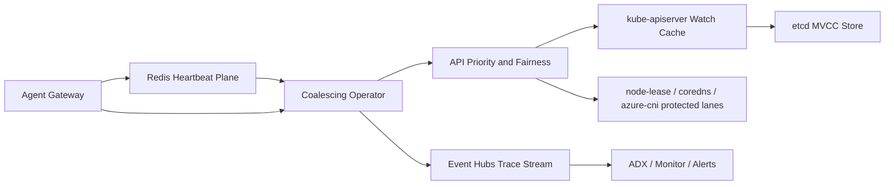
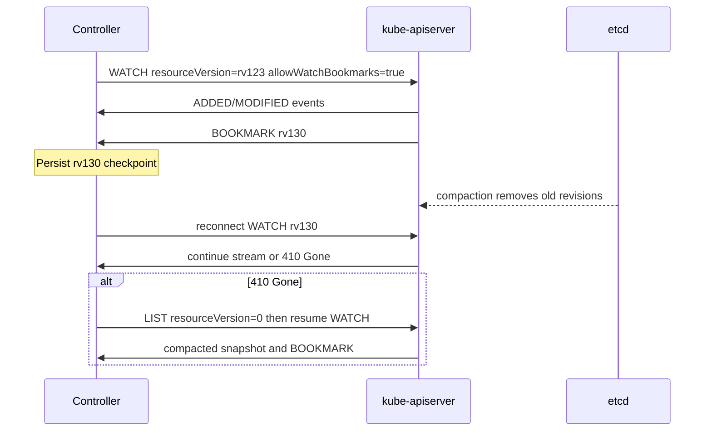

# Enterprise AKS `kube-apiserver` and `etcd` watch-storm selection FAQ

## 1. Executive summary

For high-churn agent sandboxes on AKS,
the first hard limit is often the control plane,
not worker-node CPU or memory.
Node scale-out alone does not remove
API serialization pressure,
`etcd` write amplification,
or watch fan-out multiplication.

This guide compares four production patterns.
Pattern A uses APF, watch-cache discipline,
and transition-only CRD status projection.
Pattern B isolates blast radius with vCluster.
Pattern C breaks past single-`etcd` ceilings
with cellular multi-cluster sharding.
Pattern D is a prohibited anti-pattern.

If your workload runs `50–200` creates plus deletes per second,
and CRDs carry heartbeat plus trace payloads,
start with write-path reduction first.
Topology splitting should follow,
not replace, status-path hygiene.

## 2. Problem statement

A common footprint is `10,000+` active sandboxes
with high-churn CRDs such as
`AgentSandboxClaim` and `MCPToolSession`.
Object lifetime is short,
state transitions are frequent,
and watcher count is high.
That combination creates
`N_watchers * write_qps` amplification.

Failure mode one is uncached `LIST` storms.
Clients repeatedly issue `resourceVersion=""` full scans.
The API server serializes large object sets each time,
then returns them to many clients.
Memory and CPU spikes hit the control plane first.

Failure mode two is `.status` write amplification.
If each second writes `50–100 KB` trace blobs,
`etcd` MVCC files grow rapidly,
and quota pressure increases.
At the edge, operators hit
`mvcc: database space exceeded`.

Failure mode three is lane starvation.
Aggressive reconcilers consume inflight seats.
Then critical lanes such as
`node-lease`, CoreDNS, and Azure CNI
wait behind business traffic.
The cluster appears alive,
while scheduling and admission degrade.

## 3. Four architecture patterns

### Pattern A (primary recommendation up to about `20K–25K`)

Use AKS Standard or Premium control plane,
apply APF queue isolation with
`FlowSchema` plus `PriorityLevelConfiguration`,
and enforce watch-cache paths by default:
`resourceVersion="0"`,
`allowWatchBookmarks=true`,
and `PartialObjectMetadata`.

Apply transition-only CRD status projection.
Move one-second heartbeat and dense trace payloads
to Redis or Event Hubs.
Keep CRD status small and semantic:
phase, conditions, and compact reason codes.

### Pattern B (tenant isolation for many teams)

Run dedicated vCluster control planes
for team or tenant boundaries.
High-churn CRDs remain inside virtual planes.
Host AKS keeps lower-churn pools and system services.
This pattern reduces cross-team blast radius,
but increases control-plane operations overhead.

### Pattern C (hyperscale beyond single-raft comfort)

When sustained mutating CRD QPS
stays above roughly `300`,
single-`etcd` operating margin tightens.
Adopt Fleet-managed cellular sharding
with consistent-hash placement,
routing by tenant, workspace, or run key.
Split failure domain and control-plane load together.

### Pattern D (prohibited anti-pattern)

Workers poll uncached `LIST`,
while one-second heartbeats write
large `.status` payloads into CRDs.
Small tests may pass,
but larger concurrency quickly triggers
429 floods, reconnect storms,
and `etcd` size alarms.

## 4. Quantified 12-dimension matrix

| Dimension | Pattern A APF+WatchCache+Projection | Pattern B vCluster | Pattern C Multi-Cluster | Pattern D Anti-pattern |
|---|---|---|---|---|
| Control-plane isolation | Medium-High | High | High | Low |
| Active sandboxes per unit | `20K–25K` cluster | `8K–15K` per vCluster | `10K–20K` per cluster, scales out | `<8K` unstable |
| Mutating CRD QPS | `120–300` | `80–200` per vCluster | `300+` with shards | fragile above `80` |
| Uncached LIST impact | Low | Medium | Medium | High |
| etcd MVCC growth slope | Low | Medium | Medium | High |
| Watch fan-out pressure | Medium | Medium | Medium | Very high |
| 410 Gone reconnect risk | Low | Medium | Medium | High |
| Blast radius | Cluster scope | Tenant scope | Cell scope | Global |
| Ops complexity | Medium | Medium-High | High | Low but unsafe |
| Cost efficiency | High | Medium | Medium-High at scale | Misleadingly low |
| Compliance posture | Medium-High | High | High | Low |
| 3-year TCO | baseline `1.0x` | `1.15x–1.35x` | starts `1.25x`, improves with scale | `>1.5x` |

## 5. Why Pattern A starts with write-path reduction

Most control-plane incidents are not
"insufficient cores".
They are structural broadcast problems:
every tiny state mutation
gets re-serialized and fanned out.
Reduce low-value write frequency first,
and three pressure lines drop together:
mutating QPS,
watch payload volume,
and API serialization overhead.

Constrain CRD status to explainable fields:
`phase`,
`conditions`,
`lastTransitionTime`,
and compact checksums.
Keep heartbeat, token counters,
and deep traces in side telemetry planes.
Use Redis/Event Hubs for high-frequency channels.

APF does not make every request faster.
It preserves priority lanes under stress.
Define who must never starve,
then assign seats and queue policy accordingly.

## 6. Mermaid: control-plane protection layout



## 7. Mermaid: bookmark resume and storm prevention



## 8. Q1–Q6 formulas with worked numbers

### Q1. Watch bandwidth amplification

`BW_watch = λ_mut × N_watchers × S_obj`

Example:
`λ_mut=120/s`,
`N_watchers=180`,
`S_obj=3.5 KB`.
Bandwidth is about `75.6 MB/s`.
If object size inflates to `20 KB`,
bandwidth jumps to `432 MB/s`.

### Q2. Uncached LIST memory amplification

`Mem_list ≈ N_clients × N_objects × S_obj × f_copy`

Example:
`40` clients,
`60,000` objects,
`2.8 KB` average object,
`f_copy=1.6`.
Peak memory is around `10.7 GB`,
well above many control-plane burst windows.

### Q3. etcd MVCC growth vs 8 GiB ceiling

`Growth = λ_write × S_obj × T_compact`

Example:
`λ_write=220/s`,
`S_obj=12 KB`,
`T_compact=3600s`.
One-hour growth is about `9.5 GB`.
Without reduction, this can exceed
an `8 GiB` practical quota window.

### Q4. APF seats via Little's Law

`Seats = ceil(QPS × L_p99 × k)`

Example:
critical lanes with `QPS=35`,
`L_p99=0.25s`,
safety factor `k=1.8`,
need `16` seats.
Business controllers can receive
separate seats and queue budget.

### Q5. Payload reduction with `PartialObjectMetadata`

`Reduction = 1 - S_meta / S_full`

Example:
`S_full=4.2 KB`,
`S_meta=0.55 KB`.
Reduction is about `86.9%`.
This directly lowers
network and serialization load.

### Q6. TCO crossover across patterns

`C_total = C_cp + C_ops + C_obs + C_incident`

For `<=18K` active sandboxes,
Pattern A usually wins cost and speed.
For `18K–40K` with strong team autonomy,
Pattern B often improves isolation economics.
Beyond `40K` or sustained high mutating QPS,
Pattern C often recovers its added ops cost.

## 9. Pattern B boundary: vCluster is not a silver bullet

The primary value of vCluster
is blast-radius containment.
It does not automatically optimize
high-frequency write behavior.
If each tenant still writes noisy large status blobs,
the same pressure repeats inside each virtual plane.

Bind vCluster rollout to status projection standards.
Define per-tenant SLOs and quotas.
Require load tests before onboarding
new high-churn operators.

## 10. Pattern C boundary: multi-cluster sharding

Sharding keys must be deterministic.
Use consistent hash on `tenant_id`
or `workspace_id`,
and store mapping in audited configuration.
Avoid ad-hoc manual routing decisions.

Separate control-plane relocation
from data-plane migration plans.
Control-plane reroute can be fast.
State and cache movement often needs
explicit warmup and cutover choreography.

## 11. Anti-pattern detection signals

If these symptoms appear together,
you are likely in Pattern D:

- sharp growth of `apiserver_flowcontrol_rejected_requests_total`;
- persistent rise of `etcd_mvcc_db_total_size_in_bytes`;
- frequent `410 Gone` and full relist reconnect loops;
- healthy node heartbeats but slow new-pod admission;
- random 429 and timeout storms in business workflows.

## 12. Core code and config

### 12.1 APF `FlowSchema` and `PriorityLevelConfiguration`

```yaml
apiVersion: flowcontrol.apiserver.k8s.io/v1
kind: PriorityLevelConfiguration
metadata:
  name: sandbox-controller-pl
spec:
  type: Limited
  limited:
    assuredConcurrencyShares: 40
    limitResponse:
      type: Queue
      queuing:
        queues: 32
        handSize: 8
        queueLengthLimit: 80
---
apiVersion: flowcontrol.apiserver.k8s.io/v1
kind: FlowSchema
metadata:
  name: sandbox-controller-fs
spec:
  matchingPrecedence: 600
  distinguisherMethod:
    type: ByUser
  priorityLevelConfiguration:
    name: sandbox-controller-pl
  rules:
  - subjects:
    - kind: ServiceAccount
      serviceAccount:
        namespace: agent-system
        name: sandbox-controller
    resourceRules:
    - verbs: ["get", "list", "watch", "patch", "update"]
      apiGroups: ["agent.platform.io"]
      resources: ["agentsandboxclaims", "mcptoolsessions", "agentsandboxclaims/status"]
      namespaces: ["*"]
---
apiVersion: flowcontrol.apiserver.k8s.io/v1
kind: PriorityLevelConfiguration
metadata:
  name: node-high-pl
spec:
  type: Limited
  limited:
    assuredConcurrencyShares: 80
    limitResponse:
      type: Reject
```

### 12.2 Python helper: transition-only status coalescing

```python
from __future__ import annotations

import hashlib
import json
import random
import time
from dataclasses import dataclass
from typing import Dict


@dataclass
class RateLimiter:
    rate: float = 6.0
    burst: int = 12
    tokens: float = 12.0
    last: float = time.time()

    def allow(self) -> bool:
        now = time.time()
        self.tokens = min(self.burst, self.tokens + (now - self.last) * self.rate)
        self.last = now
        if self.tokens >= 1.0:
            self.tokens -= 1.0
            return True
        return False


class StatusCoalescer:
    def __init__(self) -> None:
        self.hash_by_obj: Dict[str, str] = {}
        self.rv_checkpoint: Dict[str, str] = {}
        self.limiter = RateLimiter()

    def _semantic_hash(self, status: Dict) -> str:
        compact = {
            "phase": status.get("phase"),
            "conditions": status.get("conditions", []),
            "reason": status.get("reason"),
            "code": status.get("code"),
        }
        data = json.dumps(compact, sort_keys=True, ensure_ascii=False).encode("utf-8")
        return hashlib.sha256(data).hexdigest()

    def should_patch_status(self, uid: str, status: Dict) -> bool:
        digest = self._semantic_hash(status)
        previous = self.hash_by_obj.get(uid)
        if digest == previous:
            return False
        if not self.limiter.allow():
            time.sleep(random.uniform(0.03, 0.12))
            return False
        self.hash_by_obj[uid] = digest
        return True

    def on_bookmark(self, resource: str, resource_version: str) -> None:
        self.rv_checkpoint[resource] = resource_version
```

### 12.3 PromQL and KQL control-plane probes

```promql
sum by (flow_schema) (
  rate(apiserver_flowcontrol_rejected_requests_total[5m])
)

max(apiserver_current_inflight_requests{request_kind="mutating"})

max(etcd_mvcc_db_total_size_in_bytes)

sum(rate(apiserver_watch_events_sizes_sum[5m]))
/
sum(rate(apiserver_watch_events_total[5m]))
```

```kql
let win = 5m;
let fc = InsightsMetrics
| where Name == "apiserver_flowcontrol_rejected_requests_total"
| summarize rejected = sum(Val) by bin(TimeGenerated, win), ClusterName;
let inflight = InsightsMetrics
| where Name == "apiserver_current_inflight_requests"
| summarize inflight_max = max(Val) by bin(TimeGenerated, win), ClusterName;
let etcd = InsightsMetrics
| where Name == "etcd_mvcc_db_total_size_in_bytes"
| summarize etcd_bytes = max(Val) by bin(TimeGenerated, win), ClusterName;
fc
| join kind=inner inflight on TimeGenerated, ClusterName
| join kind=inner etcd on TimeGenerated, ClusterName
| project TimeGenerated, ClusterName, rejected, inflight_max, etcd_bytes
| order by TimeGenerated desc
```

## 13. Operating baseline and SLOs

Use three layered SLO sets:
system-lane health,
controller-lane health,
and tenant completion outcomes.
Independent alerts prevent
misclassifying platform incidents
as business spikes.

Example baseline targets:
mutating inflight P99 under `70`,
`etcd` size occupancy under `65%`,
and mean watch payload under `1.2 KB`.
Breaches should trigger
degrade and throttling playbooks.

## 14. Decision tree: good fit vs not for

**Good fit for Pattern A**

- single cluster target up to about `25K` active sandboxes;
- team can modify controllers and status payload design;
- rapid stabilization is needed without topology split.

**Good fit for Pattern B**

- strong BU autonomy and compliance boundaries;
- tenant-level blast radius isolation is mandatory;
- platform accepts added control-plane operations load.

**Good fit for Pattern C**

- single-cluster QPS ceiling is already exceeded;
- platform owns routing and multi-cluster SRE capability;
- centralized observability is already in place.

**Not for**

- teams refuse to change noisy status-write behavior;
- worker paths still depend on uncached full relists;
- control-plane bottlenecks are treated as node-only issues.

## 15. Enterprise scenarios, TCO, and rollout

### 15.1 Scenario A: code-interpreter and data-science platform

A large internal analytics platform
runs `16K–18K` concurrent sandboxes
with peak churn around `140/s`.
Default status-write behavior
caused 429 bursts and launch jitter.

After Pattern A rollout,
mutating CRD QPS dropped
from `260` to `72`,
average watch payload dropped
from `4.8 KB` to `0.9 KB`,
and `etcd` growth slope fell about `91%`.
Critical job startup P95 improved
from `14.2s` to `4.9s`.

### 15.2 Scenario B: internal agent PaaS with `120` operator teams

A shared enterprise platform
hosts many custom operators.
Single-team release incidents
often propagated globally.
Troubleshooting was slow and political.

The target model combined
Pattern B isolation with
Pattern A write-path discipline.
Major incident blast radius
contracted from platform-wide
to tenant-local domains,
and monthly severe events
declined by about `63%`.

### 15.3 Three-tier 3-year TCO (USD)

| Tier | Scale assumption | Pattern A | Pattern B | Pattern C |
|---|---|---:|---:|---:|
| Tier-1 | `8K` active sandboxes | `1.72M` | `1.98M` | `2.26M` |
| Tier-2 | `22K` active sandboxes | `4.86M` | `5.35M` | `5.02M` |
| Tier-3 | `45K` active sandboxes | `10.9M` | `11.8M` | `9.95M` |

For Tier-1 and Tier-2,
Pattern A is usually the best
cost-versus-complexity point.
At Tier-3 scale,
Pattern C shard economics
often outweigh extra platform effort.

### 15.4 Five-step rollout and D0/D1/D2 runbook (18 actions)

**Five-step rollout**

1. Build control-plane baseline metrics and load profile.
2. Deploy status-write reduction and APF isolation first.
3. Enforce watch bookmark resume and relist hygiene.
4. Choose vCluster or multi-cluster by scale and tenancy.
5. Add load, threshold, and rollback gates to releases.

**D0 (same-day containment)**

1. Block new uncached `LIST` polling clients.
2. Apply temporary APF protection for system lanes.
3. Move heartbeat writes from CRD to Redis.
4. Enable token-bucket throttling on noisy reconcilers.
5. Turn on `allowWatchBookmarks=true` and persist checkpoints.
6. Add joint alerts for etcd size and inflight spikes.

**D1 (two-week hardening)**

7. Standardize CRD status projection schema.
8. Publish controller SDK with semantic dedupe.
9. Move primary read paths to metadata-first queries.
10. Add load-test gates into CI release checks.
11. Define per-team control-plane budgets.
12. Run 410 Gone reconnect game-days.

**D2 (quarterly evolution)**

13. Introduce vCluster isolation for multi-BU environments.
14. Deploy Fleet consistent-hash placement.
15. Unify cross-cluster observability and alerting.
16. Add control-plane cost forecasting dashboards.
17. Feed postmortem learnings back into APF and quota tuning.
18. Run regional failover and audit closure drills.

## Sources

Azure Kubernetes Service best practices for cluster operators  
https://learn.microsoft.com/azure/aks/best-practices

Kubernetes API Priority and Fairness  
https://kubernetes.io/docs/concepts/cluster-administration/flow-control/

Kubernetes API concepts (`resourceVersion`, bookmarks, watches)  
https://kubernetes.io/docs/reference/using-api/api-concepts/

etcd maintenance and compaction operations  
https://etcd.io/docs/v3.5/op-guide/maintenance/

Azure Kubernetes Fleet Manager overview  
https://learn.microsoft.com/azure/kubernetes-fleet/

Azure Monitor managed Prometheus metrics for AKS  
https://learn.microsoft.com/azure/azure-monitor/containers/kubernetes-monitoring-enable
