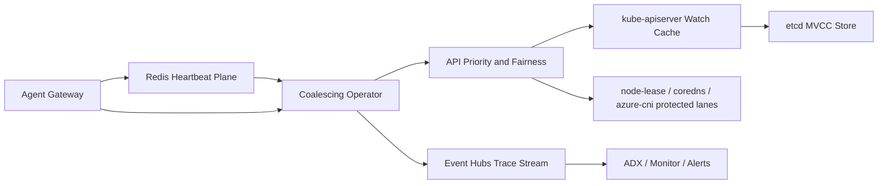
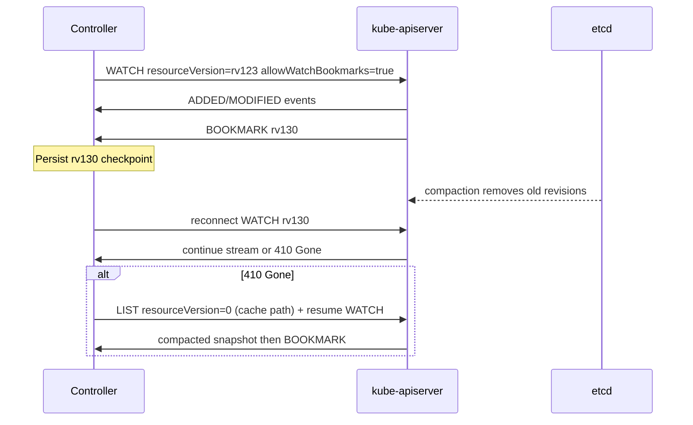

# 企业 AKS `kube-apiserver`/`etcd` Watch 风暴与 CRD 高 churn 选型 FAQ

## 1. 执行摘要

当企业在 AKS 上同时运行大量短生命周期 Agent 沙箱时，
瓶颈通常先出现在控制平面，而不是工作节点。
只扩容节点池无法解决 `kube-apiserver` 序列化压力、
`etcd` 写放大和 watch 广播放大问题。

本指南给出四种可落地模式：
Pattern A 以 APF、watch-cache 和状态投影为主，
Pattern B 用 vCluster 做租户级控制平面隔离，
Pattern C 用多集群分片突破单 `etcd` Raft 天花板，
Pattern D 标记为禁用反模式。

如果你的负载在 `50–200` 次每秒创建删除，
并且 CRD 同时承载心跳、追踪和状态，
建议先做状态写入减载，再做拓扑拆分。
否则扩容会变成“更快写满控制平面”的放大器。

## 2. 生产问题定义

典型场景是 `10,000+` 活跃沙箱 Pod 与两类高 churn CRD：
`AgentSandboxClaim` 和 `MCPToolSession`。
这类对象生命周期短、状态变化频繁、watch 客户端多，
天然触发 `N_watchers * write_qps` 的放大链路。

故障模式一是 uncached `LIST` 风暴。
客户端反复以 `resourceVersion=""` 拉全量对象，
服务端需要重复序列化大对象集合并回传，
内存和 CPU 高峰会先打满 API Server。

故障模式二是 `.status` 写放大。
如果每秒心跳都写入 `50–100 KB` 跟踪片段，
`etcd` MVCC 文件增速会非常快，
并逼近配额上限后触发 `mvcc: database space exceeded`。

故障模式三是控制面饥饿。
高频 Operator reconcile 请求抢占并发席位后，
`node-lease`、CoreDNS、Azure CNI 等关键系统流量会被拖慢，
最终表现为节点看似健康但调度与网络初始化超时。

## 3. 四种架构模式总览

### Pattern A（主推荐，单集群可达 `20K–25K` 活跃沙箱）

以 AKS 标准/高级控制平面为底座，
通过 APF 的 `FlowSchema` 与 `PriorityLevelConfiguration`
做流量分舱与并发配额。
同时把客户端改为 `resourceVersion="0"` watch-cache 路径，
启用 `allowWatchBookmarks=true`，
并使用 `PartialObjectMetadata` 降低回传体积。

状态层采用“状态转移才写入”的压缩策略。
每秒心跳和细粒度 trace 不再写 CRD，
迁移到 Redis 或 Event Hubs，
CRD 仅保留阶段、条件与必要摘要。

### Pattern B（多团队租户隔离优先）

每个团队或业务单元运行独立 vCluster 虚拟控制平面，
高 churn CRD 仅在虚拟平面内扩散，
宿主 AKS 仅承载低 churn 的 warm pool 和基础系统。
该模式降低跨团队相互影响，
但会引入额外控制平面运维成本。

### Pattern C（超大规模多集群分片）

当单集群 mutating CRD QPS 持续超过 `~300`，
单 `etcd` Raft 的安全运行窗口会被压缩。
此时建议采用 Fleet + 一致性哈希路由，
按租户、工作区或会话键分片到多 AKS Stamp，
把故障域和控制平面负载一起切开。

### Pattern D（反模式，禁止）

让 Agent Worker 持续轮询 uncached `LIST`，
并把高频心跳直接写回 CRD `.status`。
该模式在小规模压测看似可用，
一旦并发放大就会触发 API 429、watch 重连风暴、
以及 `etcd` 体积告警连锁。

## 4. 12 维量化对比矩阵

| 维度 | Pattern A APF+WatchCache+状态投影 | Pattern B vCluster | Pattern C 多集群分片 | Pattern D 反模式 |
|---|---|---|---|---|
| 控制平面隔离 | 中，高优先级系统流量受保护 | 高，租户独立控制面 | 高，集群级隔离 | 低 |
| 单集群活跃沙箱 | `20K–25K` | `8K–15K`/vCluster | `10K–20K`/cluster，线性叠加 | `<8K` 常失稳 |
| mutating CRD QPS | `120–300` | `80–200`/vCluster | `300+` 通过分片扩展 | `>80` 即风险 |
| uncached LIST 影响 | 低，默认禁用路径 | 中，取决于租户治理 | 中，可被路由分散 | 高 |
| etcd MVCC 增速 | 低，状态压缩后显著下降 | 中，按租户分摊 | 中，按集群分摊 | 高 |
| watch 广播成本 | 中，Payload 缩小 | 中，租户内广播 | 中，跨集群切分 | 极高 |
| 410 Gone 重连 | 低，bookmark 恢复 | 中 | 中 | 高 |
| 故障域半径 | 集群级 | vCluster 级 | 单分片集群级 | 全局 |
| 运维复杂度 | 中 | 中高 | 高 | 低（但不可用） |
| 成本效率 | 高 | 中 | 中高（规模大时优） | 表面低，实则高 |
| 合规与多租户 | 中高 | 高 | 高 | 低 |
| 三年 TCO | 基线 `1.0x` | `1.15x–1.35x` | `1.25x` 起，规模上升后回收 | `>1.5x` |

## 5. Pattern A 深拆：为什么先做“写减载”

控制平面性能问题多数不是“算力不够”，
而是“每次变化都被全网广播”的结构性问题。
只要把高频、低价值、不可审计的细碎状态
从 CRD 主状态面迁移出去，
你会同时降低写 QPS、watch fan-out 和序列化成本。

建议把 CRD `.status` 限制在业务可解释字段：
`phase`、`conditions`、`lastTransitionTime` 与摘要哈希。
trace、token 统计、心跳和日志片段进入旁路遥测平面，
由 Redis/Event Hubs 承载并汇聚。

APF 的目标不是把所有请求变快，
而是确保系统关键流量不被业务流量挤出。
因此应先明确“谁必须优先”，
再为不同流量分配并发席位和排队策略。

## 6. Mermaid：控制平面保护架构



## 7. Mermaid：bookmark 恢复与重连抑制



## 8. Q1–Q6 量化公式与样例

### Q1. watch 带宽放大

`BW_watch = λ_mut × N_watchers × S_obj`

示例：
`λ_mut=120/s`，
`N_watchers=180`，
`S_obj=3.5 KB`。
则 `BW_watch ≈ 75.6 MB/s`，
如果对象含 trace 膨胀到 `20 KB`，
带宽上升到 `432 MB/s`。

### Q2. uncached LIST 内存放大

`Mem_list ≈ N_clients × N_objects × S_obj × f_copy`

示例：
`40` 个客户端，
`60,000` 对象，
`2.8 KB` 平均对象，
`f_copy=1.6`。
峰值内存约 `10.7 GB`，
远超常见控制平面瞬时安全窗口。

### Q3. etcd MVCC 增长与 8 GiB 天花板

`Growth = λ_write × S_obj × T_compact`

示例：
`λ_write=220/s`，
`S_obj=12 KB`，
`T_compact=3600s`。
一小时增长约 `9.5 GB`，
意味着不做压缩时会击穿 `8 GiB` 配额。

### Q4. APF 并发席位（Little's Law）

`Seats = ceil(QPS × L_p99 × k)`

示例：
系统关键流量 `QPS=35`，
`L_p99=0.25s`，
安全系数 `k=1.8`，
需要 `16` 个席位。
业务控制器流量可单独分配 `40` 席位并允许排队。

### Q5. `PartialObjectMetadata` 负载下降

`Reduction = 1 - S_meta / S_full`

示例：
`S_full=4.2 KB`，
`S_meta=0.55 KB`，
降幅约 `86.9%`。
这直接降低 watch 网络和序列化 CPU 压力。

### Q6. 单集群 vs vCluster vs 多集群 TCO 转折

`C_total = C_cp + C_ops + C_obs + C_incident`

当活跃沙箱 `<= 18K` 时，
Pattern A 通常成本最低。
在 `18K–40K` 且团队自治强时，
Pattern B 更易控风险。
超过 `40K` 或 mutating QPS 持续高位时，
Pattern C 的分片收益覆盖额外运维成本。

## 9. Pattern B 适用边界：vCluster 不是性能银弹

vCluster 的核心价值是隔离租户 blast radius，
不是自动提升每个租户的控制平面效率。
如果租户内仍保留高频大对象写入，
问题只会“局部重演”。

建议将 vCluster 与状态压缩策略绑定上线。
同时建立租户级 SLO、
并为每个 vCluster 设定配额和压测门槛，
避免“隔离后失控”。

## 10. Pattern C 适用边界：多集群分片

分片路由必须稳定且可复现，
推荐基于 `tenant_id` 或 `workspace_id`
做一致性哈希，
并把映射写入可审计配置源。

跨集群调度时应区分控制面和数据面故障。
控制面异常可快速迁移路由，
数据面迁移需考虑会话状态与缓存一致性。
因此要预先定义冷迁移与热迁移路径。

## 11. 反模式告警信号

如果你持续看到以下现象，
通常说明系统已处于 Pattern D：

- `apiserver_flowcontrol_rejected_requests_total` 突增；
- `etcd_mvcc_db_total_size_in_bytes` 持续线性上涨；
- 控制器频繁收到 `410 Gone` 并触发全量重拉；
- 节点心跳正常但新 Pod Admission 显著变慢；
- 业务错误表现为随机 429、超时和重试雪崩。

## 12. 关键代码与配置

### 12.1 APF `FlowSchema` + `PriorityLevelConfiguration`

```yaml
apiVersion: flowcontrol.apiserver.k8s.io/v1
kind: PriorityLevelConfiguration
metadata:
  name: sandbox-controller-pl
spec:
  type: Limited
  limited:
    assuredConcurrencyShares: 40
    limitResponse:
      type: Queue
      queuing:
        queues: 32
        handSize: 8
        queueLengthLimit: 80
---
apiVersion: flowcontrol.apiserver.k8s.io/v1
kind: FlowSchema
metadata:
  name: sandbox-controller-fs
spec:
  matchingPrecedence: 600
  distinguisherMethod:
    type: ByUser
  priorityLevelConfiguration:
    name: sandbox-controller-pl
  rules:
  - subjects:
    - kind: ServiceAccount
      serviceAccount:
        namespace: agent-system
        name: sandbox-controller
    resourceRules:
    - verbs: ["get", "list", "watch", "patch", "update"]
      apiGroups: ["agent.platform.io"]
      resources: ["agentsandboxclaims", "mcptoolsessions", "agentsandboxclaims/status"]
      namespaces: ["*"]
---
apiVersion: flowcontrol.apiserver.k8s.io/v1
kind: PriorityLevelConfiguration
metadata:
  name: node-high-pl
spec:
  type: Limited
  limited:
    assuredConcurrencyShares: 80
    limitResponse:
      type: Reject
```

### 12.2 Python：状态转移写入合并与 bookmark 检查点

```python
from __future__ import annotations

import hashlib
import json
import random
import time
from dataclasses import dataclass
from typing import Dict, Optional


@dataclass
class RateLimiter:
    rate: float = 6.0
    burst: int = 12
    tokens: float = 12.0
    last: float = time.time()

    def allow(self) -> bool:
        now = time.time()
        self.tokens = min(self.burst, self.tokens + (now - self.last) * self.rate)
        self.last = now
        if self.tokens >= 1.0:
            self.tokens -= 1.0
            return True
        return False


class StatusCoalescer:
    def __init__(self) -> None:
        self.hash_by_obj: Dict[str, str] = {}
        self.rv_checkpoint: Dict[str, str] = {}
        self.limiter = RateLimiter()

    def _semantic_hash(self, status: Dict) -> str:
        compact = {
            "phase": status.get("phase"),
            "conditions": status.get("conditions", []),
            "reason": status.get("reason"),
            "code": status.get("code"),
        }
        data = json.dumps(compact, sort_keys=True, ensure_ascii=False).encode("utf-8")
        return hashlib.sha256(data).hexdigest()

    def should_patch_status(self, uid: str, status: Dict) -> bool:
        digest = self._semantic_hash(status)
        previous = self.hash_by_obj.get(uid)
        if digest == previous:
            return False
        if not self.limiter.allow():
            time.sleep(random.uniform(0.03, 0.12))
            return False
        self.hash_by_obj[uid] = digest
        return True

    def on_bookmark(self, resource: str, resource_version: str) -> None:
        self.rv_checkpoint[resource] = resource_version
```

### 12.3 观测查询：PromQL + Azure Monitor KQL

```promql
sum by (flow_schema) (
  rate(apiserver_flowcontrol_rejected_requests_total[5m])
)

max(apiserver_current_inflight_requests{request_kind="mutating"})

max(etcd_mvcc_db_total_size_in_bytes)

sum(rate(apiserver_watch_events_sizes_sum[5m]))
/
sum(rate(apiserver_watch_events_total[5m]))
```

```kql
let win = 5m;
let fc = InsightsMetrics
| where Name == "apiserver_flowcontrol_rejected_requests_total"
| summarize rejected = sum(Val) by bin(TimeGenerated, win), ClusterName;
let inflight = InsightsMetrics
| where Name == "apiserver_current_inflight_requests"
| summarize inflight_max = max(Val) by bin(TimeGenerated, win), ClusterName;
let etcd = InsightsMetrics
| where Name == "etcd_mvcc_db_total_size_in_bytes"
| summarize etcd_bytes = max(Val) by bin(TimeGenerated, win), ClusterName;
fc
| join kind=inner inflight on TimeGenerated, ClusterName
| join kind=inner etcd on TimeGenerated, ClusterName
| project TimeGenerated, ClusterName, rejected, inflight_max, etcd_bytes
| order by TimeGenerated desc
```

## 13. 运营与 SLO 基线

推荐把控制平面 SLO 分为三层：
系统关键流量可用性、
业务控制器可用性、
以及租户任务完成率。
三层指标必须分别报警，
否则容易把系统异常误判为业务高峰。

建议把“控制平面预算”正式纳入平台季度经营指标，
并把 API Server 429、410 Gone、etcd 增速与发布质量挂钩。
当某团队持续触发预算超标时，
应要求其在下一版本前完成状态模型收敛与写路径整改。

在实践中，很多团队只统计 Pod 成功率，
却忽略控制平面延迟对交付体验的前置影响。
应补充“控制平面到业务体验”的因果指标链，
例如 Admission 排队时延、调度确认时延和会话首 token 时延。

对于跨区域部署，建议按区域独立核算控制平面预算，
不要用全局平均值掩盖单区域持续过载。
区域级预算可直接指导是否触发流量回迁、
是否提前扩容控制平面等级、
以及是否临时冻结高风险发布窗口。

关键阈值示例：
`apiserver` mutating inflight P99 小于 `70`，
`etcd` 体积占用低于 `65%`，
watch 平均 payload 小于 `1.2 KB`。
超过阈值触发降级与限流策略。

另外建议设置“平台保护阈值”和“业务可用阈值”两套门限，
前者用于快速保护控制平面稳定性，
后者用于评估业务体验是否仍在可接受区间。
双阈值机制可以减少过度保守导致的误降级，
也能防止过度激进导致的连锁故障扩散。

## 14. 决策树：Good fit vs Not for

**Good fit（Pattern A）**

- 单集群目标 `<=25K` 活跃沙箱；
- 团队可改控制器并实施状态压缩；
- 需要快速获得稳定性改进且不改租户拓扑。

**Good fit（Pattern B）**

- 多业务单元自治和合规边界清晰；
- 需强隔离 blast radius；
- 可接受更高控制平面运维复杂度。

**Good fit（Pattern C）**

- 已突破单集群 QPS 天花板；
- 具备平台路由与多集群 SRE 能力；
- 可建设统一可观测与跨集群运维面板。

**Not for**

- 不愿意修改高频 `.status` 写入逻辑；
- 仍依赖 uncached `LIST` 轮询；
- 把控制平面问题当作“单纯节点扩容”。

如果组织还没有统一 CRD 设计规范，
建议先建立状态字段治理委员会，
明确哪些字段允许进入 `.status`，
哪些字段必须转移到遥测或审计旁路。
否则每个团队都会把“临时调试字段”永久化，
最终把控制平面当作日志存储使用。

对大型企业而言，
决策树不应只按技术指标做一次性选择，
而应按季度复评规模、团队结构与合规要求。
同一个组织在不同业务线上，
完全可能并行采用 Pattern A、B、C 的组合策略。

## 15. 企业案例、TCO 与五步落地

### 15.1 场景 A：代码解释与数据科学平台（`18,000` 并发沙箱）

某企业内部分析平台在交易日高峰期，
并发沙箱稳定在 `16K–18K`，
峰值创建删除约 `140/s`。
初期采用默认控制器写回策略，
出现 API 429 与启动延迟抖动。

改造为 Pattern A 后，
CRD mutating QPS 从 `260` 降到 `72`，
watch 平均 payload 从 `4.8 KB` 降到 `0.9 KB`，
`etcd` 增长斜率下降约 `91%`。
关键作业的 P95 启动时延从 `14.2s` 降到 `4.9s`。

### 15.2 场景 B：多 BU 内部 Agent PaaS（`120` Operator 团队）

该平台由多团队共享同一 AKS，
每个团队自带 Operator 与 CRD，
高峰期经常出现“某团队发布导致全局抖动”。
团队协作成本高，排障周期长。

落地策略是 Pattern B + Pattern A 组合：
每个 BU 使用独立 vCluster，
并统一执行状态压缩和 APF 基线。
故障域从“全平台”收敛到“单租户平面”，
月度重大事故数下降约 `63%`。

### 15.3 三档三年 TCO（USD）

| 档位 | 规模假设 | Pattern A | Pattern B | Pattern C |
|---|---|---:|---:|---:|
| Tier-1 | `8K` 活跃沙箱 | `1.72M` | `1.98M` | `2.26M` |
| Tier-2 | `22K` 活跃沙箱 | `4.86M` | `5.35M` | `5.02M` |
| Tier-3 | `45K` 活跃沙箱 | `10.9M` | `11.8M` | `9.95M` |

在 Tier-1 与 Tier-2，
Pattern A 通常是成本和复杂度最优点。
当规模进入 Tier-3，
Pattern C 的分片收益超过额外平台运维投入。

需要注意的是，
TCO 计算必须包含事故机会成本与恢复成本，
而不仅是资源账单。
如果控制平面抖动导致核心业务窗口错过，
其损失往往远高于多集群额外基础设施开销。

建议在财务模型中单独记录三类隐性成本：
发布冻结导致的人效损失、
反复回滚导致的工程损失、
以及审计补证导致的合规损失。
这三项通常能显著改变架构选型结论。
同时应把控制平面治理目标写入年度平台路线图，
确保架构演进、组织职责与预算分配保持一致节奏。
并通过季度复盘持续校准容量假设。

### 15.4 五步落地与 D0/D1/D2（18 项）

**五步落地**

1. 建立控制平面基线观测与负载画像。
2. 先完成 `.status` 写减载与 APF 分舱。
3. 校验 watch 路径与 bookmark 恢复策略。
4. 依据规模决定 vCluster 或多集群分片。
5. 把压测、阈值与回滚纳入发布门禁。

**D0（当日止血）**

1. 禁止新增 uncached `LIST` 轮询客户端。
2. 下发 APF 临时保护策略给系统关键流量。
3. 将心跳写入迁出 CRD，改到 Redis。
4. 对高频控制器启用令牌桶限流。
5. 打开 `allowWatchBookmarks=true` 并落盘 checkpoint。
6. 建立 `etcd` 占用与 inflight 双阈值告警。

**D1（两周稳态）**

7. 统一 CRD 状态投影字段契约与审计规范。
8. 发布控制器 SDK，内置状态去重与抖动重试。
9. 将 `PartialObjectMetadata` 接入主查询路径。
10. 完成压测脚本并纳入 CI 质量门禁。
11. 为每个团队建立控制平面预算与配额。
12. 建立 410 Gone 重连演练和回放机制。

**D2（季度演进）**

13. 对多 BU 平台推进 vCluster 租户隔离。
14. 建设 Fleet 一致性哈希分片路由层。
15. 打通跨集群可观测与统一告警口径。
16. 建立控制平面成本看板与容量预测。
17. 定期复盘事故并回写 APF/配额参数。
18. 建立区域级容灾切换演练与审计闭环。

## Sources

Azure Kubernetes Service best practices for cluster operators  
https://learn.microsoft.com/azure/aks/best-practices

Kubernetes API Priority and Fairness  
https://kubernetes.io/docs/concepts/cluster-administration/flow-control/

Kubernetes Efficient detection of changes (watch bookmarks, resourceVersion)  
https://kubernetes.io/docs/reference/using-api/api-concepts/

etcd maintenance and compaction operations  
https://etcd.io/docs/v3.5/op-guide/maintenance/

Azure Kubernetes Fleet Manager overview  
https://learn.microsoft.com/azure/kubernetes-fleet/

Azure Monitor managed Prometheus metrics for AKS  
https://learn.microsoft.com/azure/azure-monitor/containers/kubernetes-monitoring-enable
