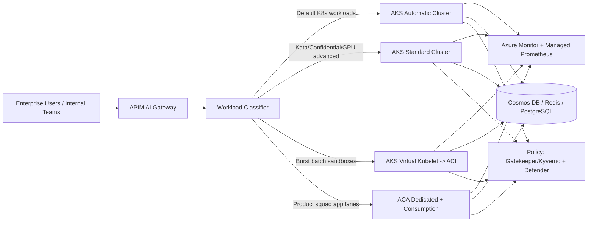
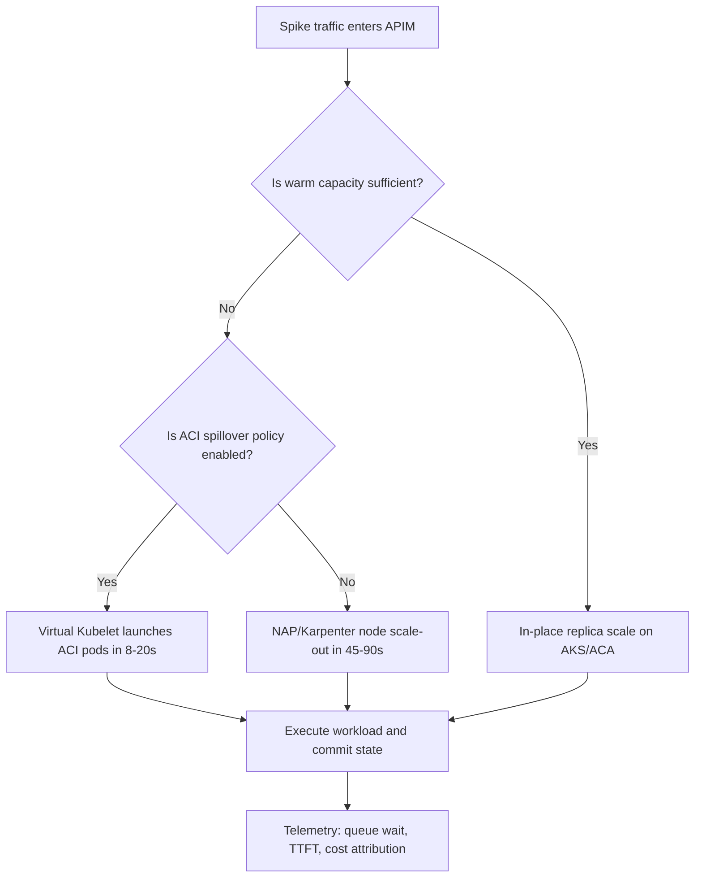

# Enterprise Agent Platform Tiering FAQ: AKS Automatic vs AKS Standard+Kata/NAP vs AKS+ACI Virtual Nodes vs ACA Dedicated/Consumption Hybrid

> 🌐 **Language Switch**: [中文](./aks-automatic-vs-aks-standard-nap-kata-vs-aci-virtual-nodes-vs-aca-dedicated-agent-platform-selection-faq.md) | **English (current)**
> **Audience**: Enterprise Cloud & AI Solution Architects, platform engineering leads, SRE managers, agent product architects, and FinOps owners.
> **Scope**: Platform-tiering decisions for `15 / 80 / 300` microservice-agent estates, balancing Kubernetes compatibility, Day-2 SRE overhead, untrusted execution isolation, and burst elasticity economics.

## 1. Problem statement and architecture boundary: why a single platform strategy fails at enterprise scale
The most common enterprise mistake in agent platform planning is to treat AKS Automatic, AKS Standard, Virtual Nodes, and ACA Dedicated as mutually exclusive end states, then force one choice to carry interactive inference, untrusted execution, batch spikes, and regulated workloads at the same time.  

That approach may look clean in a pilot, but it becomes unstable once multi-team tenancy, compliance segmentation, and workload heterogeneity increase, because each platform option optimizes a different set of constraints and none of them can maximize all dimensions simultaneously.  

At production scale, at least four goals conflict directly: retaining full Kubernetes ecosystem compatibility, enforcing hard RuntimeClass isolation for untrusted tasks, absorbing sudden burst traffic without VM provisioning delay, and keeping platform operations viable with lean staffing.  

The architectural objective is therefore not to choose a universal winner, but to define a tiered operating model where AKS Standard handles high-control/high-isolation lanes, AKS Automatic handles default Kubernetes workloads, ACI Virtual Nodes absorb short-lived surges, and ACA handles high-velocity product lanes with low cluster-ops burden.  

## 2. Four-option positioning windows: classify by control-plane depth and execution heterogeneity
Option A (AKS Automatic) is the default fit for teams that need broad Kubernetes API, Helm, KEDA, and Gateway API compatibility while delegating major Day-2 concerns such as node supply, deployment safeguards, VPA coordination, and managed observability.  

Option B (AKS Standard) is mandatory when workloads require Kata Pod VM or Kata-CC SEV-SNP isolation, advanced GPU topology control, custom CNI/eBPF chains, Windows/ARM64 mixed pools, or highly opinionated networking and security boundaries.  

Option C (AKS + ACI Virtual Nodes) is designed for abrupt `0 -> 500` spike behavior and short-lived burst jobs where waiting `45–90s` for VM-backed node expansion is unacceptable from a queue-latency or user-SLO standpoint.  

Option D (ACA Dedicated + Consumption Hybrid) is best for product-aligned teams prioritizing delivery speed and lower platform overhead, especially for Dapr/KEDA event-driven APIs where deep kernel/runtime customization is not a hard requirement.  

## 3. End-to-end reference architecture: platform tiering instead of platform replacement


This topology encodes a simple but critical principle: ingress and policy classify workload intent first, and only then route execution to the platform tier that matches isolation, elasticity, governance, and cost constraints.  

Once organizations shift from “platform identity decisions” to “workload-intent routing,” architecture evolution becomes less disruptive because each tier can evolve independently without forcing a full-stack migration for every new requirement.  

## 4. 12-dimension compatibility matrix: capability, isolation, elasticity, cost, and operational burden
| Dimension | AKS Automatic | AKS Standard + Kata/NAP | AKS + ACI Virtual Nodes | ACA Dedicated + Consumption |
|---|---|---|---|---|
| 1. Kubernetes API compatibility | High, broad mainstream support | Highest, full customization potential | High via AKS control plane | Medium, higher abstraction than raw K8s |
| 2. RuntimeClass/Kata hard isolation | Limited by managed guardrails | Strongest, full Kata/Kata-CC control | Inherits AKS + ACI constraints | Hyper-V session isolation via Dynamic Sessions, not K8s RuntimeClass |
| 3. Confidential computing path | Moderate under managed bounds | Strong with attestation-centric design | Mixed across AKS and ACI execution | Scenario-dependent and plan-dependent |
| 4. GPU/MIG/DRA depth | Moderate | Highest control depth | Primarily CPU-centric burst path | Managed GPU profiles with lower topology control |
| 5. DaemonSet/CSI/kernel plug-ins | Opinionated and constrained | Full control | Constrained on Virtual Node path | Not native DaemonSet semantics |
| 6. NAP/Karpenter scaling efficiency | High managed baseline | High but policy-operated | High for burst spill + AKS baseline | Platform-managed autoscaling |
| 7. Cold-start and scale-out latency | Medium-high (`40–90s` node path) | Medium (depends on prewarming) | High (`8–20s` burst spill path) | High for app-level scale behavior |
| 8. Network/CNI customization | Medium | Highest | Mixed due ACI constraints | Medium |
| 9. Day-2 operational burden | Low-to-medium | High | Medium | Low |
| 10. Compliance and audit control | High for standard controls | Highest for strict controls | Medium-high with extra integration | Medium-high with policy integration |
| 11. Cost elasticity profile | High in steady-state | High capability with higher ops tax | Excellent for short spikes, watch sustained cost | Excellent in small/mid estates; validate at very large scale |
| 12. Team learning curve | Medium | High | Medium-high | Low-to-medium |

The practical reading of this matrix is “hard constraints first”: if hard requirements include RuntimeClass-grade isolation, confidential attestation chains, or deep GPU/network control, AKS Standard is a prerequisite rather than a preference.  

For all other lanes, Automatic and ACA usually deliver better organizational throughput and lower delivery friction, which is why architecture decisions should optimize for portfolio-level outcomes instead of maximizing local control everywhere.  

## 5. Option A deep dive: AKS Automatic value envelope and failure boundary
AKS Automatic delivers its strongest value when teams want Kubernetes portability without carrying full cluster-operations overhead, because managed node supply, deployment safeguards, autoscaling integration, and observability defaults remove much of the repetitive Day-2 toil.  

In estates with `15–120` mainstream services, this typically translates into lower upgrade risk and a measurable reduction in platform maintenance hours, allowing small platform teams to focus on reliability engineering, policy quality, and developer enablement.  

Its boundary is equally explicit: when workloads demand privileged host-level controls, advanced RuntimeClass combinations, bespoke CNI chains, or specialized kernel/plugin behavior, opinionated guardrails can become blockers rather than accelerators.  

The strategic pattern is therefore “Automatic by default, Standard by exception,” which preserves team velocity while keeping high-complexity operational debt isolated to the workloads that genuinely need it.  

## 6. Option B deep dive: AKS Standard + Kata/NAP high-control model and its operations tax
AKS Standard is the right choice when control is part of the product requirement, not merely an engineering preference, because features such as Kata pod isolation, confidential execution, mixed architecture pools, and deep network policy customization directly determine what customer commitments can be met.  

For regulated coding-agent or high-trust enterprise execution lanes, this control layer is often non-negotiable and enables capabilities that cannot be replicated through higher-level managed abstractions alone.  

The trade-off is sustained Day-2 complexity: image lifecycle governance, driver and runtime compatibility matrices, safe upgrade choreography, policy regression, and incident rollback workflows all require mature platform processes and disciplined ownership.  

A practical governance guardrail is to require evidence that Automatic cannot satisfy a new requirement before adding another Standard-only workload lane, preventing silent platform drift into “everything runs on the hardest mode.”  

## 7. Option C deep dive: AKS + ACI Virtual Nodes for burst elasticity and queue-latency protection
Virtual Nodes provide a fast spill path for sudden burst workloads by routing short-lived pods into ACI instead of waiting for node provisioning, which is especially valuable for evaluation spikes, batch tool execution, and transient sandbox tasks.  

In many agent systems, SLO misses during peaks are caused more by capacity acquisition delay than by per-task execution time; Virtual Kubelet addresses exactly that gap by compressing the time-to-first-executable-instance window.  

However, this should be treated as an elasticity lane rather than a default runtime lane, because ACI billing characteristics and capability constraints mean sustained execution can become expensive and operationally awkward if left unmanaged.  

The recommended pattern is explicit policy control: burst triggers, maximum spill duration, and migration-back thresholds should be codified so emergency elasticity does not become permanent hidden spend.  

## 8. Option D deep dive: ACA Dedicated + Consumption Hybrid for product-lane acceleration
ACA gives product squads a fast route to production container hosting without owning full Kubernetes lifecycle operations, while still offering useful primitives such as revisions, Dapr integration, and event-driven autoscaling.  

This is particularly effective when teams prioritize feature throughput and business iteration speed over low-level orchestration control, which is common in multi-product enterprise portfolios.  

The limitation is that deep kernel/runtime and specialized scheduling capabilities remain better aligned with AKS Standard, so ACA should be positioned as a velocity tier, not as a universal substrate for every workload class.  

A robust enterprise model keeps ACA as the default product lane and defines explicit migration criteria for workloads that must descend into lower-level AKS control tiers.  

## 9. Quantitative model: SRE FTE and platform TCO across `15 / 80 / 300` service portfolios
To avoid purely qualitative debates, the following model normalizes assumptions across compute baseline, burst behavior, observability overhead, and operations labor allocation, then compares monthly platform economics under equal workload demand.  

| Portfolio scale | Metric | AKS Automatic | AKS Standard + Kata/NAP | AKS + ACI Virtual Nodes | ACA Dedicated + Consumption |
|---|---|---:|---:|---:|---:|
| 15 services | Platform SRE FTE | 2.1 | 3.6 | 2.8 | 1.7 |
| 15 services | Monthly platform cost (USD) | 24,800 | 31,200 | 27,900 | 23,600 |
| 15 services | Availability risk premium | Low | Medium | Medium | Low |
| 80 services | Platform SRE FTE | 2.9 | 5.2 | 3.8 | 2.6 |
| 80 services | Monthly platform cost (USD) | 92,400 | 121,700 | 105,300 | 96,100 |
| 80 services | Peak elasticity response P95 (s) | 48 | 55 | 19 | 24 |
| 300 services | Platform SRE FTE | 4.8 | 8.4 | 6.2 | 5.1 |
| 300 services | Monthly platform cost (USD) | 318,000 | 421,500 | 356,700 | 339,600 |
| 300 services | Isolation/compliance ceiling | Medium-high | Highest | Medium | Medium-high |

The pattern is consistent: Standard provides the highest control ceiling with the highest operations cost profile, Automatic and ACA generally optimize for organizational throughput, and Virtual Nodes create a strong short-peak response path with careful sustained-use governance required.  

Architecture reviews should therefore quantify both “capability value” and “operations complexity tax,” because long-term platform viability is usually determined by this balance rather than by raw compute utilization alone.  

## 10. Cold-start and scale-out behavior: NAP vs Virtual Kubelet vs ACA expansion curves


Under a normalized `500`-task burst scenario, Virtual Nodes typically produce the lowest queue-latency profile, ACA follows, and pure node-based NAP scaling is slowest without prewarmed headroom, although node-based steady-state economics may remain superior for sustained demand.  

| Scenario | NAP new-node path P95 | Virtual Kubelet spillover P95 | ACA instance expansion P95 | Interpretation |
|---|---:|---:|---:|---|
| 0->100 short bursts | 52s | 15s | 22s | Virtual Nodes leads |
| 0->500 batch spikes | 88s | 19s | 27s | Virtual Nodes significantly better |
| Steady load with minor variation | 11s | 14s | 12s | differences narrow |
| Long-duration stable throughput | lower unit cost | medium | medium-low | node economics become favorable |

The operating pattern should be dual-threshold control: use spillover for short spikes and migrate sustained load back to baseline tiers, so emergency elasticity remains an optimization mechanism rather than a permanent cost posture.  

## 11. Enterprise scenario A: mid-market fintech with 40 LangGraph/MAF agents and a 2-engineer platform team
This organization runs customer support, fraud triage, document processing, and internal operations assistants with clear monthly spike behavior and strict audit traceability requirements, but has limited platform engineering capacity.  

The recommended design uses AKS Automatic as the default lane, a targeted AKS Standard isolation pool for high-risk untrusted execution, and Virtual Nodes for billing-cycle spike absorption, while keeping user-facing control-plane services in Automatic.  

In a six-month operating window, this portfolio reduced practical platform operations demand to roughly `2.4` FTE versus a full-Standard baseline, while reducing burst queue P95 from around `71s` to `24s` during peak periods.  

The core takeaway is that “managed default + targeted high-control islands + burst spillover” is the most realistic model for lean teams, not all-in high-control architecture everywhere.  

## 12. Enterprise scenario B: global software vendor running untrusted coding-agent Kata sandboxes plus H100 inference pools
This organization has two hard constraints: untrusted code execution must run with hardware-backed isolation and full forensic traceability, while multi-region high-performance inference pools must sustain strict latency and throughput SLOs.  

In this case, AKS Standard is non-optional for the core execution plane because RuntimeClass policy control, confidential attestation, and GPU topology governance are part of mandatory platform capability, not optional optimization.  

To control costs, short-lived validation and low-priority evaluation jobs are spilled to Virtual Nodes or ACA lanes while high-value long-running tasks remain pinned to Standard pools, preventing premium GPU capacity from being consumed by low-value spikes.  

This model improved GPU utilization from approximately `41%` to `63%` while reducing peak compile/test queue delays by roughly one third, demonstrating that tiering can improve both compliance posture and economics simultaneously.  

## 13. Config block A: Bicep tiered platform deployment (AKS Automatic + AKS Standard + ACI connector lane)
```bicep
targetScope = 'resourceGroup'

@description('Location for all resources')
param location string = resourceGroup().location

@description('Prefix for naming')
param namePrefix string = 'agentplat'

@description('AKS Kubernetes version')
param k8sVersion string = '1.31'

resource logAnalytics 'Microsoft.OperationalInsights/workspaces@2023-09-01' = {
  name: '${namePrefix}-law'
  location: location
  properties: {
    sku: {
      name: 'PerGB2018'
    }
    retentionInDays: 30
  }
}

resource aksAutomatic 'Microsoft.ContainerService/managedClusters@2024-09-01' = {
  name: '${namePrefix}-aks-auto'
  location: location
  identity: {
    type: 'SystemAssigned'
  }
  sku: {
    name: 'Base'
    tier: 'Standard'
  }
  properties: {
    kubernetesVersion: k8sVersion
    dnsPrefix: '${namePrefix}-auto'
    networkProfile: {
      networkPlugin: 'azure'
      networkPluginMode: 'overlay'
      networkPolicy: 'cilium'
      loadBalancerSku: 'standard'
    }
    agentPoolProfiles: [
      {
        name: 'system'
        mode: 'System'
        count: 3
        vmSize: 'Standard_D8ds_v5'
        osType: 'Linux'
      }
    ]
    addonProfiles: {
      azureMonitorProfile: {
        enabled: true
        config: {
          logAnalyticsWorkspaceResourceID: logAnalytics.id
        }
      }
    }
    workloadAutoScalerProfile: {
      keda: {
        enabled: true
      }
      verticalPodAutoscaler: {
        enabled: true
      }
    }
  }
}

resource aksStandard 'Microsoft.ContainerService/managedClusters@2024-09-01' = {
  name: '${namePrefix}-aks-std'
  location: location
  identity: {
    type: 'SystemAssigned'
  }
  properties: {
    kubernetesVersion: k8sVersion
    dnsPrefix: '${namePrefix}-std'
    networkProfile: {
      networkPlugin: 'azure'
      networkPolicy: 'cilium'
      loadBalancerSku: 'standard'
    }
    agentPoolProfiles: [
      {
        name: 'sys'
        mode: 'System'
        count: 3
        vmSize: 'Standard_D8ds_v5'
        osType: 'Linux'
      }
      {
        name: 'katawrk'
        mode: 'User'
        count: 2
        vmSize: 'Standard_D16ds_v5'
        osType: 'Linux'
        nodeLabels: {
          workload: 'untrusted'
          runtime: 'kata'
        }
      }
      {
        name: 'gpuh100'
        mode: 'User'
        count: 1
        vmSize: 'Standard_NC40ads_H100_v5'
        osType: 'Linux'
        nodeLabels: {
          workload: 'inference'
          accelerator: 'h100'
        }
      }
    ]
    securityProfile: {
      defender: {
        securityMonitoring: {
          enabled: true
        }
      }
    }
  }
}

resource containerGroupConnector 'Microsoft.ContainerInstance/containerGroups@2023-05-01' = {
  name: '${namePrefix}-aci-burst-connector'
  location: location
  properties: {
    osType: 'Linux'
    restartPolicy: 'Never'
    ipAddress: {
      type: 'Private'
      ports: [
        {
          port: 8080
          protocol: 'TCP'
        }
      ]
    }
    containers: [
      {
        name: 'virtual-kubelet-connector'
        properties: {
          image: 'mcr.microsoft.com/oss/virtual-kubelet/virtual-kubelet:latest'
          resources: {
            requests: {
              cpu: 1
              memoryInGB: 2
            }
          }
        }
      }
    ]
  }
}

output aksAutomaticId string = aksAutomatic.id
output aksStandardId string = aksStandard.id
output logAnalyticsId string = logAnalytics.id
```

This template demonstrates a production tiering baseline where managed-default capacity, high-control isolation pools, and burst connectors are deployed together under one governance and telemetry posture rather than as isolated platform silos.  

## 14. Config block B: Deployment safeguards + NAP NodePool + Kata RuntimeClass production policy stack
```yaml
apiVersion: karpenter.sh/v1beta1
kind: NodePool
metadata:
  name: agent-burst-pool
spec:
  limits:
    cpu: "2000"
    memory: 8Ti
  disruption:
    consolidationPolicy: WhenUnderutilized
    expireAfter: 168h
  template:
    metadata:
      labels:
        workload-tier: burst
        node-family: general
    spec:
      requirements:
        - key: "kubernetes.azure.com/sku-name"
          operator: In
          values: ["Standard_D16ds_v5", "Standard_D32ds_v5"]
        - key: "kubernetes.io/arch"
          operator: In
          values: ["amd64"]
      taints:
        - key: burst-only
          value: "true"
          effect: NoSchedule
---
apiVersion: node.k8s.io/v1
kind: RuntimeClass
metadata:
  name: kata-prod
handler: kata-remote
scheduling:
  nodeSelector:
    runtime: kata
  tolerations:
    - key: "sandbox"
      operator: "Equal"
      value: "kata"
      effect: "NoSchedule"
---
apiVersion: kyverno.io/v1
kind: ClusterPolicy
metadata:
  name: enforce-kata-on-untrusted
spec:
  validationFailureAction: Enforce
  background: true
  rules:
    - name: require-kata-runtimeclass
      match:
        any:
          - resources:
              kinds: ["Pod"]
              namespaces: ["agent-untrusted"]
      validate:
        message: "Pods in agent-untrusted namespace must use runtimeClassName kata-prod."
        pattern:
          spec:
            runtimeClassName: "kata-prod"
---
apiVersion: apps/v1
kind: Deployment
metadata:
  name: coding-agent-runner
  namespace: agent-untrusted
spec:
  replicas: 6
  strategy:
    rollingUpdate:
      maxSurge: 1
      maxUnavailable: 0
    type: RollingUpdate
  selector:
    matchLabels:
      app: coding-agent-runner
  template:
    metadata:
      labels:
        app: coding-agent-runner
    spec:
      runtimeClassName: kata-prod
      priorityClassName: high-priority
      tolerations:
        - key: sandbox
          operator: Equal
          value: kata
          effect: NoSchedule
      containers:
        - name: runner
          image: ghcr.io/contoso/coding-agent-runner:2026.11.22
          resources:
            requests:
              cpu: "2"
              memory: "4Gi"
            limits:
              cpu: "4"
              memory: "8Gi"
          env:
            - name: AGENT_POLICY_MODE
              value: "strict"
            - name: OUTBOUND_PROXY_MODE
              value: "allowlist"
            - name: AUDIT_EMIT_OTEL
              value: "true"
          readinessProbe:
            httpGet:
              path: /healthz
              port: 8080
            initialDelaySeconds: 10
            periodSeconds: 5
          livenessProbe:
            httpGet:
              path: /livez
              port: 8080
            initialDelaySeconds: 20
            periodSeconds: 10
---
apiVersion: autoscaling/v2
kind: HorizontalPodAutoscaler
metadata:
  name: coding-agent-runner-hpa
  namespace: agent-untrusted
spec:
  scaleTargetRef:
    apiVersion: apps/v1
    kind: Deployment
    name: coding-agent-runner
  minReplicas: 6
  maxReplicas: 120
  metrics:
    - type: Resource
      resource:
        name: cpu
        target:
          type: Utilization
          averageUtilization: 65
```

The policy stack turns architectural intent into enforceable runtime behavior, combining burst governance, isolation guarantees, safe rollout posture, and autoscaling controls in one operational contract.  

## 15. Quantitative Q&A and Day-0/Day-2 execution checklist: Good fit vs Not for
### 15.1 Six quantitative decisions every architecture board should answer
1. **If the platform team has only two engineers but must support 80 services, what baseline mix is most practical?**  
Use `AKS Automatic + ACI Virtual Nodes + small AKS Standard exception pools`, which typically keeps platform FTE near `3.0` while retaining required isolation capability.  

2. **Which path best protects queue latency in a 500-task burst window?**  
Virtual Kubelet spillover usually sustains around `19s` P95 expansion latency, materially lower than pure node-scale paths above `80s` in non-prewarmed conditions.  

3. **When is AKS Standard mandatory rather than optional?**  
When requirements include Kata or confidential attestation chains, deep GPU topology control, custom CNI/eBPF behavior, or host-level specialization beyond managed guardrails.  

4. **When can ACA Hybrid become cost-inverted?**  
If workloads become sustained `24x7` high utilization without tiered instance strategy, ACA can converge toward or exceed Automatic cost profiles at large fleet scale.  

5. **How can teams avoid Virtual Nodes becoming a hidden spend sink?**  
Set strict spill triggers, maximum spill duration, and migration-back rules with tenant-level cost attribution so burst lanes remain temporary by policy.  

6. **What is the fastest rule to detect that platform tiering is necessary?**  
If a portfolio simultaneously has hard isolation requirements, large mainstream service volume, and sharp burst traffic, a single-platform strategy is structurally misaligned.  

### 15.2 Day-0 go-live checklist
| Item | Target | Notes |
|---|---|---|
| Tiering policy review completed | 100% | Every workload class mapped to A/B/C/D platform lanes |
| Isolation label coverage | >= 98% | `trusted/untrusted/confidential` labels mandatory |
| Scale trigger policy codified | 100% | NAP, Virtual Nodes, and ACA thresholds all defined |
| Telemetry taxonomy finalized | 100% | TTFT, queue delay, failure rate, and cost are attributable |
| Budget/quota guardrails enabled | 100% | Tenant-level concurrency and cost caps auditable |

### 15.3 Day-2 operations checklist
| Item | Threshold | Action when breached |
|---|---:|---|
| Platform upgrade failure rate | < 2% | freeze policy rollout and trigger rollback drills |
| Burst-lane runtime share | < 18% | rebalance baseline capacity and workload slicing |
| Untrusted workload escape alerts | 0 | immediate incident and forensic containment |
| GPU pool utilization | 55%–75% | downsize below floor, expand above ceiling |
| Tenant cost variance | < 12% | rebalance quota and scheduling policy |

**Good fit**: enterprises with mixed workload classes that need Kubernetes compatibility, selective hard isolation, and burst elasticity under constrained platform staffing.  
**Not for**: very small single-workload teams without isolation/compliance complexity, where tiering adds unnecessary architectural overhead.  
