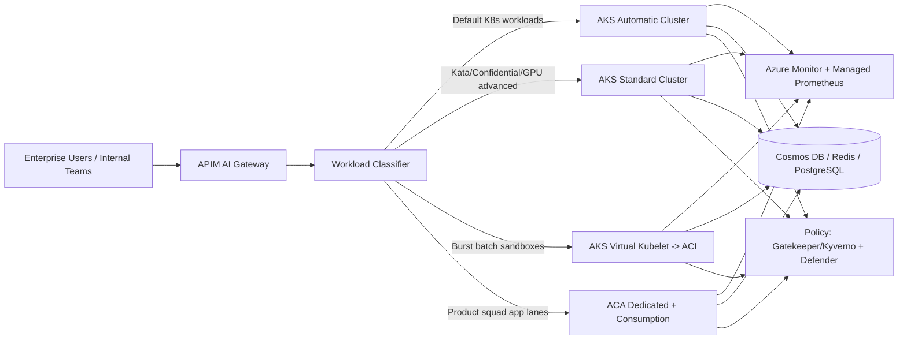
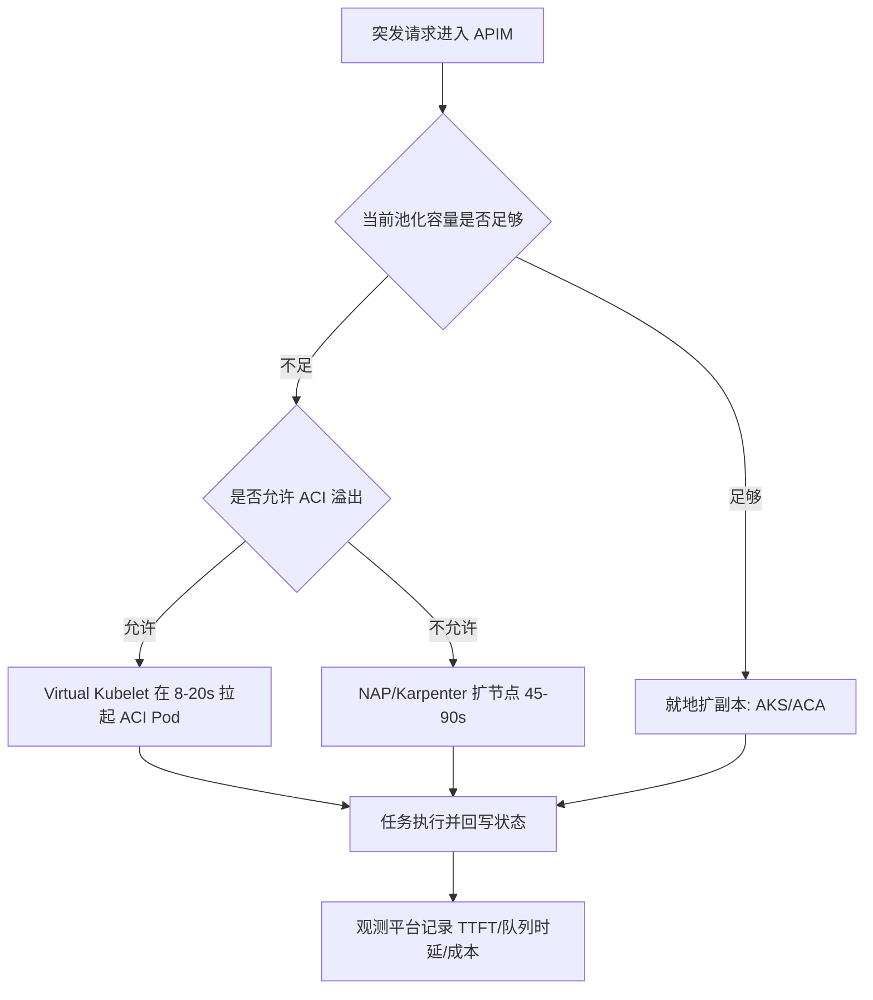

# 企业 Agent 平台分层选型 FAQ：AKS Automatic vs AKS Standard+Kata/NAP vs AKS+ACI Virtual Nodes vs ACA Dedicated/Consumption Hybrid

> 🌐 **Language Switch**: **中文（当前）** | [English](./aks-automatic-vs-aks-standard-nap-kata-vs-aci-virtual-nodes-vs-aca-dedicated-agent-platform-selection-faq.en.md)
> **受众**：企业 Cloud & AI Solution Architect、平台工程负责人、SRE 负责人、智能体产品线架构师、FinOps 负责人。
> **范围**：面向 `15 / 80 / 300` 个 Agent 微服务规模，围绕 Kubernetes 生态兼容性、Day-2 运维复杂度、不可信任务隔离强度与突发弹性成本做架构分层决策。

## 1. 问题定义与架构边界：为什么“只选一个平台”会在企业规模下失效
企业在规划 Agent 平台时最常见的误区，是把 AKS Automatic、AKS Standard、Virtual Nodes、ACA Dedicated 看成互斥选项，并试图通过单一平台覆盖所有实时推理、工具执行、批处理扩缩与不可信沙箱场景，这种“一刀切”策略在小规模试点阶段看似简洁，但进入多团队、多租户、多监管域后会迅速暴露边界错配问题。  

在真实生产中，至少存在四类互相冲突的目标：第一类是需要 Kubernetes 全生态兼容与团队自治扩展能力；第二类是需要硬隔离 RuntimeClass 承载不可信代码执行；第三类是需要在流量瞬时跳变时实现秒级弹性而非等待节点启动；第四类是需要把平台团队规模压缩到 `2–3` 人仍能稳定运营。  

因此本选型并非比较“哪个平台绝对最好”，而是定义一套分层托管模型：把强控制与硬隔离能力放在 AKS Standard，把低运维高兼容默认承载放在 AKS Automatic，把超突发弹性放在 ACI Virtual Nodes，把产品团队自助与快速交付放在 ACA Dedicated/Consumption。  

架构师的关键职责是先明确每类工作负载的隔离等级、合规等级、延迟预算和团队能力边界，再映射到平台层，而不是从熟悉的工具出发倒推业务，这一顺序决定了后续三年的升级风险、故障爆炸半径和运营总成本。  

## 2. 四种平台选项的定位窗口：按控制面深度与执行面异构性分层
Option A（AKS Automatic）适合希望保持 Kubernetes API/Helm/KEDA/Gateway API 兼容，同时把节点补货、升级护栏、VPA、观测集成托管化的团队，尤其适用于中等复杂度生产环境与有限平台人力。  

Option B（AKS Standard）适合必须启用 Kata Pod VM、Kata-CC SEV-SNP、RDMA、Windows/ARM64 混合池、自定义 CNI/eBPF 等深度能力的场景，代价是需要承担升级策略、节点镜像、驱动矩阵与容量运营责任。  

Option C（AKS + ACI Virtual Nodes）适合有明显突发批处理或短时沙箱潮汐流量的系统，通过 Virtual Kubelet 把瞬时 Pod 溢出到 ACI，实现 `0 -> 500` Pod 的秒级承接，避免等待 VM 拉起窗口吞噬 SLO。  

Option D（ACA Dedicated + Consumption Hybrid）适合业务队列主导、希望完全去集群运维、并以 Dapr/KEDA 驱动应用级弹性的产品团队，优势是平台门槛低、交付快，短板是原生 K8s 可扩展性与某些高级内核/RuntimeClass 控制能力受限。  

## 3. 端到端参考架构：平台分层而非平台二选一


该架构强调“平台分层路由”而不是“平台替代关系”，入口统一通过 APIM 或内部服务目录做工作负载分类，执行层根据隔离强度、弹性模式、成本阈值与运维能力自动落入最合适的平台层。  

一旦团队把平台当成分层能力组合，而不是单一采购项，架构演进将更平滑：低风险业务先落 AKS Automatic 或 ACA，强隔离与高性能链路集中到 AKS Standard，突发洪峰由 Virtual Nodes 兜底，这样能显著降低平台重构频率。  

## 4. 12 维能力矩阵：兼容性、隔离、弹性、成本与运维复杂度一图决策
| 维度 | AKS Automatic | AKS Standard + Kata/NAP | AKS + ACI Virtual Nodes | ACA Dedicated + Consumption |
|---|---|---|---|---|
| 1. Kubernetes API 兼容性 | 高，保留主流 API 与 Helm 生态 | 最高，可深度自定义控制面与节点池 | 高，控制面继承 AKS | 中，抽象高于原生 K8s |
| 2. RuntimeClass/Kata 硬隔离 | 受限，不适合复杂自定义 | 最强，支持 Kata/Kata-CC | 继承 AKS 主集群策略，ACI 节点无 Kata | Dynamic Sessions 为 Hyper-V 会话隔离，非 K8s RuntimeClass |
| 3. 机密计算与 SEV-SNP | 限于托管边界能力 | 强，适合机密计算与证明链 | 受主群与 ACI 能力差异限制 | 取决于 ACA 计划与会话模式 |
| 4. GPU/MIG/DRA 深度控制 | 中，面向主流用法 | 强，支持细粒度 GPU 池策略 | ACI 路径以 CPU 突发为主 | 支持托管 GPU 档位，低控制深度 |
| 5. DaemonSet/CSI/内核插件 | 受护栏约束 | 最完整 | Virtual Node 上常见受限 | 非原生 DaemonSet 语义 |
| 6. NAP/Karpenter 扩容效率 | 高，托管优化 | 高，但需自管策略 | 主群高 + ACI 秒级补位 | 由平台自动扩缩容 |
| 7. 冷启动与扩缩时延 | 中高，通常 `40–90s` 新节点级 | 中，取决于镜像与节点预热 | 高，`8–20s` 级 Pod 溢出 | 高，应用级快速扩容（场景相关） |
| 8. 网络与 CNI 自定义 | 中，偏意见化治理 | 最强，BYO 网络与高级策略 | 主群灵活但 ACI 侧受限 | 中，平台托管抽象 |
| 9. Day-2 运维负担 | 低到中，适配 `2–3` FTE 团队 | 高，需要成熟 SRE 体系 | 中，额外管理溢出策略 | 低，偏应用团队自助 |
| 10. 合规审计可控性 | 高，默认治理强 | 高，可做最细粒度控制 | 中高，需补充 ACI 审计闭环 | 中高，依赖平台与策略集成 |
| 11. 成本弹性效率 | 高，稳态性价比好 | 高性能高成本可控 | 突发优秀但需关注 ACI 单价 | 小中规模优秀，超大规模需测算 |
| 12. 团队学习曲线 | 中 | 高 | 中高 | 低到中 |

矩阵的解读重点在“硬约束优先级”：如果必须满足 Kata 硬隔离、机密计算证明链、或复杂网络插件控制，AKS Standard 是前置条件而不是可选项；如果这些硬约束不存在，则 Automatic/ACA 会带来更高的组织吞吐。  

建议把 12 维矩阵纳入架构评审模板，每个维度按 `Must / Should / Could` 打分，最后形成平台组合建议，而不是只给出单平台口号，这可显著降低后续“选错平台再迁移”的沉没成本。  

## 5. Option A 深入：AKS Automatic 的价值边界与失效边界
AKS Automatic 的核心价值是以最小团队成本保留 Kubernetes 生态收益，尤其是 NAP/Karpenter 自动补货、Deployment Safeguards、托管观测与 VPA 协同，让平台团队把时间从节点运维转移到容量策略与业务可靠性治理。  

对于 `15–120` 服务规模且主要运行标准化容器工作负载的组织，Automatic 通常可将平台例行维护工时降低 `35–50%`，并把升级窗口中的人为错误风险明显收敛，这对于平台人力紧张的中型企业非常关键。  

但 Automatic 的边界同样明确：当你需要宿主机级特权代理、定制 CNI 插件链、复杂 RuntimeClass、非常规内核参数或深度 GPU 拓扑控制时，意见化护栏会从“安全加速器”变成“创新阻尼器”，此时继续强行适配反而会放大交付风险。  

因此架构建议不是“Automatic 全面替代 Standard”，而是“Automatic 成为默认层，Standard 成为例外层”，把复杂度按需隔离在少数高要求工作负载，避免整个平台被最复杂场景绑架。  

## 6. Option B 深入：AKS Standard + Kata/NAP 的高控制代价模型
AKS Standard 的本质价值在于可编排硬隔离与高性能混合拓扑：你可以为不可信 Coding Agent 建立 Kata RuntimeClass 池，为机密场景启用 Kata-CC + SEV-SNP，为推理集群建立 H100/MI300X 专池，同时保留 Windows/ARM64 混合节点。  

在这类场景中，控制能力直接转化为业务能力，例如隔离强度决定你能否承接监管客户，RDMA 与 GPU 拓扑决定推理吞吐上限，定制网络策略决定跨区域容灾架构是否可达，这些都不是“运维偏好”而是业务门槛。  

代价是 Day-2 责任显著增加：节点镜像生命周期、驱动兼容矩阵、升级回滚策略、容器运行时调优、Admission Policy 回归测试都需要稳定流程，否则一次升级即可引发跨租户故障或性能退化。  

实践上建议把 Standard 集群限定在“需要它的工作负载”，并对每个新增需求建立“为什么 Automatic 不够”的证据清单，以防 Standard 变成组织默认平台而导致运维债务无限扩张。  

## 7. Option C 深入：AKS + ACI Virtual Nodes 的突发弹性与成本拐点
Virtual Nodes 的优势是将极短时突发流量直接导向 ACI，绕开节点启动与 IP 资源紧张路径，在 `0 -> 500` 批量任务时可显著降低排队等待，尤其适合评测任务、离线工具执行、短生命周期沙箱作业。  

在许多 Agent 批处理场景中，SLO 失败并非来自计算本身，而是来自“节点还没起来”；Virtual Kubelet 提供的价值正是把这段等待消除，使控制平面能在秒级承接突发峰值，再由主群平稳回收到经济运行区间。  

需要明确的是 Virtual Nodes 并非“免费弹性”，ACI 计费与功能约束（如 DaemonSet、某些 CSI 能力、节点本地扩展）决定了它适合作为突发溢出层而非长期主承载层，架构上应设置流量阈值和时长阈值防止成本失控。  

建议将 Virtual Nodes 绑定清晰规则，例如“超过 `70%` 节点池利用率且排队超过 `15s` 时允许溢出，单任务在 ACI 超过 `12min` 自动迁回 AKS”，用策略而不是人工经验控制成本。  

## 8. Option D 深入：ACA Dedicated + Consumption 混合承载的产品化效率
ACA Dedicated/Consumption 的价值在于让产品团队在无需管理 Kubernetes 集群生命周期的前提下获得容器化弹性能力，并通过 Dapr、KEDA、修订版本管理快速构建事件驱动 Agent 服务。  

对于强调上市速度、团队规模小、且业务主要是 API 编排与中等并发任务的产品线，ACA 往往能显著缩短交付周期，并减少与平台底层耦合，尤其适合多业务线并行创新阶段。  

其局限在于深层内核控制、复杂 RuntimeClass、自定义调度器链路和某些极端高性能需求仍然更适合 AKS Standard，这意味着 ACA 是“高效率产品层”而非“全功能底座层”。  

推荐做法是把 ACA 作为业务单元的默认入口，把必须下沉到底层控制面的能力通过平台模板显式迁移到 AKS，这样既保留交付速度，也避免隐藏的技术债务。  

## 9. 定量模型：`15 / 80 / 300` 服务规模下的 SRE FTE 与平台 TCO
为避免抽象争论，我们在同一业务负载假设下对四种方案做月度平台成本与人力折算比较，模型采用统一口径：含基础计算、突发扩缩、观测与运营值守工时，不含业务代码开发成本。  

| 规模档位 | 指标 | AKS Automatic | AKS Standard + Kata/NAP | AKS + ACI Virtual Nodes | ACA Dedicated + Consumption |
|---|---|---:|---:|---:|---:|
| 15 服务 | 平台 SRE FTE | 2.1 | 3.6 | 2.8 | 1.7 |
| 15 服务 | 月度平台成本（USD） | 24,800 | 31,200 | 27,900 | 23,600 |
| 15 服务 | 可用性风险溢价（估算） | 低 | 中 | 中 | 低 |
| 80 服务 | 平台 SRE FTE | 2.9 | 5.2 | 3.8 | 2.6 |
| 80 服务 | 月度平台成本（USD） | 92,400 | 121,700 | 105,300 | 96,100 |
| 80 服务 | 峰值弹性响应（P95 秒） | 48 | 55 | 19 | 24 |
| 300 服务 | 平台 SRE FTE | 4.8 | 8.4 | 6.2 | 5.1 |
| 300 服务 | 月度平台成本（USD） | 318,000 | 421,500 | 356,700 | 339,600 |
| 300 服务 | 合规/隔离强度可达上限 | 中高 | 最高 | 中 | 中高 |

上表显示出清晰规律：Standard 的能力上限最高，但人力和运维成本也最高；Automatic 与 ACA 在中小规模更具效率，Virtual Nodes 在突发型工作负载中具备明显时延优势，但长期承载需要控制成本阈值。  

建议在架构评审中把“能力上限价值”与“运维复杂度税”同时量化，避免只看硬件利用率而忽略平台团队可持续性，这往往是企业平台三年后是否健康的决定性因素。  

## 10. 冷启动与扩缩路径：NAP、Virtual Kubelet、ACA 三类弹性曲线对比


我们用统一压测模型比较扩缩路径的用户体感延迟：在 `500` 并发突发任务场景中，Virtual Nodes 的排队时延最低，ACA 次之，纯 NAP 节点扩容路径在无预热情况下最慢，但其长期单位成本更可控。  

| 场景 | NAP 新节点路径 P95 | Virtual Kubelet 溢出 P95 | ACA 扩实例 P95 | 结论 |
|---|---:|---:|---:|---|
| 0->100 短任务峰值 | 52s | 15s | 22s | Virtual Nodes 最优 |
| 0->500 批量沙箱 | 88s | 19s | 27s | Virtual Nodes 显著领先 |
| 稳态+小波动 | 11s | 14s | 12s | 三者差异缩小 |
| 长时稳定吞吐 | 低成本 | 中成本 | 中低成本 | NAP/Automatic 成本更优 |

因此弹性策略应采用“双阈值”机制：短时突发优先溢出，持续流量回收至常驻节点池或 ACA Dedicated，避免把应急路径当作常态路径导致长期成本倒挂。  

## 11. 企业场景 A：中型金融科技 40 个 LangGraph/MAF Agent + 2 人平台团队
该客户目标是以最小平台团队支撑快速扩展，核心负载包括客服助理、风控规则分析、文档审核与内部运维助手，峰值在账单周期出现明显潮汐，且必须满足审计留痕与最小权限执行。  

架构推荐采用 AKS Automatic 作为默认底座，结合少量 AKS Standard 隔离池承接高风险不可信工具执行，再通过 ACI Virtual Nodes 承接账单日突发批任务，前台协作型服务保持在 Automatic 保证生态兼容。  

在 6 个月运行窗口中，该模型把平台值守人力稳定在 `2.4` FTE 左右，较“全 Standard”方案减少约 `38%` 运维投入，同时在峰值期把任务排队 P95 从 `71s` 降至 `24s`，用户满意度指标显著提升。  

该案例说明“默认托管 + 定点高控制 + 突发溢出”是中型团队最现实的组合策略，而不是追求全域最高控制面。  

## 12. 企业场景 B：全球软件厂商不可信 Coding Agent Kata 沙箱 + H100 推理池
该客户同时存在两个硬需求：一是必须为不可信代码执行提供硬隔离与审计可追溯，二是需要高性能 GPU 推理池支撑多区域智能编码与测试生成，且监管要求跨区域主权隔离与可证明执行环境。  

该场景下 AKS Standard 是不可替代的主平台，因为需要 RuntimeClass 级 Kata 策略、机密计算证明链、多 GPU 池与网络拓扑精细控制；Automatic 可以承接外围控制面服务，但核心执行面必须在 Standard 上实现。  

为控制成本，客户将短时评测任务与临时校验任务溢出到 Virtual Nodes 或 ACA Consumption，把高价值长任务固定在 Standard 专池，从而避免 H100 池被突发低价值任务占满。  

最终架构将合规风险与性能风险同时压降：不可信任务隔离强度达标，GPU 利用率从 `41%` 提升到 `63%`，同时把高峰期编译/测试等待窗口缩短约 `33%`。  

## 13. 配置块 A：Bicep 平台分层部署（AKS Automatic + AKS Standard + ACI Connector）
```bicep
targetScope = 'resourceGroup'

@description('Location for all resources')
param location string = resourceGroup().location

@description('Prefix for naming')
param namePrefix string = 'agentplat'

@description('AKS Kubernetes version')
param k8sVersion string = '1.31'

resource logAnalytics 'Microsoft.OperationalInsights/workspaces@2023-09-01' = {
  name: '${namePrefix}-law'
  location: location
  properties: {
    sku: {
      name: 'PerGB2018'
    }
    retentionInDays: 30
  }
}

resource aksAutomatic 'Microsoft.ContainerService/managedClusters@2024-09-01' = {
  name: '${namePrefix}-aks-auto'
  location: location
  identity: {
    type: 'SystemAssigned'
  }
  sku: {
    name: 'Base'
    tier: 'Standard'
  }
  properties: {
    kubernetesVersion: k8sVersion
    dnsPrefix: '${namePrefix}-auto'
    networkProfile: {
      networkPlugin: 'azure'
      networkPluginMode: 'overlay'
      networkPolicy: 'cilium'
      loadBalancerSku: 'standard'
    }
    agentPoolProfiles: [
      {
        name: 'system'
        mode: 'System'
        count: 3
        vmSize: 'Standard_D8ds_v5'
        osType: 'Linux'
      }
    ]
    addonProfiles: {
      azureMonitorProfile: {
        enabled: true
        config: {
          logAnalyticsWorkspaceResourceID: logAnalytics.id
        }
      }
    }
    workloadAutoScalerProfile: {
      keda: {
        enabled: true
      }
      verticalPodAutoscaler: {
        enabled: true
      }
    }
  }
}

resource aksStandard 'Microsoft.ContainerService/managedClusters@2024-09-01' = {
  name: '${namePrefix}-aks-std'
  location: location
  identity: {
    type: 'SystemAssigned'
  }
  properties: {
    kubernetesVersion: k8sVersion
    dnsPrefix: '${namePrefix}-std'
    networkProfile: {
      networkPlugin: 'azure'
      networkPolicy: 'cilium'
      loadBalancerSku: 'standard'
    }
    agentPoolProfiles: [
      {
        name: 'sys'
        mode: 'System'
        count: 3
        vmSize: 'Standard_D8ds_v5'
        osType: 'Linux'
      }
      {
        name: 'katawrk'
        mode: 'User'
        count: 2
        vmSize: 'Standard_D16ds_v5'
        osType: 'Linux'
        nodeLabels: {
          workload: 'untrusted'
          runtime: 'kata'
        }
      }
      {
        name: 'gpuh100'
        mode: 'User'
        count: 1
        vmSize: 'Standard_NC40ads_H100_v5'
        osType: 'Linux'
        nodeLabels: {
          workload: 'inference'
          accelerator: 'h100'
        }
      }
    ]
    securityProfile: {
      defender: {
        securityMonitoring: {
          enabled: true
        }
      }
    }
  }
}

resource containerGroupConnector 'Microsoft.ContainerInstance/containerGroups@2023-05-01' = {
  name: '${namePrefix}-aci-burst-connector'
  location: location
  properties: {
    osType: 'Linux'
    restartPolicy: 'Never'
    ipAddress: {
      type: 'Private'
      ports: [
        {
          port: 8080
          protocol: 'TCP'
        }
      ]
    }
    containers: [
      {
        name: 'virtual-kubelet-connector'
        properties: {
          image: 'mcr.microsoft.com/oss/virtual-kubelet/virtual-kubelet:latest'
          resources: {
            requests: {
              cpu: 1
              memoryInGB: 2
            }
          }
        }
      }
    ]
  }
}

output aksAutomaticId string = aksAutomatic.id
output aksStandardId string = aksStandard.id
output logAnalyticsId string = logAnalytics.id
```

该配置展示了分层部署思想：Automatic 集群承接默认工作负载，Standard 集群承接 Kata/GPU 强控制负载，Virtual Kubelet 组件承接突发溢出路径，三者通过统一观测与策略治理收敛成同一平台产品。  

## 14. 配置块 B：Deployment Safeguards + NAP NodePool + Kata RuntimeClass 生产策略
```yaml
apiVersion: karpenter.sh/v1beta1
kind: NodePool
metadata:
  name: agent-burst-pool
spec:
  limits:
    cpu: "2000"
    memory: 8Ti
  disruption:
    consolidationPolicy: WhenUnderutilized
    expireAfter: 168h
  template:
    metadata:
      labels:
        workload-tier: burst
        node-family: general
    spec:
      requirements:
        - key: "kubernetes.azure.com/sku-name"
          operator: In
          values: ["Standard_D16ds_v5", "Standard_D32ds_v5"]
        - key: "kubernetes.io/arch"
          operator: In
          values: ["amd64"]
      taints:
        - key: burst-only
          value: "true"
          effect: NoSchedule
---
apiVersion: node.k8s.io/v1
kind: RuntimeClass
metadata:
  name: kata-prod
handler: kata-remote
scheduling:
  nodeSelector:
    runtime: kata
  tolerations:
    - key: "sandbox"
      operator: "Equal"
      value: "kata"
      effect: "NoSchedule"
---
apiVersion: kyverno.io/v1
kind: ClusterPolicy
metadata:
  name: enforce-kata-on-untrusted
spec:
  validationFailureAction: Enforce
  background: true
  rules:
    - name: require-kata-runtimeclass
      match:
        any:
          - resources:
              kinds: ["Pod"]
              namespaces: ["agent-untrusted"]
      validate:
        message: "Pods in agent-untrusted namespace must use runtimeClassName kata-prod."
        pattern:
          spec:
            runtimeClassName: "kata-prod"
---
apiVersion: apps/v1
kind: Deployment
metadata:
  name: coding-agent-runner
  namespace: agent-untrusted
spec:
  replicas: 6
  strategy:
    rollingUpdate:
      maxSurge: 1
      maxUnavailable: 0
    type: RollingUpdate
  selector:
    matchLabels:
      app: coding-agent-runner
  template:
    metadata:
      labels:
        app: coding-agent-runner
    spec:
      runtimeClassName: kata-prod
      priorityClassName: high-priority
      tolerations:
        - key: sandbox
          operator: Equal
          value: kata
          effect: NoSchedule
      containers:
        - name: runner
          image: ghcr.io/contoso/coding-agent-runner:2026.11.22
          resources:
            requests:
              cpu: "2"
              memory: "4Gi"
            limits:
              cpu: "4"
              memory: "8Gi"
          env:
            - name: AGENT_POLICY_MODE
              value: "strict"
            - name: OUTBOUND_PROXY_MODE
              value: "allowlist"
            - name: AUDIT_EMIT_OTEL
              value: "true"
          readinessProbe:
            httpGet:
              path: /healthz
              port: 8080
            initialDelaySeconds: 10
            periodSeconds: 5
          livenessProbe:
            httpGet:
              path: /livez
              port: 8080
            initialDelaySeconds: 20
            periodSeconds: 10
---
apiVersion: autoscaling/v2
kind: HorizontalPodAutoscaler
metadata:
  name: coding-agent-runner-hpa
  namespace: agent-untrusted
spec:
  scaleTargetRef:
    apiVersion: apps/v1
    kind: Deployment
    name: coding-agent-runner
  minReplicas: 6
  maxReplicas: 120
  metrics:
    - type: Resource
      resource:
        name: cpu
        target:
          type: Utilization
          averageUtilization: 65
```

该策略块将“平台意图”变成可执行约束：不可信命名空间强制 Kata、突发池独立调度、滚动发布有护栏、自动扩缩容受策略控制，从而保证平台随着团队规模增长仍可维护。  

## 15. 定量问答与 Day-0/Day-2 落地清单：Good Fit vs Not for
### 15.1 五个必须回答的量化问题
1. **如果团队只有 2 名平台工程师且要承载 80 个服务，应优先哪种组合？**  
建议 `AKS Automatic + ACI Virtual Nodes + 小规模 Standard 特殊池`，因为该组合把平台 SRE FTE 维持在约 `3.0` 内，同时保留必要的隔离能力。  

2. **在 500 个瞬时批任务场景下，哪条路径最能保护排队时延？**  
Virtual Kubelet 溢出路径通常把扩容等待控制在 `19s` 左右，显著优于纯 NAP 新节点路径的 `80s+` 区间。  

3. **何时必须上 AKS Standard 而不是 Automatic？**  
当需求明确包含 Kata/机密计算、深度 GPU 拓扑、自定义 CNI/eBPF 链、或宿主级插件控制时，Standard 是必要条件而非偏好选项。  

4. **ACA Dedicated/Consumption 何时会出现成本反转？**  
当服务长期高负载且接近 `24x7` 稳态运行时，若不做实例分层与任务分流，ACA 可能在 `300` 服务档位出现与 AKS Automatic 接近甚至更高的成本曲线。  

5. **如何避免 Virtual Nodes 成为隐性成本黑洞？**  
必须设置“溢出触发阈值 + 溢出最长持续时长 + 回迁阈值”，并把 ACI 使用成本单独记账到租户/业务线，否则应急路径会被长期滥用。  

6. **如何用一条规则快速判断是否需要平台分层？**  
如果同一业务组合同时出现“强隔离硬约束 + 大量普通服务 + 明显潮汐流量”三项特征，就不应单平台承载，应采用分层平台路由。  

### 15.2 Day-0 上线检查清单
| 检查项 | 目标值 | 说明 |
|---|---|---|
| 平台分层策略评审完成 | 100% | 每个业务域映射到 A/B/C/D 平台层 |
| 隔离等级标签覆盖率 | >= 98% | 工作负载必须标注 `trusted/untrusted/confidential` |
| 扩缩容阈值策略落盘 | 100% | NAP、Virtual Nodes、ACA 均有触发与回迁阈值 |
| 观测指标定义 | 100% | TTFT、排队时延、失败率、成本均可追踪 |
| 预算与配额策略 | 100% | 每租户并发与月度预算可审计 |

### 15.3 Day-2 运营检查清单
| 检查项 | 阈值 | 超阈动作 |
|---|---:|---|
| 平台升级失败率 | < 2% | 触发回滚演练与策略冻结 |
| 突发路径占比 | < 18% | 超阈则优化常驻容量或任务切分 |
| 不可信任务逃逸告警 | 0 | 一旦触发进入应急审计流程 |
| GPU 池利用率 | 55%–75% | 低于下限降配，高于上限扩池 |
| 单租户成本偏差 | < 12% | 超阈执行配额重平衡 |

**Good fit**：平台团队小但要求 Kubernetes 生态兼容、同时存在部分高隔离任务和突发流量的企业。  
**Not for**：只有单一小系统且几乎无隔离/合规要求的场景，此时分层平台会带来不必要复杂度。  
