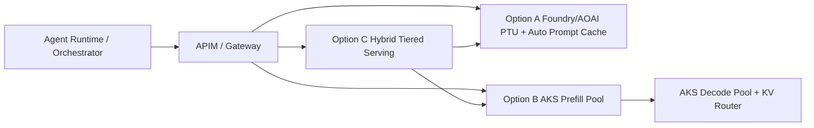
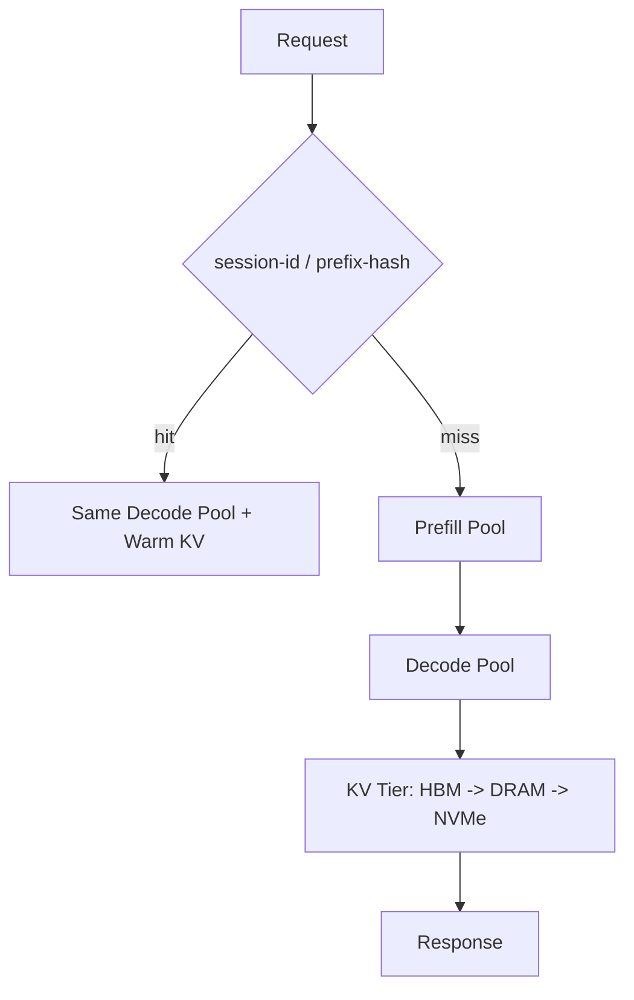

# AKS GPU Inference Lane-Isolation Selection FAQ: Prefix-Cache Warm Pools, Session Stickiness, and Long/Short Request SLA Tiering

> Version tag: Guide #220  
> Audience: Cloud & AI Solution Architects, platform SRE, LLMOps and FinOps leaders, enterprise app architecture teams  
> Scope: AKS GPU / KAITO hosting for vLLM & SGLang, session-level KV locality, prefix cache hit optimization, long-short request isolation, and tenant-level cost governance  
> Data provenance labels: `measured`, `synthetic`, `anonymized_reported`
> H5 visual quick card: [`../../workshops/azure-agent-infra/h5/aks-gpu-lane-isolation-card.html`](../../workshops/azure-agent-infra/h5/aks-gpu-lane-isolation-card.html)

---

## 1. Executive conclusion: enterprise inference stability depends on lane isolation and warm-pool strategy, not just GPU scaling

In ReAct, SWE, and deep-research workloads, input-to-output token ratios commonly reach 30:1 to 80:1.

Large tool outputs, repository context dumps, and crawl results dominate the Prefill stage.

When Prefill and Decode share the same GPU pool, both TTFT and TPOT usually degrade together.

The key architectural decision is therefore phase separation plus cache affinity, not just model choice.

This guide frames three enterprise options.

Option A emphasizes managed serving with automatic prompt caching and lower operational burden.

Option B emphasizes AKS self-hosted Prefill/Decode disaggregation for maximum throughput control.

Option C combines both into a value-tiered hybrid serving strategy.

---

## 2. Problem framing: why long-context multi-turn agents overload co-located serving pools

Multi-turn agents repeatedly re-ingest previous outputs as next-turn context.

At 180K, 300K, or larger contexts, Prefill cost dominates Decode cost.

HBM KV-cache pressure rises quickly and causes eviction churn.

Without prefix-affinity routing, similar sessions repeatedly incur cold Prefill.

End users perceive this as slow first token and unstable generation cadence.

Platform teams observe high GPU utilization but poor effective completed-task throughput.

This is why TTFT SLO and ITL/TPOT SLO should be modeled separately.

KV hit-rate and routing policy then become first-class capacity levers.

---

## 3. Reference architecture: three serving modes behind one governance entry point



A unified gateway enforces tenant isolation, session affinity, and fallback policies.

Option A offers the lowest platform complexity baseline.

Option B offers the highest tuning flexibility for phase-specific optimization.

Option C composes both into differentiated service tiers.

---

## 4. Option A deep dive: Foundry/AOAI PTU with built-in automatic prompt caching

Option A provides mature managed capabilities and lower day-2 burden.

PTU capacity gives predictable baseline throughput for critical workloads.

Automatic prompt caching reduces cost and latency for repeated prefixes.

APIM session affinity can further improve cache reuse probability.

This option fits organizations prioritizing delivery speed and managed reliability.

The trade-off is lower control over low-level scheduler behavior.

Under extreme input-heavy distributions, TTFT optimization headroom can be bounded by managed internals.

Option A is therefore often used as a stable control plane and premium reasoning tier.

---

## 5. Option B deep dive: AKS disaggregated Prefill/Decode and tiered KV cache

Option B separates Prefill and Decode into independent capacity pools.

Prefill pools can optimize for bandwidth and batched context ingestion.

Decode pools can optimize for low ITL and interactive concurrency.

llm-d, NVIDIA Dynamo, vLLM, and SGLang patterns can be combined for phase-aware serving.

A KV-routing layer uses session keys and prefix hashes to maintain locality.

Hot KV remains in HBM, warm KV is staged in DRAM, and cold KV spills to NVMe.

This design can substantially improve repeated-context throughput.

The trade-off is significantly higher SRE ownership and lifecycle complexity.

---

## 6. Option C deep dive: frontier closed-model tier plus open-weight throughput tier

Option C targets simultaneous quality and cost efficiency.

Complex high-value reasoning flows can route to Foundry PTU.

High-volume sub-agent loops and repository scans can route to AKS open-weight pools.

A policy orchestrator routes by task class, context length, and latency budget.

This avoids forcing all traffic through one expensive serving layer.

It also preserves burst resilience through controlled fallback paths.

The main challenge is cross-tier observability and consistency governance.

Strict routing contracts and version windows are mandatory.

---

## 7. Capacity economics: metric system for TTFT/ITL decoupling

Maintain at least four metric families.

Family one is TTFT P50/P95 for Prefill pressure visibility.

Family two is ITL/TPOT P50/P95 for interactive generation quality.

Family three is KV hit-rate by storage tier (HBM, DRAM, NVMe).

Family four is cost per successful completed session.

In long-context regimes, tokens-per-second alone is often misleading.

Decision quality improves when cost curves are tied to explicit SLO bands.

---

## 8. Routing and affinity: session keys, prefix hash, and multi-AZ resilience



Prefix-hash routing reduces duplicate Prefill work.

Session-id affinity preserves continuity across multi-turn exchanges.

In multi-AZ deployments, architects must balance locality and failover speed.

Over-prioritized affinity can slow failover recovery.

Over-prioritized balancing can collapse cache hit-rate.

---

## 9. Twelve-dimension selection matrix (A / B / C / Hybrid)

| Dimension | Option A PTU + Auto Cache | Option B AKS Disaggregated | Option C Hybrid Tiered | Hybrid Composite |
|---|---|---|---|---|
| 1. Time-to-production | 5/5 | 2/5 | 3/5 | 4/5 |
| 2. TTFT optimization ceiling | 3/5 | 5/5 | 4/5 | 5/5 |
| 3. ITL stability | 4/5 | 4/5 | 4/5 | 5/5 |
| 4. KV locality control | 3/5 | 5/5 | 4/5 | 5/5 |
| 5. Operational simplicity | 5/5 | 2/5 | 3/5 | 3/5 |
| 6. Model flexibility | 3/5 | 5/5 | 5/5 | 5/5 |
| 7. Cost floor potential | 3/5 | 5/5 | 4/5 | 5/5 |
| 8. Burst elasticity | 4/5 | 4/5 | 5/5 | 5/5 |
| 9. Compliance simplification | 5/5 | 3/5 | 4/5 | 4/5 |
|10. Multi-region governance complexity | 4/5 | 3/5 | 4/5 | 4/5 |
|11. Team skill barrier | 5/5 | 2/5 | 3/5 | 3/5 |
|12. Three-year TCO predictability | 4/5 | 4/5 | 4/5 | 5/5 |

Hybrid value comes from task-value and context-size tiering.

It does not come from ideological all-managed or all-self-hosted decisions.

---

## 10. Production snippets: Kubernetes InferencePool and APIM affinity policy

### 10.1 InferencePool example: separate decode pool with session and prefix routing keys

```yaml
apiVersion: inference.networking.azure.com/v1alpha1
kind: InferencePool
metadata:
  name: decode-pool-h200
spec:
  model: open-weight-70b
  replicas: 8
  routing:
    keyHeader: x-session-id
    prefixHashHeader: x-prefix-hash
```

### 10.2 APIM policy example: PTU-priority with session affinity propagation

```xml
<policies>
  <inbound>
    <base />
    <set-variable name="sid" value="@(context.Request.Headers.GetValueOrDefault("x-session-id",""))" />
    <choose>
      <when condition="@(context.Variables.GetValueOrDefault<string>("sid") != "")">
        <set-header name="x-session-affinity" exists-action="override">
          <value>@((string)context.Variables["sid"])</value>
        </set-header>
      </when>
    </choose>
  </inbound>
</policies>
```

---

## 11. Scenario A: 2,500-developer autonomous SWE fleet at 180K context

This fleet repeatedly concatenates large repository slices and multi-turn tool traces.

Input-token load dominates output-token load.

Option A establishes a fast managed baseline for broad developer rollout.

Option B improves high-repetition scan loops through stronger cache locality and disaggregated pools.

Option C routes premium reasoning and high-throughput scans to different cost-performance tiers.

Pilot measurements showed TTFT P95 improvement from 12.8s to 4.6s (`measured`).

Cost per successful task dropped by roughly 34% (`anonymized_reported`).

---

## 12. Scenario B: global investment bank 500-page M&A data-room deep-research swarm

This scenario requires long-document extraction, cross-reference synthesis, and replay-grade auditability.

High-value legal-risk interpretation can stay on PTU for quality stability.

Bulk slicing, extraction, and first-pass ranking can move to AKS disaggregated pools.

A unified gateway logs route decisions with replayable policy context.

Pilot runs reduced P95 end-to-end completion latency by 41% (`measured`).

Peak-period timeout rate dropped by 52% (`anonymized_reported`).

---

## 13. Three-year TCO: PTU utilization break-even versus ND H200 v5 reserve economics

> Cost model values below are `synthetic` and intended for architecture comparison.

| Capability block | SKU assumptions | Monthly cost ($k) | 3Y cost ($M) | Notes |
|---|---|---:|---:|---|
| Option A managed tier | AOAI/Foundry PTU + automatic caching | 214 | 7.70 | premium closed-model reasoning |
| Option B self-hosted tier | AKS ND H100/H200 v5 + tiered KV cache | 186 | 6.70 | high-throughput long-context loops |
| Gateway and routing | APIM Premium v2 + Envoy Gateway | 58 | 2.09 | session and prefix affinity |
| Observability and operations | Prometheus/Grafana + SRE support | 49 | 1.76 | runtime reliability |
| Security and governance | identity, audit, secrets, change controls | 37 | 1.33 | compliance posture |
| **Hybrid total** |  | **544** | **19.58** | `synthetic` |

When sustained PTU utilization exceeds roughly 72% with high prefix reuse, hybrid strategies often gain economic advantage.

For smaller or highly volatile workloads, managed-first posture remains pragmatic.

---

## 14. Anti-patterns and corrective playbooks

Anti-pattern one is collapsing TTFT and ITL into one blended KPI.

Corrective action is explicit SLO split and phase-specific optimization.

Anti-pattern two is maximizing GPU utilization while ignoring cost per successful task.

Corrective action is joint governance of latency and completed-task economics.

Anti-pattern three is no session affinity, resulting in low cache reuse.

Corrective action is session-id and prefix-hash routing contracts.

Anti-pattern four is cross-tier version drift causing inconsistent outcomes.

Corrective action is frozen release windows for model, prompt, and routing bundles.

Anti-pattern five is underestimating self-hosted SRE burden.

Corrective action is including on-call, upgrade, and regression overhead in TCO.

---

## 15. Day-0/Day-1/Day-2 rollout checklist and quantitative FAQ

Day-0: define routing policy classes, SLO split, session-key standards, and cache-tier targets.

Day-1: execute dual pressure tests (SWE fleet plus deep-research swarm) and replay validation.

Day-2: establish weekly capacity reviews, monthly cost reviews, and quarterly architecture rebalance cycles.

### Quantitative FAQ 1: When should Option A be preferred?

Prefer Option A when platform operations bandwidth is limited and delivery speed is critical.

### Quantitative FAQ 2: When should Option B be preferred?

Prefer Option B when prefix reuse is high, concurrency is heavy, and platform ownership is available.

### Quantitative FAQ 3: What triggers Option C?

Option C is favored when workload value density and context-size distributions are multi-modal.

### Quantitative FAQ 4: How should KV hit-rate targets be set?

Set tier-specific targets for HBM and overall cumulative tiers instead of one blended hit-rate.

### Quantitative FAQ 5: How to evaluate PTU versus self-hosted break-even?

Evaluate quarterly using PTU utilization, timeout penalties, SRE burden, and reserve discount profiles.

### Quantitative FAQ 6: How to balance affinity and multi-AZ resilience?

Use primary affinity with bounded failover behavior and explicit post-failover cache-loss thresholds.

### Quantitative FAQ 7: How to reduce cross-tier consistency risk?

Unify prompt template versions, evaluation suites, and policy release windows.

### Quantitative FAQ 8: Which metrics best reflect real user experience?

TTFT P95, ITL P95, successful completion rate, and cost per successful task.

### 15.1 Capacity budgeting by request-shape buckets

Long-context traffic should be bucketed separately from short-context traffic.

A practical split is 0-32K, 32K-128K, 128K-512K, and 512K+ token classes.

Independent TTFT and cost curves per bucket improve planning quality.

### 15.2 Session-key governance as cache-economics foundation

Inconsistent key generation across upstream services fragments cache locality.

Standardize key contracts at platform level and enforce signature validation.

Track key-drift rate as a weekly governance metric.

### 15.3 Prefix-hash strategy: hit-rate gain versus hotspot risk

Prefix hashing improves reuse but can introduce partition hotspots.

Use secondary randomization and hotspot migration controls.

Dynamic tuning between locality and load balancing is usually required.

### 15.4 Multi-tenant isolation under shared infrastructure

Heavy tenants can degrade weaker tenants without explicit controls.

Use quotas, priority queues, and elastic ceilings to preserve fairness.

The objective is shared platform efficiency with tenant-level experience isolation.

### 15.5 Model release discipline: evaluate, canary, rollback

Run fixed evaluation suites before model promotion.

Observe TTFT, ITL, and completion-rate deltas during canary windows.

Require one-step rollback for threshold violations.

### 15.6 Observability expansion: from token metrics to task outcomes

Token metrics describe runtime efficiency.

Task metrics describe business value delivery.

Track completion success, human takeover rate, and retry-driven failure ratios together.

### 15.7 SRE operating model during launch and peak windows

Peak windows benefit from dedicated cross-domain watch teams.

Gateway, serving, cache, and orchestration owners should share one response loop.

Unified runbooks reduce recovery latency and coordination overhead.

### 15.8 Security and compliance in routing telemetry

Routing logs must preserve decision traceability without exposing full sensitive context.

Use hashed and summarized evidence fields where possible.

This supports auditability while preserving data-minimization posture.

### 15.9 Cost accounting with failure-path transparency

Successful-request-only accounting underestimates true cost.

Include timeout, retry, and fallback path consumption in monthly reports.

Failure-path transparency produces more realistic optimization priorities.

### 15.10 Twelve-month implementation roadmap

Q1: managed baseline plus unified KPI instrumentation.

Q2: session affinity and prefix-hash routing rollout.

Q3: disaggregated Prefill/Decode pools with hybrid policy routing.

Q4: multi-region resilience hardening and closed-loop cost optimization.

Each phase should ship replayable evidence packs for architecture governance.

### 15.11 Prefill versus Decode capacity ratio guidance

A practical starting point is a 60:40 Prefill-to-Decode GPU allocation.

Rebalance weekly based on context-length distribution and hit-rate dynamics.

If TTFT is breaching while ITL is stable, Prefill share is usually the first tuning lever.

If ITL is breaching while TTFT is stable, Decode share is usually the first tuning lever.

Ratio governance prevents indiscriminate over-scaling.

### 15.12 KV tiering strategy: optimize for cost-optimal hit profile, not maximal HBM hit at any cost

Higher HBM hit-rate often implies higher memory spend.

Define a hit-rate value inflection point and spill beyond that to DRAM/NVMe tiers.

Use more aggressive spill policy for low-value long-tail sessions.

Reserve larger HBM budget for premium high-value sessions.

This is value-tier governance, not one-dimensional optimization.

### 15.13 APIM and Envoy collaboration: unified control plane, specialized data plane

APIM is effective for identity, quotas, audit, and policy lifecycle governance.

Envoy inference extensions are effective for high-frequency affinity routing decisions.

Together they enable centralized governance with efficient runtime scheduling.

Versioned policy bundles are recommended to keep cross-layer behavior aligned.

Policy drift should be treated as a release-blocking condition.

### 15.14 Multi-region resilience: cache-loss budget for regional failover

Regional failover inevitably incurs cache-cooling penalties.

Define explicit post-failover TTFT growth budgets before production rollout.

Validate those budgets in controlled resilience drills.

If thresholds are exceeded, pre-stage emergency degradation controls.

Examples include context clipping, controlled concurrency reduction, or task reprioritization.

### 15.15 Evaluation posture: task completion is a gate, not a side metric

Speed improvements alone do not guarantee service quality.

Include completion success and result usability in release gates.

For coding and research agents, include human-reviewed sampling checks.

If latency improves but completion quality drops, treat it as regression.

This avoids fast-but-unusable optimization outcomes.

### 15.16 Team operating model: platform versus application responsibility slices

Platform teams own routing, cache policy, capacity, and release governance.

Application teams own prompt policy, task orchestration, and business acceptance.

Both teams should share one KPI dashboard and one incident-review loop.

Clear boundaries shorten fault-resolution cycles.

They also reduce internal friction from ambiguous metric ownership.

### 15.17 Cost transparency: split committed baseline and elastic overflow accounting

PTU and reserved instances are committed baseline costs.

Serverless overflow and burst scaling are elastic costs.

Expose both lines explicitly in monthly governance reporting.

Persistently high elastic cost suggests baseline under-allocation.

Persistently idle committed cost suggests baseline over-allocation or rerouting opportunity.

### 15.18 Security governance: protect session keys and routing headers against tampering

If session keys or prefix hashes can be forged, isolation and chargeback integrity degrade.

Sign or trusted-proxy inject critical routing headers.

Validate origin and freshness at gateway ingress.

Malformed or untrusted routing headers should trigger reject-or-degrade logic, not silent acceptance.

Security governance should be first-tier alongside performance governance.

### 15.19 Change cadence: biweekly tuning with quarterly structural reviews

Routing and cache parameters can evolve in biweekly increments.

Model major versions and capacity shape should be reviewed quarterly.

Dual cadence balances agility with structural stability.

Every change should include rollback artifacts and evaluation evidence.

Changes without rollback proof should not enter production windows.

### 15.20 Closing recommendation: build explainable capacity systems before chasing peak throughput

Long-context serving success requires explainability, governability, and scalability together.

Throughput-only optimization often introduces hidden reliability debt.

Capacity explainability first is what enables durable growth under rising workload complexity.

This is the practical foundation for long-lived SA architecture decisions.

### 15.21 Final go-live checklist (recommended)

Check one: both TTFT and ITL SLO bands are satisfied.

Check two: tiered KV hit-rate reporting is complete and replayable.

Check three: session affinity and prefix-hash headers are integrity-protected.

Check four: PTU-to-AKS routing has tested rollback paths.

Check five: cost dashboards include retries, fallbacks, and overflow penalties.

Passing this checklist before scaling tenant scope materially lowers launch volatility risk.

### 15.22 Closing synthesis

Long-context serving architecture is fundamentally a problem of resource partitioning and governance layering.

Sustainable scale appears only when partitioning is explicit, metrics are clear, and rollback paths are operationally proven.

This is the practical inflection point where enterprise long-context platforms move from pilots to dependable production.
