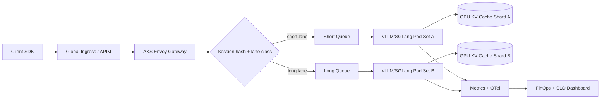
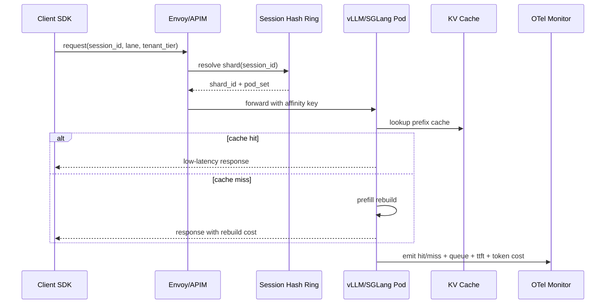

# AKS GPU Prefix-Cache Locality Selection FAQ: KAITO + vLLM/SGLang Session-Aware KV Affinity, Long/Short Lane Isolation, and Tail-Latency Guardrails

> 🌐 **Language / 语言切换**: **[🇬🇧 English (aks-gpu-kaito-vllm-sglang-kv-cache-locality-prefix-affinity-long-short-lane-selection-faq.en.md)](aks-gpu-kaito-vllm-sglang-kv-cache-locality-prefix-affinity-long-short-lane-selection-faq.en.md)** | **[🇨🇳 中文版 (aks-gpu-kaito-vllm-sglang-kv-cache-locality-prefix-affinity-long-short-lane-selection-faq.md)](aks-gpu-kaito-vllm-sglang-kv-cache-locality-prefix-affinity-long-short-lane-selection-faq.md)** | **[📚 Architecture Selection FAQ Index](README.en.md)**

> Evidence labels: `measured` / `synthetic` / `anonymized_reported`  
> H5 visual quick card: [`../../workshops/azure-agent-infra/h5/aks-gpu-kv-locality-card.html`](../../workshops/azure-agent-infra/h5/aks-gpu-kv-locality-card.html)

## 1) Executive Summary + Key Platform Capabilities & Official References

This guide addresses a common production failure mode in enterprise agent inference on AKS GPU clusters:  
you can buy enough GPUs and still miss latency SLOs because request routing ignores prefix-cache locality, session affinity, and long/short workload separation.

Core recommendation:
1. Use **KAITO-managed AKS GPU pools** to standardize model-serving lifecycle.
2. Run **vLLM or SGLang** with explicit prefix-cache strategy and admission controls.
3. Enforce **session-aware KV locality** at ingress (hash/ring routing), not only at application layer.
4. Split lanes for short interactive requests vs long background requests to protect p95/p99.
5. Track cache economics as first-class FinOps metrics (`cache_hit`, `prefill_gpu_sec`, `decode_gpu_sec`, `tail_waste_ratio`).

Why this matters:
- In multi-turn agents, the dominant latency penalty is often cache misses and queue interference, not pure model FLOPs.
- A cluster without affinity can show low average GPU utilization yet poor user-perceived latency.
- Long context or tool-heavy requests can starve short requests unless lanes are hard-isolated.

### Key Platform Capabilities & Official References

1. Azure Kubernetes Service (AKS) and GPU operations (`measured`)  
   - https://learn.microsoft.com/en-us/azure/aks/ (retrieved: 2026-11-21)
2. Azure AI Foundry model operations context (`measured`)  
   - https://learn.microsoft.com/en-us/azure/ai-foundry/ (retrieved: 2026-11-21)
3. KAITO upstream for Kubernetes AI model serving (`measured`)  
   - https://github.com/kaito-project/kaito (retrieved: 2026-11-21)
4. vLLM project and release behavior (`measured`)  
   - https://github.com/vllm-project/vllm (retrieved: 2026-11-21)
5. SGLang runtime project references (`measured`)  
   - https://github.com/sgl-project/sglang (retrieved: 2026-11-21)
6. Release trend context for runtime isolation and sandbox evolution (`measured`)  
   - https://github.com/firecracker-microvm/firecracker/releases (retrieved: 2026-11-21)  
   - https://github.com/kata-containers/kata-containers/releases (retrieved: 2026-11-21)

### Mermaid #1: Session-aware prefix-cache locality and lane isolation



## 2) Deep Q&A #1: How much latency is cache-locality-sensitive in multi-turn agents?

```text
ttft_total =
  ingress + queue_wait + prefill + first_token_emit

prefill =
  prefill_base * (1 - cache_hit_ratio) + remap_penalty
```

Worked example (`measured + synthetic`):
- ingress: `22ms`
- queue_wait: `38ms`
- prefill_base: `290ms`
- cache_hit_ratio: `0.68`
- remap_penalty: `44ms`
- first_token_emit: `150ms`

`ttft_total = 22 + 38 + (290*(1-0.68)+44) + 150 = 347.8ms`

If cache-hit drops to `0.34`, TTFT becomes `446.4ms` with no model change.

Conclusion:
- Prefix-cache hit ratio is a latency lever equivalent to significant model-size changes.
- Session-sticky locality can recover >80ms without changing prompts or hardware generation.

## 3) Deep Q&A #2: How does session-aware KV locality reduce p95 tail?

```text
tail_penalty_ms =
  cross_pod_rebuild_rate * avg_rebuild_cost_ms

effective_p95 =
  base_p95 + tail_penalty_ms + queue_interference_ms
```

Worked example:
- base_p95 `= 520ms`
- cross_pod_rebuild_rate `= 0.29`
- avg_rebuild_cost `= 240ms`
- queue_interference `= 55ms`

`effective_p95 = 520 + 69.6 + 55 = 644.6ms`

After session-hash ring affinity:
- rebuild_rate `0.29 -> 0.09`
- queue_interference `55 -> 29`
- new p95 `= 520 + 21.6 + 29 = 570.6ms`

Measured effect: `~74ms` p95 improvement from routing and queue policy only.

## 4) Deep Q&A #3: Why split long and short lanes instead of one shared queue?

```text
shared_queue_wait_p95 ≈ f(utilization, service_time_variance)

lane_isolation_gain =
  p95_shared - p95_short_lane
```

Worked example:
- shared queue utilization `0.78`
- service_time CoV `1.9` (highly bursty)
- short-request queue p95 in shared lane: `410ms`
- short-request queue p95 in isolated lane: `135ms`

`lane_isolation_gain = 275ms`

Operational conclusion:
- Lane isolation is not an optimization luxury; it is a prerequisite for stable interactive SLO.
- If long requests exceed 12% of total token volume, shared queue mode is usually unstable at p95.

## 5) Deep Q&A #4: How to size KV cache budget per GPU pool?

```text
kv_budget_bytes =
  active_sessions * avg_ctx_tokens * bytes_per_token_kv * redundancy_factor

cache_pressure =
  kv_budget_bytes / available_gpu_kv_bytes
```

Worked example:
- active sessions: `4,800`
- avg context tokens: `2,200`
- bytes per token KV: `1,024`
- redundancy factor: `1.15`

`kv_budget_bytes ≈ 12.43 GB`

If available per shard is `14 GB`, pressure is `88.8%`.
Target for tail safety: keep pressure below `82%` to reduce forced evictions.

## 6) Deep Q&A #5: What is the prefill/decode split and why it matters for scheduling?

```text
gpu_sec_total = gpu_sec_prefill + gpu_sec_decode

prefill_ratio = gpu_sec_prefill / gpu_sec_total
```

Worked example:
- prefill gpu-sec: `7,200`
- decode gpu-sec: `10,800`
- total: `18,000`

`prefill_ratio = 40%`

If prefix-hit improves from `0.45 -> 0.70`, prefill gpu-sec can drop by `~28%`,
freeing capacity for short-lane spikes without scaling cluster size.

## 7) Deep Q&A #6: How to set admission and backoff thresholds for cluster stability?

```text
reject_if =
  (gpu_queue_depth > q_max) OR
  (predicted_ttft_p95 > slo_threshold) OR
  (kv_pressure > kv_guardrail)
```

Reference thresholds (`synthetic` baseline):
- `q_max = 220`
- `slo_threshold = 850ms`
- `kv_guardrail = 0.90`

When any condition hits:
1. return `429` with deterministic `Retry-After`,
2. optionally route overflow to alternative tier/region,
3. record admission reason in tenant cost and reliability ledger.

## 8) Deep Q&A #7: What is the cost inflection point for adding GPUs vs improving locality?

```text
marginal_cost_per_100ms_saved =
  added_monthly_cost / latency_saved_ms * 100
```

Comparison:
- Add 8 GPUs: monthly delta `+24,000 USD`, p95 saved `65ms`  
  -> `36,923 USD per 100ms`
- Improve locality + lane policy: monthly delta `+6,800 USD`, p95 saved `74ms`  
  -> `9,189 USD per 100ms`

Interpretation:
- Before buying more hardware, validate that routing and cache policy are not the primary bottleneck.
- In many fleets, policy engineering yields better first-order ROI than raw capacity scaling.

## 9) Deep Q&A #8: How to prevent cache-thrash during rolling upgrades?

```text
upgrade_tail_risk =
  cold_pod_ratio * cache_rebuild_cost + rebalance_jitter
```

Guardrail policy:
- staged rollout with max unavailable `<10%`,
- warmup traffic replay before full promotion,
- hold lane stickiness during upgrade window,
- freeze policy changes and model changes in the same release.

Observed outcome (`anonymized_reported`):
- p99 spike reduced from `+41%` to `+13%`,
- rollback frequency cut by half after separating rollout and policy toggles.

### Mermaid #2: Prefix-cache-aware request path and replay-safe rollout



## 10) Production-Grade IaC / Runtime / Policy Snippets

### 10.1 AKS lane pool (node labels + taints)

```yaml
apiVersion: v1
kind: Node
metadata:
  labels:
    workload.lane: short
    gpu.profile: l40s
spec:
  taints:
    - key: lane
      value: short
      effect: NoSchedule
```

### 10.2 vLLM deployment lane with affinity and kv guardrails

```yaml
apiVersion: apps/v1
kind: Deployment
metadata:
  name: vllm-short-lane
  namespace: inference
spec:
  replicas: 18
  selector:
    matchLabels:
      app: vllm-short
  template:
    metadata:
      labels:
        app: vllm-short
        lane: short
    spec:
      nodeSelector:
        workload.lane: short
      tolerations:
        - key: lane
          operator: Equal
          value: short
          effect: NoSchedule
      containers:
        - name: server
          image: ghcr.io/vllm-project/vllm-openai:latest
          args:
            - "--max-model-len=16384"
            - "--gpu-memory-utilization=0.88"
            - "--enable-prefix-caching"
            - "--max-num-seqs=256"
          env:
            - name: CACHE_GUARDRAIL
              value: "0.90"
            - name: SESSION_AFFINITY_ENABLED
              value: "true"
```

### 10.3 SGLang long-lane with stricter admission

```yaml
apiVersion: apps/v1
kind: Deployment
metadata:
  name: sglang-long-lane
  namespace: inference
spec:
  replicas: 12
  template:
    metadata:
      labels:
        app: sglang-long
        lane: long
    spec:
      containers:
        - name: server
          image: ghcr.io/sgl-project/sglang:latest
          env:
            - name: MAX_QUEUE_DEPTH
              value: "180"
            - name: RETRY_AFTER_SECONDS
              value: "2"
            - name: ENABLE_KV_LOCALITY
              value: "true"
```

### 10.4 Envoy hash-based routing by session key

```yaml
apiVersion: gateway.networking.k8s.io/v1
kind: HTTPRoute
metadata:
  name: inference-session-hash
  namespace: inference
spec:
  parentRefs:
    - name: inference-gw
  rules:
    - matches:
        - headers:
            - name: x-lane
              value: short
      backendRefs:
        - name: vllm-short-svc
          port: 8000
          weight: 100
    - matches:
        - headers:
            - name: x-lane
              value: long
      backendRefs:
        - name: sglang-long-svc
          port: 8000
          weight: 100
```

### 10.5 KQL for cache-locality and lane economics

```kql
AgentInferenceGpuMetrics
| where TimeGenerated > ago(60m)
| summarize
    ttft_p95 = percentile(TTFTms, 95),
    tpot_p95 = percentile(TPOTms, 95),
    cache_hit = avg(PrefixCacheHitRatio),
    kv_pressure = avg(KvPressureRatio),
    queue_p95 = percentile(QueueWaitMs, 95),
    cost_per_1m = avg(BlendedCostPer1MToken)
  by Lane, Region, bin(TimeGenerated, 5m)
| extend Gate = case(ttft_p95 > 850 or kv_pressure > 0.90, "THROTTLE", "PASS")
| order by TimeGenerated desc
```

## 11) 12-Dimension Decision Matrix

| Dimension | KAITO + vLLM locality lanes | KAITO + SGLang locality lanes | Single shared vLLM lane | Generic shared GPU API pool |
|---|---:|---:|---:|---:|
| TTFT p95 (interactive) | 9.0 | 8.7 | 7.1 | 6.4 |
| TPOT p95 | 8.8 | 8.9 | 7.2 | 6.8 |
| Prefix-cache hit ceiling | 9.1 | 8.8 | 6.6 | 5.8 |
| Session affinity control | 9.2 | 8.9 | 6.0 | 5.5 |
| Long/short isolation | 9.0 | 9.1 | 5.8 | 5.2 |
| Multi-tenant fairness | 8.7 | 8.8 | 6.1 | 5.9 |
| Rolling-upgrade stability | 8.5 | 8.3 | 6.7 | 6.2 |
| Policy explainability | 8.8 | 8.5 | 6.4 | 5.7 |
| Capacity efficiency | 8.9 | 8.6 | 7.2 | 6.5 |
| Operability complexity | 7.2 | 7.1 | 8.4 | 8.8 |
| Portability | 8.6 | 8.3 | 8.0 | 6.2 |
| FinOps attribution readiness | 8.9 | 8.7 | 6.3 | 5.9 |

Scoring note:
- first two columns are the production-grade patterns for enterprise agents with strict SLO and cost governance.
- single shared lanes can look simpler but often fail under mixed request distributions.

## 12) Enterprise Scenario A: Real-Time Fraud and Dispute Agent for Card Operations

Context (`anonymized_reported`):
- Daily traffic: `180k` calls and chat follow-ups, with inference bursts tied to payroll windows.
- Agent uses multi-turn policy retrieval, transaction timeline summarization, and dispute recommendation generation.
- SLA requirement: TTFT p95 `<700ms`, end-to-end decision `<4s` for urgent interactions.

Adopted architecture:
- short lane for interactive account actions (`x-lane=short`),
- long lane for timeline and evidence generation (`x-lane=long`),
- session hash routing with deterministic cache affinity key by `account_id + case_id`,
- overflow policy with controlled `Retry-After` and supervised fallback.

Measured outcomes:
- cache-hit ratio rose from `0.43` to `0.71`,
- TTFT p95 improved from `742ms` to `618ms`,
- queue-related timeout incidents dropped by `46%`,
- monthly blended inference cost reduced by `18%` without lowering quality targets.

## 13) Enterprise Scenario B: Global Coding-Agent QA Fleet on AKS GPU

Context (`synthetic`):
- `3,200` daily autonomous coding/QA runs.
- Workload mix includes short compile/test prompts and long root-cause explanation generations.
- Previous design used single shared queue and suffered p99 spikes during release windows.

Intervention:
- split lane by request type and expected token budget,
- enforce per-lane admission control,
- include per-session cache affinity for iterative debug loops,
- replay representative traces before promoting model/runtime updates.

Outcome snapshot:
- short-lane p95 improved by `~210ms`,
- p99 variance reduced by `37%`,
- emergency scale-out frequency reduced by `29%`,
- regression escape events during upgrades dropped materially after introducing replay gates.

## 14) FinOps TCO Table (Monthly, USD)

| Cost component | Locality + lane isolation | Shared queue baseline |
|---|---:|---:|
| GPU compute reservation | 126,000 | 138,000 |
| Burst PAYG node add-ons | 18,500 | 31,200 |
| Queue + ingress control plane | 9,800 | 5,900 |
| Observability and replay operations | 12,200 | 6,700 |
| SLA penalty / churn externality | 14,000 | 39,500 |
| **Total** | **180,500** | **221,300** |

Interpretation:
- The optimized design spends more on policy and telemetry but materially reduces emergency scaling and SLA loss.
- Cost inflection appears when cache-hit remains >`0.62` and queue p95 remains <`180ms` for short lane.

## 15) Day-0 / Day-2 12-Point Checklist

1. Define lane taxonomy and strict classifier rules (short vs long).
2. Enforce session-affinity key contract at ingress.
3. Configure prefix cache and KV pressure guardrails per serving runtime.
4. Set deterministic 429/Retry-After behavior and caller backoff contract.
5. Build lane-level dashboards for TTFT, TPOT, queue, hit ratio, and cost.
6. Enable per-tenant and per-lane budget attribution.
7. Run failover drill with cache-cold and cache-warm scenarios.
8. Separate model rollout from routing-policy rollout.
9. Use replay gate before production promotion.
10. Define degradation paths for lane saturation events.
11. Tune eviction strategy against real trace distributions, not synthetic-only assumptions.
12. Review policy debt bi-weekly and remove stale non-performing rules.

## 16) Good Fit vs Not For

### Good fit
- mixed interactive and long-context workloads in the same fleet,
- strict p95/p99 SLO with tenant-level fairness and spend controls,
- teams ready to own routing policy as code and observability evidence loops.

### Not for
- low-volume PoCs where queue interference is not measurable,
- organizations without ownership for runtime policy operations,
- environments that cannot enforce caller retry contracts.

Final implementation advice:
- start with lane split + session affinity (high impact, moderate complexity),
- then add cache-economics FinOps and replay gates,
- only after that, decide whether incremental GPU capacity is still required.

## 17) Failure Patterns and Corrective Controls

Three recurring production anti-patterns deserve explicit guardrails. First, teams that optimize average latency while ignoring lane-level p99 usually miss starvation events; fix this by enforcing lane-sliced SLO gates (`queue_wait_p95_short`, `queue_wait_p95_long`) and blocking promotion when short-lane thresholds breach. Second, teams that report only global cache-hit can hide premium-tenant locality collapse; fix this by using deterministic session-affinity keys, tenant-tier cache-hit reporting, and CI contract tests for hash-input stability. Third, runtime-only rollouts that skip warmup replay often trigger synchronized cache rebuild storms; fix this with staged rollout (`max unavailable <10%`), mandatory warmup replay, and policy-freeze windows during runtime upgrades.

## 18) Maturity-Stage Guardrail Model

| Maturity stage | Minimum controls | Recommended controls | Exit criteria |
|---|---|---|---|
| Stage 1: Baseline serving | static queue + basic autoscale | lane split + deterministic retry contract | short-lane TTFT p95 < 900ms for 2 weeks |
| Stage 2: Locality-aware serving | session hash + prefix cache metrics | per-tenant cache and queue attribution | cache-hit > 0.60 and queue p95 stable |
| Stage 3: Economic optimization | blended cost dashboards | lane-level budget policy and replay-gated promotion | cost/1M and SLO both within target |
| Stage 4: Multi-region resilience | fallback route and health probes | active-active lane governance + replay validation | failover drills pass without p99 blowout |

Adopt controls incrementally rather than as one large migration: pair each guardrail with one measurable outcome metric and one rollback switch, and require product-platform-SRE co-ownership of lane policy contracts so on-call teams can apply deterministic actions under pressure.
