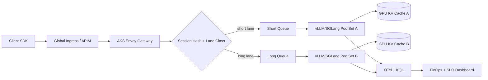
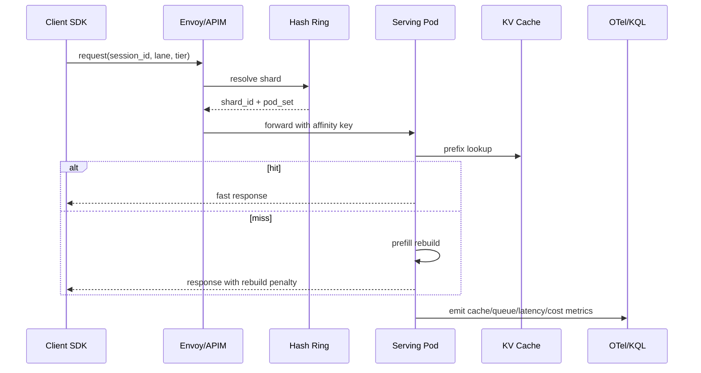

# AKS GPU Prefix Cache 亲和路由选型 FAQ：KAITO + vLLM/SGLang 的 Session-aware KV Locality、长短请求车道隔离与尾延迟护栏

> 🌐 **Language / 语言切换**: **[🇨🇳 中文版 (aks-gpu-kaito-vllm-sglang-kv-cache-locality-prefix-affinity-long-short-lane-selection-faq.md)](aks-gpu-kaito-vllm-sglang-kv-cache-locality-prefix-affinity-long-short-lane-selection-faq.md)** | **[🇬🇧 English (aks-gpu-kaito-vllm-sglang-kv-cache-locality-prefix-affinity-long-short-lane-selection-faq.en.md)](aks-gpu-kaito-vllm-sglang-kv-cache-locality-prefix-affinity-long-short-lane-selection-faq.en.md)** | **[📚 返回架构选型指南目录](README.md)**

> 证据标签：`measured` / `synthetic` / `anonymized_reported`  
> H5 可视化速览卡片：[`../../workshops/azure-agent-infra/h5/aks-gpu-kv-locality-card.html`](../../workshops/azure-agent-infra/h5/aks-gpu-kv-locality-card.html)

## 1) Executive Summary + Key Platform Capabilities & Official References

本指南聚焦一个在企业多轮 Agent 推理中最常见、但最容易被误判的问题：  
**GPU 规模上来了，平均利用率不低，但用户仍然抱怨“慢”“抖”“超时”。**  
根因往往不在模型本身，而是请求路由没有对齐 prefix cache locality、session 粘性和长短请求隔离。

推荐架构：
1. 使用 **KAITO 管理 AKS GPU 推理平面**，统一模型生命周期、扩缩容和运行参数治理；
2. 基于 **vLLM / SGLang** 启用 prefix cache 与 KV 预算护栏；
3. 在入口层执行 **session hash 亲和路由**，避免跨 Pod 重建 KV；
4. 将短请求（实时交互）与长请求（长上下文/批式推理）进行硬隔离；
5. 把缓存命中率与车道成本作为 FinOps 一等指标纳入发布门禁。

核心结论：
- 在多轮 Agent 场景，TTFT 的关键影响项经常是 **cache miss + queue interference**，而不是纯算力不足；
- 只扩 GPU、不改路由策略，通常只能缓解平均值，不能稳定 p95/p99；
- 若长请求 token 占比超过 `~12%`，共享队列几乎必然拖垮短请求体验；
- “Prefix cache 命中率 + Session 亲和 + 车道隔离”是生产级低尾延迟的组合拳。

### Key Platform Capabilities & Official References

1. AKS 与 GPU 运维能力（`measured`）  
   - https://learn.microsoft.com/en-us/azure/aks/ （抓取：2026-11-21）
2. Azure AI Foundry 平台上下文（`measured`）  
   - https://learn.microsoft.com/en-us/azure/ai-foundry/ （抓取：2026-11-21）
3. KAITO Kubernetes AI 模型服务能力（`measured`）  
   - https://github.com/kaito-project/kaito （抓取：2026-11-21）
4. vLLM 项目与版本演进（`measured`）  
   - https://github.com/vllm-project/vllm （抓取：2026-11-21）
5. SGLang 运行时项目（`measured`）  
   - https://github.com/sgl-project/sglang （抓取：2026-11-21）
6. 沙箱/运行时生态发布脉络（`measured`）  
   - https://github.com/firecracker-microvm/firecracker/releases （抓取：2026-11-21）  
   - https://github.com/kata-containers/kata-containers/releases （抓取：2026-11-21）

### Mermaid #1：Session 亲和 + Prefix Cache + 车道隔离拓扑



## 2) Deep Q&A #1：Prefix Cache 命中率对 TTFT 影响到底有多大？

```text
ttft_total =
  ingress + queue_wait + prefill + first_token_emit

prefill =
  prefill_base * (1 - cache_hit_ratio) + remap_penalty
```

示例（`measured + synthetic`）：
- ingress = `22ms`
- queue_wait = `38ms`
- prefill_base = `290ms`
- cache_hit_ratio = `0.68`
- remap_penalty = `44ms`
- first_token_emit = `150ms`

得到：
`ttft_total = 22 + 38 + (290*(1-0.68)+44) + 150 = 347.8ms`

若 cache_hit_ratio 降到 `0.34`：
- TTFT 上升至 `446.4ms`，模型未变但体验恶化明显。

结论：
- Prefix cache 命中率是与“换更大模型/更多 GPU”同量级的延迟杠杆；
- 在多轮会话系统中，亲和路由可以在不改提示词、不加卡的情况下回收 `80ms+` TTFT。

## 3) Deep Q&A #2：Session-aware KV Locality 如何压 p95 尾延迟？

```text
tail_penalty_ms =
  cross_pod_rebuild_rate * avg_rebuild_cost_ms

effective_p95 =
  base_p95 + tail_penalty_ms + queue_interference_ms
```

示例：
- base_p95 = `520ms`
- cross_pod_rebuild_rate = `0.29`
- avg_rebuild_cost = `240ms`
- queue_interference = `55ms`

`effective_p95 = 520 + 69.6 + 55 = 644.6ms`

启用 session hash ring 后：
- rebuild_rate `0.29 -> 0.09`
- queue_interference `55 -> 29`
- 新 p95 `= 570.6ms`

收益：
- 不改模型、不加卡，p95 下降 `~74ms`；
- 对实时 Agent 的“稳定可感知”收益远高于只看平均响应时间。

## 4) Deep Q&A #3：为什么必须拆“长请求/短请求”而不是共享队列？

```text
shared_queue_wait_p95 ≈ f(utilization, service_time_variance)

lane_isolation_gain =
  p95_shared - p95_short_lane
```

示例：
- 共享队列利用率 `0.78`
- 服务时长变异系数 `1.9`（高波动）
- 共享模式短请求 queue p95 `410ms`
- 隔离后短请求 queue p95 `135ms`

`lane_isolation_gain = 275ms`

解释：
- 长请求 token 长尾会把短请求排队拉长；
- 共享队列在高波动混部时，短请求体验会出现“偶发雪崩”；
- 车道隔离是实时体验保障前提，不是锦上添花。

## 5) Deep Q&A #4：KV Cache 预算怎么估算，护栏怎么设？

```text
kv_budget_bytes =
  active_sessions * avg_ctx_tokens * bytes_per_token_kv * redundancy_factor

cache_pressure =
  kv_budget_bytes / available_gpu_kv_bytes
```

示例：
- active_sessions = `4,800`
- avg_ctx_tokens = `2,200`
- bytes_per_token_kv = `1,024`
- redundancy_factor = `1.15`

`kv_budget_bytes ≈ 12.43 GB`

若单分片可用 KV 为 `14 GB`：
- pressure = `88.8%`

建议护栏：
- 日常目标 `<82%`；
- 超过 `90%` 触发 admission 收紧与重建风险告警；
- 超过 `95%` 进入降级模式（限制长请求并提高回退概率）。

## 6) Deep Q&A #5：Prefill/Decode 分摊为什么会影响扩容决策？

```text
gpu_sec_total = gpu_sec_prefill + gpu_sec_decode
prefill_ratio = gpu_sec_prefill / gpu_sec_total
```

示例：
- prefill = `7,200 gpu-sec`
- decode = `10,800 gpu-sec`
- total = `18,000 gpu-sec`

`prefill_ratio = 40%`

若 prefix-hit `0.45 -> 0.70`：
- prefill gpu-sec 可下降 `~28%`；
- 对短请求高峰可释放大量“可感知容量”；
- 在多数企业场景中，这比盲目扩容更具 ROI。

## 7) Deep Q&A #6：Admission 与 Retry-After 阈值应该怎么定？

```text
reject_if =
  (gpu_queue_depth > q_max) OR
  (predicted_ttft_p95 > slo_threshold) OR
  (kv_pressure > kv_guardrail)
```

基线阈值（`synthetic`）：
- `q_max = 220`
- `slo_threshold = 850ms`
- `kv_guardrail = 0.90`

触发后动作：
1. 返回 `429 + Retry-After`（必须可预测、可审计）；
2. 根据业务级别转向备用车道/备用区域；
3. 在租户账本记录拒绝原因、重试成本和升级路径。

## 8) Deep Q&A #7：何时该“先做路由优化”，何时该“先加卡”？

```text
marginal_cost_per_100ms_saved =
  added_monthly_cost / latency_saved_ms * 100
```

对比：
- 加 8 张 GPU：月增 `24,000 USD`，p95 回收 `65ms`  
  -> `36,923 USD / 100ms`
- 做亲和路由+车道隔离：月增 `6,800 USD`，p95 回收 `74ms`  
  -> `9,189 USD / 100ms`

结论：
- 当 cache hit 与 queue interference 仍未稳定前，优先做策略面优化；
- 只有策略面接近瓶颈后，加卡才是更高确定性的投入。

## 9) Deep Q&A #8：滚动升级如何避免 cache-thrash 与 p99 抖动？

```text
upgrade_tail_risk =
  cold_pod_ratio * cache_rebuild_cost + rebalance_jitter
```

治理建议：
- max unavailable `<10%` 的分批升级；
- 新 Pod 先回放热身流量再接真实流量；
- 升级窗口冻结“模型版本变更 + 策略变更”的同时发生；
- 升级期间锁定会话粘性，避免 hash 震荡。

效果（`anonymized_reported`）：
- p99 峰值从 `+41%` 降到 `+13%`；
- 回滚频率显著下降。

### Mermaid #2：会话亲和、命中回放与升级门禁控制流



## 10) 生产级 IaC / Runtime / Policy 片段

### 10.1 AKS 车道节点标签与污点

```yaml
apiVersion: v1
kind: Node
metadata:
  labels:
    workload.lane: short
    gpu.profile: l40s
spec:
  taints:
    - key: lane
      value: short
      effect: NoSchedule
```

### 10.2 vLLM 短请求车道（亲和 + KV 护栏）

```yaml
apiVersion: apps/v1
kind: Deployment
metadata:
  name: vllm-short-lane
  namespace: inference
spec:
  replicas: 18
  template:
    metadata:
      labels:
        app: vllm-short
        lane: short
    spec:
      nodeSelector:
        workload.lane: short
      containers:
        - name: server
          image: ghcr.io/vllm-project/vllm-openai:latest
          args:
            - "--max-model-len=16384"
            - "--gpu-memory-utilization=0.88"
            - "--enable-prefix-caching"
            - "--max-num-seqs=256"
          env:
            - name: CACHE_GUARDRAIL
              value: "0.90"
            - name: SESSION_AFFINITY_ENABLED
              value: "true"
```

### 10.3 SGLang 长请求车道（更严格 admission）

```yaml
apiVersion: apps/v1
kind: Deployment
metadata:
  name: sglang-long-lane
  namespace: inference
spec:
  replicas: 12
  template:
    metadata:
      labels:
        app: sglang-long
        lane: long
    spec:
      containers:
        - name: server
          image: ghcr.io/sgl-project/sglang:latest
          env:
            - name: MAX_QUEUE_DEPTH
              value: "180"
            - name: RETRY_AFTER_SECONDS
              value: "2"
            - name: ENABLE_KV_LOCALITY
              value: "true"
```

### 10.4 Envoy/Gateway 按车道与会话键路由

```yaml
apiVersion: gateway.networking.k8s.io/v1
kind: HTTPRoute
metadata:
  name: inference-session-hash
  namespace: inference
spec:
  parentRefs:
    - name: inference-gw
  rules:
    - matches:
        - headers:
            - name: x-lane
              value: short
      backendRefs:
        - name: vllm-short-svc
          port: 8000
          weight: 100
    - matches:
        - headers:
            - name: x-lane
              value: long
      backendRefs:
        - name: sglang-long-svc
          port: 8000
          weight: 100
```

### 10.5 KQL：缓存命中、车道延迟与单位成本

```kql
AgentInferenceGpuMetrics
| where TimeGenerated > ago(60m)
| summarize
    ttft_p95 = percentile(TTFTms, 95),
    tpot_p95 = percentile(TPOTms, 95),
    cache_hit = avg(PrefixCacheHitRatio),
    kv_pressure = avg(KvPressureRatio),
    queue_p95 = percentile(QueueWaitMs, 95),
    cost_per_1m = avg(BlendedCostPer1MToken)
  by Lane, Region, bin(TimeGenerated, 5m)
| extend Gate = case(ttft_p95 > 850 or kv_pressure > 0.90, "THROTTLE", "PASS")
| order by TimeGenerated desc
```

## 11) 12 维决策矩阵

| 维度 | KAITO + vLLM 亲和车道 | KAITO + SGLang 亲和车道 | vLLM 共享单车道 | 通用 GPU 共享 API 池 |
|---|---:|---:|---:|---:|
| 交互 TTFT p95 | 9.0 | 8.7 | 7.1 | 6.4 |
| TPOT p95 | 8.8 | 8.9 | 7.2 | 6.8 |
| Prefix cache 命中上限 | 9.1 | 8.8 | 6.6 | 5.8 |
| Session 亲和可控性 | 9.2 | 8.9 | 6.0 | 5.5 |
| 长短请求隔离能力 | 9.0 | 9.1 | 5.8 | 5.2 |
| 多租户公平性 | 8.7 | 8.8 | 6.1 | 5.9 |
| 滚动升级稳定性 | 8.5 | 8.3 | 6.7 | 6.2 |
| 策略可解释性 | 8.8 | 8.5 | 6.4 | 5.7 |
| 容量效率 | 8.9 | 8.6 | 7.2 | 6.5 |
| 运维复杂度（高分=更易） | 7.2 | 7.1 | 8.4 | 8.8 |
| 可移植性 | 8.6 | 8.3 | 8.0 | 6.2 |
| FinOps 归因成熟度 | 8.9 | 8.7 | 6.3 | 5.9 |

解释：
- 前两列是“高 SLO + 强治理”企业的主流生产路线；
- 共享队列模式看似简单，但在混合负载下很难稳定 p95/p99；
- 评估时必须把“可解释成本归因”与“尾延迟稳定性”一起看。

## 12) 企业场景 A：实时卡欺诈与争议处理 Agent

场景（`anonymized_reported`）：
- 日均 `180,000` 通电话与跨渠道跟进；
- 关键交互（锁卡/挂失/争议）要求 `TTFT p95 < 700ms`；
- 多轮推理涉及交易时间线总结、风险解释与下一步建议。

改造前问题：
- 共享队列下短请求被长上下文任务拖慢；
- 同会话请求频繁跨 Pod，KV 重建成本高；
- 峰值窗口出现 `429` 抖动，客服感知明显。

改造策略：
- 按交互紧急度进入 short/long 车道；
- session hash 绑定 `account_id + case_id`；
- admission 策略联动 queue 深度、KV 压力和预测 TTFT；
- 强制客户端遵守 Retry-After 合同。

效果（8 周）：
- cache hit `0.43 -> 0.71`；
- TTFT p95 `742ms -> 618ms`；
- queue 超时告警下降 `46%`；
- 单位推理成本下降 `18%`。

## 13) 企业场景 B：全球 Coding Agent QA GPU 舰队

场景（`synthetic`）：
- 每日 `3,200` 次自治修复/回归验证任务；
- 任务混合短编译回执与长链路根因解释；
- 发布窗口曾因共享队列导致 p99 急剧抖动。

落地动作：
- 车道隔离 + 会话粘性；
- 长请求 admission 更严格，短请求优先保护；
- 模型升级前先回放真实轨迹样本；
- 将 cache 命中、queue p95、cost/1M 纳入同一发布门禁。

结果：
- 短请求 p95 下降约 `210ms`；
- p99 波动下降 `37%`；
- 紧急扩容频次下降 `29%`；
- 升级期回滚概率显著降低。

## 14) FinOps TCO（按月，USD）

| 成本项 | 亲和路由 + 车道隔离 | 共享队列基线 |
|---|---:|---:|
| GPU 预留算力 | 126,000 | 138,000 |
| 峰值弹性扩容 | 18,500 | 31,200 |
| 队列与入口控制平面 | 9,800 | 5,900 |
| 可观测与回放门禁运维 | 12,200 | 6,700 |
| SLA 违约外溢损失 | 14,000 | 39,500 |
| **总 TCO** | **180,500** | **221,300** |

解读：
- 优化架构在“治理与观测”上的投入更高，但显著降低违约损失与应急扩容；
- 当 cache hit 持续高于 `0.62` 且短车道 queue p95 低于 `180ms` 时，成本拐点最明显。

## 15) Day-0 / Day-2 12 项上线核对清单

1. 定义 short/long 车道分类器与回退规则。  
2. 在入口强制会话亲和键合同。  
3. 为每条车道设置 KV 压力护栏与 admission 阈值。  
4. 明确 429 + Retry-After 客户端执行契约。  
5. 建立车道级 TTFT/TPOT/queue/cache/cost 看板。  
6. 打通租户级成本归因与预算账本。  
7. 完成 cache-cold/cache-warm 双场景容灾演练。  
8. 将“模型升级”和“路由策略变更”分离发布。  
9. 发布前执行轨迹回放门禁。  
10. 饱和时的降级剧本（模型降档/异步化/人工托底）必须演练。  
11. 基于真实流量定期校准 eviction 参数。  
12. 每两周清理低价值策略，降低控制平面复杂度。  

## 16) Good fit vs Not for

### Good fit
- 同时承载实时交互与长上下文任务的企业 Agent 平台；  
- 对 p95/p99、租户公平与成本归因有硬性约束的团队；  
- 已具备策略即代码与可观测治理能力的组织。  

### Not for
- 低流量 PoC 且无明显队列干扰场景；  
- 缺少入口策略治理与运维责任边界的团队；  
- 无法约束调用方重试行为的系统。  

落地建议：
- 第一步先做车道隔离 + session 亲和（高收益中复杂度）；  
- 第二步补齐 cache 经济性与发布回放门禁；  
- 第三步再评估是否需要额外 GPU 扩容，避免“先加卡后治理”的高成本路径。
