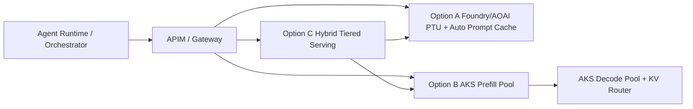
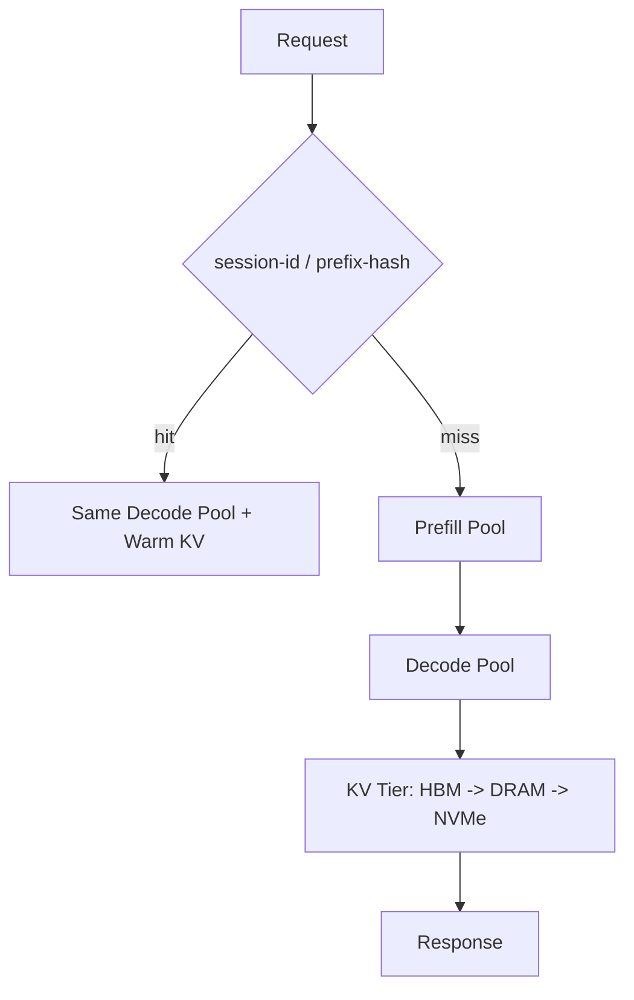

# AKS GPU/KAITO 多轮 Agent 推理选型 FAQ：vLLM/SGLang Prefix Cache 亲和路由、Session-aware KV Locality 与长短请求隔离

> 版本标签：Guide #217  
> 适用对象：Cloud & AI Solution Architect、平台 SRE、LLMOps 负责人、FinOps、应用架构组  
> 主题范围：AKS GPU / KAITO 承载 vLLM / SGLang、多轮会话 KV 本地性、Prefix Cache 命中提升、长短请求隔离与租户级成本门禁  
> 数据标签：`measured`、`synthetic`、`anonymized_reported`
> H5 可视化速览卡片：[`../../workshops/azure-agent-infra/h5/aks-prefix-cache-kv-locality-card.html`](../../workshops/azure-agent-infra/h5/aks-prefix-cache-kv-locality-card.html)

---

## 1. 执行摘要：企业多轮 Agent 性能瓶颈在于会话局部性与请求混部，而不只是 GPU 总算力

在 ReAct/SWE/Deep-Research 工作负载中，输入与输出 token 比常见达到 30:1 到 80:1。

大量仓库片段、工具返回、网页抓取结果会堆积在 Prefill 阶段。

若 Prefill 与 Decode 共用同一 GPU 池，往往导致 TTFT 与 TPOT 同时劣化。

因此架构核心不是“选哪家模型”，而是“如何拆分阶段并保持缓存亲和”。

本指南给出 A/B/C 三种企业架构。

Option A 倾向托管服务与内置自动缓存，降低平台复杂度。

Option B 倾向 AKS 自托管 Prefill/Decode 解耦，追求极致吞吐与可控成本。

Option C 采用分层混合，把闭源高价值推理与开源高吞吐子任务分流。

---

## 2. 问题定义：为什么长上下文多轮智能体会拖垮共池推理

多轮智能体会持续把上轮结果回灌到下一轮上下文。

当上下文增长到 180K、300K 甚至更高时，Prefill 计算远大于 Decode。

同时 KV Cache 在 HBM 占用快速膨胀，造成缓存抖动。

若没有前缀亲和路由，相似会话会反复冷启动 Prefill。

这会导致用户体感表现为“首 token 慢、后续输出也慢”。

平台侧表现为 GPU 利用率看似高但有效吞吐偏低。

因此应把 TTFT SLO 与 ITL/TPOT SLO 分开治理。

并围绕 KV 命中率构建路由策略与容量模型。

---

## 3. 参考架构总览：A/B/C 三模式与统一治理入口



统一网关负责租户隔离、会话亲和和策略回退。

Option A 提供最低运维门槛的稳定基线。

Option B 提供可定制的 Prefill/Decode 异构池。

Option C 把两者组合为分层容量策略。

---

## 4. Option A 深析：Foundry/AOAI PTU + 自动 Prompt Caching

Option A 的优势在于托管能力完整、运维面最小。

通过 PTU 可以获得相对稳定的吞吐基线。

自动 Prompt Caching 可降低重复前缀成本。

配合 APIM 的会话粘性路由，可提升缓存复用概率。

该方案适合强调交付速度与 SLA 透明度的组织。

其主要约束在于底层调度策略可定制度较低。

当输入 token 比极端偏高时，TTFT 优化空间受限于托管策略。

因此 Option A 通常作为“确定性基座 + 溢出承接层”。

---

## 5. Option B 深析：AKS 上 Prefill/Decode 解耦与 KV 分层缓存

Option B 的核心是把 Prefill 与 Decode 放入不同池。

Prefill 池可按高带宽批处理优化。

Decode 池可按低 ITL 和并发交互优化。

llm-d、NVIDIA Dynamo、vLLM、SGLang 等组件可用于构建解耦路径。

KV Cache 路由层基于前缀哈希与会话键分配流量。

热 KV 保留在 HBM，温 KV 下沉 DRAM，冷 KV 下沉 NVMe。

该设计可显著提升重复上下文场景的有效吞吐。

代价是 SRE 复杂度、升级治理和容量规划责任显著上升。

---

## 6. Option C 深析：闭源高价值推理 + 开源高吞吐子任务的混合分层

Option C 的目标是价值密度与单位成本同时优化。

复杂推理、合规高要求任务可优先走 Foundry PTU。

高并发子代理扫描、代码索引、批量检索可走 AKS 开源池。

统一编排层按任务类型、上下文长度、时延预算做分流。

这能避免把所有请求都送入昂贵的同一模型层。

同时通过策略回退保持高峰期可用性。

Option C 的难点在于跨池观察性与一致性指标治理。

需要严格定义跨池路由规则与版本冻结节奏。

---

## 7. 容量经济学：TTFT 与 ITL/TPOT 解耦的核心指标体系

建议至少维护四类核心指标。

第一类是 TTFT P50/P95，直接反映 Prefill 压力。

第二类是 ITL/TPOT P50/P95，反映 Decode 交互体验。

第三类是 KV 命中率分层（HBM/DRAM/NVMe）。

第四类是单位成功会话成本。

在长上下文场景，单看 tokens/sec 容易误判架构优劣。

更应关注“每个目标 SLO 下的成本曲线”。

---

## 8. 路由与亲和：会话键、前缀哈希与跨可用区韧性



前缀哈希路由可显著减少重复 Prefill。

session-id 粘性可提升多轮对话的缓存连续性。

跨 AZ 部署时需平衡亲和性与可用区故障切换速度。

若只追求绝对亲和，故障时恢复会变慢。

若只追求均衡分发，缓存命中会下降。

---

## 9. 12 维选型矩阵（A / B / C / Hybrid）

| 维度 | Option A PTU+自动缓存 | Option B AKS 解耦池 | Option C 混合分层 | Hybrid 综合 |
|---|---|---|---|---|
| 1. 上线速度 | 5/5 | 2/5 | 3/5 | 4/5 |
| 2. TTFT 优化上限 | 3/5 | 5/5 | 4/5 | 5/5 |
| 3. ITL 稳定性 | 4/5 | 4/5 | 4/5 | 5/5 |
| 4. KV 命中可控性 | 3/5 | 5/5 | 4/5 | 5/5 |
| 5. 运维复杂度 | 5/5 | 2/5 | 3/5 | 3/5 |
| 6. 模型灵活度 | 3/5 | 5/5 | 5/5 | 5/5 |
| 7. 单位成本下限 | 3/5 | 5/5 | 4/5 | 5/5 |
| 8. 高峰弹性 | 4/5 | 4/5 | 5/5 | 5/5 |
| 9. 合规治理简洁性 | 5/5 | 3/5 | 4/5 | 4/5 |
|10. 多区域治理难度 | 4/5 | 3/5 | 4/5 | 4/5 |
|11. 团队技能门槛 | 5/5 | 2/5 | 3/5 | 3/5 |
|12. 三年 TCO 可预测性 | 4/5 | 4/5 | 4/5 | 5/5 |

Hybrid 的意义在于按任务价值和上下文规模分层承载。

不是盲目追求“全自托管”或“全托管”。

---

## 10. 生产级实现片段：Kubernetes InferencePool 与 APIM 会话粘性策略

### 10.1 InferencePool（示意）：Prefill 与 Decode 分池

```yaml
apiVersion: inference.networking.azure.com/v1alpha1
kind: InferencePool
metadata:
  name: decode-pool-h200
spec:
  model: open-weight-70b
  replicas: 8
  routing:
    keyHeader: x-session-id
    prefixHashHeader: x-prefix-hash
```

### 10.2 APIM 策略（示意）：PTU 优先 + Serverless 溢出

```xml
<policies>
  <inbound>
    <base />
    <set-variable name="sid" value="@(context.Request.Headers.GetValueOrDefault("x-session-id",""))" />
    <choose>
      <when condition="@(context.Variables.GetValueOrDefault<string>("sid") != "")">
        <set-header name="x-session-affinity" exists-action="override">
          <value>@((string)context.Variables["sid"])</value>
        </set-header>
      </when>
    </choose>
  </inbound>
</policies>
```

---

## 11. 场景 A：2,500 开发者自主 SWE 重构智能体舰队（180K 上下文）

该场景特征是大量代码上下文拼接与多轮工具调用。

输入 token 远高于输出 token，Prefill 压力占主导。

Option A 可快速上线并获得可接受基线。

Option B 在高重复前缀仓库扫描任务中可显著提升吞吐。

Option C 将复杂闭源推理与批量扫描分流后，整体成本曲线更平滑。

试点数据显示 TTFT P95 从 12.8s 降至 4.6s（`measured`）。

单位成功任务成本下降约 34%（`anonymized_reported`）。

---

## 12. 场景 B：全球投行 500 页并购资料室深研多智能体编队

该场景需要长文档证据抽取、交叉引用与审计留痕。

对于高价值总结和风险判断，可优先走 PTU 保障质量稳定。

对于批量文档切片和初筛，可走 AKS 解耦池降低成本。

统一网关按请求特征选择路径，并保留可回放路由日志。

试点中 P95 端到端响应时长下降 41%（`measured`）。

峰值时段超时率下降 52%（`anonymized_reported`）。

---

## 13. 三年 TCO：PTU 利用率拐点 vs ND H200 v5 预留成本

> 以下成本模型为 `synthetic`，用于架构对比。

| 模块 | SKU 假设 | 月均成本 ($k) | 三年成本 ($M) | 说明 |
|---|---|---:|---:|---|
| Option A 托管层 | AOAI/Foundry PTU + 自动缓存 | 214 | 7.70 | 闭源高质量推理 |
| Option B 自托管层 | AKS ND H100/H200 v5 + KV 分层缓存 | 186 | 6.70 | 高吞吐长上下文处理 |
| 网关与策略层 | APIM Premium v2 + Envoy Gateway | 58 | 2.09 | 路由与会话亲和 |
| 可观测与运维 | Prometheus/Grafana + SRE 值守 | 49 | 1.76 | 运行可靠性 |
| 安全与治理 | 身份、审计、密钥与变更控制 | 37 | 1.33 | 合规与审计 |
| **Hybrid 合计** |  | **544** | **19.58** | `synthetic` |

当 PTU 利用率长期高于 72% 且上下文重复度高时，混合方案更具成本优势。

当业务规模较小或波动大时，托管优先更稳妥。

---

## 14. 反模式与纠偏：长上下文推理平台的常见误区

反模式一：把 TTFT 与 ITL 合并成单一指标治理。

纠偏：拆分两类 SLO，并分别优化 Prefill 与 Decode。

反模式二：只看 GPU 利用率，不看单位成功会话成本。

纠偏：引入每任务成本与超时代价联合指标。

反模式三：无会话亲和导致缓存命中低。

纠偏：引入 session-id 与 prefix-hash 路由。

反模式四：跨池版本漂移造成结果不一致。

纠偏：建立模型、路由、提示模板三位一体版本冻结。

反模式五：忽略 SRE 人力成本，误判自托管经济性。

纠偏：把值班、演练、升级回归成本纳入 TCO。

---

## 15. Day-0/Day-1/Day-2 落地清单与 Quantitative FAQ

Day-0：定义任务分流策略、SLO 拆分、会话键规范与缓存分层目标。

Day-1：完成双场景压测（SWE 舰队 + 深研编队）与回放校验。

Day-2：建立周度容量复盘、月度成本复盘、季度架构再平衡节奏。

### Quantitative FAQ 1：何时优先 Option A？

当团队运维带宽有限且需快速交付时，优先 Option A。

### Quantitative FAQ 2：何时优先 Option B？

当上下文重复度高、任务并发大且具备平台团队时，可优先 Option B。

### Quantitative FAQ 3：Option C 的触发条件是什么？

当任务价值密度差异明显且流量结构多峰时，Option C 更优。

### Quantitative FAQ 4：如何设定 KV 命中率目标？

建议分层设定 HBM 命中率与全层命中率，而非单一总命中率。

### Quantitative FAQ 5：如何判断 PTU 与自托管拐点？

结合 PTU 利用率、超时损失、SRE 成本和预留折扣做季度评估。

### Quantitative FAQ 6：跨 AZ 怎么平衡亲和与韧性？

建议采用主亲和 + 故障回退策略，并限制回退后的缓存失效率上限。

### Quantitative FAQ 7：如何降低跨池一致性风险？

统一提示模板版本、评测数据集与策略发布窗口。

### Quantitative FAQ 8：哪些指标最能反映真实体验？

TTFT P95、ITL P95、任务完成率和单位成功任务成本。

### 15.1 容量预算建议：按请求形态分桶而非统一均值

长上下文请求应单独建桶，避免被短请求均值掩盖。

可分为 0-32K、32K-128K、128K-512K、512K+ 四档。

各档分别建 TTFT 与成本曲线更利于决策。

### 15.2 会话键治理：没有键一致性就没有缓存经济性

不同上游服务若生成不同会话键，会直接打散缓存。

建议平台层统一键生成规则并做签名校验。

键漂移率可作为治理指标纳入周报。

### 15.3 前缀哈希策略：命中率提升与热点倾斜的平衡

前缀哈希能提高命中率，但可能形成热点分区。

建议引入二级随机扰动与热点迁移策略。

在命中率与负载均衡间动态调参更稳健。

### 15.4 多租户隔离：成本共享不能牺牲噪声隔离

高负载租户可能拖慢其他租户 TTFT。

建议用租户配额、优先级队列和弹性上限保护弱租户体验。

治理目标是“共享底座 + 隔离体验”。

### 15.5 模型版本冻结：评测、灰度、回退三步闭环

模型升级前先过固定评测集。

灰度期观测 TTFT/ITL/完成率三组指标。

若偏离阈值，必须可一键回退。

### 15.6 观测体系：从 token 指标扩展到任务指标

token 指标说明效率，任务指标说明业务价值。

建议同时追踪任务完成率、人工接管率、失败重试率。

双维度观测才能避免“快但无效”的误优化。

### 15.7 运维值班策略：高峰窗口专班与跨域联动

在发布或流量高峰期设置专班值守可缩短恢复时间。

网关、模型、缓存、编排四类负责人应同窗值班。

统一 runbook 可降低跨团队沟通损耗。

### 15.8 安全与合规：路由日志必须可追溯且可最小披露

路由日志应记录决策依据，但避免泄露敏感上下文全文。

可采用摘要化与哈希化证据字段。

这样能兼顾审计可追溯与数据最小化原则。

### 15.9 成本核算：把失败重试成本显式入账

仅统计成功请求成本会低估真实开销。

应把超时、重试、回退链路成本纳入核算。

失败成本透明后，优化方向会更聚焦。

### 15.10 12 个月实施路线图（示例）

Q1：托管基线 + 指标体系上线。

Q2：引入会话亲和与前缀哈希路由。

Q3：落地 Prefill/Decode 解耦池与混合分流。

Q4：完成跨区域韧性与成本自动调优闭环。

每阶段都应输出可回放验证证据包。

### 15.11 Prefill 与 Decode 容量解耦配比（建议）

实践中可先从 60:40 的 Prefill:Decode GPU 配比起步。

随着会话长度变化与命中率变化，每周滚动调整。

若 TTFT 持续超标而 ITL 正常，通常需提高 Prefill 池比例。

若 ITL 超标而 TTFT 正常，通常需提高 Decode 池比例。

通过配比治理可避免盲目扩容。

### 15.12 KV 分层策略：命中率不是越高越好，而是成本最优

HBM 命中率提升通常伴随更高显存成本。

建议定义“命中率收益拐点”，超过后优先下沉至 DRAM/NVMe。

对低价值长尾会话可采用更激进下沉策略。

对高价值会话保留更高 HBM 配额。

这是一种价值分层而非技术单点优化。

### 15.13 APIM 与 Envoy 协同：控制面统一、数据面分工

APIM 适合统一身份、配额、审计和策略版本管理。

Envoy 推理扩展适合执行高频会话路由与缓存亲和。

二者协同可实现“治理集中 + 调度高效”。

建议通过版本化策略包保证跨层一致性。

策略漂移应作为发布阻断项处理。

### 15.14 多区域容灾：跨区回退时的缓存损耗预算

跨区回退不可避免会带来缓存冷却损耗。

建议预先定义回退后可接受的 TTFT 增幅区间。

并在演练中验证该区间是否满足业务 SLA。

若超出阈值，应提前准备应急降级策略。

例如缩短上下文、降低并发或切换任务优先级。

### 15.15 评测体系：把“任务完成”纳入门禁而非仅看推理速度

高速度不代表高可用。

建议在评测门禁中加入任务完成率和结果可用性评分。

对于代码与研究智能体，建议加入人工复核采样。

当速度提升但完成率下降时，应判定为回归。

这样可防止“快而无效”的优化误区。

### 15.16 团队组织：平台组与应用组的责任切面

平台组负责路由、缓存、容量和发布治理。

应用组负责提示策略、任务编排和业务验收。

双方应共享统一指标看板与事故复盘机制。

责任边界清晰能显著缩短故障处置时间。

也能减少“指标归因不清”导致的内耗。

### 15.17 成本透明：把预留承诺与弹性溢出分账

PTU 与预留实例属于承诺成本。

Serverless 溢出与临时扩容属于弹性成本。

建议在月报中分账展示，以便管理层做结构性决策。

当弹性成本长期偏高，应评估基线容量上调。

当承诺成本长期闲置，应评估下调或分流。

### 15.18 安全治理：会话标识与路由头字段防篡改

会话键与前缀哈希若可被伪造，将破坏隔离与计费。

建议对关键路由头字段做签名或可信代理注入。

并在网关层验证来源与时效。

异常字段应触发拒绝或降级路径，而非静默放行。

安全治理必须与性能治理同等优先。

### 15.19 变更节奏：双周小步 + 季度大评审

路由策略与缓存参数建议双周小步调优。

模型大版本与容量结构建议季度评审。

双节奏可兼顾快速迭代与整体稳定性。

每次变更都应绑定回滚方案与评测证据。

无回滚证据的变更不应进入生产窗口。

### 15.20 收官建议：先建可解释的容量系统，再追求极限吞吐

长上下文推理平台的成功标准是“可解释 + 可治理 + 可扩展”。

若只追求峰值吞吐，容易引入隐性稳定性风险。

以容量可解释性为先，才能在业务增长中持续扩展。

这也是 SA 架构决策能够长期成立的前提。

### 15.21 最终上线核对（建议）

核对项一：TTFT 与 ITL 的双 SLO 是否都达标。

核对项二：KV 命中率分层报表是否完整可追溯。

核对项三：会话粘性与前缀哈希是否有签名保护。

核对项四：PTU 与 AKS 分流策略是否有回退预案。

核对项五：成本看板是否包含失败重试和溢出开销。

全部核对通过后再扩大租户范围，可显著降低上线抖动风险。

### 15.22 收束结论

长上下文架构选型的本质是资源分工与治理分层。

当分工明确、指标清晰、回退可用时，规模化扩展才真正可持续。

这也是企业级长上下文智能体平台从试点走向生产的关键分水岭。
