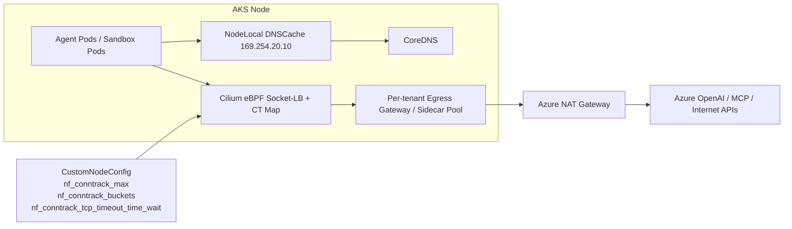
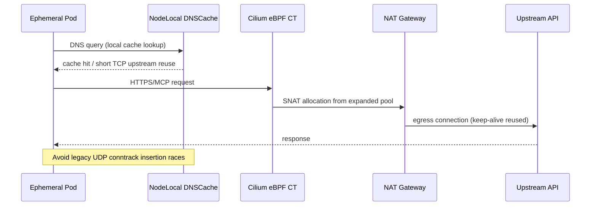

# Enterprise AKS `nf_conntrack` and SNAT exhaustion selection FAQ: Pattern A (Azure CNI Overlay + Cilium eBPF CT + NodeLocal DNSCache + NAT Gateway + connection pooling) vs Pattern B (`sysctl` scaling only) vs Pattern C (central egress proxy) vs Pattern D (`hostNetwork`/`NOTRACK` anti-pattern)

## 1. Executive Summary

In high-churn multi-tenant AKS agent clusters, bursty short-lived DNS/HTTPS/MCP calls without keep-alive pooling can silently saturate both Linux `nf_conntrack` tables and egress SNAT port pools, which surfaces as intermittent `5s` DNS stalls, `ECONNRESET`, and `ConnectTimeout` failures.  
The default production recommendation is **Pattern A**: `Azure CNI Overlay Powered by Cilium` + `NodeLocal DNSCache` + `Azure NAT Gateway` + per-tenant keep-alive pooling + bounded `CustomNodeConfig` tuning.

Pattern B can reduce immediate table-full drops but does not solve iptables path cost or DNS UDP race behavior at scale. Pattern C is a conditional transition pattern when an enterprise already operates a robust proxy platform. Pattern D must be prohibited in multi-tenant environments because it trades short-term throughput for boundary violations and elevated blast radius.

## 2. Context and recurring failure profile

When per-node connection creation rate is high and connection hold time is long, steady-state conntrack occupancy grows linearly under Little's Law and quickly reaches kernel limits.  
The practical risk is not only hard outage: many incidents appear as partial random failures, where some pods fail while others succeed, which significantly delays root-cause convergence.

The failure pattern is cross-layer by nature: application teams see SDK timeouts, platform teams see kernel logs, and network teams see SNAT pressure. Without a shared capacity model, teams optimize local symptoms independently and often re-introduce the same fault under load.  
A robust design therefore needs deterministic modeling across application connection shape, node conntrack occupancy, and egress SNAT capacity in one closed loop.

## 3. Three high-frequency failure modes

1. **`nf_conntrack` table-full drops**: kernel logs show `nf_conntrack: table full, dropping packet`.  
2. **SNAT pool exhaustion**: egress port pools hit limits and produce intermittent failures.  
3. **Cross-tenant collateral impact**: noisy workloads degrade neighbors on the same node/subnet.

## 4. Four-pattern comparison matrix (12 dimensions)

| Dimension | Pattern A: Cilium + NodeLocal + NATGW (recommended) | Pattern B: `sysctl` scaling only | Pattern C: central egress proxy | Pattern D: `hostNetwork`/`NOTRACK` (prohibited) |
|---|---|---|---|---|
| Isolation boundary | High | Medium | Medium | Low |
| Burst short-connection resilience | High | Medium-low | Medium-high | Superficially high, structurally risky |
| DNS stability | High | Medium-low | Medium | Low |
| SNAT scalability | High | Low | Medium | Low |
| Datapath efficiency | High (eBPF) | Low-medium (iptables) | Medium | Low |
| Operational complexity | Medium | Medium | High | Low (but incident-heavy) |
| Observability quality | High | Medium | Medium-high | Low |
| Compliance fit | High | Medium | Medium | Low |
| Debug velocity | High | Medium-low | Medium | Low |
| Performance consistency | High | Medium-low | Medium | Low |
| 3-year TCO | Best | Second-best but elevated | Medium-high | Worst |
| Production readiness | Default | Temporary mitigation | Conditional | Block |

## 5. Recommended architecture details (Pattern A)

Pattern A should be implemented as a sequence: reduce connection creation rate, shorten connection hold duration, and scale egress SNAT capacity.  
NodeLocal DNSCache and keep-alive pooling reduce churn; Cilium eBPF datapath improves consistency at scale; NAT Gateway provides linear SNAT scaling; `CustomNodeConfig` bounds kernel behavior with explicit and auditable values.

The key is coupled optimization, not isolated tuning. Expanding only `nf_conntrack_max` without reducing churn can inflate slab memory and push the bottleneck to SNAT. Expanding only SNAT while keeping poor pooling still leaves node-local conntrack instability under burst.  
Production rollouts should therefore enforce phased validation with metrics at each step and explicit rollback criteria.

## 6. Mermaid: AKS CNI Overlay + Cilium + NodeLocal DNS + NAT Gateway



## 7. Mermaid: ephemeral connection lifecycle and UDP race reduction



## 8. Q1–Q6 formulas with worked values

| ID | Formula | Example inputs | Result and interpretation |
|---|---|---|---|
| Q1 Steady occupancy | `C_steady = λ_conn * E[T_hold]` | `λ=2500/s, T=125s` | `312,500`, above default `131,072`. |
| Q2 Optimized occupancy | `λ_eff = λ*(1-r_keepalive)*(1-0.5*r_dns)` | `r_keepalive=0.92,r_dns=0.90,T=30s` | `λ_eff=110/s, C=3,300`, `98.94%` reduction. |
| Q3 Slab footprint | `M_slab = C_max * 352B` | `C_max=524,288` | About `176 MiB`. |
| Q4 Hash footprint | `M_hash = buckets * 8B` | `buckets=131,072` | About `1 MiB`. |
| Q5 NAT capacity | `P_total = N_ips * 64,512` | `N_ips=4` | `258,048` SNAT ports. |
| Q6 NAT IP sizing | `N_ips = ceil(P_peak/(64,512*util))` | `P_peak=300,000, util=0.8` | Requires `6` public IPs. |

## 9. Executable stdlib Python: AksConntrackAndSnatCapacityPlanner

```python
from __future__ import annotations

import ast
from dataclasses import dataclass
import math
from pathlib import Path
import re
from typing import Dict


@dataclass
class PlannerInput:
    unpooled_rps: float
    keepalive_reuse_ratio: float
    nodelocal_dns_hit_ratio: float
    time_wait_sec: float
    baseline_hold_sec: float = 125.0
    conntrack_max: int = 131_072


class AksConntrackAndSnatCapacityPlanner:
    ENTRY_BYTES = 352
    SNAT_PORTS_PER_IP = 64_512
    MAX_NAT_IPS = 16

    @staticmethod
    def effective_new_conn_rps(
        unpooled_rps: float,
        keepalive_reuse_ratio: float,
        nodelocal_dns_hit_ratio: float,
    ) -> float:
        if not (0.0 <= keepalive_reuse_ratio < 1.0):
            raise ValueError("keepalive_reuse_ratio must be in [0,1).")
        if not (0.0 <= nodelocal_dns_hit_ratio <= 1.0):
            raise ValueError("nodelocal_dns_hit_ratio must be in [0,1].")
        return unpooled_rps * (1.0 - keepalive_reuse_ratio) * (1.0 - 0.5 * nodelocal_dns_hit_ratio)

    @staticmethod
    def steady_conntrack_entries(new_conn_rps: float, hold_sec: float) -> float:
        return new_conn_rps * hold_sec

    @staticmethod
    def _round_up_power_of_two(value: int) -> int:
        if value <= 1:
            return 1
        return 1 << (value - 1).bit_length()

    def evaluate_conntrack(self, payload: PlannerInput) -> Dict[str, float]:
        baseline_entries = round(
            self.steady_conntrack_entries(payload.unpooled_rps, payload.baseline_hold_sec),
            6,
        )
        effective_rps = self.effective_new_conn_rps(
            payload.unpooled_rps,
            payload.keepalive_reuse_ratio,
            payload.nodelocal_dns_hit_ratio,
        )
        optimized_entries = round(
            self.steady_conntrack_entries(effective_rps, payload.time_wait_sec),
            6,
        )
        reduction_ratio = round(
            1.0 - (optimized_entries / baseline_entries if baseline_entries else 0.0),
            6,
        )
        status = "EXHAUSTED_TABLE_FULL" if optimized_entries > payload.conntrack_max else "HEALTHY"
        return {
            "baseline_entries": baseline_entries,
            "optimized_entries": optimized_entries,
            "reduction_ratio": reduction_ratio,
            "status": status,
        }

    def recommend_custom_node_config(self, target_entries: float, headroom: float = 1.5) -> Dict[str, float]:
        raw_max = int(math.ceil(max(131_072, target_entries * headroom)))
        conntrack_max = self._round_up_power_of_two(raw_max)
        buckets = conntrack_max // 4
        slab_mib = conntrack_max * self.ENTRY_BYTES / (1024.0 * 1024.0)
        hash_mib = buckets * 8 / (1024.0 * 1024.0)
        return {
            "conntrack_max": conntrack_max,
            "buckets": buckets,
            "slab_mib": slab_mib,
            "hash_mib": hash_mib,
        }

    def nat_gateway_ip_count(self, peak_snat_ports: int, safety_utilization: float = 0.8) -> int:
        if not (0.0 < safety_utilization <= 1.0):
            raise ValueError("safety_utilization must be in (0,1].")
        if peak_snat_ports < 0:
            raise ValueError("peak_snat_ports must be >= 0.")
        capacity_per_ip = self.SNAT_PORTS_PER_IP * safety_utilization
        count = int(math.ceil(peak_snat_ports / capacity_per_ip)) if peak_snat_ports else 1
        count = max(1, count)
        if count > self.MAX_NAT_IPS:
            raise ValueError("NAT IP requirement exceeds 16 per subnet.")
        return count


if __name__ == "__main__":
    planner = AksConntrackAndSnatCapacityPlanner()

    baseline = planner.steady_conntrack_entries(2500, 125)
    assert baseline == 312500
    assert baseline > 131072

    burst = planner.evaluate_conntrack(
        PlannerInput(
            unpooled_rps=2500,
            keepalive_reuse_ratio=0.0,
            nodelocal_dns_hit_ratio=0.0,
            time_wait_sec=125,
            conntrack_max=131072,
        )
    )
    assert burst["status"] == "EXHAUSTED_TABLE_FULL"

    pattern_a = planner.evaluate_conntrack(
        PlannerInput(
            unpooled_rps=2500,
            keepalive_reuse_ratio=0.92,
            nodelocal_dns_hit_ratio=0.90,
            time_wait_sec=30,
            conntrack_max=131072,
        )
    )
    assert math.isclose(pattern_a["optimized_entries"], 3300.0, rel_tol=1e-9)
    assert math.isclose(pattern_a["reduction_ratio"], 0.98944, rel_tol=1e-6)
    assert pattern_a["status"] == "HEALTHY"

    cfg = planner.recommend_custom_node_config(target_entries=312500)
    assert cfg["buckets"] == cfg["conntrack_max"] // 4

    assert planner.nat_gateway_ip_count(50000) == 1
    assert planner.nat_gateway_ip_count(300000) == 6
    assert planner.nat_gateway_ip_count(800000) == 16
    try:
        planner.nat_gateway_ip_count(900000)
        raise AssertionError("Expected ValueError for >16 NAT IP requirement.")
    except ValueError:
        pass
```

## 10. JSON: AKS `CustomNodeConfig` + Cilium + NAT Gateway manifest

```json
{
  "clusterProfile": {
    "networkPlugin": "azure",
    "networkPluginMode": "overlay",
    "networkDataplane": "cilium",
    "nodelocalDnsCache": true
  },
  "linuxOsConfig": {
    "sysctls": {
      "netNetfilterNfConntrackMax": 524288,
      "netNetfilterNfConntrackBuckets": 131072,
      "netIpv4IpLocalPortRange": "10240 65535",
      "netIpv4TcpTwReuse": true
    }
  },
  "egress": {
    "natGateway": {
      "publicIpCount": 6,
      "snatPortsPerIp": 64512
    },
    "tenantPooling": {
      "http2KeepAliveEnabled": true,
      "maxConcurrentStreams": 128
    }
  }
}
```

## 11. KQL: conntrack saturation and NAT SNAT failures

```kql
let win = 5m;
let ct =
    AKSNodeLogs
    | where TimeGenerated > ago(7d)
    | extend cluster = tostring(CustomDimensions.cluster)
    | extend node = tostring(CustomDimensions.node)
    | extend entries = todouble(coalesce(CustomDimensions.conntrack_entries, extract(@"entries=(\d+)", 1, Message)))
    | extend maxv = todouble(coalesce(CustomDimensions.conntrack_max, extract(@"max=(\d+)", 1, Message)))
    | summarize ct_entries = avg(entries), ct_max = max(maxv), ct_insert_failed = countif(Message has "conntrack_insert_failed")
      by bin(TimeGenerated, win), cluster;
let snat =
    AzureMetrics
    | where TimeGenerated > ago(7d)
    | where MetricName in ("SNATConnectionCount", "FailedSNATConnectionCount")
    | extend cluster = tostring(Tags.cluster)
    | summarize snat_total = sumif(Total, MetricName == "SNATConnectionCount"),
                snat_failed = sumif(Total, MetricName == "FailedSNATConnectionCount")
      by bin(TimeGenerated, win), cluster;
let dns =
    AKSNodeLogs
    | where TimeGenerated > ago(7d)
    | extend cluster = tostring(CustomDimensions.cluster)
    | summarize dns_timeout = countif(Message has "i/o timeout" or Message has "SERVFAIL")
      by bin(TimeGenerated, win), cluster;
ct
| join kind=fullouter snat on TimeGenerated, cluster
| extend TimeGenerated = coalesce(TimeGenerated, TimeGenerated1), cluster = coalesce(cluster, cluster1)
| project-away TimeGenerated1, cluster1
| join kind=fullouter dns on TimeGenerated, cluster
| extend TimeGenerated = coalesce(TimeGenerated, TimeGenerated1), cluster = coalesce(cluster, cluster1)
| project-away TimeGenerated1, cluster1
| extend ct_ratio = iif(ct_max > 0, ct_entries / ct_max, real(null))
| project TimeGenerated, cluster, ct_entries, ct_max, ct_ratio,
          ct_insert_failed = coalesce(ct_insert_failed, 0),
          snat_total = coalesce(snat_total, 0.0),
          snat_failed = coalesce(snat_failed, 0.0),
          dns_timeout = coalesce(dns_timeout, 0)
| order by TimeGenerated desc
```

## 12. Extended Q&A (Q7–Q12)

| ID | Question | Key answer |
|---|---|---|
| Q7 | Is `nf_conntrack_max` scaling alone enough? | No; it postpones failure without fixing churn shape and SNAT constraints. |
| Q8 | Why is NodeLocal DNSCache pivotal? | It stabilizes DNS path and reduces UDP race sensitivity. |
| Q9 | Why avoid `hostNetwork: true`? | It weakens tenant boundary integrity and expands host exposure. |
| Q10 | Why is NAT Gateway required? | It gives linear SNAT scale (`64,512` ports/IP up to `16` IPs). |
| Q11 | When is Pattern C acceptable? | Only with mature proxy HA and governance capabilities. |
| Q12 | What marks closure? | Sustained reduction across `ct_ratio`, `snat_failed`, and DNS timeout rates. |

## 13. Selection decision tree (concise)

1. Multi-tenant production with high short-connection churn: default Pattern A.  
2. Legacy cluster emergency mitigation: temporary Pattern B with explicit sunset date.  
3. Existing enterprise proxy platform and accepted extra hop: evaluate Pattern C.  
4. Any proposal using `hostNetwork` or `NOTRACK` on shared nodes: block as Pattern D.

## 14. Scenario 15.1: 64-node multi-tenant Python/MCP sandbox fleet

This workload runs roughly `18,000` short-lived tool calls per second with coupled DNS and HTTPS churn.  
Before pooling and NodeLocal DNS, conntrack occupancy follows a bursty saw-tooth pattern near limits and creates recurring intermittent failures that are difficult to attribute quickly.

After Pattern A rollout, effective connection creation rate drops sharply, conntrack saturation stabilizes in healthy bands, and cross-tenant collateral impact decreases.  
Operationally, this enables tenant-level policy tuning rather than node-level firefighting.

## 15. Scenario 15.2: regulated financial RAG and crawler egress cluster

This environment first hit Azure LB-style constrained SNAT behavior, then accumulated node conntrack pressure, producing dual-layer instability.  
Migrating to NAT Gateway with Cilium and NodeLocal DNS restored predictable egress behavior and provided clear linear scaling levers.

For regulated workloads, stability changes must be auditable.  
Every parameter change should include rationale, expected impact, and rollback evidence in the change record.

## 16. 15.3 Three-tier 3-year risk-adjusted TCO (USD, thousands)

| Tier | Scale assumption | Pattern A | Pattern B | Pattern C | Pattern D |
|---|---|---:|---:|---:|---:|
| Tier-1 | 16 nodes, medium churn | `980` | `1,240` | `1,360` | `1,950*` |
| Tier-2 | 64 nodes, high churn | `3,460` | `4,780` | `5,220` | `8,140*` |
| Tier-3 | 160 nodes, extreme churn | `8,920` | `12,650` | `13,980` | `22,300*` |

`*` Pattern D accumulates hidden costs in incident rollback, compliance remediation, and customer impact handling.

## 17. 15.4 D0 / D1 / D2 runbook (18 items)

**D0 (same-day containment)**  
1. Freeze high-risk node placement for new tenants.  
2. Enable baseline keep-alive pooling.  
3. Enable NodeLocal DNSCache.  
4. Verify `conntrack_max` and `buckets` consistency.  
5. Enable `conntrack_insert_failed` and SNAT-failure telemetry.  
6. Start unified incident command and reporting.  

**D1 (1-2 week hardening)**  
7. Roll out Cilium eBPF dataplane.  
8. Introduce NAT Gateway and baseline capacity policy.  
9. Encode kernel settings into `CustomNodeConfig`.  
10. Implement tenant egress pooling profiles.  
11. Add hotspot eviction and balancing policy.  
12. Build cross-layer alert correlations.  

**D2 (1-2 month optimization)**  
13. Add quarterly capacity forecast and load drills.  
14. Add offline replay for parameter changes.  
15. Add region-specific policy templates.  
16. Automate compliance evidence packaging.  
17. Add network health into release gates.  
18. Link tenant cost attribution with FinOps controls.  

Treat the runbook as executable operations, not narrative guidance: every item should carry a named owner, execution SLA, rollback trigger, required telemetry proof, and audit evidence location, so triage quality does not degrade across shift handoffs.

To keep post-incident improvements durable, maintain a versioned capacity baseline per node pool that records short-connection churn, average hold time, DNS behavior, tenant egress concurrency, and expected `conntrack` plus SNAT envelopes; each tuning change should include explicit before/after deltas and expected benefit bounds.

Convert network resilience into three jointly-governed SLO layers: node-kernel health (`ct_ratio`, insert-failure rate), egress health (SNAT failure ratio, connect success and latency), and business-experience health (timeout ratio, retry amplification, tenant error-budget burn), and require all three in release-gate reviews to avoid local optimizations that shift failure downstream.

Avoid the common anti-pattern of scaling SNAT capacity alone without connection-shape governance: sustained gains require coordinated keep-alive pooling policy, NodeLocal DNSCache behavior, Cilium datapath posture, and NAT capacity sizing validated by replay load tests under equivalent workload profiles.

For regulated sectors, parameter tuning must remain auditable and region-aware: persist decision evidence in change records, include threshold rationale and rollback checkpoints, and enforce a global-minimum policy plus regional override model so failover between regions preserves predictable service quality and compliance posture.

## 18. Sources (retrieved on 2026-11-27)

Azure Kubernetes Service CNI Overlay and Cilium  
https://learn.microsoft.com/azure/aks/azure-cni-powered-by-cilium

AKS Custom Node Configuration  
https://learn.microsoft.com/azure/aks/custom-node-configuration

Azure NAT Gateway SNAT behavior and limits  
https://learn.microsoft.com/azure/nat-gateway/nat-gateway-resource

Kubernetes NodeLocal DNSCache  
https://kubernetes.io/docs/tasks/administer-cluster/nodelocaldns/
