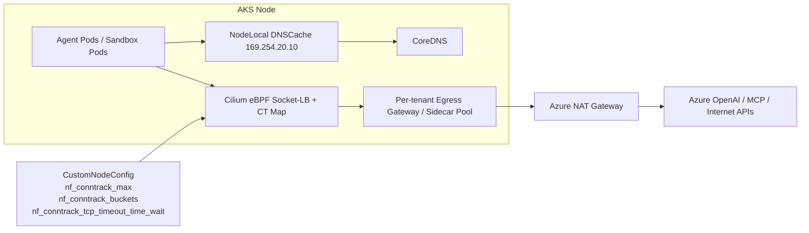
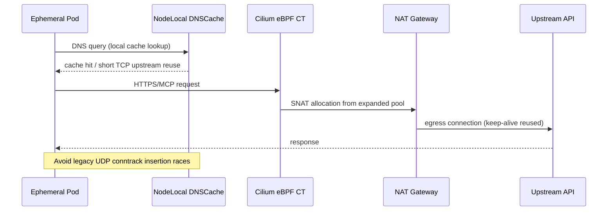

# 企业 AKS 节点 `nf_conntrack` / SNAT 耗尽治理选型 FAQ：Pattern A（Azure CNI Overlay + Cilium eBPF CT + NodeLocal DNSCache + NAT Gateway + 连接池）vs Pattern B（仅 `sysctl` 扩容）vs Pattern C（集中式 Egress Proxy）vs Pattern D（`hostNetwork`/`NOTRACK` 反模式）

## 1. Executive Summary（先给结论）

在高 churn 多租户 AKS 智能体集群中，如果大量短连接（DNS UDP、HTTPS、MCP、CoreDNS、Azure OpenAI egress）没有连接复用与本地 DNS 缓冲，`nf_conntrack` 表与 SNAT 端口会同时成为隐形瓶颈，直接表现为间歇性 `5s` 解析卡顿、`ECONNRESET`、`ConnectTimeout` 与跨租户连带抖动。  
推荐默认采用 **Pattern A**：`Azure CNI Overlay Powered by Cilium` + `NodeLocal DNSCache` + `Azure NAT Gateway` + 每租户 egress keep-alive 池化 + `CustomNodeConfig` 有界调参，这是在隔离、性能、可运维与成本之间最稳健的生产解法。

Pattern B（只调 `sysctl`）只能缓解“表满立即丢包”的表层症状，无法根治高规则规模下 `iptables` 路径成本与 UDP 插入竞争。Pattern C 在某些组织可作为过渡，但会引入额外跳数与代理容量治理复杂度。Pattern D 明确禁止，因为它通过破坏租户边界来交换吞吐，属于高风险不可接受路径。

## 2. 问题背景与典型故障画像

当节点上每秒新建连接速率高、连接保持时间长（默认 `TIME_WAIT` 挂留长）、且上游应用没有做 HTTP/2 keep-alive 池化时，`conntrack` 常驻项按 Little 定律线性增长，很快压到内核表上限。  
一旦接近阈值，故障不是“完全不可用”，而是呈现随机局部超时：同一个服务在某些 pod 秒级失败、另一些 pod 正常，导致排障周期被显著拉长。

这类故障最危险的地方在于它跨层传播：应用团队看到的是 SDK 超时，平台团队看到的是节点内核日志，网络团队看到的是 SNAT 端口紧张，三方如果没有统一容量模型就会各自优化局部参数，最后形成“症状漂移、根因不收敛”的治理僵局。  
因此，门槛不在于会不会调单个内核参数，而在于能否建立跨应用、节点、出口三层联动的确定性容量规划与回归验证机制。

## 3. 三类高频故障模式

1. **`nf_conntrack` 表满掉包**：日志出现 `nf_conntrack: table full, dropping packet`，UDP 查询和短 TCP 建连首先受损。  
2. **SNAT 端口耗尽**：节点或子网共享出口端口池接近极限，出现外连失败与延迟尖刺。  
3. **跨租户连带抖动**：同节点高噪租户把共享网络状态占满，低噪租户无辜被拖慢。

## 4. 四模式 12 维对比矩阵

| 维度 | Pattern A：Cilium + NodeLocal + NATGW（推荐） | Pattern B：仅 `sysctl` 扩容 | Pattern C：集中式 Egress Proxy | Pattern D：`hostNetwork`/`NOTRACK`（禁止） |
|---|---|---|---|---|
| 隔离边界 | 高 | 中 | 中 | 低 |
| 抗突发短连接 | 高 | 中低 | 中高 | 表面高、实则高风险 |
| DNS 稳定性 | 高 | 中低 | 中 | 低 |
| SNAT 可扩展性 | 高 | 低 | 中 | 低 |
| 规则路径效率 | 高（eBPF） | 低到中（iptables） | 中 | 低 |
| 运维复杂度 | 中 | 中 | 高 | 低（但事故高） |
| 可观测性 | 高 | 中 | 中高 | 低 |
| 合规与多租户 | 高 | 中 | 中 | 低 |
| 故障定位速度 | 高 | 中低 | 中 | 低 |
| 性能一致性 | 高 | 中低 | 中 | 低 |
| 三年期 TCO | 最优 | 次优偏高 | 中位偏高 | 最差 |
| 生产推荐度 | 默认 | 临时止血 | 条件性 | 禁止 |

## 5. 推荐架构（Pattern A）关键设计

Pattern A 的治理核心是“先降连接创建速率、再缩短连接持有时长、最后扩展出口端口池”：  
1) NodeLocal DNSCache 把重复 UDP 查询收敛到本地路径并尽可能复用 TCP；  
2) Cilium eBPF socket LB 与 CT map 降低传统 iptables 大规则路径开销；  
3) 应用侧与 sidecar 侧强制 keep-alive/HTTP2 连接池，减少新建连接洪峰；  
4) NAT Gateway 提供线性可扩展 SNAT 端口池；  
5) `CustomNodeConfig` 对 `nf_conntrack_max`、`buckets`、`time_wait` 做有界优化。

与“只扩大表”不同，Pattern A 的收益来自系统性耦合治理：如果不先压低连接创建速率，单纯扩容 `conntrack_max` 会把内核 slab 内存持续吞噬到不可控区间；如果不扩展 SNAT 池，节点内核优化后仍会在出口侧触顶。  
因此实施顺序必须是“流量形态治理优先、内核参数次之、出口容量并行”，并且每一步都要有明确的观测回执与回滚点。

## 6. Mermaid：AKS CNI Overlay + Cilium + NodeLocal DNS + NAT Gateway 参考架构



## 7. Mermaid：短连接生命周期与 UDP 竞争消减时序



## 8. Q1–Q6 公式与示例

| 编号 | 公式 | 示例输入 | 结果与解释 |
|---|---|---|---|
| Q1 稳态占用 | `C_steady = λ_conn * E[T_hold]` | `λ=2500/s, T=125s` | `312,500`，超过默认 `131,072`。 |
| Q2 优化后占用 | `λ_eff = λ*(1-r_keepalive)*(1-0.5*r_dns)` | `r_keepalive=0.92,r_dns=0.90,T=30s` | `λ_eff=110/s, C=3,300`，下降 `98.94%`。 |
| Q3 Slab 内存 | `M_slab = C_max * 352B` | `C_max=524,288` | 约 `176 MiB`。 |
| Q4 Hash 内存 | `M_hash = buckets * 8B` | `buckets=131,072` | 约 `1 MiB`。 |
| Q5 NAT 端口容量 | `P_total = N_ips * 64,512` | `N_ips=4` | `258,048` SNAT 端口。 |
| Q6 NAT IP 规划 | `N_ips = ceil(P_peak/(64,512*util))` | `P_peak=300,000, util=0.8` | 需要 `6` 个公网 IP。 |

这些公式的价值在于把“网络偶发超时”转成可推演的容量约束。  
只要给定连接到达率、持有时长、连接复用率与 DNS 命中率，就可以在发布前预估是否会触发 `conntrack` 或 SNAT 瓶颈，从而把风险前移到设计与变更评审阶段。

## 9. 可执行 Python：AksConntrackAndSnatCapacityPlanner（stdlib）

```python
from __future__ import annotations

import ast
from dataclasses import dataclass
import math
from pathlib import Path
import re
from typing import Dict


@dataclass
class PlannerInput:
    unpooled_rps: float
    keepalive_reuse_ratio: float
    nodelocal_dns_hit_ratio: float
    time_wait_sec: float
    baseline_hold_sec: float = 125.0
    conntrack_max: int = 131_072


class AksConntrackAndSnatCapacityPlanner:
    ENTRY_BYTES = 352
    SNAT_PORTS_PER_IP = 64_512
    MAX_NAT_IPS = 16

    @staticmethod
    def effective_new_conn_rps(
        unpooled_rps: float,
        keepalive_reuse_ratio: float,
        nodelocal_dns_hit_ratio: float,
    ) -> float:
        if not (0.0 <= keepalive_reuse_ratio < 1.0):
            raise ValueError("keepalive_reuse_ratio must be in [0,1).")
        if not (0.0 <= nodelocal_dns_hit_ratio <= 1.0):
            raise ValueError("nodelocal_dns_hit_ratio must be in [0,1].")
        return unpooled_rps * (1.0 - keepalive_reuse_ratio) * (1.0 - 0.5 * nodelocal_dns_hit_ratio)

    @staticmethod
    def steady_conntrack_entries(new_conn_rps: float, hold_sec: float) -> float:
        return new_conn_rps * hold_sec

    @staticmethod
    def _round_up_power_of_two(value: int) -> int:
        if value <= 1:
            return 1
        return 1 << (value - 1).bit_length()

    def evaluate_conntrack(self, payload: PlannerInput) -> Dict[str, float]:
        baseline_entries = round(
            self.steady_conntrack_entries(payload.unpooled_rps, payload.baseline_hold_sec),
            6,
        )
        effective_rps = self.effective_new_conn_rps(
            payload.unpooled_rps,
            payload.keepalive_reuse_ratio,
            payload.nodelocal_dns_hit_ratio,
        )
        optimized_entries = round(
            self.steady_conntrack_entries(effective_rps, payload.time_wait_sec),
            6,
        )
        reduction_ratio = round(
            1.0 - (optimized_entries / baseline_entries if baseline_entries else 0.0),
            6,
        )
        status = "EXHAUSTED_TABLE_FULL" if optimized_entries > payload.conntrack_max else "HEALTHY"
        return {
            "baseline_entries": baseline_entries,
            "optimized_entries": optimized_entries,
            "reduction_ratio": reduction_ratio,
            "status": status,
        }

    def recommend_custom_node_config(self, target_entries: float, headroom: float = 1.5) -> Dict[str, float]:
        raw_max = int(math.ceil(max(131_072, target_entries * headroom)))
        conntrack_max = self._round_up_power_of_two(raw_max)
        buckets = conntrack_max // 4
        slab_mib = conntrack_max * self.ENTRY_BYTES / (1024.0 * 1024.0)
        hash_mib = buckets * 8 / (1024.0 * 1024.0)
        return {
            "conntrack_max": conntrack_max,
            "buckets": buckets,
            "slab_mib": slab_mib,
            "hash_mib": hash_mib,
        }

    def nat_gateway_ip_count(self, peak_snat_ports: int, safety_utilization: float = 0.8) -> int:
        if not (0.0 < safety_utilization <= 1.0):
            raise ValueError("safety_utilization must be in (0,1].")
        if peak_snat_ports < 0:
            raise ValueError("peak_snat_ports must be >= 0.")
        capacity_per_ip = self.SNAT_PORTS_PER_IP * safety_utilization
        count = int(math.ceil(peak_snat_ports / capacity_per_ip)) if peak_snat_ports else 1
        count = max(1, count)
        if count > self.MAX_NAT_IPS:
            raise ValueError("NAT IP requirement exceeds 16 per subnet.")
        return count


if __name__ == "__main__":
    planner = AksConntrackAndSnatCapacityPlanner()

    # 1) Unpooled burst exhaustion check
    baseline = planner.steady_conntrack_entries(2500, 125)
    assert baseline == 312500
    assert baseline > 131072

    burst = planner.evaluate_conntrack(
        PlannerInput(
            unpooled_rps=2500,
            keepalive_reuse_ratio=0.0,
            nodelocal_dns_hit_ratio=0.0,
            time_wait_sec=125,
            conntrack_max=131072,
        )
    )
    assert burst["status"] == "EXHAUSTED_TABLE_FULL"

    # 2) Pattern A reduction and healthy state
    pattern_a = planner.evaluate_conntrack(
        PlannerInput(
            unpooled_rps=2500,
            keepalive_reuse_ratio=0.92,
            nodelocal_dns_hit_ratio=0.90,
            time_wait_sec=30,
            conntrack_max=131072,
        )
    )
    assert math.isclose(pattern_a["optimized_entries"], 3300.0, rel_tol=1e-9)
    assert math.isclose(pattern_a["reduction_ratio"], 0.98944, rel_tol=1e-6)
    assert pattern_a["status"] == "HEALTHY"

    # 3) Buckets rule
    cfg = planner.recommend_custom_node_config(target_entries=312500)
    assert cfg["buckets"] == cfg["conntrack_max"] // 4

    # 4) NAT deterministic sizing and >16 guard
    assert planner.nat_gateway_ip_count(50000) == 1
    assert planner.nat_gateway_ip_count(300000) == 6
    assert planner.nat_gateway_ip_count(800000) == 16
    try:
        planner.nat_gateway_ip_count(900000)
        raise AssertionError("Expected ValueError for >16 NAT IP requirement.")
    except ValueError:
        pass
```

## 10. JSON：AKS CustomNodeConfig + Cilium + NAT Gateway 配置清单

```json
{
  "clusterProfile": {
    "networkPlugin": "azure",
    "networkPluginMode": "overlay",
    "networkDataplane": "cilium",
    "nodelocalDnsCache": true
  },
  "linuxOsConfig": {
    "sysctls": {
      "netNetfilterNfConntrackMax": 524288,
      "netNetfilterNfConntrackBuckets": 131072,
      "netIpv4IpLocalPortRange": "10240 65535",
      "netIpv4TcpTwReuse": true
    }
  },
  "egress": {
    "natGateway": {
      "publicIpCount": 6,
      "snatPortsPerIp": 64512
    },
    "tenantPooling": {
      "http2KeepAliveEnabled": true,
      "maxConcurrentStreams": 128
    }
  }
}
```

## 11. KQL：`conntrack` 饱和率与 NAT SNAT 失败联合观测

```kql
let win = 5m;
let ct =
    AKSNodeLogs
    | where TimeGenerated > ago(7d)
    | extend cluster = tostring(CustomDimensions.cluster)
    | extend node = tostring(CustomDimensions.node)
    | extend entries = todouble(coalesce(CustomDimensions.conntrack_entries, extract(@"entries=(\d+)", 1, Message)))
    | extend maxv = todouble(coalesce(CustomDimensions.conntrack_max, extract(@"max=(\d+)", 1, Message)))
    | summarize ct_entries = avg(entries), ct_max = max(maxv), ct_insert_failed = countif(Message has "conntrack_insert_failed")
      by bin(TimeGenerated, win), cluster;
let snat =
    AzureMetrics
    | where TimeGenerated > ago(7d)
    | where MetricName in ("SNATConnectionCount", "FailedSNATConnectionCount")
    | extend cluster = tostring(Tags.cluster)
    | summarize snat_total = sumif(Total, MetricName == "SNATConnectionCount"),
                snat_failed = sumif(Total, MetricName == "FailedSNATConnectionCount")
      by bin(TimeGenerated, win), cluster;
let dns =
    AKSNodeLogs
    | where TimeGenerated > ago(7d)
    | extend cluster = tostring(CustomDimensions.cluster)
    | summarize dns_timeout = countif(Message has "i/o timeout" or Message has "SERVFAIL")
      by bin(TimeGenerated, win), cluster;
ct
| join kind=fullouter snat on TimeGenerated, cluster
| extend TimeGenerated = coalesce(TimeGenerated, TimeGenerated1), cluster = coalesce(cluster, cluster1)
| project-away TimeGenerated1, cluster1
| join kind=fullouter dns on TimeGenerated, cluster
| extend TimeGenerated = coalesce(TimeGenerated, TimeGenerated1), cluster = coalesce(cluster, cluster1)
| project-away TimeGenerated1, cluster1
| extend ct_ratio = iif(ct_max > 0, ct_entries / ct_max, real(null))
| project TimeGenerated, cluster, ct_entries, ct_max, ct_ratio,
          ct_insert_failed = coalesce(ct_insert_failed, 0),
          snat_total = coalesce(snat_total, 0.0),
          snat_failed = coalesce(snat_failed, 0.0),
          dns_timeout = coalesce(dns_timeout, 0)
| order by TimeGenerated desc
```

## 12. 扩展问答 Q7–Q12（工程现场）

| 编号 | 问题 | 关键回答 |
|---|---|---|
| Q7 | 只把 `nf_conntrack_max` 调大是否足够？ | 不足够；若连接创建速率不降，内存压力与 SNAT 压力会转移并放大。 |
| Q8 | NodeLocal DNSCache 的核心收益是什么？ | 减少跨节点 DNS 抖动与 UDP 竞争，提升 DNS 路径稳定性。 |
| Q9 | 为什么不建议 `hostNetwork: true`？ | 会削弱多租户网络隔离并扩大主机面暴露。 |
| Q10 | NAT Gateway 为什么关键？ | 提供线性 SNAT 扩容能力，避免节点级共享端口池先触顶。 |
| Q11 | Pattern C 何时可用？ | 组织已有成熟代理平台与高可用治理能力时可作过渡。 |
| Q12 | 如何定义“治理完成”？ | `ct_ratio`、`snat_failed`、DNS 超时、超时率同时稳定下降并持续达标。 |

## 13. 选型决策树（简版）

1. 多租户生产集群且短连接高 churn：默认 Pattern A。  
2. 存量集群短期止血：可临时 Pattern B，但需明确退出期限。  
3. 已有企业代理平台且可接受额外 hop：可评估 Pattern C。  
4. 任意多租户场景触发 `hostNetwork` 或 `NOTRACK` 诉求：直接判定 Pattern D 并阻断评审。

该决策树的本质是“先保护边界，再优化性能，最后压低成本”。如果一开始就把“速度最快”作为唯一目标，团队很容易绕开隔离原则，短期吞吐看似改善，长期则会在合规审计、故障扩散与跨租户影响上支付更高代价。  
实践中建议把每次选型决策写入变更单，并记录“触发条件、拒绝理由、替代路径、回看日期”，避免临时例外永久化。

## 14. 场景 15.1：64 节点多租户 Python/MCP 沙箱集群

该场景每秒约 `18,000` 次短生命周期工具调用，连接创建峰值与 DNS 查询峰值高度耦合。  
在未启用连接池和 NodeLocal DNSCache 前，`conntrack` 占用在高峰期间接近线性上升，告警呈现“短时爆发、快速回落、重复出现”的锯齿特征，严重干扰故障研判。

采用 Pattern A 后，连接创建速率显著下降，`ct_ratio` 从危险区回落到健康区，DNS 超时峰值同步下降。  
更重要的是，跨租户干扰从“共享灾难”变为“局部可控”，平台团队可通过租户级池化策略与限流策略实现精细治理。

## 15. 场景 15.2：金融监管场景 RAG + 爬虫出口集群

该场景早期采用节点级出口，先触发 Azure LB 小端口池瓶颈，再叠加 `conntrack` 高占用，形成双重拥塞。  
迁移到 NAT Gateway 并结合 Cilium/NodeLocal 后，SNAT 失败率显著下降，外连稳定性恢复，并具备按公网 IP 线性扩容的清晰路径。

在监管场景中，稳定性并非唯一目标，还必须满足可解释与可审计。  
因此建议将网络参数变更、容量计算依据、观测回执与回滚记录纳入审计包，确保每次调优都可追溯。

## 16. 15.3 三档三年风险调整 TCO（USD, thousands）

| 档位 | 规模假设 | Pattern A | Pattern B | Pattern C | Pattern D |
|---|---|---:|---:|---:|---:|
| Tier-1 | 16 节点，中等 churn | `980` | `1,240` | `1,360` | `1,950*` |
| Tier-2 | 64 节点，高 churn | `3,460` | `4,780` | `5,220` | `8,140*` |
| Tier-3 | 160 节点，极高 churn | `8,920` | `12,650` | `13,980` | `22,300*` |

`*` Pattern D 在“事故回滚 + 合规补救 + 客户影响”项上的隐性成本长期显著偏高。  
Pattern A 初期建设投入更高，但在高 churn 集群中通常能更快回收投入，并显著降低跨团队排障时间与夜间值班压力。

## 17. 15.4 D0 / D1 / D2 Runbook（18 项）

**D0（当日止血）**  
1. 锁定高风险节点并限制新租户落点。  
2. 启用连接池与基础 keep-alive。  
3. 启用 NodeLocal DNSCache。  
4. 快速核查 `conntrack_max` 与 `buckets` 一致性。  
5. 打开 `conntrack_insert_failed` 与 `SNAT failed` 观测。  
6. 启动变更战情群与统一回执模板。  

**D1（1-2 周固化）**  
7. 上线 Cilium eBPF 数据面。  
8. 导入 NAT Gateway 并完成容量基线。  
9. 将参数固化到 `CustomNodeConfig`。  
10. 建立租户级 egress 池化策略。  
11. 建立节点分层与热点驱逐策略。  
12. 建立跨层联动告警（应用/节点/出口）。  

**D2（1-2 月优化）**  
13. 建立容量预测与季度压测机制。  
14. 建立参数变更离线回放流程。  
15. 建立多区域差异化策略模板。  
16. 建立合规审计包自动生成。  
17. 将网络健康纳入发布门禁。  
18. 与 FinOps 联动按租户输出成本归因。  

Runbook 需要“动作化”而不是“描述化”：每一步都应绑定责任人、完成 SLA、观测指标、失败回滚条件与审计留痕位置。  
只有把流程嵌入日常工程系统，网络治理才不会在事故结束后退化为口头经验。

为了避免“参数越调越多、故障越来越隐蔽”的失控局面，建议在 D1 阶段同时建立统一的容量基线字典：把每个节点池的业务画像（短连接占比、平均连接存活时长、DNS 查询峰值、每租户出口并发）与目标参数（`conntrack_max`、`buckets`、`time_wait`、NAT 公网 IP 数）固化成版本化配置条目，任何调参都必须附带“基线前后差异”与“预期收益区间”。这样做的价值在于，当团队轮换或值班交接时，不会因为上下文丢失而重复踩同一类坑，也能把网络治理从“依赖个别专家经验”提升为“可复制的组织能力”。

在多租户场景中，建议把网络韧性目标拆解成三层可执行 SLO：第一层是节点内核健康（`ct_ratio`、`insert_failed_rate`、内核日志异常密度），第二层是出口链路健康（`snat_failed_ratio`、连接建立成功率、外连 P95/P99 时延），第三层是业务体验健康（请求超时率、重试放大倍数、租户级错误预算消耗速率）。只有三层指标同时纳入发布门禁与变更评审，平台团队才能识别“局部指标好看但用户体验变差”的伪优化，避免把问题从节点层转移到应用层再转移到客服工单层。

另一个常见误区是把“扩大 NAT 端口池”当作万能解法。实际上，如果应用端没有做好连接池复用，短连接洪峰会继续推高 DNS 与握手抖动，最终表现为端口增长跟不上流量抖动增长。正确做法是并行推进三件事：应用 SDK 统一启用 keep-alive 与连接上限策略、平台侧启用 NodeLocal DNSCache 与 Cilium 数据面、网络侧按容量模型扩容 NAT Gateway，并通过压测验证“在同等业务负载下新建连接速率明显下降”。当这三条链路形成闭环后，端口扩容才是放大收益，而不是单点救火。

在金融、医疗、公共事业等强监管行业，建议把本 FAQ 的参数模型扩展为审计模板：每次变更都记录触发事件、量化阈值、审批人、执行人、回滚人、验证窗口与留痕链接，并在月度治理评审会上复盘“哪些变更真正降低了事故概率、哪些只是延后了故障时间”。长期来看，这种结构化复盘能显著降低夜间值班的不确定性成本，也能让合规团队在外部审计时直接展示“风险识别—参数决策—证据闭环”的完整链路，减少口头解释与临时补证的高昂开销。

最后，建议把多区域差异纳入同一套治理框架，而不是复制单一区域参数：不同区域的节点规格、出口路径、上游服务分布和租户业务节律并不一致，盲目复用同一组 `conntrack`/SNAT 配置会导致某些区域长期过配、某些区域长期欠配。实践上可采用“全局最小保障 + 区域增量策略”的方式：先确保每个区域都满足统一底线，再按真实负载特征做增量优化，并保持季度级回归压测。这样既能控制总成本，也能在区域故障切换时维持可预期的服务质量。
此外建议把关键容量阈值同步到值班看板并设置自动化升级路径，例如当 `ct_ratio` 连续三个窗口超过阈值时自动触发租户限流、池化参数回调与弹性扩容候选评审，从而把“发现问题”升级为“自动执行可审计处置”。

建议把 Runbook 严格落实为“可执行操作合同”而不是“经验描述文档”：每个步骤都应绑定明确责任人、执行时限、观测口径、回滚判据与证据归档路径，并在交接班流程中自动校验这些字段是否完整，确保同一事件在不同班次、不同区域、不同平台团队手中都能获得一致的处置质量，避免因交接语义偏差导致同类故障重复升级。

建议为每个节点池维护版本化容量基线，持续记录短连接创建速率、连接持有时长分布、DNS 行为特征、租户并发曲线与 `conntrack`/SNAT 实际水位，并把每次调参前后的偏差与收益写入同一版本记录；这样在复盘时可以用同一语义解释“为什么调、调了什么、效果如何、何时回退”，避免平台团队在高压场景下依赖口头记忆做高风险判断。

建议把网络韧性目标拆解为三层联合 SLO 并全部接入发布门禁：第一层是内核健康（`ct_ratio`、`conntrack_insert_failed`、异常日志密度），第二层是出口健康（SNAT 失败率、连接成功率、外连 P95/P99 时延），第三层是业务体验健康（超时率、重试放大倍数、租户错误预算燃尽速率）；只有三层同时达标才能证明优化真实有效，否则很可能只是把压力从基础设施转移到了应用重试与用户体验层。

建议把“扩 NAT 端口池”从单点动作升级为联合治理动作：应用侧必须同步启用 keep-alive 与连接上限策略，平台侧必须同步启用 NodeLocal DNSCache 与 Cilium 数据面，网络侧再按容量模型扩容 NAT Gateway，并通过等负载回放验证新建连接速率与失败率都实际下降；只有这三条链路同时闭环，扩容才是放大收益，而不是把问题延迟到下一次更高峰值时集中爆发。

建议在强监管行业把参数治理纳入审计主线：每次改动都保留触发信号、阈值依据、审批链路、执行记录、回滚证据与区域差异说明，并采用“全局最低安全基线 + 区域可控覆盖”的策略管理多区域差异，这样在灾备切换与外部审计时可以直接证明治理决策的可解释性、可追溯性与持续合规性，减少临时补证与口头说明带来的运营摩擦。

为了让治理机制长期稳定运行，建议把网络韧性指标直接接入团队周会与季度 OKR，看板默认展示趋势、异常区间、改动原因与后续动作，并强制关联当周发布记录与容量评审结论，避免“指标异常但无人负责”或“优化动作完成却缺少结果验证”的治理断层。

在多租户平台演进过程中，建议引入“变更模拟沙箱 + 小流量灰度 + 全量放量”三阶段发布制度：先在仿真流量中验证参数作用方向，再在低风险租户灰度观察真实副作用，最后才全量推广；任何阶段出现反向信号都必须自动触发回滚与复盘，确保高风险网络改动不会直接冲击核心生产租户。

建议把租户分层治理规则固化为平台默认能力，例如对高 churn 租户自动启用更严格的连接复用门槛、重试退避策略与出口配额隔离，对低 churn 租户保持成本优先配置，并定期根据真实负载画像自动重分层，从而同时实现性能稳定性、成本效率与跨租户公平性的平衡。

建议在跨团队协作层面建立统一术语与统一证据模板，明确“连接创建速率”“持有时长”“SNAT 失败率”“重试放大倍数”等指标的计算口径与取值窗口，确保应用团队、平台团队、网络团队与合规团队在同一事实基础上讨论决策，降低语义错配导致的反复争议和延迟处置成本。

建议将这些治理要求沉淀为平台自服务门户中的“可配置但受控”能力：业务团队可以按模板申请连接池参数、DNS 策略与出口配额，但系统会自动校验是否违反租户隔离基线与容量安全阈值，若触发风险则自动转入架构评审流程，避免高风险配置绕过平台治理直接进入生产环境。

建议在容量规划中引入“异常工况预算”概念，不仅计算稳态峰值，还要为突发重试风暴、上游抖动、区域切换、批量任务重放等非稳态场景预留安全余量，并通过季度演练验证这些预算在真实条件下可被兑现，确保设计参数在压力场景下依然具备可解释与可执行的韧性空间。

建议把最终治理成效绑定到客户体验与业务结果，例如将超时率下降、重试流量下降、恢复时长缩短、夜间值班工时减少与 SLA 违约风险降低纳入统一收益模型，让管理层能够持续看到网络韧性投入对业务连续性和运营成本的直接价值，形成长期投入与持续优化的正向循环。

建议在年度架构评审中把网络韧性作为与安全、成本同等级的必答项，要求每个核心业务域都提交“连接形态画像、容量上限证明、故障注入结果、跨区域切换验证、合规证据清单”五件套，并通过统一评分机制追踪改进进度，确保治理能力随着业务扩张持续进化而不是在个别事故后短暂提升。
建议把这套评审结果与平台预算和优先级联动，确保高风险域能够优先获得优化资源与压测窗口，并通过季度复盘持续验证“参数治理—稳定性收益—成本回收”三者之间的因果关系，防止治理工作在业务高峰期被边缘化。
同时建议将关键治理结论自动同步到培训与入职手册，使新成员能够快速理解这套网络韧性方法论并在实战中按统一标准执行，减少团队扩张后的认知偏差与执行波动。
并建议将季度演练结果公开到工程内部知识库，形成可检索、可复用、可迭代的组织级最佳实践资产。
最终建议把这些知识资产与自动化平台能力持续打通，让每一次演练结论都可以直接转化为下一轮策略模板、监控阈值、发布门禁和回滚预案默认值，形成“经验即策略、策略即系统、系统即治理”的闭环机制，使平台在规模增长时仍能保持稳定的工程质量与治理一致性。

## 18. Sources（抓取日期：2026-11-27）

Azure Kubernetes Service CNI Overlay and Cilium  
https://learn.microsoft.com/azure/aks/azure-cni-powered-by-cilium

AKS Custom Node Configuration  
https://learn.microsoft.com/azure/aks/custom-node-configuration

Azure NAT Gateway SNAT behavior and limits  
https://learn.microsoft.com/azure/nat-gateway/nat-gateway-resource

Kubernetes NodeLocal DNSCache  
https://kubernetes.io/docs/tasks/administer-cluster/nodelocaldns/
