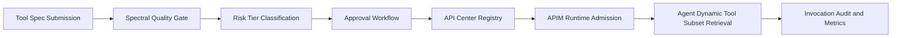
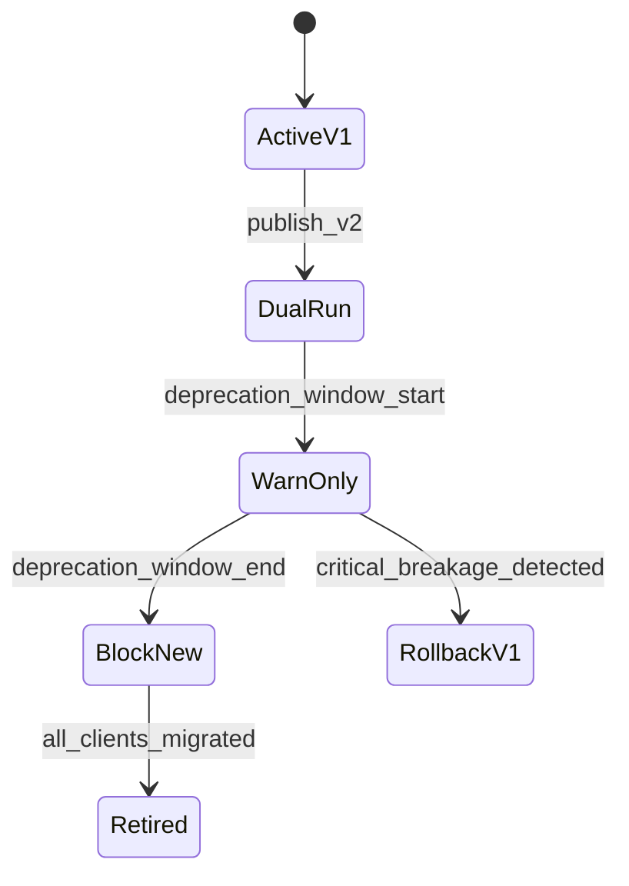

# API Center+APIM vs Foundry Connected Tools vs Custom MCP Registry: Enterprise Tool-Sprawl Governance Selection FAQ

> 🌐 **Language / 语言切换**: **[🇬🇧 English (apim-mcp-registry-api-center-vs-custom-tool-gateway-enterprise-agent-tool-sprawl-selection-faq.en.md)](apim-mcp-registry-api-center-vs-custom-tool-gateway-enterprise-agent-tool-sprawl-selection-faq.en.md)** | **[🇨🇳 中文版 (apim-mcp-registry-api-center-vs-custom-tool-gateway-enterprise-agent-tool-sprawl-selection-faq.md)](apim-mcp-registry-api-center-vs-custom-tool-gateway-enterprise-agent-tool-sprawl-selection-faq.md)** | **[📚 Architecture Selection FAQ Index](README.en.md)**

## 1) Objective and boundary
Goal: solve enterprise MCP/tool sprawl, duplicate wrappers, and missing unified admission governance.
Scope: tool registry onboarding, dynamic discovery, risk tiering, gateway admission, version deprecation, and cross-team reuse.
Exclusion: no low-level kernel/driver/RDMA/eBPF internals.
Conclusion: API Center registry governance plus APIM runtime admission is the enterprise-scale primary path.
## 2) Verifiable sources with timestamps
- Azure API Center docs (04:52 BJT)。
- Azure API Management docs (04:52 BJT)。
- Azure AI Foundry Connected Tools docs (04:53 BJT)。
- Spectral rules docs (04:53 BJT)。
- MCP specification and tool-governance references (04:54 BJT)。
- Azure Policy and private-network governance docs (04:54 BJT)。
- Log Analytics query syntax docs (04:54 BJT)。
Evidence labels are measured/synthetic/anonymized_reported.
## 3) Four tool-registry architectures and 12-dimension matrix
- A: API Center registry plus APIM runtime governance for enterprise unified asset control.
- B: Foundry Project Connected Tools for single-team rapid prototyping and project-local binding.
- C: Custom MCP Registry on AKS/ACA for deep customization with higher maintenance burden.
- D: Team-by-team hardcoded Function Calling wrappers with short-term speed and long-term governance drift.
- Dimension 1 discovery efficiency and catalog searchability.
- Dimension 2 description quality and onboarding gate coverage.
- Dimension 3 auth consistency (OAuth/OBO/least privilege).
- Dimension 4 risk-tier governance (read/reversible-write/irreversible-financial-write).
- Dimension 5 dynamic subset impact on tool-misfire rate and token cost.
- Dimension 6 version evolution and deprecation-window safety.
- Dimension 7 cross-domain reuse improvement potential.
- Dimension 8 shadow-tool discovery and interception capability.
- Dimension 9 operations complexity and platform-team burden.
- Dimension 10 audit traceability and signed-approval chain.
- Dimension 11 controlled exposure cost for legacy REST/SOAP systems.
- Dimension 12 anti-pattern risk (duplicated wrappers across repositories).
## 4) Scoreboard and gating thresholds
- API Center+APIM: governance5, reuse5, extensibility4, ops3.
- Foundry Connected Tools: prototyping-speed5, project-autonomy4, global-governance2.
- Custom Registry: customization5, governance3, maintenance-complexity5.
- Hardcoded wrappers: short-term speed4, long-term governance1, duplicate-cost5.
- Threshold A: once tools per agent exceed 25, dynamic subset retrieval is mandatory.
- Threshold B: Tier-2 high-risk writes require signed approval and dual control.
- Threshold C: tools without clear description or idempotency key are blocked from onboarding.
- Threshold D: deprecation must include advance window plus automated migration alerts.
## 5) Five calculable Q&As
### Q1 How to govern tool-misfire surge when tool count exceeds 25~30
- Use two-stage tool retrieval: intent prefilter to Top-8, then domain sub-agent executes fine-grained invocation.
- Enforce description, idempotency key, risk tags, and input-output contract checks at onboarding.
- Combine version alerts and call audits to expose compatibility risk early and guide migration.
### Q2 How Spectral gates enforce onboarding quality
- Use two-stage tool retrieval: intent prefilter to Top-8, then domain sub-agent executes fine-grained invocation.
- Enforce description, idempotency key, risk tags, and input-output contract checks at onboarding.
- Combine version alerts and call audits to expose compatibility risk early and guide migration.
### Q3 How to expose legacy REST/SOAP as controlled MCP with minimal change
- Use two-stage tool retrieval: intent prefilter to Top-8, then domain sub-agent executes fine-grained invocation.
- Enforce description, idempotency key, risk tags, and input-output contract checks at onboarding.
- Combine version alerts and call audits to expose compatibility risk early and guide migration.
### Q4 How to prevent silent failures during v1->v2 evolution and deprecation windows
- Use two-stage tool retrieval: intent prefilter to Top-8, then domain sub-agent executes fine-grained invocation.
- Enforce description, idempotency key, risk tags, and input-output contract checks at onboarding.
- Combine version alerts and call audits to expose compatibility risk early and guide migration.
### Q5 How to quantify engineering-hour savings from reuse 12% to 65%
- Use two-stage tool retrieval: intent prefilter to Top-8, then domain sub-agent executes fine-grained invocation.
- Enforce description, idempotency key, risk tags, and input-output contract checks at onboarding.
- Combine version alerts and call audits to expose compatibility risk early and guide migration.
## 6) Layered reference architecture
- Catalog layer: API Center unified registration for MCP/OpenAPI assets and metadata.
- Quality gate layer: Spectral rules, risk tiering, approval workflow, and e-signature.
- Runtime layer: APIM unified auth, throttling, masking, auditing, and admission.
- Discovery layer: semantic retrieval chooses tool subsets to reduce misfires and context load.
- Orchestration layer: domain sub-agents execute tasks with minimum tool sets.
- Lifecycle layer: version release, deprecation windows, compatibility alerts, and migration hints.
- Observability layer: success rate, misfire rate, reuse rate, shadow-tool interception.
- Governance layer: policy, budget, private networking, permissions, and compliance evidence retention.
## 7) Scenario A: national retail bank 450+ certified MCP tool marketplace
- Head-office architecture board governs onboarding, risk tiers, and automated scans in API Center.
- Retail, credit, and risk teams subscribe certified tools and invoke via APIM OBO controls.
- High-risk write tools always pass dual approval and replay-audit mechanisms.
- Unified catalog prevents duplicate wrappers and conflicting data semantics for core systems.
- Tool reuse and defect-fix efficiency improve materially.
## 8) Scenario B: global pharma clinical/PV/regulatory tool governance platform
- Regulated query and filing-write tools require strict version pinning and impact analysis.
- Any high-risk operation requires signed approval and complete invocation audit trail.
- Cross-department reuse is enabled by unified discoverable tool catalog.
- Deprecation window alerts prevent silent failures during filing-critical windows.
- Compliance teams can perform rapid sampling review using complete evidence trails.
## 9) Mermaid diagram 1: tool onboarding and runtime governance flow

- Dual gates at onboarding and runtime ensure tools are onboardable, callable, auditable, and deprecatable.
## 10) Mermaid diagram 2: version evolution and deprecation window state machine

- Dual-run plus warning-window mechanics significantly reduce migration shock on production agents.
## 11) Bicep template (API Center + APIM private gateway)
```bicep
targetScope = 'resourceGroup'
param location string = resourceGroup().location
resource apic 'Microsoft.ApiCenter/services@2024-03-01' = {
  name: 'apic'
  location: location
}
resource apim 'Microsoft.ApiManagement/service@2023-09-01-preview' = {
  name: 'apim-prod'
  location: location
  sku: { name: 'PremiumV2', capacity: 1 }
}
```
- Production deployment should add private endpoints, identity boundaries, audit retention, and cross-environment metadata sync policy.
## 12) Spectral gate and dynamic tool-subset policy snippets
```json
{
  "required_fields": ["name","description","risk_tier","idempotency_key","owner"],
  "risk_tier": ["Tier-0 Read","Tier-1 Reversible Write","Tier-2 Irreversible Financial Action"],
  "deprecation_policy": {"min_notice_days": 30, "dual_run_required": true}
}
```
```python
def select_tool_subset(intent_embedding, catalog, top_k=8):
    ranked = semantic_rank(intent_embedding, catalog)
    return ranked[:top_k]
```
- Tool-subset retrieval can significantly reduce model misfires and unnecessary context-token cost.
## 13) KQL: misfire, reuse, shadow-tool, and deprecation-alert audit
```kql
let t = ToolGovernanceLogs | where TimeGenerated > ago(30d);
t
| summarize misfireRate=avg(todouble(ToolMisfire)), reuseRate=avg(todouble(CrossTeamReuse)), shadowBlocked=avg(todouble(ShadowToolBlocked)), deprecatedCallRate=avg(todouble(DeprecatedVersionCalled)) by Domain
| order by misfireRate desc
```
- Making misfire and deprecated-call rates release gates prevents silent agent degradation.
## 14) Five-step rollout guide
- Step 1: standardize tool metadata schema and risk-tier dictionary.
- Step 2: enable Spectral quality gate and approval workflow before broad project onboarding.
- Step 3: force runtime calls through APIM with OBO boundary controls.
- Step 4: launch dynamic tool-subset retrieval and misfire monitoring.
- Step 5: establish dual-run, deprecation-window, and automated migration alerts.
- In parallel, build cross-team reuse incentives and shadow-tool retirement workflows.
- Every change must ship audit evidence pack and impact assessment report.
