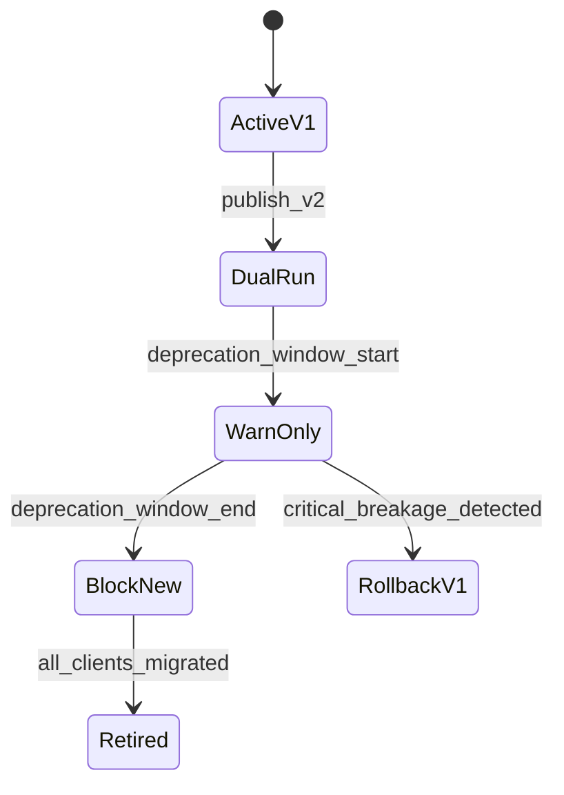

# API Center+APIM vs Foundry Connected Tools vs 自建 MCP Registry：企业工具泛滥治理选型 FAQ

> 🌐 **Language / 语言切换**: **[🇨🇳 中文版 (apim-mcp-registry-api-center-vs-custom-tool-gateway-enterprise-agent-tool-sprawl-selection-faq.md)](apim-mcp-registry-api-center-vs-custom-tool-gateway-enterprise-agent-tool-sprawl-selection-faq.md)** | **[🇬🇧 English (apim-mcp-registry-api-center-vs-custom-tool-gateway-enterprise-agent-tool-sprawl-selection-faq.en.md)](apim-mcp-registry-api-center-vs-custom-tool-gateway-enterprise-agent-tool-sprawl-selection-faq.en.md)** | **[📚 返回架构选型指南目录](README.md)**

## 1) 研究目标与边界
目标：解决企业 MCP/工具泛滥、重复封装与缺乏统一准入治理问题。
范围：工具目录注册、动态发现、风险分级、网关准入、版本下线与跨团队复用。
排除：不讨论底层内核/驱动/RDMA/eBPF 等低层研发细节。
结论：API Center 注册治理 + APIM 运行时准入是企业规模化主路径。
## 2) 可验证来源与时间戳
- Azure API Center 文档（04:52 BJT）。
- Azure API Management 文档（04:52 BJT）。
- Azure AI Foundry Connected Tools 文档（04:53 BJT）。
- Spectral 规则文档（04:53 BJT）。
- MCP 规范与工具调用治理参考（04:54 BJT）。
- Azure Policy 与私网治理文档（04:54 BJT）。
- Log Analytics 查询语法文档（04:54 BJT）。
证据标签统一 measured/synthetic/anonymized_reported。
## 3) 四类工具目录与治理架构 12 维矩阵
- A: API Center 注册目录 + APIM 运行时网关治理，适合集团级统一资产治理。
- B: Foundry Project Connected Tools，适合单团队快速原型与项目内绑定。
- C: AKS/ACA 自建 MCP Registry 门户，适合深度定制但维护成本高。
- D: 团队各自硬编码 Function Calling，短期快但长期治理失控。
- 维度1 工具发现效率与目录可检索性。
- 维度2 工具描述标准化与质量门禁覆盖。
- 维度3 认证授权一致性（OAuth/OBO/最小权限）。
- 维度4 风险分级（只读/可逆写/不可逆金融写）治理能力。
- 维度5 动态子集选择对选错率与 Token 成本影响。
- 维度6 版本演进与下线窗口可控性。
- 维度7 跨部门复用率提升能力。
- 维度8 影子工具发现与拦截能力。
- 维度9 运维复杂度与平台团队负担。
- 维度10 审计追溯与电子签名审批链。
- 维度11 旧系统（REST/SOAP）受控暴露改造成本。
- 维度12 反模式（代码仓重复封装同接口）。
## 4) 评分与门禁阈值
- API Center+APIM：治理5、复用5、扩展4、运维3。
- Foundry Connected Tools：原型速度5、项目自治4、全局治理2。
- 自建 Registry：定制5、治理3、维护复杂度5。
- 硬编码封装：短期速度4、长期治理1、重复成本5。
- 阈值A：单智能体工具超过25个时必须启用动态子集检索。
- 阈值B：Tier-2 高危写操作必须走电子签名审批与双人复核。
- 阈值C：无描述或无幂等键工具禁止上架。
- 阈值D：Deprecation 需提前窗口公告并提供自动迁移告警。
## 5) 五组可复算 Q&A
### Q1 工具数超过 25~30 后选错率飙升如何治理
- 采用两级工具检索：先按意图筛 Top-8，再由子智能体执行细粒度调用。
- 上架时强制描述、幂等键、风险标签与输入输出契约完整性检查。
- 结合版本告警与调用审计，提前暴露兼容性风险并引导迁移。
### Q2 Spectral 门禁如何保证上架质量
- 采用两级工具检索：先按意图筛 Top-8，再由子智能体执行细粒度调用。
- 上架时强制描述、幂等键、风险标签与输入输出契约完整性检查。
- 结合版本告警与调用审计，提前暴露兼容性风险并引导迁移。
### Q3 存量 REST/SOAP 如何零改造受控暴露为 MCP
- 采用两级工具检索：先按意图筛 Top-8，再由子智能体执行细粒度调用。
- 上架时强制描述、幂等键、风险标签与输入输出契约完整性检查。
- 结合版本告警与调用审计，提前暴露兼容性风险并引导迁移。
### Q4 v1->v2 演进与下线窗口如何防静默崩溃
- 采用两级工具检索：先按意图筛 Top-8，再由子智能体执行细粒度调用。
- 上架时强制描述、幂等键、风险标签与输入输出契约完整性检查。
- 结合版本告警与调用审计，提前暴露兼容性风险并引导迁移。
### Q5 复用率 12% 提升到 65% 的工时节省如何测算
- 采用两级工具检索：先按意图筛 Top-8，再由子智能体执行细粒度调用。
- 上架时强制描述、幂等键、风险标签与输入输出契约完整性检查。
- 结合版本告警与调用审计，提前暴露兼容性风险并引导迁移。
## 6) 分层参考架构
- 目录层：API Center 统一注册 MCP/OpenAPI 资产与元数据。
- 门禁层：Spectral 规则、风险分级、审批流与电子签名。
- 运行层：APIM 统一鉴权、限流、脱敏、审计与准入。
- 发现层：语义检索选取工具子集，降低选错率与上下文负载。
- 编排层：领域子智能体根据最小工具集合执行任务。
- 生命周期层：版本发布、弃用窗口、兼容性告警与自动迁移建议。
- 观测层：调用成功率、选错率、复用率、影子工具拦截率。
- 治理层：策略、预算、私网、权限与合规证据留存。
## 7) 场景A：股份制银行 450+ 工具黄金超市
- 总行架构委员会在 API Center 管理准入、风险分级和自动扫描。
- 零售、信贷、风控团队按域订阅认证工具并通过 APIM OBO 调用。
- 高风险写操作工具统一走双人审批与审计回放机制。
- 统一目录避免同一核心接口被重复封装和口径冲突。
- 工具复用率与缺陷修复效率显著提升。
## 8) 场景B：跨国药企临床/PV/注册申报工具治理平台
- 受监管查询与申报写入工具全部要求版本锁定和影响面分析。
- 任何高风险操作需电子签名审批和完整调用留痕。
- 跨部门复用通过统一工具目录实现“发现即复用”。
- 弃用窗口策略提前预警，避免申报期静默故障。
- 合规团队可基于审计证据快速完成抽检与复核。
## 9) Mermaid 图1：工具目录准入与运行时治理流

- 准入与运行时双门禁确保“可上架、可调用、可审计、可下线”。
## 10) Mermaid 图2：版本演进与弃用窗口状态机

- 通过双跑与告警窗口机制可显著降低版本切换对线上智能体的冲击。
## 11) Bicep 模板（API Center + APIM 私网网关）
```bicep
targetScope = 'resourceGroup'
param location string = resourceGroup().location
resource apic 'Microsoft.ApiCenter/services@2024-03-01' = {
  name: 'apic'
  location: location
}
resource apim 'Microsoft.ApiManagement/service@2023-09-01-preview' = {
  name: 'apim-prod'
  location: location
  sku: { name: 'PremiumV2', capacity: 1 }
}
```
- 生产部署需追加私网端点、身份边界、审计保留与跨环境元数据同步策略。
## 12) Spectral 门禁与动态工具子集策略片段
```json
{
  "required_fields": ["name","description","risk_tier","idempotency_key","owner"],
  "risk_tier": ["Tier-0 Read","Tier-1 Reversible Write","Tier-2 Irreversible Financial Action"],
  "deprecation_policy": {"min_notice_days": 30, "dual_run_required": true}
}
```
```python
def select_tool_subset(intent_embedding, catalog, top_k=8):
    ranked = semantic_rank(intent_embedding, catalog)
    return ranked[:top_k]
```
- 工具子集检索可显著降低模型选错率与无效上下文Token消耗。
## 13) KQL：选错率/复用率/影子工具/弃用告警审计
```kql
let t = ToolGovernanceLogs | where TimeGenerated > ago(30d);
t
| summarize misfireRate=avg(todouble(ToolMisfire)), reuseRate=avg(todouble(CrossTeamReuse)), shadowBlocked=avg(todouble(ShadowToolBlocked)), deprecatedCallRate=avg(todouble(DeprecatedVersionCalled)) by Domain
| order by misfireRate desc
```
- 把选错率与弃用调用率纳入发布门禁可防止智能体静默退化。
## 14) 五步落地指南
- 步骤1：统一工具目录元数据规范与风险分级字典。
- 步骤2：先启用 Spectral 门禁和审批流，再开放项目接入。
- 步骤3：运行时全部收口 APIM，并打通 OBO 权限边界。
- 步骤4：上线动态工具子集检索与选错率监控。
- 步骤5：建立版本双跑、弃用窗口与自动迁移告警机制。
- 并行建立跨部门复用激励和影子工具清退流程。
- 每次变更都需产出审计证据包与影响面评估报告。
