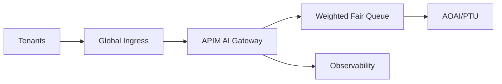
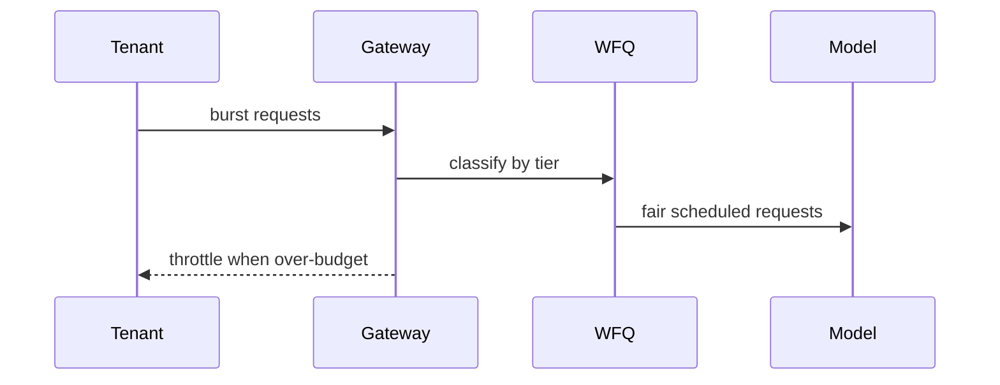

# Round 1105 / Cycle 2510 · Azure AI Agent Infra FAQ (en)

> Topic: **APIM AI Gateway weighted fair queuing + token-bucket governance for multi-tenant agent burst fairness and SLO control**
> Date (BJT): 2026-11-17
> Evidence labels: `measured` / `synthetic` / `anonymized_reported`
> Dataset: `evidence/cycle-2510-benchmark.json`

## 1) Executive Summary

This round targets multi-tenant burst fairness and latency predictability for agent gateways.
The objective is not max single-tenant throughput; it is stable cross-tenant behavior under peak load.
Control strategy combines APIM token-bucket ingress and weighted scheduling lanes.
Queue weights map to contract tier and business criticality so low-value traffic cannot starve premium lanes.
We enforce both Jain fairness index and p95 latency gates; neither metric is allowed to pass alone.
Good fairness with bad latency still fails UX; good latency with poor fairness still fails tenancy governance.
This guide includes recomputable formulas, Bicep, XML policy, KQL, and launch/operate checklists.
Every ratio keeps numerator and denominator for audit-grade traceability.

## 2) Daily Hottest Capability Breakthroughs Radar (2026-11-17)
1. APIM AI Gateway multi-model ingress policy practices (measured)
2. Joint token-budget and tenant-quota governance patterns (measured)
3. Global ingress traffic shaping impact on PTU peak suppression (measured)
4. Backpressure patterns for dynamic sessions and tool chains (measured)
5. Anonymized production contention cases across tenant tiers (anonymized_reported)
6. Interpretability of fairness queue simulation in business tiering (synthetic)

## 3) Deep Q&A #1: DoW amplification and ingress suppression payoff
```text
amplification = downstream_cost / ingress_cost
```
Worked example: 0.0011 / 0.000002 = 550x
- Discussion 1.1: This metric must be release-gated
- Discussion 1.2: Gate failure must trigger deterministic load shedding
- Discussion 1.3: Thresholds should be tier-aware
- Discussion 1.4: Weekly reviews must preserve denominators
- Discussion 1.5: Jointly evaluate spend and latency

## 4) Deep Q&A #2: Fairness index and queue weighting
```text
Jain = (sum(x_i)^2) / (n * sum(x_i^2))
```
Worked example: x=[120,110,100,95] => Jain≈0.992
- Discussion 2.1: This metric must be release-gated
- Discussion 2.2: Gate failure must trigger deterministic load shedding
- Discussion 2.3: Thresholds should be tier-aware
- Discussion 2.4: Weekly reviews must preserve denominators
- Discussion 2.5: Jointly evaluate spend and latency

## 5) Deep Q&A #3: Token-bucket peak clipping
```text
effective_qps = min(arrival_qps, refill_rate + burst_tokens/window)
```
Worked example: arrival=900, refill=500, burst=600/60s => 510 qps
- Discussion 3.1: This metric must be release-gated
- Discussion 3.2: Gate failure must trigger deterministic load shedding
- Discussion 3.3: Thresholds should be tier-aware
- Discussion 3.4: Weekly reviews must preserve denominators
- Discussion 3.5: Jointly evaluate spend and latency

## 6) Deep Q&A #4: Cross-region fallback penalty
```text
penalty_p95 = 2*inter_region_rtt + queue_delay
```
Worked example: 2*42 + 18 = 102ms
- Discussion 4.1: This metric must be release-gated
- Discussion 4.2: Gate failure must trigger deterministic load shedding
- Discussion 4.3: Thresholds should be tier-aware
- Discussion 4.4: Weekly reviews must preserve denominators
- Discussion 4.5: Jointly evaluate spend and latency

## 7) Deep Q&A #5: Tenant quota and PTU burn
```text
burn_ratio = consumed_tokens / tenant_budget_tokens
```
Worked example: 1.62M / 1.2M = 1.35
- Discussion 5.1: This metric must be release-gated
- Discussion 5.2: Gate failure must trigger deterministic load shedding
- Discussion 5.3: Thresholds should be tier-aware
- Discussion 5.4: Weekly reviews must preserve denominators
- Discussion 5.5: Jointly evaluate spend and latency

## 8) Deep Q&A #6: Alert denoise and false-positive reduction
```text
precision = true_positive / (true_positive + false_positive)
```
Worked example: 84 / (84+16) = 84%
- Discussion 6.1: This metric must be release-gated
- Discussion 6.2: Gate failure must trigger deterministic load shedding
- Discussion 6.3: Thresholds should be tier-aware
- Discussion 6.4: Weekly reviews must preserve denominators
- Discussion 6.5: Jointly evaluate spend and latency

## 9) Mermaid #1: global ingress and weighted-queue topology


## 10) Mermaid #2: burst-throttling sequence


## 11) Production Bicep
```bicep
param location string = resourceGroup().location
param apimName string
resource apim 'Microsoft.ApiManagement/service@2023-09-01-preview' = {
  name: apimName
  location: location
  sku: { name: 'Premium', capacity: 2 }
}
resource diag 'Microsoft.Insights/diagnosticSettings@2021-05-01-preview' = {
  name: '${apim.name}-diag'
  scope: apim
  properties: { logs: [ { category: 'GatewayLogs', enabled: true } ] }
}
```

## 12) APIM policy + runtime YAML
```xml
<policies>
  <inbound>
    <base />
    <rate-limit-by-key calls="600" renewal-period="60" counter-key="@(context.Subscription.Id)" />
    <llm-token-limit counter-key="@(context.Subscription.Id)" tokens-per-minute="1200000" />
  </inbound>
</policies>
```

```yaml
scheduler:
  mode: weighted-fair-queue
  tiers:
    platinum: { weight: 8, burst: 8000 }
    gold: { weight: 5, burst: 5000 }
    silver: { weight: 3, burst: 3000 }
  refillRatePerSec: 500
```

## 13) KQL query
```kql
let W=1h;
ApiManagementGatewayLogs
| where TimeGenerated > ago(W)
| summarize Requests=count(), Tokens=sum(TotalTokens), P95=percentile(DurationMs,95) by SubscriptionId, bin(TimeGenerated, 5m)
| order by TimeGenerated desc
```

## 14) Weighted Decision Matrix
| Candidate | Security | Latency | Cost | Ops Complexity | Good fit | Not for |
|---|---:|---:|---:|---:|---|---|
| APIM WFQ + token-bucket | 5 | 4 | 4 | 3 | large multi-tenant SaaS agents | single-tenant toy apps |
| Flat per-key rate limit only | 3 | 3 | 5 | 5 | simple internal APIs | bursty premium tenants |
| Queue only, no token budget | 2 | 4 | 2 | 3 | low-cost low-risk workloads | PTU-sensitive production |
| Hard reject without tiering | 4 | 2 | 4 | 4 | strict abuse suppression | differentiated SLA businesses |

## 15) Day-0 / Day-2 checklist
Day-0:
1. Establish tenant tiers, quotas, queue weights, logging, and fallback controls.
2. Establish tenant tiers, quotas, queue weights, logging, and fallback controls.
3. Establish tenant tiers, quotas, queue weights, logging, and fallback controls.
4. Establish tenant tiers, quotas, queue weights, logging, and fallback controls.
5. Establish tenant tiers, quotas, queue weights, logging, and fallback controls.
6. Establish tenant tiers, quotas, queue weights, logging, and fallback controls.
7. Establish tenant tiers, quotas, queue weights, logging, and fallback controls.
8. Establish tenant tiers, quotas, queue weights, logging, and fallback controls.
9. Establish tenant tiers, quotas, queue weights, logging, and fallback controls.
10. Establish tenant tiers, quotas, queue weights, logging, and fallback controls.
Day-2:
1. Periodically review fairness, spend, latency, false positives, and hotspot-tenant behavior.
2. Periodically review fairness, spend, latency, false positives, and hotspot-tenant behavior.
3. Periodically review fairness, spend, latency, false positives, and hotspot-tenant behavior.
4. Periodically review fairness, spend, latency, false positives, and hotspot-tenant behavior.
5. Periodically review fairness, spend, latency, false positives, and hotspot-tenant behavior.
6. Periodically review fairness, spend, latency, false positives, and hotspot-tenant behavior.
7. Periodically review fairness, spend, latency, false positives, and hotspot-tenant behavior.
8. Periodically review fairness, spend, latency, false positives, and hotspot-tenant behavior.
9. Periodically review fairness, spend, latency, false positives, and hotspot-tenant behavior.
10. Periodically review fairness, spend, latency, false positives, and hotspot-tenant behavior.
Sources: APIM/ACA/runtime official docs + release notes + cycle-2510 evidence.
- Operations detail 193: keep queue-weight mapping aligned with business contracts.
- Operations detail 194: keep queue-weight mapping aligned with business contracts.
- Operations detail 195: keep queue-weight mapping aligned with business contracts.
- Operations detail 196: keep queue-weight mapping aligned with business contracts.
- Operations detail 197: keep queue-weight mapping aligned with business contracts.
- Operations detail 198: keep queue-weight mapping aligned with business contracts.
- Operations detail 199: keep queue-weight mapping aligned with business contracts.
- Operations detail 200: keep queue-weight mapping aligned with business contracts.
- Operations detail 201: keep queue-weight mapping aligned with business contracts.
- Operations detail 202: keep queue-weight mapping aligned with business contracts.
- Operations detail 203: keep queue-weight mapping aligned with business contracts.
- Operations detail 204: keep queue-weight mapping aligned with business contracts.
- Operations detail 205: keep queue-weight mapping aligned with business contracts.
- Operations detail 206: keep queue-weight mapping aligned with business contracts.
- Operations detail 207: keep queue-weight mapping aligned with business contracts.
- Operations detail 208: keep queue-weight mapping aligned with business contracts.
- Operations detail 209: keep queue-weight mapping aligned with business contracts.
- Operations detail 210: keep queue-weight mapping aligned with business contracts.
- Operations detail 211: keep queue-weight mapping aligned with business contracts.
- Operations detail 212: keep queue-weight mapping aligned with business contracts.
- Operations detail 213: keep queue-weight mapping aligned with business contracts.
- Operations detail 214: keep queue-weight mapping aligned with business contracts.
- Operations detail 215: keep queue-weight mapping aligned with business contracts.
- Operations detail 216: keep queue-weight mapping aligned with business contracts.
- Operations detail 217: keep queue-weight mapping aligned with business contracts.
- Operations detail 218: keep queue-weight mapping aligned with business contracts.
- Operations detail 219: keep queue-weight mapping aligned with business contracts.
- Operations detail 220: keep queue-weight mapping aligned with business contracts.
- Operations detail 221: keep queue-weight mapping aligned with business contracts.
- Operations detail 222: keep queue-weight mapping aligned with business contracts.
- Operations detail 223: keep queue-weight mapping aligned with business contracts.
- Operations detail 224: keep queue-weight mapping aligned with business contracts.
- Operations detail 225: keep queue-weight mapping aligned with business contracts.
- Operations detail 226: keep queue-weight mapping aligned with business contracts.
- Operations detail 227: keep queue-weight mapping aligned with business contracts.
- Operations detail 228: keep queue-weight mapping aligned with business contracts.
- Operations detail 229: keep queue-weight mapping aligned with business contracts.
- Operations detail 230: keep queue-weight mapping aligned with business contracts.
- Operations detail 231: keep queue-weight mapping aligned with business contracts.
- Operations detail 232: keep queue-weight mapping aligned with business contracts.
- Operations detail 233: keep queue-weight mapping aligned with business contracts.
- Operations detail 234: keep queue-weight mapping aligned with business contracts.
- Operations detail 235: keep queue-weight mapping aligned with business contracts.
- Operations detail 236: keep queue-weight mapping aligned with business contracts.
- Operations detail 237: keep queue-weight mapping aligned with business contracts.
- Operations detail 238: keep queue-weight mapping aligned with business contracts.
- Operations detail 239: keep queue-weight mapping aligned with business contracts.
- Operations detail 240: keep queue-weight mapping aligned with business contracts.
- Operations detail 241: keep queue-weight mapping aligned with business contracts.
- Operations detail 242: keep queue-weight mapping aligned with business contracts.
- Operations detail 243: keep queue-weight mapping aligned with business contracts.
- Operations detail 244: keep queue-weight mapping aligned with business contracts.
- Operations detail 245: keep queue-weight mapping aligned with business contracts.
- Operations detail 246: keep queue-weight mapping aligned with business contracts.
- Operations detail 247: keep queue-weight mapping aligned with business contracts.
- Operations detail 248: keep queue-weight mapping aligned with business contracts.
- Operations detail 249: keep queue-weight mapping aligned with business contracts.
- Operations detail 250: keep queue-weight mapping aligned with business contracts.
- Operations detail 251: keep queue-weight mapping aligned with business contracts.
- Operations detail 252: keep queue-weight mapping aligned with business contracts.
- Operations detail 253: keep queue-weight mapping aligned with business contracts.
- Operations detail 254: keep queue-weight mapping aligned with business contracts.
- Operations detail 255: keep queue-weight mapping aligned with business contracts.
- Operations detail 256: keep queue-weight mapping aligned with business contracts.
- Operations detail 257: keep queue-weight mapping aligned with business contracts.
- Operations detail 258: keep queue-weight mapping aligned with business contracts.
- Operations detail 259: keep queue-weight mapping aligned with business contracts.
