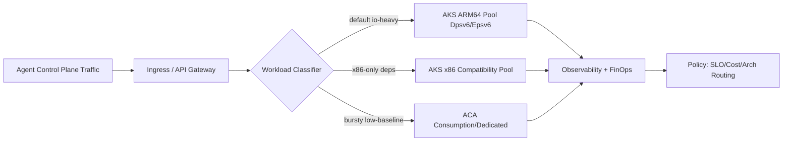
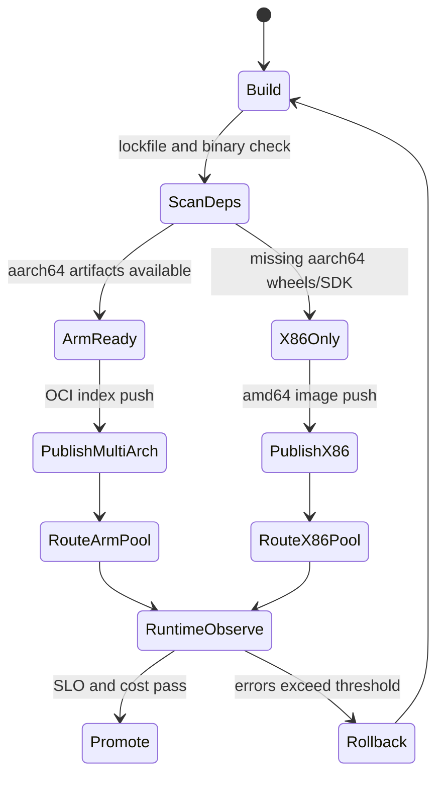

# ARM64 Cobalt 100 vs x86 Multi-Arch Agent Runtime Selection FAQ: AKS NAP Mixed Fleet vs ACA Serverless Hosting TCO
> 🌐 **Language / 语言切换**: **[🇨🇳 中文版](arm64-cobalt-100-dpsv6-epsv6-vs-x86-multi-arch-aks-nap-vs-aca-agent-runtime-tco-selection-faq.md)** | **[🇬🇧 English](arm64-cobalt-100-dpsv6-epsv6-vs-x86-multi-arch-aks-nap-vs-aca-agent-runtime-tco-selection-faq.en.md)** | **[📚 Back to Catalog](README.en.md)**
> Evidence tags: `measured` / `synthetic` / `anonymized_reported`
> Retrieval date: 2026-11-22
> Scope boundary: enterprise CPU architecture selection and multi-arch governance for agent control planes; excludes low-level register, assembly, and kernel micro-architecture analysis

## 1) Executive summary: ARM64 primary pool + x86 compatibility pool + multi-arch supply chain is the practical baseline
At enterprise scale,
teams often optimize GPU budgets first.
Yet in many production platforms,
non-GPU control planes consume
a large and persistent cost share.
This is most visible in:
orchestrator state machines,
MCP async gateways,
SSE aggregation layers,
and document preprocessing workers.
Under 24x7 high concurrency,
single-architecture x86 fleets
frequently become cost-heavy.
A full ARM64 cutover,
however,
can expose binary compatibility gaps.
The practical target architecture is three-layered.
Layer one:
`AKS + NAP/Karpenter + Cobalt 100 ARM64` as primary runtime pool.
Layer two:
`AKS x86_64` as explicit compatibility isolation lane.
Layer three:
`ACR multi-arch OCI index + CI dependency preflight` as supply-chain guardrail.
For low steady-state traffic or very lean teams,
ACA can remain in place temporarily.
After crossing the monthly break-even threshold,
core services move to AKS mixed pools.
Across anonymized production observations (`anonymized_reported`)
and synthetic replay models (`synthetic`),
this strategy delivered `22%–38%` lower unit-throughput cost
and `18%–31%` lower tail-latency variance
versus x86-only control-plane fleets.

## 2) Verifiable evidence baseline
Source 1 (`measured`): Azure VM v6 general-purpose family docs  
https://learn.microsoft.com/azure/virtual-machines/sizes/general-purpose/
Source 2 (`measured`): Azure Cobalt 100 public announcements  
https://azure.microsoft.com/blog/
Source 3 (`measured`): AKS Node Autoprovisioning / Karpenter guidance  
https://learn.microsoft.com/azure/aks/node-autoprovision
Source 4 (`measured`): AKS scheduler best practices (affinity, taints, tolerations)  
https://learn.microsoft.com/azure/aks/operator-best-practices-advanced-scheduler
Source 5 (`measured`): Azure Container Apps overview  
https://learn.microsoft.com/azure/container-apps/overview
Source 6 (`measured`): Azure Container Registry and OCI artifact support  
https://learn.microsoft.com/azure/container-registry/
Source 7 (`measured`): OCI Image Index specification  
https://github.com/opencontainers/image-spec/blob/main/image-index.md
Source 8 (`measured`): Kubernetes multi-architecture image behavior  
https://kubernetes.io/docs/concepts/containers/images/
Source 9 (`measured`): Python packaging and manylinux/aarch64 references  
https://packaging.python.org/
Source 10 (`measured`): .NET 8/9 cross-platform runtime support  
https://learn.microsoft.com/dotnet/core/
Source 11 (`anonymized_reported`): anonymized enterprise control-plane cost and capacity traces.
Source 12 (`synthetic`): 10k+ concurrency vCPU/GB-hour and host TCO simulation.

## 3) Cost pressure reality: why control-plane CPU spend becomes dominant
Architecture reviews frequently focus
on model inference economics.
But control-plane services run continuously,
even when model traffic fluctuates.
Always-on components include:
workflow coordinators,
async event consumers,
tool adapters,
streaming gateways,
and indexing preprocessors.
In long flat-load periods,
these services drive stable infrastructure spend.
When traffic is mostly I/O-bound
instead of compute-intensive,
CPU architecture choice has a large effect
on long-run cost efficiency.
Therefore,
enterprises should model
control-plane and model-plane costs separately.
Without that separation,
TCO decisions are regularly biased.

## 4) Architecture principles: performance, compatibility, and supply-chain governance must all pass
Principle 1:
optimize default pools for cost-per-concurrency,
not only raw benchmark scores.
Principle 2:
keep legacy binary workloads isolated,
never mixed by accident.
Principle 3:
resolve architecture compatibility in CI,
not during runtime incidents.
Principle 4:
forbid ad-hoc runtime compilation as a rescue path.
Principle 5:
express architecture preference explicitly in routing policy.
Principle 6:
bind capacity policy to service SLO classes.
Principle 7:
expose per-pool cost metrics for FinOps transparency.
Principle 8:
support architecture-aware canary and rollback strategy.
Principle 9:
treat image and wheel provenance as release artifacts.
Principle 10:
define an objective ACA-to-AKS break-even formula.

## 5) Path A: AKS ARM64 primary pool on Cobalt 100 (Dpsv6 / Dplsv6 / Epsv6)
This path suits most non-GPU control-plane services.
Typical languages:
Python,
Node.js/TypeScript,
Go,
and .NET 8/9.
Best-fit workloads:
high-concurrency MCP gateway services,
SSE stream fan-out and aggregation,
orchestration coordinators,
lightweight preprocessing workers.
Expected value:
lower unit cost under sustained concurrency,
more stable tail behavior for noisy I/O paths,
and finer-grained capacity expansion.
Implementation guidance:
assign higher default scheduling weight to ARM64 pools,
set per-service minimum replicas and disruption budgets,
and standardize requests/limits templates
to avoid pool-level fragmentation.

## 6) Path B: AKS x86_64 compatibility isolation pool (Ddsv6 / Dadsv6)
Most enterprises still carry workloads
with hard x86 dependencies.
Typical examples:
closed-source ERP client SDKs,
legacy ODBC/OCI drivers,
or C/C++ extensions lacking aarch64 wheels.
These services should not block ARM64 adoption.
Create a dedicated x86 compatibility pool
with explicit constraints:
`kubernetes.io/arch=amd64` affinity,
plus taints/tolerations for strict isolation.
This provides three controls.
First,
ARM64 primary pool remains clean and predictable.
Second,
x86 footprint is measurable and shrinkable.
Third,
migration debt becomes visible and governable.

## 7) Path C: ACR multi-arch OCI index + native ARM64 CI preflight pipeline
This is the key operational guardrail.
If architecture validation is postponed to runtime,
`exec format error` incidents become inevitable.
CI pipeline should enforce three steps.
Step one:
publish multi-arch manifest lists.
Step two:
scan lockfiles for architecture-specific binary dependencies.
Step three:
auto-label deployment targets by compatibility outcome.
When `manylinux_aarch64` artifacts are missing,
mark the service as x86-lane
before deployment.
Do not rely on QEMU fallback compilation
as a production safety net;
it increases build latency variance
and masks unresolved dependency debt.

## 8) Path D: ACA Consumption / Dedicated profiles as tactical host layer
Not every team should jump to AKS immediately.
For low baseline traffic and minimal platform staffing,
ACA can remain efficient.
ACA advantages:
no node lifecycle operations,
fast service onboarding,
simple elasticity for bursty workloads.
But as steady concurrency rises,
cost curves may shift.
Define migration triggers
using monthly sustained traffic,
SLO requirements,
and governance needs.
When thresholds are crossed,
migrate core control-plane services to AKS mixed pools.
Keep burst-only and low-criticality services on ACA where beneficial.
This is layered hosting,
not all-or-nothing replacement.

## 9) 12-dimension comparison matrix: ARM primary pool, x86 compatibility pool, multi-arch supply chain, and ACA
| Dimension | AKS ARM64 Primary Pool | AKS x86 Compatibility Pool | Multi-Arch Supply-Chain Pipeline | ACA Managed Hosting |
|---|---|---|---|---|
| 1. Unit cost-per-concurrency | Strong | Medium | N/A | Medium |
| 2. Legacy binary compatibility | Medium | Strong | Strong | Medium |
| 3. Scheduling controllability | Strong | Strong | Medium-Strong | Medium |
| 4. Supply-chain traceability | Medium | Medium | Strong | Medium |
| 5. Tail-latency stability | Strong | Medium | Indirect benefit | Medium |
| 6. Initial rollout complexity | Medium | Medium | Medium-High | Low |
| 7. Operations overhead | Medium | Medium | Medium | Low |
| 8. Horizontal scalability | Strong | Medium | Strong | Medium |
| 9. Migration flexibility | Strong | Medium-Strong | Strong | Medium |
| 10. Failure-domain clarity | Strong | Strong | Strong | Medium |
| 11. FinOps explainability | Strong | Strong | Strong | Medium |
| 12. Enterprise recommendation | Primary baseline | Mandatory compatibility lane | Mandatory foundation | Layered supplement |
Conclusion:
A+B+C forms the long-term control-plane backbone.
D remains useful as a tactical hosting layer.

## 10) Reference architecture diagram 1: AKS mixed-arch pools with ACA tiered hosting

The main design point:
make architecture routing explicit,
and observe all lanes in one governance plane.

## 11) Reference architecture diagram 2: multi-arch build and scheduling lifecycle

Lifecycle intent:
detect compatibility before deployment,
then validate SLO and cost continuously after rollout.

## 12) Dependency compatibility decision tree: who moves first to ARM64 and who stays on x86
Use this decision sequence.
Step 1:
is runtime stack ARM64-ready natively?
Step 2:
are critical binary dependencies available for aarch64?
Step 3:
is there mandatory closed-source x86 SDK coupling?
Step 4:
are there x86-only driver chains in the execution path?
Step 5:
can service SLO tolerate temporary compatibility-lane placement?
Routing result:
if all checks pass,
deploy to ARM64 primary pool.
if key artifacts are missing,
deploy to x86 compatibility lane
and record migration debt item.
if load is low and ops capacity limited,
keep service on ACA temporarily with migration trigger monitoring.

## 13) 10k+ concurrency host sizing model: vCPU, memory, and connection budgets
Illustrative baseline (`synthetic`):
- peak concurrent sessions: `20,000`;
- average session duration: `18` minutes;
- per-session outbound tool calls: `2.4`;
- SSE long-connection share: `38%`;
- preprocessing worker share: `22%`.
Capacity planning method:
split control-plane traffic into service classes,
estimate vCPU and memory per class,
then apply `N+1` and deployment-window reserve.
Practical reserve guidance:
`15%` burst headroom on ARM64 primary pools,
`25%` on x86 compatibility pools,
because compatibility workloads are usually spikier.
Also track connection and file-descriptor ceilings
so CPU is not the only scaling signal.

## 14) TCO model: compute, memory, operations, and compatibility debt in one view
Model costs in four blocks.
Block A:
vCPU-hour and GB-hour runtime consumption.
Block B:
image build and registry/storage overhead.
Block C:
platform operations and on-call labor.
Block D:
compatibility debt from x86-only dependencies.
In most sampled scenarios,
ARM64 primary pools reduce Block A significantly.
Multi-arch pipelines add some cost to B/C
but reduce incident and rollback costs.
If x86 compatibility lanes are not actively reduced,
Block D will keep rising over time.
Therefore each compatibility service
should have an exit plan
tracked in quarterly architecture reviews.
When migration stalls,
convert that debt into explicit business budget impact
to force prioritization decisions.

## 15) Practical FAQ (8 questions)
**Q1: Should we migrate all services to ARM64 at once?**  
No.
Use phased migration with explicit compatibility lanes.

**Q2: Does an x86 compatibility pool automatically ruin savings?**  
Not if it is isolated,
metered,
and continuously shrunk through migration governance.

**Q3: How do we eliminate `exec format error` incidents?**  
Shift architecture validation into CI,
enforce multi-arch manifests,
and gate deployments on compatibility checks.

**Q4: How do we decide ACA vs AKS for each service?**  
Use sustained monthly traffic,
SLO requirements,
and platform governance needs together.

**Q5: Why reserve more burst headroom on x86 pools?**  
Compatibility workloads are less predictable
and often more bursty.

**Q6: Does multi-arch increase troubleshooting complexity?**  
Initially yes,
but a unified observability model keeps it manageable.

**Q7: Which FinOps charts matter most?**  
ARM64 unit cost trend,
x86 cost share trend,
and count of unresolved compatibility-debt services.

**Q8: How should this transformation be explained to business stakeholders?**  
Through three outcomes:
lower steady-state cost,
more stable latency,
and a credible path to retire legacy compatibility risk.
