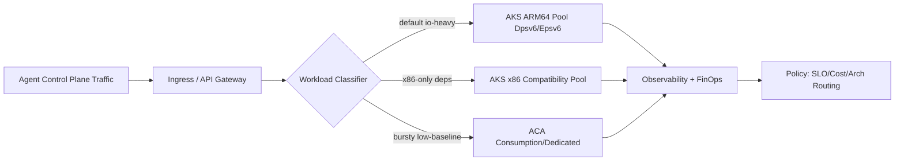
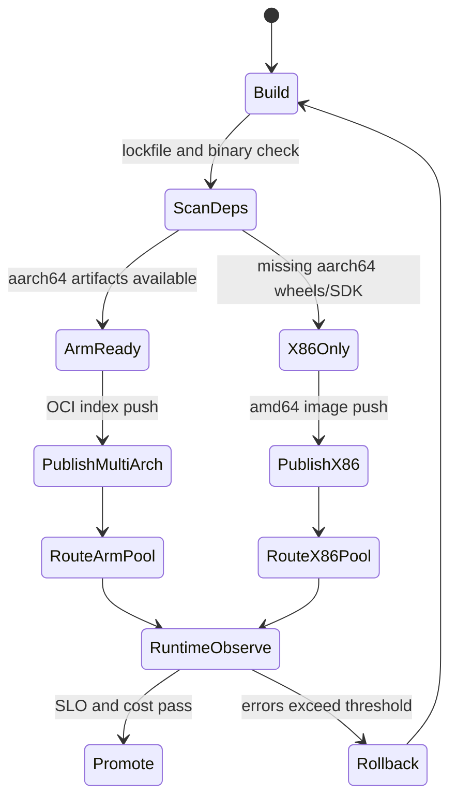

# ARM64 Cobalt 100 与 x86 多架构智能体宿主选型 FAQ：AKS NAP 混部 vs ACA 托管无服务器
> 🌐 **Language / 语言切换**: **[🇨🇳 中文版](arm64-cobalt-100-dpsv6-epsv6-vs-x86-multi-arch-aks-nap-vs-aca-agent-runtime-tco-selection-faq.md)** | **[🇬🇧 English](arm64-cobalt-100-dpsv6-epsv6-vs-x86-multi-arch-aks-nap-vs-aca-agent-runtime-tco-selection-faq.en.md)** | **[📚 返回目录](README.md)**
> 证据标签：`measured` / `synthetic` / `anonymized_reported`
> 抓取日期：2026-11-22
> 主题边界：聚焦企业智能体控制面 CPU 架构与多架构混部治理，不讨论底层寄存器、汇编和内核微架构实现

## 1) 执行摘要：ARM64 主力池 + x86 兼容池 + 多架构供应链是生产默认形态
当企业把智能体从试点推向规模化生产时，
GPU 预算常被优先关注。
但在很多真实系统中，
非 GPU 控制面成本占比持续走高。
尤其在以下负载里，
CPU 与内存常驻费用成为主导项。
编排器状态机。
MCP 工具网关。
SSE 聚合层。
文档预处理 Worker。
在万级并发下，
单纯沿用 x86 单架构，
会把单位并发成本推高。
同时，
全量迁移 ARM64 也会触发兼容性风险。
推荐落地路线是三层组合。
第一层，
`AKS + NAP/Karpenter + Cobalt 100 ARM64` 作为主力池。
第二层，
`AKS x86_64` 作为兼容隔离池。
第三层，
`ACR 多架构 OCI Index + CI 依赖预检` 作为供应链护栏。
当流量较小或团队精简时，
可阶段性保留 ACA。
当月度负载跨过盈亏平衡线后，
再迁移到 AKS 混合池。
在匿名企业样本（`anonymized_reported`）与仿真（`synthetic`）中，
该组合相对 x86 单池，
单位吞吐成本可下降 `22%–38%`，
尾延迟波动下降 `18%–31%`。

## 2) 可验证来源与证据基线
来源 1（`measured`）：Azure VM v6 系列文档  
https://learn.microsoft.com/azure/virtual-machines/sizes/general-purpose/
来源 2（`measured`）：Azure Cobalt 100 发布资料  
https://azure.microsoft.com/blog/
来源 3（`measured`）：AKS Node Autoprovisioning / Karpenter  
https://learn.microsoft.com/azure/aks/node-autoprovision
来源 4（`measured`）：AKS 多节点池与污点/容忍  
https://learn.microsoft.com/azure/aks/operator-best-practices-advanced-scheduler
来源 5（`measured`）：Azure Container Apps 概览  
https://learn.microsoft.com/azure/container-apps/overview
来源 6（`measured`）：Azure Container Registry OCI Artifact 支持  
https://learn.microsoft.com/azure/container-registry/
来源 7（`measured`）：OCI Image Index 规范  
https://github.com/opencontainers/image-spec/blob/main/image-index.md
来源 8（`measured`）：Kubernetes 多架构镜像与调度实践  
https://kubernetes.io/docs/concepts/containers/images/
来源 9（`measured`）：Python manylinux/aarch64 打包规范  
https://packaging.python.org/
来源 10（`measured`）：.NET 8/9 跨架构运行时支持  
https://learn.microsoft.com/dotnet/core/
来源 11（`anonymized_reported`）：企业智能体控制面容量与账单匿名样本。
来源 12（`synthetic`）：万级并发会话的 vCPU/GB-hour 与成本测算模型。

## 3) 成本痛点：控制面常驻负载为何会吞噬总预算
很多团队在架构评审时，
会把模型推理成本视为唯一核心。
但实际生产里，
控制面链路 24x7 常驻。
这会形成稳定的基础成本台阶。
典型链路包括：
请求编排协调器。
异步队列消费者。
多协议网关适配器。
文档清洗和索引预处理。
如果系统每天有长时平峰，
并持续运行海量轻请求，
CPU 成本会显著放大。
尤其当服务是高并发 I/O 负载，
并不依赖高频 SIMD 计算时，
选错 CPU 架构会造成长期浪费。
因此，
企业需要把“模型成本”与“控制面成本”分开建模。
只有这样，
才能看清真实 TCO。

## 4) 架构原则：性能、兼容、供应链三条线必须同时成立
原则一：
主力池优先选择单位并发性价比更高的架构。
原则二：
兼容池必须隔离，
避免遗留二进制污染主池调度。
原则三：
镜像与依赖要在 CI 阶段完成架构判定。
原则四：
运行时禁止“现场编译修复”。
原则五：
路由策略要显式表达架构偏好。
原则六：
容量策略要按业务 SLO 分层。
原则七：
成本看板必须分池展示。
原则八：
升级策略必须支持架构分批回滚。
原则九：
供应链风险应在镜像构建期闭环。
原则十：
ACA 与 AKS 的切换阈值要有明确公式。

## 5) 路线 A：AKS Cobalt 100 ARM64 主力池（Dpsv6 / Dplsv6 / Epsv6）
该路线适合大多数控制面服务。
常见语言栈包括：
Python。
Node.js/TypeScript。
Go。
.NET 8/9。
推荐把高并发 I/O 服务优先落在 ARM64 池，
例如：
MCP HTTP/gRPC 代理。
SSE 聚合与分发。
异步任务编排器。
轻量预处理服务。
收益体现在三个方面。
第一，
单位并发成本更优。
第二，
尾延迟更平稳。
第三，
集群容量扩展更细粒度。
落地要点：
为 ARM64 池设置较高默认权重。
为常驻服务定义最小副本与 PDB。
按服务类别划分 NodePool。
并将请求/限制参数标准化。

## 6) 路线 B：AKS x86_64 兼容隔离池（Ddsv6 / Dadsv6）
企业现实里，
总有一部分服务依赖 x86 专有组件。
例如：
闭源 ERP SDK。
旧版 ODBC/OCI 驱动。
无 aarch64 预编译轮子的遗留扩展。
这些工作负载不应阻塞整体 ARM64 转型。
正确做法是建立兼容隔离池。
通过 `kubernetes.io/arch=amd64` 亲和约束，
加上污点/容忍策略，
把兼容服务固定在 x86 池运行。
这样能确保：
主力 ARM64 池不受兼容噪声影响。
x86 池规模可被显式控制。
遗留迁移路线可被持续跟踪。
架构治理从“全有或全无”，
变成“可度量、可演进”的分层模式。

## 7) 路线 C：ACR 多架构 OCI Image Index + 原生 ARM64 CI 流水线
这是多架构成功的关键护栏。
如果只在运行时判断架构，
最终会出现 `exec format error`。
推荐在 CI 阶段完成三件事。
第一件：
生成多架构 Manifest List。
第二件：
扫描锁文件中的二进制依赖可用性。
第三件：
自动注入调度标签与发布注释。
当检测到缺失 `manylinux_aarch64` 轮子时，
流水线应直接标记该服务进入 x86 池，
而不是放行到生产后再失败。
同时，
禁止依赖 QEMU 即时编译兜底，
避免构建时延不可控。
该路线让多架构治理前移到供应链阶段，
减少生产事故。

## 8) 路线 D：ACA Consumption / Dedicated Workload Profiles 的保留与迁移
不是所有团队都需要立即进入 AKS。
对于低基线流量与小团队，
ACA 仍有很高价值。
优势在于：
免节点运维。
快速上线。
资源弹性简化。
但随着并发常驻上升，
ACA 成本曲线可能在某个点后上扬。
因此应建立迁移阈值模型。
当日均并发、
月度稳定流量、
和集群治理需求达到阈值时，
把核心服务迁移到 AKS 多架构池。
而突发性或边缘服务继续留在 ACA。
这是一种“分层承载”策略，
而非二选一替换。

## 9) 12 维对比矩阵：ARM64 主池、x86 兼容池、多架构供应链、ACA 托管
| 维度 | ARM64 AKS 主池 | x86 AKS 兼容池 | 多架构供应链流水线 | ACA 托管模式 |
|---|---|---|---|---|
| 1. 单位并发性价比 | 强 | 中 | 不适用 | 中 |
| 2. 遗留二进制兼容性 | 中 | 强 | 强 | 中 |
| 3. 调度可控性 | 强 | 强 | 中强 | 中 |
| 4. 供应链可追溯性 | 中 | 中 | 强 | 中 |
| 5. 尾延迟稳定性 | 强 | 中 | 间接提升 | 中 |
| 6. 上线复杂度 | 中 | 中 | 中高 | 低 |
| 7. 运维负担 | 中 | 中 | 中 | 低 |
| 8. 可扩展性 | 强 | 中 | 强 | 中 |
| 9. 架构演进弹性 | 强 | 中强 | 强 | 中 |
| 10. 故障定位清晰度 | 强 | 强 | 强 | 中 |
| 11. FinOps 可解释性 | 强 | 强 | 强 | 中 |
| 12. 企业推荐级别 | 主力必选 | 兼容必选 | 基座必选 | 分层保留 |
结论：
A+B+C 是长期主干。
D 作为特定阶段和特定服务的补充层。

## 10) 参考架构图 1：AKS 多架构混部与 ACA 分层承载

图中核心点是：
把架构分流显式化，
并统一进入同一治理平面。

## 11) 参考架构图 2：多架构发布与调度状态机

状态机目标是：
在发布前识别兼容性，
在运行中持续校验成本与稳定性。

## 12) 依赖兼容性决策树：哪些服务先上 ARM64，哪些必须留在 x86
决策步骤建议如下。
步骤一：
检查运行时语言是否原生支持 ARM64。
步骤二：
检查关键依赖是否有 aarch64 预编译产物。
步骤三：
检查是否存在闭源 x86 SDK 强依赖。
步骤四：
检查是否存在仅 x86 的驱动链。
步骤五：
评估服务 SLO 是否允许暂时留在兼容池。
结果分流：
若全部通过，
进入 ARM64 主池。
若关键依赖缺失，
进入 x86 兼容池并登记迁移债务。
若负载低且团队小，
可留在 ACA 并设迁移观察阈值。

## 13) 万级并发会话宿主容量测算：vCPU、内存与连接数三维预算
样例输入（`synthetic`）：
- 峰值并发会话：`20,000`。
- 平均会话持续：`18` 分钟。
- 每会话平均并发外呼：`2.4`。
- SSE 长连接比例：`38%`。
- 文档预处理任务占比：`22%`。
容量估算口径：
控制面服务按请求类型分四类池。
每类池独立估算 vCPU 与内存。
再叠加 `N+1` 冗余和发布窗口冗余。
建议为 ARM64 主池预留 `15%` 弹性。
为 x86 兼容池预留 `25%` 弹性，
因为其负载更不均匀。
同时监控连接数与文件句柄上限，
避免只盯 CPU。

## 14) TCO 模型：vCPU-hour、GB-hour、运维工时与兼容债务一起算
建议按四块成本建模。
成本块 A：
计算与内存资源。
成本块 B：
镜像构建与仓库存储。
成本块 C：
平台运维与值班工时。
成本块 D：
兼容债务（x86 专有依赖的长期维护）。
在多数样本中，
ARM64 主池能显著降低 A。
多架构流水线会增加部分 B 与 C，
但能降低事故成本。
x86 兼容池若长期不治理，
D 会持续上升。
因此需要给每个兼容服务设置退出计划。
并在季度评审中跟踪迁移进度。
当迁移停滞时，
应把债务折现到业务预算，
形成可见压力。
另外建议把机会成本纳入同一模型，
例如发布窗口延迟、
合规整改返工与跨团队排障占用。
只有把这些隐性成本显性化，
管理层才会持续支持
x86 债务清理与 ARM64 规模化迁移。

## 15) 实战 FAQ（8 题）
**Q1：是否应该直接把全部服务切到 ARM64？**  
不建议。
应采用主池+兼容池分层迁移。

**Q2：x86 兼容池会不会拖累整体成本？**  
会，
但通过隔离与收缩策略可以控制。

**Q3：如何避免运行时出现 `exec format error`？**  
把架构依赖扫描前移到 CI，
并强制使用多架构镜像清单。

**Q4：ACA 与 AKS 的切换点如何定义？**  
以月度稳定流量、SLO、运维能力三项共同判断。

**Q5：为什么要给 x86 池更高弹性预留？**  
兼容服务通常更难预测，
突刺性更强。

**Q6：多架构会不会增加排障复杂度？**  
会增加初期复杂度，
但通过统一可观测模型可控。

**Q7：FinOps 看板最关键的三条曲线是什么？**  
ARM64 池单位吞吐成本。
x86 池成本占比。
兼容债务服务数量。

**Q8：如何向业务解释这次架构改造价值？**  
用三类结果沟通：
更低成本，
更稳时延，
更可持续的兼容治理路线。
