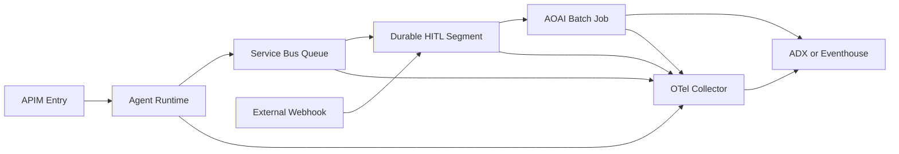
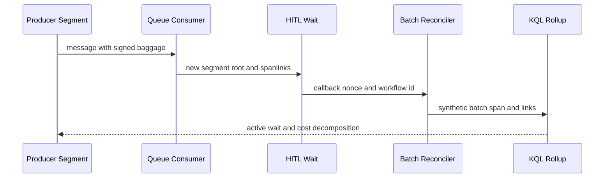

# Enterprise asynchronous agent trace continuity and FinOps attribution selection FAQ
> Topic ID: #472
> Section: 3.7 LLMOps observability and FinOps governance
> Audience: enterprise platform observability teams and cost governance teams
> Goal: preserve causal trace continuity across long async workflows and achieve end to end cost attribution

## 1 Production problem and trace break root causes
Synchronous HTTP paths usually fit a single `trace_id`, but enterprise agent systems cross queue fan out, batch completion, and human wait boundaries where native header propagation is frequently lost.
Typical boundaries include `Service Bus` batch consumers, multi day `Durable Functions` waits, `AOAI Batch` JSONL output, and external SaaS callbacks that strip or rewrite tracing headers.
If teams force one giant root span across hours or days, sampling windows are polluted by idle wait time and active compute latency SLOs become meaningless.
Batch fan in amplifies the issue because one consumer turn may represent dozens of producers, while single parent models keep one lineage and drop the rest.
FinOps integrity also degrades when tenant tags are carried in unsigned context fields, since forged callback payloads can pollute cross tenant chargeback.
A production design must therefore deliver async causality modeling, trusted context propagation, and durable cost reconstruction as one coherent control plane.

## 2 Why naive tracing fails in async pipelines
A naive parent child tree assumes short contiguous execution, which does not hold for queued processing, callback waits, and delayed batch completion.
When wait time extends from seconds to hours, collectors either decide too early and lose descendants or hold state too long and exceed memory limits.
Single parent correlation cannot represent `N` to `M` batch causality, so most upstream contributors disappear from the trace graph.
External callback systems often sanitize custom headers, which means trace continuity based only on network headers is fragile by design.
The practical fix is segment bounded tracing with link based causality and signed workflow context that survives transport boundaries.

## 3 Four architecture patterns
Pattern A uses segment roots with `SpanLinks`, signed `baggage`, and ADX or Eventhouse causal joins for enterprise async continuity.
Pattern B uses native Application Insights correlation for simpler short lived Azure PaaS chains with lower onboarding complexity.
Pattern C uses workflow ledger anchoring with durable callback tokens and leaf trace pointers for strong resilience against header stripping.
Pattern D is the anti pattern using monster traces, unsigned tenant tags, and missing batch linkage.

## 4 Twelve dimension quantified comparison matrix
| Dimension | Pattern A segment plus links | Pattern B native App Insights | Pattern C workflow ledger | Pattern D anti pattern |
|---|---|---|---|---|
| Async causality fidelity | above `99%` | `80` to `90%` | above `99%` | `45` to `65%` |
| `N` to `M` batch lineage | native | partial | strong | weak |
| `24h` wait separation | strong | medium | strong | weak |
| `AOAI Batch` attribution | `99.9%` | `60` to `75%` | above `98%` | `50` to `65%` |
| External callback survival | strong | weak to medium | strong | weak |
| Collector memory pressure | low to medium | medium | medium | high |
| Query latency at scale | `2` to `6 s` | `3` to `9 s` | `4` to `10 s` | unstable |
| Tenant isolation trust | high | medium | high | low |
| Operational complexity | medium | low to medium | medium high | low early high later |
| Audit explainability | strong | medium | strong | weak |
| Three year blended TCO | `3M` to `12M` | `2M` to `10M` | `4M` to `14M` | `5M` to `16M` |
| Recommendation | async enterprise primary | short flow supplement | strong compliance extension | disallow and migrate |

## 5 Pattern A segment and span link primary path
Pattern A splits long workflows into short active segments so sampling decisions are made in bounded windows rather than over day long idle periods.
Cross segment causality is expressed with `SpanLinks`, allowing one consumer span to preserve many producer contexts without forcing invalid single parent compression.
Trusted context travels in signed `baggage` envelopes carrying `workflow_run_id`, `tenant_id`, and budget fields, and each receiver verifies signature before accepting attributes.
Batch jobs encode workflow metadata into `custom_id`, then batch output reconciliation emits synthetic spans linked back to originating segment contexts.
This pattern keeps active latency, queue lag, and human wait analytically separable while preserving near complete FinOps attribution coverage.

## 6 Pattern B native correlation path
Pattern B gives fast onboarding through platform native SDK behavior and works well for minute scale chains inside homogeneous Azure services.
Its limits emerge in multi day waits, external callback hops, and large batch fan in where correlation gaps appear without custom join logic.
For teams with short horizons and constrained complexity budgets, Pattern B can be an interim baseline before introducing Pattern A controls.

## 7 Pattern C workflow ledger path
Pattern C anchors causality in a durable ledger where callback tokens map events to `workflow_run_id` and leaf trace identifiers.
Because continuity is persisted in storage, this path is resilient when external systems drop tracing headers or delay responses across days.
The tradeoff is added model and query complexity because waterfall style views require federated joins between ledger and telemetry stores.

## 8 Pattern D anti pattern risk profile
Monster traces across long waits push collector memory and sampling logic into failure modes and degrade signal quality for true active latency.
Unsigned tenant context enables spoofing and billing contamination under adversarial or malformed callback conditions.
Missing batch links create large dark zones where cost and latency cannot be tied back to business workflow ownership.
These behaviors make anti pattern designs unsustainable for production governance.

## 9 Mermaid async trace continuity topology


## 10 Mermaid broken versus repaired sequence


## 11 Quantitative Q1 to Q6 worked examples
Q1 collector memory estimate.
Use `RAM = RPS * Bytes * Window`.
With `RPS = 1200` and `Bytes = 5000`.
At `Window = 30 s`, memory is near `1.8 GB`.
At `Window = 3600 s`, memory rises near `216 GB` and risks OOM.
Q2 wall time decomposition.
Use `T_wall = T_active + T_queue + T_wait`.
This prevents `14` hour human waits from polluting active compute latency alerts.
Q3 attribution coverage metric.
Use `Coverage = Cost_attributed / Cost_total`.
Primary target should reach `99.9%`.
Q4 span link cardinality control.
Set per span link cap near `128`.
Shard by tenant and workflow step when fan in exceeds cap.
Q5 signed context benefit.
Unsigned context can be forged in callback channels.
HMAC verification blocks forged tenant tags before ingestion.
Q6 alert separation strategy.
Active latency alerts track `T_active` percentiles.
Wait alerts track `T_wait` percentiles to reduce false paging noise.

## 12 Code block one async segment and span link consumer
```python
from opentelemetry.trace import Link

def verify_baggage(payload, secret):
    base = payload.get("base", "")
    sign = payload.get("sig", "")
    expected = hmac_sha256(base, secret)
    return sign == expected

def start_consumer_segment(tracer, parent_contexts, baggage_obj, secret):
    if not verify_baggage(baggage_obj, secret):
        raise RuntimeError("forged baggage blocked")
    links = []
    for ctx in parent_contexts:
        link_obj = Link(ctx)
        links.append(link_obj)
    with tracer.start_as_current_span("sb_consumer_segment", links=links) as span:
        span.set_attribute("workflow_run_id", baggage_obj["workflow"])
        span.set_attribute("tenant_id", baggage_obj["tenant"])
        span.set_attribute("budget_id", baggage_obj["budget"])
        span.set_attribute("segment_kind", "queue_consume")
        return span.get_span_context()

def hmac_sha256(text, secret):
    payload = text + secret
    encoded = payload.encode("utf-8")
    digest = hashlib.sha256(encoded)
    token = digest.hexdigest()
    return token[:16]
```

## 13 Code block two batch custom id envelope and reconciler
```python
def encode_custom_id(workflow_id, step_id, tenant_id, secret):
    base = workflow_id + "|" + step_id + "|" + tenant_id
    sign = hmac_sha256(base, secret)
    return base + "|" + sign

def parse_custom_id(custom_id):
    parts = custom_id.split("|")
    return {
        "workflow": parts[0],
        "step": parts[1],
        "tenant": parts[2],
        "sig": parts[3],
    }

def reconcile_batch_output(rows, tracer, secret):
    for row in rows:
        meta = parse_custom_id(row["custom_id"])
        base_text = meta["workflow"] + "|" + meta["step"] + "|" + meta["tenant"]
        envelope = {"base": base_text, "sig": meta["sig"]}
        if not verify_baggage(envelope, secret):
            continue
        with tracer.start_as_current_span("gen_ai_batch_completion") as span:
            span.set_attribute("workflow_run_id", meta["workflow"])
            span.set_attribute("tenant_id", meta["tenant"])
            span.set_attribute("token_input", row["usage_in"])
            span.set_attribute("token_output", row["usage_out"])
```

## 14 Code block three KQL active wait and cost decomposition
```kql
let Base = traces
| where timestamp > ago(1d)
| where isnotempty(customDimensions.workflow_run_id)
| extend tenant = tostring(customDimensions.tenant_id)
| extend wf = tostring(customDimensions.workflow_run_id)
| extend kind = tostring(customDimensions.segment_kind)
| extend usd = todouble(customDimensions.usd_cost)
| project timestamp, name, durationMs, tenant, wf, kind, usd;
let Active = Base
| where kind in ("runtime_exec","queue_consume","batch_reconcile")
| summarize p95_active_agent_ms=percentile(durationMs,95) by tenant;
let Wait = Base
| where kind in ("hitl_wait","callback_wait")
| summarize p95_hitl_wait_min=percentile(durationMs,95) / 60000.0 by tenant;
let Queue = Base
| where kind == "queue_lag"
| summarize p95_queue_lag_ms=percentile(durationMs,95) by tenant;
let Cost = Base
| summarize usd_total=sum(usd) by tenant;
Active
| join kind=leftouter Wait on tenant
| join kind=leftouter Queue on tenant
| join kind=leftouter Cost on tenant
| project tenant, p95_active_agent_ms, p95_queue_lag_ms, p95_hitl_wait_min, usd_total
```

## 15 Enterprise scenarios and three year TCO
### 15.1 Scenario A global insurance underwriting and claims
This platform executes about `85K` multi day workflows per day across queue fan out, durable approvals, external callbacks, and nightly batch extraction.
After deploying Pattern A plus Pattern C, dark batch cost dropped, collector memory pressure decreased, and false latency pages during overnight human waits were largely eliminated.
Teams now separate active compute from wait latency in one governance dashboard and resolve incidents with stronger causal evidence.
### 15.2 Scenario B enterprise IT service desk automation
This environment combines Event Grid, Service Bus, and ServiceNow callbacks and uses Pattern B plus Pattern A to balance onboarding speed with robust async continuity.
Tenant level cost attribution coverage improved, callback trace survivability increased, and monthly chargeback reconciliation effort decreased.
### 15.3 Three tier three year blended TCO
| Tier | Daily workflow volume | Recommended mix | Three year blended TCO |
|---|---:|---|---:|
| Tier 1 | `10K` | Pattern B plus A | `3M` USD |
| Tier 2 | `85K` | Pattern A primary | `8M` USD |
| Tier 3 | `200K` | Pattern A plus C | `12M` USD |
### 15.4 D0 D1 D2 runbook with 18 actions
- **D0-1** Define segment boundaries and active window limits.
- **D0-2** Define signed `baggage` fields and key rotation policy.
- **D0-3** Define `SpanLinks` cap and sharding strategy.
- **D0-4** Define batch `custom_id` encoding contract.
- **D0-5** Define callback nonce ledger and expiry control.
- **D0-6** Define active and wait dual alert semantics.
- **D1-1** Deploy queue consumer segment root implementation.
- **D1-2** Deploy batch reconciler link backfill pipeline.
- **D1-3** Deploy signed context verification guardrail.
- **D1-4** Run `N` to `M` fan in replay stress tests.
- **D1-5** Run cross tenant spoofing red team scenarios.
- **D1-6** Publish active wait cost triple dashboard.
- **D2-1** Review weekly trace break samples and repair rate.
- **D2-2** Review weekly dark cost and billing drift metrics.
- **D2-3** Review monthly collector memory and drop rates.
- **D2-4** Review monthly key rotation and invalidation windows.
- **D2-5** Run quarterly callback disaster recovery drills.
- **D2-6** Optimize quarterly architecture mix and budget profile.
This runbook requires SRE and finance teams to share one attribution dictionary so incident dashboards and chargeback reports remain aligned on one source of truth.
Weekly reviews should classify trace break samples by queue boundary, batch boundary, and callback boundary, then convert fixes into reusable playbooks.
Multi region deployments should validate key rotation propagation and ledger replication consistency to avoid temporary signature failures during failover windows.
When batch throughput spikes, scale reconciliation workers and query cache first instead of extending sampling windows that increase collector instability risk.
For external callback ecosystems, keep staged allow lists and replay sandboxes so token mapping and causal join logic are validated before full traffic exposure.
Quarterly governance should jointly inspect active latency, queue lag, human wait, and attribution coverage with business event context to avoid optimizing the wrong signal.
The objective is not one visually clean chart but a durable operating state where async workflows remain observable attributable explainable and auditable under stress.
If coverage declines or trace breaks rise for two consecutive weeks, trigger focused remediation and freeze high risk config changes until thresholds recover.
Codify replay scripts and incident samples into onboarding materials so new operators can execute cross boundary trace recovery procedures quickly during night shifts.
Budget sensitive tenants can apply tiered sampling while preserving critical lineage, balancing telemetry precision with storage cost discipline.
During audit windows, temporarily raise sampling density for priority tenants and shorten report refresh cadence, then revert to baseline after completion.
Platform contracts should explicitly reject unsigned tenant context at ingestion boundaries so billing identity remains trustworthy across all integration styles.
Long term operations can include trace health scoring in service objectives, making observability quality a first class reliability commitment.
Major cross system migrations should include callback contract rehearsal and ledger migration stress tests to prevent historical lineage gaps after cutover.
Sustained execution of these controls turns async agent operations from opaque firefighting into evidence driven governance with predictable cost and risk posture.

Sources fetched on 2026 11 27
OpenTelemetry specification and span links
https://opentelemetry.io/docs/specs/otel/trace/api
W3C Trace Context and baggage
https://www.w3.org/TR/trace-context
Azure Service Bus messaging overview
https://learn.microsoft.com/azure/service-bus-messaging/service-bus-messaging-overview
Azure OpenAI batch processing
https://learn.microsoft.com/azure/ai-services/openai/how-to/batch
Azure Data Explorer KQL basics
https://learn.microsoft.com/azure/data-explorer/kusto/query
