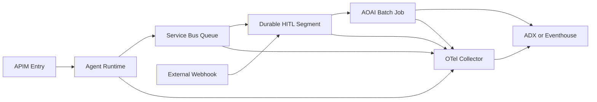
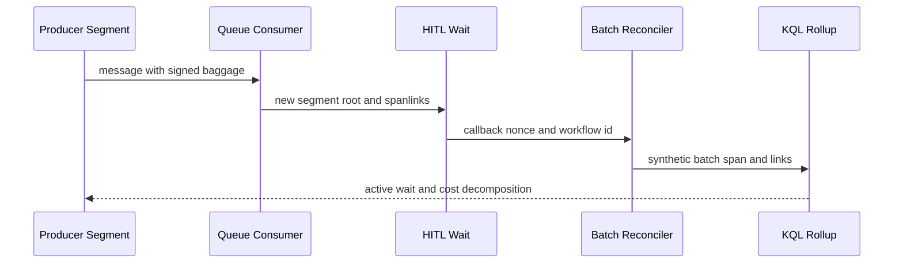

# 企业异步智能体分布式链路连续性与成本归因选型 FAQ
> Topic ID: #472
> Section: 3.7 LLMOps 可观测与 FinOps 治理
> Audience: 企业平台可观测团队与成本治理团队
> Goal: 在多日异步工作流中保持链路可追溯并实现端到端成本归因

## 1 生产问题与观测断裂根因
同步 HTTP 请求通常能落在单一 `trace_id` 内完成闭环，但企业生产中的智能体工作流跨越消息队列、批处理作业与人工审批等待，链路连续性会在多个边界被天然打断。
常见边界包括 `Service Bus` 批量消费、`Durable Functions` 长时等待、`AOAI Batch` 离线 JSONL 回包以及外部 SaaS 回调，这些边界往往无法稳定保留原始 `traceparent`。
若强行把多小时甚至多天流程塞进一个超级根链路，采样窗口会被等待时间污染，活跃计算与人审空闲混在一起，告警系统会把流程闲置误判为计算延迟劣化。
批量扇入扇出会进一步放大问题，一个消费者批次可能对应几十个上游生产者，单父子模型无法表达多因果来源，最终导致大比例链路失联和成本暗区。
FinOps 归因同样受损，若租户标记只放在不可信头字段，外部回调或恶意请求可伪造 `tenant_id`，造成跨租户计费污染并触发审计争议。
因此生产架构必须同时解决三项任务，即异步因果表达、可信上下文传播、长周期成本重建，缺一都会让可观测和成本治理在规模化阶段失真。

## 2 朴素追踪模型为何在异步链路失效
朴素模型依赖单条父子跨度树，假设上下游调用在短时间内连续完成，这在同步服务可成立，但在批处理和人审等待中会被事实打破。
当等待时间从秒级扩展到小时级，采样器要么提前做决策丢失后续节点，要么把窗口拉长到不可承受的内存规模，导致采集面先于业务面崩溃。
即使保留了部分链路，单父结构也无法准确表达 `N` 对 `M` 的批次关系，队列消费端只能选择一个父上下文，其余因果来源在图中消失。
外部回调场景更复杂，很多第三方会清洗或重写自定义头，若系统只信任网络头字段，回调链路常在边界处断裂，结果是看板可见性与真实执行分离。
要恢复完整视图，系统必须把追踪从单树模型升级为分段加链接模型，并引入可验签上下文与持久化工作流标识，形成跨边界重建能力。

## 3 四种架构路径总览
Pattern A 采用分段根跨度与 `SpanLinks`，用签名 `baggage` 在队列与批处理边界携带可信业务上下文，并在 ADX 或 Eventhouse 做因果重建。
Pattern B 采用 Application Insights 原生链路能力，适合中短流程和同构 Azure PaaS 场景，优势是接入快，限制是跨日异步与批处理相关性补全能力有限。
Pattern C 采用工作流账本主导，把因果关系持久化到数据库，再把叶子链路回填到分析层，强项是抗头字段丢失，弱项是默认瀑布视图拼接成本更高。
Pattern D 是反模式，依赖超长单根链路和未签名上下文传播，结果是采样失效、归因污染、跨租户风险同时出现。

## 4 十二维量化对比矩阵
| 维度 | Pattern A 分段加 SpanLinks | Pattern B App Insights 原生 | Pattern C 工作流账本主导 | Pattern D 反模式 |
|---|---|---|---|---|
| 异步因果保真 | `99%` 以上 | `80` 到 `90%` | `99%` 以上 | `45` 到 `65%` |
| `N` 对 `M` 批次扇入表达 | 原生支持 | 部分支持 | 强支持 | 弱支持 |
| `24h` 等待与活跃分离 | 强 | 中 | 强 | 弱 |
| `AOAI Batch` 归因覆盖 | `99.9%` | `60` 到 `75%` | `98%` 以上 | `50` 到 `65%` |
| 外部回调抗丢头 | 强 | 弱到中 | 强 | 弱 |
| 采样器内存占用 | 低到中 | 中 | 中 | 高 |
| 查询延迟百亿级别前 | `2` 到 `6 s` | `3` 到 `9 s` | `4` 到 `10 s` | 不稳定 |
| 租户隔离可信度 | 高 | 中 | 高 | 低 |
| 运营复杂度 | 中 | 低到中 | 中高 | 表面低后期高 |
| 审计可解释性 | 强 | 中 | 强 | 弱 |
| 三年综合 TCO | `3M` 到 `12M` | `2M` 到 `10M` | `4M` 到 `14M` | `5M` 到 `16M` |
| 推荐结论 | 企业异步主路径 | 中短流程补充 | 强合规增强路径 | 禁用并迁移 |

## 5 Pattern A 分段与链接主路径
Pattern A 把长流程切成可采样的短段，每段只覆盖活跃计算窗口，避免等待时间占据采样器内存，同时保留可追踪的段间因果关系。
段间关系通过 `SpanLinks` 表达，一个消费批次可以链接多个生产段上下文，避免单父结构丢失多数来源的问题。
业务上下文通过签名 `baggage` 封装传递，内容通常包括 `workflow_run_id`、`tenant_id`、`budget_id` 和签名值，接收端先验签再入链路。
批处理作业通过 `custom_id` 映射回工作流步骤，结果回包时生成合成跨度并链接原段上下文，确保离线 token 消耗不会落入黑盒。
该模式在保持观测精度的同时控制资源开销，通常是企业跨队列跨批处理异步平台的首选实现。

## 6 Pattern B 原生相关性路径
Pattern B 依赖平台原生相关性机制，接入成本低，适合流程时长较短且主要运行在同构托管服务内的应用。
在分钟级消息链路中，它能快速提供端到端看板和基础告警，但在多日等待和外部回调清洗场景下容易出现链路碎片化。
若业务没有大规模批处理扇入扇出需求，Pattern B 可以作为早期落地路径，并在后续扩展阶段逐步引入 Pattern A 的段间链接能力。

## 7 Pattern C 工作流账本路径
Pattern C 把因果关系锚定在持久化账本里，通过回调令牌把外部事件映射到内部 `workflow_run_id`，天然适合长周期审批和第三方系统回调场景。
该模式对头字段丢失不敏感，哪怕外部系统不回传追踪头，平台仍可通过账本键完成因果重建，保证审计链条完整。
代价是即时瀑布视图需要额外拼接查询，工程上要同时维护账本模型和观测模型，适合作为强合规场景的增强路径。

## 8 Pattern D 反模式风险
反模式第一类是把一个根跨度跨天保持打开，采样器要么提前丢弃后续数据，要么为等待窗口支付巨额内存，最终导致采集系统先失效。
反模式第二类是信任未签名租户标识，外部请求可伪造计费上下文，跨租户归因污染会直接触发财务与审计争议。
反模式第三类是忽略批次多因果链接，仅保留一个父上下文，导致大批成本和延迟数据失去来源归属，运营决策缺乏依据。
因此反模式必须尽快迁移，生产新建系统不应再采用。

## 9 Mermaid 异步链路连续性拓扑


## 10 Mermaid 断裂链路与修复对照


## 11 量化推导 Q1 到 Q6
Q1 采样器内存估算。
公式可写为 `RAM = RPS * Bytes * Window`。
设 `RPS = 1200`，每跨度 `Bytes = 5000`。
当窗口 `Window = 30 s` 时，内存约 `1.8 GB`。
若误设为 `3600 s`，内存约 `216 GB`，会触发 OOM 风险。
Q2 壁钟时间分解。
`T_wall = T_active + T_queue + T_wait`。
该分解可避免把 `14` 小时人工等待误报为计算延迟。
Q3 归因覆盖率。
`Coverage = Cost_attributed / Cost_total`。
主路径目标应达到 `99.9%`。
Q4 批次链接上限。
每跨度链接上限可设为 `128`。
超限时可按租户和步骤做分片聚合。
Q5 签名验证收益。
未签名上下文在压测中可出现跨租户污染。
启用 HMAC 验签后伪造请求可在入口被拒绝。
Q6 告警抑制策略。
活跃延迟告警只看 `T_active` 百分位。
等待告警单独看 `T_wait` 百分位，避免混合告警噪声。

## 12 代码块一 分段传播与 SpanLinks 消费者
```python
from opentelemetry.trace import Link

def verify_baggage(payload, secret):
    base = payload.get("base", "")
    sign = payload.get("sig", "")
    expected = hmac_sha256(base, secret)
    return sign == expected

def start_consumer_segment(tracer, parent_contexts, baggage_obj, secret):
    if not verify_baggage(baggage_obj, secret):
        raise RuntimeError("forged baggage blocked")
    links = []
    for ctx in parent_contexts:
        link_obj = Link(ctx)
        links.append(link_obj)
    with tracer.start_as_current_span("sb_consumer_segment", links=links) as span:
        span.set_attribute("workflow_run_id", baggage_obj["workflow"])
        span.set_attribute("tenant_id", baggage_obj["tenant"])
        span.set_attribute("budget_id", baggage_obj["budget"])
        span.set_attribute("segment_kind", "queue_consume")
        return span.get_span_context()

def hmac_sha256(text, secret):
    payload = text + secret
    encoded = payload.encode("utf-8")
    digest = hashlib.sha256(encoded)
    token = digest.hexdigest()
    return token[:16]
```

## 13 代码块二 Batch custom_id 编码与回包重建
```python
def encode_custom_id(workflow_id, step_id, tenant_id, secret):
    base = workflow_id + "|" + step_id + "|" + tenant_id
    sign = hmac_sha256(base, secret)
    return base + "|" + sign

def parse_custom_id(custom_id):
    parts = custom_id.split("|")
    return {
        "workflow": parts[0],
        "step": parts[1],
        "tenant": parts[2],
        "sig": parts[3],
    }

def reconcile_batch_output(rows, tracer, secret):
    for row in rows:
        meta = parse_custom_id(row["custom_id"])
        base_text = meta["workflow"] + "|" + meta["step"] + "|" + meta["tenant"]
        envelope = {"base": base_text, "sig": meta["sig"]}
        if not verify_baggage(envelope, secret):
            continue
        with tracer.start_as_current_span("gen_ai_batch_completion") as span:
            span.set_attribute("workflow_run_id", meta["workflow"])
            span.set_attribute("tenant_id", meta["tenant"])
            span.set_attribute("token_input", row["usage_in"])
            span.set_attribute("token_output", row["usage_out"])
```

## 14 代码块三 KQL 活跃与等待拆解查询
```kql
let Base = traces
| where timestamp > ago(1d)
| where isnotempty(customDimensions.workflow_run_id)
| extend tenant = tostring(customDimensions.tenant_id)
| extend wf = tostring(customDimensions.workflow_run_id)
| extend kind = tostring(customDimensions.segment_kind)
| extend usd = todouble(customDimensions.usd_cost)
| project timestamp, name, durationMs, tenant, wf, kind, usd;
let Active = Base
| where kind in ("runtime_exec","queue_consume","batch_reconcile")
| summarize p95_active_agent_ms=percentile(durationMs,95) by tenant;
let Wait = Base
| where kind in ("hitl_wait","callback_wait")
| summarize p95_hitl_wait_min=percentile(durationMs,95) / 60000.0 by tenant;
let Queue = Base
| where kind == "queue_lag"
| summarize p95_queue_lag_ms=percentile(durationMs,95) by tenant;
let Cost = Base
| summarize usd_total=sum(usd) by tenant;
Active
| join kind=leftouter Wait on tenant
| join kind=leftouter Queue on tenant
| join kind=leftouter Cost on tenant
| project tenant, p95_active_agent_ms, p95_queue_lag_ms, p95_hitl_wait_min, usd_total
```

## 15 企业落地场景与三年 TCO
### 15.1 场景 A 全球保险核保与理赔编排
该平台每天处理约 `8.5` 万个多日流程，跨越队列、审批与批处理边界，历史上批量回包成本暗区高且告警噪声大，值班团队难以快速定位真实瓶颈。
采用 Pattern A 加 Pattern C 后，平台把批次因果重建与账本回调令牌统一，批处理成本暗区显著缩小，采集器内存压力下降并消除夜间假性延迟告警。
运营团队可分离观察活跃计算、队列滞留与人工等待三条曲线，排障动作从经验驱动转为证据驱动，跨团队协作效率明显提升。
### 15.2 场景 B 企业 IT 服务台异步自动化
该场景同时接入 Event Grid 与 ServiceNow 回调，采用 Pattern B 加 Pattern A 组合，在中短流程保持快速接入，在批次与外部回调边界启用签名上下文与链接重建。
改造后租户级成本归因覆盖率提升，跨系统回调链路可见性增强，月度成本复核与 SLA 复盘时间显著下降。
### 15.3 三档三年综合 TCO
| 档位 | 日流程规模 | 推荐组合 | 三年综合 TCO |
|---|---:|---|---:|
| Tier 1 | `1` 万 | Pattern B 加 A | `3M` 美元 |
| Tier 2 | `8.5` 万 | Pattern A 主路径 | `8M` 美元 |
| Tier 3 | `20` 万 | Pattern A 加 C | `12M` 美元 |
### 15.4 D0 D1 D2 运行手册共 18 项
- **D0-1** 定义分段边界与活跃窗口上限。
- **D0-2** 定义 `baggage` 签名字段与密钥轮换策略。
- **D0-3** 定义 `SpanLinks` 上限与分片规则。
- **D0-4** 定义 Batch `custom_id` 编码规范。
- **D0-5** 定义账本回调令牌与过期策略。
- **D0-6** 定义活跃与等待双告警口径。
- **D1-1** 上线队列消费者分段根跨度逻辑。
- **D1-2** 上线批处理回包重建与链接回填。
- **D1-3** 上线签名验证失败拦截策略。
- **D1-4** 执行 `N` 对 `M` 批次压测与回放。
- **D1-5** 执行跨租户伪造请求攻防演练。
- **D1-6** 发布活跃等待成本三维看板。
- **D2-1** 每周复核链路断裂样本与修复率。
- **D2-2** 每周复核成本暗区与账单偏差。
- **D2-3** 每月复核采样器内存与丢弃率。
- **D2-4** 每月复核签名轮换与失效窗口。
- **D2-5** 每季度执行跨系统回调灾备演练。
- **D2-6** 每季度优化路径组合与预算结构。
该手册要求值班与财务团队统一使用同一归因口径，避免运行报表和结算报表出现定义冲突，确保告警处置与成本核销可以在同一事实基线下对齐。
建议在每周例会上固定复盘链路断裂样本，按队列边界批次边界回调边界分类沉淀修复模板，逐步降低重复事故对一线团队的认知负担。
对于跨区域部署，应额外检查密钥轮换传播时延与账本复制一致性，防止区域切换期间出现短暂验签失败导致的归因漏记问题。
当批处理吞吐突增时，平台应优先扩展重建并发与查询缓存，而不是盲目延长采样窗口，以避免把观测开销转化为新一轮稳定性风险。
对外部回调系统建议建立灰度白名单和重放沙箱，先验证令牌映射与链路拼接正确，再放开到全量流量，减少生产时段试错成本。
季度评审中应联合检查活跃延迟、队列滞留、人工等待、成本覆盖率四类指标，并关联业务事件波动，确保优化动作聚焦真实瓶颈而非表面波动。
治理目标不是追求单一看板漂亮数字，而是让异步智能体平台在长周期复杂编排下仍保持可观测、可归因、可解释、可审计的工程稳态。
当出现连续两周覆盖率下降或链路断裂抬头，必须触发专项整改窗口并冻结高风险配置变更，直至关键指标恢复到控制阈值以内。
建议把常见故障演练脚本与回放样本纳入入职训练，使新同学能够在最短时间掌握跨边界链路修复套路，提升夜间值班响应质量。
对于预算敏感业务线，可按租户建立分层采样策略，在保证核心链路可追溯前提下降低非关键流量存储成本，实现精度与成本平衡。
在审计高峰期可临时提升关键租户采样比例并缩短报表刷新周期，待窗口结束后恢复常态策略，兼顾合规响应速度与系统总体开销。
平台接口规范应明确禁止未签名租户字段入链路，所有外部入口统一走验签网关，确保计费上下文在任何接入模式下都具备一致可信度。
长期运营中可将链路健康评分纳入服务等级协议，促使业务与平台共同关注观测质量，不再把可追溯性视作可选项而是基础能力。
若发生跨系统大规模变更，应提前进行回调契约演练与账本迁移压测，避免上线后出现历史关联断裂导致大面积人工对账。
通过持续运行这些治理动作，企业可以把异步智能体从黑盒运维转向白盒运维，在效率、风险与成本之间形成可持续的动态平衡。

来源抓取日期 2026 11 27
OpenTelemetry specification and span links
https://opentelemetry.io/docs/specs/otel/trace/api
W3C Trace Context and baggage
https://www.w3.org/TR/trace-context
Azure Service Bus messaging overview
https://learn.microsoft.com/azure/service-bus-messaging/service-bus-messaging-overview
Azure OpenAI batch processing
https://learn.microsoft.com/azure/ai-services/openai/how-to/batch
Azure Data Explorer KQL basics
https://learn.microsoft.com/azure/data-explorer/kusto/query
